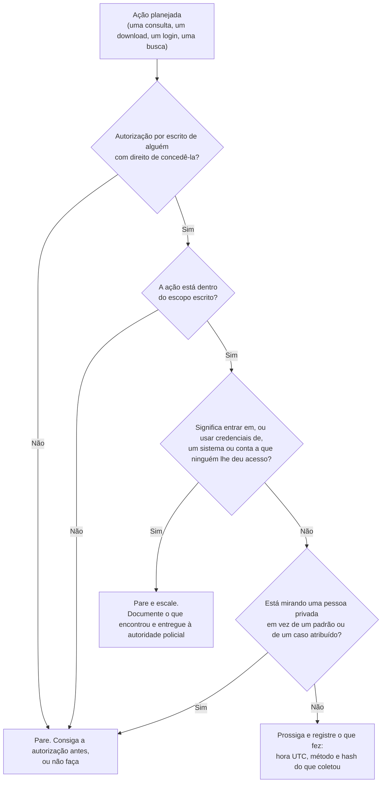

# Dia 01: O que faz um investigador, e a linha que você não cruza

> 🇺🇸 Original: [*Day 1: What an investigator does, and the line you don't cross*](https://github.com/thiefdroppers/cyber-investigator-skills/blob/main/curriculum/phase-1-foundations/day-01.md) — © ThiefDroppers, licença MIT.
> Aqui: tradução fiel **+** camada brasileira. Nada do original foi removido; tudo o que é novo vem marcado com ➕.

**Fase 1. Fundamentos** · Meta da trilha: saber qual é o trabalho do investigador, onde fica a fronteira legal e ética, e montar o acompanhamento que você vai usar nos próximos 89 dias.

Rank Jutsu: `D` · [](https://colab.research.google.com/github/Ridd1kulusC0d3r/investigador-cyber-90-dias/blob/main/curriculo/fase-1-fundamentos/dia-01/dia-01.ipynb)

---

## 🎬 ➕ Abertura do caso — *A ligação das 11h05*

Seu crachá da Vigia ainda nem chegou. Rafa encosta na sua mesa com o notebook aberto e um print de SMS na tela: *"Serra Azul: sua chave Pix foi bloqueada por segurança. Regularize em serraazul-pix.example"*.

— Trinta e sete reclamações em duas horas. Três cooperados já perderam dinheiro. O contrato foi assinado agora há pouco. É seu.

Você já está com o terminal aberto, os dedos coçando para rodar um `dig`. Rafa fecha a tampa do seu notebook com um dedo.

— Antes de qualquer comando: o que você **pode** fazer nesse caso? Me mostra por escrito.

É isso que o Dia 1 ensina. *(Personagens e cenário: [Operação Isca](../../../caso-continuo/).)*

---

## 📖 Conceito

Um investigador cibernético estabelece o que aconteceu, como aconteceu e o que estava envolvido, e faz isso com cuidado suficiente para que a conclusão sobreviva a alguém tentando provar que ela está errada. Um *pentester* procura fraquezas antes que um atacante as encontre. Quem faz resposta a incidentes contém um incidente em andamento e restabelece o serviço. O investigador se sobrepõe aos dois, mas o produto dele é outro: um achado que outra pessoa consegue conferir, passo a passo, da evidência bruta até a conclusão.

Esse produto depende de disciplina de evidência. "Tenho quase certeza de que o login veio do exterior" é uma opinião. "O log de acesso exportado às 14:02 UTC mostra um login bem-sucedido a partir de 203.0.113.45, que o próprio campo de geolocalização do provedor indica como fora do país, e aqui está o SHA-256 da exportação" é um achado. O Dia 2 transforma isso em rotina.

A autorização decide se qualquer parte do trabalho é lícita. Puxar registros DNS, ler um log ou procurar um *username* em várias plataformas pode ser trabalho rotineiro de um caso num contexto, e crime ou violação de privacidade em outro. A técnica é a mesma nos dois. A diferença é se alguém com o direito de conceder acesso deu a você um motivo legítimo para olhar, e se o que você está fazendo permanece dentro desse motivo.

Na maioria das jurisdições, a lei gira em torno da autorização. Nos Estados Unidos, o *Computer Fraud and Abuse Act*, em 18 U.S.C. § 1030(a)(2), torna crime acessar intencionalmente um computador "sem autorização" ou "excedendo o acesso autorizado" e, com isso, obter informação. Em *Van Buren v. United States* (2021), a Suprema Corte interpretou "excede o acesso autorizado" de forma restrita: cobre entrar em partes de um sistema (arquivos, pastas, bancos de dados) que estão fora do seu alcance, e não o mau uso de dados que você tinha direito de ver. Essa restrição não ajuda o investigador que entra num sistema ao qual nunca recebeu acesso. O *Computer Misuse Act 1990* do Reino Unido, seção 1, e o Código Penal do Canadá, seção 342.1, traçam a mesma linha básica.

O trabalho com fraude e abuso acrescenta mais uma regra: **cace padrões, não pessoas**. Um bom produto investigativo descreve uma tática (o roteiro de um golpe de recrutamento, um *kit* de phishing, a infraestrutura que uma campanha de golpe reaproveita) que protege muitas pessoas de uma vez. Montar o perfil de uma pessoa privada por curiosidade, sem um caso sancionado por trás, é onde a investigação vira perseguição. Se você perceber que está pesquisando uma pessoa em vez de um padrão ou de um caso atribuído, pare e pergunte por quê.

Faça estas quatro checagens antes de cada ação em um caso. Todo veredito da tabela da Parte 2, mais abaixo, sai delas.



## 📚 Recursos

- [18 U.S.C. § 1030, texto integral (Cornell LII)](https://www.law.cornell.edu/uscode/text/18/1030). Leia a subseção (a)(2) e as definições em (e)(6).
- [Van Buren v. United States, decisão (PDF)](https://www.supremecourt.gov/opinions/20pdf/19-783_k53l.pdf). A ementa (*syllabus*) das primeiras páginas basta.
- [UK Computer Misuse Act 1990, seção 1](https://www.legislation.gov.uk/ukpga/1990/18/section/1) e [Código Penal do Canadá, seção 342.1](https://laws-lois.justice.gc.ca/eng/acts/c-46/section-342.1.html). Escolha o que se aplica onde você mora, ou encontre o equivalente do seu país.
- [Código de Ética do EC-Council](https://www.eccouncil.org/code-of-ethics/): uma declaração curta de conduta profissional que vale tendo você a certificação ou não.
- [OSINT Framework](https://osintframework.com/): navegue para ver o tamanho da Fase 2. Não rode nenhuma ferramenta ainda.

### ➕ Recursos do contexto Brasil

O "encontre o equivalente do seu país" do original, resolvido:

- [Lei 12.737/2012 ("Lei Carolina Dieckmann")](https://www.planalto.gov.br/ccivil_03/_ato2011-2014/2012/lei/l12737.htm): criou o art. 154-A do Código Penal, invasão de dispositivo informático.
- [Código Penal compilado](https://www.planalto.gov.br/ccivil_03/decreto-lei/del2848compilado.htm): leia o art. 154-A (com a redação dada pela Lei 14.155/2021) e o art. 147-A (perseguição).
- [Lei 14.132/2021](https://www.planalto.gov.br/ccivil_03/_ato2019-2022/2021/lei/l14132.htm): criou o crime de perseguição (*stalking*).
- [LGPD — Lei 13.709/2018](https://www.planalto.gov.br/ccivil_03/_ato2015-2018/2018/lei/l13709.htm): arts. 4º (onde a lei *não* se aplica) e 7º (bases legais).
- [Marco Civil da Internet — Lei 12.965/2014](https://www.planalto.gov.br/ccivil_03/_ato2011-2014/2014/lei/l12965.htm): arts. 10 e 22 (quem pode obter registros de conexão e de acesso, e como).
- [OSINT Brazuca](https://github.com/osintbrazuca/osint-brazuca): o "OSINT Framework" com fontes brasileiras. Mesmo aviso: só navegue.

## 🛠️ Prática: quadro de progresso no GitHub Projects e um registro de autorização preenchido

**Seu checklist de hoje.** Faça na ordem e marque cada item ao terminar:

- [ ] Parte 1: o quadro de progresso
- [ ] Parte 2: exemplo resolvido de ações autorizadas e não autorizadas
- [ ] Parte 3: seu registro de autorização
- [ ] ➕ Parte 4: a mesma régua no caso brasileiro (Operação Isca)
- [ ] ➕ Parte 5: o notebook do dia no Colab

### Parte 1: o quadro de progresso

1. Faça um *fork* deste repositório (ou crie um repositório privado seu).
2. No seu *fork*, abra a aba **Projects**, escolha **New project** e selecione o modelo **Board**.
3. Renomeie as colunas padrão para `Não iniciado`, `Em andamento` e `Artefato construído`.
4. Adicione um item de rascunho por dia (`Dia 01` a `Dia 90`) pela caixa "Add item" no fim da coluna `Não iniciado`. Se digitar 90 itens for cansativo, adicione agora os 18 dias da Fase 1 e o restante no início de cada fase.
5. Crie um campo personalizado chamado `Artefato` (tipo: Text). Ao terminar um dia, cole ali o caminho ou link do artefato antes de mover o cartão.

Um cartão só vai para `Artefato construído` quando o campo Artefato aponta para algo que existe. Ler um dia não o conclui.

> ➕ Atalho: o arquivo [`curriculo/mapa-dos-dias.csv`](../../mapa-dos-dias.csv) já tem os 90 dias com título em português. Mude a coluna `status` e rode `python scripts/gerar_indice.py` para atualizar o índice do repositório.

### Parte 2: exemplo resolvido de ações autorizadas e não autorizadas

Leia o cenário e o veredito de cada ação antes de preencher o seu registro.

Uma cooperativa de crédito (fictícia, usando o domínio reservado `creditunion.example`) contrata você com uma carta de contratação assinada. Os associados estão recebendo mensagens de texto com link para `creditunion-login.example`, uma página imitação que coleta senhas do internet banking. Seu escopo escrito diz: "Identificar e documentar a infraestrutura de phishing que se passa pela cooperativa e preparar pedidos de derrubada (*takedown*). Não contatar suspeitos. Não acessar nenhum sistema que não pertença à cooperativa."

| Ação | Veredito | Por quê |
|---|---|---|
| Carregar a página de phishing num navegador de análise isolado e salvar o HTML e uma captura de tela | Autorizado | A página é servida publicamente, e documentá-la é o núcleo do escopo. |
| Rodar `dig creditunion-login.example` e consultar o registro do domínio | Autorizado | São registros públicos sobre a infraestrutura, exatamente o que o escopo nomeia. |
| Buscar nos logs de *Certificate Transparency* outros domínios imitação | Autorizado | Dado público, e serve ao propósito declarado de achar infraestrutura relacionada. |
| Encontrar um arquivo de configuração que o kit deixou exposto, ler a senha de administrador nele e entrar no painel do kit para ver quantas vítimas existem | Não autorizado | O painel pertence a outra pessoa, e ninguém com direito de conceder acesso lhe deu permissão. Ser propriedade de um criminoso não muda isso. Pelo § 1030, é acesso "sem autorização". Documente que o arquivo está exposto e entregue à autoridade policial. |
| Testar no site real do banco as credenciais de associados que o kit registrou, para ver quais funcionam | Não autorizado | Você estaria entrando em contas que pertencem a associados, que nunca consentiram. O time de fraude da cooperativa redefine essas contas pelo processo próprio. |
| Procurar os familiares do suposto operador do kit nas redes sociais | Não autorizado | Está fora do escopo e mira pessoas privadas em vez do padrão. |
| Descrever a estrutura da página do kit, o texto da isca e o padrão de hospedagem para que o time de fraude reconheça a próxima campanha | Autorizado, e é a coisa mais útil que você produz | Isto é o padrão, e protege todos os associados, não um só. |

A maioria das linhas não autorizadas pareceria útil no momento da tentação. Por isso, escreva o escopo antes de começar.

### Parte 3: seu registro de autorização

Crie `notas/registro-de-autorizacao.md` no seu *fork* com esta estrutura e preencha para o cenário acima como se você fosse o investigador:

```markdown
# Registro de autorização

Contrato / ID do caso:
Autorizado por (nome, cargo, organização):
Autoridade dessa pessoa para conceder acesso (por que ela pode dizer sim):
Data da autorização (UTC):
Evidência escrita da autorização (nome do arquivo + SHA-256):

## Dentro do escopo
- Sistemas / dados que posso examinar:
- Técnicas que posso usar:

## Fora do escopo
- Sistemas / dados que não posso tocar:
- Técnicas que não posso usar:
- Pessoas que não posso pesquisar:

## Condições de parada
- Se eu encontrar ______, eu paro e escalo para ______.

## Tratamento dos dados
- Onde a evidência fica guardada:
- Quem pode vê-la:
- Quando é apagada:
- ➕ Base legal LGPD do tratamento (art. 7º, inciso):
```

Depois, escreva sua resposta, em 3 a 5 frases, para esta pergunta: *o que me faria parar, mesmo que tecnicamente eu pudesse continuar?* Salve como `notas/minha-linha.md`. Você vai revisitá-la no checkpoint da Fase 5.

> ➕ Para o campo "Evidência escrita (SHA-256)": salve a carta de contratação e rode
> `python scripts/registrar_evidencia.py notas/carta-contratacao.pdf "carta de contratação Serra Azul"`.
> O script calcula o hash, anota a hora UTC e guarda tudo em `notas/registro-de-custodia.csv`.

### ➕ Parte 4: a mesma régua no caso brasileiro

Mesma lógica das quatro checagens, agora na Operação Isca. A Cooperativa Serra Azul assinou o contrato com a Vigia. Escopo escrito pela Marta Quintão: *"Identificar e documentar a infraestrutura do golpe do 'Pix bloqueado' que se passa pela Serra Azul, levantar o padrão das mensagens e preparar notificações de derrubada. Não contatar suspeitos. Não acessar sistemas de terceiros. Dados de cooperados só pelos canais internos da cooperativa."*

Cubra a coluna "Veredito" e tente responder antes de ler.

| Ação | Veredito | Por quê |
|---|---|---|
| Consultar o RDAP/WHOIS de `serraazul-pix.example` e o histórico de DNS | Autorizado | Registro público sobre a infraestrutura nomeada no escopo. (Se fosse `.br`, a fonte seria o RDAP do Registro.br.) |
| Mapear o padrão do SMS: número remetente, encurtador usado, texto exato, horário dos disparos | Autorizado, e o mais útil do dia | É o padrão. A cooperativa usa isso para alertar os 40 mil cooperados de uma vez. |
| Digitar no app do seu banco a chave Pix que aparece no kit, só para ver o nome do recebedor | Não autorizado (repasse) | O diretório de chaves existe para iniciar pagamentos, não para investigar recebedores, e o escopo diz que dados de terceiros correm pelos canais da cooperativa. Quem trata isso é o time de fraude da Serra Azul, pelos mecanismos entre instituições (como o MED, o Mecanismo Especial de Devolução do Pix). |
| Achar o arquivo `vitimas.txt` exposto no servidor do kit e baixá-lo "para avisar os cooperados" | Não autorizado | É sistema alheio e dado pessoal de terceiros. A boa intenção não cria autorização. Documente a URL e a exposição (sem baixar o conteúdo), e entregue à cooperativa e à polícia. |
| Pedir à hospedagem do site falso os logs de acesso com os IPs das vítimas | Não autorizado (o caminho é judicial) | Pelo Marco Civil, o provedor só é obrigado a fornecer registros de acesso mediante ordem judicial (art. 10, §1º; o pedido em juízo segue o art. 22). Você faz a notificação de abuso e pede preservação. |
| Entrar com seu WhatsApp pessoal no grupo onde o kit "Serra Azul" é vendido | Não autorizado | Fora do escopo escrito, expõe você e o caso, e perfil de fachada só com autorização específica (é o Dia 31). |
| Procurar no Instagram quem é o "Pescador" a partir do apelido no código do kit | Não autorizado neste escopo | Mira uma pessoa, não o padrão. Se um dia houver atribuição, ela é trabalho da polícia com ordem judicial. Você registra o apelido como artefato do kit. |

### ➕ Parte 5: o notebook do dia

Abra o [notebook do Dia 01 no Colab](https://colab.research.google.com/github/Ridd1kulusC0d3r/investigador-cyber-90-dias/blob/main/curriculo/fase-1-fundamentos/dia-01/dia-01.ipynb). Nele você:

1. transforma as quatro checagens em uma função Python comentada linha a linha;
2. joga o **quiz do portão de autorização** (as 14 ações das Partes 2 e 4, uma por vez);
3. preenche o registro de autorização por formulário e sai com o `.md` pronto e o SHA-256 calculado.

## ✅ Checkpoint

- Seu quadro tem três colunas: `Não iniciado`, `Em andamento` e `Artefato construído`.
- Seu quadro tem 18 itens, um para cada um dos Dias 01 a 18 da Fase 1.
- O Dia 01 está em `Artefato construído`.
- O campo Artefato do Dia 01 aponta para `notas/registro-de-autorizacao.md`.
- Todos os campos do seu registro de autorização estão preenchidos para o cenário da cooperativa.
- As condições de parada nomeiam pelo menos dois gatilhos concretos (por exemplo, "encontro credenciais" ou "encontro material envolvendo um menor de idade").
- Sem consultar notas, você explica a diferença entre "ser capaz de" e "estar autorizado a".
- Sem consultar notas, você dá um exemplo da sua própria vida (um computador compartilhado da família, o celular de um parceiro, a conta de um colega) em que "ser capaz de" e "estar autorizado a" são diferentes.
- Sem consultar notas, você nomeia o artigo de lei que se aplica onde você mora.

### ➕ Checkpoint BR

- Você nomeia o art. 154-A do Código Penal e diz, com suas palavras, o que mudou com a Lei 14.155/2021.
- Você explica por que montar o perfil de uma pessoa sem caso pode encostar no art. 147-A (perseguição), e não só ser "antiético".
- Você explica por que a exceção do art. 4º, III da LGPD (investigação de infrações penais) **não** cobre você como analista de um MSSP privado, e qual inciso do art. 7º você usaria no caso Serra Azul.
- Você acertou pelo menos 12 das 14 ações do quiz do notebook.

## ⚖️ ➕ Camada jurídica BR

**Art. 154-A do Código Penal (invasão de dispositivo informático).** Criado pela Lei 12.737/2012 e endurecido pela Lei 14.155/2021. Em resumo: é crime invadir dispositivo informático de uso alheio para obter, adulterar ou destruir dados sem autorização expressa ou tácita do usuário, ou instalar vulnerabilidades para obter vantagem ilícita. A redação de 2021 tirou a exigência de "violação indevida de mecanismo de segurança" e elevou a pena para reclusão de 1 a 4 anos, mais multa. Tradução para o caso: o painel do kit com a senha exposta não deixa de ser "dispositivo de uso alheio" por estar mal protegido.

**Art. 147-A do Código Penal (perseguição).** Criado pela Lei 14.132/2021: perseguir alguém de forma reiterada, por qualquer meio, invadindo ou perturbando sua esfera de liberdade ou privacidade. É a versão jurídica do "cace padrões, não pessoas".

**LGPD, arts. 4º e 7º.** A LGPD não se aplica ao tratamento feito exclusivamente para investigação e repressão de infrações penais (art. 4º, III), mas essa exceção é da autoridade pública. Um analista de empresa privada continua dentro da LGPD e precisa de uma base legal do art. 7º para tratar dados pessoais no caso.

**Marco Civil, arts. 10 e 22.** Registros de conexão e de acesso a aplicações só saem do provedor por ordem judicial. Você não "pede os IPs"; você notifica, preserva e prepara o material para quem pode pedir em juízo.

> Este repositório é material de estudo e não substitui orientação jurídica. Na dúvida, o "Dr. Hélio" do seu caso real é o jurídico do cliente.

## 🧠 ➕ Camada 8 — por que o "eu consigo" vira "eu posso"

Repare que todas as linhas "não autorizado" da tabela vêm com uma justificativa pronta: *é criminoso mesmo*, *é para ajudar as vítimas*, *o cliente queria saber quantos foram*. Albert Bandura chamou isso de **desengajamento moral**: os mecanismos com que pessoas comuns desligam o próprio freio ético sem se sentirem antiéticas. Quatro deles aparecem direto no trabalho do investigador:

| Mecanismo (Bandura) | Como soa no caso | Linha da tabela |
|---|---|---|
| Justificação moral | "É para proteger os cooperados" | baixar `vitimas.txt` |
| Rotulação eufemística | "Só dei uma olhadinha no painel" | entrar no painel do kit |
| Deslocamento de responsabilidade | "O cliente pediu o número de vítimas" | entrar no painel do kit |
| Desumanização / culpa da vítima | "Golpista não tem direito a privacidade" | caçar o "Pescador" no Instagram |

O antídoto prático é exatamente o da Parte 3: escrever a regra **antes** de sentir a tentação. Sob pressão (37 reclamações, três vítimas, cliente ligando), o raciocínio piora; a regra escrita não. Por isso o `minha-linha.md` vale mais do que parece.

## 🤖 ➕ Skill do dia

Hoje a [skill pt-BR](../../../skills/investigador-cyber/SKILL.md) ganhou o procedimento **"Portão de autorização (4 checagens)"**, que roda antes de qualquer outro procedimento. É o fluxograma deste dia escrito como passos numerados, mais as condições de parada brasileiras (SaferNet e Disque 100 para casos com menores). Histórico em [`CHANGELOG-DA-SKILL.md`](../../../skills/investigador-cyber/CHANGELOG-DA-SKILL.md).

## 💡 ➕ Inovação OSINT do dia — custódia desde o primeiro arquivo

O original pede o SHA-256 da autorização no Dia 1, antes de ensinar hash no Dia 2. Aqui você já sai com isso automatizado, só com `hashlib` (biblioteca padrão do Python):

```python
import hashlib                                   # já vem com o Python
with open("carta-contratacao.pdf", "rb") as f:   # "rb" = ler em bytes
    print(hashlib.sha256(f.read()).hexdigest())  # 64 caracteres = a impressão digital
```

A ideia que vale levar para todas as suas ferramentas: o primeiro artefato de um caso não é a primeira descoberta, é a **prova de que você podia procurar**. Registrar a autorização com hash e hora UTC antes da primeira consulta muda a qualidade de tudo o que vem depois.

## 📝 Diário de estudo

- Data:
- Tempo gasto:
- O que ficou claro:
- O que ainda está nebuloso:
- Artefato produzido: `notas/registro-de-autorizacao.md`, `notas/minha-linha.md`

---
<sub>Baseado em [cyber-investigator-skills](https://github.com/thiefdroppers/cyber-investigator-skills) por ThiefDroppers (MIT). Tradução, camada BR, Camada 8, skill pt-BR e notebook por Deivison Lourenço (@Ridd1kulusC0d3r).</sub>
