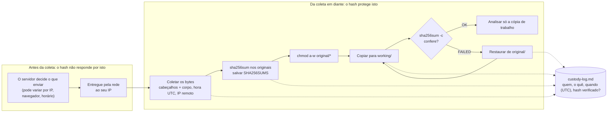

# Dia 02: Disciplina de evidência, da coleta ao registro de custódia

> 🇺🇸 Original: [*Day 2: Evidence discipline, from collection to custody log*](https://github.com/thiefdroppers/cyber-investigator-skills/blob/main/curriculum/phase-1-foundations/day-02.md) — © ThiefDroppers, licença MIT.
> Aqui: tradução fiel **+** camada brasileira. Nada do original foi removido; tudo o que é novo vem marcado com ➕.

**Fase 1. Fundamentos** · Meta da trilha: coletar uma evidência digital de modo que qualquer pessoa consiga confirmar depois o que você coletou, quando, de onde, e que nada mudou desde então.

Rank Jutsu: `D` · [](https://colab.research.google.com/github/Ridd1kulusC0d3r/investigador-cyber-90-dias/blob/main/curriculo/fase-1-fundamentos/dia-02/dia-02.ipynb)

---

## 🎬 ➕ Abertura do caso — *O hash antes do café*

Segunda-feira, 11h38. O registro de autorização de ontem (o Dia 01) está assinado e com hash. Você finalmente abre `serraazul-pix.example` no navegador da VM de análise, tira um print caprichado e cola no canal do caso: *"Achei o site falso!"*.

Rafa responde em dez segundos.

— Bonito. Agora prova que esse print é daquele servidor, daquele horário, e que ninguém mexeu nele até a delegacia receber.

Você olha de novo o print. A página diz só *"Sistema em manutenção"*. Nenhum formulário, nenhum campo de senha. Estranho, para um site que roubou três cooperados hoje cedo.

— Anota isso também — diz Rafa. — O que o servidor te mostrou é um fato. O que ele mostra para as vítimas é outra pergunta. Primeiro, a coleta.

É isso que o Dia 2 ensina. *(Personagens e cenário: [Operação Isca](../../../caso-continuo/).)*

---

## 📖 Conceito

Evidência digital é fácil de copiar e fácil de alterar, e uma cópia é indistinguível do original, a menos que você tenha registrado algo sobre ela no momento da coleta. Disciplina de evidência é o hábito de registrar esse "algo" toda vez.

Quatro coisas entram no registro. Um *hash* criptográfico (SHA-256) é a impressão digital dos bytes exatos; se um byte muda, o hash muda por completo. Um carimbo de tempo em UTC fixa quando você coletou; a hora local é ambígua entre fusos horários e mudanças de horário de verão, e dois investigadores em cidades diferentes vão discordar sobre a ordem dos eventos. A fonte diz de onde vieram os bytes (a URL, o dispositivo, a tela de exportação) e como você os obteve. O registro de custódia anota cada pessoa e cada sistema que manuseou o item depois disso.

Seja preciso sobre o que um hash prova. Ele prova que o arquivo que você tem hoje é idêntico ao arquivo cujo hash você calculou no momento da coleta. Ele não prova que o servidor lhe enviou um conteúdo verdadeiro, e não prova que o conteúdo nunca foi editado antes de chegar a você. Kits de phishing rotineiramente servem páginas diferentes para visitantes diferentes, então a sua captura mostra o que o servidor enviou para você, naquele horário, a partir do seu endereço IP e do seu navegador. Escreva suas conclusões de acordo com isso.

A ordem também importa. A RFC 3227 descreve a coleta por ordem de volatilidade: capture primeiro o que desaparece primeiro (memória, conexões de rede ativas, uma página web que pode ser derrubada em uma hora), antes do que persiste (um disco, um log arquivado). Nunca trabalhe na sua única cópia. Calcule o hash do original, faça uma cópia de trabalho, confirme que a cópia de trabalho tem o mesmo hash e analise a cópia.

Uma captura de tela, sozinha, é evidência fraca. Ela é a imagem de uma renderização, sem cabeçalhos, sem o HTML de origem e sem nada que um tribunal ou um colega possa conferir contra o servidor. Tire capturas de tela para o seu relatório, mas colete também os bytes por trás delas.

O hash protege tudo a partir do passo de coleta e não diz nada sobre o que aconteceu antes dele. Cada passo depois da coleta também escreve uma linha no registro de custódia.



## 📚 Recursos

- [RFC 3227: Guidelines for Evidence Collection and Archiving](https://www.rfc-editor.org/rfc/rfc3227). As partes a ler são a seção 2.1 (ordem de volatilidade) e a seção 2.4 (considerações legais).
- [NIST SP 800-86: Guide to Integrating Forensic Techniques into Incident Response](https://csrc.nist.gov/pubs/sp/800/86/final). Leia a seção 3, sobre as fases de coleta, exame, análise e relatório.
- [GNU coreutils: sha256sum](https://www.gnu.org/software/coreutils/manual/html_node/sha2-utilities.html) e [PowerShell Get-FileHash](https://learn.microsoft.com/en-us/powershell/module/microsoft.powershell.utility/get-filehash) para o comando em cada plataforma.
- [Internet Archive Save Page Now](https://web.archive.org/save): uma captura independente, feita por terceiro, que você pode citar ao lado da sua.

### ➕ Recursos do contexto Brasil

- [Código de Processo Penal, arts. 158-A a 158-F](https://www.planalto.gov.br/ccivil_03/decreto-lei/del3689.htm): a cadeia de custódia na lei brasileira, incluída pelo Pacote Anticrime ([Lei 13.964/2019](https://www.planalto.gov.br/ccivil_03/_ato2019-2022/2019/lei/l13964.htm)). Leia o art. 158-B, que lista as etapas.
- [Código de Processo Civil, art. 384](https://www.planalto.gov.br/ccivil_03/_ato2015-2018/2015/lei/l13105.htm): a **ata notarial**, em que um tabelião atesta o que viu numa página. É o "terceiro independente" mais usado nos tribunais brasileiros, ao lado do Wayback Machine.
- [ABNT NBR ISO/IEC 27037](https://www.abntcatalogo.com.br/): diretrizes para identificação, coleta, aquisição e preservação de evidência digital (norma paga; procure pelo número no catálogo da ABNT).
- [`scripts/registrar_evidencia.py`](../../../scripts/registrar_evidencia.py): o script deste repo que calcula SHA-256, anota a hora UTC e acrescenta a linha no registro de custódia em CSV.

## 🛠️ Prática: curl e sha256sum, produzindo uma pasta de evidência e um registro de custódia preenchido

Você vai coletar uma página web pública de uma organização pública (use `https://www.iana.org/help/example-domains`, que a IANA publica exatamente para este tipo de exercício) e documentá-la como se fosse evidência de um caso.

**Seu checklist de hoje.** Faça na ordem e marque cada item ao terminar:

- [ ] Passo 1: montar a pasta do caso
- [ ] Passo 2: coletar cabeçalhos e corpo numa única requisição
- [ ] Passo 3: calcular o hash dos originais e travá-los
- [ ] Passo 4: fazer a cópia de trabalho e provar que ela confere
- [ ] Passo 5: corroborar com um terceiro
- [ ] Passo 6: preencher o registro de custódia
- [ ] Passo 7: testar a armadilha (*tripwire*)
- [ ] ➕ Passo 8: a mesma disciplina na coleta da Operação Isca (Prática BR)
- [ ] ➕ Passo 9: o notebook do dia no Colab

### Passo 1: montar a pasta do caso

```bash
mkdir -p ~/cases/P1-D02/{original,working,notes}
cd ~/cases/P1-D02
```

### Passo 2: coletar cabeçalhos e corpo numa única requisição

```bash
date -u +%Y-%m-%dT%H:%M:%SZ | tee notes/collection-start.txt
curl -sS -L \
  -A "Mozilla/5.0 (X11; Linux x86_64) evidence-collection/P1-D02" \
  -D original/headers.txt \
  -o original/page.html \
  -w 'final_url=%{url_effective}\nhttp_code=%{http_code}\nremote_ip=%{remote_ip}\nsize=%{size_download}\n' \
  https://www.iana.org/help/example-domains | tee notes/transfer.txt
```

`-D` salva todos os cabeçalhos de resposta, `-w` registra a URL final, o código de status e o IP do servidor ao qual você realmente se conectou, e `-A` rotula as suas requisições para que sejam identificáveis nos logs do servidor.

Saída ilustrativa (o seu IP e o tamanho serão diferentes):

```
2026-03-10T14:22:07Z
final_url=https://www.iana.org/help/example-domains
http_code=200
remote_ip=192.0.2.80
size=7431
```

Se você tiver o `wget` instalado, também pode salvar um arquivo WARC, o formato de arquivamento que o Internet Archive usa, que guarda requisições e respostas juntas:

```bash
wget --warc-file=original/page --page-requisites --no-verbose \
  -P original/wget https://www.iana.org/help/example-domains
```

### Passo 3: calcular o hash dos originais e travá-los

```bash
cd original
sha256sum headers.txt page.html > ../notes/SHA256SUMS      # Linux
# macOS:   shasum -a 256 headers.txt page.html > ../notes/SHA256SUMS
# Windows: Get-FileHash -Algorithm SHA256 .\headers.txt, .\page.html
cd ..
chmod a-w original/*
cat notes/SHA256SUMS
```

Saída ilustrativa:

```
4f1c0d6e8a...e21b  headers.txt
9b7a33c1f0...0c4d  page.html
```

### Passo 4: fazer a cópia de trabalho e provar que ela confere

```bash
cp original/* working/
cd working && sha256sum -c ../notes/SHA256SUMS && cd ..
```

Você deve ver `headers.txt: OK` e `page.html: OK`. Daqui em diante, você só abre arquivos em `working/`.

### Passo 5: corroborar com um terceiro

Envie a mesma URL para `https://web.archive.org/save`. Copie para as suas notas a URL da captura resultante (ela tem a forma `https://web.archive.org/web/20260310142301/https://www.iana.org/help/example-domains`). Uma captura de arquivo feita por alguém que não é você é uma corroboração útil quando a sua própria captura é questionada.

### Passo 6: preencher o registro de custódia

Crie `notes/custody-log.md`:

```markdown
# Registro de custódia de evidência: P1-D02

| Item | Descrição | Fonte | Coletado (UTC) | Coletado por | Método | SHA-256 | Guardado em |
|---|---|---|---|---|---|---|---|
| E1 | Cabeçalhos da resposta HTTP | https://www.iana.org/help/example-domains (IP remoto em transfer.txt) | | | curl 8.x, comando em notes/ | | original/headers.txt |
| E2 | HTML da página | idem | | | idem | | original/page.html |
| E3 | Captura de terceiro | Wayback Machine | | Internet Archive | Save Page Now | n/a (URL registrada) | notes/wayback.txt |

## Eventos de manuseio
| Hora (UTC) | Item | Ação | Por | Hash verificado? |
|---|---|---|---|---|
| | E1, E2 | Coletado, hash calculado, definido como somente leitura | | sim |
| | E1, E2 | Copiado para working/ | | sim (sha256sum -c OK) |
```

Preencha cada lacuna a partir da saída do seu próprio terminal. Não arredonde horários nem redigite hashes à mão; cole-os.

### Passo 7: testar a armadilha (*tripwire*)

Abra `working/page.html`, mude um caractere, salve e rode de novo `sha256sum -c ../notes/SHA256SUMS` a partir de `working/`. Você deve ver `page.html: FAILED`. Restaure a cópia de trabalho a partir de `original/` e registre os dois eventos na tabela de manuseio.

### ➕ Prática BR: a coleta do site falso da Serra Azul

A Vigia coleta páginas de golpe a partir de uma VM de análise com saída por VPN de pesquisa, nunca do IP do escritório (o Dia 7 explica por quê). A coleta do caso já foi feita e está em [`caso-continuo/dados/dia-02/`](../../../caso-continuo/dados/dia-02/): `original/`, `notas/` e uma pasta `trabalho/` que **alguém mexeu**.

1. Leia `notas/inicio-coleta.txt` e `notas/transfer.txt`. Converta o início da coleta para horário de Brasília (UTC-3) e confira que ele cai **depois** das 11h00 do contrato do Dia 01. Se caísse antes, o que isso diria sobre a sua autorização?
2. Rode `sha256sum -c ../notas/SHA256SUMS` dentro de `original/` (precisa dar OK) e depois dentro de `trabalho/` (um arquivo vai dar FAILED). Descubra qual caractere mudou com `diff original/page.html trabalho/page.html`.
3. Abra `original/headers.txt`. Quantas respostas HTTP há nele? Qual o `Server`? Qual cookie foi definido? Por que o primeiro bloco é um `301`?
4. Leia o comentário HTML dentro de `original/page.html`. Registre o apelido como **artefato do kit** (não como pessoa).
5. Escreva `notas/registro-de-custodia-isca.md` com as linhas E1 (cabeçalhos), E2 (HTML) e E3 (captura de terceiro: aqui, uma ata notarial *solicitada* à cooperativa, ou o Wayback), mais a tabela de manuseio com: coleta, cópia, detecção da alteração em `trabalho/`, restauração.
6. Escreva duas frases: o que o hash prova sobre esta página e o que ele **não** prova (lembre-se da página "em manutenção").

### ➕ O notebook do dia

Abra o [notebook do Dia 02 no Colab](https://colab.research.google.com/github/Ridd1kulusC0d3r/investigador-cyber-90-dias/blob/main/curriculo/fase-1-fundamentos/dia-02/dia-02.ipynb). Nele você:

1. vê com os próprios olhos o efeito avalanche (um caractere muda o SHA-256 inteiro);
2. reimplementa o `sha256sum -c` em Python, linha a linha, e roda contra as pastas `original/` e `trabalho/` da Operação Isca;
3. joga o quiz **"o hash prova isso?"** (8 afirmações);
4. preenche o registro de custódia por formulário e sai com o `.md` pronto, já com hora UTC e hashes colados (nunca redigitados).

## ✅ Checkpoint

O seu artefato é a pasta `~/cases/P1-D02`. Ele passa quando:

- Todo arquivo em `original/` é somente leitura.
- Os hashes dos arquivos em `original/` conferem exatamente com `notes/SHA256SUMS`.
- `notes/custody-log.md` não tem células vazias.
- Todo horário em `notes/custody-log.md` está em UTC, com o `Z` no final.
- A tabela de manuseio inclui o teste deliberado de adulteração.
- A tabela de manuseio inclui a restauração.
- `notes/transfer.txt` registra o IP remoto, para que você diga qual servidor respondeu.
- Você consegue explicar, em duas frases, o que o hash prova e o que ele não prova sobre a página.

### ➕ Checkpoint BR

- Você identificou o arquivo adulterado em `trabalho/` e o caractere alterado, e registrou detecção e restauração na tabela de manuseio.
- Você converteu o horário da coleta para BRT e mostrou que ela aconteceu depois da autorização.
- Você nomeia o art. 158-B do CPP e cita pelo menos quatro das etapas da cadeia de custódia que ele lista.
- Você explica por que, no Brasil, uma ata notarial (CPC, art. 384) costuma valer mais diante de um juiz do que o seu print sozinho.
- Você acertou pelo menos 6 das 8 afirmações do quiz do notebook.

## ⚖️ ➕ Camada jurídica BR

**CPP, arts. 158-A a 158-F (cadeia de custódia).** Incluídos pela Lei 13.964/2019 (Pacote Anticrime). O art. 158-A define a cadeia de custódia como o conjunto de procedimentos para manter e documentar a história cronológica do vestígio, desde o reconhecimento até o descarte. O art. 158-B lista as etapas: reconhecimento, isolamento, fixação, coleta, acondicionamento, transporte, recebimento, processamento, armazenamento e descarte. O texto foi pensado para o vestígio físico e para a perícia oficial, mas a lógica é a mesma do seu `custody-log.md`: quem, o quê, quando, como, e se a integridade foi conferida. Material coletado sem esse registro abre espaço para a defesa alegar quebra da cadeia de custódia, e há discussão nos tribunais sobre quais consequências isso traz em cada caso.

**Prints e prova digital.** Tribunais brasileiros já recusaram prints de conversa ou de página como prova isolada, por não haver como verificar integridade e origem. O caminho seguro é o do Dia 2: bytes originais, hash, hora UTC, fonte e um terceiro independente.

**CPC, art. 384 (ata notarial).** A existência e o modo de existir de um fato podem ser atestados por tabelião em ata notarial, inclusive dados de arquivos eletrônicos e imagens. Para a Serra Azul, a recomendação prática é: a Vigia coleta com hash, e a cooperativa (via Dr. Hélio) pede a ata notarial da página antes da derrubada.

**Você não é perito oficial.** No processo penal, o exame de corpo de delito é feito por perito oficial (CPP, art. 159). O seu papel como analista de MSSP é entregar um material íntegro e documentado à cooperativa e, por meio dela, à polícia.

> Material de estudo, não constitui orientação jurídica.

## 🧠 ➕ Camada 8 — o print que convence

Um print é *vívido*: tem cor, logo, o nome da cooperativa. Um arquivo `SHA256SUMS` é chato. Sob pressão (37 reclamações, cliente ligando), o cérebro favorece o que é fácil de processar, e um material fácil de processar parece mais verdadeiro do que é. Psicólogos chamam isso de **fluência de processamento**. Ela explica por que o seu print "parece prova" e por que o golpista investe tanto no visual da página falsa: a mesma fluência que convence você convence a vítima.

O segundo efeito é a **carga cognitiva**. Coletar, calcular hash, travar, copiar, verificar e registrar são seis passos, num momento em que a sua memória de trabalho está ocupada com o caso. É exatamente quando as pessoas pulam passos sem perceber. A resposta da medicina e da aviação a esse problema é o checklist: tirar a sequência da cabeça e pôr no papel. Por isso o original do Dia 2 é um checklist e por isso o notebook gera o registro automaticamente.

**Consequência prática:** nunca confie na sua memória para dizer "eu verifiquei o hash". Se não está na tabela de manuseio, para o caso não aconteceu.

## 🤖 ➕ Skill do dia

Hoje o dia propõe para a [skill pt-BR](../../../skills/investigador-cyber/SKILL.md) o procedimento **"Coleta e custódia de evidência"**: hash, UTC, fonte, cópia de trabalho verificada, terceiro independente e a frase obrigatória sobre o que o hash não prova. Proposta completa em [`_skill-delta.md`](_skill-delta.md).

## 💡 ➕ Inovação OSINT do dia — conferir um SHA256SUMS e consultar o Wayback, só com stdlib

O `sha256sum -c` cabe em poucas linhas de Python, o que permite verificar evidência em qualquer máquina (inclusive no Windows sem PowerShell à mão):

```python
import hashlib, pathlib                                    # nada para instalar
for linha in pathlib.Path("notas/SHA256SUMS").read_text().splitlines():
    esperado, nome = linha.split(maxsplit=1)               # "hash  arquivo"
    atual = hashlib.sha256(pathlib.Path(nome).read_bytes()).hexdigest()
    print(nome, "OK" if atual == esperado else "FAILED")
```

E a API pública de disponibilidade do Internet Archive diz se já existe uma captura de terceiro de uma URL, e de quando:

```python
import json, urllib.request, urllib.parse
url = "https://www.iana.org/help/example-domains"
api = "https://archive.org/wayback/available?url=" + urllib.parse.quote(url)
print(json.load(urllib.request.urlopen(api, timeout=10)).get("archived_snapshots"))
```

Num caso real, rode a consulta ao Wayback **antes** de pedir a derrubada: se o kit sair do ar, a captura de terceiro é o que sobra.

## 📝 Diário de estudo

- Data:
- Tempo gasto:
- O que ficou claro:
- O que ainda está nebuloso:
- Artefato produzido: `~/cases/P1-D02/` (com `notes/custody-log.md`), `notas/registro-de-custodia-isca.md`

---
<sub>Baseado em [cyber-investigator-skills](https://github.com/thiefdroppers/cyber-investigator-skills) por ThiefDroppers (MIT). Tradução, camada BR, Camada 8, skill pt-BR e notebook por Deivison Lourenço (@Ridd1kulusC0d3r).</sub>
