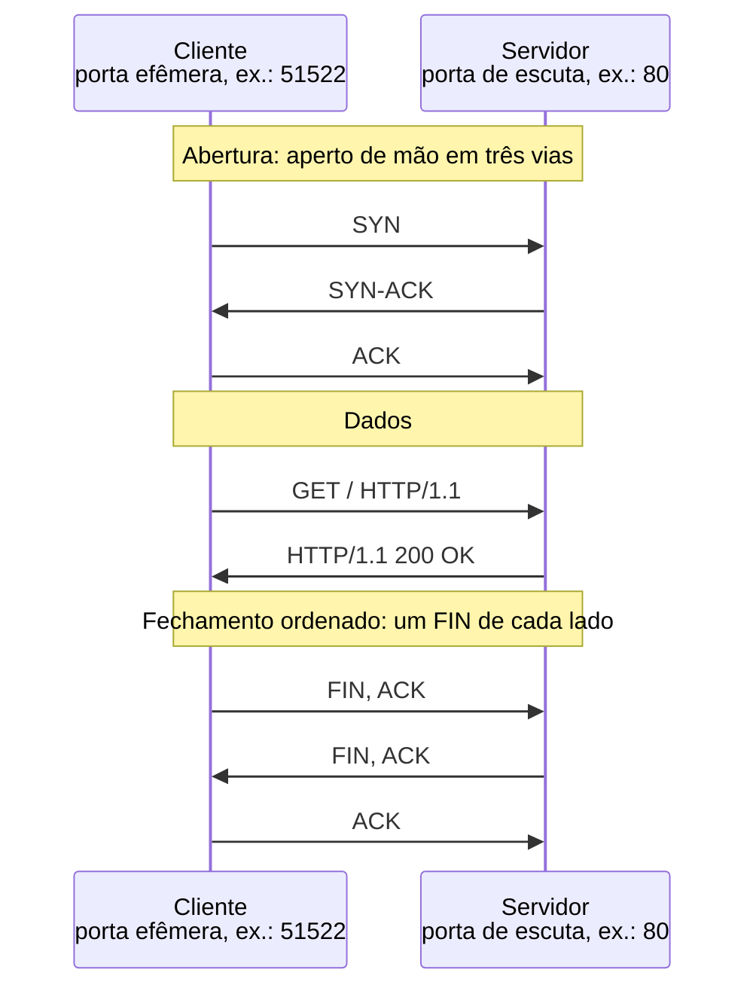
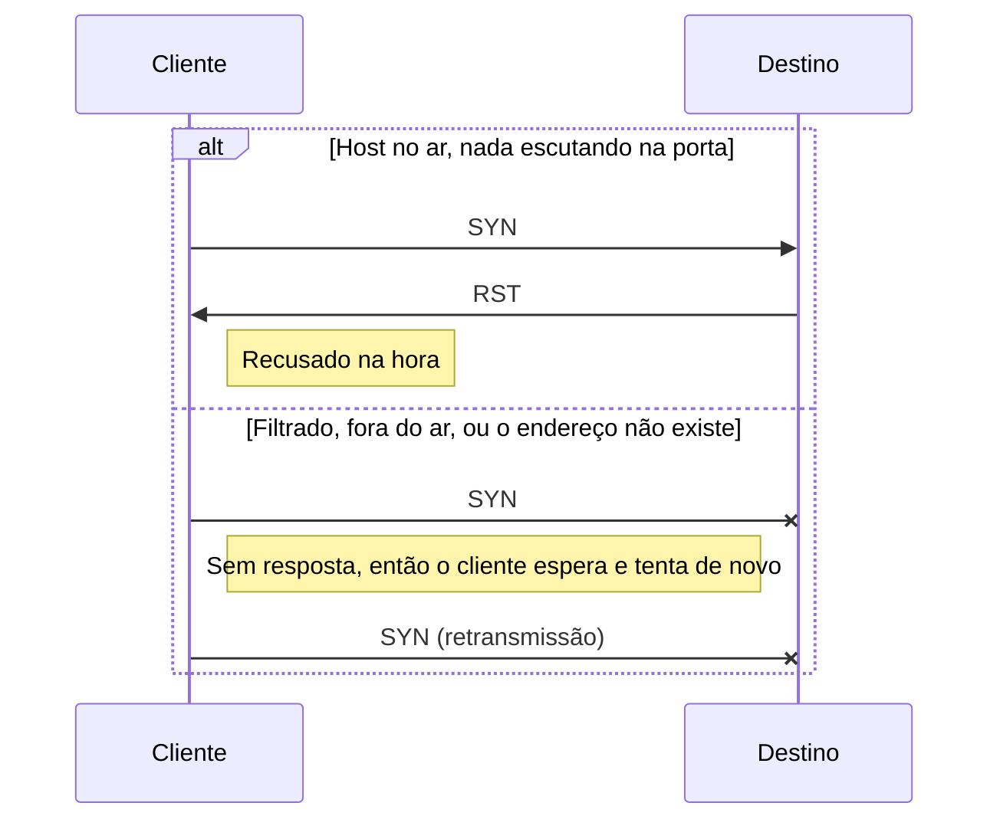
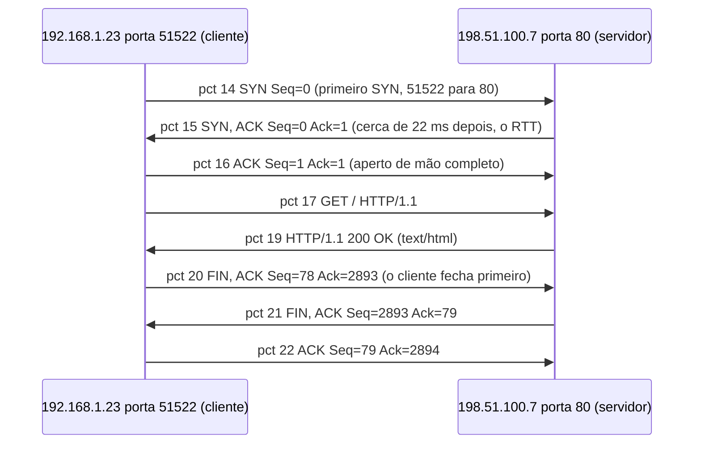

# Dia 03: TCP/IP para investigadores: lendo uma conexão no Wireshark

> 🇺🇸 Original: [*Day 3: TCP/IP for investigators, reading one connection in Wireshark*](https://github.com/thiefdroppers/cyber-investigator-skills/blob/main/curriculum/phase-1-foundations/day-03.md) — © ThiefDroppers, licença MIT.
> Aqui: tradução fiel **+** camada brasileira. Nada do original foi removido; tudo o que é novo vem marcado com ➕.

**Fase 1. Fundamentos** · Meta da trilha: ler uma única conexão de rede pacote por pacote e descrevê-la nos termos que um investigador usa: quem, para onde, por qual meio, quando e como terminou.

Rank Jutsu: `D` · [](https://colab.research.google.com/github/Ridd1kulusC0d3r/investigador-cyber-90-dias/blob/main/curriculo/fase-1-fundamentos/dia-03/dia-03.ipynb)

---

## 🎬 ➕ Abertura do caso — *Doze pacotes e um silêncio*

Segunda, 12h31. O registro de custódia de manhã ficou bonito, mas Rafa ainda não está satisfeito.

— Você sabe o que o servidor te *mandou*. Não sabe como a conversa aconteceu. Liga o Wireshark na VM do laboratório e pede o site de novo, em HTTP puro.

Você captura. Doze pacotes para `serraazul-pix.example`, de `203.0.113.77`: DNS, aperto de mão, um `GET`, um `301`, dois `FIN`. Aí você tenta o outro domínio que apareceu no grupo de WhatsApp da ouvidoria, `serraazul-seguranca.example`. O DNS responde `203.0.113.78`. Depois: quatro `SYN` e nada.

— Nada não é resultado — diz Rafa. — Nada tem formato. Me diz qual é.

É isso que o Dia 3 ensina. *(Personagens e cenário: [Operação Isca](../../../caso-continuo/).)*

---

## 📖 Conceito

Você não precisa projetar redes para investigá-las. Você precisa ler os registros que as redes deixam para trás, e quase todos esses registros descrevem conexões nos mesmos poucos termos.

A camada IP carrega os endereços de origem e de destino. Ela também carrega um TTL (*time to live*, tempo de vida) que cada roteador diminui em um. Sistemas operacionais partem de valores diferentes (Linux e macOS costumam usar 64, Windows 128), então um pacote que chega com TTL 52 provavelmente começou em 64 e atravessou cerca de 12 saltos. Isso é uma pista, não uma prova, já que o valor inicial pode ser alterado.

TCP e UDP acrescentam portas. Um servidor escuta numa porta conhecida (443 para HTTPS, 22 para SSH, 53 para DNS), e o cliente usa uma porta efêmera temporária, de número alto. O Linux escolhe entre 32768 e 60999 por padrão, e o Windows entre 49152 e 65535. Junte o protocolo, os dois endereços e as duas portas e você tem a quíntupla (*5-tuple*), que identifica uma conversa. Todo log de conexão que você vai ler na vida, de um *firewall*, de um *proxy* ou do Zeek, é uma tabela de quíntuplas mais horários e contagens de bytes.

O TCP abre com um aperto de mão em três vias (*three-way handshake*): o cliente envia SYN, o servidor responde SYN-ACK, o cliente envia ACK. Ele fecha de forma ordenada com pacotes FIN de cada lado, ou de forma abrupta com RST. As *flags* contam a história. Um SYN sem resposta significa que o destino estava fora do ar, filtrado, ou nunca existiu. SYN seguido de RST significa que o host está no ar, mas nada escuta naquela porta. Centenas de SYNs para portas diferentes sem nenhum aperto de mão completo é a cara de uma varredura de portas. O UDP não tem aperto de mão, então uma "conexão" UDP num log é, na verdade, um agrupamento de pacotes por quíntupla e tempo.

Uma conversa TCP completa e saudável fica assim no fio:



Uma conexão que nunca abre deixa um de dois formatos. Uma varredura de portas é, quase toda, uma longa lista deles:



O Wireshark tem dois tipos de filtro, e confundi-los custa uma tarde. Filtros de captura usam a sintaxe BPF (`host 192.0.2.10 and port 80`) e decidem o que é gravado. Filtros de exibição usam a sintaxe própria do Wireshark (`ip.addr == 192.0.2.10 && tcp.port == 80`) e só escondem pacotes que já foram gravados. Numa investigação, prefira captura ampla e exibição estreita, porque o que você filtrou na captura se perdeu.

Só capture tráfego em redes e dispositivos que você possui ou que está autorizado a monitorar. Capturar o tráfego de outra pessoa é interceptação, que é um crime à parte na maioria dos lugares.

## 📚 Recursos

- [Wireshark User's Guide](https://www.wireshark.org/docs/wsug_html_chunked/): capítulo 4 (captura) e capítulo 6 (filtros de exibição).
- [Referência de filtros de exibição do Wireshark](https://www.wireshark.org/docs/dfref/): procure `tcp` e `ip` para ver todos os campos em que dá para filtrar.
- [RFC 9293: Transmission Control Protocol](https://www.rfc-editor.org/rfc/rfc9293), seção 3.5 para o aperto de mão e figura 6 para o diagrama de estados.
- [Practical Packet Analysis, 3ª ed.](https://nostarch.com/packetanalysis3) (Chris Sanders), se você quiser um livro inteiro. Pago; o guia do Wireshark acima cobre o trabalho de hoje de graça.

### ➕ Recursos do contexto Brasil

- [Lei 9.296/1996](https://www.planalto.gov.br/ccivil_03/leis/l9296.htm): interceptação de comunicações telefônicas **e de fluxo de comunicações em sistemas de informática e telemática**, que só pode ocorrer por ordem judicial. É a lei brasileira por trás do aviso do original sobre interceptação.
- [Marco Civil da Internet (Lei 12.965/2014)](https://www.planalto.gov.br/ccivil_03/_ato2011-2014/2014/lei/l12965.htm), art. 7º, II: inviolabilidade e sigilo do fluxo das comunicações pela internet, salvo por ordem judicial.
- [NIC.br / CEPTRO.br](https://ceptro.br/): materiais em português sobre IPv4, IPv6 e boas práticas de rede (o curso IPv6 do NIC.br explica cabeçalhos IP com cuidado).
- [Wireshark em português (docs da comunidade)](https://www.wireshark.org/docs/): a interface do Wireshark tem tradução para pt-BR em *Edit > Preferences > Appearance > Language*; os nomes de filtros continuam em inglês.

## 🛠️ Prática: Wireshark, um diagrama em escada (*flow graph*) e uma tabela de quíntupla para uma conexão

Você vai capturar a sua própria máquina buscando uma página em HTTP puro, para que cada byte seja legível, e documentar a conexão.

**Seu checklist de hoje.** Faça na ordem e marque cada item ao terminar:

- [ ] Passo 1: capturar
- [ ] Passo 2: isolar a conexão
- [ ] Passo 3: montar o diagrama em escada
- [ ] Passo 4: montar a tabela da conversa
- [ ] Passo 5: acrescentar uma conexão que falhou, para contraste
- [ ] ➕ Passo 6: ler a captura do laboratório da Operação Isca (Prática BR)
- [ ] ➕ Passo 7: o notebook do dia no Colab

### Passo 1: capturar

1. Instale o Wireshark a partir de `https://www.wireshark.org/download.html`. No Linux, `sudo apt install wireshark`, responda Sim quando perguntarem se usuários não-root podem capturar, depois adicione-se ao grupo com `sudo usermod -aG wireshark $USER` e saia e entre de novo na sessão.
2. Abra o Wireshark e vá em View > Time Display Format > UTC Date and Time of Day. Investigadores trabalham em UTC.
3. Vá em Capture > Options, selecione a sua interface ativa (Wi-Fi ou Ethernet) e, na caixa de filtro de captura, digite `port 80 or port 53`. Clique em Start.
4. Num terminal, rode:
   ```bash
   curl -4 -s -o /dev/null -w '%{remote_ip}:%{remote_port}\n' http://neverssl.com/
   ```
   `neverssl.com` existe para servir HTTP puro para testes. `-4` força IPv4, para que os endereços fiquem mais fáceis de ler. Anote o IP que ele imprime.
5. Pare a captura (quadrado vermelho) e salve-a com File > Save As como `day03.pcapng`. Calcule o hash: `sha256sum day03.pcapng`.

### Passo 2: isolar a conexão

Aplique estes filtros de exibição, um de cada vez, e anote o que cada um mostra:

| Filtro de exibição | O que ele mostra |
|---|---|
| `dns` | A consulta de `neverssl.com` que aconteceu antes da conexão |
| `tcp.flags.syn == 1 && tcp.flags.ack == 0` | Só aberturas de conexão, um pacote por tentativa |
| `ip.addr == <o IP que o curl imprimiu> && tcp.port == 80` | A conversa inteira |
| `http.request` | A linha de requisição GET |
| `tcp.flags.fin == 1 \|\| tcp.flags.reset == 1` | Como a conversa terminou |

Lista de pacotes ilustrativa para o filtro da conversa (endereços de faixas de documentação):

```
No.  Time (UTC)                   Source         Destination    Proto Info
 14  2026-03-10 14:30:01.201844   192.168.1.23   198.51.100.7   TCP   51522 → 80 [SYN] Seq=0 Win=64240 Len=0 MSS=1460
 15  2026-03-10 14:30:01.224310   198.51.100.7   192.168.1.23   TCP   80 → 51522 [SYN, ACK] Seq=0 Ack=1 Win=65535 Len=0
 16  2026-03-10 14:30:01.224402   192.168.1.23   198.51.100.7   TCP   51522 → 80 [ACK] Seq=1 Ack=1 Win=64240 Len=0
 17  2026-03-10 14:30:01.224571   192.168.1.23   198.51.100.7   HTTP  GET / HTTP/1.1
 19  2026-03-10 14:30:01.249907   198.51.100.7   192.168.1.23   HTTP  HTTP/1.1 200 OK  (text/html)
 20  2026-03-10 14:30:01.250311   192.168.1.23   198.51.100.7   TCP   51522 → 80 [FIN, ACK] Seq=78 Ack=2893 Len=0
 21  2026-03-10 14:30:01.273020   198.51.100.7   192.168.1.23   TCP   80 → 51522 [FIN, ACK] Seq=2893 Ack=79 Len=0
 22  2026-03-10 14:30:01.273101   192.168.1.23   198.51.100.7   TCP   51522 → 80 [ACK] Seq=79 Ack=2894 Len=0
```

O intervalo entre os pacotes 14 e 15 (cerca de 22 ms) é o tempo de ida e volta (RTT) até o servidor. Por padrão, o Wireshark mostra números de sequência relativos ao início da conexão, por isso eles começam em 0.

Clique no pacote 15 e expanda a camada Internet Protocol no painel de detalhes. Anote o TTL. Um valor como 52 ou 56 sugere um TTL inicial de 64; um valor como 116 ou 120 sugere 128.

### Passo 3: montar o diagrama em escada

1. Com o filtro da conversa aplicado, abra Statistics > Flow Graph.
2. Marque "Limit to display filter" e defina Flow type como "TCP Flows".
3. Salve o gráfico com o botão "Save As..." como `day03-flow.png` (PDF também serve).
4. Em qualquer editor de imagem, ou redesenhando no draw.io (`https://app.diagrams.net`), rotule os três pacotes do aperto de mão, a requisição, a resposta e os dois FINs. Ao lado do primeiro SYN, escreva a porta efêmera do cliente e a porta do servidor.

O seu *flow graph* rotulado deve carregar as mesmas informações desta escada de referência, montada a partir da lista de pacotes ilustrativa do Passo 2. Confira os seus rótulos com ela:



Você também pode guardar uma versão em texto ao lado da imagem. Copie o bloco acima para `day03-flow.md`, troque cada endereço, porta, número de pacote e valor de sequência pelos seus, e o GitHub o renderiza ali mesmo. Guarde também o `.png`, já que ele sai direto do Wireshark.

### Passo 4: montar a tabela da conversa

Abra Statistics > Conversations e selecione a aba TCP. Marque "Limit to display filter". Copie a linha da sua conexão para `day03-5tuple.md`:

```markdown
| Campo | Valor |
|---|---|
| Protocolo | TCP |
| IP : porta do cliente | |
| IP : porta do servidor | |
| Primeiro pacote (UTC) | |
| Duração (s) | |
| Pacotes A→B / B→A | |
| Bytes A→B / B→A | |
| Como abriu | SYN / SYN-ACK / ACK nos pacotes __, __, __ |
| Como fechou | FIN de ___ primeiro, ou RST |
| TTL observado do servidor / inicial provável | |
| SHA-256 do arquivo de captura | |
```

### Passo 5: acrescentar uma conexão que falhou, para contraste

Inicie uma nova captura sem filtro de captura e rode `curl -4 --max-time 5 http://neverssl.com:81/`. A porta 81 não é servida, então a tentativa falha. Filtre por `tcp.port == 81` e anote se você vê SYNs repetidos sem resposta (filtrado, então o cliente tenta de novo) ou um SYN respondido com RST (o host recusou). Acrescente uma linha à sua tabela descrevendo isso.

### ➕ Prática BR: a captura do laboratório da Vigia

A captura da abertura está em [`caso-continuo/dados/dia-03/isca-lab.pcap`](../../../caso-continuo/dados/dia-03/isca-lab.pcap) (formato pcap clássico, 18 pacotes, fictícia: a VM `192.168.56.10` fala com o gateway do laboratório `192.168.56.1`, que sai pela VPN de pesquisa). Abra-a no Wireshark (ou no notebook, sem instalar nada) e:

1. Calcule o SHA-256 do arquivo e registre-o como item no seu registro de custódia do Dia 02 (é evidência nova).
2. Aplique os cinco filtros de exibição da tabela do Passo 2, trocando o IP por `203.0.113.77`. Qual é o código HTTP da resposta e para onde ela manda (`Location`)?
3. Anote o TTL dos pacotes que vêm de `203.0.113.77`. Qual o TTL inicial provável, e quantos saltos? Marque como **inferência**.
4. Quem mandou o primeiro FIN, o cliente ou o servidor? (Repare: é diferente do exemplo do original.)
5. Filtre `ip.addr == 203.0.113.78`. Conte os SYNs, meça o intervalo entre eles e diga qual dos dois formatos do Conceito é este.
6. Preencha `day03-5tuple-isca.md` com duas linhas: a conversa com `.77` e a tentativa com `.78`.

### ➕ O notebook do dia

Abra o [notebook do Dia 03 no Colab](https://colab.research.google.com/github/Ridd1kulusC0d3r/investigador-cyber-90-dias/blob/main/curriculo/fase-1-fundamentos/dia-03/dia-03.ipynb). Nele você:

1. escreve um leitor de pcap só com `struct` (sem Wireshark, sem scapy) e entende cada campo dos cabeçalhos Ethernet, IP e TCP;
2. imprime a lista de pacotes no mesmo formato do Wireshark, com hora UTC, e monta a escada em mermaid automaticamente;
3. joga o quiz **"que formato é este?"** (aperto de mão completo, recusado, filtrado, varredura);
4. gera a tabela de quíntupla do Passo 4 já preenchida para a captura da Operação Isca.

## ✅ Checkpoint

O seu artefato é o `day03-flow.png` anotado mais o `day03-5tuple.md`. Ele passa quando:

- O diagrama em escada rotula os três pacotes do aperto de mão, o GET, a resposta 200 e os pacotes de fechamento FIN ou RST.
- As portas estão escritas no primeiro SYN.
- Todas as células da tabela estão preenchidas.
- Todos os horários da tabela estão em UTC.
- A tabela inclui o hash da captura.
- Você consegue dizer, em uma frase cada, como a tentativa na porta 81 apareceu no fio e como ela apareceria num log de firewall que registra só a quíntupla e uma ação.

### ➕ Checkpoint BR

- A sua tabela da Operação Isca tem a conversa com `203.0.113.77` (resposta `301`, quem fechou primeiro) e a tentativa com `203.0.113.78` (quatro SYNs, sem resposta, intervalos que dobram).
- O TTL do servidor está anotado como inferência, com o TTL inicial provável.
- O SHA-256 de `isca-lab.pcap` entrou no seu registro de custódia.
- Você explica por que capturar o tráfego da VM do laboratório é lícito e capturar o Wi-Fi da agência da cooperativa "para ver quem clicou" não é, sem autorização específica.
- Você acertou pelo menos 5 das 6 perguntas do quiz do notebook.

## ⚖️ ➕ Camada jurídica BR

**Lei 9.296/1996 (interceptação).** A lei regula a interceptação de comunicações telefônicas e, pelo parágrafo único do art. 1º, também do fluxo de comunicações em sistemas de informática e telemática. Interceptação só ocorre por ordem do juiz, em investigação criminal ou instrução processual penal. O art. 10 tipifica como crime realizar interceptação sem autorização judicial ou com objetivos não autorizados em lei. <!-- TODO jurídico: confirmar a redação atual do art. 10 após a Lei 13.869/2019 (abuso de autoridade). -->

**Marco Civil, art. 7º, II.** É direito do usuário a inviolabilidade e o sigilo do fluxo das suas comunicações pela internet, salvo por ordem judicial.

**O que isso muda no seu dia.** Capturar o tráfego da **sua** VM, numa rede de laboratório que a Vigia controla, é observar a sua própria comunicação com um servidor público. Capturar a rede da agência para "ver quem mais clicou" é capturar comunicação de terceiros (funcionários, cooperados no Wi-Fi). Mesmo dentro da cooperativa, isso exige base clara (política interna, aviso aos usuários, autorização formal do cliente e análise do jurídico). Na Operação Isca, isso **não** está no escopo escrito do Dia 01.

> Material de estudo, não constitui orientação jurídica.

## 🧠 ➕ Camada 8 — o silêncio que a gente preenche

Quatro SYNs sem resposta para `203.0.113.78` e a primeira reação de quase todo mundo é contar uma história: *"derrubaram o site"*, *"o golpista bloqueou a gente"*, *"é um servidor de reserva esperando o próximo disparo"*. Daniel Kahneman chamou essa tendência de **WYSIATI** (*what you see is all there is*, "o que você vê é tudo o que existe"): a mente monta a história mais coerente possível com a informação disponível, e não sente falta da informação que não tem.

Na rede, silêncio é ambíguo por natureza: filtro no caminho, host desligado, endereço que nunca existiu, ou um servidor que só responde para IPs brasileiros de operadora móvel. O original diz isso com precisão: SYN sem resposta significa *fora do ar, filtrado, ou nunca existiu*. Três hipóteses, não uma.

**Consequência prática:** quando o dado for "nada", escreva as hipóteses concorrentes **antes** da sua favorita, e diga qual observação separaria uma da outra (aqui: repetir de outra origem, olhar o DNS histórico, procurar o IP em outro log). Isso vira hábito no Dia 4.

## 🤖 ➕ Skill do dia

Hoje o dia propõe para a [skill pt-BR](../../../skills/investigador-cyber/SKILL.md) um procedimento curto de **leitura de uma conexão (quíntupla e flags TCP)**, com a regra de nunca reduzir "sem resposta" a uma única hipótese. Proposta completa em [`_skill-delta.md`](_skill-delta.md).

## 💡 ➕ Inovação OSINT do dia — ler um pcap sem instalar nada

O formato pcap clássico é simples: 24 bytes de cabeçalho global e, para cada pacote, 16 bytes (segundos, microssegundos, tamanho gravado, tamanho original) seguidos dos bytes do pacote. O módulo `struct` da biblioteca padrão lê isso direto:

```python
import struct, datetime
dados = open("isca-lab.pcap", "rb").read()
pos = 24                                                       # pula o cabeçalho global
while pos < len(dados):
    seg, us, grav, _ = struct.unpack("<IIII", dados[pos:pos+16])
    quadro = dados[pos+16:pos+16+grav]                         # o pacote em si
    ttl, proto = quadro[14+8], quadro[14+9]                    # Ethernet (14) + offsets do IPv4
    hora = datetime.datetime.fromtimestamp(seg + us/1e6, datetime.timezone.utc)  # sempre UTC
    print(hora, "TTL", ttl, "proto", proto)
    pos += 16 + grav
```

É útil quando você recebe um pcap numa máquina em que não pode instalar o Wireshark, ou quando quer extrair só um campo de milhares de arquivos. Para pcapng (o formato padrão do Wireshark atual), converta antes com `editcap -F pcap entrada.pcapng saida.pcap`, que vem junto com o Wireshark.

## 📝 Diário de estudo

- Data:
- Tempo gasto:
- O que ficou claro:
- O que ainda está nebuloso:
- Artefato produzido: `day03-flow.png`, `day03-5tuple.md`, `day03-5tuple-isca.md`

---
<sub>Baseado em [cyber-investigator-skills](https://github.com/thiefdroppers/cyber-investigator-skills) por ThiefDroppers (MIT). Tradução, camada BR, Camada 8, skill pt-BR e notebook por Deivison Lourenço (@Ridd1kulusC0d3r).</sub>
