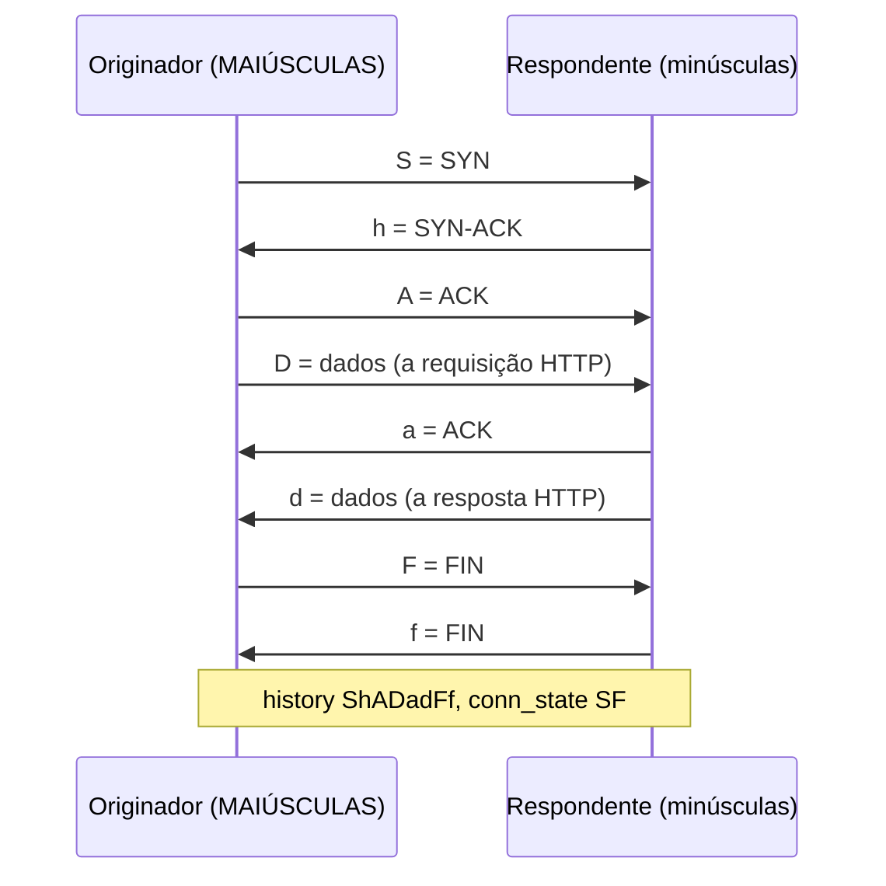
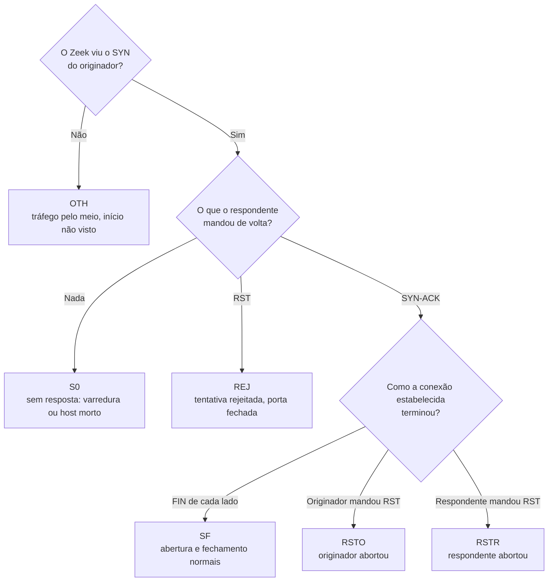
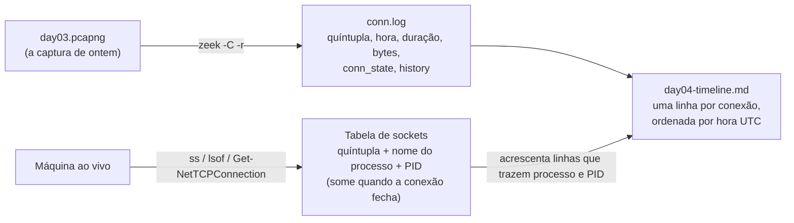

# Dia 04: Lendo logs de conexão com Zeek e tabelas de sockets ao vivo

> 🇺🇸 Original: [*Day 4: Reading connection logs with Zeek and live socket tables*](https://github.com/thiefdroppers/cyber-investigator-skills/blob/main/curriculum/phase-1-foundations/day-04.md) — © ThiefDroppers, licença MIT.
> Aqui: tradução fiel **+** camada brasileira. Nada do original foi removido; tudo o que é novo vem marcado com ➕.

**Fase 1. Fundamentos** · Meta da trilha: transformar pacotes brutos nos registros de uma linha por conexão que a maioria das investigações usa de verdade, e ler o desfecho de uma conexão pelos seus códigos de estado.

Rank Jutsu: `D` · [](https://colab.research.google.com/github/Ridd1kulusC0d3r/investigador-cyber-90-dias/blob/main/curriculo/fase-1-fundamentos/dia-04/dia-04.ipynb)

---

## 🎬 ➕ Abertura do caso — *Nove linhas da sede*

Segunda, 14h10. Marta Quintão manda um zip pelo canal seguro: o `conn.log` do sensor de rede da sede da Serra Azul, recortado para o dia. Nenhum pacote, só linhas.

— A gente tem um Zeek desde a auditoria do ano passado — ela escreve. — Ninguém nunca olhou.

Você abre. Nove linhas. Três delas mostram máquinas do atendimento da sede conversando com `203.0.113.77` hoje de manhã, durante e logo depois do disparo dos SMS. Uma termina em `RSTR`. Duas, perto do meio-dia, terminam em `S0`.

Rafa lê por cima do seu ombro.

— Antes de alguém concluir que o atendimento "caiu no golpe": me diz, linha por linha, o que cada conexão *fez*. Em português que a Marta entenda.

É isso que o Dia 4 ensina. *(Personagens e cenário: [Operação Isca](../../../caso-continuo/).)*

---

## 📖 Conceito

Capturas completas de pacotes são raras em casos reais. Elas são grandes, enchem discos em poucas horas, e a maioria das organizações não as guarda. O que você normalmente recebe é um log de conexão: uma linha por conversa, com a quíntupla, a hora de início, a duração, as contagens de bytes e alguma indicação de como a conversa foi. *Firewalls*, logs de fluxo de nuvem (AWS VPC Flow Logs, Google Cloud VPC Flow Logs), *proxies* e sensores de rede produzem alguma versão disso. O `conn.log` do Zeek é o formato aberto mais usado, e aprendê-lo torna todos os outros fáceis de ler.

O Zeek resume cada conexão com dois campos que valem a pena decorar. `conn_state` é um código curto de como a conexão foi. `SF` significa abertura e fechamento normais. `S0` significa que um SYN foi visto sem resposta nenhuma, que é a cara de varreduras e hosts mortos. `REJ` significa que o SYN foi respondido com RST, então a porta estava fechada. `RSTO` e `RSTR` significam que o originador ou o respondente resetou uma conexão estabelecida. `OTH` significa que o Zeek viu o meio de uma conversa sem o começo, comum no início de uma captura. O campo `history` soletra a sequência de pacotes em letras: `S` para SYN, `h` para SYN-ACK, `A` para ACK, `D` para dados, `F` para FIN, `R` para RST. Letras maiúsculas vêm do originador e minúsculas do respondente, então `ShADadFf` se lê como uma conversa TCP completa e comum.

Eis `ShADadFf` desdobrado pacote a pacote. O Zeek registra `A`, `a`, `D` e `d` no máximo uma vez por direção, por mais que veja, então `D` significa "pelo menos um pacote de dados", e o ACK final do fechamento não acrescenta letra nova.



Os códigos de `conn_state` acima saem de uma pequena série de perguntas sobre o início e o fim da conexão. Este gráfico cobre só os seis estados citados nesta seção; a documentação do Zeek lista os demais.



Contagens de bytes têm muito peso investigativo. Uma conexão em que o host interno enviou 40 MB e recebeu 2 KB é um *upload*, seja qual for a porta. Uma conexão que dura nove horas com algumas centenas de bytes a cada minuto parece um *heartbeat* (sinal de vida), que é como muitas ferramentas de acesso remoto e implantes de *malware* se comportam.

A contraparte ao vivo de um log de conexão é a tabela de *sockets* do sistema operacional. `ss` no Linux, `lsof` no macOS e `netstat` no Windows mostram as conexões abertas agora e, com as *flags* certas, qual processo é dono de cada uma. Essa ligação de uma conexão de rede com um processo é muitas vezes o fato que transforma "tráfego estranho" em achado, e ela só existe enquanto a conexão está viva. É por isso que ela fica perto do topo da ordem de volatilidade do Dia 2.

## 📚 Recursos

- [Documentação do conn.log do Zeek](https://docs.zeek.org/en/master/logs/conn.html): a lista completa de campos e as tabelas de `conn_state` e `history`.
- [Documentação do Zeek, "Zeek Logs" e zeek-cut](https://docs.zeek.org/en/master/log-formats.html).
- [Página de manual do ss(8)](https://man7.org/linux/man-pages/man8/ss.8.html).
- [Documentação do Security Onion](https://docs.securityonion.net/), se você quiser depois o Zeek rodando continuamente num sensor. Não é necessário hoje.

### ➕ Recursos do contexto Brasil

- [Marco Civil da Internet (Lei 12.965/2014)](https://www.planalto.gov.br/ccivil_03/_ato2011-2014/2014/lei/l12965.htm), art. 5º, VI e VIII: as definições legais de **registro de conexão** e **registro de acesso a aplicações de internet**. O `conn.log` de uma empresa não é nenhum dos dois no sentido da lei (que fala de provedores), mas é útil saber a diferença quando o caso chegar à polícia.
- [Resolução CMN nº 4.893/2021](https://www.bcb.gov.br/estabilidadefinanceira/buscanormas): política de segurança cibernética das instituições financeiras autorizadas pelo Banco Central, que trata de registro de incidentes e rastreabilidade. É o contexto regulatório em que uma cooperativa de crédito guarda (ou deveria guardar) logs como este. A Res. CMN 4.893/2021 se dirige às instituições financeiras e demais instituições autorizadas a funcionar pelo Banco Central, o que inclui as cooperativas de crédito. Ela foi alterada pela Res. CMN 5.274/2025 (publicada em 22/12/2025, com adequação até 1º/3/2026), que acrescentou, entre outros pontos, testes de intrusão ao menos anuais por terceiro independente e controles específicos para os ambientes Pix.
- [Zeek na comunidade brasileira (Security Onion BR, palestras do GTER/GTS do NIC.br)](https://gter.nic.br/): os encontros GTER e GTS do NIC.br têm apresentações em português sobre monitoramento de rede.

## 🛠️ Prática: Zeek (via Docker) e ss, produzindo uma tabela de linha do tempo de conexões

Você vai transformar a captura de ontem num `conn.log` do Zeek, lê-lo e cruzá-lo com uma tabela de *sockets* ao vivo da sua própria máquina.

**Seu checklist de hoje.** Faça na ordem e marque cada item ao terminar:

- [ ] Passo 1: rodar o Zeek contra o seu pcap
- [ ] Passo 2: ler o log de conexões
- [ ] Passo 3: contar por estado
- [ ] Passo 4: mapear conexões ao vivo para processos
- [ ] Passo 5: montar a linha do tempo de conexões
- [ ] ➕ Passo 6: o `conn.log` da sede da Serra Azul (Prática BR)
- [ ] ➕ Passo 7: o notebook do dia no Colab

### Passo 1: rodar o Zeek contra o seu pcap

Instale o Docker Desktop (Windows e macOS) ou o `docker.io` (Linux). Depois, na pasta que contém `day03.pcapng`:

```bash
docker run --rm -v "$PWD":/pcap -w /pcap zeek/zeek zeek -C -r day03.pcapng
ls *.log
```

`-r` lê um arquivo de captura em vez de escutar uma interface. `-C` diz ao Zeek para ignorar *checksums* ruins, que você vai ver em quase toda captura feita na máquina que envia, porque a placa de rede preenche os *checksums* depois que o Wireshark vê o pacote. Espere `conn.log`, `dns.log`, `http.log` e mais alguns.

Se você não puder usar o Docker, o `tshark` (instalado junto com o Wireshark) dá um resumo de conversas comparável:

```bash
tshark -r day03.pcapng -q -z conv,tcp
```

### Passo 2: ler o log de conexões

O `conn.log` bruto é separado por tabulações e tem um bloco de cabeçalho. O `zeek-cut` seleciona colunas pelo nome, e `-u` converte os carimbos de tempo para UTC:

```bash
docker run --rm -v "$PWD":/pcap -w /pcap zeek/zeek sh -c \
  "zeek-cut -u ts id.orig_h id.orig_p id.resp_h id.resp_p proto service duration orig_bytes resp_bytes conn_state history < conn.log"
```

Saída ilustrativa (endereços de documentação):

```
2026-03-10T14:30:01+0000  192.168.1.23  38211  192.168.1.1   53  udp  dns   0.021  31  47    SF   Dd
2026-03-10T14:30:01+0000  192.168.1.23  51522  198.51.100.7  80  tcp  http  0.071  77  2892  SF   ShADadFf
2026-03-10T14:30:44+0000  192.168.1.23  51530  198.51.100.7  81  tcp  -     5.002  0   0     S0   S
```

Leia cada linha em voz alta como uma frase. A segunda linha: "Às 14:30:01 UTC, 192.168.1.23 abriu uma conexão HTTP com 198.51.100.7 na porta 80, enviou 77 bytes, recebeu 2.892 e a fechou normalmente." A terceira: "Ele tentou a porta 81 e não recebeu resposta nenhuma." Se a sua tentativa na porta 81 foi recusada, você vai ver `REJ` com *history* `Sr`.

### Passo 3: contar por estado

Numa captura maior, este comando de uma linha é a sua primeira olhada no tipo de tráfego que você tem:

```bash
docker run --rm -v "$PWD":/pcap -w /pcap zeek/zeek sh -c \
  "zeek-cut conn_state < conn.log | sort | uniq -c | sort -rn"
```

Uma captura dominada por `S0` e `REJ` vindos de uma única origem é varredura. Uma captura dominada por `SF` é uso comum.

### Passo 4: mapear conexões ao vivo para processos

Com um navegador aberto, rode a tabela de *sockets* da sua própria máquina:

```bash
# Linux
sudo ss -tunap state established
# macOS
sudo lsof -nP -iTCP -sTCP:ESTABLISHED
# Windows (PowerShell como administrador)
Get-NetTCPConnection -State Established | Select LocalAddress,LocalPort,RemoteAddress,RemotePort,OwningProcess
```

Saída ilustrativa no Linux:

```
Netid Recv-Q Send-Q  Local Address:Port    Peer Address:Port  Process
tcp   0      0       192.168.1.23:51544    198.51.100.7:443   users:(("firefox",pid=2311,fd=87))
tcp   0      0       192.168.1.23:40118    203.0.113.20:443   users:(("slack",pid=3120,fd=41))
```

A coluna `Process` liga uma conexão a um programa nomeado e a um PID, o que nenhum log de rede consegue fazer sozinho.

### Passo 5: montar a linha do tempo de conexões

Crie `day04-timeline.md` com uma linha por conexão do seu `conn.log`, ordenada por hora, mais três linhas da sua tabela de *sockets*. As duas fontes se encontram na tabela assim:



```markdown
| Hora (UTC) | Origem | Destino | Proto/Serviço | Duração | Bytes saída/entrada | Estado | History | Processo (se conhecido) | Leitura em português claro |
|---|---|---|---|---|---|---|---|---|---|
```

A última coluna é o objetivo do exercício. Cada linha precisa de uma frase que um gerente não técnico consiga acompanhar, como "o notebook consultou neverssl.com e depois baixou a página inicial por HTTP sem criptografia".

### ➕ Prática BR: o `conn.log` da sede da Serra Azul

Os arquivos estão em [`caso-continuo/dados/dia-04/`](../../../caso-continuo/dados/dia-04/): `conn.log` (sensor Zeek da sede, recorte do dia 5/out, só as linhas relevantes) e `ss-vigia-lab01.txt` (a tabela de *sockets* da VM de análise da Vigia, tirada enquanto você revisitava o site falso). Plano de endereços da sede, que a TI da cooperativa mandou junto: `10.20.32.0/22` são servidores (o resolvedor DNS é `10.20.32.53`), `10.20.36.0/24` é o atendimento. O Dia 9 detalha isso.

1. Calcule o SHA-256 dos dois arquivos e registre-os na custódia (fonte: "Marta Quintão, canal seguro, 14h10 BRT").
2. Rode o `zeek-cut -u` do Passo 2 sobre o `conn.log` (ou leia direto: o `ts` está em segundos Unix; o notebook converte).
3. Faça o Passo 3 (contar por estado) e diga, em uma frase, que tipo de tráfego é este recorte.
4. Para cada linha, escreva a leitura em português claro. Atenção especial a: a linha `RSTR` com 517 bytes enviados e 0 recebidos; as duas linhas `S0` para `203.0.113.77:443` perto do meio-dia; as duas `S0` de `198.51.100.14` para a porta 3389 (o sensor fica antes do firewall da sede: vê o SYN que o firewall descarta).
5. Converta os horários das conexões com `203.0.113.77` para BRT. Quais caem dentro da janela dos SMS (07h12 a 08h40 BRT)?
6. Acrescente as linhas da `ss-vigia-lab01.txt` e responda: qual processo da VM falava com o site falso, e por que nenhuma linha do `conn.log` da cooperativa poderia dizer qual processo, em qual máquina do atendimento, abriu aquelas conexões?

### ➕ O notebook do dia

Abra o [notebook do Dia 04 no Colab](https://colab.research.google.com/github/Ridd1kulusC0d3r/investigador-cyber-90-dias/blob/main/curriculo/fase-1-fundamentos/dia-04/dia-04.ipynb). Nele você:

1. escreve um `zeek-cut` em Python (lê o cabeçalho `#fields` e devolve colunas pelo nome, com hora UTC e BRT);
2. reproduz o `sort | uniq -c` com `collections.Counter`;
3. escreve um **decodificador de `history`** que transforma `ShADr` em frases;
4. joga o quiz **"decifre o history"** (`ShADadFf`, `S`, `Sr` e outros);
5. gera a `day04-timeline-isca.md` com a coluna de leitura em português já rascunhada para você revisar.

## ✅ Checkpoint

O seu artefato é `day04-timeline.md`. Ele passa quando:

- `day04-timeline.md` tem pelo menos cinco linhas.
- As linhas estão ordenadas por hora UTC.
- Cada valor de `conn_state` e `history` está copiado exatamente do log.
- Pelo menos uma linha tem um estado diferente de `SF`.
- A leitura em português claro dessa linha diz corretamente o que aconteceu (sem resposta, recusada ou resetada, e por qual lado).
- Pelo menos uma linha traz um nome de processo e um PID da tabela de *sockets*.
- Você consegue explicar por que um log de firewall jamais poderia ter lhe dito aquele nome de processo e aquele PID.
- Sem consultar notas, você decodifica `ShADadFf`, `S` e `Sr`.

### ➕ Checkpoint BR

- A sua `day04-timeline-isca.md` tem as nove linhas do `conn.log` mais as linhas da `ss`, ordenadas por UTC, com uma coluna extra de hora BRT.
- Você explica a linha `RSTR` (`ShADr`): quem resetou, e por que "enviou 517 bytes, recebeu 0" **não** prova que alguém digitou senha.
- Você liga as duas linhas `S0` perto do meio-dia a uma hipótese verificável (bloqueio no firewall da sede? o servidor parou de responder?) e diz qual log confirmaria cada uma. (O Dia 9 traz o log do firewall.)
- Você nunca escreve "o funcionário X caiu no golpe": escreve "a estação 10.20.36.21 conectou-se a 203.0.113.77:443 às ... UTC".
- Você acertou pelo menos 6 das 8 perguntas do quiz do notebook.

## ⚖️ ➕ Camada jurídica BR

**Logs de funcionários são dados pessoais.** Um `conn.log` liga um endereço IP interno a horários de navegação. Como o endereço de uma estação é associável a quem a usa (escala de trabalho, login), esse log é dado pessoal pela LGPD (art. 5º, I). A cooperativa pode tratá-lo para segurança e prevenção à fraude com base, por exemplo, no legítimo interesse (art. 7º, IX) ou no cumprimento de obrigação regulatória (art. 7º, II), mas a Vigia só recebe o que precisa: um recorte do dia e dos domínios do caso, não o log do ano inteiro. Isso é o princípio da necessidade (art. 6º, III).

**Monitorar não é punir.** O caso é sobre o golpe contra cooperados. Se, no meio da análise, surgir algo sobre a conduta de um empregado (por exemplo, navegação pessoal), isso fica fora do escopo do Dia 01: não é seu achado, e não vai para o relatório. Se for relevante para a segurança, sinalize para a Marta e o Dr. Hélio, sem nominar ninguém.

**Registro de conexão (Marco Civil, art. 5º, VI).** A lei chama de "registro de conexão" os dados de início e fim de uma conexão à internet, guardados pelo provedor de conexão (art. 13, guarda de 1 ano). O sensor Zeek da cooperativa não é provedor de conexão nesse sentido; o log é dela, e a cooperativa decide entregá-lo à Vigia por contrato.

> Material de estudo, não constitui orientação jurídica.

## 🧠 ➕ Camada 8 — o erro fundamental de atribuição nas nove linhas

Três estações do atendimento falaram com o site falso. A tentação é imediata: *"o pessoal da sede caiu no golpe"*. Psicólogos sociais chamam de **erro fundamental de atribuição** a tendência de explicar o comportamento dos outros por características da pessoa (descuido, ingenuidade) e subestimar a situação. Aqui, a situação é óbvia quando você olha: o atendimento da sede é justamente quem recebeu as 37 reclamações de manhã, e abrir o link denunciado para entender a queixa é o que um atendente diligente faria.

O log não sabe *por que* alguém abriu a conexão. Ele não sabe nem *quem* abriu: sabe qual endereço, em que hora. O `RSTR` com 517 bytes de saída é compatível com "abriu a página e fechou", não com "digitou a senha".

**Consequência prática:** descreva endereços e horários, não pessoas e intenções. E, ao entregar a timeline para a Marta, acrescente uma linha: "estas conexões são compatíveis com verificação das denúncias pelo próprio atendimento; não há, neste log, indício de envio de credenciais". Você protege as pessoas e protege o caso de uma conclusão que a defesa derrubaria em um minuto.

## 🤖 ➕ Skill do dia

Hoje o dia propõe para a [skill pt-BR](../../../skills/investigador-cyber/SKILL.md) o procedimento **"Leitura de log de conexão (Zeek e similares)"**: decodificar `conn_state` e `history`, ler bytes de saída e entrada, e a regra de escrever endereços e horários, nunca pessoas. Proposta completa em [`_skill-delta.md`](_skill-delta.md).

## 💡 ➕ Inovação OSINT do dia — um `zeek-cut` em dez linhas

O formato TSV do Zeek traz os nomes das colunas na linha `#fields`. Com `csv` e `datetime`, ambos da biblioteca padrão, você lê qualquer log do Zeek (conn, dns, http, ssl) sem instalar o Zeek:

```python
import csv, datetime
def zeek_cut(caminho, *colunas):
    campos = None
    for linha in open(caminho, encoding="utf-8"):
        if linha.startswith("#fields"):
            campos = linha.rstrip("\n").split("\t")[1:]          # nomes das colunas
        elif not linha.startswith("#"):
            reg = dict(zip(campos, linha.rstrip("\n").split("\t")))
            reg["ts"] = datetime.datetime.fromtimestamp(float(reg["ts"]), datetime.timezone.utc)
            yield [reg[c] for c in colunas]
for linha in zeek_cut("conn.log", "ts", "id.orig_h", "id.resp_h", "conn_state", "history"):
    print(*linha, sep="\t")
```

O mesmo leitor serve para o `dns.log`: o campo `query` daria, em segundos, a lista de todas as estações que pediram `serraazul-pix.example`, que é exatamente o que o Dia 5 vai buscar no resolvedor da cooperativa.

## 📝 Diário de estudo

- Data:
- Tempo gasto:
- O que ficou claro:
- O que ainda está nebuloso:
- Artefato produzido: `day04-timeline.md`, `day04-timeline-isca.md`

---
<sub>Baseado em [cyber-investigator-skills](https://github.com/thiefdroppers/cyber-investigator-skills) por ThiefDroppers (MIT). Tradução, camada BR, Camada 8, skill pt-BR e notebook por Deivison Lourenço (@Ridd1kulusC0d3r).</sub>
