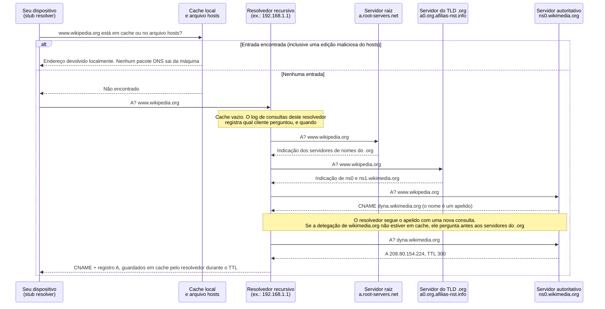
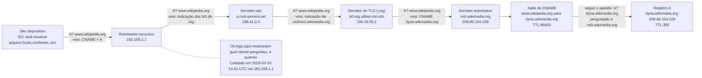

# Dia 05: Cadeias de resolução DNS: seguindo um nome até um endereço

> 🇺🇸 Original: [*Day 5: DNS resolution chains, following a name to an address*](https://github.com/thiefdroppers/cyber-investigator-skills/blob/main/curriculum/phase-1-foundations/day-05.md) — © ThiefDroppers, licença MIT.
> Aqui: tradução fiel **+** camada brasileira. Nada do original foi removido; tudo o que é novo vem marcado com ➕.

**Fase 1. Fundamentos** · Meta da trilha: rastrear como um nome de host vira um endereço IP, salto por salto, e saber qual parte dessa cadeia guarda qual evidência.

Rank Jutsu: `D` · [](https://colab.research.google.com/github/Ridd1kulusC0d3r/investigador-cyber-90-dias/blob/main/curriculo/fase-1-fundamentos/dia-05/dia-05.ipynb)

---

## 🎬 ➕ Abertura do caso — *Quem perguntou primeiro*

Segunda, 15h02. A TI da Serra Azul acabou de ligar um bloqueio no resolvedor DNS interno: agora `serraazul-pix.example` responde `NXDOMAIN` para quem está dentro da cooperativa. Você roda `dig` da VM, pela internet, e o nome resolve normalmente para `203.0.113.77`, com um TTL que cai a cada consulta.

— Dois `dig`, duas respostas, as duas certas — diz Rafa. — Agora a pergunta que importa: o resolvedor da cooperativa guarda log de consultas?

Guarda. A TI manda um extrato filtrado pelo nome do golpe. A primeira consulta interna é das 08h14, de uma estação do atendimento. Rafa aponta outra coisa na tela da Marta: o print de um cooperado que jura ter digitado `serraazul.example`, o endereço **verdadeiro**, e mesmo assim caiu numa página igual à do golpe.

— Isso aí não passa por DNS nenhum. Hoje você vai entender por quê.

É isso que o Dia 5 ensina. *(Personagens e cenário: [Operação Isca](../../../caso-continuo/).)*

---

## 📖 Conceito

Quase todo incidente começa com um nome: um link num SMS de phishing, um domínio num log de *proxy*, um nome de host na configuração de um *malware*. Antes que uma conexão aconteça, o nome tem de ser resolvido, e cada passo dessa resolução envolve uma parte diferente, que viu a consulta e pode tê-la registrado.

A cadeia tem quatro tipos de participante. O *stub resolver* do seu dispositivo confere o cache local e o arquivo *hosts* (`/etc/hosts` no Linux e no macOS, `C:\Windows\System32\drivers\etc\hosts` no Windows), e então pergunta a um resolvedor recursivo. Normalmente é o seu roteador, o seu provedor, o servidor DNS do seu empregador ou um serviço público como 1.1.1.1 ou 8.8.8.8. O resolvedor recursivo, se não tem resposta em cache, pergunta a um servidor raiz quais servidores cuidam do domínio de topo (`.org`), pergunta a esses quais servidores são autoritativos para o domínio (`wikipedia.org`) e, por fim, pergunta ao servidor autoritativo pelo registro em si.

A cadeia completa de `www.wikipedia.org`, usando os valores ilustrativos da prática de hoje, fica assim:



Dois detalhes derrubam investigadores de novo e de novo. Primeiro, as respostas ficam em cache pelo TTL do registro, em segundos. Se o registro A de um domínio tem TTL de 300, duas pessoas consultando com dez minutos de diferença podem receber respostas diferentes, e nenhuma está errada. Sempre registre o horário e o resolvedor que você usou. Segundo, muitos nomes são apelidos. Um registro CNAME diz "este nome é, na verdade, aquele outro nome", e a cadeia pode ter vários saltos, muitas vezes terminando no nome de host de uma CDN ou de um provedor de nuvem. O IP final pode pertencer a uma plataforma compartilhada que hospeda milhares de sites sem relação entre si, então um IP sozinho raramente identifica quem está por trás de um domínio.

Como evidência, o log de consultas do resolvedor recursivo costuma ser o melhor registro de qual máquina interna consultou qual domínio, e quando. Ele existe antes de qualquer conexão e sobrevive mesmo quando a conexão foi bloqueada. O arquivo *hosts* importa pelo motivo oposto: *malware* e algumas ferramentas de fraude o editam para mandar o nome de um banco real para um servidor falso, e nada na rede mostra o redirecionamento, porque nenhuma consulta DNS sai da máquina.

O `dig` é a ferramenta padrão do investigador porque mostra a resposta inteira, incluindo *flags* e TTLs. O `nslookup` vem instalado em todo lugar, inclusive no Windows, e é bom o suficiente para checagens rápidas.

## 📚 Recursos

- [How DNS Works (quadrinho)](https://howdns.works/): um passeio rápido e preciso pela cadeia de resolução.
- [Mess With DNS](https://messwithdns.net/), de Julia Evans: um *sandbox* gratuito em que você cria registros e vê resolvedores reais consultando-os.
- [Manual do dig (documentação do BIND 9)](https://bind9.readthedocs.io/en/latest/manpages.html#dig-dns-lookup-utility).
- [DNSViz](https://dnsviz.net/): desenha a cadeia de delegação e de DNSSEC de qualquer domínio.
- [RFC 1034](https://www.rfc-editor.org/rfc/rfc1034), seção 5, sobre resolvedores, se você quiser a fonte.

### ➕ Recursos do contexto Brasil

- [Registro.br — RDAP e WHOIS](https://registro.br/tecnologia/ferramentas/rdap/): para domínios `.br`, quem delega é o Registro.br (NIC.br). O RDAP mostra os servidores DNS declarados, as datas de criação e alteração e o titular (CPF/CNPJ mascarados).
- [Registro.br — DNSSEC](https://registro.br/tecnologia/dnssec/): documentação em português sobre a cadeia de assinatura DNSSEC no `.br`.
- [Cartilha de Segurança para Internet (CERT.br)](https://cartilha.cert.br/): os fascículos sobre golpes e códigos maliciosos explicam *pharming* (redirecionamento por DNS ou arquivo *hosts*) para o público leigo; bom material para a cooperativa repassar.
- [Resolvedores públicos com DoH](https://developers.cloudflare.com/1.1.1.1/encryption/dns-over-https/make-api-requests/dns-json/): Cloudflare (1.1.1.1) e Google (8.8.8.8) respondem consultas DNS em JSON por HTTPS, úteis para coletar de forma reprodutível (veja a Inovação do dia).

## 🛠️ Prática: dig, DNSViz e draw.io, produzindo um diagrama de cadeia de resolução para o nome de host de uma organização pública

Escolha o nome de host do site de uma organização pública (uma universidade, uma prefeitura, uma biblioteca nacional ou a Wikipédia). Os exemplos abaixo usam `www.wikipedia.org`.

**Seu checklist de hoje.** Faça na ordem e marque cada item ao terminar:

- [ ] Passo 1: descobrir o que a sua máquina usa
- [ ] Passo 2: resolver normalmente e ler a resposta completa
- [ ] Passo 3: percorrer a cadeia a partir da raiz
- [ ] Passo 4: perguntar diretamente ao servidor autoritativo
- [ ] Passo 5: ver o cache acontecendo
- [ ] Passo 6: obter o grafo do DNSViz
- [ ] Passo 7: desenhar a sua própria cadeia de resolução
- [ ] ➕ Passo 8: as duas respostas de `serraazul-pix.example` e o log do resolvedor da cooperativa (Prática BR)
- [ ] ➕ Passo 9: o notebook do dia no Colab

### Passo 1: descobrir o que a sua máquina usa

```bash
# Linux (systemd-resolved)
resolvectl status | grep -A2 "DNS Servers"
# macOS
scutil --dns | grep nameserver | sort -u
# Windows
Get-DnsClientServerAddress -AddressFamily IPv4
```

Confira também o arquivo *hosts* da sua máquina em busca de qualquer entrada além de `localhost`. Registre as duas coisas nas suas notas.

### Passo 2: resolver normalmente e ler a resposta completa

```bash
dig www.wikipedia.org
```

Saída ilustrativa, resumida:

```
;; ->>HEADER<<- opcode: QUERY, status: NOERROR, id: 40211
;; flags: qr rd ra; QUERY: 1, ANSWER: 2, AUTHORITY: 0, ADDITIONAL: 1

;; QUESTION SECTION:
;www.wikipedia.org.             IN      A

;; ANSWER SECTION:
www.wikipedia.org.      49518   IN      CNAME   dyna.wikimedia.org.
dyna.wikimedia.org.     300     IN      A       208.80.154.224

;; Query time: 18 msec
;; SERVER: 192.168.1.1#53(192.168.1.1)
;; WHEN: Tue Mar 10 14:41:02 UTC 2026
```

O que cada parte lhe diz:

- `status: NOERROR` significa que o nome existe. `NXDOMAIN` significa que não existe. `SERVFAIL` significa que o resolvedor não conseguiu obter resposta, o que é comum em domínios maliciosos quebrados ou mal configurados de propósito.
- `flags: qr rd ra` mostra que isto é uma resposta (`qr`), que você pediu recursão (`rd`) e que o servidor a oferece (`ra`). A ausência de `aa` significa que a resposta veio de um cache ou de um resolvedor recursivo, não do servidor autoritativo.
- A seção ANSWER mostra uma cadeia de dois saltos: `www.wikipedia.org` é um apelido (CNAME) de `dyna.wikimedia.org`, que tem o registro A. O TTL do CNAME é longo (horas); o do registro A é de 5 minutos, então o endereço pode mudar rápido enquanto o apelido fica estável.
- `SERVER` e `WHEN` são a sua proveniência. Copie-os para as suas notas toda vez.

A mesma consulta com `nslookup`, para comparação:

```bash
nslookup www.wikipedia.org 1.1.1.1
```

Ele mostra o CNAME como `canonical name = dyna.wikimedia.org.` e rotula o resultado como "Non-authoritative answer".

### Passo 3: percorrer a cadeia a partir da raiz

```bash
dig +trace +nodnssec www.wikipedia.org
```

`+trace` faz o `dig` cumprir o papel do resolvedor: ele pergunta a um servidor raiz, segue a indicação para os servidores do `.org` e depois para os servidores de nomes do próprio domínio. Ilustrativo, resumido:

```
.                     518400  IN  NS  a.root-servers.net.
;; Received 239 bytes from 192.168.1.1#53(192.168.1.1) in 12 ms

org.                  172800  IN  NS  a0.org.afilias-nst.info.
;; Received 780 bytes from 198.41.0.4#53(a.root-servers.net) in 21 ms

wikipedia.org.        86400   IN  NS  ns0.wikimedia.org.
wikipedia.org.        86400   IN  NS  ns1.wikimedia.org.
;; Received 350 bytes from 199.19.56.1#53(a0.org.afilias-nst.info) in 30 ms

www.wikipedia.org.    86400   IN  CNAME  dyna.wikimedia.org.
;; Received 88 bytes from 208.80.154.238#53(ns0.wikimedia.org) in 95 ms
```

Cada linha `Received ... from` nomeia o servidor que deu aquele pedaço da resposta. Repare que o último passo devolve só o CNAME; o `+trace` não o segue. Rode `dig +trace +nodnssec dyna.wikimedia.org` para terminar a cadeia.

Algumas redes bloqueiam consultas diretas aos servidores raiz, então o `+trace` para depois do primeiro bloco. Se isso acontecer, rode-o de outra rede ou pule para o Passo 4, que não depende dele.

### Passo 4: perguntar diretamente ao servidor autoritativo

```bash
dig @ns0.wikimedia.org dyna.wikimedia.org +norecurse
```

A linha `flags` agora inclui `aa` (*authoritative answer*, resposta autoritativa). O TTL mostra o valor configurado completo, e não uma contagem regressiva de um cache.

### Passo 5: ver o cache acontecendo

```bash
for i in 1 2 3; do dig +noall +answer dyna.wikimedia.org @1.1.1.1; sleep 20; done
```

O TTL diminui entre as execuções, o que mostra que você está lendo de um cache.

### Passo 6: obter o grafo do DNSViz

Vá a `https://dnsviz.net/`, digite o domínio (`wikipedia.org`) e clique no botão de análise. Na página de resultados, salve a imagem do grafo (botão direito > Salvar imagem como) como `day05-dnsviz.png`. Ela desenha a delegação da raiz até o domínio, incluindo a cadeia de assinatura DNSSEC se o domínio usar DNSSEC.

### Passo 7: desenhar a sua própria cadeia de resolução

No draw.io (`https://app.diagrams.net`, escolha "Device" para salvar localmente), desenhe a cadeia que você observou, da esquerda para a direita:

1. O seu dispositivo (rótulo: SO, *stub resolver*, arquivo *hosts* conferido sim ou não)
2. O seu resolvedor recursivo (rótulo: IP do Passo 1)
3. Servidor raiz (rótulo: o nome e o IP do `+trace`)
4. Servidor do TLD (rótulo: nome e IP)
5. Servidor autoritativo (rótulo: nome e IP)
6. Cada salto de CNAME como uma caixa própria, com o seu TTL
7. O registro A ou AAAA final, com o seu TTL

Em cada seta, escreva o que foi perguntado e o que voltou ("A? www.wikipedia.org → indicação dos NS do .org"). Ao lado do resolvedor recursivo, acrescente uma nota: "Os logs aqui mostrariam qual cliente perguntou, e quando." Salve como `day05-resolution-chain.drawio` e exporte com File > Export as > PNG.

Um diagrama pronto carrega as mesmas caixas e rótulos desta referência, que usa os valores ilustrativos dos Passos 2 e 3. Cada valor do seu deve sair da sua própria saída:



Cada seta que chega a uma caixa de servidor é rotulada com a pergunta enviada a esse servidor e a resposta que ele deu.

### ➕ Prática BR: duas respostas certas e um log que lembra

Arquivos em [`caso-continuo/dados/dia-05/`](../../../caso-continuo/dados/dia-05/) (fictícios; o `.example` é reservado e não resolve na internet real, por isso as saídas foram preparadas para você):

- `dig-resolvedor-interno.txt` — o `dig` feito de dentro da cooperativa, depois do bloqueio;
- `dig-publico.txt` — o `dig` da VM da Vigia contra `1.1.1.1`;
- `dig-trace.txt` — o `+trace` de `www.serraazul-pix.example`;
- `log-consultas-resolvedor.txt` — extrato do log de consultas do resolvedor `dns1.serraazul.example` (`10.20.32.53`);
- `hosts-didatico.txt` — um arquivo *hosts* adulterado, de exemplo, para explicar o print do cooperado.

1. Leia os dois `dig`. Para cada um, anote `status`, `flags`, `SERVER`, `WHEN` e os TTLs. Explique por que o interno diz `NXDOMAIN` e o público diz `NOERROR`, e por que **as duas respostas são verdadeiras**. Que tipo de bloqueio a TI usou? (Dica: olhe o nome da zona na seção AUTHORITY.)
2. No `dig-trace.txt`, identifique raiz, TLD, servidores autoritativos (`ns1.dnsbarato.example`) e o CNAME. Compare o TTL do registro A no autoritativo (300) com o do `dig-publico.txt` (187): o que essa diferença lhe diz?
3. No log do resolvedor, liste os clientes que consultaram `serraazul-pix.example` e quando, em BRT. Cruze com o `conn.log` do Dia 4: cada conexão com `203.0.113.77` foi precedida por uma consulta? Houve consulta sem conexão? E conexão sem consulta?
4. Em que horário o bloqueio de DNS entrou? E as conexões `S0` perto do meio-dia, do Dia 4, aconteceram antes ou depois dele? O que isso sugere sobre **outro** bloqueio, em outra camada? (O Dia 9 confirma.)
5. Abra `hosts-didatico.txt`. Explique, para a Marta, como um cooperado pode digitar o endereço verdadeiro e cair no site falso, e por que nenhum log de DNS da cooperativa ou do provedor registraria isso.
6. Desenhe a cadeia de `www.serraazul-pix.example` no formato do Passo 7, com a nota "o log do resolvedor 10.20.32.53 registra quem perguntou".

### ➕ O notebook do dia

Abra o [notebook do Dia 05 no Colab](https://colab.research.google.com/github/Ridd1kulusC0d3r/investigador-cyber-90-dias/blob/main/curriculo/fase-1-fundamentos/dia-05/dia-05.ipynb). Nele você:

1. escreve um leitor da saída do `dig` (cabeçalho, *flags*, seções, `SERVER`, `WHEN`) e segue a cadeia de CNAME até o registro A;
2. faz uma consulta DNS **real** em JSON por HTTPS (DoH) a um domínio público, com plano B offline;
3. simula o cache: dois investigadores, dez minutos de diferença, respostas diferentes e ambas corretas;
4. cruza o log do resolvedor com o `conn.log` do Dia 4 numa linha do tempo única;
5. joga o quiz **"onde está a evidência?"** e gera o diagrama da cadeia em mermaid.

## ✅ Checkpoint

Os seus artefatos são `day05-resolution-chain.png` e `day05-dnsviz.png`. Eles passam quando:

- Toda caixa de servidor traz um nome e um IP tirados da sua própria saída do `dig`.
- Toda caixa de registro traz um TTL.
- A cadeia de CNAME está completa, terminando num registro A ou AAAA.
- O diagrama marca onde existiriam logs de consulta (no mínimo, no resolvedor recursivo).
- O diagrama anota a hora da coleta.
- O diagrama anota o resolvedor usado.
- Você consegue explicar por que dois investigadores poderiam obter IPs diferentes para o mesmo nome com uma hora de diferença.
- Você consegue explicar por que editar um arquivo *hosts* não deixaria rastro na rede.

### ➕ Checkpoint BR

- Você explica, em duas frases, por que o `NXDOMAIN` interno e o `NOERROR` público são ambos verdadeiros, e nomeia o mecanismo de bloqueio (RPZ, *Response Policy Zone*).
- A sua linha do tempo junta log do resolvedor e `conn.log`, em UTC e BRT, e aponta a consulta de 12h02 UTC que não virou conexão `SF`.
- Você explica *pharming* por arquivo *hosts* para um leigo, sem jargão, em até cinco linhas.
- Você acertou pelo menos 5 das 6 perguntas do quiz do notebook.

## ⚖️ ➕ Camada jurídica BR

**Quem pode pedir o log de consultas de um provedor.** O log do resolvedor **da cooperativa** é dela, e ela o entrega por contrato. Já o log do resolvedor de um provedor de acesso (a operadora do cooperado) é outra conversa: o Marco Civil obriga o provedor de conexão a guardar registros de conexão por um ano (art. 13), mas **proíbe** que ele guarde os registros de acesso a aplicações (art. 14). Logs de DNS do provedor não aparecem com esse nome na lei, e qualquer acesso a dados de navegação de um cliente da operadora depende de ordem judicial (art. 10, §1º, e art. 22). <!-- TODO jurídico: confirmar se há entendimento consolidado sobre a natureza jurídica de logs de DNS de provedores de conexão. -->

**Pharming e o Código Penal.** Alterar o arquivo *hosts* da máquina de alguém para desviá-lo a um site falso envolve, em tese, instalar vulnerabilidade ou adulterar dados em dispositivo alheio (CP, art. 154-A) e, quando há prejuízo financeiro por meio eletrônico, a fraude eletrônica do art. 171, §2º-A (Lei 14.155/2021). O enquadramento é tarefa da polícia e do Ministério Público; o seu trabalho é documentar o artefato (o *hosts* adulterado, com hash) se ele aparecer num equipamento que você está autorizado a examinar.

**Bloqueio por RPZ.** O bloqueio no resolvedor da cooperativa é uma medida da própria cooperativa na própria rede, e é legítima. Pedir bloqueio de um domínio para **toda a internet brasileira** é outro caminho, que passa pelo registro, pelo provedor de hospedagem (notificação de abuso) ou por ordem judicial.

> Material de estudo, não constitui orientação jurídica.

## 🧠 ➕ Camada 8 — "eu digitei o endereço certo"

O cooperado do print tem razão: ele digitou `serraazul.example`, e o que viu foi a página falsa. A primeira reação de muita gente na cooperativa é duvidar dele (*"ele clicou no link e não lembra"*). Às vezes é isso. Mas quando a vítima é desacreditada logo de saída, duas coisas acontecem: a investigação perde uma hipótese técnica real (o *pharming* por arquivo *hosts* ou por roteador doméstico adulterado), e a vítima sofre **revitimização**, o dano secundário causado pela resposta das instituições, e não pelo golpe em si.

O golpe explora exatamente a confiança no nome: o cérebro trata o endereço digitado como garantia, e todo o visual da página falsa confirma a expectativa. É **viés de confirmação** do lado da vítima, e o golpista o fabrica de propósito.

**Consequência prática:** registre o relato da vítima como dado, com a hora e as palavras dela, e transforme-o em hipóteses verificáveis (hosts adulterado? DNS do roteador trocado? autocompletar do navegador?), em vez de julgar se ela "está certa". O Dia 70 e a entrevista com o "Seu Antônio" voltam a isso.

## 🤖 ➕ Skill do dia

Hoje o dia propõe para a [skill pt-BR](../../../skills/investigador-cyber/SKILL.md) o procedimento **"Seguir uma cadeia de resolução DNS"**: registrar resolvedor e hora, seguir CNAMEs até o A, tratar TTL e respostas divergentes como normais, apontar onde existem logs e considerar o arquivo *hosts*. Proposta completa em [`_skill-delta.md`](_skill-delta.md).

## 💡 ➕ Inovação OSINT do dia — DNS em JSON por HTTPS, só com `urllib`

Resolvedores públicos como o do Google respondem consultas DNS em JSON por HTTPS (*DNS-over-HTTPS*, formato JSON). Isso dá uma coleta reprodutível de qualquer máquina, sem `dig`, e a resposta já vem com `TTL`, `Status` e a cadeia de CNAME:

```python
import json, urllib.request
url = "https://dns.google/resolve?name=www.wikipedia.org&type=A"
resp = json.load(urllib.request.urlopen(url, timeout=10))
print(resp["Status"])                       # 0 = NOERROR, 3 = NXDOMAIN
for r in resp.get("Answer", []):
    print(r["name"], r["type"], r["TTL"], r["data"])   # tipo 5 = CNAME, 1 = A
```

O da Cloudflare (`https://cloudflare-dns.com/dns-query?name=...&type=A`) devolve o mesmo formato, desde que você envie o cabeçalho `accept: application/dns-json`. Consultar os dois e comparar é um jeito barato de perceber respostas diferentes por resolvedor. Lembre-se de anotar **qual** resolvedor respondeu e quando: para a evidência, "Google DoH, 2026-10-05T18:02Z" é o `SERVER` e o `WHEN` do `dig`.

## 📝 Diário de estudo

- Data:
- Tempo gasto:
- O que ficou claro:
- O que ainda está nebuloso:
- Artefato produzido: `day05-resolution-chain.png`, `day05-dnsviz.png`, linha do tempo DNS + conexões da Operação Isca

---
<sub>Baseado em [cyber-investigator-skills](https://github.com/thiefdroppers/cyber-investigator-skills) por ThiefDroppers (MIT). Tradução, camada BR, Camada 8, skill pt-BR e notebook por Deivison Lourenço (@Ridd1kulusC0d3r).</sub>
