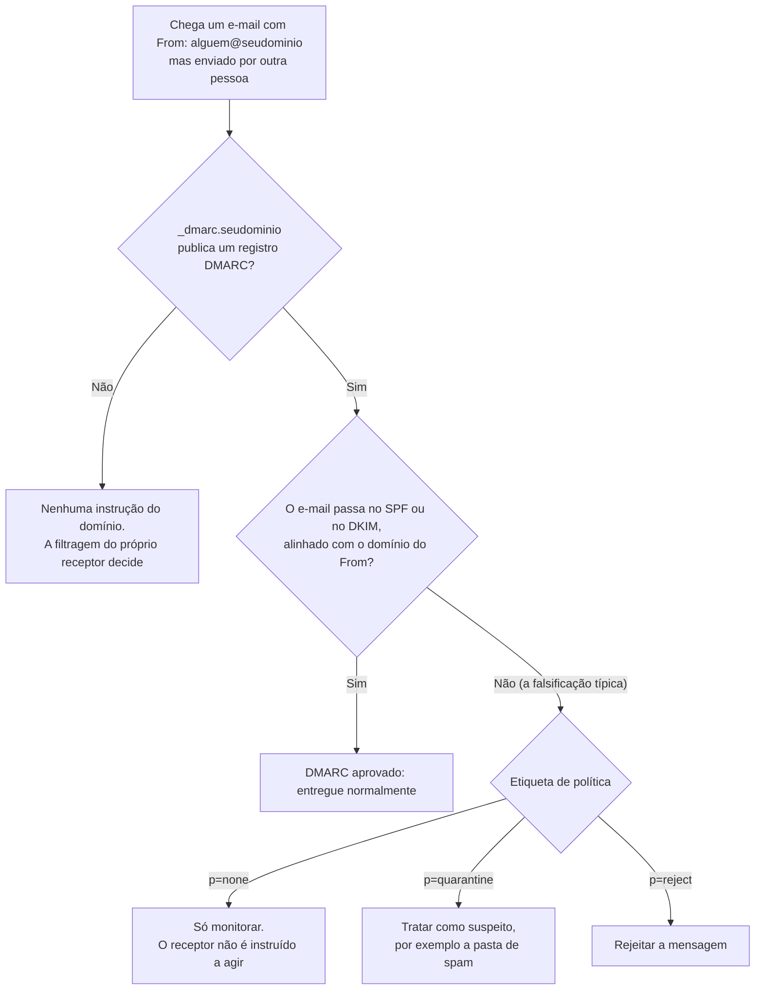
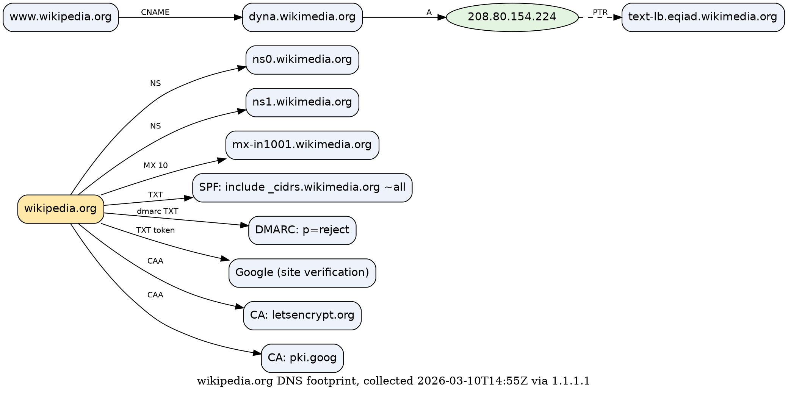
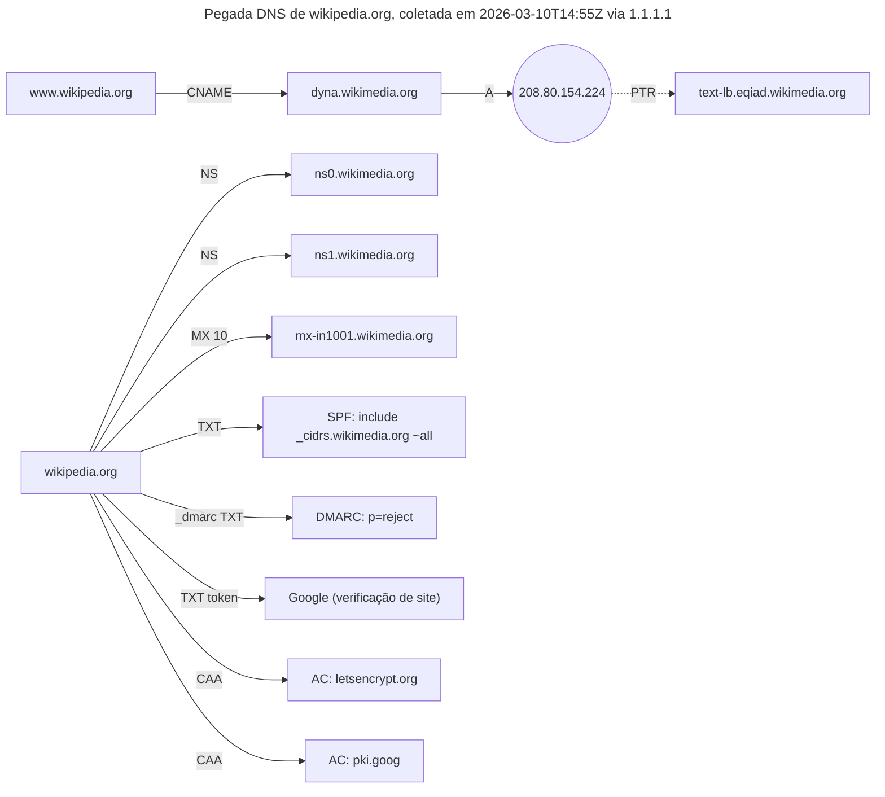

# Dia 06: Registros DNS como evidência: o grafo de pegada de um domínio

> 🇺🇸 Original: [*Day 6: DNS records as evidence, building a domain footprint graph*](https://github.com/thiefdroppers/cyber-investigator-skills/blob/main/curriculum/phase-1-foundations/day-06.md) — © ThiefDroppers, licença MIT.
> Aqui: tradução fiel **+** camada brasileira. Nada do original foi removido; tudo o que é novo vem marcado com ➕.

**Fase 1. Fundamentos** · Meta da trilha: ler cada tipo comum de registro DNS pelo que ele revela sobre a infraestrutura e a postura de e-mail de uma organização, e transformar os resultados num grafo.

Rank Jutsu: `D` · [](https://colab.research.google.com/github/Ridd1kulusC0d3r/investigador-cyber-90-dias/blob/main/curriculo/fase-1-fundamentos/dia-06/dia-06.ipynb)

---

## 🎬 ➕ Abertura do caso — *O token esquecido*

Segunda, 16h30. A ouvidoria repassa um dado novo: dois cooperados receberam também um **e-mail** "da Serra Azul", com remetente `atendimento@serraazul.example`, o endereço verdadeiro. Marta liga, aflita.

— Invadiram o nosso e-mail?

Rafa não responde. Ele vira o seu monitor e escreve três linhas no terminal: `dig` no domínio verdadeiro, no `serraazul-pix.example` e no `serraazul-seguranca.example`, registro por registro.

Dez minutos depois, duas coisas estão na tela. O DMARC da cooperativa é `p=none`. E os dois domínios do golpe, com IPs diferentes, carregam no TXT **o mesmo** *token* de verificação de painel: `ik-77c1e9a04b`.

— A primeira explica o e-mail sem invasão nenhuma — diz Rafa. — A segunda é o seu primeiro vínculo de verdade. Desenha.

É isso que o Dia 6 ensina. *(Personagens e cenário: [Operação Isca](../../../caso-continuo/).)*

---

## 📖 Conceito

Ontem você resolveu um nome até um endereço. Hoje você lê o resto do DNS público de um domínio, que diz uma quantidade surpreendente de coisas sobre como uma organização administra a sua infraestrutura. Tudo isso é publicado de propósito, para que a internet consiga chegar à organização, e é por isso que lê-lo é reconhecimento comum e lícito.

Os registros que vale conhecer, e o que cada um diz a um investigador:

| Registro | Guarda | O que lhe diz |
|---|---|---|
| A / AAAA | Endereço IPv4 / IPv6 | Onde o serviço está hospedado. Muitas vezes uma faixa de CDN ou de nuvem compartilhada com muitos outros clientes. |
| CNAME | Um apelido para outro nome | Qual plataforma de fato serve o nome (uma CDN, um *help desk* SaaS, um construtor de sites). |
| NS | Os servidores de nomes do domínio | Quem opera o DNS do domínio. Uma troca repentina de NS num domínio estabelecido pode significar transferência ou sequestro (*hijack*). |
| SOA | Servidor primário, caixa de e-mail do administrador, número de série | O campo RNAME é um endereço de e-mail escrito com um ponto no lugar do `@`. Os números de série muitas vezes são datas (`2026060420`), o que mostra quando a zona mudou pela última vez. |
| MX | Servidores de e-mail, com prioridade | Quem cuida do e-mail recebido (Google Workspace, Microsoft 365, servidor próprio). `0 .` é um MX nulo (RFC 7505): o domínio não aceita e-mail nenhum. |
| TXT | Texto livre | Política SPF, *tokens* de verificação de domínio deixados por fornecedores SaaS e, às vezes, outras configurações. |
| TXT em `_dmarc.` | Política DMARC | Como os receptores devem tratar e-mails que falham na autenticação. Diretamente relevante para o quanto o domínio é fácil de falsificar. |
| CAA | Quais autoridades certificadoras podem emitir para o domínio | Uma AC inesperada nos logs de *Certificate Transparency* vira suspeita quando o CAA a proíbe. |
| PTR | Mapeamento reverso de IP para nome | Pistas de hospedagem. Operadores muitas vezes codificam nomes de *data center* ou de função aqui. |

Registros de e-mail merecem atenção extra, porque muita fraude viaja por e-mail. O SPF (`v=spf1 ... -all`) lista quais servidores podem enviar e-mail pelo domínio; `-all` significa rejeitar todo o resto, e `~all` significa só marcar como suspeito. O DMARC (`v=DMARC1; p=reject`) diz aos servidores receptores o que fazer com e-mails que falham no alinhamento de SPF e DKIM. Um domínio sem registro DMARC, ou com `p=none`, não dá aos receptores nenhuma instrução para rejeitar e-mail falsificado, então um ataque de imitação contra ele fica mais barato. Você vai usar isto na Fase 5, ao avaliar por que um comprometimento de e-mail corporativo (BEC) funcionou.

Para um receptor que respeita o DMARC, o destino de uma mensagem falsificada se resume ao registro em `_dmarc.` e à etiqueta de política nele:



O DNS atual só mostra o presente. Serviços de DNS passivo registram para onde os nomes resolveram no passado, o que importa quando um domínio de golpe já mudou ou saiu do ar. Você vai usá-los na Fase 3.

## 📚 Recursos

- [RFC 7208: SPF](https://www.rfc-editor.org/rfc/rfc7208), seção 5, para os mecanismos (`include`, `ip4`, `-all`).
- [RFC 7489: DMARC](https://www.rfc-editor.org/rfc/rfc7489), seção 6.3, para as etiquetas de política (`p`, `sp`, `rua`, `pct`).
- [Visão geral do dmarc.org](https://dmarc.org/overview/).
- [Documentação do Graphviz](https://graphviz.org/documentation/) e a [referência da linguagem DOT](https://graphviz.org/doc/info/lang.html).
- [Cloudflare Learning Center: registros DNS](https://www.cloudflare.com/learning/dns/dns-records/), uma referência legível de cada tipo.

### ➕ Recursos do contexto Brasil

- [Registro.br — RDAP](https://registro.br/tecnologia/ferramentas/rdap/): para domínios `.br`, o RDAP traz servidores DNS, datas de criação e de alteração e o titular. Uma troca recente de NS num `.br` de banco ou cooperativa aparece aqui com data.
- [CERT.br — boas práticas antispam e autenticação de e-mail](https://www.antispam.br/): material em português sobre SPF, DKIM e DMARC para administradores.
- [Febraban — orientações de segurança](https://portal.febraban.org.br/): campanhas e orientações do setor bancário sobre golpes com uso do nome de bancos, úteis como contexto para o relatório à cooperativa.
- [Banco Central — Resolução BCB nº 85/2021](https://www.bcb.gov.br/estabilidadefinanceira/buscanormas): segurança cibernética das instituições de pagamento, e a [Resolução CMN nº 4.893/2021](https://www.bcb.gov.br/estabilidadefinanceira/buscanormas) para instituições financeiras. Nenhuma das duas exige DMARC pelo nome, mas ambas pedem controles proporcionais ao risco, e e-mail falsificado é risco documentado. <!-- TODO jurídico: confirmar se há norma do BCB que trate expressamente de autenticação de e-mail. -->

## 🛠️ Prática: dig e Graphviz, produzindo um grafo de pegada de domínio

Escolha o domínio principal de uma organização pública. O exemplo resolvido usa `wikipedia.org` e `example.com`, o domínio que a IANA reserva para documentação.

**Seu checklist de hoje.** Faça na ordem e marque cada item ao terminar:

- [ ] Passo 1: coletar todos os tipos de registro
- [ ] Passo 2: seguir os ponteiros um nível adiante
- [ ] Passo 3: escrever o grafo
- [ ] Passo 4: anotar os achados
- [ ] ➕ Passo 5: a pegada do domínio verdadeiro e dos dois domínios do golpe (Prática BR)
- [ ] ➕ Passo 6: o notebook do dia no Colab

### Passo 1: coletar todos os tipos de registro

```bash
D=wikipedia.org
for t in A AAAA NS SOA MX TXT CAA; do
  echo "== $t"; dig +noall +answer "$D" "$t"
done | tee day06-$D-raw.txt
dig +noall +answer "_dmarc.$D" TXT | tee -a day06-$D-raw.txt
date -u +%Y-%m-%dT%H:%M:%SZ >> day06-$D-raw.txt
```

Não use `dig ANY`. A maioria dos servidores hoje devolve uma resposta mínima a consultas ANY (RFC 8482), então vai parecer que o domínio quase não tem registros.

Resultados ilustrativos para `wikipedia.org` (capturados em 2026; os seus podem ser diferentes):

```
wikipedia.org.  86400  IN  NS    ns0.wikimedia.org.
wikipedia.org.  3600   IN  SOA   ns0.wikimedia.org. hostmaster.wikimedia.org. 2026060420 43200 7200 1209600 3600
wikipedia.org.  600    IN  MX    10 mx-in1001.wikimedia.org.
wikipedia.org.  600    IN  TXT   "v=spf1 include:_cidrs.wikimedia.org ~all"
wikipedia.org.  600    IN  TXT   "google-site-verification=AMHkgs-..."
wikipedia.org.  600    IN  CAA   0 issue "letsencrypt.org"
wikipedia.org.  600    IN  CAA   0 issue "pki.goog"
_dmarc.wikipedia.org. 600 IN TXT "v=DMARC1; p=reject; rua=mailto:dmarc-rua@wikimedia.org;"
```

Como ler:

- DNS e e-mail são hospedados pela própria organização sob `wikimedia.org` (os nomes de NS e MX são da organização).
- A caixa de administrador do SOA, `hostmaster.wikimedia.org`, significa `hostmaster@wikimedia.org`, e o número de série se lê como uma data: 4 de junho de 2026, alteração número 20.
- O SPF termina em `~all` (falha leve), mas o DMARC é `p=reject`, então os receptores são instruídos a rejeitar e-mails que falham no alinhamento.
- Um *token* de verificação de site do Google mostra que o domínio foi verificado num serviço do Google. *Tokens* como esse dizem quais fornecedores SaaS uma organização usa.
- O CAA permite que só Let's Encrypt e Google Trust Services emitam certificados.

E para `example.com`:

```
example.com.  300  IN  MX   0 .
example.com.  300  IN  TXT  "v=spf1 -all"
```

Um MX nulo e um registro SPF que não autoriza ninguém: este domínio não envia nem recebe e-mail, então qualquer e-mail que diga vir dele é forjado. Muitas organizações publicam exatamente isso em domínios estacionados ou em domínios imitação defensivos que elas mesmas possuem.

### Passo 2: seguir os ponteiros um nível adiante

```bash
dig +short A mx-in1001.wikimedia.org        # onde o e-mail chega?
dig +short -x 208.80.154.224                # consulta reversa do IP web
dig +short TXT _cidrs.wikimedia.org         # expandir o include do SPF
```

Uma consulta reversa ilustrativa devolve `text-lb.eqiad.wikimedia.org.`, um nome que sugere um balanceador de carga (`lb`) e um código de site (`eqiad`). Trate a leitura do código de site como inferência; o registro não a afirma.

### Passo 3: escrever o grafo

Instale o Graphviz (`sudo apt install graphviz`, `brew install graphviz` ou o instalador para Windows de graphviz.org). Crie `day06-footprint.dot` usando os seus próprios dados:



Renderize:

```bash
dot -Tpng day06-footprint.dot -o day06-footprint.png
dot -Tsvg day06-footprint.dot -o day06-footprint.svg
```

Eis os mesmos dados desenhados com Mermaid, para você ver como fica um grafo de pegada pronto antes de renderizar o seu. O Graphviz dispõe os nós de outro jeito, e os seus valores virão do seu próprio domínio:



Se você preferir Mermaid ao Graphviz, pode escrever o seu grafo assim e salvá-lo em `day06-footprint.md`; o GitHub o renderiza, e o Mermaid Live Editor (`https://mermaid.live`) o exporta como PNG ou SVG.

### Passo 4: anotar os achados

Abaixo do grafo, em `day06-findings.md`, escreva uma linha por observação no formato "Observação (registro) → o que ela sugere → confiança". Por exemplo:

```
DMARC p=reject (_dmarc TXT) → os receptores são instruídos a rejeitar e-mail falsificado deste domínio exato → alta, afirmado no registro
PTR contém "eqiad" (PTR) → o front-end web fica num data center com esse código de site → baixa, inferido só pela nomenclatura
```

### ➕ Prática BR: três domínios, um *token*

Arquivos em [`caso-continuo/dados/dia-06/`](../../../caso-continuo/dados/dia-06/), no mesmo formato do Passo 1 (saídas preparadas, porque `.example` não resolve na internet real):

- `serraazul.example-raw.txt` — o domínio **verdadeiro** da cooperativa;
- `serraazul-pix.example-raw.txt` — o site falso do SMS;
- `serraazul-seguranca.example-raw.txt` — o domínio da tentativa sem resposta do Dia 3.

1. Calcule o SHA-256 dos três arquivos e registre-os na custódia.
2. Para o domínio verdadeiro, leia SPF e DMARC e responda à pergunta do Checkpoint: um e-mail falsificado com `From: atendimento@serraazul.example` tende a ser rejeitado por um receptor que respeita DMARC? Use isso para responder à Marta se "invadiram o e-mail" (resposta curta: o registro não prova que não invadiram, mas explica o e-mail sem precisar de invasão).
3. Para os dois domínios do golpe: decodifique os SOA (RNAME e número de série como data). Em que dia cada zona foi criada ou alterada, em relação ao disparo de 5/out?
4. Compare os NS e os TXT dos dois domínios do golpe. Qual valor aparece nos dois? Por que esse vínculo é mais forte do que "mesmo provedor de DNS" (`dnsbarato.example` atende milhares de clientes)?
5. Monte o grafo com os três domínios: a cooperativa num agrupamento, o golpe noutro, e uma aresta rotulada "mesmo token TXT `ik-77c1e9a04b`" ligando os dois domínios do golpe. Use a linha de rótulo com hora UTC e resolvedor.
6. Escreva `day06-findings-isca.md` com uma linha por observação, confiança e a marca **inferência** onde couber. Inclua uma recomendação para a cooperativa sobre o DMARC (`p=none` → `quarantine` → `reject`, depois de monitorar os relatórios `rua`).

### ➕ O notebook do dia

Abra o [notebook do Dia 06 no Colab](https://colab.research.google.com/github/Ridd1kulusC0d3r/investigador-cyber-90-dias/blob/main/curriculo/fase-1-fundamentos/dia-06/dia-06.ipynb). Nele você:

1. lê as três coletas e decodifica cada registro (SOA com data do serial, RNAME como e-mail, MX nulo, SPF e DMARC);
2. aplica o fluxograma do DMARC como função Python ao e-mail falso "da Serra Azul";
3. encontra automaticamente os valores compartilhados entre domínios (o embrião da análise de vínculos da Fase 2) e marca o que é vínculo forte e o que é infraestrutura comum;
4. gera o grafo em **DOT** e em **Mermaid** e os achados com confiança;
5. joga o quiz **"o que este registro diz?"**.

## ✅ Checkpoint

O seu artefato é o `day06-footprint.png` mais o `day06-findings.md` e o arquivo bruto da coleta. Ele passa quando:

- O grafo tem pelo menos um nó para cada um de NS, MX, A (ou CNAME para A), SPF, DMARC (ou um nó explícito "sem DMARC") e CAA (ou "sem CAA").
- O rótulo do grafo traz a hora da coleta em UTC.
- O rótulo do grafo traz o resolvedor.
- Toda linha de achado declara a sua confiança.
- Toda linha de achado baseada só em convenções de nomenclatura está marcada como inferência.
- Você consegue dizer, só pelo DMARC e pelo SPF, se um e-mail falsificado "de" o domínio que você escolheu tende a ser rejeitado por um receptor que respeita DMARC, e por quê.

### ➕ Checkpoint BR

- O seu grafo da Operação Isca tem os três domínios, com a aresta do *token* compartilhado rotulada.
- Você distingue, por escrito, vínculo forte (mesmo *token* de painel) de infraestrutura comum (mesmo provedor de DNS).
- Você explicou à Marta, em até cinco linhas e sem jargão, por que o DMARC `p=none` permite o e-mail falso sem invasão, e qual o caminho seguro para `p=reject`.
- Você decodificou as datas dos seriais dos SOA do golpe e as colocou na linha do tempo do caso.
- Você acertou pelo menos 6 das 8 perguntas do quiz do notebook.

## ⚖️ ➕ Camada jurídica BR

**Ler DNS público é lícito.** Os registros são publicados para que qualquer um os consulte. Não há "acesso" a sistema alheio, e o portão do Dia 01 passa nas quatro checagens, desde que o domínio esteja no escopo.

**O SOA pode trazer dado pessoal.** O RNAME é uma caixa de e-mail. Em domínios pequenos, ela às vezes é o e-mail pessoal de quem registrou. Se o RNAME de um domínio do golpe trouxesse algo como `fulano.silva.gmail.com`, isso seria dado pessoal de uma pessoa física (LGPD, art. 5º, I) e, mais importante, um ponto de partida para **pesquisar uma pessoa**, o que o escopo do Dia 01 não autoriza. Registre-o como artefato do domínio, com hash da coleta, e entregue-o à cooperativa para repasse à polícia. Na Operação Isca, o RNAME é genérico (`hostmaster.dnsbarato.example`), o que é o mais comum em provedores de DNS baratos.

**Uso indevido do nome da cooperativa.** Domínios que imitam a marca de uma instituição podem ser objeto de notificação ao registrador e ao provedor de hospedagem e, para `.br`, do procedimento de resolução de disputas do Registro.br (SACI-Adm). A derrubada é trabalho do jurídico da cooperativa com o seu material como base.

> Material de estudo, não constitui orientação jurídica.

## 🧠 ➕ Camada 8 — "invadiram o nosso e-mail?"

A pergunta da Marta é a reação mais comum diante de um e-mail falso com o remetente certo, e ela vem acompanhada de medo e vergonha institucional. O golpista conta com isso: **autoridade** é um dos princípios de influência descritos por Robert Cialdini, e um remetente idêntico ao oficial empresta autoridade à mensagem sem esforço nenhum. O cooperado vê `@serraazul.example` e baixa a guarda.

Do lado de quem investiga, a pergunta da Marta convida a uma resposta emocional ("calma, não invadiram") ou alarmista ("pode ter sido"). As duas são erros de calibragem. O registro DMARC permite uma resposta precisa: *"o domínio de vocês não instrui ninguém a rejeitar e-mails falsificados, então qualquer pessoa consegue mandar um e-mail com esse remetente sem invadir nada. Isso não prova que o seu servidor está íntegro; prova que a invasão não é necessária para explicar o que aconteceu"*.

**Consequência prática:** quando o cliente faz uma pergunta carregada de medo, responda com o que o registro **mostra** e com o que ele **não mostra**, nessa ordem. Calibragem tranquiliza mais do que consolo.

## 🤖 ➕ Skill do dia

Hoje o dia propõe para a [skill pt-BR](../../../skills/investigador-cyber/SKILL.md) o procedimento **"Pegada DNS de um domínio"** (todos os tipos de registro, sem ANY, leitura de SOA, SPF e DMARC, grafo com proveniência) e um item novo no procedimento de grafo de vínculos: separar vínculo forte (valor exclusivo compartilhado) de infraestrutura comum. Proposta completa em [`_skill-delta.md`](_skill-delta.md).

## 💡 ➕ Inovação OSINT do dia — *tokens* de verificação como pivô

Fornecedores SaaS e painéis de kits pedem que o dono do domínio publique um TXT com um valor único (`google-site-verification=...`, `MS=...`, `facebook-domain-verification=...`). Esse valor é, muitas vezes, **único por conta**. Dois domínios com o mesmo *token* foram, com alta probabilidade, verificados pela mesma conta. É um dos pivôs mais fortes e mais esquecidos da análise de infraestrutura.

Só com a biblioteca padrão, dá para extrair e cruzar *tokens* de qualquer coleta em texto:

```python
import re, collections
coletas = {"a.example": open("a-raw.txt").read(), "b.example": open("b-raw.txt").read()}
quem_tem = collections.defaultdict(set)
for dominio, texto in coletas.items():
    for token in re.findall(r'"([\w.-]+-verification=[^"]+|[\w.-]+=[A-Za-z0-9_-]{8,})"', texto):
        quem_tem[token].add(dominio)
for token, dominios in quem_tem.items():
    if len(dominios) > 1:
        print("vínculo:", token, "→", sorted(dominios))
```

Na Fase 3, você vai repetir esse cruzamento em escala com DNS passivo e buscas reversas por TXT em serviços como SecurityTrails ou o DNSDumpster. O princípio é o mesmo: procure o valor que só o operador conhece.

## 📝 Diário de estudo

- Data:
- Tempo gasto:
- O que ficou claro:
- O que ainda está nebuloso:
- Artefato produzido: `day06-footprint.png`, `day06-findings.md`, `day06-footprint-isca.md`, `day06-findings-isca.md`

---
<sub>Baseado em [cyber-investigator-skills](https://github.com/thiefdroppers/cyber-investigator-skills) por ThiefDroppers (MIT). Tradução, camada BR, Camada 8, skill pt-BR e notebook por Deivison Lourenço (@Ridd1kulusC0d3r).</sub>
