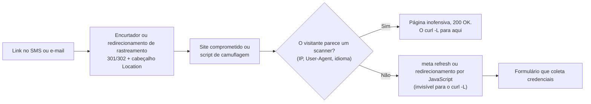
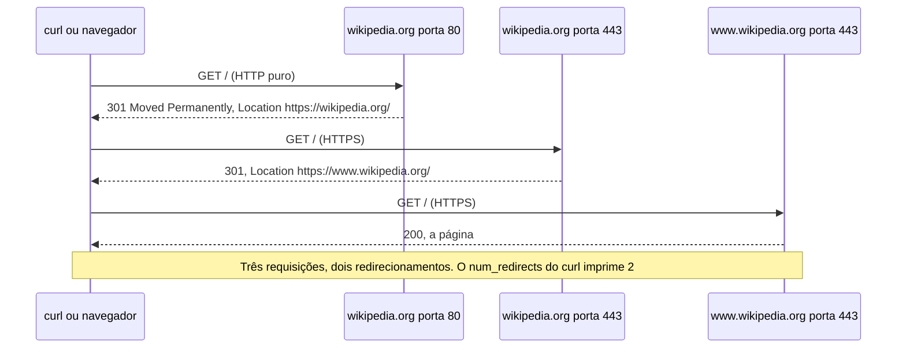
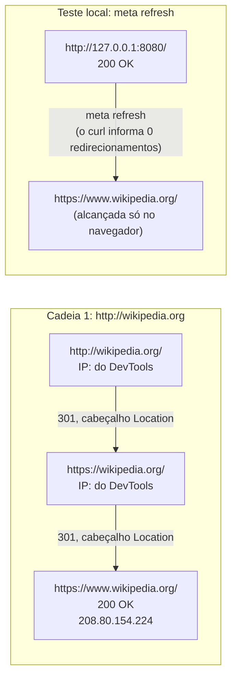

# Dia 07: HTTP para investigadores: cabeçalhos, códigos de status e cadeias de redirecionamento

> 🇺🇸 Original: [*Day 7: HTTP for investigators, headers, status codes, and redirect chains*](https://github.com/thiefdroppers/cyber-investigator-skills/blob/main/curriculum/phase-1-foundations/day-07.md) — © ThiefDroppers, licença MIT.
> Aqui: tradução fiel **+** camada brasileira. Nada do original foi removido; tudo o que é novo vem marcado com ➕.

**Fase 1. Fundamentos** · Meta da trilha: ler uma troca HTTP do jeito que ela aparece em logs e capturas, e mapear uma cadeia de redirecionamento desde a primeira URL em que a vítima clicou até a página que finalmente carregou.

Rank Jutsu: `D` · [](https://colab.research.google.com/github/Ridd1kulusC0d3r/investigador-cyber-90-dias/blob/main/curriculo/fase-1-fundamentos/dia-07/dia-07.ipynb)

---

## 🎬 ➕ Abertura do caso — *O celular viu outra coisa*

Segunda, 18h18. O mistério da manhã ainda incomoda: o seu `curl` sempre recebeu *"Sistema em manutenção"*, mas três cooperados digitaram CPF e senha num formulário.

Rafa puxa uma cadeira.

— Você pediu a página como `curl`, de uma VPN de pesquisa. Quem caiu no golpe pediu como celular Android, em português, de uma operadora brasileira. Pede de novo. Do jeito da vítima.

Você configura o navegador da VM com *User-Agent* de Android e idioma pt-BR, abre o link curto do SMS, `lnk.example/sa7`, e grava tudo no DevTools. Um `302` do encurtador. Um `301` para HTTPS. Um `200`... e, meio segundo depois, sem nenhum `Location`, a página pula sozinha para `/pix/regularizar`. Campos de CPF e senha.

— Duas cadeias — diz Rafa. — As duas verdadeiras. A do `curl` é a que o golpista quer que você documente.

É isso que o Dia 7 ensina. *(Personagens e cenário: [Operação Isca](../../../caso-continuo/).)*

---

## 📖 Conceito

A maioria dos golpes chega às vítimas como uma URL, e a URL da mensagem raramente é onde a vítima termina. Encurtadores de link, redirecionamentos de rastreamento, sites comprometidos e *scripts* de camuflagem (*cloaking*) ficam entre a isca e a página de phishing. Mapear essa cadeia é trabalho investigativo de rotina, e ele depende de um punhado de fatos sobre HTTP.

Uma requisição tem um método (`GET` para buscar, `POST` para enviar um formulário), um caminho e cabeçalhos. Os que o investigador confere são `Host` (qual site foi pedido, importante quando um IP hospeda muitos sites), `User-Agent` (o que o cliente afirma ser), `Referer` (a página de onde o cliente veio; o erro de grafia está no próprio padrão) e `Cookie`.

Uma resposta tem um código de status e cabeçalhos. As classes de status: `2xx` sucesso, `3xx` redirecionamento, `4xx` erro do cliente (`403` proibido, `404` não encontrado), `5xx` erro do servidor. Nos redirecionamentos, `301` e `308` são permanentes, e `302`, `303` e `307` são temporários; o destino fica no cabeçalho `Location`. Os cabeçalhos de resposta que ajudam a identificar infraestrutura incluem `Server` (o software do servidor web, muitas vezes genérico ou escondido), `Via` e cabeçalhos específicos de CDN, como `CF-RAY` da Cloudflare ou `X-Cache`, além de `Set-Cookie` (cookies de sessão e de rastreamento, às vezes nomeados pelo *framework* que os definiu), `Date` (o relógio do próprio servidor, útil para conciliar horários) e `Last-Modified`.

Redirecionamentos por cabeçalho são só um mecanismo. Uma página também pode redirecionar com uma *tag* HTML `<meta http-equiv="refresh">` ou com JavaScript (`window.location = ...`). Ferramentas de linha de comando como `curl -L` só seguem redirecionamentos por cabeçalho, então uma cadeia que parece parar num `200 OK` pode continuar no navegador. Kits de phishing também fazem camuflagem: devolvem uma página inofensiva para visitantes cujo IP, *user agent* ou idioma parecem de um *scanner* de segurança, e a página real para todos os outros. Duas ferramentas podem ver duas cadeias diferentes para a mesma URL, e as duas capturas podem estar corretas.

Uma cadeia típica de golpe, e o ponto em que as suas ferramentas e o navegador da vítima se separam:



Um redirecionamento por cabeçalho é uma troca simples de requisição e resposta. Esta é a cadeia pública que você vai mapear no Passo 2:



Não abra links suspeitos a partir do IP da sua casa ou do seu escritório, e nunca digite nada num formulário suspeito de phishing. Hoje você pratica com redirecionamentos públicos conhecidos e legítimos. Na Fase 2 você vai usar serviços em *sandbox*, como o urlscan.io, para URLs suspeitas ao vivo.

## 📚 Recursos

- [MDN: códigos de status de resposta HTTP](https://developer.mozilla.org/en-US/docs/Web/HTTP/Status) e [MDN: cabeçalhos HTTP](https://developer.mozilla.org/en-US/docs/Web/HTTP/Headers). (A MDN tem versão em português de boa parte dessas páginas: troque `en-US` por `pt-BR` na URL.)
- [Everything curl](https://everything.curl.dev/), especialmente as seções sobre saída detalhada (*verbose*) e sobre seguir redirecionamentos.
- [Chrome DevTools: referência dos recursos da aba Network](https://developer.chrome.com/docs/devtools/network/reference).
- [urlscan.io](https://urlscan.io/): prévia da Fase 2. Ele registra cada requisição e cada redirecionamento que uma página faz. Varreduras públicas ficam visíveis para todos; escolha Unlisted ou Private para qualquer coisa sensível.

### ➕ Recursos do contexto Brasil

- [CERT.br — notificações de incidentes](https://www.cert.br/): o CERT.br recebe notificações de phishing que usam infraestrutura no Brasil e as encaminha aos responsáveis pelas redes. É um canal para a cooperativa, além da notificação direta ao provedor de hospedagem.
- [SaferNet Brasil — central de denúncias](https://new.safernet.org.br/denuncie): recebe denúncias de crimes contra direitos humanos na internet; phishing financeiro vai para a polícia e para o CERT.br, não para a SaferNet. Saber o canal certo economiza dias.
- [Banco Central — golpes com Pix](https://www.bcb.gov.br/meubc/faqs/s/pix): a página de perguntas frequentes do BC sobre Pix explica o MED e os golpes mais comuns; boa fonte para o texto de alerta aos cooperados.
- [urlscan.io com país de saída Brasil](https://urlscan.io/docs/api/): a API de varredura aceita escolher o país de onde a página é visitada (*country*), o que ajuda contra camuflagem por geolocalização. Use sempre a visibilidade Unlisted ou Private.

## 🛠️ Prática: curl e DevTools do navegador, produzindo um diagrama de cadeia de redirecionamento e uma tabela comparativa de cabeçalhos

**Seu checklist de hoje.** Faça na ordem e marque cada item ao terminar:

- [ ] Passo 1: ler uma troca completa
- [ ] Passo 2: mapear uma cadeia de redirecionamento por cabeçalho
- [ ] Passo 3: pegar o que o curl deixa passar
- [ ] Passo 4: registrar a mesma cadeia no navegador
- [ ] Passo 5: montar os artefatos
- [ ] ➕ Passo 6: as duas cadeias de `lnk.example/sa7` (Prática BR)
- [ ] ➕ Passo 7: o notebook do dia no Colab

### Passo 1: ler uma troca completa

```bash
curl -4 -sv -o /dev/null https://www.wikipedia.org/ 2>&1 | grep -E '^[<>*] '
```

Linhas começando com `>` são o que você enviou, `<` é o que voltou, e `*` é o curl descrevendo a conexão. Ilustrativo, resumido:

```
* Connected to www.wikipedia.org (208.80.154.224) port 443
* SSL connection using TLSv1.3 / AEAD-CHACHA20-POLY1305-SHA256
> GET / HTTP/2
> Host: www.wikipedia.org
> User-Agent: curl/8.7.1
> Accept: */*
< HTTP/2 200
< date: Tue, 10 Mar 2026 15:02:19 GMT
< server: ATS/9.2.15
< x-cache: cp1108 miss, cp1108 hit/1167008
< strict-transport-security: max-age=106384710; includeSubDomains; preload
< content-type: text/html
```

Os cabeçalhos `server` e `x-cache` apontam para uma camada de cache na frente do site. `strict-transport-security` diz aos navegadores para usar só HTTPS neste domínio daqui em diante.

### Passo 2: mapear uma cadeia de redirecionamento por cabeçalho

```bash
curl -4 -sIL http://wikipedia.org | grep -iE '^(HTTP/|location:|server:|date:)'
```

Saída ilustrativa (capturada em 2026):

```
HTTP/1.1 301 Moved Permanently
location: https://wikipedia.org/
HTTP/2 301
location: https://www.wikipedia.org/
HTTP/2 200
```

Três saltos: o HTTP puro é promovido a HTTPS, depois o domínio sem `www` é mandado para o `www`, e então a página carrega.

`-I` envia requisições HEAD, e alguns servidores respondem a HEAD de forma diferente de GET. Confirme com um GET de verdade que descarta o corpo, mas despeja os cabeçalhos de cada salto:

```bash
curl -4 -sL -D - -o /dev/null http://wikipedia.org | grep -iE '^(HTTP/|location:)'
curl -4 -sL -o /dev/null -w 'hops=%{num_redirects} final=%{url_effective} code=%{http_code}\n' http://wikipedia.org
```

Repita para uma segunda cadeia pública da sua escolha, como `http://github.com` ou o domínio sem `www` da prefeitura da sua cidade por `http://`.

### Passo 3: pegar o que o curl deixa passar

Crie uma página de teste local que redireciona com uma *meta tag*, para provar o ponto na sua própria máquina:

```bash
mkdir -p ~/lab/day07 && cd ~/lab/day07
cat > index.html <<'EOF'
<html><head><meta http-equiv="refresh" content="0; url=https://www.wikipedia.org/"></head>
<body>Redirecting...</body></html>
EOF
python3 -m http.server 8080 --bind 127.0.0.1
```

Em outro terminal, `curl -sL -o /dev/null -w '%{num_redirects} %{url_effective}\n' http://127.0.0.1:8080/` informa zero redirecionamentos e uma URL final em 127.0.0.1. Abra o mesmo endereço num navegador e você cai na Wikipédia. Anote o que isso significa para qualquer cadeia que você mapear só com o curl. Pare o servidor com Ctrl+C.

### Passo 4: registrar a mesma cadeia no navegador

1. Abra uma nova janela privada e pressione F12 (Cmd+Option+I no macOS) para abrir o DevTools. Selecione a aba Network.
2. Marque "Preserve log", para que as entradas sobrevivam à troca de página, e "Disable cache".
3. Digite `http://wikipedia.org` na barra de endereços e pressione Enter.
4. Cada redirecionamento aparece como uma linha própria, com o seu código de status. Clique numa linha e leia o painel Headers; o cabeçalho de resposta `Location` mostra o próximo salto.
5. Salve a gravação como um arquivo HAR (o ícone de seta para baixo na barra da aba Network, ou clique com o botão direito numa linha e escolha a opção de salvar ou exportar HAR). Arquivos HAR são JSON e incluem cookies e, às vezes, *tokens*, então trate-os como evidência sensível. Calcule o hash do arquivo como no Dia 2.

### Passo 5: montar os artefatos

Desenhe a cadeia no draw.io, uma caixa por salto, da esquerda para a direita. Cada caixa traz a URL completa, e cada seta traz o código de status e o mecanismo (`301 Location`, `meta refresh`, `JavaScript`). Abaixo de cada caixa, anote o IP que respondeu, quando você o tiver (do `curl -v` ou do painel Headers do DevTools, que mostra "Remote Address"). Acrescente o teste local de *meta refresh* como uma segunda cadeia, separada. Exporte como `day07-redirects.png`.

O seu desenho deve terminar com o formato desta referência. O IP abaixo da caixa final é o que o `curl -v` imprimiu no Passo 1; preencha os outros com os seus próprios valores de "Remote Address" do DevTools:



A cadeia 2, a sua escolha do Passo 2, vai entre elas, no mesmo estilo.

Depois preencha `day07-headers.md` para a página final de cada cadeia pública:

```markdown
| Cabeçalho | Página final da cadeia 1 | Página final da cadeia 2 | O que ele sugere |
|---|---|---|---|
| Status | | | |
| Server | | | |
| Cabeçalhos de CDN / cache (Via, X-Cache, CF-RAY, ...) | | | |
| Nomes em Set-Cookie | | | |
| Strict-Transport-Security | | | |
| Date (relógio do servidor) vs o seu relógio UTC | | | |
```

### ➕ Prática BR: duas cadeias para o mesmo link

Arquivos em [`caso-continuo/dados/dia-07/`](../../../caso-continuo/dados/dia-07/) (fictícios):

- `cadeia.json` — as duas visitas da VM `vigia-lab01` a `http://lnk.example/sa7`: uma com `curl -sIL` e outra com o navegador configurado como Android em pt-BR, saltos com status, mecanismo, IP e `Server`;
- `vigia-lab01.har` — um HAR mínimo da visita pelo navegador.

1. Calcule o SHA-256 dos dois arquivos. Lembre: o HAR é evidência **sensível** (tem cookie de sessão do kit). Onde ele fica guardado e quem pode vê-lo?
2. Desenhe as duas cadeias lado a lado, no formato do Passo 5, cada uma num `subgraph`. Quantas setas tem a do curl? E a do navegador? Qual seta o `curl -L` nunca veria, e por quê?
3. Do HAR, extraia para cada salto: hora, URL, IP (`serverIPAddress`), status, `Location`. Confira que o `Referer` do último salto aponta para a página anterior, o que mostra o redirecionamento feito no navegador.
4. Preencha `day07-headers-isca.md` comparando a página final do curl e a do navegador (status, `Server`, nomes de cookie, `Date`). Compare o `Date` do servidor com a sua hora UTC de coleta.
5. Escreva em duas frases por que a página "em manutenção" que você coletou no Dia 2 **não** contradiz os relatos das vítimas, e cite uma mudança na forma de coletar que reduz o efeito da camuflagem.
6. Atualize o registro de custódia do Dia 2: o item E2 continua íntegro, mas a conclusão escrita sobre ele precisa de uma ressalva. Qual?

### ➕ O notebook do dia

Abra o [notebook do Dia 07 no Colab](https://colab.research.google.com/github/Ridd1kulusC0d3r/investigador-cyber-90-dias/blob/main/curriculo/fase-1-fundamentos/dia-07/dia-07.ipynb). Nele você:

1. sobe um servidor HTTP **local** de brinquedo (só `http.server`) que imita a camuflagem do IscaKit: devolve "manutenção" para `curl` e o formulário falso (inerte, sem campos reais) para um *User-Agent* de celular;
2. escreve um seguidor de redirecionamentos com `urllib` que mostra cada salto, e vê com os próprios olhos o que ele **não** segue (`meta refresh` e JavaScript);
3. ensina o seguidor a detectar `meta refresh` e `window.location` no HTML;
4. lê o HAR e desenha as duas cadeias da Operação Isca em mermaid;
5. joga o quiz **"qual mecanismo?"**.

## ✅ Checkpoint

Os seus artefatos são `day07-redirects.png`, `day07-headers.md` e o arquivo HAR com hash. Eles passam quando:

- As duas cadeias públicas mostram cada salto, com URL completa, código de status e mecanismo.
- O número de setas de redirecionamento em cada cadeia bate com o `%{num_redirects}` do curl (a cadeia da Wikipédia tem três caixas e duas setas).
- A cadeia de *meta refresh* está desenhada separadamente.
- A cadeia de *meta refresh* traz uma nota explicando por que o curl informou zero redirecionamentos.
- A última coluna da tabela de cabeçalhos declara inferências como inferências (por exemplo, "`x-cache` sugere um *proxy* de cache na frente da origem"), e não como fatos sobre quem opera o site.
- Você consegue explicar por que uma URL de phishing pode mostrar uma página inofensiva ao seu *scanner* e um formulário de credenciais a uma vítima, e citar uma coisa que você mudaria na forma de buscá-la para reduzir esse efeito.

### ➕ Checkpoint BR

- As duas cadeias de `lnk.example/sa7` estão desenhadas lado a lado, com a seta de JavaScript marcada como "invisível ao curl".
- O HAR tem hash na custódia e uma nota de que contém cookie de sessão.
- A ressalva ao item E2 do Dia 2 está escrita (ex.: "conteúdo servido a cliente `curl` via VPN de pesquisa; vítimas relatam formulário servido a celulares").
- Você nunca digitou nada no formulário falso, nem em laboratório; o formulário do notebook é inerte.
- Você acertou pelo menos 5 das 6 perguntas do quiz do notebook.

## ⚖️ ➕ Camada jurídica BR

**Visitar não é invadir.** Abrir uma página servida publicamente, mesmo de um kit de golpe, com o navegador configurado como celular, não é acesso a dispositivo alheio: o servidor entrega a página a qualquer um que a peça. Mudar o *User-Agent* não "engana" um sistema de segurança; é como você vê o que a vítima viu. O portão do Dia 01 passa nas quatro checagens.

**Digitar dados é outra coisa.** Enviar dados no formulário (mesmo um CPF fictício) é interagir com o sistema do golpista e pode alimentar o painel dele, contaminar a evidência e, se forem dados de terceiros, tratar dado pessoal sem base. No escopo do Dia 01, não. Teste de envio controlado, se um dia for necessário, só com autorização específica e orientação jurídica.

**HAR é dado pessoal e evidência.** O HAR guarda cookies, *tokens* e cabeçalhos. Se for de uma vítima (por exemplo, exportado do navegador de um cooperado), contém dados pessoais dela e talvez credenciais: base legal, minimização e guarda restrita (LGPD, arts. 6º e 46). Se for seu, ainda assim tem o cookie de sessão do kit, que permitiria a alguém "continuar" a sua sessão no site do golpe.

**Derrubada.** Com as duas cadeias documentadas, a cooperativa tem o que precisa para notificar o encurtador (`lnk.example`), o provedor de hospedagem de `203.0.113.77` e o CERT.br. Registre também que existe o pedido de **preservação** dos registros: pelo Marco Civil, a autoridade policial ou administrativa ou o Ministério Público podem requerer cautelarmente que um provedor de aplicações guarde os registros de acesso por prazo maior (art. 15, §2º). Quem pede é a autoridade; a cooperativa leva o material até ela.

> Material de estudo, não constitui orientação jurídica.

## 🧠 ➕ Camada 8 — o golpe foi desenhado para o celular de quem tem pressa

A camuflagem do IscaKit não é só técnica; é psicológica. O kit escolhe **quem** vê o formulário: celular, idioma português, operadora brasileira. Ou seja, alguém lendo um SMS no ônibus, às 7h40, com a mensagem *"sua chave Pix foi bloqueada"*. Três princípios de influência de Cialdini aparecem empilhados: **autoridade** (o nome da cooperativa), **escassez** (a chave "bloqueada", o acesso perdido) e, implícita, a **urgência** que corta a deliberação. Na tela pequena, a barra de endereço some, o domínio não aparece inteiro, e o cérebro, sob pressão de tempo, troca o raciocínio analítico pelo automático (o "Sistema 1" de Kahneman).

E há um efeito do lado de quem investiga: o analista no notebook, com tela grande e sem pressa, vê "manutenção" e tende a subestimar o golpe. O contexto de quem avalia é o oposto do contexto de quem foi enganado.

**Consequência prática:** reproduza o contexto da vítima (dispositivo, idioma, origem, horário) antes de julgar a "obviedade" do golpe. E, no texto de alerta para os 40 mil cooperados, escreva para o celular e para a pressa: uma frase, um verbo, um canal oficial ("A Serra Azul nunca pede senha por link. Na dúvida, ligue para o número no verso do seu cartão.").

## 🤖 ➕ Skill do dia

Hoje o dia propõe para a [skill pt-BR](../../../skills/investigador-cyber/SKILL.md) o procedimento **"Mapear uma cadeia de redirecionamento"**: cada salto com URL, status, mecanismo e IP; buscar também como a vítima buscaria; procurar `meta refresh` e JavaScript; tratar duas cadeias diferentes como possível camuflagem; nunca enviar dados no formulário. Proposta completa em [`_skill-delta.md`](_skill-delta.md).

## 💡 ➕ Inovação OSINT do dia — um seguidor de redirecionamentos que conta cada salto

O `urllib` segue redirecionamentos sozinho e esconde os saltos. Desligando isso, você vê cada `Location` e pode trocar o *User-Agent* entre visitas, só com a biblioteca padrão:

```python
import urllib.request, urllib.error, urllib.parse
class NaoSeguir(urllib.request.HTTPRedirectHandler):
    def redirect_request(self, *a, **k): return None          # devolve o 3xx em vez de seguir
abridor = urllib.request.build_opener(NaoSeguir)
def cadeia(url, ua="curl/8.5.0", max_saltos=10):
    for _ in range(max_saltos):
        req = urllib.request.Request(url, headers={"User-Agent": ua, "Accept-Language": "pt-BR"})
        try:
            r = abridor.open(req, timeout=10); print(r.status, url); return
        except urllib.error.HTTPError as e:                     # 3xx chega aqui como "erro"
            print(e.code, url, "→", e.headers.get("Location"))
            if not e.headers.get("Location"): return
            url = urllib.parse.urljoin(url, e.headers["Location"])
cadeia("http://wikipedia.org")
```

Rodar a mesma função com dois *User-Agents* e comparar as saídas é o teste mais barato de camuflagem. Para URLs de golpe reais, rode-a só a partir de infraestrutura de análise (VM, VPN ou serviço em *sandbox*), nunca da rede do cliente ou de casa.

## 📝 Diário de estudo

- Data:
- Tempo gasto:
- O que ficou claro:
- O que ainda está nebuloso:
- Artefato produzido: `day07-redirects.png`, `day07-headers.md`, HAR com hash, `day07-redirects-isca.md`, `day07-headers-isca.md`

---
<sub>Baseado em [cyber-investigator-skills](https://github.com/thiefdroppers/cyber-investigator-skills) por ThiefDroppers (MIT). Tradução, camada BR, Camada 8, skill pt-BR e notebook por Deivison Lourenço (@Ridd1kulusC0d3r).</sub>
