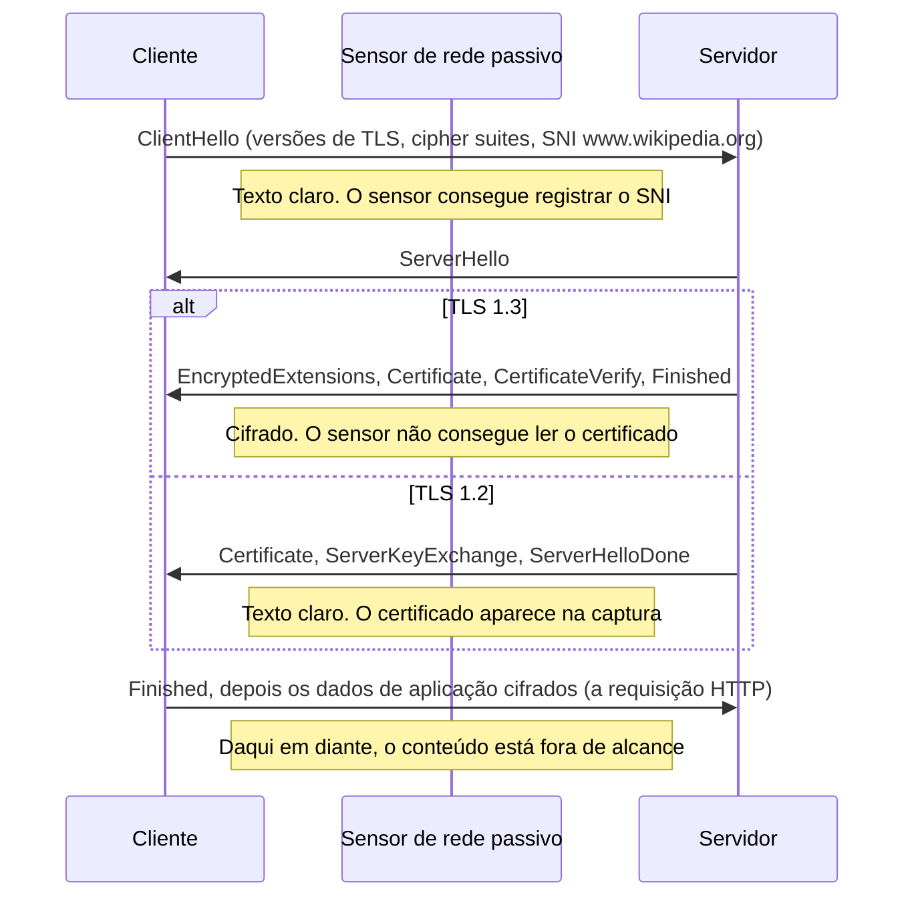
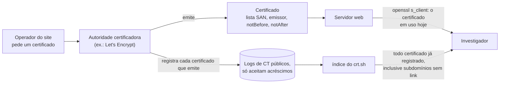
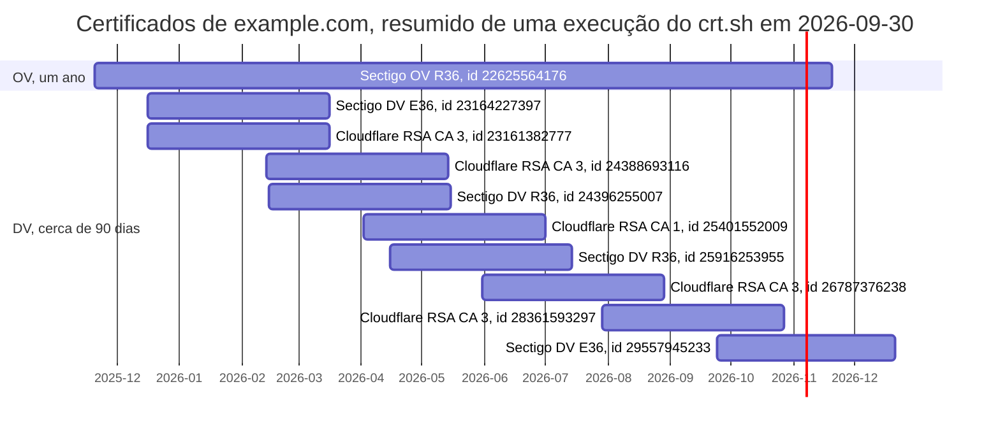

# Dia 08: TLS e certificados: o que o investigador lê num certificado

> 🇺🇸 Original: [*Day 8: TLS and certificates, what an investigator reads in a cert*](https://github.com/thiefdroppers/cyber-investigator-skills/blob/main/curriculum/phase-1-foundations/day-08.md) — © ThiefDroppers, licença MIT.
> Aqui: tradução fiel **+** camada brasileira. Nada do original foi removido; tudo o que é novo vem marcado com ➕.

**Fase 1. Fundamentos** · Meta da trilha: obter o certificado de um servidor, ler os campos que importam para uma investigação e usar os logs de *Certificate Transparency* para montar uma linha do tempo de emissão de um domínio.

Rank Jutsu: `D` · [](https://colab.research.google.com/github/Ridd1kulusC0d3r/investigador-cyber-90-dias/blob/main/curriculo/fase-1-fundamentos/dia-08/dia-08.ipynb)

---

## 🎬 ➕ Abertura do caso — *O cadeado da véspera*

Terça, 6/out, 09h10. A primeira coisa que você vê ao abrir o notebook é uma mensagem da Marta, às 06h52: *"Um cooperado diz que o site tinha cadeado. Então era seguro?"*

Rafa já está com o terminal aberto.

— O cadeado diz que a conversa é cifrada. Não diz com quem. Puxa o certificado do `serraazul-pix.example` e me diz três coisas: quem emitiu, quando, e para quais nomes.

Você puxa. AC gratuita, validação de domínio. `notBefore`: domingo, 4/out, 21h47 UTC, ou 18h47 em Brasília, pouco mais de doze horas antes do primeiro SMS. E na lista de nomes, ao lado de `serraazul-pix.example` e do `www`, um terceiro: `serraazul-seguranca.example`. O mesmo domínio do *token* de ontem.

Aí você consulta os logs de *Certificate Transparency*. Há um certificado que você ainda não conhecia, registrado esta madrugada, às 02h13 UTC (23h13 de segunda, em Brasília): `coopserra-azul.example`.

— Ele está montando o próximo — diz Rafa. — Linha do tempo. Agora.

É isso que o Dia 8 ensina. *(Personagens e cenário: [Operação Isca](../../../caso-continuo/).)*

---

## 📖 Conceito

A maior parte do tráfego web é cifrada com TLS, então o conteúdo normalmente está fora de alcance. O aperto de mão e o certificado não estão, e carregam muito valor investigativo.

Uma conexão TLS começa com o ClientHello do cliente. Ele lista as versões de TLS e as *cipher suites* que o cliente suporta e, na extensão *Server Name Indication* (SNI), o nome de host que ele quer. O SNI viaja em texto claro em quase todo o tráfego atual (o *Encrypted Client Hello* existe, mas ainda não é comum), então um sensor de rede que não consegue ler a página ainda consegue registrar qual site foi pedido. O servidor responde com um ServerHello e o seu certificado. No TLS 1.2, o certificado é enviado em texto claro e aparece nas capturas de pacotes. No TLS 1.3, ele é cifrado, então um sensor passivo vê o SNI, mas não o certificado. Para ler o certificado, você se conecta ao servidor por conta própria.

O aperto de mão, do ponto de vista de um sensor posicionado no fio:



Os campos do certificado que vale ler:

- *Subject Alternative Name* (SAN) é a lista de nomes de host para os quais o certificado é válido. Os navegadores usam este campo, não o antigo *Common Name*. Uma lista SAN é uma lista pronta de domínios relacionados, e um certificado que cobre `brand-login.example` e `brand-verify.example` liga os dois ao mesmo operador.
- *Issuer* nomeia a autoridade certificadora (AC). ACs gratuitas e automatizadas, como a Let's Encrypt, emitem uma grande fatia de todos os certificados da web, para sites legítimos e maliciosos, então o emissor sozinho não prova nada.
- A validade (`notBefore`, `notAfter`) define a vida útil do certificado. O `notBefore` costuma ficar a minutos da emissão, então ele data quando alguém montou o site. Um certificado para a imitação de um banco emitido dois dias antes de começarem os SMS de phishing é uma âncora da linha do tempo.
- O OID da política de certificado dá o nível de validação: `2.23.140.1.2.1` é validado por domínio (DV, ou seja, só o controle do domínio foi verificado), `2.23.140.1.2.2` é validado por organização (OV), e `2.23.140.1.1` é validação estendida (EV). Um certificado DV não diz nada sobre quem é o dono do site.
- O número de série e a impressão digital SHA-256 identificam um certificado específico, e são o que você cita num relatório.

O *Certificate Transparency* (CT) torna os certificados pesquisáveis. Os navegadores exigem que as ACs publicamente confiáveis registrem cada certificado que emitem em logs de CT públicos e que só aceitam acréscimos (*append-only*). Serviços como o crt.sh indexam esses logs, então você consegue listar cada certificado já emitido para um domínio, inclusive subdomínios para os quais ninguém fez link. Defensores usam isso para perceber domínios imitação no momento em que um certificado é emitido para eles. Investigadores usam para datar infraestrutura e achar hosts relacionados.

Os dois caminhos até um certificado, e o que cada um lhe dá:



## 📚 Recursos

- [The Illustrated TLS 1.3 Connection](https://tls13.xargs.org/): cada byte de um aperto de mão real, anotado.
- [crt.sh](https://crt.sh/): busca gratuita no *Certificate Transparency*, mantida pela Sectigo.
- [Certificate Transparency: How CT works](https://certificate.transparency.dev/howctworks/).
- [RFC 5280](https://www.rfc-editor.org/rfc/rfc5280), seção 4.1 (campos do certificado) e 4.2.1.6 (*Subject Alternative Name*).
- [Requisitos de Base (*Baseline Requirements*) do CA/Browser Forum](https://cabforum.org/working-groups/server/baseline-requirements/), para os tempos de vida máximos atuais dos certificados e os OIDs de política.

### ➕ Recursos do contexto Brasil

- [ITI — Infraestrutura de Chaves Públicas Brasileira (ICP-Brasil)](https://www.gov.br/iti/pt-br): a ICP-Brasil emite certificados para assinatura digital com validade jurídica (MP 2.200-2/2001). Não confunda: o "cadeado" de um site usa certificados de ACs reconhecidas pelos navegadores, que em geral **não** são da ICP-Brasil. Um site ter cadeado não tem nada a ver com "certificado digital" no sentido jurídico brasileiro.
- [Registro.br — RDAP](https://registro.br/tecnologia/ferramentas/rdap/): para cruzar a data de criação de um `.br` com o `notBefore` do primeiro certificado dele no crt.sh.
- [Cartilha de Segurança para Internet (CERT.br)](https://cartilha.cert.br/): o fascículo sobre golpes explica, para leigos, por que o cadeado não garante que o site é legítimo. Bom para o texto de alerta aos cooperados.
- [CT monitoring com crt.sh por RSS/Atom](https://crt.sh/): o crt.sh oferece feed Atom por consulta (`https://crt.sh/atom?q=...`); uma cooperativa pode monitorar `%serraazul%` de graça.

## 🛠️ Prática: openssl e crt.sh, produzindo uma ficha de perfil do certificado e uma linha do tempo de emissão

Use o domínio da mesma organização pública dos Dias 5 e 6. O exemplo resolvido usa `www.wikipedia.org`.

**Seu checklist de hoje.** Faça na ordem e marque cada item ao terminar:

- [ ] Passo 1: obter o certificado
- [ ] Passo 2: ver o SNI no fio
- [ ] Passo 3: consultar o *Certificate Transparency*
- [ ] Passo 4: montar a linha do tempo de emissão
- [ ] Passo 5: a ficha de perfil do certificado
- [ ] ➕ Passo 6: o certificado do site falso e a linha do tempo do IscaKit (Prática BR)
- [ ] ➕ Passo 7: o notebook do dia no Colab

### Passo 1: obter o certificado

```bash
echo | openssl s_client -connect www.wikipedia.org:443 -servername www.wikipedia.org 2>/dev/null \
  | openssl x509 -noout -subject -issuer -dates -serial -fingerprint -sha256 \
      -ext subjectAltName,certificatePolicies
```

`-servername` define o SNI; sem ele, um servidor que hospeda muitos sites pode lhe entregar o certificado errado. `echo |` fecha a conexão assim que o aperto de mão termina.

Saída de uma execução em 2026 (lista SAN resumida):

```
subject=CN=*.wikipedia.org
issuer=C=US, O=Let's Encrypt, CN=YE2
notBefore=Aug  5 19:15:41 2026 GMT
notAfter=Nov  3 19:15:40 2026 GMT
serial=062387C4D2B6E686767EFF54CE0B7E26BDDF
sha256 Fingerprint=08:E0:B6:5D:F4:1F:B0:75:...:32:F7:B7:32:53
X509v3 Subject Alternative Name:
    DNS:*.m.mediawiki.org, DNS:*.m.wikibooks.org, ..., DNS:wikipedia.org, DNS:wiktionary.org, DNS:wmfusercontent.org
X509v3 Certificate Policies:
    Policy: 2.23.140.1.2.1
```

Como ler: um certificado Let's Encrypt, validado por domínio, válido por 90 dias, cobrindo cerca de 40 nomes dos projetos da organização. Só a lista SAN já mapeia a família de domínios da organização.

A opção `-ext` precisa do OpenSSL 1.1.1 ou mais novo. O macOS traz o LibreSSL como `/usr/bin/openssl`, que pode rejeitá-la; nesse caso, instale o OpenSSL pelo Homebrew ou troque `-ext ...` por `-text` e leia as mesmas seções no despejo completo.

Salve o próprio certificado como evidência:

```bash
echo | openssl s_client -connect www.wikipedia.org:443 -servername www.wikipedia.org 2>/dev/null \
  | openssl x509 -outform PEM > day08-www.wikipedia.org.pem
sha256sum day08-www.wikipedia.org.pem
```

### Passo 2: ver o SNI no fio

Inicie uma captura no Wireshark, rode de novo o comando do Passo 1, pare a captura e aplique o filtro de exibição:

```
tls.handshake.type == 1
```

Isso mostra só os pacotes ClientHello. Expanda Transport Layer Security > Handshake Protocol: Client Hello > Extension: server_name e confirme que o nome de host está legível. Clique com o botão direito no campo Server Name e escolha Apply as Column. Agora tente `tls.handshake.type == 11` (Certificate). Numa conexão TLS 1.3, ele não devolve nada, porque o certificado foi cifrado.

### Passo 3: consultar o *Certificate Transparency*

Num navegador, abra `https://crt.sh/?q=wikipedia.org`. Cada linha é um certificado (ou pré-certificado) registrado, com a data de registro, as datas de validade, o nome comum, as identidades correspondentes e o emissor. Acrescente `%25.` antes do domínio (`https://crt.sh/?q=%25.wikipedia.org`) para incluir todos os subdomínios.

Para organizações grandes, os resultados chegam a milhares de linhas. Escolha o domínio de uma organização pública menor se a página expirar. O crt.sh é um serviço comunitário gratuito, muitas vezes lento ou temporariamente com erro; tente de novo mais tarde, em vez de martelar o serviço.

A saída em JSON é mais fácil de processar:

```bash
curl -s 'https://crt.sh/?q=example.com&output=json' \
  | jq -r '.[] | [.not_before, .issuer_name, (.name_value | gsub("\n"; " "))] | @tsv' \
  | sort -u | tail -20
```

Cada linha dá o início da validade, o emissor e os nomes cobertos, em ordem de data.

### Passo 4: montar a linha do tempo de emissão

Dos resultados do crt.sh para o seu domínio, pegue os últimos 12 meses. Agrupe os certificados pelo conjunto de nomes que cobrem e desenhe-os como barras horizontais do `notBefore` ao `notAfter`. Use qualquer planilha (LibreOffice Calc ou Google Sheets: gráfico de barras empilhadas, com a primeira série transparente como deslocamento) ou desenhe as barras no draw.io. Rotule cada barra com o emissor e o primeiro SAN.

Procure três tipos de evento: uma cadência regular de renovação (barras que se sobrepõem e se repetem a cada 60 a 90 dias, o que é automação), um nome novo aparecendo pela primeira vez (um serviço ou subdomínio novo) e uma troca de AC.

Você também pode pular a planilha e gerar o gráfico como um diagrama Gantt em Mermaid, direto do crt.sh. Cada barra vai de `not_before` a `not_after` e é rotulada com o nome comum, a AC emissora e o ID do crt.sh, então cada barra remete a um certificado registrado. O crt.sh muitas vezes tem duas linhas com o mesmo número de série, o pré-certificado e o certificado final, então `unique_by(.serial_number)` mantém uma barra por certificado (para `example.com` em 30/09/2026, 78 linhas viraram 43 números de série antes do filtro de data).

```bash
D=example.com
since=$(date -u -v-12m +%F 2>/dev/null || date -u -d '12 months ago' +%F)   # macOS || Linux
{
  echo 'gantt'
  echo "    title Certificates logged for $D since $since (crt.sh)"
  echo '    dateFormat YYYY-MM-DD'
  echo '    axisFormat %Y-%m'
  curl -s "https://crt.sh/?q=$D&output=json" \
    | jq -r --arg since "$since" '
        map(select(.not_before >= $since)) | unique_by(.serial_number) | sort_by(.not_before) | .[]
        | "    \(.common_name), \((.issuer_name | capture("CN=(?<cn>[^,]+)").cn) // .issuer_name), id \(.id) :\(.not_before[0:10]), \(.not_after[0:10])"'
} > day08-timeline.mmd
```

Saída de uma execução em 30/09/2026, primeiras linhas (27 linhas no total):

```
gantt
    title Certificates logged for example.com since 2025-09-30 (crt.sh)
    dateFormat YYYY-MM-DD
    axisFormat %Y-%m
    example.com, Sectigo Public Server Authentication CA OV R36, id 22625564176 :2025-11-20, 2026-11-20
    example.com, Sectigo Public Server Authentication CA OV R36, id 22648264889 :2025-11-21, 2026-11-21
    example.com, Sectigo Public Server Authentication CA OV R36, id 22853418213 :2025-12-02, 2026-12-02
    example.com, Sectigo Public Server Authentication CA DV E36, id 23164227397 :2025-12-16, 2026-03-16
```

Ponha o conteúdo do arquivo dentro de um bloco ` ```mermaid ` em `day08-timeline.md`. O GitHub o renderiza, e o Mermaid Live Editor (`https://mermaid.live`) o exporta como PNG para a sua imagem de linha do tempo. Uma versão resumida dessa execução fica assim:



Dois dos três tipos de evento aparecem até nesta visão resumida. Os certificados de 90 dias se repetem mais ou menos a cada dois meses, o que é uma cadência de renovação, e o emissor muda: duas famílias de AC (Sectigo e Cloudflare) emitem em paralelo, e o emissor da Cloudflare passa da CA 3 para a CA 1 e volta. Um certificado OV de um ano corre ao lado delas. As barras são rotuladas só pelo nome comum, que é `example.com` em todas as linhas desta execução, então, para achar um nome visto pela primeira vez, você ainda precisa ler a lista SAN (`name_value` no JSON).

### Passo 5: a ficha de perfil do certificado

Crie `day08-cert-card.md`:

```markdown
| Campo | Valor | Nota investigativa |
|---|---|---|
| Host consultado (SNI) | | |
| Coletado (UTC) / a partir do IP | | |
| CN do Subject | | |
| Quantidade de SAN / SANs notáveis | | |
| Emissor | | |
| Nível de validação (OID da política) | | DV / OV / EV |
| notBefore / notAfter / vida útil em dias | | |
| Número de série | | |
| Impressão digital SHA-256 | | |
| Bate com o CAA do DNS (Dia 6)? | | |
| Primeiro certificado já registrado para este domínio (crt.sh) | | |
| Cadência de renovação observada | | |
```

### ➕ Prática BR: o cadeado do IscaKit

Arquivos em [`caso-continuo/dados/dia-08/`](../../../caso-continuo/dados/dia-08/) (fictícios; o certificado foi fabricado para o curso por uma "AC Gratuita Exemplo" que não existe e não é confiável por navegador nenhum):

- `serraazul-pix.example.pem` — o certificado servido por `203.0.113.77`;
- `crtsh.json` — o resultado de uma busca no crt.sh por `%serraazul%` e `%coopserra%`, no formato JSON do serviço.

1. Rode os comandos do Passo 1 **sobre o arquivo**, sem rede: `openssl x509 -in serraazul-pix.example.pem -noout -subject -issuer -dates -serial -fingerprint -sha256 -ext subjectAltName,certificatePolicies`. Calcule também o SHA-256 do arquivo PEM (não confunda com a impressão digital do certificado: uma é do arquivo de texto, a outra é dos bytes DER).
2. Converta o `notBefore` para BRT e calcule quantas horas antes do primeiro SMS (05/out, 07h12 BRT) o certificado começou a valer.
3. Leia a lista SAN. Qual nome liga este certificado ao domínio da tentativa sem resposta do Dia 3 e ao *token* do Dia 6? Isso é uma **segunda fonte independente** para o vínculo de ontem: atualize a confiança dele.
4. No `crtsh.json`, remova as duplicatas pelo número de série (pré-certificado e certificado final) e monte o Gantt dos certificados do golpe e do certificado legítimo da cooperativa. Qual nome aparece pela primeira vez **depois** do disparo? Quando?
5. Compare o emissor do certificado do golpe com o CAA do domínio **verdadeiro** (Dia 6: `ac-exemplo.example`). Por que o CAA da cooperativa não impediu o certificado do golpe? (Dica: para qual domínio o CAA vale?)
6. Preencha `day08-cert-card-isca.md` e escreva, em três frases, a resposta à Marta sobre o cadeado.

### ➕ O notebook do dia

Abra o [notebook do Dia 08 no Colab](https://colab.research.google.com/github/Ridd1kulusC0d3r/investigador-cyber-90-dias/blob/main/curriculo/fase-1-fundamentos/dia-08/dia-08.ipynb). Nele você:

1. lê o PEM, decodifica o base64 e escreve um mini-leitor de **DER/ASN.1** só com a biblioteca padrão, para extrair emissor, validade, número de série, SAN e OID de política sem `openssl`;
2. calcula a impressão digital SHA-256 e vê por que ela difere do hash do arquivo `.pem`;
3. tenta obter o certificado **real** de `www.wikipedia.org` com `ssl` (com plano B offline);
4. processa o JSON do crt.sh, remove duplicatas e gera o Gantt da linha do tempo do IscaKit;
5. joga o quiz **"o cadeado prova isso?"** e gera a ficha de perfil.

## ✅ Checkpoint

Os seus artefatos são `day08-cert-card.md`, o arquivo `.pem` salvo e com hash, e a imagem da linha do tempo de emissão. Eles passam quando:

- Todo campo da ficha está preenchido a partir da sua própria saída.
- O nível de validação está decodificado a partir do OID da política.
- O emissor está conferido contra os registros CAA do Dia 6.
- A linha do tempo cobre pelo menos 12 meses.
- A linha do tempo marca pelo menos uma renovação.
- A linha do tempo marca qualquer nome visto pela primeira vez ou troca de AC, se houver.
- Você consegue explicar por que um sensor de rede registrou o SNI de uma sessão TLS 1.3, mas não o seu certificado.
- Você consegue explicar por que um certificado DV de uma AC gratuita não é evidência de que um site é malicioso.

### ➕ Checkpoint BR

- A sua ficha do certificado do golpe tem `notBefore` em UTC e em BRT, e a diferença em horas até o primeiro SMS.
- O vínculo `serraazul-pix.example` ↔ `serraazul-seguranca.example` está registrado com **duas** fontes independentes (TXT do Dia 6 e SAN de hoje) e a confiança atualizada.
- O Gantt do IscaKit marca `coopserra-azul.example` como nome visto pela primeira vez **depois** do disparo, com a hora de registro no CT.
- Você explicou por que o CAA de `serraazul.example` não protege contra `serraazul-pix.example`.
- A resposta à Marta sobre o cadeado tem até três frases e nenhum jargão.
- Você acertou pelo menos 6 das 8 perguntas do quiz do notebook.

## ⚖️ ➕ Camada jurídica BR

**Ler certificados e logs de CT é lícito.** O certificado é entregue a qualquer cliente que se conecta, e os logs de CT são públicos por desenho. Nenhuma checagem do portão do Dia 01 é tocada.

**Certificado de site não é certificado ICP-Brasil.** A MP 2.200-2/2001 instituiu a ICP-Brasil e dá presunção de veracidade a documentos assinados com certificados dela. O certificado TLS de um site, mesmo de uma AC confiável pelos navegadores, não tem esse papel jurídico: ele prova controle de domínio (DV), não identidade civil. Num relatório para a polícia, escreva "certificado DV emitido por AC gratuita para os nomes X, Y, Z", nunca "o site tinha certificado digital".

**Pedido à AC.** As ACs publicam canais de denúncia para revogação de certificados usados em phishing (exigência dos *Baseline Requirements*: o *problem reporting*). A revogação não derruba o site, mas faz navegadores exibirem alerta. É mais uma linha no pacote de derrubada que a cooperativa envia, com número de série e impressão digital do certificado.

**Monitoramento preventivo.** Monitorar o CT por nomes parecidos com `serraazul` é tratamento de dado público sobre domínios, não sobre pessoas. É a medida preventiva mais barata que você pode recomendar à Marta.

> Material de estudo, não constitui orientação jurídica.

## 🧠 ➕ Camada 8 — o cadeado como heurística

Durante anos, campanhas de segurança ensinaram: *"procure o cadeado"*. A mensagem colou, e hoje funciona contra quem a aprendeu. O cadeado virou uma **heurística** (um atalho mental, no sentido de Tversky e Kahneman) para "site confiável", quando ele só significa "conexão cifrada". O golpista sabe disso: um certificado gratuito, emitido em minutos, compra a confiança que a campanha educativa construiu. É um caso clássico de sinal que perdeu o valor quando ficou barato de imitar.

A pergunta da Marta (*"tinha cadeado, então era seguro?"*) não é ingenuidade; é a regra antiga funcionando. E repare: a vítima não errou ao seguir a heurística; a heurística é que ficou desatualizada.

**Consequência prática:** no material para os cooperados, não diga só "o cadeado não basta"; dê uma regra substituta, curta e verificável: *"a Serra Azul só usa serraazul.example. Qualquer outro endereço, mesmo com cadeado, não é nosso."* E, para o investigador: trate cada sinal de confiança (cadeado, logo, remetente) como algo que o adversário pode comprar, e pergunte quanto custa.

## 🤖 ➕ Skill do dia

Hoje o dia propõe para a [skill pt-BR](../../../skills/investigador-cyber/SKILL.md) o procedimento **"Ler um certificado e montar a linha do tempo de emissão"**: SNI, campos que importam, OID de política, impressão digital, CT com deduplicação por número de série, e a regra de que DV de AC gratuita não é evidência de malícia nem de legitimidade. Proposta completa em [`_skill-delta.md`](_skill-delta.md).

## 💡 ➕ Inovação OSINT do dia — certificado e CT sem instalar nada

O módulo `ssl` da biblioteca padrão traz o certificado de qualquer servidor, e `hashlib` dá a impressão digital que você cita no relatório:

```python
import ssl, hashlib
pem = ssl.get_server_certificate(("www.wikipedia.org", 443))   # o SNI vai junto (Python 3.10+)
der = ssl.PEM_cert_to_DER_cert(pem)                             # bytes "crus" do certificado
print(hashlib.sha256(der).hexdigest())                          # = sha256 Fingerprint do openssl, sem os ":"
```

E o JSON do crt.sh, com deduplicação por número de série, cabe em poucas linhas de `urllib` + `json` (o notebook faz isso com plano B offline). Para monitoramento contínuo, o feed Atom do crt.sh (`https://crt.sh/atom?q=%25serraazul%25`) pode ser lido com `xml.etree.ElementTree`, também da biblioteca padrão: um "alerta de domínio imitação" gratuito, que uma cooperativa pequena consegue rodar num agendador.

## 📝 Diário de estudo

- Data:
- Tempo gasto:
- O que ficou claro:
- O que ainda está nebuloso:
- Artefato produzido: `day08-cert-card.md`, `.pem` com hash, linha do tempo de emissão, `day08-cert-card-isca.md`, `day08-timeline-isca.md`

---
<sub>Baseado em [cyber-investigator-skills](https://github.com/thiefdroppers/cyber-investigator-skills) por ThiefDroppers (MIT). Tradução, camada BR, Camada 8, skill pt-BR e notebook por Deivison Lourenço (@Ridd1kulusC0d3r).</sub>
