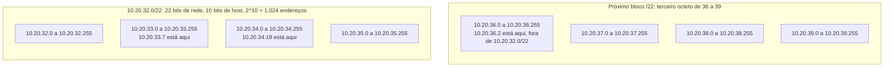
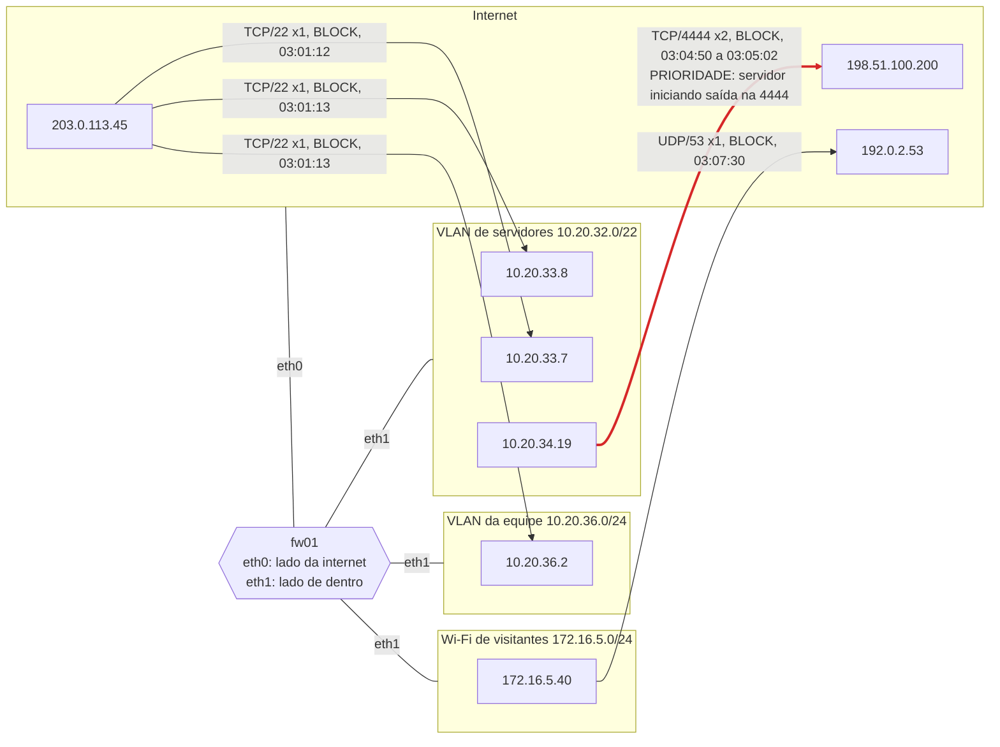

# Dia 09: Sub-redes e CIDR para ler logs de firewall

> 🇺🇸 Original: [*Day 9: Subnetting and CIDR for reading firewall logs*](https://github.com/thiefdroppers/cyber-investigator-skills/blob/main/curriculum/phase-1-foundations/day-09.md) — © ThiefDroppers, licença MIT.
> Aqui: tradução fiel **+** camada brasileira. Nada do original foi removido; tudo o que é novo vem marcado com ➕.

**Fase 1. Fundamentos** · Meta da trilha: situar qualquer endereço IP de um log de firewall dentro ou fora de um segmento de rede nomeado, com rapidez e correção, e transformar um log bruto de bloqueios num mapa de quais segmentos falaram com o quê.

Rank Jutsu: `D` · [](https://colab.research.google.com/github/Ridd1kulusC0d3r/investigador-cyber-90-dias/blob/main/curriculo/fase-1-fundamentos/dia-09/dia-09.ipynb)

---

## 🎬 ➕ Abertura do caso — *O endereço que não é da sede*

Terça, 14h00. Para fechar a dúvida do Dia 4 (por que as conexões perto do meio-dia deram `S0`?), a TI da Serra Azul mandou dois arquivos: o log do firewall da sede, `fw-sede`, recortado para segunda-feira, e o plano de endereços da cooperativa. O time de fraude mandou um terceiro: o extrato dos acessos ao internet banking que fizeram os três Pix contestados.

Você confirma em minutos: às 11h47 e 11h52 (horário de Brasília, como o *syslog* do firewall grava), a TI já tinha bloqueado `203.0.113.77` no firewall, horas antes do bloqueio de DNS. Mistério resolvido.

Mas há três linhas de outro segmento. `10.20.40.57`, às 13h41, tentando `203.0.113.77` e `203.0.113.78`. Você abre o plano de endereços: `10.20.40.0/24` é a **Agência Centro**, a rede dos caixas.

Rafa se inclina.

— Isso não é a sede verificando denúncia. Anota, prioriza e não conclui nada ainda. E olha o extrato do internet banking: dois cooperados diferentes, o mesmo IP, com vinte minutos de diferença. Me diz o que esse IP prova.

É isso que o Dia 9 ensina. *(Personagens e cenário: [Operação Isca](../../../caso-continuo/).)*

---

## 📖 Conceito

Um log de firewall é uma lista de endereços. Ele vira evidência quando você sabe quais endereços pertencem a qual parte da rede: o segmento de servidores, os notebooks da equipe, o Wi-Fi de visitantes ou a internet. Redes são descritas em notação CIDR, e lê-la é um pouco de aritmética.

`10.20.32.0/22` significa que os primeiros 22 bits do endereço são a rede, e os 10 bits restantes numeram os hosts. 2^10 são 1.024 endereços, então a faixa vai de `10.20.32.0` a `10.20.35.255`. Para situar um endereço de cabeça, olhe o octeto em que o prefixo termina. Um /22 termina dentro do terceiro octeto, deixando 2 bits de host ali, então o terceiro octeto anda em blocos de 2^2 = 4: de 32 a 35 é uma rede, de 36 a 39 a seguinte. `10.20.33.7` está dentro de `10.20.32.0/22`; `10.20.36.2` não está. O mesmo raciocínio cobre qualquer prefixo: um /24 é um bloco de 256 no último octeto, um /16 um bloco de 256 no terceiro, um /26 um bloco de 64 no último.

Desenhado, o /22 são quatro blocos consecutivos do tamanho de um /24, e o /22 seguinte começa onde ele termina:



Algumas faixas que você deve reconhecer de olho:

| Faixa | Significado |
|---|---|
| `10.0.0.0/8`, `172.16.0.0/12`, `192.168.0.0/16` | Endereços privados (RFC 1918). Nunca roteados na internet. Repare que `172.16.0.0/12` vai até `172.31.255.255`. |
| `100.64.0.0/10` | NAT de operadora, *carrier-grade NAT* (RFC 6598). Um endereço público compartilhado por muitos clientes do provedor. |
| `127.0.0.0/8` | *Loopback*, a máquina falando consigo mesma. |
| `169.254.0.0/16` | *Link-local*. Um host que não conseguiu endereço por DHCP muitas vezes aparece aqui. |
| `192.0.2.0/24`, `198.51.100.0/24`, `203.0.113.0/24` | Reservados para documentação (RFC 5737). Este roteiro os usa nos exemplos; eles nunca deveriam aparecer num log real. |

O NAT muda o que cada log consegue lhe dizer. Quando um notebook em `10.20.36.14` navega num site, os logs do próprio site registram o IP público da organização, não `10.20.36.14`. Para identificar a máquina interna, você precisa do log de tradução NAT do firewall, para o mesmo horário e porta. O mesmo limite vale para o NAT de operadora, em que um único IP público, num dado momento, pode representar centenas de residências. Um endereço IP num log identifica um ponto de rede num horário. Ele não identifica uma pessoa, e relatórios que o tratam como se identificasse causam dano real.

Num log de firewall, a direção importa tanto quanto os endereços. Bloqueios de entrada vindos da internet são ruído de fundo constante em qualquer endereço exposto. Uma conexão de saída de um servidor interno para um host externo desconhecido, numa porta estranha, é mais rara e, em geral, a linha mais importante.

## 📚 Recursos

- [RFC 1918: Address Allocation for Private Internets](https://www.rfc-editor.org/rfc/rfc1918) e o [registro IANA de endereços IPv4 de uso especial](https://www.iana.org/assignments/iana-ipv4-special-registry/).
- [Documentação do módulo `ipaddress` do Python](https://docs.python.org/3/library/ipaddress.html).
- [Cola e prática de sub-redes (subnettingpractice.com)](https://subnettingpractice.com/), para treinar até /8 a /30 ficarem automáticos.
- [Documentação do UFW do Ubuntu](https://help.ubuntu.com/community/UFW), para o formato de log usado abaixo.

### ➕ Recursos do contexto Brasil

- [Registro.br — WHOIS/RDAP de endereços IP](https://registro.br/tecnologia/ferramentas/rdap/): o NIC.br é o registro nacional de IPs (NIR) do Brasil, abaixo do LACNIC. Para um IP brasileiro, o RDAP do Registro.br mostra o bloco, o sistema autônomo e a organização responsável (em geral, a operadora), não o assinante.
- [LACNIC — RDAP](https://rdap.lacnic.net/): para blocos da América Latina e do Caribe.
- [NIC.br — boas práticas de CGNAT e registro de porta de origem](https://bcp.nic.br/): com o NAT de operadora, só o par **IP + porta de origem + horário** permite à operadora apontar o assinante; o NIC.br tem documentos sobre isso.
- [Marco Civil da Internet (Lei 12.965/2014)](https://www.planalto.gov.br/ccivil_03/_ato2011-2014/2014/lei/l12965.htm), arts. 10, 13 e 22: guarda de registros de conexão pelo provedor e obtenção por ordem judicial.

## 🛠️ Prática: `ipaddress` do Python e draw.io, produzindo um mapa de fluxos por segmento a partir de um log de firewall

### O ambiente

Você está revisando logs de uma pequena organização fictícia com este plano de endereços (escreva-o no alto das suas notas):

| Segmento | CIDR | Conteúdo |
|---|---|---|
| VLAN de servidores | `10.20.32.0/22` | Servidores web, de arquivos e de banco de dados |
| VLAN da equipe | `10.20.36.0/24` | Notebooks da equipe |
| Wi-Fi de visitantes | `172.16.5.0/24` | Dispositivos de visitantes, só acesso à internet |
| Internet | todo o resto | |

**Seu checklist de hoje.** Faça na ordem e marque cada item ao terminar:

- [ ] Passo 1: salvar o log de exemplo
- [ ] Passo 2: reduzir cada linha a um fluxo
- [ ] Passo 3: situar cada endereço de cabeça e depois conferir com Python
- [ ] Passo 4: ler a história
- [ ] Passo 5: desenhar o mapa de fluxos por segmento
- [ ] ➕ Passo 6: o firewall da sede da Serra Azul e os IPs do internet banking (Prática BR)
- [ ] ➕ Passo 7: o notebook do dia no Colab

### Passo 1: salvar o log de exemplo

Salve o seguinte como `ufw-sample.log`. Está no formato UFW (iptables) do Linux e usa endereços de documentação para os hosts externos:

```
Mar 10 03:01:12 fw01 kernel: [UFW BLOCK] IN=eth0 OUT= MAC=52:54:00:aa:bb:cc:52:54:00:11:22:33:08:00 SRC=203.0.113.45 DST=10.20.33.7 LEN=60 TOS=0x00 PREC=0x00 TTL=52 ID=4410 DF PROTO=TCP SPT=50122 DPT=22 WINDOW=64240 RES=0x00 SYN URGP=0
Mar 10 03:01:13 fw01 kernel: [UFW BLOCK] IN=eth0 OUT= MAC=52:54:00:aa:bb:cc:52:54:00:11:22:33:08:00 SRC=203.0.113.45 DST=10.20.33.8 LEN=60 TOS=0x00 PREC=0x00 TTL=52 ID=4411 DF PROTO=TCP SPT=50123 DPT=22 WINDOW=64240 RES=0x00 SYN URGP=0
Mar 10 03:01:13 fw01 kernel: [UFW BLOCK] IN=eth0 OUT= MAC=52:54:00:aa:bb:cc:52:54:00:11:22:33:08:00 SRC=203.0.113.45 DST=10.20.36.2 LEN=60 TOS=0x00 PREC=0x00 TTL=52 ID=4412 DF PROTO=TCP SPT=50124 DPT=22 WINDOW=64240 RES=0x00 SYN URGP=0
Mar 10 03:04:50 fw01 kernel: [UFW BLOCK] IN=eth1 OUT=eth0 MAC=52:54:00:dd:ee:ff:52:54:00:44:55:66:08:00 SRC=10.20.34.19 DST=198.51.100.200 LEN=52 TOS=0x00 PREC=0x00 TTL=127 ID=881 DF PROTO=TCP SPT=49811 DPT=4444 WINDOW=64240 RES=0x00 SYN URGP=0
Mar 10 03:05:02 fw01 kernel: [UFW BLOCK] IN=eth1 OUT=eth0 MAC=52:54:00:dd:ee:ff:52:54:00:44:55:66:08:00 SRC=10.20.34.19 DST=198.51.100.200 LEN=52 TOS=0x00 PREC=0x00 TTL=127 ID=902 DF PROTO=TCP SPT=49812 DPT=4444 WINDOW=64240 RES=0x00 SYN URGP=0
Mar 10 03:07:30 fw01 kernel: [UFW BLOCK] IN=eth1 OUT=eth0 MAC=52:54:00:dd:ee:ff:52:54:00:77:88:99:08:00 SRC=172.16.5.40 DST=192.0.2.53 LEN=71 TOS=0x00 PREC=0x00 TTL=63 ID=12001 PROTO=UDP SPT=53001 DPT=53 LEN=51
```

Os campos de que você precisa: `IN=` e `OUT=` são as interfaces (um `OUT=` vazio significa que o pacote era endereçado ao próprio firewall ou foi bloqueado na entrada), `SRC` e `DST` são os endereços, `PROTO`, `SPT` e `DPT` são protocolo e portas, `TTL` é o tempo de vida restante, e um `SYN` solto perto do fim é a *flag* TCP.

### Passo 2: reduzir cada linha a um fluxo

```bash
grep -o 'SRC=[^ ]* DST=[^ ]*.*DPT=[0-9]*' ufw-sample.log \
  | sed -E 's/SRC=([^ ]+) DST=([^ ]+).*PROTO=([A-Z]+).*DPT=([0-9]+)/\1 -> \2 \3\/\4/'
```

Saída:

```
203.0.113.45 -> 10.20.33.7 TCP/22
203.0.113.45 -> 10.20.33.8 TCP/22
203.0.113.45 -> 10.20.36.2 TCP/22
10.20.34.19 -> 198.51.100.200 TCP/4444
10.20.34.19 -> 198.51.100.200 TCP/4444
172.16.5.40 -> 192.0.2.53 UDP/53
```

### Passo 3: situar cada endereço de cabeça e depois conferir com Python

Primeiro, situe cada endereço num segmento, no papel, usando o método do tamanho de bloco do Conceito. Depois, confira o seu trabalho:

```bash
python3 - <<'EOF'
import ipaddress
rfc1918 = [ipaddress.ip_network(n) for n in ("10.0.0.0/8", "172.16.0.0/12", "192.168.0.0/16")]
segments = {
    "Server VLAN": ipaddress.ip_network("10.20.32.0/22"),
    "Staff VLAN":  ipaddress.ip_network("10.20.36.0/24"),
    "Guest Wi-Fi": ipaddress.ip_network("172.16.5.0/24"),
}
for ip in ["203.0.113.45", "10.20.33.7", "10.20.33.8", "10.20.36.2",
           "10.20.34.19", "198.51.100.200", "172.16.5.40", "192.0.2.53"]:
    a = ipaddress.ip_address(ip)
    seg = next((name for name, net in segments.items() if a in net), "Internet")
    print(f"{ip:15} rfc1918={str(any(a in r for r in rfc1918)):5} segment={seg}")

n = ipaddress.ip_network("10.20.32.0/22")
print(n.network_address, "-", n.broadcast_address, n.num_addresses, "addresses, mask", n.netmask)
EOF
```

Saída:

```
203.0.113.45    rfc1918=False segment=Internet
10.20.33.7      rfc1918=True  segment=Server VLAN
10.20.33.8      rfc1918=True  segment=Server VLAN
10.20.36.2      rfc1918=True  segment=Staff VLAN
10.20.34.19     rfc1918=True  segment=Server VLAN
198.51.100.200  rfc1918=False segment=Internet
172.16.5.40     rfc1918=True  segment=Guest Wi-Fi
192.0.2.53      rfc1918=False segment=Internet
10.20.32.0 - 10.20.35.255 1024 addresses, mask 255.255.252.0
```

O script confere a RFC 1918 explicitamente, em vez de usar a propriedade `is_private` do Python. `is_private` também devolve `True` para as faixas de documentação, então `ipaddress.ip_address("203.0.113.45").is_private` é `True`. Teste isso você mesmo. Um script que confia em `is_private` rotularia como interno um endereço de documentação ou de outro uso especial.

`10.20.34.19` é o endereço que a maioria das pessoas situa errado. Ele parece poder estar em qualquer lugar, mas 34 cai no bloco de 32 a 35, então é um servidor.

### Passo 4: ler a história

Escreva `day09-findings.md` com uma entrada por fluxo distinto: segmento para segmento, protocolo e porta, contagem e a sua leitura. Leitura resolvida para este log:

- Um endereço externo enviou tentativas de conexão SSH (SYN para a porta 22) a três endereços internos em dois segundos, e o firewall bloqueou todas. Isso é varredura rotineira da internet. Registre, mas não é a prioridade.
- Um servidor (`10.20.34.19`, VLAN de servidores) tentou duas vezes, com doze segundos de intervalo, abrir uma conexão TCP de saída para um host externo na porta 4444. O firewall bloqueou as duas. Servidores raramente iniciam conexões de saída para hosts arbitrários, e 4444 é a porta de escuta padrão de ferramentas comuns de teste de intrusão e de acesso remoto. Esta é a pista. Os próximos passos seriam os registros de processos e conexões do próprio servidor no mesmo minuto, que é a visão `ss` do Dia 4.
- Um dispositivo de visitante enviou uma consulta DNS diretamente para um resolvedor externo, e o firewall a bloqueou, o que sugere que o DNS de visitantes deve passar por um resolvedor interno. Provavelmente é um bloqueio de política, e não uma ameaça.

Um TTL de 127 nos pacotes do servidor combina com um host Windows que começou em 128 e atravessou o firewall uma vez. Marque isso como inferência.

### Passo 5: desenhar o mapa de fluxos por segmento

No draw.io, abra More Shapes (no fim do painel esquerdo) e ative a biblioteca Networking. Desenhe:

1. Um retângulo grande por segmento, rotulado com nome e CIDR.
2. Uma nuvem "Internet".
3. O firewall `fw01` entre eles, com as suas interfaces (`eth0` voltada para a internet, `eth1` voltada para dentro).
4. Uma seta por fluxo distinto do Passo 2, da origem para o destino, rotulada `proto/porta × contagem, BLOCK`, com o intervalo de horário.
5. Pinte de vermelho a seta que você classificou como mais prioritária e acrescente um balão com a sua leitura de uma linha.

Exporte como `day09-segment-flows.png`.

O seu mapa deve carregar as mesmas informações desta referência, desenhada a partir do log de exemplo. O firewall fica entre as zonas e, como toda linha do log é um `BLOCK`, nenhum desses fluxos chegou ao destino:



### ➕ Prática BR: o `fw-sede` e o IP que não é uma pessoa

Arquivos em [`caso-continuo/dados/dia-09/`](../../../caso-continuo/dados/dia-09/) (fictícios):

- `ufw-fw-sede.log` — o log do firewall da sede, no mesmo formato UFW, **com horário local de Brasília** (o *syslog* não grava fuso; a TI confirmou por escrito);
- `plano-de-enderecos.csv` — o plano de endereços da Serra Azul (servidores da sede, atendimento da sede, Agência Centro, Wi-Fi de visitantes das agências);
- `acessos-ib-contestados.txt` — o extrato do internet banking com IP e porta de origem dos logins que fizeram os três Pix contestados.

1. Calcule o SHA-256 dos três arquivos e registre na custódia, anotando que o firewall grava em BRT sem fuso explícito (essa é uma informação de proveniência; sem ela, toda a sua linha do tempo erraria por 3 horas).
2. Faça os Passos 2 e 3 com o plano da Serra Azul. Converta os horários para UTC e confira: as linhas das 11h47 e 11h52 BRT batem com as `S0` do `conn.log` do Dia 4 (14h47 e 14h52 UTC)? E a varredura RDP das 10h09 BRT bate com as duas `S0` de `198.51.100.14`?
3. Situe `10.20.40.57`. Qual segmento? Por que três tentativas de um caixa da Agência Centro para os **dois** IPs do golpe valem mais do que as conexões do atendimento da sede? (Pense em direção, segmento de origem e no que a Agência Centro faz.) Registre como pista **prioritária e não concluída**. Atenção: o UFW, como configurado aqui, só registra bloqueios. A ausência de linhas antes das 13h41 **não** prova que a máquina não falou com o golpe mais cedo, quando o IP ainda não estava bloqueado; isso exige o log de conexões permitidas, que a TI entrega na Fase 4.
4. Ordene os fluxos por prioridade no `day09-findings-isca.md`: o caixa da Agência Centro, os bloqueios do atendimento (explicados pelo bloqueio da TI), a varredura RDP (ruído de fundo, mas porta sensível), o DNS do Wi-Fi de visitantes (política).
5. No extrato do internet banking, os cooperados A e B usaram o mesmo IP público, `198.51.100.230`, com portas de origem diferentes. Escreva três hipóteses compatíveis com isso (mesmo operador do golpe, NAT de operadora móvel, VPN/proxy compartilhado) e diga que dado separaria uma da outra. Por que a linha do cooperado C, sem porta registrada, é mais fraca como evidência?
6. Desenhe o mapa de fluxos da Serra Azul no formato do Passo 5, com a seta da Agência Centro em vermelho.

### ➕ O notebook do dia

Abra o [notebook do Dia 09 no Colab](https://colab.research.google.com/github/Ridd1kulusC0d3r/investigador-cyber-90-dias/blob/main/curriculo/fase-1-fundamentos/dia-09/dia-09.ipynb). Nele você:

1. treina a conta de cabeça com o **jogo do tamanho de bloco** (CIDRs sorteados, você diz o primeiro e o último endereço, o `ipaddress` confere);
2. vê com os próprios olhos a pegadinha do `is_private` com os endereços de documentação;
3. lê o `fw-sede` com expressões regulares, converte BRT → UTC e cruza com o `conn.log` do Dia 4;
4. classifica cada fluxo por segmento e direção e gera a lista de prioridades;
5. gera o mapa de fluxos em mermaid, com a seta prioritária em vermelho.

## ✅ Checkpoint

O seu artefato é o `day09-segment-flows.png` mais o `day09-findings.md`. Ele passa quando:

- Todo endereço do log está no segmento correto do mapa, inclusive `10.20.34.19` na VLAN de servidores.
- A direção das setas segue `SRC` para `DST`.
- Toda seta traz protocolo, porta, contagem e ação.
- Os achados classificam as tentativas de saída na 4444 acima da varredura SSH de entrada.
- Os achados explicam por que a direção e o segmento de origem determinam essa classificação.
- Sem calculadora, você dá o primeiro e o último endereço de `172.20.14.77/20` (resposta: `172.20.0.0` a `172.20.15.255`) e diz se é espaço RFC 1918 (é).

### ➕ Checkpoint BR

- A sua linha do tempo do caso agora junta firewall (convertido de BRT), `conn.log` e log do resolvedor, todos em UTC, e o mistério das `S0` perto do meio-dia está explicado com fonte.
- `10.20.40.57` está situado na Agência Centro e registrado como pista prioritária, sem conclusão sobre o que aconteceu na máquina nem sobre quem a usava.
- As três hipóteses para o IP compartilhado dos cooperados A e B estão escritas, com o dado que separaria cada uma.
- Você explica por que, no Brasil, pedir à operadora "quem usava o IP X" sem a porta de origem e o horário exato pode não identificar ninguém, e quem pode fazer esse pedido.
- Você fez pelo menos 8 de 10 no jogo do tamanho de bloco do notebook.

## ⚖️ ➕ Camada jurídica BR

**IP não é pessoa, e o Marco Civil sabe disso.** O provedor de conexão guarda os registros de conexão (data e hora de início e fim, duração e o endereço IP atribuído) por um ano (art. 13), e só os fornece por ordem judicial (arts. 10, §1º, e 22). O pedido em juízo precisa demonstrar indícios do ilícito, justificar a utilidade dos registros e delimitar o período (art. 22, parágrafo único). Quem formula esse pedido é a autoridade policial, o Ministério Público ou a parte em processo, não a Vigia.

**A porta de origem.** Com o NAT de operadora (CGNAT), um mesmo IP público serve muitos assinantes ao mesmo tempo. Sem a porta lógica de origem e o horário preciso (com fuso!), a operadora pode não conseguir apontar o assinante. Há discussão nos tribunais brasileiros sobre a obrigação de guardar e fornecer a porta de origem. <!-- TODO jurídico: confirmar o entendimento atual do STJ sobre guarda e fornecimento da porta lógica de origem por provedores de conexão e de aplicação. --> Na prática: quando a cooperativa entregar os logs do internet banking à polícia, eles precisam ter IP, porta de origem e horário com fuso. A linha do cooperado C, sem porta, é um exemplo do que fazer melhor.

**Logs dos caixas são dado pessoal de empregado.** O endereço `10.20.40.57` corresponde a um notebook usado por uma pessoa em um turno. A cooperativa pode tratar o log para segurança, mas o achado do Dia 9 é sobre a **máquina** e o **fluxo**. Exame do notebook e qualquer conversa com a pessoa são decisões da cooperativa (RH e jurídico), com base legal e procedimento próprios (Fase 4). A Vigia não nomeia, não acusa e não presume.

> Material de estudo, não constitui orientação jurídica.

## 🧠 ➕ Camada 8 — a pista que grita e a pista que importa

Duas coisas no log de hoje chamam atenção por motivos opostos. A varredura RDP de fora é barulhenta: vários destinos, porta "perigosa", origem estrangeira. As três linhas do caixa da Agência Centro são discretas: três SYNs bloqueados, no meio perto do meio-dia. O cérebro dá peso ao que é **saliente** (vívido, chamativo), e a **heurística de disponibilidade** (Tversky e Kahneman) faz o "ataque de hackers" que você já viu em mil manchetes parecer mais provável do que é.

O original ensina o antídoto: **direção e segmento de origem** valem mais do que o barulho. Varredura de entrada é ruído de fundo de qualquer endereço exposto. Saída de um segmento interno sensível para a infraestrutura do golpe é rara, e é a pista.

E há um segundo viés esperando logo depois: assim que a pista aparece, a mente quer uma história com personagem ("a caixa caiu no golpe", "a caixa é cúmplice"). Essa é a hora de repetir a regra do original: o IP identifica um ponto de rede num horário, não uma pessoa.

**Consequência prática:** classifique fluxos por uma regra escrita **antes** de olhar o log (direção, segmento, porta, contagem) e só depois leia as linhas. E, na pista prioritária, escreva o que falta saber, não o que você supõe.

## 🤖 ➕ Skill do dia

Hoje o dia propõe para a [skill pt-BR](../../../skills/investigador-cyber/SKILL.md) o procedimento **"Ler um log de firewall por segmento"**: plano de endereços primeiro, CIDR conferido por RFC 1918 explícita (nunca `is_private`), fuso do log confirmado, priorização por direção e segmento, e a regra de que IP é ponto de rede num horário, não pessoa. Proposta completa em [`_skill-delta.md`](_skill-delta.md).

## 💡 ➕ Inovação OSINT do dia — RDAP de IP sem chave de API

Para um IP público que aparece no log, o primeiro passo de OSINT é saber **de quem é o bloco** (a operadora, a nuvem, o *data center*), nunca de quem é o assinante. O RDAP é o sucessor do WHOIS, em JSON, e o serviço de *bootstrap* `rdap.org` redireciona para o registro certo (ARIN, LACNIC, RIPE...). Só com a biblioteca padrão:

```python
import json, urllib.request
ip = "8.8.8.8"                                                    # troque por um IP público do seu caso
with urllib.request.urlopen(f"https://rdap.org/ip/{ip}", timeout=10) as r:
    d = json.load(r)
print(d.get("handle"), d.get("name"), d.get("startAddress"), "-", d.get("endAddress"), d.get("country"))
for ent in d.get("entities", []):
    print("  papel:", ent.get("roles"), "·", ent.get("handle"))
```

Para IPs brasileiros, o LACNIC delega ao Registro.br, e a resposta traz o sistema autônomo e a organização responsável pelo bloco. Esse é o dado que vai no relatório ("IP pertence a bloco da operadora X; identificação do assinante depende de ordem judicial"), e é aqui que o OSINT legítimo para.

## 📝 Diário de estudo

- Data:
- Tempo gasto:
- O que ficou claro:
- O que ainda está nebuloso:
- Artefato produzido: `day09-segment-flows.png`, `day09-findings.md`, `day09-findings-isca.md`, `day09-segment-flows-isca.md`

---
<sub>Baseado em [cyber-investigator-skills](https://github.com/thiefdroppers/cyber-investigator-skills) por ThiefDroppers (MIT). Tradução, camada BR, Camada 8, skill pt-BR e notebook por Deivison Lourenço (@Ridd1kulusC0d3r).</sub>
