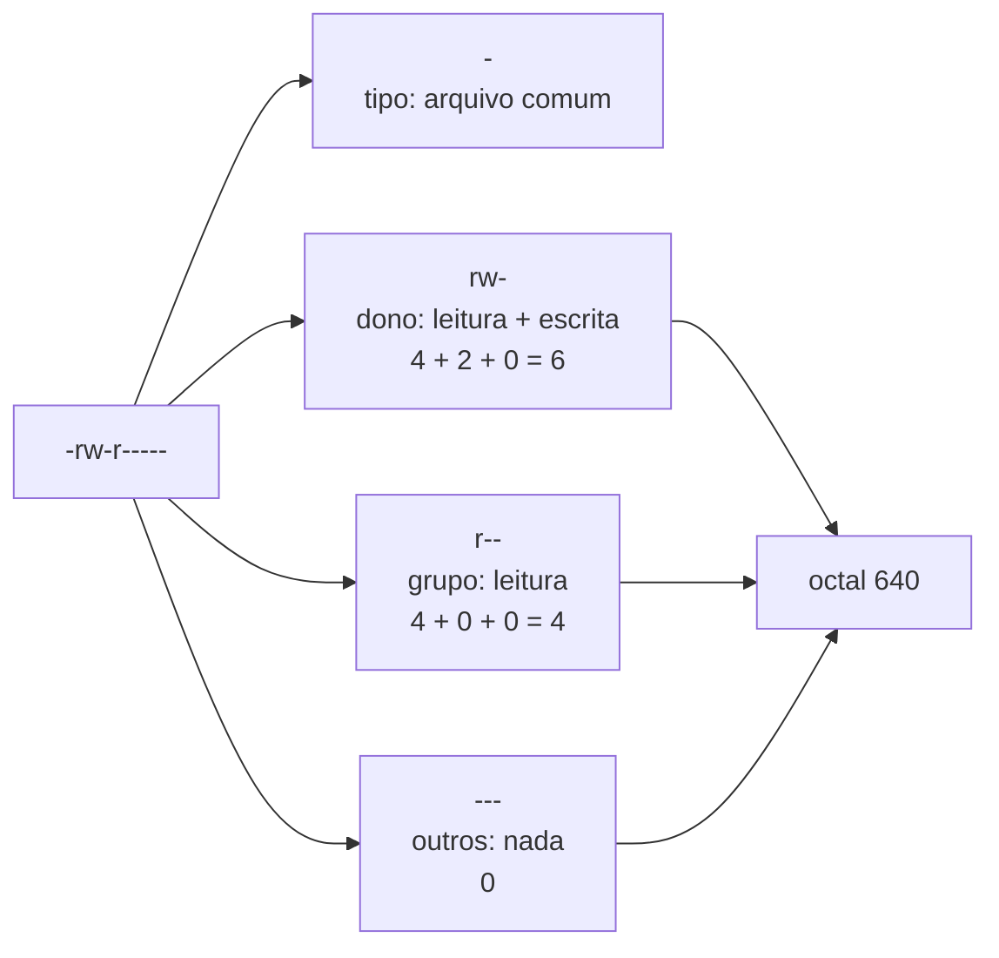
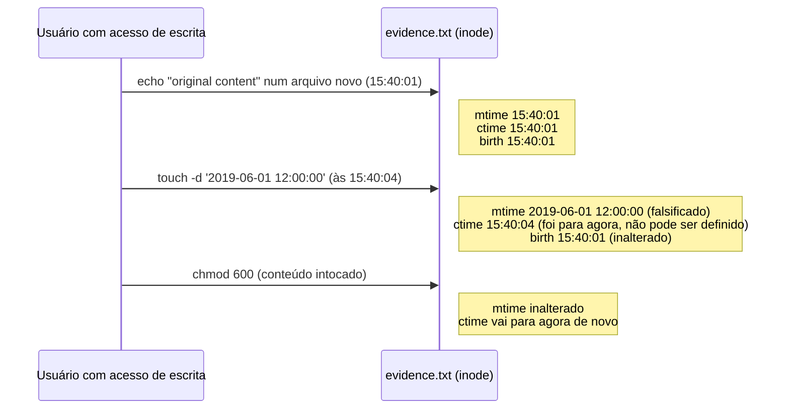

# Dia 10: O shell Linux, o sistema de arquivos e o modelo de permissões

> 🇺🇸 Original: [*Day 10: The Linux shell, filesystem, and permissions model*](https://github.com/thiefdroppers/cyber-investigator-skills/blob/main/curriculum/phase-1-foundations/day-10.md) — © ThiefDroppers, licença MIT.
> Aqui: tradução fiel **+** camada brasileira. Nada do original foi removido; tudo o que é novo vem marcado com ➕.

**Fase 1. Fundamentos** · Meta da trilha: circular por um sistema Linux com segurança, ler dono, permissões e carimbos de tempo como evidência, e saber quais carimbos de tempo um atacante consegue falsificar.

Rank Jutsu: `D` · [](https://colab.research.google.com/github/Ridd1kulusC0d3r/investigador-cyber-90-dias/blob/main/curriculo/fase-1-fundamentos/dia-10/dia-10.ipynb)

---

## 🎬 ➕ Abertura do caso — *A pasta que todo mundo podia escrever*

Segunda-feira, 16h10. Chega o primeiro pacote de logs da Serra Azul: Juliano Prates, o analista de infraestrutura da cooperativa, copiou o log de acesso do portal e o `auth.log` do servidor `sa-web01` para uma pasta `/srv/entrega-vigia/` e mandou por e-mail, junto com a saída de um `stat` que você pediu.

Você já está abrindo o `access.log.1` quando Rafa pergunta, sem tirar os olhos do monitor dele:

— Quem podia ter escrito nessa pasta antes de você baixar?

Você olha o `stat`. `drwxrwxrwx`. Todo mundo.

— E esse `LEIA-ME.txt` diz que foi modificado em 14 de setembro, mas nasceu hoje. Alguém mexeu na data, ou tem uma explicação boba. Qual das duas? Antes de ler uma linha do log, me diz em que você pode confiar.

É o Dia 10: ler permissões e carimbos de tempo antes de ler o conteúdo. *(Personagens e cenário: [Operação Isca](../../../caso-continuo/).)*

---

## 📖 Conceito

A maioria dos servidores que você vai investigar roda Linux, e a maior parte das ferramentas forenses e de OSINT funciona melhor nele. Você precisa de fluência suficiente para achar arquivos, lê-los sem alterá-los e responder a duas perguntas recorrentes: quem poderia ter escrito este arquivo, e quando ele mudou?

Todo arquivo tem um dono, um grupo e três conjuntos de permissões: leitura (`r`), escrita (`w`) e execução (`x`) para o dono, para o grupo e para todos os outros. O `ls -l` mostra isso como `-rw-r-----`: o primeiro caractere é o tipo (`-` arquivo, `d` diretório, `l` link simbólico), depois vêm três caracteres para o dono, três para o grupo e três para os outros. A forma octal conta `r`=4, `w`=2, `x`=1, então `rw-r-----` é `640`. Num diretório, `x` significa permissão para entrar nele e `w` significa permissão para criar ou apagar arquivos dentro dele, seja quem for o dono desses arquivos. Esse segundo ponto é o motivo de um diretório gravável por todos (*world-writable*) dentro da raiz de um site importar tanto: qualquer processo do sistema pode largar um arquivo ali.

Lendo `-rw-r-----` pedaço por pedaço:



Três bits especiais aparecem em investigações. O SUID (`s` na posição de execução do dono, octal 4000) faz um programa rodar com os privilégios do dono dele, então um binário SUID-root inesperado é um achado clássico de persistência e de escalada de privilégio. O SGID (2000) faz o mesmo para o grupo. O *sticky bit* (`t`, 1000) num diretório compartilhado como `/tmp` impede que um usuário apague os arquivos de outro.

Todo arquivo também carrega carimbos de tempo, e investigadores os leem errado o tempo todo. O `mtime` (*modify*) muda quando o conteúdo do arquivo muda. O `atime` (*access*) muda quando ele é lido, mas a maioria dos sistemas monta os discos com `relatime`, que só o atualiza de vez em quando, então ele é evidência fraca. O `ctime` é a hora de mudança do *inode*, atualizada quando mudam o conteúdo, as permissões ou o dono; ele **não** é a hora de criação. Muitos sistemas de arquivos modernos (ext4, XFS, Btrfs) também gravam uma hora de nascimento (*birth time*), que o `stat` mostra como `Birth` quando o kernel e as ferramentas dão suporte.

A assimetria importante: qualquer usuário que pode escrever num arquivo consegue definir o `mtime` e o `atime` dele para qualquer valor com `touch`, mas não consegue definir o `ctime`, porque mudar os outros carimbos atualiza o próprio `ctime` para a hora atual. Um arquivo cujo `mtime` diz 2019 e cujo `ctime` diz terça-feira passada foi mexido com `touch`. Essa discrepância é um dos sinais mais comuns de adulteração deliberada de carimbos de tempo no Linux.

Este é o experimento que você vai rodar no Passo 3, com os horários ilustrativos da saída dele. Observe qual carimbo cada ação move:



## 📚 Recursos

- [The Linux Command Line](https://linuxcommand.org/tlcl.php), de William Shotts, um livro gratuito. Capítulos 2 a 4 (navegação) e 9 (permissões).
- [OverTheWire: Bandit](https://overthewire.org/wargames/bandit/), níveis 0 a 12. Um servidor de prática legal, feito exatamente para estas habilidades.
- [Página de manual inode(7)](https://man7.org/linux/man-pages/man7/inode.7.html): a descrição de referência dos carimbos de tempo e dos bits de permissão.
- [Página de manual find(1)](https://man7.org/linux/man-pages/man1/find.1.html), em especial `-perm`, `-newer`, `-mmin` e `-user`.

### ➕ Recursos do contexto Brasil

- [Guia Foca GNU/Linux](https://www.guiafoca.org/): o manual livre de Linux em português mais usado no Brasil; os capítulos de permissões e de comandos de arquivos cobrem o dia inteiro.
- [Código de Processo Penal, arts. 158-A a 158-F](https://www.planalto.gov.br/ccivil_03/decreto-lei/del3689compilado.htm) (redação da Lei 13.964/2019): as etapas da cadeia de custódia. O Dia 10 é a parte técnica de "fixação" e "coleta": registrar o estado do arquivo **antes** de mexer nele.
- [`../../../caso-continuo/dados/dia-10/stat-entrega-ti.txt`](../../../caso-continuo/dados/dia-10/stat-entrega-ti.txt): a saída de `stat` da entrega da Serra Azul, usada na Prática BR.

## 🛠️ Prática: stat e find, produzindo uma ficha de triagem de arquivos e uma tabela comparativa de adulteração de carimbos de tempo

Use uma máquina Linux que seja sua: uma VM, o WSL no Windows ou uma máquina sobrando. (O macOS serve para a maior parte dos passos, mas o `stat` dele usa outras flags; as formas mostradas são as do Linux.)

**Seu checklist de hoje.** Faça na ordem e marque cada item ao terminar:

- [ ] Passo 1: navegar e se orientar
- [ ] Passo 2: ler os metadados completos de um arquivo
- [ ] Passo 3: o experimento de adulteração de carimbos de tempo
- [ ] Passo 4: achar arquivos do jeito que um investigador acha
- [ ] Passo 5: montar a ficha de triagem de arquivos
- [ ] ➕ Passo 6: a ficha de triagem da entrega da Serra Azul (Prática BR)
- [ ] ➕ Passo 7: o notebook do dia no Colab

### Passo 1: navegar e se orientar

```bash
pwd; whoami; id
cd /var/log && ls -la | head -20
ls -l /etc/passwd /etc/shadow
```

Ilustrativo:

```
uid=1000(analyst) gid=1000(analyst) groups=1000(analyst),4(adm),27(sudo)
-rw-r--r-- 1 root root   2891 Mar  9 10:02 /etc/passwd
-rw-r----- 1 root shadow 1502 Mar  9 10:02 /etc/shadow
```

Pertencer ao grupo `adm` é o que permite ler a maior parte dos logs em `/var/log` sem `sudo` no Debian e no Ubuntu. O `/etc/shadow` guarda os *hashes* das senhas e só pode ser lido pelo root e pelo grupo `shadow`.

### Passo 2: ler os metadados completos de um arquivo

```bash
stat /var/log/auth.log            # ou /var/log/syslog, ou qualquer log presente
```

Ilustrativo:

```
  File: /var/log/auth.log
  Size: 48213           Blocks: 96         IO Block: 4096   regular file
Device: 8,2     Inode: 1048612     Links: 1
Access: (0640/-rw-r-----)  Uid: (  104/  syslog)   Gid: (    4/     adm)
Access: 2026-03-10 09:14:02.118201233 +0000
Modify: 2026-03-10 09:02:13.771034520 +0000
Change: 2026-03-10 09:02:13.771034520 +0000
 Birth: 2026-03-09 00:00:01.004411902 +0000
```

Lendo: pertence ao usuário `syslog`, pode ser lido pelo grupo `adm`, foi escrito pela última vez às 09:02:13 UTC e foi criado (*birth*) logo depois da meia-noite de 9 de março, o que combina com uma rotação diária de log.

Uma forma de uma linha, mais fácil de colar numa tabela:

```bash
stat -c '%n|%U:%G|%a|mtime=%y|ctime=%z|birth=%w' /var/log/auth.log
```

### Passo 3: o experimento de adulteração de carimbos de tempo

No seu diretório *home*:

```bash
mkdir -p ~/lab/day10 && cd ~/lab/day10
echo "original content" > evidence.txt
stat -c 'mtime=%y  ctime=%z  birth=%w' evidence.txt
sleep 3
touch -d '2019-06-01 12:00:00' evidence.txt
stat -c 'mtime=%y  ctime=%z  birth=%w' evidence.txt
```

Ilustrativo:

```
mtime=2026-03-10 15:40:01.221 +0000  ctime=2026-03-10 15:40:01.221 +0000  birth=2026-03-10 15:40:01.221 +0000
mtime=2019-06-01 12:00:00.000 +0000  ctime=2026-03-10 15:40:04.502 +0000  birth=2026-03-10 15:40:01.221 +0000
```

O `mtime` agora afirma 2019. O `ctime` avançou para o momento do `touch`, e o `birth` continua mostrando hoje. Um `mtime` mais antigo que o *birth*, ou um `ctime` anos mais novo que o `mtime` num arquivo que nunca deveria ter mudado, é uma pergunta que você precisa responder antes de confiar nas datas do arquivo.

Agora mude as permissões e veja o `ctime` se mover de novo sem tocar no conteúdo:

```bash
chmod 600 evidence.txt && stat -c 'mode=%a mtime=%y ctime=%z' evidence.txt
```

### Passo 4: achar arquivos do jeito que um investigador acha

```bash
# Programas SUID e SGID no sistema de arquivos raiz
find / -xdev -type f \( -perm -4000 -o -perm -2000 \) -exec ls -l {} + 2>/dev/null

# Arquivos e diretórios graváveis por todos, fora de /proc, /sys e /tmp
find / -xdev \( -path /tmp -o -path /var/tmp \) -prune -o -perm -0002 ! -type l -print 2>/dev/null

# Arquivos em /etc alterados nos últimos 2 dias
find /etc -xdev -type f -mtime -2 -exec ls -l --time-style=+%FT%T {} + 2>/dev/null

# Arquivos mais novos que um arquivo de referência (tudo o que foi escrito depois que seu evidence.txt foi criado)
find ~ -newer ~/lab/day10/evidence.txt -type f 2>/dev/null | head
```

O `-xdev` mantém o `find` num único sistema de arquivos, para ele não sair vagando por montagens de rede. O `2>/dev/null` esconde o ruído de "Permission denied"; rode uma vez sem isso para ver quanta coisa você não consegue ler como usuário comum.

Uma instalação nova tem uma lista curta de binários SUID (`passwd`, `sudo`, `su`, `mount` e parecidos); o número exato depende da distribuição e dos pacotes instalados. Salve sua lista como linha de base (*baseline*):

```bash
find / -xdev -type f -perm -4000 2>/dev/null | sort > ~/lab/day10/suid-baseline.txt
wc -l ~/lab/day10/suid-baseline.txt
```

Toda entrada inesperada mais tarde é uma pista.

### Passo 5: montar a ficha de triagem de arquivos

Escolha cinco arquivos: `/etc/passwd`, `/etc/shadow`, `/usr/bin/passwd` (um binário SUID normal), um arquivo em `/var/log` e o seu `evidence.txt` adulterado. Para cada um, preencha uma linha em `day10-triage-card.md`:

```markdown
| Caminho | Dono:Grupo | Modo (octal / simbólico) | Bits especiais | Quem pode escrevê-lo? | mtime (UTC) | ctime (UTC) | birth (UTC) | Carimbos consistentes? | SHA-256 |
|---|---|---|---|---|---|---|---|---|---|
```

"Quem pode escrevê-lo?" significa nomear as contas ou grupos de fato, por exemplo "só o root" ou "o root e qualquer membro de adm". Pegue o hash com `sha256sum <caminho>`, usando `sudo` quando precisar.

### ➕ Prática BR: a ficha de triagem da entrega da Serra Azul

Abra [`caso-continuo/dados/dia-10/stat-entrega-ti.txt`](../../../caso-continuo/dados/dia-10/stat-entrega-ti.txt). São sete linhas no formato `stat -c '%n|%U:%G|%a|%A|mtime=%y|ctime=%z|birth=%w'`, rodadas pelo Juliano no servidor `sa-web01` a seu pedido, em UTC.

1. Monte `isca-dia10-ficha-entrega.md` com a mesma tabela do Passo 5 (a coluna SHA-256 fica para quando você receber os arquivos; anote "pendente").
2. Para cada linha, responda **quem podia escrever**. Atenção ao diretório `/srv/entrega-vigia`: modo `777`, grupo `www-data`. Explique por que, nesse diretório, "quem podia escrever" inclui o processo do servidor web, e por que isso pesa mais do que a permissão `664` dos arquivos dentro dele.
3. Marque as inconsistências de carimbo. Há duas coisas para notar, e só uma delas é suspeita:
   - `access.log.1` original: `mtime` às 02:59:58 e `ctime`/`birth` do arquivo seguinte às 03:00:02 UTC (00h BRT). O que isso conta sobre o `logrotate`?
   - `LEIA-ME.txt`: `mtime` em 14/09, `birth` hoje. Liste **duas** explicações: uma maliciosa (`touch -d`) e uma banal (cópia com `cp -p` ou `cp --preserve=timestamps`, que preserva o `mtime` do original). Qual pergunta você manda ao Juliano para decidir entre elas?
4. Escreva duas linhas de recomendação para a próxima entrega: diretório com modo `750` (dono `juliano`, sem `www-data`), e `sha256sum` dos arquivos calculado **no servidor, antes da cópia**, enviado no corpo do e-mail.

O que você **não** faz: pedir acesso ao servidor para "conferir você mesmo". O escopo do caso é a infraestrutura do golpe; os sistemas internos da cooperativa entram só pelo que o TI dela entrega.

### ➕ O notebook do dia

Abra o [notebook do Dia 10 no Colab](https://colab.research.google.com/github/Ridd1kulusC0d3r/investigador-cyber-90-dias/blob/main/curriculo/fase-1-fundamentos/dia-10/dia-10.ipynb). Nele você:

1. converte modos simbólicos em octais (e o contrário) com uma função comentada linha a linha, incluindo SUID, SGID e *sticky*;
2. refaz o experimento do `touch` **dentro do Python** (`os.utime`) e vê o `ctime` andar sozinho;
3. roda um "detector de carimbo mexido" sobre a saída de `stat` da Serra Azul;
4. joga o **quiz do `rwx`** (8 perguntas) e gera a ficha `isca-dia10-ficha-entrega.md`.

## ✅ Checkpoint

Seus artefatos são `day10-triage-card.md`, `~/lab/day10/suid-baseline.txt` e uma tabela comparativa de duas linhas, no mesmo arquivo, mostrando o `evidence.txt` antes e depois do `touch`. Eles passam quando:

- Todo modo aparece nas formas octal e simbólica.
- A coluna de bits especiais marca corretamente `/usr/bin/passwd` como SUID.
- A linha do `evidence.txt` está marcada como inconsistente, com uma frase de motivo citando `ctime` e `birth`.
- Você consegue explicar, sem consultar notas, por que o `ctime` não é uma hora de criação.
- Você consegue explicar, sem consultar notas, por que o `atime` é evidência fraca numa montagem com `relatime`.
- Você consegue explicar, sem consultar notas, por que a permissão de escrita num diretório deixa um usuário apagar um arquivo que não é dele (a menos que o *sticky bit* esteja ligado).

### ➕ Checkpoint BR

- `isca-dia10-ficha-entrega.md` tem as sete linhas, com "quem pode escrever" nomeando contas e grupos, e o diretório `777` marcado como risco à integridade da entrega.
- A linha do `LEIA-ME.txt` traz as duas explicações (adulteração e `cp -p`) e a pergunta ao Juliano, **sem** concluir adulteração.
- Você explica, sem notas, por que a rotação às 03:00 UTC aparece como 00h no relógio do servidor.
- Você acertou pelo menos 6 das 8 perguntas do quiz do notebook.

## ⚖️ ➕ Camada jurídica BR

**Cadeia de custódia (CPP, arts. 158-A a 158-F, incluídos pela Lei 13.964/2019).** O art. 158-B descreve as etapas do rastreamento de um vestígio, da identificação e fixação até o armazenamento e o descarte. Um arquivo de log que passou por um diretório gravável por qualquer processo do servidor, sem hash no ponto de origem, chega com um buraco logo na primeira etapa. Isso não torna o log inútil, mas dá à defesa, num eventual processo, um argumento pronto contra a integridade dele. O remédio é barato: hash no servidor, antes da cópia, registrado por quem copiou.

**Quem faz a coleta.** A Vigia não coleta no servidor da cooperativa; quem coleta é o funcionário dela, e a Vigia recebe. Por isso o "recebimento" é uma etapa sua: hora UTC, hash na chegada e comparação com o hash de origem. O script `scripts/registrar_evidencia.py` do Dia 1 faz exatamente o seu lado.

> Material de estudo, não constitui orientação jurídica.

## 🧠 ➕ Camada 8 — a primeira data que você vê vira âncora

Tversky e Kahneman descreveram a **ancoragem**: um número visto primeiro puxa todas as estimativas seguintes para perto dele, mesmo quando ele é arbitrário. Em perícia de arquivos, a âncora quase sempre é o `mtime`, porque é o que o `ls -l` mostra. "O arquivo é de 14 de setembro" vira um fato na sua cabeça antes de você ver o `ctime` e o `birth`.

O efeito tem dois lados no caso de hoje. Ancorado no `mtime`, você aceitaria uma data falsificada. Ancorado na palavra "inconsistente", você acusaria o Juliano de adulterar um arquivo que provavelmente só foi copiado com `cp -p`. O antídoto é de rotina, não de força de vontade: **leia sempre os três (ou quatro) carimbos juntos, e escreva a explicação banal antes da maliciosa.** Uma inconsistência é uma pergunta para alguém, não um veredito sobre alguém.

## 🤖 ➕ Skill do dia

O Dia 10 propõe para a [skill pt-BR](../../../skills/investigador-cyber/SKILL.md) o procedimento **"Ler datas e permissões de arquivo como evidência"**: os três carimbos juntos, o `ctime` que não se falsifica com `touch`, quem podia escrever e a regra de oferecer a explicação banal antes da maliciosa. Texto e caso de teste em [`_skill-delta.md`](_skill-delta.md).

## 💡 ➕ Inovação OSINT do dia — um detector de *timestomping* em 10 linhas

O `os.stat` da biblioteca padrão devolve `st_mtime_ns` e `st_ctime_ns` com precisão de nanossegundos. A regra do dia vira um varredor de pasta:

```python
import os, pathlib                                   # só stdlib
LIMITE = 24 * 3600 * 10**9                           # 1 dia em nanossegundos
for p in pathlib.Path("entrega").rglob("*"):         # percorre a pasta recebida
    s = os.stat(p, follow_symlinks=False)            # não segue links: lê o próprio arquivo
    if s.st_ctime_ns - s.st_mtime_ns > LIMITE:       # ctime muito depois do mtime = pergunta
        print("mtime antigo, ctime recente:", p)
```

Dois limites honestos: o `os.stat` do Linux não traz o *birth time* (para isso use `stat -c %w` ou a chamada `statx` do kernel), e cópias com `cp -p`, extrações de `.zip` e `rsync -t` produzem o mesmo padrão sem nenhuma má-fé. A ferramenta encontra perguntas; quem responde é você.

## 📝 Diário de estudo

- Data:
- Tempo gasto:
- O que ficou claro:
- O que ainda está nebuloso:
- Artefato produzido: `day10-triage-card.md`, `~/lab/day10/suid-baseline.txt`, `isca-dia10-ficha-entrega.md`

---
<sub>Baseado em [cyber-investigator-skills](https://github.com/thiefdroppers/cyber-investigator-skills) por ThiefDroppers (MIT). Tradução, camada BR, Camada 8, skill pt-BR e notebook por Deivison Lourenço (@Ridd1kulusC0d3r).</sub>
