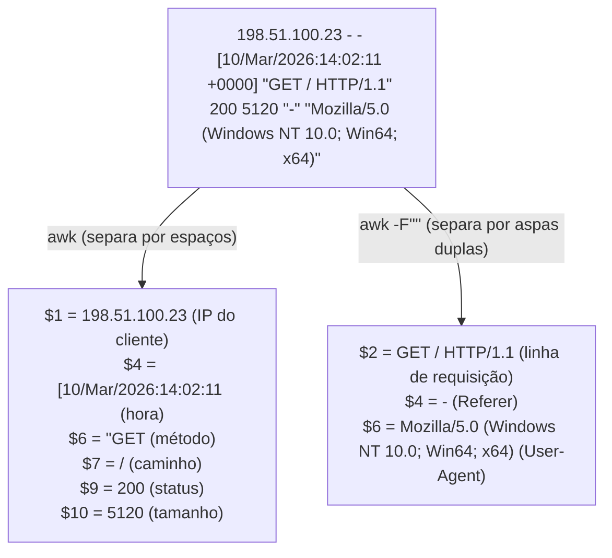
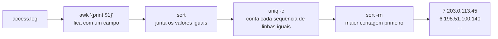
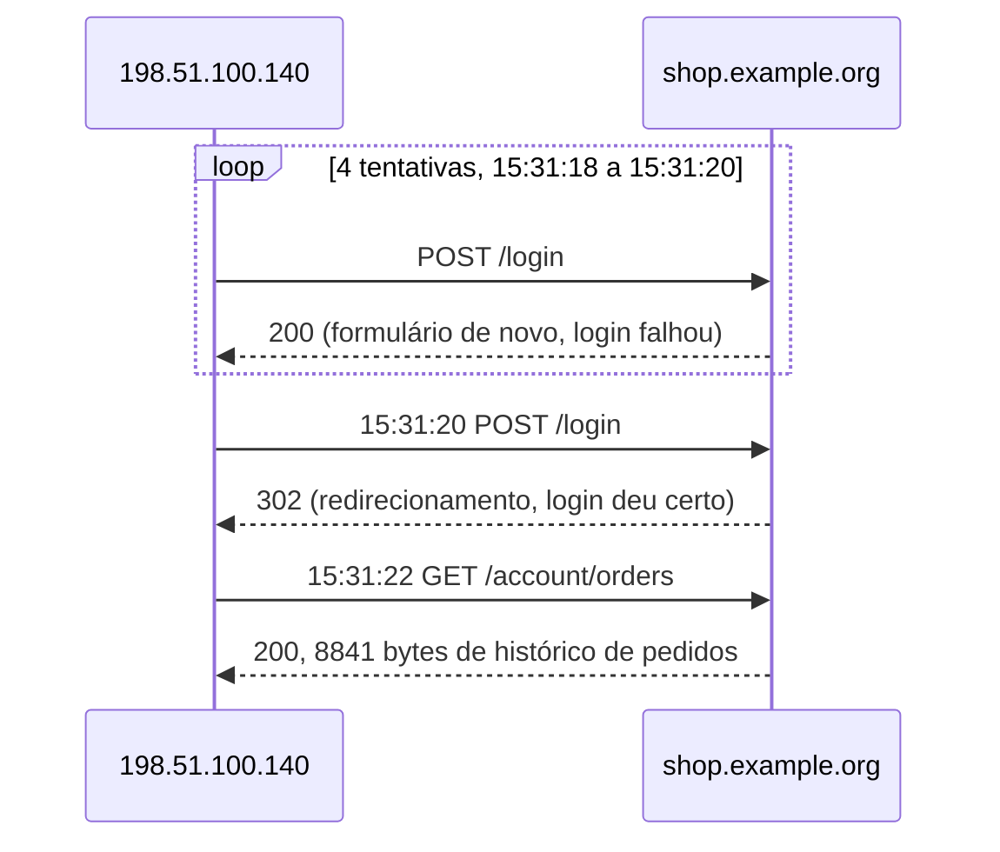

# Dia 11: Triagem de logs web com grep, awk e sed

> 🇺🇸 Original: [*Day 11: Web log triage with grep, awk, and sed*](https://github.com/thiefdroppers/cyber-investigator-skills/blob/main/curriculum/phase-1-foundations/day-11.md) — © ThiefDroppers, licença MIT.
> Aqui: tradução fiel **+** camada brasileira. Nada do original foi removido; tudo o que é novo vem marcado com ➕.

**Fase 1. Fundamentos** · Meta da trilha: pegar um log de acesso bruto de servidor web e, em menos de quinze minutos, produzir um resumo ranqueado de quem fez o quê, quando, e quais linhas merecem um olhar mais de perto.

Rank Jutsu: `D` · [](https://colab.research.google.com/github/Ridd1kulusC0d3r/investigador-cyber-90-dias/blob/main/curriculo/fase-1-fundamentos/dia-11/dia-11.ipynb)

---

## 🎬 ➕ Abertura do caso — *O logo que entregou a cópia*

Com a pergunta sobre a pasta `777` respondida (o Juliano usou `cp -p`, e mandou os hashes de origem), você finalmente abre o `access.log` do portal **real** da Serra Azul, `serraazul.example`. São três dias, de sábado a segunda.

— Por que eu leria o log do site verdadeiro? — você pergunta. — O golpe está no outro servidor.

Rafa gira a cadeira.

— Kit de phishing preguiçoso não copia tudo. Às vezes ele carrega a imagem direto do site original. Quando a vítima abre a página falsa, o navegador dela pede o logo **pra Serra Azul**, e diz de onde veio no `Referer`. E alguém precisou baixar o site para copiar, não precisou?

Você digita `awk -F'"' '{print $4}'` e a primeira linha que aparece é `https://serraazul-pix.example/`.

É o Dia 11: `grep`, `awk` e `sed` contra um log de verdade. *(Personagens e cenário: [Operação Isca](../../../caso-continuo/).)*

---

## 📖 Conceito

Logs de acesso de servidor web estão entre as evidências mais comuns que você vai receber, e muitas vezes chegam como um arquivo de texto puro, sem nenhuma ferramenta em volta. `grep`, `awk`, `sed`, `sort` e `uniq` estão instalados em toda máquina Linux e macOS, rodam em arquivos de qualquer tamanho e deixam o original intocado. Aprenda-os antes de qualquer plataforma de logs, porque a plataforma nem sempre vai estar disponível.

O Apache e o nginx usam por padrão o formato "combined":

```
198.51.100.23 - - [10/Mar/2026:14:02:11 +0000] "GET / HTTP/1.1" 200 5120 "-" "Mozilla/5.0 (Windows NT 10.0; Win64; x64)"
```

Separando por espaços, os campos que o `awk` vê são: `$1` o IP do cliente, `$4` o carimbo de tempo com um `[` na frente, `$6` o método com uma aspa na frente, `$7` o caminho, `$9` o código de status, `$10` o tamanho da resposta. Separando por aspas duplas (`awk -F'"'`), `$2` é a linha de requisição inteira, `$4` o *Referer* e `$6` o *User-Agent*. Conhecer as duas separações cobre a maioria das perguntas.

A mesma linha, separada dos dois jeitos:



Cada ferramenta tem o seu trabalho. O `grep` seleciona linhas. O `awk` seleciona campos e faz contas e condições. O `sed` reescreve texto, em geral para extrair um pedaço da linha. `sort | uniq -c | sort -rn` é o idioma de "contar e ranquear", e você vai digitá-lo centenas de vezes.

Cada etapa desse idioma faz um trabalho pequeno:



Na triagem você procura formas, não lê cada linha. Um único IP batendo em muitos caminhos que devolvem `404` em poucos segundos é descoberta automatizada. Caminhos contendo `../` ou a forma codificada em URL `%2e%2e%2f` são tentativas de *path traversal*. `POST /login` repetido de uma mesma origem, terminando num redirecionamento `302`, pode ser um palpite de senha que finalmente funcionou. Uma rajada súbita de erros `500` pode significar que algo quebrou, ou que alguém achou uma entrada que quebra o sistema. Um *User-Agent* que não é de navegador, como `python-requests` ou `curl`, marca um script, embora atacantes possam pôr o *User-Agent* que quiserem, então a ausência de um não prova nada.

O IP de cliente nesses logs é o que quer que tenha se conectado ao servidor web. Se uma CDN, um balanceador de carga ou um *proxy* reverso fica na frente, `$1` é o endereço do *proxy* e o cliente real está num cabeçalho como `X-Forwarded-For`, mas só se o servidor foi configurado para registrá-lo. Confira em qual situação você está antes de tirar qualquer conclusão sobre origens.

## 📚 Recursos

- [Apache HTTP Server: Log Files](https://httpd.apache.org/docs/2.4/logs.html), a definição do formato combined e dos códigos `%`.
- [nginx: ngx_http_log_module](https://nginx.org/en/docs/http/ngx_http_log_module.html).
- [The GNU Awk User's Guide](https://www.gnu.org/software/gawk/manual/gawk.html), capítulos 4 (lendo a entrada e os campos) e 7 (padrões e ações).
- [Sed, An Introduction and Tutorial](https://www.grymoire.com/Unix/Sed.html), de Bruce Barnett.
- [OWASP: Path Traversal](https://owasp.org/www-community/attacks/Path_Traversal), para entender o que as linhas de *traversal* estão tentando fazer.

### ➕ Recursos do contexto Brasil

- [Marco Civil da Internet — Lei 12.965/2014](https://www.planalto.gov.br/ccivil_03/_ato2011-2014/2014/lei/l12965.htm), art. 15: provedores de aplicação constituídos como pessoa jurídica guardam registros de acesso a aplicações por 6 meses. É o que define até quando o log de terceiros ainda existe para ser pedido em juízo.
- [LGPD — Lei 13.709/2018](https://www.planalto.gov.br/ccivil_03/_ato2015-2018/2018/lei/l13709.htm): IP de cooperado é dado pessoal. A cooperativa é controladora; a Vigia trata como operadora, dentro do contrato.
- [`../../../caso-continuo/dados/dia-11/`](../../../caso-continuo/dados/dia-11/): o log de acesso do portal da Serra Azul usado na Prática BR.

## 🛠️ Prática: grep, awk e sed, produzindo uma planilha de triagem de log web com histograma de atividade por hora

**Seu checklist de hoje.** Faça na ordem e marque cada item ao terminar:

- [ ] Passo 1: salvar o log de amostra
- [ ] Passo 2: as cinco primeiras perguntas
- [ ] Passo 3: a pergunta do login
- [ ] Passo 4: remodelar linhas com sed
- [ ] Passo 5: o histograma por hora
- [ ] Passo 6: preencher a planilha de triagem
- [ ] ➕ Passo 7: o log do portal da Serra Azul (Prática BR)
- [ ] ➕ Passo 8: o notebook do dia no Colab

### Passo 1: salvar o log de amostra

Crie `~/lab/day11/access.log` com o conteúdo abaixo. É uma loja fictícia em `shop.example.org`, e todo endereço de cliente vem de uma faixa de documentação.

```
198.51.100.23 - - [10/Mar/2026:14:02:11 +0000] "GET / HTTP/1.1" 200 5120 "-" "Mozilla/5.0 (Windows NT 10.0; Win64; x64)"
198.51.100.23 - - [10/Mar/2026:14:02:12 +0000] "GET /static/app.css HTTP/1.1" 200 1834 "https://shop.example.org/" "Mozilla/5.0 (Windows NT 10.0; Win64; x64)"
192.0.2.77 - - [10/Mar/2026:14:05:40 +0000] "GET /login HTTP/1.1" 200 2210 "-" "Mozilla/5.0 (Macintosh; Intel Mac OS X 14_4)"
192.0.2.77 - - [10/Mar/2026:14:05:52 +0000] "POST /login HTTP/1.1" 302 0 "https://shop.example.org/login" "Mozilla/5.0 (Macintosh; Intel Mac OS X 14_4)"
203.0.113.45 - - [10/Mar/2026:15:10:03 +0000] "GET /wp-login.php HTTP/1.1" 404 512 "-" "python-requests/2.31.0"
203.0.113.45 - - [10/Mar/2026:15:10:03 +0000] "GET /.env HTTP/1.1" 404 512 "-" "python-requests/2.31.0"
203.0.113.45 - - [10/Mar/2026:15:10:04 +0000] "GET /admin/config.php HTTP/1.1" 404 512 "-" "python-requests/2.31.0"
203.0.113.45 - - [10/Mar/2026:15:10:04 +0000] "GET /index.php?page=../../../../etc/passwd HTTP/1.1" 400 312 "-" "python-requests/2.31.0"
203.0.113.45 - - [10/Mar/2026:15:10:05 +0000] "GET /index.php?page=%2e%2e%2f%2e%2e%2fetc%2fpasswd HTTP/1.1" 400 312 "-" "python-requests/2.31.0"
203.0.113.45 - - [10/Mar/2026:15:10:05 +0000] "GET /.git/config HTTP/1.1" 403 290 "-" "python-requests/2.31.0"
198.51.100.140 - - [10/Mar/2026:15:31:18 +0000] "POST /login HTTP/1.1" 200 2290 "-" "Mozilla/5.0 (X11; Linux x86_64)"
198.51.100.140 - - [10/Mar/2026:15:31:19 +0000] "POST /login HTTP/1.1" 200 2290 "-" "Mozilla/5.0 (X11; Linux x86_64)"
198.51.100.140 - - [10/Mar/2026:15:31:19 +0000] "POST /login HTTP/1.1" 200 2290 "-" "Mozilla/5.0 (X11; Linux x86_64)"
198.51.100.140 - - [10/Mar/2026:15:31:20 +0000] "POST /login HTTP/1.1" 200 2290 "-" "Mozilla/5.0 (X11; Linux x86_64)"
198.51.100.140 - - [10/Mar/2026:15:31:20 +0000] "POST /login HTTP/1.1" 302 0 "-" "Mozilla/5.0 (X11; Linux x86_64)"
198.51.100.140 - - [10/Mar/2026:15:31:22 +0000] "GET /account/orders HTTP/1.1" 200 8841 "-" "Mozilla/5.0 (X11; Linux x86_64)"
198.51.100.23 - - [10/Mar/2026:16:44:09 +0000] "GET /products/42 HTTP/1.1" 200 6021 "https://shop.example.org/" "Mozilla/5.0 (Windows NT 10.0; Win64; x64)"
192.0.2.77 - - [10/Mar/2026:16:50:31 +0000] "GET /account/orders HTTP/1.1" 200 8120 "https://shop.example.org/" "Mozilla/5.0 (Macintosh; Intel Mac OS X 14_4)"
203.0.113.45 - - [10/Mar/2026:17:02:44 +0000] "GET /server-status HTTP/1.1" 403 290 "-" "python-requests/2.31.0"
198.51.100.23 - - [10/Mar/2026:17:15:00 +0000] "GET /cart HTTP/1.1" 500 1024 "https://shop.example.org/products/42" "Mozilla/5.0 (Windows NT 10.0; Win64; x64)"
```

Calcule o hash (`sha256sum access.log`) e faça uma cópia de trabalho. As saídas abaixo vêm da execução de cada comando contra exatamente este arquivo.

### Passo 2: as cinco primeiras perguntas

Quem está mais ativo?

```bash
awk '{print $1}' access.log | sort | uniq -c | sort -rn
```
```
   7 203.0.113.45
   6 198.51.100.140
   4 198.51.100.23
   3 192.0.2.77
```

Que códigos de status voltaram?

```bash
awk '{print $9}' access.log | sort | uniq -c | sort -rn
```
```
  10 200
   3 404
   2 403
   2 400
   2 302
   1 500
```

Que clientes são declarados?

```bash
awk -F'"' '{print $6}' access.log | sort | uniq -c | sort -rn
```
```
   7 python-requests/2.31.0
   6 Mozilla/5.0 (X11; Linux x86_64)
   4 Mozilla/5.0 (Windows NT 10.0; Win64; x64)
   3 Mozilla/5.0 (Macintosh; Intel Mac OS X 14_4)
```

Todo erro de cliente, com hora, origem e caminho:

```bash
awk '$9 ~ /^4/ {print $4, $1, $9, $7}' access.log | tr -d '['
```
```
10/Mar/2026:15:10:03 203.0.113.45 404 /wp-login.php
10/Mar/2026:15:10:03 203.0.113.45 404 /.env
10/Mar/2026:15:10:04 203.0.113.45 404 /admin/config.php
10/Mar/2026:15:10:04 203.0.113.45 400 /index.php?page=../../../../etc/passwd
10/Mar/2026:15:10:05 203.0.113.45 400 /index.php?page=%2e%2e%2f%2e%2e%2fetc%2fpasswd
10/Mar/2026:15:10:05 203.0.113.45 403 /.git/config
10/Mar/2026:17:02:44 203.0.113.45 403 /server-status
```

*Path traversal*, na forma pura e na codificada em URL (o `-i` ignora maiúsculas e minúsculas, já que `%2E` e `%2e` são equivalentes):

```bash
grep -Ei '(\.\./|%2e%2e)' access.log | awk '{print $1, $7}'
```
```
203.0.113.45 /index.php?page=../../../../etc/passwd
203.0.113.45 /index.php?page=%2e%2e%2f%2e%2e%2fetc%2fpasswd
```

### Passo 3: a pergunta do login

```bash
awk '$6=="\"POST" && $7=="/login" {print $1, $9}' access.log | sort | uniq -c
```
```
   1 192.0.2.77 302
   4 198.51.100.140 200
   1 198.51.100.140 302
```

Em ordem cronológica, as seis linhas de `198.51.100.140` ficam assim:



Nesta aplicação, um login que falha mostra o formulário de novo (`200`) e um que dá certo redireciona (`302`). Então `198.51.100.140` falhou quatro vezes em dois segundos, acertou na quinta tentativa e, dois segundos depois, abriu `/account/orders`. Cinco tentativas em dois segundos é mais rápido do que uma pessoa digita, o que aponta para um palpite automatizado de senha (ou uma ferramenta de *credential stuffing*) que funcionou. Confirme com o dono do site que o sucesso é sinalizado pelo redirecionamento antes de confiar nisso.

### Passo 4: remodelar linhas com sed

Extraia só hora, IP, método, caminho e status numa passada, o que é prático para colar numa linha do tempo:

```bash
sed -E 's/^([^ ]+) .*\[([^]]+)\] "([A-Z]+) ([^ ]+).*" ([0-9]{3}) .*/\2 \1 \3 \4 \5/' access.log | head -3
```
```
10/Mar/2026:14:02:11 +0000 198.51.100.23 GET / 200
10/Mar/2026:14:02:12 +0000 198.51.100.23 GET /static/app.css 200
10/Mar/2026:14:05:40 +0000 192.0.2.77 GET /login 200
```

### Passo 5: o histograma por hora

```bash
awk -F'[][]' '{split($2, t, ":"); print t[1], t[2] ":00"}' access.log \
  | sort | uniq -c \
  | awk '{bar=""; for (i = 0; i < $1; i++) bar = bar "#"; printf "%s %s %3d %s\n", $2, $3, $1, bar}'
```
```
10/Mar/2026 14:00   4 ####
10/Mar/2026 15:00  12 ############
10/Mar/2026 16:00   2 ##
10/Mar/2026 17:00   2 ##
```

O `-F'[][]'` separa por qualquer um dos colchetes, então `$2` é o carimbo de tempo. Separá-lo por `:` dá a data em `t[1]` e a hora em `t[2]`. O pico das 15:00 contém tanto o *scanner* quanto o ataque ao login. Num log real cobrindo semanas, o mesmo comando vira um mapa de calor rápido de atividade por dia e hora.

### Passo 6: preencher a planilha de triagem

Crie `day11-triage.md`:

```markdown
# Triagem de log web: access.log de shop.example.org
SHA-256 do arquivo de origem:
Intervalo de tempo coberto (UTC):
Total de requisições: | IPs de cliente únicos:
Proxy/CDN na frente? ($1 é o cliente real?):

## Achados ranqueados
| Posição | IP de origem | Intervalo (UTC) | Comportamento | Evidência (comando + contagem) | Confiança | Próximo passo |
|---|---|---|---|---|---|---|

## Atividade por hora
(cole o histograma)

## Linha de base benigna
(quais IPs parecem clientes comuns, e por quê)
```

Ranqueie o login automatizado bem-sucedido acima do *scanner*. O *scanner* só recebeu erros; o atacante do login chegou a uma página de conta.

### ➕ Prática BR: o log do portal da Serra Azul

Baixe [`caso-continuo/dados/dia-11/access-serraazul.log`](../../../caso-continuo/dados/dia-11/access-serraazul.log): 35 linhas do nginx de `sa-web01`, o servidor do portal **real** `serraazul.example`, de sábado 3/out a segunda 5/out. Duas diferenças em relação à loja do original:

- O fuso é `-0300` (o servidor grava em hora de Brasília). Converta para UTC na planilha: some 3 horas.
- Não há CDN nem *proxy* na frente (o TI confirmou): `$1` é o cliente que conectou.

Calcule o hash e confira com o que o Juliano mandou (`c14588c5…f7ab65a3`). Depois responda a três perguntas, cada uma com o comando que a respondeu.

**1. Quem copiou o site, e quando?** O espelhamento deixa uma forma inconfundível: um só IP, um *User-Agent* de ferramenta e todos os recursos estáticos em um ou dois segundos.

```bash
awk -F'"' '$6 ~ /Wget/ {split($1,a," "); print a[4], a[1], $2}' access-serraazul.log | tr -d '['
```
```
03/Oct/2026:22:41:09 203.0.113.77 GET / HTTP/1.1
03/Oct/2026:22:41:09 203.0.113.77 GET /robots.txt HTTP/1.1
03/Oct/2026:22:41:10 203.0.113.77 GET /static/css/portal.css HTTP/1.1
03/Oct/2026:22:41:10 203.0.113.77 GET /static/js/portal.js HTTP/1.1
03/Oct/2026:22:41:10 203.0.113.77 GET /static/img/logo-serraazul.png HTTP/1.1
03/Oct/2026:22:41:11 203.0.113.77 GET /acesso HTTP/1.1
03/Oct/2026:22:41:11 203.0.113.77 GET /static/img/cadeado.svg HTTP/1.1
```

`203.0.113.77` é o IP onde `serraazul-pix.example` está hospedado (Dias 5 e 6). Sábado, 22h41 BRT (4/out, 01h41 UTC): menos de um dia antes de o certificado do site falso ser emitido (Dia 8).

**2. Quantos navegadores abriram a página falsa?** O kit não copiou o logo; ele aponta para o logo do site real. Cada vítima que abre a página falsa pede o logo à Serra Azul, com o *Referer* do golpe.

```bash
awk -F'"' '$4 ~ /serraazul-pix/ {split($1,a," "); print a[4], a[1]}' access-serraazul.log | tr -d '['
awk -F'"' '$4 ~ /serraazul-pix/ {split($1,a," "); print a[1]}' access-serraazul.log | sort -u | wc -l
```

São 14 requisições de 13 IPs. A primeira, `04/Oct/2026:23:18:52` de `203.0.113.140` com *User-Agent* Linux de desktop, vem antes do disparo: provável teste do kit (você registra, não atribui). As outras 13 caem entre 07:13 e 08:47 do dia 5, na janela do SMS (07h12–08h40) e logo depois, quase todas de celular.

**3. Algum cooperado que viu a página falsa entrou no site real depois?**

```bash
grep '198.51.100.17 ' access-serraazul.log | awk '{print $4, $6, $7, $9}' | tr -d '["'
```

`198.51.100.17` carregou a página falsa às 07:14 e às 07:31, e às 07:40 entrou no portal real e fez login (`POST /acesso` → `302`), nove minutos depois da segunda visita ao golpe. Isso não diz quem é a pessoa, nem se ela foi uma das três vítimas; diz que um aparelho que viu o golpe também acessou a conta verdadeira logo em seguida. (Um segundo IP, `198.51.100.66`, também volta ao portal real uma hora depois, mas só abre a página inicial.) É a pergunta que a Marta vai querer cruzar com as transações, **pelos canais internos da cooperativa**.

Monte `isca-dia11-triagem.md` com o modelo do Passo 6, mais o histograma do log BR, e ranqueie: (1) o espelhamento por `203.0.113.77`, que liga a infraestrutura do golpe ao site real; (2) os 13 *hotlinks* do dia 5, que estimam o alcance; (3) o teste de 4/out; (4) o `203.0.113.9`, varredura genérica sem relação demonstrada com o caso. Na linha de base benigna, explique o `503` de `198.51.100.66` às 09:15 seguido de `200` seis segundos depois.

> Um limite que entra na planilha: a contagem de *hotlinks* é um **piso**, não o total. Navegador com cache, bloqueador de imagens ou uma versão do kit que hospede o logo localmente não deixam linha aqui.

### ➕ O notebook do dia

Abra o [notebook do Dia 11 no Colab](https://colab.research.google.com/github/Ridd1kulusC0d3r/investigador-cyber-90-dias/blob/main/curriculo/fase-1-fundamentos/dia-11/dia-11.ipynb). Nele você:

1. escreve um *parser* do formato combined com uma expressão regular comentada pedaço a pedaço;
2. refaz em Python cada *one-liner* do original, lado a lado com o comando `awk` equivalente;
3. roda o detector de espelhamento e de *hotlink* no log da Serra Azul, com conversão para UTC;
4. joga o **quiz "qual comando responde?"** e gera `isca-dia11-triagem.md` já com o histograma.

## ✅ Checkpoint

Seu artefato é `day11-triage.md`. Ele passa quando:

- `day11-triage.md` registra o hash de origem, igual ao que seus comandos imprimiram.
- `day11-triage.md` registra o intervalo de tempo, igual ao que seus comandos imprimiram.
- `day11-triage.md` registra os totais de requisições e de IPs únicos, cada um igual ao que seus comandos imprimiram.
- Os achados ranqueados põem `198.51.100.140` em primeiro, com a evidência "4 × 200 e depois 1 × 302 em POST /login em 2 s, seguidos de /account/orders".
- Os achados ranqueados põem `203.0.113.45` em segundo, com os caminhos de descoberta e de *traversal*.
- Cada achado nomeia o *one-liner* exato que o produziu, para que outro analista possa rodá-lo de novo.
- A linha de base benigna nomeia `198.51.100.23` e `192.0.2.77`.
- A linha de base benigna explica por que um `500` no carrinho de um cliente comum não é, com esta evidência, um ataque.

### ➕ Checkpoint BR

- `isca-dia11-triagem.md` tem o hash conferido, o intervalo **em UTC** (`2026-10-03T13:14:02Z` a `2026-10-05T12:15:09Z`), 35 requisições e 17 IPs únicos.
- O espelhamento aparece em primeiro, com o comando, as 7 linhas e a ligação explícita com o IP de `serraazul-pix.example`.
- A estimativa de alcance diz "pelo menos 13 navegadores", não "13 vítimas", e explica por que é um piso.
- Nenhuma linha da planilha tenta dizer **quem** é `198.51.100.17`.
- Você acertou pelo menos 5 das 7 perguntas do quiz do notebook.

## ⚖️ ➕ Camada jurídica BR

**O log é da cooperativa, e o IP é dado pessoal.** A Serra Azul é a controladora (LGPD, art. 5º, VI) dos registros de acesso ao portal dela; a Vigia trata esses dados como operadora, por conta da cooperativa e nos limites do contrato. Cruzar `198.51.100.17` com o cadastro de um cooperado é tratamento que cabe à cooperativa, pela base legal que ela já usa para prevenção a fraude, e não a você. O seu achado é "um aparelho que viu a página falsa entrou no portal nove minutos depois"; quem transforma isso em nome é o time de fraude dela.

**O log do outro lado só sai com ordem judicial.** O que o servidor `203.0.113.77` registrou sobre as vítimas (Dia 32 vai mostrar o tipo de registro) está com o provedor de hospedagem. Pelo Marco Civil, registros de acesso a aplicações só são fornecidos mediante ordem judicial (art. 10, §1º; o pedido segue o art. 22), e o provedor de aplicação pessoa jurídica os guarda por 6 meses (art. 15). Prazo útil para a lista de pedidos da delegacia: até abril de 2027, e só se ninguém apagar antes. Por isso o pedido de **preservação** entra cedo no relatório.

> Material de estudo, não constitui orientação jurídica.

## 🧠 ➕ Camada 8 — o número que vira manchete

Quando você imprimir "14 requisições com *Referer* do golpe", a tentação é escrever "14 vítimas". Kahneman chamou de **WYSIATI** (*what you see is all there is*) a tendência de montar a história mais coerente possível só com o que está na frente, sem pesar o que não está. O log mostra navegadores que pediram uma imagem. Não mostra quem tinha a imagem em cache, quem desistiu antes de digitar a senha, nem o resto das 37 reclamações.

Do lado da vítima, o mesmo log conta outra coisa: `198.51.100.17` abriu a página falsa duas vezes e foi ao site real. É o comportamento de quem desconfiou e foi conferir, e merece o cuidado de não ser tratado como suspeito. Consequência prática: escreva **"pelo menos N navegadores"** e diga em uma frase o que o número não alcança. É o que impede o relatório de virar manchete errada na boca de outra pessoa.

## 🤖 ➕ Skill do dia

O Dia 11 propõe para a [skill pt-BR](../../../skills/investigador-cyber/SKILL.md) o procedimento **"Triagem de log de acesso web"**: separar por espaço e por aspas, ranquear formas, conferir *proxy*, converter fuso, e ler o *Referer* de domínios imitação como estimativa mínima de alcance. Texto e caso de teste em [`_skill-delta.md`](_skill-delta.md).

## 💡 ➕ Inovação OSINT do dia — o *Referer* como armadilha (e o Canarytoken de site clonado)

O que aconteceu por acaso no caso pode ser feito de propósito. A Thinkst publica, gratuitamente, os [Canarytokens](https://canarytokens.org/), e um dos tipos é o **cloned website** (CSS/JavaScript): um trecho embutido no site legítimo que só dispara quando a página é carregada a partir de **outro domínio**, avisando que alguém clonou o site. É a versão preparada do *hotlink* que o kit deixou.

Sem token nenhum, a detecção de hoje cabe em poucas linhas de Python stdlib, e pode rodar todo dia no log do cliente:

```python
import re                                                     # só stdlib
DOMINIO_REAL = "serraazul.example"
padrao = re.compile(r'"(?:GET|POST) [^"]*" \d{3} \S+ "https?://([^/"]+)')   # pega o host do Referer
for linha in open("access-serraazul.log", encoding="utf-8"):
    m = padrao.search(linha)
    if m and not m.group(1).endswith(DOMINIO_REAL):          # Referer de um domínio que não é o seu
        print(m.group(1), "->", linha.split()[0])            # domínio estranho e IP que carregou
```

Limite honesto: *Referer* pode ser suprimido pela política `Referrer-Policy` da página falsa, e kits mais cuidadosos hospedam as próprias imagens. A ausência de alerta não prova que o site não foi clonado.

## 📝 Diário de estudo

- Data:
- Tempo gasto:
- O que ficou claro:
- O que ainda está nebuloso:
- Artefato produzido: `day11-triage.md`, `isca-dia11-triagem.md`

---
<sub>Baseado em [cyber-investigator-skills](https://github.com/thiefdroppers/cyber-investigator-skills) por ThiefDroppers (MIT). Tradução, camada BR, Camada 8, skill pt-BR e notebook por Deivison Lourenço (@Ridd1kulusC0d3r).</sub>
