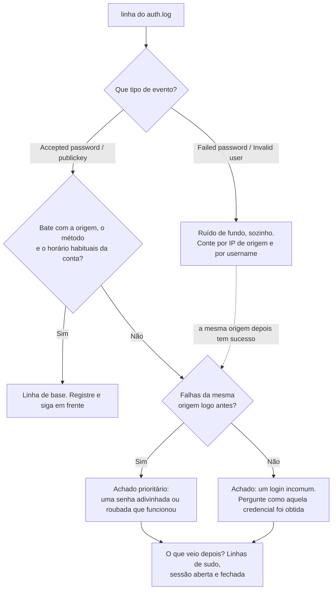

# Dia 12: Triagem de logs de autenticação e a linha do tempo de uma intrusão SSH

> 🇺🇸 Original: [*Day 12: Authentication log triage and an SSH intrusion timeline*](https://github.com/thiefdroppers/cyber-investigator-skills/blob/main/curriculum/phase-1-foundations/day-12.md) — © ThiefDroppers, licença MIT.
> Aqui: tradução fiel **+** camada brasileira. Nada do original foi removido; tudo o que é novo vem marcado com ➕.

**Fase 1. Fundamentos** · Meta da trilha: ler registros de autenticação do Linux, separar o ruído de fundo do login que importa e montar o resultado numa linha do tempo que outro investigador consiga conferir.

Rank Jutsu: `D` · [](https://colab.research.google.com/github/Ridd1kulusC0d3r/investigador-cyber-90-dias/blob/main/curriculo/fase-1-fundamentos/dia-12/dia-12.ipynb)

---

## 🎬 ➕ Abertura do caso — *Domingo, 22h47*

Terça de manhã, a Marta liga logo cedo.

— O Juliano me disse que vocês acharam o site falso baixando o nosso portal. Ele conseguiu entrar no nosso servidor também?

Você abre o `auth.log` do `sa-web01`, que veio na mesma entrega. Quase tudo é ruído: robôs tentando `admin`, `root`, `ubuntu`. Até que uma linha para o seu dedo na rolagem: *domingo, 22h47, `Accepted password for juliano from 198.51.100.200`*. Duas falhas antes. Dois `sudo` depois, mexendo no nginx. E o Juliano, pelo que o próprio TI informou, só entra com chave, pela VPN, em horário comercial.

Você já está escrevendo "conta comprometida" quando Rafa se inclina.

— Escreve também o que derrubaria isso. Um fato só.

É o Dia 12: transformar um log de autenticação numa linha do tempo com uma avaliação que pode ser contestada. *(Personagens e cenário: [Operação Isca](../../../caso-continuo/).)*

---

## 📖 Conceito

Num servidor Linux, o log de autenticação é onde são gravados logins, logins que falharam, uso de `sudo` e início e fim de sessões. Em sistemas Debian e Ubuntu rodando rsyslog, ele é o `/var/log/auth.log`; no RHEL, no Fedora e nos parentes deles, é o `/var/log/secure`. Sistemas que guardam logs só no *journal* do systemd expõem os mesmos eventos pelo `journalctl`. À parte, o `/var/log/wtmp` (lido com `last`) registra sessões e o `/var/log/btmp` (lido com `sudo lastb`) registra logins que falharam, num formato binário.

As linhas que você vai ler com mais frequência vêm do `sshd`:

- `Failed password for root from 203.0.113.45 port 50240 ssh2`: uma conta que existe, senha errada.
- `Failed password for invalid user admin from ...`: o *username* não existe neste servidor. Muitas dessas linhas significam que alguém está percorrendo uma lista genérica de *usernames*.
- `Accepted password for deploy from ...` ou `Accepted publickey for analyst from ... ED25519 SHA256:...`: um login bem-sucedido e o método usado. Para logins por chave, a impressão digital (*fingerprint*) identifica qual chave foi usada, e você pode compará-la com o `authorized_keys`.
- `pam_unix(sshd:session): session opened for user deploy(uid=1001)` e o `session closed` correspondente: início e fim da sessão, que delimitam o que aquele login pode ter feito.

O `sudo` grava a própria linha, com o usuário, o diretório de trabalho, o usuário-alvo e o comando completo, o que faz dela um dos registros isolados mais úteis de um sistema Linux.

Os carimbos de tempo deste log exigem cuidado. O formato tradicional do syslog (`Mar 10 02:14:09`) não tem ano nem fuso horário. O ano vem do contexto (as datas do arquivo, os nomes da rotação, os registros vizinhos), e o fuso é o fuso local do servidor naquele momento, que você precisa confirmar com `timedatectl` ou com a configuração do sistema antes de comparar com qualquer outra fonte. Os padrões mais novos de algumas distribuições gravam carimbos RFC 3339 completos (`2026-03-10T02:14:09.412233+00:00`), o que elimina a ambiguidade. Registre com qual formato você está trabalhando.

A maioria dos servidores SSH expostos à internet vê logins falhos de *scanners* a cada poucos minutos. Isso é ruído de fundo. O achado quase sempre é um sucesso: um login de um lugar inesperado, num horário inesperado, por um método que aquela conta normalmente não usa, em especial um que vem depois de uma sequência de falhas da mesma origem.

A ordem de triagem de cada linha, como um fluxograma de decisão:



## 📚 Recursos

- [Páginas de manual sshd(8) e sshd_config(5)](https://man.openbsd.org/sshd), incluindo a opção `LogLevel`, que controla quanto é registrado.
- [Página de manual journalctl(1)](https://man7.org/linux/man-pages/man1/journalctl.1.html), em especial `--since`, `--until`, `-u` e `-o short-iso-precise`.
- [sudoers(5): registro](https://www.sudo.ws/docs/man/sudoers.man/), sobre o que o `sudo` registra e onde.
- [MITRE ATT&CK T1110 Brute Force](https://attack.mitre.org/techniques/T1110/) e [T1078 Valid Accounts](https://attack.mitre.org/techniques/T1078/), para ver como esses padrões são classificados.

### ➕ Recursos do contexto Brasil

- [Marco Civil da Internet — Lei 12.965/2014](https://www.planalto.gov.br/ccivil_03/_ato2011-2014/2014/lei/l12965.htm), arts. 13 e 22: o provedor de conexão guarda os registros de conexão por 1 ano, e só os entrega com ordem judicial. É o caminho para saber quem usava um IP numa data e hora; não é um caminho seu.
- [CERT.br — Cartilha de Segurança para Internet](https://cartilha.cert.br/): os fascículos sobre senhas e autenticação em dois fatores são material bom para a recomendação ao cliente.
- [`../../../caso-continuo/dados/dia-12/`](../../../caso-continuo/dados/dia-12/): o `auth.log` do servidor do portal da Serra Azul, usado na Prática BR.

## 🛠️ Prática: grep, sed e awk, produzindo uma linha do tempo de intrusão SSH (CSV mais uma linha do tempo desenhada)

**Seu checklist de hoje.** Faça na ordem e marque cada item ao terminar:

- [ ] Passo 1: salvar o log de amostra
- [ ] Passo 2: contar o ruído
- [ ] Passo 3: achar cada sucesso e cada comando privilegiado
- [ ] Passo 4: correlacionar falhas com um sucesso da mesma origem
- [ ] Passo 5: produzir o CSV da linha do tempo
- [ ] Passo 6: desenhar a linha do tempo
- [ ] ➕ Passo 7: o `auth.log` do portal da Serra Azul (Prática BR)
- [ ] ➕ Passo 8: o notebook do dia no Colab

### Passo 1: salvar o log de amostra

Crie `~/lab/day12/auth.log`. O servidor `lab-web01` é fictício, grava em UTC e todos os endereços são de faixas de documentação.

```
Mar 10 02:14:07 lab-web01 sshd[1811]: Invalid user admin from 203.0.113.45 port 50122
Mar 10 02:14:09 lab-web01 sshd[1811]: Failed password for invalid user admin from 203.0.113.45 port 50122 ssh2
Mar 10 02:14:12 lab-web01 sshd[1815]: Invalid user oracle from 203.0.113.45 port 50188
Mar 10 02:14:14 lab-web01 sshd[1815]: Failed password for invalid user oracle from 203.0.113.45 port 50188 ssh2
Mar 10 02:14:18 lab-web01 sshd[1819]: Failed password for root from 203.0.113.45 port 50240 ssh2
Mar 10 02:14:22 lab-web01 sshd[1823]: Failed password for root from 203.0.113.45 port 50301 ssh2
Mar 10 02:31:40 lab-web01 sshd[1902]: Failed password for deploy from 198.51.100.9 port 41822 ssh2
Mar 10 02:31:47 lab-web01 sshd[1902]: Failed password for deploy from 198.51.100.9 port 41822 ssh2
Mar 10 02:31:55 lab-web01 sshd[1902]: Accepted password for deploy from 198.51.100.9 port 41822 ssh2
Mar 10 02:31:55 lab-web01 sshd[1902]: pam_unix(sshd:session): session opened for user deploy(uid=1001) by (uid=0)
Mar 10 02:33:02 lab-web01 sudo:   deploy : TTY=pts/0 ; PWD=/home/deploy ; USER=root ; COMMAND=/usr/bin/cat /etc/shadow
Mar 10 02:35:40 lab-web01 sshd[1902]: pam_unix(sshd:session): session closed for user deploy
Mar 10 09:02:13 lab-web01 sshd[2410]: Accepted publickey for analyst from 192.0.2.10 port 55012 ssh2: ED25519 SHA256:q3Vd1xExampleFingerprintOnlyForLab0000000
Mar 10 09:02:13 lab-web01 sshd[2410]: pam_unix(sshd:session): session opened for user analyst(uid=1000) by (uid=0)
```

O contexto que você recebeu: a conta `deploy` é usada só por um processo automatizado de implantação (*deploy*) a partir de `192.0.2.50`, sempre com chave. A conta `analyst` pertence ao administrador, que normalmente entra a partir de `192.0.2.10` em horário comercial.

Calcule o hash do arquivo antes de começar. As saídas abaixo vêm da execução de cada comando contra ele.

### Passo 2: contar o ruído

Logins falhos por origem. Em toda linha `Failed password`, o IP é o quarto campo a partir do fim, diga a linha "invalid user" ou não, então `$(NF-3)` funciona nos dois casos:

```bash
grep "Failed password" auth.log | awk '{print $(NF-3)}' | sort | uniq -c | sort -rn
```
```
   4 203.0.113.45
   2 198.51.100.9
```

*Usernames* tentados:

```bash
grep "Failed password" auth.log \
  | sed -E 's/.*Failed password for (invalid user )?([^ ]+) from.*/\2/' \
  | sort | uniq -c | sort -rn
```
```
   2 root
   2 deploy
   1 oracle
   1 admin
```

### Passo 3: achar cada sucesso e cada comando privilegiado

```bash
grep -E "Accepted (password|publickey)" auth.log | awk '{print $1, $2, $3, "user=" $9, "ip=" $11, "method=" $7}'
grep "sudo:" auth.log | sed -E 's/.*sudo: +([^ ]+) :.*COMMAND=(.*)/\1 ran: \2/'
```
```
Mar 10 02:31:55 user=deploy ip=198.51.100.9 method=password
Mar 10 09:02:13 user=analyst ip=192.0.2.10 method=publickey
deploy ran: /usr/bin/cat /etc/shadow
```

### Passo 4: correlacionar falhas com um sucesso da mesma origem

```bash
awk '/Failed password/ {f[$(NF-3)]++}
     /Accepted/ && f[$11] {print "SUCCESS AFTER", f[$11], "FAILS:", $1, $2, $3, "user=" $9, "ip=" $11}' auth.log
```
```
SUCCESS AFTER 2 FAILS: Mar 10 02:31:55 user=deploy ip=198.51.100.9
```

O `awk` mantém uma contagem de falhas por IP enquanto lê, e imprime qualquer login aceito vindo de um IP que já tem falhas.

Agora pese isso contra o contexto. A `deploy` normalmente entra a partir de `192.0.2.50` com chave. Este login veio de outro endereço, usou senha, veio depois de duas falhas e, em 67 segundos, rodou `sudo cat /etc/shadow`, que lê o *hash* da senha de todas as contas. O login de `analyst` às 09:02 bate com a origem, o método e o horário habituais do administrador. A atividade de `203.0.113.45` é uma varredura genérica de *usernames* que nunca teve sucesso.

### Passo 5: produzir o CSV da linha do tempo

```bash
awk 'BEGIN {OFS=","; print "time,host,event,user,src_ip"}
/Failed password/  {print $1" "$2" "$3, $4, "ssh_fail", ($9=="invalid" ? $11 : $9), $(NF-3)}
/Accepted/         {print $1" "$2" "$3, $4, "ssh_success_" $7, $9, $11}
/sudo:.*COMMAND=/  {split($0, c, "COMMAND="); print $1" "$2" "$3, $4, "sudo:" c[2], $6, "-"}' \
  auth.log > day12-timeline.csv
cat day12-timeline.csv
```
```
time,host,event,user,src_ip
Mar 10 02:14:09,lab-web01,ssh_fail,admin,203.0.113.45
Mar 10 02:14:14,lab-web01,ssh_fail,oracle,203.0.113.45
Mar 10 02:14:18,lab-web01,ssh_fail,root,203.0.113.45
Mar 10 02:14:22,lab-web01,ssh_fail,root,203.0.113.45
Mar 10 02:31:40,lab-web01,ssh_fail,deploy,198.51.100.9
Mar 10 02:31:47,lab-web01,ssh_fail,deploy,198.51.100.9
Mar 10 02:31:55,lab-web01,ssh_success_password,deploy,198.51.100.9
Mar 10 02:33:02,lab-web01,sudo:/usr/bin/cat /etc/shadow,deploy,-
Mar 10 09:02:13,lab-web01,ssh_success_publickey,analyst,192.0.2.10
```

Acrescente o fechamento da sessão às 02:35:40 à mão (ou estenda o `awk` com uma regra `/session closed/`, o que é um bom exercício), e converta a coluna de hora para ISO 8601 completo, com o ano e o `Z`, já que você sabe que o servidor grava em UTC: `2026-03-10T02:31:55Z`.

Na sua própria máquina de laboratório, a consulta equivalente ao vivo é:

```bash
journalctl -u ssh --since "today" -o short-iso-precise    # a unidade se chama "sshd" na família RHEL
sudo lastb -F | head                                        # logins falhos com datas completas
last -F | head                                              # sessões com datas completas
```

### Passo 6: desenhar a linha do tempo

No draw.io, desenhe um eixo de tempo horizontal de 02:10 a 09:10 UTC, com uma quebra entre 02:40 e 09:00. Ponha cada evento como um marcador acima da linha, colorido por tipo: cinza para a varredura de `203.0.113.45` (um único colchete para a rajada inteira), laranja para as duas falhas de `deploy`, vermelho para o login bem-sucedido por senha e para o comando `sudo`, e verde para o login normal de `analyst`. Desenhe uma barra sombreada para a sessão de `deploy`, de 02:31:55 a 02:35:40. Acrescente uma caixa de legenda: "Avaliação: a conta deploy provavelmente foi acessada por uma parte não autorizada a partir de 198.51.100.9, usando senha, e os hashes de senha foram lidos. Confiança: moderada; falta confirmar que o processo de deploy não mudou de origem ou de método."

Exporte como `day12-timeline.png`.

Este gráfico de Gantt em Mermaid é uma referência para o trecho de 02:10 a 02:40 do seu desenho, com cinza para a varredura, vermelho para os eventos da intrusão e uma barra para a sessão. O Mermaid não desenha quebra de eixo, então o login de `analyst` às 09:02, que fica depois da quebra, não aparece aqui; ele precisa aparecer no seu.

```mermaid
gantt
    title lab-web01, 10 de março de 2026, 02:10 a 02:40 UTC
    dateFormat HH:mm:ss
    axisFormat %H:%M
    section Varredura
    203.0.113.45, 4 senhas falhas (admin, oracle, root x2) :done, scan, 02:14:07, 02:14:22
    section Intrusão
    deploy falha a partir de 198.51.100.9   :crit, milestone, f1, 02:31:40, 0s
    deploy falha de novo                    :crit, milestone, f2, 02:31:47, 0s
    Accepted password para deploy           :crit, milestone, ok, 02:31:55, 0s
    sessão de deploy aberta                 :active, sess, 02:31:55, 02:35:40
    sudo cat /etc/shadow                    :crit, milestone, sudo, 02:33:02, 0s
```



Se quiser uma versão em texto para guardar junto do PNG no repositório, salve o bloco acima em `day12-timeline.md` e estenda-o a partir do seu CSV.

### ➕ Prática BR: o `auth.log` do portal da Serra Azul

Baixe [`caso-continuo/dados/dia-12/auth-sa-web01.log`](../../../caso-continuo/dados/dia-12/auth-sa-web01.log) e leia o `LEIA-ME.md` da mesma pasta. Duas diferenças em relação ao original:

- O servidor grava em **RFC 3339 com fuso** (`2026-10-04T22:47:25.330871-03:00`). Não há ambiguidade de ano nem de fuso, mas os campos mudam de posição: a data inteira é `$1`, o host é `$2`, e o *username* do `Accepted` passa a ser `$7` (antes era `$9`).
- O contexto do TI: a conta `juliano` entra **com chave**, a partir da VPN da cooperativa (`198.51.100.130`), em horário comercial.

Hash de conferência: `ba0bb226…bffec889f`. Adapte os comandos dos Passos 2 a 5. A correlação fica assim:

```bash
awk '/Failed password/ {f[$(NF-3)]++}
     /Accepted/ && f[$9] {print "SUCCESS AFTER", f[$9], "FAILS:", $1, "user=" $7, "ip=" $9}' auth-sa-web01.log
```
```
SUCCESS AFTER 2 FAILS: 2026-10-04T22:47:25.330871-03:00 user=juliano ip=198.51.100.200
```

E o CSV, já com a regra de `session closed` que o original sugere como exercício:

```bash
awk 'BEGIN {OFS=","; print "time,host,event,user,src_ip"}
/Failed password/  {print $1, $2, "ssh_fail", ($7=="invalid" ? $9 : $7), $(NF-3)}
/Accepted/         {print $1, $2, "ssh_success_" $5, $7, $9}
/sudo:.*COMMAND=/  {split($0, c, "COMMAND="); print $1, $2, "sudo:" c[2], $4, "-"}
/session closed/   {print $1, $2, "session_closed", $NF, "-"}' auth-sa-web01.log > isca-dia12-timeline.csv
```

Agora o trabalho de verdade, em `isca-dia12-avaliacao.md`:

1. **O ruído.** `203.0.113.9` (o mesmo *scanner* genérico do log web do Dia 11) tenta `admin`, `ubuntu` e `root`, e nunca entra. Ruído.
2. **Uma linha que não é ruído, mesmo sem sucesso.** `2026-10-03T22:51:09-03:00`, `Failed password for invalid user serraazul from 203.0.113.77`. É o IP do site falso, **dez minutos depois** de ele espelhar o portal (Dia 11), tentando um *username* com o nome da marca. Registre como achado ligado ao caso, confiança alta para "a mesma infraestrutura tocou o SSH do servidor real", e nenhuma confiança para "invasão": não houve sucesso.
3. **O login de domingo.** `juliano`, `198.51.100.200`, senha, duas falhas antes, `sudo nginx -t` e `systemctl reload nginx`, sessão de 22:47:25 a 22:58:40. Desvia da linha de base em três pontos (origem, método, horário). Mas o que veio depois é **manutenção comum**, não leitura de `/etc/shadow` nem criação de usuário. Escreva duas hipóteses com o mesmo cuidado:
   - H1: o próprio Juliano, de casa, fora do padrão (errou a senha duas vezes e recarregou o nginx);
   - H2: alguém com a senha dele, testando o acesso sem chamar atenção.
4. **O fato que derruba.** Uma frase: o que, se confirmado, elimina H2? (Dica: não é nada no log. É uma pergunta à pessoa certa, mais um registro de outra fonte, como o *ticket* de mudança ou o registro de plantão.)
5. **A linha do tempo desenhada.** Mesmas cores do Passo 6, eixo em **UTC** (some 3 h), com a tentativa de `203.0.113.77` marcada em roxo e ligada por uma seta ao espelhamento do Dia 11.

Avaliação no formato do original: "Avaliação: …. Confiança: …; precisa de confirmação de que …".

> O que você **não** faz: descobrir de quem é `198.51.100.200` consultando o provedor. Quem usava um IP numa data e hora é registro de conexão (Marco Civil, art. 13), e só sai do provedor por ordem judicial.

### ➕ O notebook do dia

Abra o [notebook do Dia 12 no Colab](https://colab.research.google.com/github/Ridd1kulusC0d3r/investigador-cyber-90-dias/blob/main/curriculo/fase-1-fundamentos/dia-12/dia-12.ipynb). Nele você:

1. lê os dois formatos de carimbo (syslog clássico sem ano e RFC 3339 com fuso) e vê por que o primeiro precisa de contexto;
2. classifica cada linha pelo fluxograma do Conceito, transformado em função;
3. gera o CSV em ISO 8601 UTC dos dois logs e desenha a linha do tempo em texto;
4. joga o **jogo "ruído ou achado?"** (10 linhas) e preenche a avaliação com o fato que a derrubaria.

## ✅ Checkpoint

Seus artefatos são `day12-timeline.csv` e `day12-timeline.png`. Eles passam quando:

- O CSV tem cada falha, cada sucesso, cada comando `sudo` e o fechamento da sessão.
- Toda hora do CSV está em ISO 8601 UTC.
- Toda linha do CSV pode ser rastreada até uma linha do log de origem.
- A linha do tempo desenhada separa visualmente a varredura da intrusão.
- A linha do tempo desenhada delimita a sessão de `deploy` com os horários de abertura e fechamento.
- Sua avaliação diz o que torna anormal o login das 02:31 (origem, método, falhas anteriores, o que veio depois).
- Sua avaliação diz qual fato isolado a derrubaria.
- Você consegue explicar por que o ano e o fuso de uma linha syslog clássica precisam ser estabelecidos por fora da própria linha.

### ➕ Checkpoint BR

- `isca-dia12-timeline.csv` tem 13 linhas de evento, com a hora convertida para UTC (`2026-10-05T01:47:25Z` para o login de domingo).
- A tentativa de `203.0.113.77` aparece como achado ligado ao caso, separada do ruído de `203.0.113.9`.
- `isca-dia12-avaliacao.md` traz H1 e H2, diz o que veio depois do login (e o que **não** veio) e nomeia o fato que derrubaria H2.
- Nenhuma linha diz "conta comprometida" como confirmado.
- Você acertou pelo menos 8 das 10 linhas do jogo "ruído ou achado?".

## ⚖️ ➕ Camada jurídica BR

**Se H2 for verdade, é crime, e de quem.** Entrar no servidor com a senha de outra pessoa é invasão de dispositivo informático (CP, art. 154-A), e há forma qualificada, com pena maior, quando a invasão resulta na obtenção de conteúdo de comunicações privadas, segredos comerciais ou informações sigilosas (o `/etc/shadow` do caso do original seria um exemplo de alvo nessa linha). Para a Vigia, a consequência é processual: um log que pode virar prova de crime merece cadeia de custódia desde a entrega (Dia 10) e não pode ser "limpo" para ficar mais legível. Trabalhe sempre numa cópia.

**Quem estava atrás de `198.51.100.200`.** Saber qual assinante usava aquele IP às 22h47 de 4/out é pedir **registro de conexão** ao provedor de acesso. O Marco Civil manda guardar esses registros por 1 ano (art. 13) e só permite fornecê-los por ordem judicial (art. 10, §1º), requerida nos termos do art. 22. Se a cooperativa registrar ocorrência, este é um dos itens da lista para a delegacia, com o horário **em UTC e com o fuso original ao lado**, porque provedores trabalham com o horário exato e um erro de fuso aponta para outro assinante.

> Material de estudo, não constitui orientação jurídica.

## 🧠 ➕ Camada 8 — dentro de um incidente, tudo parece ataque

Você abriu este log já sabendo que existe um golpe em andamento contra a Serra Azul. Isso muda como você lê cada linha. O **viés de confirmação** (a tendência de buscar e pesar mais a evidência que confirma o que já se acredita) faz o login de domingo "parecer" invasão antes de você terminar de ler: o horário estranho e a senha entram como prova, e os dois `sudo` de manutenção comum passam despercebidos.

O lado oposto também existe e é o mais comum no dia a dia de SOC: a **fadiga de alarmes**. Depois de centenas de `Failed password`, o olho para de ler, e a única linha diferente (`invalid user serraazul`, vinda do IP do golpe) se perde no meio do ruído. O antídoto para os dois é o mesmo: **contar antes de ler** (Passo 2), e para cada achado escrever a hipótese contrária e o fato que a decidiria. A hipótese contrária não é gentileza com o suspeito; é o que torna sua avaliação conferível.

## 🤖 ➕ Skill do dia

O Dia 12 propõe para a [skill pt-BR](../../../skills/investigador-cyber/SKILL.md) o procedimento **"Triagem de log de autenticação e linha do tempo"**: contar o ruído, comparar cada sucesso com a linha de base da conta, ler o que veio depois, padronizar o horário em UTC e sempre declarar a hipótese concorrente e o fato que a derrubaria. Texto e caso de teste em [`_skill-delta.md`](_skill-delta.md).

## 💡 ➕ Inovação OSINT do dia — linha do tempo que abre em qualquer ferramenta

O original pede CSV e um PNG desenhado. Um terceiro formato, sem nenhuma biblioteca, deixa a linha do tempo pronta para o [Timesketch](https://timesketch.org/) (ferramenta livre de análise colaborativa de linhas do tempo, mantida pelo Google): um CSV com as colunas `message`, `datetime` e `timestamp_desc`, que é o formato de importação documentado por ele.

```python
import csv, re                                                     # só stdlib
from datetime import datetime, timezone
with open("auth-sa-web01.log", encoding="utf-8") as f, \
     open("isca-dia12-timesketch.csv", "w", newline="", encoding="utf-8") as out:
    w = csv.writer(out)
    w.writerow(["message", "datetime", "timestamp_desc"])          # colunas que o Timesketch exige
    for linha in f:
        carimbo, resto = linha.split(" ", 1)                       # RFC 3339 é o 1º campo
        utc = datetime.fromisoformat(carimbo).astimezone(timezone.utc)
        w.writerow([resto.strip(), utc.isoformat(), "auth.log"])   # hora já normalizada em UTC
```

A ideia que fica: o artefato do dia não é o desenho, é a **tabela normalizada em UTC**. Dela sai o PNG, sai o Gantt e sai a importação em qualquer ferramenta que o próximo analista usar.

## 📝 Diário de estudo

- Data:
- Tempo gasto:
- O que ficou claro:
- O que ainda está nebuloso:
- Artefato produzido: `day12-timeline.csv`, `day12-timeline.png`, `isca-dia12-timeline.csv`, `isca-dia12-avaliacao.md`

---
<sub>Baseado em [cyber-investigator-skills](https://github.com/thiefdroppers/cyber-investigator-skills) por ThiefDroppers (MIT). Tradução, camada BR, Camada 8, skill pt-BR e notebook por Deivison Lourenço (@Ridd1kulusC0d3r).</sub>
