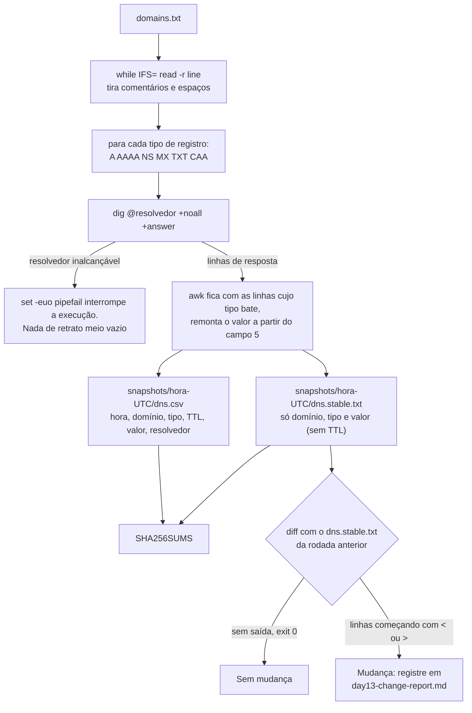

# Dia 13: Script Bash para automatizar uma etapa de reconhecimento

> 🇺🇸 Original: [*Day 13: Bash scripting to automate one recon step*](https://github.com/thiefdroppers/cyber-investigator-skills/blob/main/curriculum/phase-1-foundations/day-13.md) — © ThiefDroppers, licença MIT.
> Aqui: tradução fiel **+** camada brasileira. Nada do original foi removido; tudo o que é novo vem marcado com ➕.

**Fase 1. Fundamentos** · Meta da trilha: transformar uma consulta que você vinha digitando à mão num script que coleta os mesmos dados do mesmo jeito toda vez, carimba com a hora UTC, calcula o hash e mostra o que mudou entre uma rodada e outra.

Rank Jutsu: `D` · [](https://colab.research.google.com/github/Ridd1kulusC0d3r/investigador-cyber-90-dias/blob/main/curriculo/fase-1-fundamentos/dia-13/dia-13.ipynb)

---

## 🎬 ➕ Abertura do caso — *O que mudou durante a noite*

Terça, 9h20. Você reabre o terminal e roda, de memória, os mesmos `dig` de ontem nos domínios imitação. `coopserra-azul.example`, que na segunda à noite não respondia `A` nenhum, agora aponta para `203.0.113.78`. E `serraazul-seguranca.example` ganhou um registro `MX`.

— Ganhou desde quando? — pergunta Rafa.

Você abre o caderno. Na segunda à noite você tinha anotado "A, NS" para dois domínios, esquecido o `MX`, e usado o resolvedor da Vigia num e o `1.1.1.1` no outro. Não dá para dizer se o mundo mudou ou se foi a sua coleta.

— Domínio que ganha `MX` está se preparando para mandar ou receber e-mail. Se o próximo disparo for por e-mail e não por SMS, a Marta precisa saber **hoje**. Escreve um script. Toda manhã, igual, com hash. Aí, quando dois retratos forem diferentes, a diferença é do mundo.

É o Dia 13. *(Personagens e cenário: [Operação Isca](../../../caso-continuo/).)*

---

## 📖 Conceito

Investigadores escrevem scripts mais por consistência do que por velocidade. Uma consulta digitada à mão na segunda e de novo na quinta vai sair diferente em detalhes pequenos: um tipo de registro esquecido, outro resolvedor, a hora não anotada. Um script torna toda coleta idêntica, então, quando dois resultados diferem, a diferença está no mundo e não no jeito como você coletou. Um script também é documentação. Entregar a um colega o `dns-snapshot.sh` e a saída dele diz exatamente como os dados foram produzidos.

Alguns hábitos de bash deixam os scripts confiáveis o bastante para trabalho com evidência:

- Comece com `set -euo pipefail`. O `-e` para o script no primeiro comando que falhar, em vez de seguir adiante com dados ruins; o `-u` trata uma variável com nome errado como erro, em vez de string vazia; e o `pipefail` faz um *pipeline* falhar quando qualquer etapa falha, não só a última.
- Ponha aspas em toda variável (`"$domain"`, não `$domain`). Variáveis sem aspas são quebradas nos espaços e expandem curingas, o que transforma uma entrada estranha em comportamento estranho.
- Leia arquivos de entrada linha a linha com `while IFS= read -r line`. O acréscimo `|| [[ -n "$line" ]]` pega uma última linha sem quebra de linha no fim, coisa comum em arquivos editados à mão.
- Carimbe a saída com `date -u` em formato ISO 8601, e grave numa pasta nova com carimbo de tempo a cada rodada, para nunca sobrescrever uma coleta anterior.
- Calcule o hash da saída no fim, como no Dia 2, para que o retrato (*snapshot*) possa ser conferido depois.
- Guarde uma cópia da saída que dê para comparar automaticamente, sem os campos voláteis. Os TTLs de DNS fazem contagem regressiva sem parar, então dois retratos tirados com um minuto de diferença sempre diferem no TTL; comparar só domínio, tipo e valor mostra as mudanças reais.

Um script também multiplica o que quer que ele faça. Aponte-o só para domínios que você está autorizado a monitorar (os seus, os de um cliente com escopo escrito, ou de organizações públicas para praticar), mantenha a taxa de requisições baixa e nunca ponha uma ferramenta ativa em laço contra sistemas de terceiros. Consultas DNS por um resolvedor público são leves, o que as torna um bom primeiro alvo de automação.

O script que você escreve hoje põe cada um desses hábitos num ponto fixo da execução:



## 📚 Recursos

- [GNU Bash Reference Manual](https://www.gnu.org/software/bash/manual/bash.html), seções 3.2 (*pipelines*) e 4.3.1 (o *builtin* `set`).
- [ShellCheck](https://www.shellcheck.net/): cole um script no navegador ou instale localmente; ele pega erros de aspas e outros enganos comuns.
- [Google Shell Style Guide](https://google.github.io/styleguide/shellguide.html).
- [BashFAQ/001: How can I read a file line by line?](https://mywiki.wooledge.org/BashFAQ/001)

### ➕ Recursos do contexto Brasil

- [Registro.br — RDAP](https://rdap.registro.br/) e a [documentação técnica do Registro.br](https://registro.br/tecnologia/): para domínios `.br`, a fonte primária de delegação (NS) e de dados de registro. Um script de monitoramento de domínios imitação `.br` deveria somar uma consulta RDAP ao `dig`.
- [CERT.br — Recomendações sobre e-mail (SPF, DKIM, DMARC)](https://antispam.br/): explica por que um domínio imitação que ganha `MX` (e, depois, SPF) está se preparando para e-mail. Útil para a recomendação à cooperativa.
- [`../../../caso-continuo/dados/dia-13/`](../../../caso-continuo/dados/dia-13/): a lista de domínios do caso e dois retratos simulados, usados na Prática BR.

## 🛠️ Prática: bash e dig, produzindo uma ferramenta de retrato de DNS, dois retratos datados e um relatório de mudanças

**Seu checklist de hoje.** Faça na ordem e marque cada item ao terminar:

- [ ] Passo 1: escrever a lista de domínios
- [ ] Passo 2: escrever o script
- [ ] Passo 3: rodar e ler a saída
- [ ] Passo 4: tirar um segundo retrato e comparar
- [ ] Passo 5: agendar (opcional)
- [ ] Passo 6: escrever o relatório de mudanças
- [ ] ➕ Passo 7: os dois retratos dos domínios imitação (Prática BR)
- [ ] ➕ Passo 8: o notebook do dia no Colab

### Passo 1: escrever a lista de domínios

Em `~/lab/day13/`, crie `domains.txt`. Use as organizações públicas dos Dias 5 a 8, mais `example.com`:

```
wikipedia.org
example.com   # IANA reserved example domain
```

### Passo 2: escrever o script

Salve como `~/lab/day13/dns-snapshot.sh`:

```bash
#!/usr/bin/env bash
# dns-snapshot.sh: record the public DNS state of domains you are authorized to monitor.
# Usage: ./dns-snapshot.sh domains.txt [resolver]
set -euo pipefail

infile="${1:?usage: $0 domains.txt [resolver]}"
resolver="${2:-1.1.1.1}"
run_ts="$(date -u +%Y%m%dT%H%M%SZ)"
outdir="snapshots/${run_ts}"
mkdir -p "$outdir"
csv="${outdir}/dns.csv"
stable="${outdir}/dns.stable.txt"

hash256() {
  if command -v sha256sum >/dev/null 2>&1; then sha256sum "$@"; else shasum -a 256 "$@"; fi
}

echo "collected_utc,domain,rtype,ttl,value,resolver" > "$csv"
: > "${stable}.tmp"

while IFS= read -r line || [[ -n "$line" ]]; do
  domain="${line%%#*}"                          # drop comments
  domain="$(printf '%s' "$domain" | tr -d '[:space:]')"
  [[ -z "$domain" ]] && continue

  for rtype in A AAAA NS MX TXT CAA; do
    now="$(date -u +%Y-%m-%dT%H:%M:%SZ)"
    dig @"$resolver" +noall +answer "$domain" "$rtype" \
      | awk -v ts="$now" -v d="$domain" -v rt="$rtype" -v r="$resolver" -v st="${stable}.tmp" '
          $4 == rt {
            val = ""
            for (i = 5; i <= NF; i++) val = val (i > 5 ? " " : "") $i
            print d "\t" rt "\t" val >> st      # plain copy for diffing
            gsub(/"/, "\"\"", val)                 # CSV-escape quotes
            printf "%s,%s,%s,%s,\"%s\",%s\n", ts, d, rt, $2, val, r
          }' >> "$csv"
  done
  sleep 1                                       # stay polite to the resolver
done < "$infile"

# TTLs and timestamps change on every run, so diff on domain + type + value only.
sort -u "${stable}.tmp" > "$stable" && rm -f "${stable}.tmp"

( cd "$outdir" && hash256 dns.csv dns.stable.txt > SHA256SUMS )
echo "wrote $(( $(wc -l < "$csv") - 1 )) records to $csv"
```

> ➕ Os comentários dentro do script ficaram em inglês, como no original, para você poder comparar com ele linha a linha. Em português: *drop comments* = "descarta comentários"; *plain copy for diffing* = "cópia simples para o diff"; *CSV-escape quotes* = "escapa as aspas no padrão CSV"; *stay polite to the resolver* = "seja educado com o resolvedor"; o comentário antes do `sort -u` diz "TTLs e carimbos mudam a cada rodada, então o diff é só por domínio + tipo + valor".

Como ele funciona, seção por seção:

- `${1:?usage...}` para com uma mensagem de uso se você esquecer o arquivo de entrada. `${2:-1.1.1.1}` define o resolvedor padrão.
- O bloco `awk` fica só com as linhas de resposta cujo tipo é o que foi pedido (`$4 == rt`). Um nome que é CNAME devolve primeiro a linha do CNAME, e esse filtro a descarta para que um CNAME não seja registrado como registro A. Ele remonta o valor do registro a partir do campo 5, porque valores TXT e MX contêm espaços.
- O CSV escapa aspas duplas embutidas dobrando-as, que é a regra do CSV, para que registros TXT abram certinho numa planilha.
- Se o `dig` não alcança o resolvedor, ele sai com código diferente de zero, e o `set -e` junto com o `pipefail` param o script em vez de gravar um retrato meio vazio.

Torne-o executável e confira:

```bash
chmod +x dns-snapshot.sh
shellcheck dns-snapshot.sh     # instale com: sudo apt install shellcheck / brew install shellcheck
```

### Passo 3: rodar e ler a saída

```bash
./dns-snapshot.sh domains.txt
```

Saída resumida, de rodadas de teste feitas em 2026 (suas contagens e valores vão diferir):

```
wrote 22 records to snapshots/20260930T051836Z/dns.csv
```
```
collected_utc,domain,rtype,ttl,value,resolver
2026-09-30T05:18:36Z,wikipedia.org,A,296,"208.80.154.224",1.1.1.1
2026-09-30T05:18:36Z,wikipedia.org,AAAA,296,"2620:0:861:ed1a::1",1.1.1.1
2026-09-30T05:18:37Z,wikipedia.org,MX,223,"10 mx-in1001.wikimedia.org.",1.1.1.1
2026-09-30T05:18:37Z,wikipedia.org,TXT,600,"""v=spf1 include:_cidrs.wikimedia.org ~all""",1.1.1.1
2026-09-30T05:18:38Z,example.com,MX,241,"0 .",1.1.1.1
2026-09-30T05:18:38Z,example.com,TXT,300,"""v=spf1 -all""",1.1.1.1
```

Confira o retrato como faria com qualquer evidência:

```bash
cd snapshots/<run folder> && sha256sum -c SHA256SUMS && cd -
# macOS: shasum -a 256 -c SHA256SUMS
```

### Passo 4: tirar um segundo retrato e comparar

Rode o script de novo mais tarde (uma hora depois, ou no dia seguinte) e compare os arquivos estáveis:

```bash
a=$(ls -d snapshots/* | head -1); b=$(ls -d snapshots/* | tail -1)
diff "$a/dns.stable.txt" "$b/dns.stable.txt" > day13-changes.diff && echo "no changes between $a and $b"
```

O `diff` não imprime nada e sai com 0 quando os arquivos são iguais. Linhas que começam com `<` só existem no primeiro retrato, e linhas com `>`, só no segundo. Num domínio movimentado hospedado em CDN, você pode ver registros A se alternando entre rodadas; num domínio cujos registros NS ou MX mudam, investigue por quê.

Para ver a ferramenta detectar uma mudança sem esperar, acrescente um terceiro domínio ao `domains.txt` e rode de novo. O diff deve mostrar só os registros desse domínio como novos.

### Passo 5: agendar (opcional)

Para rodar todo dia às 06:00 UTC numa máquina que fica ligada, acrescente isto com `crontab -e` (o cron usa a hora local da máquina, então ajuste a hora se o relógio do seu sistema não estiver em UTC):

```
0 6 * * * cd "$HOME/lab/day13" && ./dns-snapshot.sh domains.txt >> run.log 2>&1
```

### Passo 6: escrever o relatório de mudanças

Crie `day13-change-report.md`:

```markdown
# Relatório de mudanças de DNS
Domínios monitorados: (lista, com o motivo de você estar autorizado ou de serem alvos públicos de prática)
Retrato A: pasta, SHA-256 do dns.csv
Retrato B: pasta, SHA-256 do dns.csv
Resolvedor:

| Domínio | Tipo de registro | Valor em A | Valor em B | Tipo de mudança (adicionado / removido / modificado) | Causa provável |
|---|---|---|---|---|---|
```

Se nada mudou, diga isso explicitamente e inclua o teste do terceiro domínio como linha de demonstração.

### ➕ Prática BR: os dois retratos dos domínios imitação

Os domínios do caso são `.example` e não resolvem na internet de verdade. Por isso a pasta [`caso-continuo/dados/dia-13/`](../../../caso-continuo/dados/dia-13/) traz o que o seu script **teria** gravado: o [`domains.txt`](../../../caso-continuo/dados/dia-13/domains.txt) do caso (o site real do cliente e os três domínios imitação) e duas pastas de retrato no formato exato do Passo 2:

- `snapshots/20261005T210005Z/` (segunda, 18h00 BRT, depois da entrega dos logs);
- `snapshots/20261006T090004Z/` (terça, 06h00 BRT, a rodada agendada do Passo 5).

1. Confira os dois retratos antes de usar: `sha256sum -c SHA256SUMS` dentro de cada pasta. Os dois devem dar `OK`.
2. Rode o diff do Passo 4. Saída esperada:

   ```
   0a1
   > coopserra-azul.example	A	203.0.113.78
   6a8
   > serraazul-seguranca.example	MX	10 mail.serraazul-seguranca.example.
   ```

3. Monte `isca-dia13-mudancas.md` com o modelo do Passo 6. Na linha "Domínios monitorados", escreva o motivo da autorização: o site real está no contrato; os domínios imitação são a infraestrutura nomeada no escopo do Dia 1.
4. Para cada mudança, a coluna "Causa provável" com cuidado:
   - `coopserra-azul.example` passou a responder `A` com `203.0.113.78`: o mesmo IP em que `serraazul-seguranca.example` já estava no retrato A, vizinho do `203.0.113.77` do site falso, e com os mesmos servidores de nomes `ns*.dnsbarato.example`. O domínio estava "estacionado" e foi **ativado**. Provável preparação de uma segunda página. (O Dia 30 retoma esse IP.)
   - `serraazul-seguranca.example` ganhou `MX`. Um domínio imitação que passa a aceitar e-mail pode estar se preparando para disparo por e-mail, para receber respostas de vítimas, ou só seguindo o modelo padrão do provedor. Três hipóteses, nenhuma confirmada.
5. Uma linha de recomendação para a Marta: avisar o time de atendimento e o filtro de e-mail da cooperativa sobre os dois domínios **hoje**, sem esperar confirmação, porque o custo de avisar é baixo e o de não avisar é um segundo disparo.

> Hábito que entra na sua rotina: o `domains.txt` do caso fica versionado junto com os retratos. Quando o Dia 8 (ou qualquer dia futuro) achar um domínio novo, ele entra na lista, e o primeiro retrato dele é a sua prova de "quando eu comecei a olhar".

### ➕ O notebook do dia

Abra o [notebook do Dia 13 no Colab](https://colab.research.google.com/github/Ridd1kulusC0d3r/investigador-cyber-90-dias/blob/main/curriculo/fase-1-fundamentos/dia-13/dia-13.ipynb). Nele você:

1. reescreve o `dns-snapshot.sh` em Python stdlib, com o mesmo formato de saída (consulta DNS por `socket` para A/AAAA, e por DoH JSON com plano B offline);
2. confere os `SHA256SUMS` dos dois retratos da Serra Azul e roda o diff;
3. joga o **quiz "o que o `set -euo pipefail` faz aqui?"**;
4. gera `isca-dia13-mudancas.md` já com as duas mudanças classificadas.

## ✅ Checkpoint

Seus artefatos são `dns-snapshot.sh`, pelo menos duas pastas de retrato e `day13-change-report.md`. Eles passam quando:

- O ShellCheck não reporta avisos, ou você consegue explicar cada um que restou.
- Cada pasta de retrato contém `dns.csv`, `dns.stable.txt` e `SHA256SUMS`.
- `sha256sum -c SHA256SUMS` passa nas duas pastas de retrato.
- O relatório de mudanças cita o hash dos dois retratos.
- O relatório de mudanças lista cada linha do `day13-changes.diff`, ou diz que ele veio vazio e mostra o teste do terceiro domínio.
- Você consegue explicar o que o `set -euo pipefail` faria se o resolvedor ficasse inalcançável no meio da execução.
- Você consegue explicar por que o script compara o `dns.stable.txt` e não o `dns.csv`.

### ➕ Checkpoint BR

- `isca-dia13-mudancas.md` cita os SHA-256 dos dois `dns.csv` da Serra Azul (`f4b0f960…` e `0b614cef…`) e a conferência `OK` dos dois `SHA256SUMS`.
- As duas mudanças aparecem como "adicionado", com causa provável escrita como hipótese, não como fato.
- A recomendação à Marta tem uma ação concreta e um prazo.
- Você acertou pelo menos 5 das 6 perguntas do quiz do notebook.

## ⚖️ ➕ Camada jurídica BR

**Automatizar não amplia a autorização.** O escopo do caso (Dia 1) cobre a infraestrutura do golpe. Um script que roda `dig` todo dia contra quatro domínios é a mesma ação, repetida; um script que faz varredura de portas em `203.0.113.0/24` "para ver o que mais tem lá" é outra ação, contra sistemas de terceiros, e não está no escopo. O art. 154-A do CP trata de invasão, e consultar DNS público não é invasão, mas a regra prática do original vale também aqui: nunca ponha uma ferramenta **ativa** em laço contra sistemas de terceiros.

**O retrato é prova de quando.** Num pedido de derrubada ou num boletim de ocorrência, "o domínio passou a ter MX entre 21h00 UTC de 5/out e 09h00 UTC de 6/out" só vale se você conseguir mostrar os dois retratos íntegros. Os `SHA256SUMS` e a pasta com carimbo UTC são a parte técnica disso; o registro de custódia do Dia 2 é a parte documental.

> Material de estudo, não constitui orientação jurídica.

## 🧠 ➕ Camada 8 — a memória do analista não é um retrato

A sua lembrança de "ontem tinha só A e NS" não é um registro, é uma **reconstrução**. A psicologia da memória (o trabalho de Elizabeth Loftus é a referência clássica) mostra que lembranças são remontadas a cada vez que são acessadas, e absorvem informação que chegou depois. Depois de ver o `MX` hoje, você já não consegue lembrar com segurança se ele estava lá ontem e você não reparou.

Há um segundo efeito, mais sutil: **mudar o método muda o que você vê**. Um resolvedor diferente, um tipo de registro esquecido, e a "mudança" que você percebe é da sua coleta. O script resolve os dois problemas de uma vez: grava o que viu, quando viu e como viu, igual toda vez. A consequência prática é simples: em monitoramento, só conta como mudança o que aparece entre **dois retratos feitos do mesmo jeito**.

## 🤖 ➕ Skill do dia

O Dia 13 propõe para a [skill pt-BR](../../../skills/investigador-cyber/SKILL.md) um acréscimo ao procedimento **"Ciclo de reconhecimento OSINT"**: coleta repetida feita sempre pelo mesmo método, em pasta nova com carimbo UTC e hash, e mudança só afirmada a partir de dois retratos íntegros comparados sem os campos voláteis. Texto e caso de teste em [`_skill-delta.md`](_skill-delta.md).

## 💡 ➕ Inovação OSINT do dia — DNS sobre HTTPS em JSON, só com `urllib`

Nem todo ambiente tem `dig` (o Colab não tem por padrão, e muitas máquinas Windows também não). Resolvedores públicos oferecem **DNS sobre HTTPS** com resposta em JSON, no formato documentado pelo Google ([`dns.google/resolve`](https://developers.google.com/speed/public-dns/docs/doh/json)) e pela Cloudflare ([`cloudflare-dns.com/dns-query`](https://developers.cloudflare.com/1.1.1.1/encryption/dns-over-https/make-api-requests/dns-json/), com o cabeçalho `accept: application/dns-json`). Dá para refazer o núcleo do `dns-snapshot.sh` com a biblioteca padrão:

```python
import json, urllib.request                                   # só stdlib
def doh(nome, tipo="A"):
    url = f"https://dns.google/resolve?name={nome}&type={tipo}"
    with urllib.request.urlopen(url, timeout=8) as r:
        resposta = json.load(r)
    # "Answer" só existe quando há registros; cada item traz name, type, TTL e data
    return [(a["TTL"], a["data"]) for a in resposta.get("Answer", [])]
print(doh("wikipedia.org", "MX"))
```

Dois cuidados: registre no retrato **qual** resolvedor DoH você usou (é o mesmo papel do `@1.1.1.1` no `dig`), e lembre que o provedor do DoH vê cada nome que você consulta, o que importa quando o nome monitorado é sensível. O notebook do dia usa esta função com plano B offline.

## 📝 Diário de estudo

- Data:
- Tempo gasto:
- O que ficou claro:
- O que ainda está nebuloso:
- Artefato produzido: `dns-snapshot.sh`, `snapshots/`, `day13-change-report.md`, `isca-dia13-mudancas.md`

---
<sub>Baseado em [cyber-investigator-skills](https://github.com/thiefdroppers/cyber-investigator-skills) por ThiefDroppers (MIT). Tradução, camada BR, Camada 8, skill pt-BR e notebook por Deivison Lourenço (@Ridd1kulusC0d3r).</sub>
