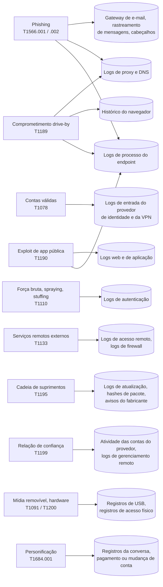

# Dia 15: Vetores de ataque comuns e a evidência que cada um deixa

> 🇺🇸 Original: [*Day 15: Common attack vectors and the evidence each one leaves*](https://github.com/thiefdroppers/cyber-investigator-skills/blob/main/curriculum/phase-1-foundations/day-15.md) — © ThiefDroppers, licença MIT.
> Aqui: tradução fiel **+** camada brasileira. Nada do original foi removido; tudo o que é novo vem marcado com ➕.

**Fase 1. Fundamentos** · Meta da trilha: nomear os caminhos pelos quais atacantes entram com mais frequência, mapear cada um para a técnica correspondente do MITRE ATT&CK e saber quais registros você puxaria para confirmá-lo ou descartá-lo.

Rank Jutsu: `D` · [](https://colab.research.google.com/github/Ridd1kulusC0d3r/investigador-cyber-90-dias/blob/main/curriculo/fase-1-fundamentos/dia-15/dia-15.ipynb)

---

## 🎬 ➕ Abertura do caso — *Como eles entraram, se ninguém invadiu nada?*

Quarta-feira, 7/out. Reunião por vídeo com a Marta e o Dr. Hélio. O jurídico vai direto ao ponto.

— A diretoria quer uma frase para o conselho: "como eles entraram". Foi invasão do nosso sistema?

Você abre a boca para dizer "não" e para. Não houve invasão do portal (Dia 12 e Dia 14). Mas três cooperados tiveram transferências feitas por **alguém que entrou com a senha certa**. Entrou onde, e deixou rastro em qual log?

Rafa, depois que a chamada termina:

— São dois vetores, não um. A isca chegou por SMS, e isso é engenharia social, não tem log nosso. A entrada no internet banking foi com credencial válida. Cada um deixa evidência num lugar diferente, e a pergunta da diretoria só tem resposta se esses lugares estavam gravando. Faz o mapa de prontidão: vetor, técnica, registro, quem guarda, por quanto tempo.

É o Dia 15. *(Personagens e cenário: [Operação Isca](../../../caso-continuo/).)*

---

## 📖 Conceito

Um vetor de ataque é o caminho que o atacante usou para conseguir o primeiro ponto de apoio. Costuma ser a primeira pergunta de uma investigação ("como eles entraram?"), e cada vetor deixa evidência num lugar diferente. Um número pequeno de vetores responde pela maior parte das intrusões e fraudes reais, e o MITRE ATT&CK dá um ID a cada um, o que permite alinhar suas anotações com relatórios de ameaça e com o trabalho de outros analistas.

Os vetores que vale conhecer agora, com o lugar onde a evidência deles fica:

| Vetor | ID no ATT&CK | Onde a evidência costuma estar |
|---|---|---|
| *Phishing* com link ou anexo | T1566.002, T1566.001 | Logs do *gateway* de e-mail e de rastreamento de mensagens; os cabeçalhos da própria mensagem (`Authentication-Results`, com os resultados de SPF, DKIM e DMARC, e os saltos `Received`); logs de *proxy* ou de DNS mostrando o clique; logs de processo do *endpoint* mostrando o que o anexo executou |
| Uso de credenciais roubadas, porém válidas | T1078 | Logs de entrada do provedor de identidade e da VPN: IP ou rede de origem nova, dispositivo novo, horário incomum, viagem impossível entre duas entradas |
| Adivinhação de senha, *password spraying* e *credential stuffing* | T1110, incluindo .003 e .004 | Logs de autenticação: muitas falhas e depois um sucesso (Dia 12), ou uma senha testada em muitas contas, ou muitas contas tentadas uma vez cada a partir de IPs rotativos (*stuffing*) |
| Exploração de uma aplicação exposta ao público | T1190 | Logs web e de aplicação com cadeias de *exploit* no caminho ou no corpo, picos de erro e, depois, o processo do servidor web iniciando um *shell* ou um processo que ele nunca roda normalmente |
| Serviços remotos expostos (RDP, SSH, VPN) | T1133 | Logs de acesso remoto; evento 4624 do Windows com tipo de logon 10 para RDP; logs de *firewall* mostrando a porta acessível a partir da internet |
| Comprometimento por *drive-by* a partir de um site malicioso ou comprometido | T1189 | Logs de *proxy* e de DNS da visita; histórico do navegador; logs do *endpoint* de um *download* ou *exploit* em seguida à visita |
| Comprometimento da cadeia de suprimentos | T1195 | Logs de atualização de software, *hashes* de pacote diferentes dos publicados pelo fabricante, avisos de segurança do fabricante. Muitas vezes é descoberto fora da organização vítima. |
| Relação de confiança (o acesso de um provedor de TI ou de um parceiro é abusado) | T1199 | Atividade das contas do provedor fora do padrão normal delas; logs da ferramenta de gerenciamento remoto |
| Mídia removível e acréscimo de hardware | T1091, T1200 | Registros de conexão de dispositivo (registro do Windows e logs de eventos para dispositivos USB), registros de acesso físico |

A fraude acrescenta um vetor que o ATT&CK arquiva sob *Stealth* (a tática que substituiu a maior parte de *Defense Evasion* no ATT&CK v19): a personificação (T1684.001, *Social Engineering: Impersonation*; relatórios mais antigos a citam como T1656), em que o atacante se passa por um chefe, um fornecedor ou um banco para levar uma pessoa a agir. A evidência é a própria conversa (e-mail, SMS, registros de chamada) e o pagamento ou a mudança de conta que veio depois. Nenhum *malware* é necessário.

A mesma tabela, desenhada como grafo, mostra de quão poucas fontes de evidência os vetores dependem. Os logs de processo do *endpoint*, por exemplo, alimentam três vetores, então uma organização sem eles (como a do cenário de hoje) fica mais fraca nos três ao mesmo tempo:



Em casos de fraude e golpe, a vítima normalmente é uma pessoa, não um servidor, e o "vetor" muitas vezes é uma mensagem numa plataforma que o investigador não controla. O trabalho do investigador é documentar o padrão (a isca, o pretexto, a infraestrutura) de um jeito que ajude a próxima vítima em potencial, que é para onde a Fase 5 vai.

Para todo vetor, a pergunta prática é a mesma: se foi assim que eles entraram, que registro existiria, quem o guarda e por quanto tempo? Os períodos de retenção importam. Muitos logs de entrada em nuvem, em planos de licença básicos, são guardados por semanas e não por meses, então um vetor que aconteceu há três meses pode já não ser demonstrável.

## 📚 Recursos

- [MITRE ATT&CK: tática Initial Access (TA0001)](https://attack.mitre.org/tactics/TA0001/), e a seção "Detection" da página de cada técnica, que lista as fontes de dados.
- [MITRE ATT&CK Navigator](https://mitre-attack.github.io/attack-navigator/), a ferramenta web gratuita que você vai usar hoje, e o [repositório no GitHub com a documentação](https://github.com/mitre-attack/attack-navigator).
- [Catálogo de vulnerabilidades exploradas conhecidas da CISA](https://www.cisa.gov/known-exploited-vulnerabilities-catalog), a lista por trás de muitas intrusões T1190.
- [Verizon DBIR](https://www.verizon.com/business/resources/reports/dbir/), para o ranking atual dos vetores de acesso inicial.

### ➕ Recursos do contexto Brasil

- [Banco Central — Pix: segurança e MED](https://www.bcb.gov.br/estabilidadefinanceira/pix): a página do Pix no site do BCB reúne as regras de segurança e o Mecanismo Especial de Devolução. É o "registro do pagamento" do vetor de personificação, do lado do sistema financeiro.
- [Resolução BCB nº 1/2020 (Regulamento do Pix)](https://www.bcb.gov.br/estabilidadefinanceira/buscanormas): base normativa do Pix; o MED e os limites e travas foram acrescentados por resoluções posteriores. <!-- TODO jurídico: listar as resoluções BCB específicas que criaram e alteraram o MED, conferindo número e data. -->
- [CERT.br — Cartilha, fascículo "Golpes na Internet"](https://cartilha.cert.br/): os golpes de *phishing* por SMS e de falsa central descritos para o público leigo. Bom para a comunicação aos cooperados.
- [`../../../caso-continuo/`](../../../caso-continuo/): a bíblia da Operação Isca, para os fatos fixos do vetor do caso (horário do SMS, remetentes, encurtador).

## 🛠️ Prática: MITRE ATT&CK Navigator, produzindo um mapa de calor de prontidão de evidência para o acesso inicial

### O cenário

Use a organização fictícia do Dia 9 (VLAN de servidores, VLAN de funcionários, Wi-Fi de visitantes, um *firewall*) e suponha que ela tenha: um serviço de e-mail e identidade em nuvem com o registro padrão, os logs do *firewall* UFW do Dia 9, logs de acesso do servidor web (Dia 11), logs de autenticação Linux (Dia 12) e nenhuma ferramenta de detecção em *endpoint* nos notebooks dos funcionários.

**Seu checklist de hoje.** Faça na ordem e marque cada item ao terminar:

- [ ] Passo 1: pontuar cada vetor
- [ ] Passo 2: montar a camada
- [ ] Passo 3: exportar
- [ ] Passo 4: fechar a maior lacuna
- [ ] Passo 5: testar o recarregamento
- [ ] ➕ Passo 6: a camada da Serra Azul (Prática BR)
- [ ] ➕ Passo 7: o notebook do dia no Colab

### Passo 1: pontuar cada vetor

Para cada técnica da tabela do Conceito, decida quão bem esta organização conseguiria provar ou descartar aquele vetor com os logs que tem. Use esta escala:

| Pontuação | Significado |
|---|---|
| 0 | Não existe nenhuma fonte de evidência relevante |
| 1 | A evidência existe, mas é parcial, de vida curta, ou dependeria de um terceiro |
| 2 | A evidência existe e provavelmente mostraria o vetor, com lacunas |
| 3 | Evidência forte e retida, que confirmaria ou excluiria o vetor com clareza |

Escreva as pontuações e uma justificativa de uma linha para cada uma em `day15-scores.md` antes de abrir a ferramenta. Exemplo: "T1190: 2. Os logs de acesso web capturam cadeias de *exploit* nas URLs, mas não nos corpos de POST, e não há registro de processos no servidor para mostrar o que um *exploit* executou."

### Passo 2: montar a camada

1. Abra `https://mitre-attack.github.io/attack-navigator/`, escolha *Create New Layer* e depois *Enterprise*.
2. Clique na aba com o nome da camada e renomeie para "Initial access evidence readiness, fictional org (Day 15)". Acrescente uma descrição com o cenário e a escala de pontuação.
3. Use o controle de busca da barra de ferramentas (a lupa) para achar cada técnica pelo ID, como `T1190`. Selecione-a.
4. Com a técnica selecionada, use o controle de pontuação (*scoring*) da barra de técnicas para inserir a sua nota. Repita para todas as técnicas, incluindo as subtécnicas (`T1566.001`, `T1566.002`, `T1110.003`, `T1110.004`). Para ver as subtécnicas na matriz, expanda a técnica-mãe pela pequena alça lateral da célula.
5. Acrescente a sua justificativa de uma linha a cada técnica pontuada, com o controle de comentário.
6. Abra a configuração de cores nos controles da camada e defina um gradiente do vermelho (0), passando pelo amarelo, até o verde (3), com mínimo 0 e máximo 3.
7. Técnicas sem pontuação vão poluir a visão. Nos controles da camada, use a opção de esconder técnicas desabilitadas depois de desabilitar as que não foram pontuadas, ou deixe-as e deixe a cor carregar a mensagem.

Os ícones da barra de ferramentas do Navigator mudam entre versões. Se um controle não estiver onde foi descrito, passe o mouse sobre os ícones para ver os rótulos.

### Passo 3: exportar

- Use o controle da camada para baixá-la como JSON: `day15-initial-access.json`. Este é o artefato reutilizável; você pode carregá-lo de novo com *Open Existing Layer*.
- Use o controle de renderizar para SVG e baixe `day15-initial-access.svg` para o seu relatório.

### Passo 4: fechar a maior lacuna

Escolha o vetor de menor pontuação que você também considere mais provável para esta organização. Em `day15-scores.md`, escreva uma recomendação curta: qual fonte de log acrescentar ou reter, por quanto tempo, e qual evento ou campo específico passaria a responder a pergunta. Exemplo: "T1566.002 está com nota 1. Ligar o registro de consultas DNS no resolvedor interno e guardá-lo por 180 dias mostraria qual notebook de funcionário resolveu um domínio de *phishing*, e quando."

### Passo 5: testar o recarregamento

No Navigator, escolha *Open Existing Layer* e envie `day15-initial-access.json`. Confira se cada pontuação e cada comentário voltaram intactos. Se faltar algo, corrija, baixe o JSON de novo e repita o teste.

### ➕ Passo 6 (Prática BR): a camada da Serra Azul

Agora a mesma régua, aplicada à pergunta da diretoria. Monte uma **segunda** camada, "Serra Azul — prontidão de evidência, Operação Isca (Dia 15)", só com os vetores que o caso pode ter usado. O que a cooperativa tem, segundo o Juliano e a Marta:

- log de acesso do portal (nginx, 14 dias de rotação) e `auth.log` do servidor (4 semanas) — Dias 11 e 12;
- logs do internet banking (fornecidos pela central do sistema cooperativo, retenção informada: 90 dias, **entrega mediante chamado**, prazo de 5 dias úteis);
- registros de transação Pix (retidos pelo sistema financeiro; consulta pelo time de fraude);
- os prints de SMS que 37 cooperados mandaram à ouvidoria;
- nenhum registro de qual cooperado clicou no link (o clique acontece no celular pessoal dele, fora de qualquer rede da cooperativa).

Pontue e justifique em `isca-dia15-scores.md`:

| Técnica | Pergunta no caso | Pontue (0–3) e justifique |
|---|---|---|
| T1566.002 | O link chegou e foi clicado? | O SMS chega pelo celular pessoal: nada no *gateway* da cooperativa. Prints da ouvidoria e *hotlinks* do Dia 11 são evidência indireta. |
| T1684.001 | Alguém se passou pela Serra Azul? | A própria mensagem (texto, remetentes `+55 00 00000-0001` a `-0004`, encurtador) é a evidência central. |
| T1078 | O acesso ao internet banking foi com credencial válida? | Logs de entrada do internet banking: com quem estão, por quanto tempo, quanto demora para chegar? |
| T1110 | Foi adivinhação de senha, e não *phishing*? | O que descartaria isso? (Dica: o padrão de falhas antes do sucesso, Dia 12.) |
| T1190 | O portal foi explorado? | Dias 11, 12 e 14. |

Gere a camada no notebook (que monta o JSON no formato do Navigator, sem digitar nada na ferramenta), carregue-a com *Open Existing Layer* e exporte o SVG. Feche com o "Passo 4" do caso: o vetor de pontuação mais baixa e mais provável é quase certamente **T1078 no internet banking**, porque a evidência existe mas está com um terceiro e expira em 90 dias. A recomendação para a Marta: abrir **hoje** o chamado pedindo a preservação dos logs de entrada das três contas afetadas, do dia 5/out.

> A frase que você leva para o Dr. Hélio responder à diretoria: *"Não houve invasão dos sistemas da cooperativa. Os cooperados foram enganados por uma mensagem que se passava pela Serra Azul (personificação, por SMS), entregaram a senha num site falso, e essa senha foi usada no internet banking. A prova da segunda parte está nos logs da central, que precisamos preservar até <data>."*

### ➕ O notebook do dia

Abra o [notebook do Dia 15 no Colab](https://colab.research.google.com/github/Ridd1kulusC0d3r/investigador-cyber-90-dias/blob/main/curriculo/fase-1-fundamentos/dia-15/dia-15.ipynb). Nele você:

1. pontua os 15 itens do original por formulário, com justificativa, e vê o mapa de calor em texto;
2. **gera o arquivo de camada do Navigator** (`.json`) com pontuação, comentário e gradiente 0–3, para as duas camadas;
3. valida o próprio JSON antes de carregar (o "teste do recarregamento" automatizado);
4. joga o **quiz "qual vetor, qual registro?"**.

## ✅ Checkpoint

Seus artefatos são `day15-initial-access.svg`, `day15-initial-access.json` e `day15-scores.md`. Eles passam quando:

- Pelo menos onze técnicas e subtécnicas da tabela do Conceito estão pontuadas.
- Cada justificativa nomeia uma fonte de log específica.
- Cada justificativa nomeia uma limitação específica.
- O mapa de calor usa um gradiente de 0 a 3.
- O mapa de calor tem uma legenda ou descrição explicando a escala.
- Recarregar `day15-initial-access.json` com *Open Existing Layer* (Passo 5) mostra cada pontuação e cada comentário intactos.
- A recomendação para a lacuna nomeia um evento ou campo específico (só o nome de um produto não conta).
- A recomendação para a lacuna dá um período de retenção, com uma razão.
- Sem consultar notas, você consegue dizer o que significam as notas 0, 1, 2 e 3 nesta escala.

### ➕ Checkpoint BR

- `isca-dia15-serraazul.json` carrega no Navigator com as cinco técnicas pontuadas e comentadas.
- `isca-dia15-scores.md` separa os dois vetores do caso (personificação/*phishing* para a isca; contas válidas para a entrada) e diz onde a evidência de cada um está.
- A recomendação nomeia o registro (logs de entrada do internet banking das contas afetadas em 5/out), o custodiante (a central do sistema cooperativo) e o prazo (antes de vencer a retenção de 90 dias).
- Você acertou pelo menos 6 das 8 perguntas do quiz do notebook.

## ⚖️ ➕ Camada jurídica BR

**O vetor também classifica o crime.** Para a polícia e o Ministério Público, a diferença entre os vetores aparece na tipificação. A personificação com o fim de obter vantagem por meio de informação fornecida pela vítima, induzida em erro por mensagem fraudulenta, é a **fraude eletrônica** do art. 171, §2º-A do Código Penal (incluído pela Lei 14.155/2021). Já usar a senha alheia para entrar num sistema se aproxima do art. 154-A (invasão de dispositivo informático), e a transferência em si é o prejuízo que fecha o estelionato. Classificar bem o vetor no relatório ajuda quem vai enquadrar, mas o enquadramento não é seu.

**Retenção é prazo.** Os logs de entrada do internet banking estão com um terceiro e somem em 90 dias. O pedido de preservação é um ato simples e barato; a reconstrução depois que o log expirou é impossível. No relatório, toda lacuna de evidência que dependa de terceiro deve vir com uma data-limite.

> Material de estudo, não constitui orientação jurídica.

## 🧠 ➕ Camada 8 — o vetor que não aparece no ATT&CK é a pessoa

O ATT&CK descreve o que o atacante fez. Num golpe como o da Serra Azul, o passo decisivo foi feito pela **vítima**: ela leu o SMS, sentiu medo de perder o acesso ao Pix e digitou a senha. Robert Cialdini descreveu os princípios de influência que esse tipo de mensagem explora, e dois aparecem de forma direta: **autoridade** (a mensagem "é" da cooperativa) e **escassez/urgência** ("sua chave foi bloqueada", agir agora).

Isso tem consequência para o investigador. O "vetor" que mais pesa no caso não deixa registro técnico na cooperativa: o registro dele é a memória e o celular de 37 pessoas assustadas. Tratar esses relatos como evidência (com data, hora, print e o cuidado de não culpar quem clicou) é parte da prontidão de evidência, tanto quanto ligar um log. A Fase 5 volta a isso com o "Seu Antônio".

## 🤖 ➕ Skill do dia

O Dia 15 propõe para a [skill pt-BR](../../../skills/investigador-cyber/SKILL.md) um acréscimo ao procedimento **"Triagem de padrão de fraude e golpe"**: separar o vetor da isca do vetor de entrada, mapear cada um para a técnica do ATT&CK e dizer onde a evidência de cada um está, com quem e até quando. Texto e caso de teste em [`_skill-delta.md`](_skill-delta.md).

## 💡 ➕ Inovação OSINT do dia — camada do Navigator gerada por código

Clicar em quinze técnicas no Navigator é lento e não deixa rastro de como você chegou às notas. O arquivo de camada é um JSON documentado no [repositório do Navigator](https://github.com/mitre-attack/attack-navigator/tree/master/layers), e dá para gerá-lo com `json` da biblioteca padrão, a partir da sua planilha de notas:

```python
import json                                                    # só stdlib
notas = {"T1078": (1, "Logs do internet banking com a central, 90 dias, por chamado"),
         "T1684.001": (2, "Texto do SMS e remetentes nos prints da ouvidoria")}
camada = {
    "name": "Serra Azul — prontidão de evidência",
    "domain": "enterprise-attack",
    "versions": {"layer": "4.5"},                              # versão do formato de camada
    "techniques": [{"techniqueID": t, "score": s, "comment": c} for t, (s, c) in notas.items()],
    "gradient": {"colors": ["#ff6666", "#ffe766", "#8ec843"], "minValue": 0, "maxValue": 3},
}
json.dump(camada, open("isca-dia15-serraazul.json", "w"), ensure_ascii=False, indent=2)
```

A camada vira um arquivo versionável, que nasce da mesma planilha que justifica as notas. Se uma versão nova do ATT&CK mudar um ID (como aconteceu com T1656 → T1684.001), o Navigator avisa ao carregar, e você corrige num lugar só.

## 📝 Diário de estudo

- Data:
- Tempo gasto:
- O que ficou claro:
- O que ainda está nebuloso:
- Artefato produzido: `day15-initial-access.json`, `day15-initial-access.svg`, `day15-scores.md`, `isca-dia15-serraazul.json`, `isca-dia15-scores.md`

---
<sub>Baseado em [cyber-investigator-skills](https://github.com/thiefdroppers/cyber-investigator-skills) por ThiefDroppers (MIT). Tradução, camada BR, Camada 8, skill pt-BR e notebook por Deivison Lourenço (@Ridd1kulusC0d3r).</sub>
