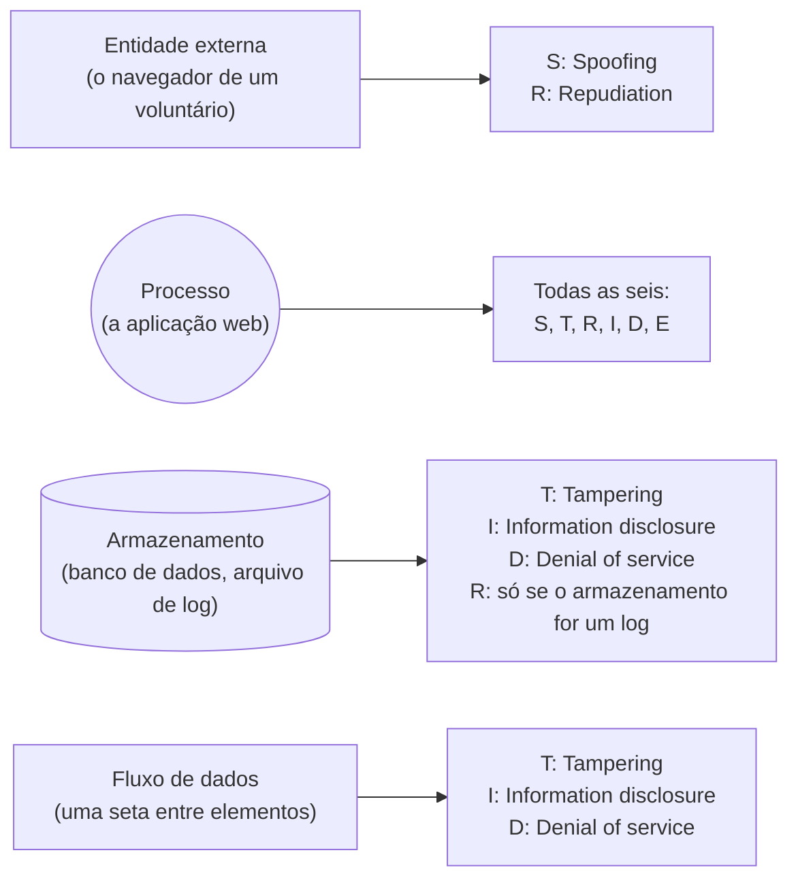
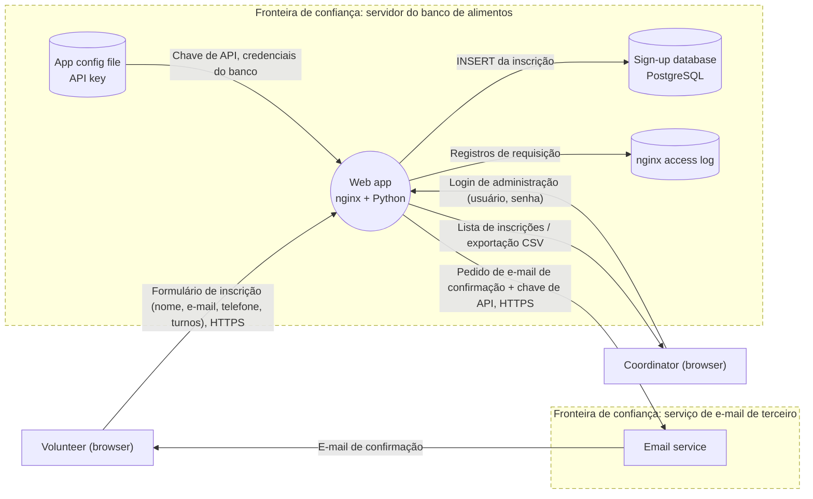

# Dia 16: Modelagem de ameaças com STRIDE

> 🇺🇸 Original: [*Day 16: Threat modeling with STRIDE*](https://github.com/thiefdroppers/cyber-investigator-skills/blob/main/curriculum/phase-1-foundations/day-16.md) — © ThiefDroppers, licença MIT.
> Aqui: tradução fiel **+** camada brasileira. Nada do original foi removido; tudo o que é novo vem marcado com ➕.

**Fase 1. Fundamentos** · Meta da trilha: desenhar um sistema pequeno como diagrama de fluxo de dados, achar as ameaças dele com STRIDE e produzir um modelo de ameaças que outra pessoa consiga revisar.

Rank Jutsu: `D` · [](https://colab.research.google.com/github/Ridd1kulusC0d3r/investigador-cyber-90-dias/blob/main/curriculo/fase-1-fundamentos/dia-16/dia-16.ipynb)

---

## 🎬 ➕ Abertura do caso — *O canal que o golpista também vai querer*

Quinta-feira, 8/out. A Marta chega à chamada com uma ideia pronta.

— Vamos lançar amanhã um "Denuncie um golpe" no portal. O cooperado manda o print do SMS, o número que mandou, o link. A ouvidoria baixa tudo numa planilha e manda para vocês. Assim a gente para de receber print por WhatsApp pessoal.

Rafa gosta da ideia e faz a pergunta de sempre.

— E se o Pescador também gostar? Quem é a primeira pessoa a mandar uma denúncia falsa com um "print" que é um arquivo malicioso? Quem tenta exportar a planilha com os telefones dos cooperados? E se alguém disser que não mandou a denúncia que mandou, vocês conseguem provar?

A Marta fica em silêncio.

— Antes de lançar, a gente desenha. Cinco caixas, seis letras. Meia hora.

É o Dia 16: STRIDE, primeiro no sistema do original, depois no canal de denúncia da Serra Azul. *(Personagens e cenário: [Operação Isca](../../../caso-continuo/).)*

---

## 📖 Conceito

A modelagem de ameaças faz quatro perguntas, na redação do *Threat Modeling Manifesto*: no que estamos trabalhando, o que pode dar errado, o que vamos fazer a respeito, e fizemos um trabalho bom o bastante? Desenvolvedores a usam antes de construir. Investigadores usam o mesmo método ao contrário: dado um sistema que foi atacado, quais caminhos estavam abertos, e qual deles bate com a evidência? Um modelo de ameaças também diz, antes de qualquer incidente, quais logs seriam necessários para investigar cada ameaça. O Dia 17 constrói esse segundo uso em cima do modelo de hoje.

O modelo começa com um diagrama de fluxo de dados (*data flow diagram*, DFD) que usa quatro tipos de elemento e uma fronteira. Entidades externas são pessoas ou sistemas fora do seu controle (o navegador de um voluntário, um provedor de e-mail). Processos são código que lida com dados (uma aplicação web). Armazenamentos de dados guardam dados (um banco de dados, um arquivo de log, um *bucket* de armazenamento). Fluxos de dados são as setas entre eles, rotuladas com o que se move. Fronteiras de confiança (*trust boundaries*) são linhas tracejadas onde o nível de confiança muda, como entre a internet e o seu servidor, ou entre o seu servidor e um serviço de terceiro. A maioria das ameaças fica em fluxos que cruzam uma fronteira.

STRIDE, criado na Microsoft, é uma lista de seis tipos de ameaça, cada um o oposto de uma propriedade de segurança:

| Ameaça | Viola | Pergunta a fazer | Visão do investigador |
|---|---|---|---|
| *Spoofing* (falsificação de identidade) | Autenticação | Alguém consegue se passar por um usuário ou por um sistema? | Logs de entrada e de sessão |
| *Tampering* (adulteração) | Integridade | Os dados podem ser alterados em trânsito ou em repouso? | Hashes, logs de mudança e de auditoria |
| *Repudiation* (repúdio) | Não repúdio | Alguém pode negar ter feito algo porque nada registrou? | Se existe trilha de auditoria, para começo de conversa |
| *Information disclosure* (divulgação de informação) | Confidencialidade | Os dados podem chegar a quem não deveria? | Logs de acesso, volumes de transferência de dados |
| *Denial of service* (negação de serviço) | Disponibilidade | O serviço pode ficar inutilizável? | Taxas de erro, métricas de recursos |
| *Elevation of privilege* (elevação de privilégio) | Autorização | Alguém pode fazer mais do que o seu papel permite? | Mudanças de papel, acesso a funções de administração por não administradores |

Nem toda ameaça se aplica a todo elemento. A regra de bolso usual, do método "STRIDE por elemento": entidades externas podem ser falsificadas e podem repudiar; processos estão expostos às seis; armazenamentos de dados, a adulteração, divulgação de informação, negação de serviço e repúdio, quando o armazenamento é um log; fluxos de dados, a adulteração, divulgação de informação e negação de serviço.

A mesma regra de bolso como uma tabela de consulta. Passe cada elemento do seu diagrama por ela e você tem a sua lista inicial de ameaças:



Mantenha os modelos pequenos. Um modelo de cinco elementos que você realmente termina e revisa vale mais do que um diagrama de cinquenta elementos abandonado no meio.

## 📚 Recursos

- [Threat Modeling Manifesto](https://www.threatmodelingmanifesto.org/), uma página com as quatro perguntas e os valores por trás delas.
- [OWASP Threat Dragon](https://owasp.org/www-project-threat-dragon/), a ferramenta gratuita usada hoje, com [downloads no GitHub](https://github.com/OWASP/threat-dragon/releases) e [documentação](https://www.threatdragon.com/docs/).
- [Microsoft: Threat Modeling Tool threats (categorias STRIDE)](https://learn.microsoft.com/en-us/azure/security/develop/threat-modeling-tool-threats).
- [OWASP Threat Modeling Cheat Sheet](https://cheatsheetseries.owasp.org/cheatsheets/Threat_Modeling_Cheat_Sheet.html).
- Adam Shostack, *Threat Modeling: Designing for Security* (Wiley, 2014), se você quiser o livro completo. O jogo de cartas gratuito dele, [*Elevation of Privilege*](https://github.com/adamshostack/eop), ensina STRIDE jogando.

### ➕ Recursos do contexto Brasil

- [LGPD — Lei 13.709/2018](https://www.planalto.gov.br/ccivil_03/_ato2015-2018/2018/lei/l13709.htm), art. 46, §2º: as medidas de segurança devem ser observadas desde a fase de concepção do produto ou do serviço até a sua execução. Modelar ameaças antes de lançar o canal é exatamente isso (*privacy by design*).
- [LGPD, art. 6º, VIII e X](https://www.planalto.gov.br/ccivil_03/_ato2015-2018/2018/lei/l13709.htm): princípios da prevenção e da responsabilização e prestação de contas. A ameaça de repúdio do STRIDE é o lado técnico da prestação de contas.
- [OWASP Brasil](https://owasp.org/www-chapter-brasil/) e o [OWASP Top 10 em português](https://owasp.org/Top10/pt_BR/): para justificar as mitigações das ameaças de adulteração e divulgação na Prática BR.

## 🛠️ Prática: OWASP Threat Dragon, produzindo um DFD STRIDE com pelo menos oito ameaças documentadas

### O sistema

Um banco de alimentos fictício de bairro mantém um pequeno site de inscrição de voluntários, descrito aqui por inteiro para que você não precise inventar nada:

- Voluntários usam um formulário web público para enviar nome, e-mail, telefone e os turnos disponíveis.
- A aplicação web (um servidor Linux, nginx mais uma aplicação Python) guarda as inscrições num banco PostgreSQL no mesmo servidor.
- Ela manda um e-mail de confirmação a cada voluntário por um serviço de e-mail transacional de terceiro, usando uma chave de API guardada no arquivo de configuração da aplicação.
- Dois coordenadores entram numa página de administração (usuário e senha, sem segundo fator) para ver as inscrições e exportá-las como arquivo CSV.
- O link de exportação tem a forma `/admin/export?file=signups-2026-03-10.csv`.
- O nginx grava logs de acesso. A aplicação não grava nenhum log de auditoria próprio.

**Seu checklist de hoje.** Faça na ordem e marque cada item ao terminar:

- [ ] Passo 1: instalar e criar o modelo
- [ ] Passo 2: desenhar o DFD
- [ ] Passo 3: achar ameaças com STRIDE
- [ ] Passo 4: exportar os artefatos
- [ ] Passo 5: nomear o fluxo de maior risco
- [ ] ➕ Passo 6: o canal "Denuncie um golpe" da Serra Azul (Prática BR)
- [ ] ➕ Passo 7: o notebook do dia no Colab

### Passo 1: instalar e criar o modelo

1. Baixe a versão *desktop* para o seu sistema operacional na página de *releases* do Threat Dragon no GitHub e instale. Também existe uma versão web; a versão *desktop* guarda o modelo como arquivo local.
2. Crie um modelo de ameaças novo e vazio. Título: "Food bank volunteer sign-up (fictional)". Dono (*Owner*): o seu nome. Descrição: cole a descrição do sistema acima.
3. Acrescente um diagrama e escolha o tipo de diagrama STRIDE.

### Passo 2: desenhar o DFD

Usando a paleta de elementos, posicione:

- Atores (entidades externas): `Volunteer (browser)`, `Coordinator (browser)`, `Email service (third party)`
- Processos: `Web app (nginx + Python)`
- Armazenamentos: `Sign-up database (PostgreSQL)`, `nginx access log`, `App config file (API key)`
- Fronteiras de confiança: uma em volta do servidor (separando-o da internet) e uma em volta do serviço de e-mail

Depois conecte-os com fluxos de dados, e rotule cada fluxo com o que ele carrega:

| De | Para | Rótulo |
|---|---|---|
| Volunteer | Web app | Formulário de inscrição (nome, e-mail, telefone, turnos), HTTPS |
| Web app | Sign-up database | INSERT da inscrição |
| Web app | Email service | Pedido de e-mail de confirmação + chave de API, HTTPS |
| Email service | Volunteer | E-mail de confirmação |
| Coordinator | Web app | Login de administração (usuário, senha) |
| Web app | Coordinator | Lista de inscrições / exportação CSV |
| Web app | nginx access log | Registros de requisição |
| App config file | Web app | Chave de API, credenciais do banco |

Confira se todo fluxo de um ator para a aplicação web cruza a fronteira de confiança do servidor.

O seu DFD terminado deve conter o que esta referência contém. Ela segue as formas usuais de DFD: retângulo para entidade externa, círculo para processo, cilindro para armazenamento de dados e caixa tracejada para cada fronteira de confiança. As formas do próprio Threat Dragon são um pouco diferentes.



> ➕ Os nomes dos elementos ficaram em inglês, como no original, para o seu modelo ser comparável com o de quem segue o currículo original. Os rótulos dos fluxos podem ir em português.

### Passo 3: achar ameaças com STRIDE

Selecione cada elemento e cada fluxo, um por vez, e use o painel de ameaças para acrescentar ameaças. Para cada uma, registre a categoria STRIDE, um título, uma descrição específica deste sistema, um status (*Open* para todas, hoje), uma severidade (*Low*, *Medium* ou *High*) e uma mitigação.

Exemplos resolvidos para três delas:

- *Spoofing*, no ator Coordinator e no fluxo de login de administração. Título: "Login de administração por *credential stuffing*". Descrição: "A página de administração aceita usuário e senha sem segundo fator nem limite de tentativas. Um atacante usando senhas vazadas de outros sites poderia entrar como coordenador e ler ou exportar os contatos de todos os voluntários." Severidade: *High*. Mitigação: "Acrescentar segundo fator para as contas de coordenador, limitar a taxa e registrar as falhas de login, alertar sobre logins vindos de redes novas."
- *Information disclosure*, no processo da aplicação web (a exportação). Título: "Nome do arquivo de exportação é adivinhável". Descrição: "Os arquivos de exportação têm o nome pela data. Se o parâmetro `file` não for conferido contra a sessão autenticada, ou aceitar caminhos, qualquer um que adivinhe uma data pode baixar uma lista, ou ler outros arquivos do servidor por *path traversal*." Severidade: *High*. Mitigação: "Gerar as exportações sob demanda, atrás de uma sessão autenticada, rejeitar qualquer valor de `file` que não seja um nome esperado, e nunca passar o parâmetro ao sistema de arquivos."
- *Repudiation*, no processo da aplicação web. Título: "Nenhum log de auditoria da aplicação". Descrição: "A aplicação não registra qual coordenador viu, exportou ou apagou registros. Os logs do nginx mostram uma requisição a `/admin/export` e um endereço IP, mas não qual conta a fez. Um coordenador poderia negar uma exportação, e um atacante usando um login roubado seria indistinguível do coordenador real." Severidade: *Medium*. Mitigação: "Gravar um registro de auditoria para cada ação de administração, com conta, hora, IP de origem e objeto afetado, e enviá-lo para fora do servidor."

Acrescente pelo menos mais cinco suas. Toda letra do STRIDE precisa aparecer pelo menos uma vez no modelo. Ideias para verificar: adulteração do formulário de inscrição (HTML ou *script* injetado num campo de nome e depois exibido na página de administração), divulgação da chave de API a partir do arquivo de configuração (e o que alguém poderia fazer com ela: mandar e-mail que parece vir do banco de alimentos), negação de serviço por milhares de inscrições automatizadas, e elevação de privilégio se as páginas de administração dependem de um link escondido em vez de conferir o papel da sessão.

### Passo 4: exportar os artefatos

1. Salve o modelo; o Threat Dragon o guarda como arquivo JSON. Chame-o de `day16-foodbank-threat-model.json`.
2. Abra a visão de relatório, que lista cada elemento com as suas ameaças e mitigações, e imprima em PDF como `day16-foodbank-report.pdf`.
3. Faça uma captura de tela do próprio diagrama como `day16-foodbank-dfd.png`.

### Passo 5: nomear o fluxo de maior risco

Decida qual fluxo isolado do seu DFD você considera de maior risco. Escreva uma frase dizendo por quê, e nomeie a fronteira de confiança que ele cruza. Ponha o nome do fluxo e essa frase na descrição do modelo de ameaças, depois salve o modelo e imprima o relatório em PDF de novo, para que os dois artefatos a tenham.

### ➕ Passo 6 (Prática BR): o canal "Denuncie um golpe" da Serra Azul

Crie um segundo modelo no Threat Dragon: "Serra Azul — canal Denuncie um golpe (Operação Isca)". O sistema, como a Marta descreveu:

- O cooperado preenche um formulário no portal `serraazul.example/denuncie`: telefone que mandou a mensagem, link recebido, texto, e um **print** (imagem enviada).
- A aplicação (a mesma `sa-web01` dos Dias 10 a 12) grava a denúncia num banco e o print numa pasta de *uploads*.
- O formulário pede o **CPF** do cooperado, "para a ouvidoria retornar".
- Três atendentes da ouvidoria entram numa área restrita (usuário e senha da intranet) para ver as denúncias e exportar uma planilha semanal, que vai por e-mail para a Vigia.
- Um SMS automático de confirmação ("Recebemos sua denúncia, protocolo N") sai por um *gateway* de SMS de terceiro, com chave de API no arquivo de configuração.

Elementos mínimos: `Cooperado (celular)`, `Atendente ouvidoria (navegador)`, `Gateway de SMS (terceiro)`, `Vigia (e-mail)` como atores; `Portal / denuncie (nginx + app)` como processo; `Banco de denúncias`, `Pasta de uploads (prints)`, `Config (chave do gateway)`, `nginx access log` como armazenamentos; fronteiras em volta de `sa-web01`, do *gateway* e da Vigia.

Documente pelo menos **oito** ameaças, com todas as letras do STRIDE, e inclua obrigatoriamente estas três, que são do caso:

1. **S — "Denuncie" falso.** O Pescador registra `serraazul-denuncie.example` e manda SMS: "Denuncie o golpe aqui". O canal legítimo vira isca nova. (Ameaça na entidade `Cooperado`: ele não tem como distinguir o canal verdadeiro do falso.) Mitigação: o canal só é divulgado dentro do app e do portal, e a cooperativa avisa que **nunca** manda link de denúncia por SMS.
2. **I — o CPF que não precisava estar ali.** A planilha semanal vai por e-mail com telefone, CPF e texto de todos os denunciantes. Mitigação que começa pela pergunta: o CPF é necessário para a finalidade? (Dica: o protocolo já permite o retorno.)
3. **R — "eu não mandei essa denúncia".** Sem log de auditoria, nem a ouvidoria nem a Vigia conseguem provar quando uma denúncia chegou, de qual sessão, e quem a exportou.

E uma de **T** que o investigador vai sentir na pele: um "print" enviado pelo formulário que não é imagem (ou é uma imagem com conteúdo malicioso), e que um atendente abre na estação de trabalho da agência. É a ponte para o arco da Fase 4.

Faça o Passo 5 também para este modelo: o fluxo de maior risco e a fronteira que ele cruza. Exporte como `isca-dia16-denuncie.json`, `isca-dia16-denuncie.pdf` e `isca-dia16-denuncie.png`.

### ➕ O notebook do dia

Abra o [notebook do Dia 16 no Colab](https://colab.research.google.com/github/Ridd1kulusC0d3r/investigador-cyber-90-dias/blob/main/curriculo/fase-1-fundamentos/dia-16/dia-16.ipynb). Nele você:

1. descreve os dois sistemas como listas de elementos e fluxos, e o notebook aplica a regra "STRIDE por elemento" para gerar o esqueleto de ameaças;
2. desenha os DFDs em Mermaid, prontos para colar no seu repositório;
3. preenche as ameaças por formulário e o notebook confere os critérios do checkpoint (8 ameaças, 6 letras, mitigação, repúdio);
4. joga o **quiz "qual letra?"** com 10 ameaças dos dois sistemas.

## ✅ Checkpoint

Seus artefatos são o JSON do modelo, o relatório em PDF e a imagem do diagrama. Eles passam quando:

- O DFD tem todos os elementos e fluxos das tabelas acima.
- Cada fluxo está rotulado com o seu conteúdo.
- As duas fronteiras de confiança estão desenhadas.
- Há pelo menos oito ameaças.
- As ameaças cobrem as seis categorias do STRIDE.
- Cada ameaça tem uma descrição específica do sistema (ela nomeia campos, páginas ou componentes deste sistema).
- Cada ameaça tem uma mitigação.
- Pelo menos uma ameaça é de repúdio e aponta um log que falta, porque o trabalho de amanhã depende dela.
- A descrição do modelo nomeia o fluxo isolado que você considera de maior risco, com uma frase de justificativa que nomeia a fronteira que ele cruza (Passo 5).
- Sem consultar notas, você consegue nomear a propriedade de segurança que cada tipo de ameaça do STRIDE viola.

### ➕ Checkpoint BR

- O modelo "Denuncie um golpe" tem pelo menos oito ameaças, as seis letras e as três ameaças obrigatórias do caso.
- A ameaça do CPF propõe **não coletar** o dado (minimização) antes de propor protegê-lo.
- A ameaça de repúdio nomeia os campos que o log de auditoria precisa ter.
- A descrição do modelo nomeia o fluxo de maior risco e a fronteira que ele cruza.
- Você acertou pelo menos 8 das 10 perguntas do quiz do notebook.

## ⚖️ ➕ Camada jurídica BR

**Segurança desde a concepção.** O art. 46, §2º da LGPD diz que as medidas de segurança devem ser observadas desde a fase de concepção do produto ou do serviço até a sua execução. Um modelo de ameaças feito **antes** do lançamento do canal é o registro de que a cooperativa cumpriu esse dever, e é um documento que ela vai querer ter se algum dia precisar explicar um incidente à ANPD.

**Minimização.** O art. 6º, III da LGPD (princípio da necessidade) limita o tratamento ao mínimo necessário para a finalidade. O CPF no formulário de denúncia é o exemplo do dia (e o caso dá um argumento a mais: desde 6/out o próprio site falso passou a pedir o CPF; um canal oficial que pede o mesmo dado ensina o cooperado a entregá-lo): se o protocolo resolve o retorno, o CPF é dado coletado sem necessidade, e cada cópia dele (no banco, na planilha, no e-mail para a Vigia) é uma ameaça de divulgação a mais. O melhor controle de confidencialidade para um dado é não tê-lo.

**Repúdio e prova.** Uma denúncia de cooperado pode virar peça de um inquérito. Sem registro de quando chegou e por qual sessão, ela vale como relato, mas não ajuda a montar a linha do tempo. O log de auditoria proposto aqui é o que o Dia 17 vai mapear.

> Material de estudo, não constitui orientação jurídica.

## 🧠 ➕ Camada 8 — o golpista também lê o modelo de ameaças

A ameaça mais perigosa do canal da Serra Azul não é técnica: é o "Denuncie" falso. Ela funciona pela mesma razão que o golpe original funcionou: a mensagem usa a **autoridade** da cooperativa e a **reciprocidade** do cooperado que quer ajudar (Cialdini). Um cooperado que acabou de ser alertado sobre o golpe está, justamente, mais propenso a clicar num link que promete ajudar a combatê-lo.

Do lado da equipe, o obstáculo é a **falácia do planejamento** (Kahneman e Tversky): a tendência de subestimar riscos e prazos de um projeto que já queremos lançar. "Lança amanhã" é a frase que faz a modelagem parecer burocracia. A meia hora do Rafa custa menos do que o primeiro incidente. Consequência prática: modele as ameaças **da perspectiva de quem já está atacando você**, porque esse ator existe, tem nome no caso, e já demonstrou que copia o que a cooperativa publica (Dia 11).

## 🤖 ➕ Skill do dia

O Dia 16 propõe para a [skill pt-BR](../../../skills/investigador-cyber/SKILL.md) o procedimento **"Modelagem de ameaças com STRIDE"**: elementos e fronteiras, STRIDE por elemento, ameaças específicas do sistema com mitigação, pelo menos um repúdio que aponta o log que falta, e a pergunta de minimização antes de proteger um dado. Texto e caso de teste em [`_skill-delta.md`](_skill-delta.md).

## 💡 ➕ Inovação OSINT do dia — DFD como código, com `threat-dragon` e Mermaid lado a lado

O arquivo do Threat Dragon é JSON, e o DFD em Mermaid é texto: os dois podem viver no Git do caso e ser revisados por *diff*, como código. O passo seguinte é gerar o esqueleto de ameaças automaticamente a partir da lista de elementos, aplicando a regra "STRIDE por elemento". Só com a biblioteca padrão:

```python
REGRA = {"entidade": "SR", "processo": "STRIDE", "armazenamento": "TID", "log": "TIDR", "fluxo": "TID"}
elementos = [("Cooperado (celular)", "entidade"), ("Portal / denuncie", "processo"),
             ("Banco de denúncias", "armazenamento"), ("nginx access log", "log")]
for nome, tipo in elementos:
    for letra in REGRA[tipo]:                         # cada letra aplicável vira uma pergunta
        print(f"[{letra}] {nome}: ?")
```

O que sai é uma lista de perguntas, não de ameaças: cada linha ainda precisa de uma descrição específica e de uma mitigação, escritas por alguém que conhece o sistema. Ferramentas como o [pytm](https://github.com/OWASP/pytm) (projeto da OWASP, biblioteca externa) levam essa ideia mais longe, gerando o DFD e o relatório a partir de um arquivo Python.

## 📝 Diário de estudo

- Data:
- Tempo gasto:
- O que ficou claro:
- O que ainda está nebuloso:
- Artefato produzido: `day16-foodbank-threat-model.json`, `day16-foodbank-report.pdf`, `day16-foodbank-dfd.png`, `isca-dia16-denuncie.json`

---
<sub>Baseado em [cyber-investigator-skills](https://github.com/thiefdroppers/cyber-investigator-skills) por ThiefDroppers (MIT). Tradução, camada BR, Camada 8, skill pt-BR e notebook por Deivison Lourenço (@Ridd1kulusC0d3r).</sub>
