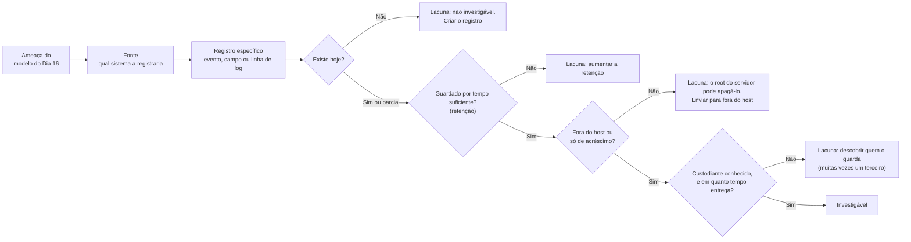
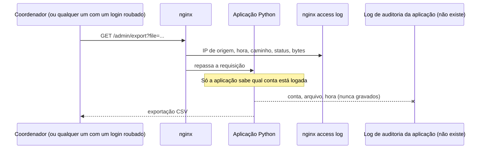
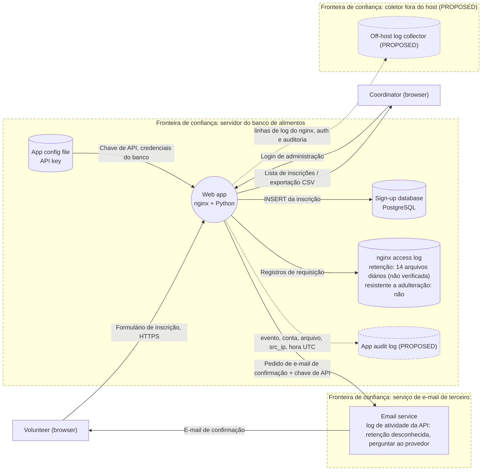

# Dia 17: Do modelo de ameaças ao mapa de evidências: qual registro prova o quê

> 🇺🇸 Original: [*Day 17: From threat model to evidence map, which record proves what*](https://github.com/thiefdroppers/cyber-investigator-skills/blob/main/curriculum/phase-1-foundations/day-17.md) — © ThiefDroppers, licença MIT.
> Aqui: tradução fiel **+** camada brasileira. Nada do original foi removido; tudo o que é novo vem marcado com ➕.

**Fase 1. Fundamentos** · Meta da trilha: para cada ameaça de um modelo, nomear o registro exato que mostraria que ela aconteceu, conferir se esse registro existe hoje e transformar as lacunas num plano curto de prontidão de evidência.

Rank Jutsu: `D` · [](https://colab.research.google.com/github/Ridd1kulusC0d3r/investigador-cyber-90-dias/blob/main/curriculo/fase-1-fundamentos/dia-17/dia-17.ipynb)

---

## 🎬 ➕ Abertura do caso — *"Se acontecer, a gente consegue provar?"*

Sexta-feira, 9/out. A primeira boa notícia da semana chega cedo: a hospedagem de `serraazul-pix.example` foi suspensa. O canal "Denuncie um golpe" foi adiado uma semana, e a Marta não está feliz, mas está convencida. O CPF saiu do formulário. Agora ela faz a pergunta que vale o adiamento.

— Das oito ameaças que vocês listaram, se uma acontecer no primeiro mês, a gente consegue provar? Com qual registro?

Você abre o modelo do Dia 16 e começa pela A03, a do repúdio. O nginx registra `POST /denuncie` e um IP. Quem exportou a planilha? Nenhum registro. A planilha foi por e-mail: quem guarda o log de envio, o provedor de e-mail da cooperativa? Por quanto tempo? Você não sabe.

Rafa empurra uma folha em branco para o seu lado.

— Quatro colunas por ameaça: fonte, registro, retenção, custodiante. Onde você escrever "não sei", isso é um achado. No fim, no máximo cinco ações. A primeira fecha o repúdio.

É o Dia 17. *(Personagens e cenário: [Operação Isca](../../../caso-continuo/).)*

---

## 📖 Conceito

O modelo de ameaças de ontem respondeu a "o que pode dar errado?". O trabalho de hoje responde à pergunta seguinte do investigador: "se der errado, alguém conseguiria provar?". Para muitas organizações pequenas, a resposta honesta é não. Ninguém deixou de olhar; o registro que resolveria a questão nunca foi criado, ou foi apagado depois de sete dias.

Prontidão de evidência (às vezes chamada de prontidão forense, *forensic readiness*) é a prática de decidir com antecedência qual evidência você vai precisar e garantir que ela seja coletada e guardada. Para cada ameaça você precisa de quatro fatos. A **fonte** é o sistema que a registraria. O **registro específico** é o evento, o campo ou a linha que mostraria a ameaça acontecendo; "os logs" não é resposta. A **retenção** é quanto tempo esse registro sobrevive antes da rotação ou da exclusão. O **custodiante** é quem pode entregá-lo, e em quanto tempo. Uma ameaça cujo registro não existe não pode ser investigada, por mais habilidoso que seja o investigador.

Cada ameaça passa pelas mesmas quatro checagens, e um "não" em qualquer uma delas é uma lacuna para o plano de prontidão:



O primeiro dos três padrões abaixo, visto como uma requisição passando pelo sistema:



Três padrões aparecem em quase toda revisão de prontidão. Primeiro, o servidor web registra a requisição, mas não a identidade: o nginx vê `GET /admin/export?file=...` vindo de um endereço IP, enquanto só a aplicação sabe qual conta fez a requisição. Se a aplicação não anota isso, toda ação de administração é anônima. Segundo, os logs vivem na máquina que eles descrevem. Um atacante com root no servidor pode editar ou apagar o `/var/log/auth.log`, então os logs que importam também devem ser enviados para um lugar que o atacante não alcance, como um servidor syslog separado ou um serviço de logs em nuvem. Terceiro, terceiros guardam alguns dos registros mais úteis (os logs de entrega do serviço de e-mail, os logs de entrada do provedor de identidade), e as regras de retenção e de exportação deles são definidas por contrato e por plano de licença, não por você.

O produto deste trabalho é curto e concreto: uma tabela que liga ameaças a registros, e uma lista das poucas mudanças que fechariam as maiores lacunas. É também um documento que você vai reusar em todas as fases seguintes, porque num caso real a primeira hora costuma ir para descobrir quais desses registros existem.

## 📚 Recursos

- [NIST SP 800-92: Guide to Computer Security Log Management](https://csrc.nist.gov/pubs/sp/800/92/final), seções 2 e 4, sobre fontes de log e retenção.
- [UK NCSC: Introduction to logging for security purposes](https://www.ncsc.gov.uk/guidance/introduction-logging-security-purposes).
- [OWASP Logging Cheat Sheet](https://cheatsheetseries.owasp.org/cheatsheets/Logging_Cheat_Sheet.html): quais eventos de aplicação registrar e quais campos cada registro precisa.
- [Documentação do rsyslog: encaminhamento de logs](https://www.rsyslog.com/doc/), para enviar logs para fora do host.

### ➕ Recursos do contexto Brasil

- [Marco Civil da Internet — Lei 12.965/2014](https://www.planalto.gov.br/ccivil_03/_ato2011-2014/2014/lei/l12965.htm), arts. 13 e 15: os prazos **mínimos** de guarda que a lei impõe a provedores (1 ano para registros de conexão, 6 meses para registros de acesso a aplicações de provedor pessoa jurídica). Servem de referência para justificar retenção, mas não se aplicam automaticamente aos logs internos de uma cooperativa.
- [Código de Processo Penal, arts. 158-A a 158-F](https://www.planalto.gov.br/ccivil_03/decreto-lei/del3689compilado.htm): a cadeia de custódia começa no reconhecimento e na coleta. Log que não existe não tem cadeia de custódia para começar.
- [LGPD, arts. 15 e 16](https://www.planalto.gov.br/ccivil_03/_ato2015-2018/2018/lei/l13709.htm): o término do tratamento e a eliminação dos dados. A retenção de log com dado pessoal precisa de uma razão escrita, e "guardar para sempre" não é uma.

## 🛠️ Prática: OWASP Threat Dragon e uma planilha, produzindo um mapa de prontidão de evidência e um DFD anotado

**Seu checklist de hoje.** Faça na ordem e marque cada item ao terminar:

- [ ] Passo 1: montar o mapa de evidências
- [ ] Passo 2: anotar o DFD
- [ ] Passo 3: escrever o plano de prontidão
- [ ] ➕ Passo 4: o mapa de evidências do canal "Denuncie um golpe" (Prática BR)
- [ ] ➕ Passo 5: o notebook do dia no Colab

### Passo 1: montar o mapa de evidências

Abra o seu modelo do Dia 16. Crie uma planilha `day17-evidence-map` com uma linha por ameaça e estas colunas:

| ID da ameaça | STRIDE | Título da ameaça | Fonte de evidência | Registro / campo específico | Existe hoje? (S / N / Parcial) | Retenção hoje | Resistente a adulteração? (fora do host, só de acréscimo) | Custodiante | Lacuna e correção |

Linhas resolvidas, usando as três ameaças do Dia 16:

| Campo | Login de administração por *credential stuffing* | Nome do arquivo de exportação é adivinhável | Nenhum log de auditoria da aplicação |
|---|---|---|---|
| Fonte de evidência | nginx access log; *handler* de login da aplicação | nginx access log | Aplicação (não existe) |
| Registro específico | Linhas `POST /admin/login` com códigos de status por IP de origem (o padrão do Dia 11: muitos `200` e depois um `302`) | Linhas `GET /admin/export?file=...`, com status, bytes enviados e IP de origem | Seria: `event=export account=<nome> file=<nome> src_ip=<ip> ts=<UTC>` |
| Existe hoje? | Parcial: mostra tentativas e sucesso por IP, não qual *username* foi tentado | S para a requisição; N para qual conta (se alguma) estava logada | N |
| Retenção hoje | A rotação padrão do nginx no Ubuntu é de 14 arquivos diários; confirme em `/etc/logrotate.d/nginx` | Igual | n/a |
| Resistente a adulteração? | N (no mesmo servidor) | N | n/a |
| Custodiante | O voluntário de TI do banco de alimentos | Igual | Igual |
| Lacuna e correção | Registrar *username* e resultado na aplicação; enviar os logs para fora do servidor | Registrar a conta em toda exportação | Acrescentar log de auditoria para todas as ações de administração; enviar para fora do servidor; guardar 12 meses |

Confira a afirmação sobre retenção você mesmo, em qualquer máquina Ubuntu com nginx instalado:

```bash
cat /etc/logrotate.d/nginx
```

Procure a diretiva `daily` ou `weekly` e a contagem `rotate N`; juntas, elas dão a retenção. Registre o que encontrar, em vez de confiar na tabela acima.

Preencha uma linha para cada ameaça do seu modelo, incluindo as cinco ou mais que você acrescentou. Duas linhas precisam de tratamento especial:

- A ameaça de divulgação da chave de API. O registro mais útil fica no serviço de e-mail (chamadas de API por chave, com IP de origem), não no servidor. Procure o que a documentação do provedor que você escolheu diz sobre logs de atividade de API e a retenção deles, e registre a resposta e o link da documentação. Se não encontrar, escreva "desconhecido, perguntar ao provedor", o que em si já é um achado.
- A ameaça de negação de serviço. Os logs do nginx mostram volume, mas o registro que prova o impacto é o log de erro da aplicação ou do banco de dados durante a enxurrada, e possivelmente as métricas de recursos do servidor. Nomeie os dois.

### Passo 2: anotar o DFD

No Threat Dragon, abra o diagrama do Dia 16 e salve uma cópia como `day17-foodbank-evidence.json`. Na cópia:

1. Acrescente um armazenamento para cada fonte de evidência que falta hoje, com o sufixo `(PROPOSED)`: `App audit log (PROPOSED)`, `Off-host log collector (PROPOSED)`.
2. Desenhe fluxos da aplicação web para esses armazenamentos, rotulados com o que seria enviado.
3. Acrescente uma terceira fronteira de confiança em volta do coletor fora do host, para mostrar que ele fica fora do servidor que um atacante poderia controlar.
4. Na descrição de cada armazenamento existente (`nginx access log`), escreva a retenção dele e se ele é resistente a adulteração.

Exporte o diagrama como `day17-evidence-dfd.png`.

A cópia anotada deve ficar como esta referência: o diagrama do Dia 16 mais os armazenamentos e fluxos propostos, tracejados, e uma terceira fronteira em volta do coletor. A retenção mostrada para o log do nginx é o padrão do Ubuntu das linhas resolvidas, e continua não verificada até você ler o `/etc/logrotate.d/nginx`.



### Passo 3: escrever o plano de prontidão

Crie `day17-readiness-plan.md` com no máximo cinco ações, ranqueadas por quantas ameaças cada uma fecha. Para cada ação, diga:

- quais ameaças ela torna investigáveis (pelo ID da ameaça),
- o registro específico que ela cria ou preserva,
- a retenção de que ela precisa e por que esse período (por exemplo, "12 meses, porque voluntários costumam relatar o mau uso dos seus dados meses depois"),
- o esforço aproximado (em horas, não em orçamento).

Feche com um parágrafo "se formos atacados amanhã": quais ameaças você conseguiria investigar hoje, quais não conseguiria, e o que você pediria primeiro ao provedor de e-mail.

### ➕ Passo 4 (Prática BR): o mapa de evidências do canal "Denuncie um golpe"

Pegue as ameaças A01 a A08 do seu `isca-dia16-denuncie.md` e monte `isca-dia17-mapa-evidencias` com as mesmas colunas do Passo 1. Informações que o Juliano levantou para você (anote como "informado pelo TI, não verificado" onde couber):

- `sa-web01`: nginx com rotação de 14 dias; `auth.log` com 4 semanas; nada é enviado para fora do servidor.
- A aplicação do canal ainda não existe: o log de auditoria pode ser **projetado** agora, de graça.
- O e-mail da cooperativa é um serviço em nuvem; o Juliano acha que o log de envio fica "uns 30 dias" e não sabe se mostra anexos.
- O *gateway* de SMS tem um painel com histórico de envios; retenção desconhecida.
- Os prints ficam na pasta de *uploads* de `sa-web01`, sem hash.

Três linhas pedem cuidado especial:

1. **A01 ("Denuncie" falso por SMS).** A evidência dela **não está em nenhum sistema da cooperativa**: está no SMS recebido pelo cooperado e nos registros da operadora. A fonte que a cooperativa controla é indireta: as próprias denúncias de cooperados que receberam o SMS falso, e os retratos de DNS do Dia 13 para domínios novos. Escreva isso.
2. **A07 (chave do *gateway* vazada).** Como a chave de API do original: o registro decisivo é o histórico de envios **por chave** no painel do *gateway*, com IP de origem. "Retenção desconhecida, perguntar ao fornecedor" é um achado.
3. **A04 (print malicioso).** Um registro que ninguém pensou em criar: o hash de cada arquivo recebido, gravado no momento do *upload*. Sem ele, se um atendente abrir um arquivo malicioso, não dá para saber qual foi, nem quem o mandou.

Depois, escreva `isca-dia17-plano-prontidao.md` com no máximo **cinco** ações. A primeira fecha o repúdio (A03): o log de auditoria do canal, com os campos `evento`, `protocolo`, `conta`, `src_ip`, `ts_utc` e `sha256_upload`, enviado para fora de `sa-web01`. Feche com o parágrafo "se o canal for atacado no primeiro mês", e diga o que você pediria **primeiro** ao fornecedor do *gateway* de SMS.

### ➕ Passo 5: o notebook do dia

Abra o [notebook do Dia 17 no Colab](https://colab.research.google.com/github/Ridd1kulusC0d3r/investigador-cyber-90-dias/blob/main/curriculo/fase-1-fundamentos/dia-17/dia-17.ipynb). Nele você:

1. transforma as quatro checagens do fluxograma (existe, retenção, fora do host, custodiante) numa função que classifica cada linha do mapa e aponta a lacuna;
2. lê uma configuração de `logrotate` (de exemplo, ou a sua) e calcula a retenção real;
3. ranqueia as ações do plano pelo número de ameaças que cada uma fecha;
4. desenha o registro de auditoria proposto e grava um exemplo de linha em JSON, com o hash do *upload*.

## ✅ Checkpoint

Seus artefatos são `day17-evidence-map`, `day17-evidence-dfd.png` e `day17-readiness-plan.md`. Eles passam quando:

- Toda ameaça do Dia 16 tem uma linha.
- Toda célula "registro específico" nomeia um evento, um campo ou um padrão de linha de log. Nenhuma célula diz só "logs".
- Os valores de retenção vêm de algo que você conferiu (um arquivo de configuração que você leu ou uma página de documentação cujo link você deu), ou estão marcados como "não verificada".
- O DFD anotado mostra os armazenamentos propostos.
- O DFD anotado mostra a fronteira fora do host.
- Todo armazenamento proposto e a fronteira fora do host têm o sufixo `(PROPOSED)`.
- O plano de prontidão tem no máximo cinco ações.
- Cada ação está ligada a IDs de ameaças.
- A primeira ação fecha a lacuna de repúdio do Dia 16.
- Sem consultar notas, você consegue nomear os quatro fatos de que cada ameaça precisa para a prontidão de evidência.

### ➕ Checkpoint BR

- `isca-dia17-mapa-evidencias` tem as oito ameaças do canal, com "informado pelo TI, não verificado" onde a retenção não foi conferida.
- A linha da A01 diz explicitamente que a evidência principal está fora da cooperativa, e nomeia as fontes indiretas.
- A linha da A04 propõe o hash do arquivo no momento do *upload*.
- O plano tem no máximo cinco ações, a primeira fecha a A03, e cada ação tem uma retenção com razão escrita (não "para sempre").
- Você acertou pelo menos 5 das 6 perguntas do quiz do notebook.

## ⚖️ ➕ Camada jurídica BR

**Retenção tem dois limites.** Para baixo, o limite é investigativo: log que expira antes de a vítima perceber o golpe não serve para nada. Para cima, o limite é a LGPD: os arts. 15 e 16 tratam do término do tratamento e da eliminação dos dados pessoais quando a finalidade se esgota, com exceções (como cumprimento de obrigação legal). O log de auditoria do canal de denúncias guarda IP e protocolo de cooperados: a retenção escolhida precisa de uma justificativa escrita, ligada à finalidade (por exemplo, "12 meses, porque denúncias viram inquérito e a polícia pede dados meses depois").

**O que a lei já manda guardar, e de quem.** O Marco Civil fixa prazos mínimos para **provedores** (1 ano para registros de conexão, art. 13; 6 meses para registros de acesso a aplicações de provedor pessoa jurídica, art. 15). A cooperativa, ao oferecer o portal, é provedora de aplicação; a forma como o art. 15 se aplica ao portal de uma cooperativa de crédito é pergunta para o Dr. Hélio. <!-- TODO jurídico: confirmar se o portal de uma cooperativa de crédito se enquadra como "provedor de aplicações de internet constituído na forma de pessoa jurídica que exerça essa atividade de forma organizada, profissionalmente e com fins econômicos" (MCI, art. 15) para fins de guarda obrigatória de 6 meses. --> Na dúvida, o mapa de evidências registra o prazo legal possível ao lado do prazo técnico atual (14 dias), e a diferença vira item do plano.

**Custódia começa no desenho.** A cadeia de custódia do CPP (arts. 158-A a 158-F) começa no reconhecimento do vestígio. Um log de auditoria que já nasce com hora UTC, conta, IP e hash do arquivo recebido, e que vai para fora do servidor, é um vestígio que chega à polícia com metade da cadeia já documentada.

> Material de estudo, não constitui orientação jurídica.

## 🧠 ➕ Camada 8 — o viés da sobrevivência dos logs

O investigador só vê os logs que **sobreviveram**: os que alguém ligou, que não foram rotacionados, que o atacante não apagou. Isso cria uma versão do **viés de sobrevivência** (o erro de tirar conclusões só a partir do que restou, ignorando o que se perdeu): o relatório descreve o incidente que a evidência disponível consegue mostrar, e o resto some sem deixar marca. "Não encontramos sinal de exfiltração" pode significar que não houve, ou que ninguém registrava saída.

Há também um efeito do lado da organização, que a psicologia do risco chama de **viés do otimismo**: "com a gente não vai acontecer" faz o log parecer custo sem benefício até o primeiro incidente. O mapa de evidências é o antídoto dos dois: ele obriga a escrever, **antes**, o que você não vai conseguir ver. Consequência prática: no relatório de qualquer caso, inclua uma linha "o que não pudemos verificar, e por quê", com a referência ao registro que faltava.

## 🤖 ➕ Skill do dia

O Dia 17 propõe para a [skill pt-BR](../../../skills/investigador-cyber/SKILL.md) o procedimento **"Mapa de prontidão de evidência"**: as quatro perguntas por ameaça (fonte e registro, retenção, fora do host, custodiante), retenção só a partir de algo verificado, e um plano de no máximo cinco ações com a primeira fechando o repúdio. Texto e caso de teste em [`_skill-delta.md`](_skill-delta.md).

## 💡 ➕ Inovação OSINT do dia — log de auditoria que se denuncia quando é editado

O original manda enviar os logs para fora do host. Uma camada a mais, barata e só com a biblioteca padrão, é **encadear** cada linha de auditoria com o hash da anterior: se alguém apagar ou editar uma linha no meio, a corrente quebra a partir dali.

```python
import hashlib, json                                          # só stdlib
anterior = "0" * 64                                           # "bloco gênese"
def registrar(evento, **campos):
    global anterior
    linha = {"evento": evento, **campos, "hash_anterior": anterior}
    texto = json.dumps(linha, sort_keys=True, ensure_ascii=False)
    anterior = hashlib.sha256(texto.encode()).hexdigest()     # o hash desta linha vira o "anterior" da próxima
    return texto + "\n"
print(registrar("denuncia_recebida", protocolo="DN-000123", ts_utc="2026-10-16T12:00:00Z"), end="")
print(registrar("planilha_exportada", conta="atendente02", ts_utc="2026-10-16T18:00:00Z"), end="")
```

Isto não impede a adulteração (quem tem root pode reescrever a corrente inteira), mas torna a adulteração **detectável** se o último hash for guardado em outro lugar, por exemplo no coletor fora do host ou no próprio e-mail diário à Vigia. É a mesma ideia de logs com encadeamento de hash usada em sistemas de auditoria, em vinte linhas.

## 📝 Diário de estudo

- Data:
- Tempo gasto:
- O que ficou claro:
- O que ainda está nebuloso:
- Artefato produzido: `day17-evidence-map`, `day17-evidence-dfd.png`, `day17-readiness-plan.md`, `isca-dia17-mapa-evidencias`, `isca-dia17-plano-prontidao.md`

---
<sub>Baseado em [cyber-investigator-skills](https://github.com/thiefdroppers/cyber-investigator-skills) por ThiefDroppers (MIT). Tradução, camada BR, Camada 8, skill pt-BR e notebook por Deivison Lourenço (@Ridd1kulusC0d3r).</sub>
