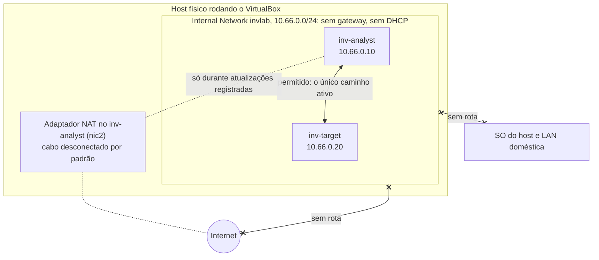
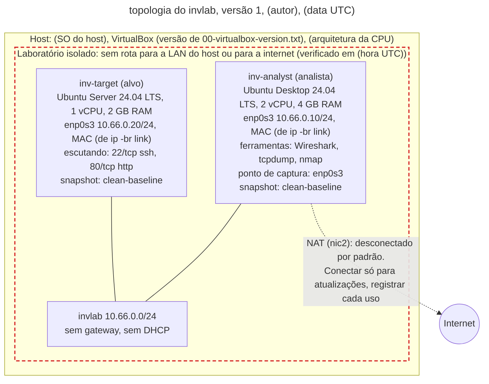
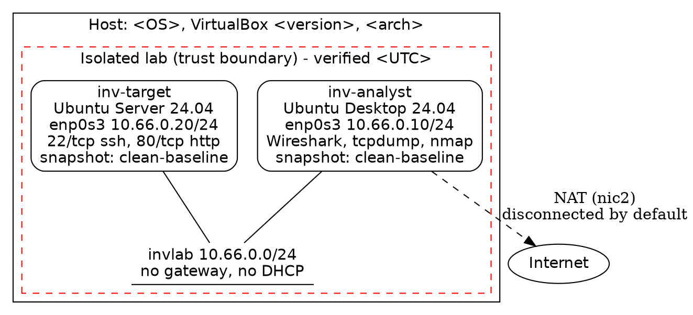

# Dia 18: Monte seu laboratório de investigação e mapeie a topologia

> 🇺🇸 Original: [*Day 18: Build your investigation lab and map its topology*](https://github.com/thiefdroppers/cyber-investigator-skills/blob/main/curriculum/phase-1-foundations/day-18.md) — © ThiefDroppers, licença MIT.
> Aqui: tradução fiel **+** camada brasileira. Nada do original foi removido; tudo o que é novo vem marcado com ➕.

**Fase 1. Fundamentos** · Meta da trilha: montar um laboratório isolado de duas máquinas que você está totalmente autorizado a atacar, capturar e examinar, provar que ele está isolado e produzir o mapa de topologia de rede que fecha a Fase 1.

Rank Jutsu: `D` · [](https://colab.research.google.com/github/Ridd1kulusC0d3r/investigador-cyber-90-dias/blob/main/curriculo/fase-1-fundamentos/dia-18/dia-18.ipynb)

---

## 🎬 ➕ Abertura do caso — *Um lugar seguro para abrir o IscaKit*

Sábado, 10/out. Fim da primeira semana do caso. A hospedagem de `serraazul-pix.example` foi suspensa na sexta, mas antes disso a polícia, por meio da cooperativa, conseguiu uma cópia do IscaKit, e a Marta pergunta se a Vigia pode "dar uma olhada no que tem dentro".

Rafa responde por você, antes que você diga sim.

— Pode. Não no seu notebook, não na rede da Vigia e não com acesso à internet. Kit de phishing chama de volta para casa: um painel, um bot de Telegram, um servidor que conta quem abriu. Se ele chamar daqui, o Pescador sabe que alguém está olhando, e de onde.

Ele desenha dois retângulos e uma linha entre eles no quadro.

— Duas máquinas, uma rede que não vai a lugar nenhum, e uma prova escrita de que não vai. Segunda-feira, você me mostra o mapa. Aí a gente fala de abrir alguma coisa.

É o Dia 18, o último da Fase 1. *(Personagens e cenário: [Operação Isca](../../../caso-continuo/).)*

---

## 📖 Conceito

Da Fase 2 em diante, você vai rodar *scanners*, abrir arquivos suspeitos, reproduzir capturas e gerar tráfego de ataque de propósito. Tudo isso precisa de um lugar onde você seja dono de cada máquina e de cada pacote, e onde um erro não consiga chegar à sua rede doméstica, ao seu empregador ou à internet. Um pequeno laboratório virtual dá isso a você, e todo exercício da Fase 1 que usou logs de amostra pode ser refeito ali em sistemas de verdade.

O isolamento é o objetivo do projeto, e ele tem de ser demonstrado, não presumido. O laboratório daqui usa o modo *Internal Network* do VirtualBox: máquinas virtuais ligadas à mesma rede interna nomeada conseguem se alcançar, mas não alcançam o host nem a internet, porque nada nessa rede roteia para lugar nenhum. Você só acrescenta acesso à internet temporariamente, por um adaptador NAT separado, para instalar atualizações, e registra cada vez que fizer isso.

O que alcança o quê, depois de o laboratório montado:



Um laboratório também é infraestrutura de evidência. *Snapshots* permitem voltar a um estado conhecido e limpo depois de um exercício, que é o equivalente, no laboratório, da cópia de trabalho do Dia 2. Uma captura de pacotes da rede do laboratório mostra exatamente o que cada exercício fez no fio. Anotações de montagem com horários UTC e *hashes* permitem que você, ou qualquer pessoa revisando o seu trabalho, reconstrua como o laboratório foi montado.

O mapa de topologia é o entregável que a maioria das pessoas pula e depois se arrepende de ter pulado. Daqui a seis semanas, quando uma captura mostrar `10.66.0.20` conversando com `10.66.0.10` na porta 4444, o mapa é como você vai saber qual máquina era qual, o que ela rodava e se aquele fluxo deveria ter sido possível. Ele precisa ser exato o bastante para que outra pessoa consiga reconstruir o laboratório a partir dele.

## 📚 Recursos

- [Downloads do VirtualBox](https://www.virtualbox.org/wiki/Downloads) e o [Manual do Usuário do VirtualBox](https://www.virtualbox.org/manual/), capítulo "Virtual Networking", para os modos de conexão (NAT, *Host-only*, *Internal Network*, *Bridged*).
- [Ubuntu Server](https://ubuntu.com/download/server) e [Ubuntu Desktop](https://ubuntu.com/download/desktop), ambos 24.04 LTS.
- [Documentação do Netplan](https://netplan.io/), para endereçamento estático no Ubuntu Server.
- [draw.io](https://app.diagrams.net/) (gratuito, roda no navegador ou como aplicativo *desktop* a partir do [GitHub](https://github.com/jgraph/drawio-desktop/releases)).
- [Graphviz](https://graphviz.org/), se você preferir um diagrama definido em texto e mantido sob controle de versão.
- [Recursos de montagem do laboratório](../../../upstream/curriculum/lab-setup-resources.md) (no original: [`lab-setup-resources.md`](https://github.com/thiefdroppers/cyber-investigator-skills/blob/main/curriculum/lab-setup-resources.md)): outros hipervisores gratuitos (VMware Workstation Pro, UTM, Proxmox VE) e alvos vulneráveis de prática para acrescentar ao `invlab` depois que esta montagem passar no checkpoint.

### ➕ Recursos do contexto Brasil

- [CERT.br — Honeypots e Honeynets](https://www.cert.br/docs/whitepapers/honeypots-honeynets/): material em português sobre ambientes controlados e o cuidado com o que sai deles. A lógica do "nada sai sem registro" é a mesma do `invlab`.
- [Código de Processo Penal, art. 158-B](https://www.planalto.gov.br/ccivil_03/decreto-lei/del3689compilado.htm): as etapas da cadeia de custódia incluem o processamento e o armazenamento do vestígio. Um laboratório documentado é onde essas etapas acontecem de forma reproduzível.
- [Lei 12.737/2012](https://www.planalto.gov.br/ccivil_03/_ato2011-2014/2012/lei/l12737.htm) e o art. 154-A do Código Penal: o motivo jurídico para o `nmap` só apontar para máquinas suas (ver a Camada jurídica).

## 🛠️ Prática: VirtualBox e draw.io, produzindo um laboratório isolado com um mapa de topologia de rede verificado

### O projeto

| Item | Valor |
|---|---|
| Hipervisor | VirtualBox 7.x no seu host |
| Rede do laboratório | *Internal Network* do VirtualBox chamada `invlab`, `10.66.0.0/24`, sem *gateway*, sem DHCP |
| `inv-analyst` | Ubuntu Desktop 24.04 LTS, 2 vCPU, 4 GB de RAM, `10.66.0.10/24`. Adaptador 1: `invlab`. Adaptador 2: NAT, cabo desconectado exceto durante atualizações |
| `inv-target` | Ubuntu Server 24.04 LTS, 1 vCPU, 2 GB de RAM, `10.66.0.20/24`. Adaptador 1: `invlab`. Roda OpenSSH (22) e nginx (80) |

Num Mac com Apple Silicon, use as versões ARM64 do Ubuntu com o VirtualBox 7.1 ou posterior, ou use o UTM com uma rede isolada equivalente. Registre qual você escolheu; isso vai para o mapa.

**Seu checklist de hoje.** Faça na ordem e marque cada item ao terminar:

- [ ] Passo 1: começar o registro de montagem
- [ ] Passo 2: criar e instalar as VMs
- [ ] Passo 3: mover as duas VMs para a rede isolada
- [ ] Passo 4: atribuir endereços estáticos
- [ ] Passo 5: provar a conectividade e o isolamento
- [ ] Passo 6: tirar *snapshots* limpos
- [ ] Passo 7: desenhar o mapa de topologia
- [ ] Passo 8: fechar o registro de montagem
- [ ] Passo 9: confirmar que a captura mostra só tráfego do laboratório
- [ ] ➕ Passo 10: as regras de quarentena para o IscaKit (Prática BR)
- [ ] ➕ Passo 11: o notebook do dia no Colab

### Passo 1: começar o registro de montagem

No seu host:

```bash
mkdir -p ~/invlab/build-log && cd ~/invlab
VBoxManage --version | tee build-log/00-virtualbox-version.txt
date -u +%Y-%m-%dT%H:%M:%SZ | tee build-log/00-build-start.txt
```

Baixe as duas ISOs do Ubuntu e confira cada uma contra o arquivo `SHA256SUMS` publicado no mesmo diretório de download em `releases.ubuntu.com`:

```bash
sha256sum ubuntu-24.04*-live-server-amd64.iso ubuntu-24.04*-desktop-amd64.iso | tee build-log/01-iso-hashes.txt
```

Compare a olho ou com `grep` contra o arquivo publicado. Uma ISO que não bate não é instalada.

### Passo 2: criar e instalar as VMs

No VirtualBox, escolha *Machine > New* para cada VM, usando os nomes, CPU e RAM da tabela do projeto. Durante a instalação do `inv-target`, deixe a rede no adaptador NAT padrão para que ele consiga baixar pacotes, e marque "Install OpenSSH server" quando o instalador oferecer. Depois do primeiro *boot*:

```bash
sudo apt update && sudo apt -y full-upgrade
sudo apt -y install nginx
```

No `inv-analyst`, depois da instalação:

```bash
sudo apt update && sudo apt -y full-upgrade
sudo apt -y install wireshark tshark nmap tcpdump dnsutils curl jq
```

### Passo 3: mover as duas VMs para a rede isolada

Desligue as duas VMs. Depois, no host (as mesmas configurações estão no painel *Settings > Network* de cada VM):

```bash
VBoxManage modifyvm "inv-target"  --nic1 intnet --intnet1 invlab
VBoxManage modifyvm "inv-analyst" --nic1 intnet --intnet1 invlab \
                                  --nic2 nat --cable-connected2 off
VBoxManage showvminfo "inv-target"  | grep -i "^NIC" | tee build-log/03-target-nics.txt
VBoxManage showvminfo "inv-analyst" | grep -i "^NIC" | tee build-log/03-analyst-nics.txt
```

Versões mais antigas do VirtualBox escrevem a última opção como `--cableconnected2`. O `inv-target` não tem mais nenhum adaptador NAT.

### Passo 4: atribuir endereços estáticos

Ligue o `inv-target`, descubra o nome da interface com `ip -br link` (normalmente `enp0s3` no VirtualBox) e crie `/etc/netplan/60-invlab.yaml`:

```yaml
network:
  version: 2
  ethernets:
    enp0s3:
      dhcp4: false
      addresses: [10.66.0.20/24]
```

Aplique, e remova ou desative qualquer arquivo netplan mais antigo que ainda configure DHCP na mesma interface:

```bash
sudo chmod 600 /etc/netplan/60-invlab.yaml
sudo netplan apply
ip -br addr
```

No `inv-analyst`, use o NetworkManager:

```bash
nmcli connection add type ethernet ifname enp0s3 con-name invlab \
  ipv4.method manual ipv4.addresses 10.66.0.10/24 ipv6.method disabled
nmcli connection up invlab
ip -br addr
```

### Passo 5: provar a conectividade e o isolamento

No `inv-analyst`, comece uma captura num terminal:

```bash
sudo tcpdump -i enp0s3 -w ~/day18-verify.pcap
```

Num segundo terminal, rode as checagens e salve a saída:

```bash
{
  date -u +%Y-%m-%dT%H:%M:%SZ
  ip -br addr
  ip route
  ping -c 3 10.66.0.20
  nmap -sn 10.66.0.0/24
  nmap -sT -p 22,80 10.66.0.20
  curl -sI http://10.66.0.20/ | head -3
  ping -c 2 -W 2 1.1.1.1 || echo "ISOLATION OK: no route to internet"
  dig +time=2 +tries=1 @1.1.1.1 example.com || echo "ISOLATION OK: no DNS to internet"
} 2>&1 | tee ~/day18-verify.txt
```

Trecho ilustrativo:

```
enp0s3           UP             10.66.0.10/24
10.66.0.0/24 dev enp0s3 proto kernel scope link src 10.66.0.10 metric 100
Nmap scan report for 10.66.0.20
Host is up (0.00041s latency).
22/tcp open  ssh
80/tcp open  http
HTTP/1.1 200 OK
ping: connect: Network is unreachable
ISOLATION OK: no route to internet
```

A tabela de rotas tem só a entrada `10.66.0.0/24` e nenhuma rota `default`. Essa linha, junto com o *ping* e a consulta DNS que falharam, é a sua prova de isolamento. Varrer `10.66.0.20` é lícito aqui porque você é dono das duas máquinas; o mesmo comando `nmap` apontado para a rede de qualquer outra pessoa sem permissão não é.

Pare a captura, depois copie os dois arquivos para o host (por uma pasta compartilhada, ou por `scp` enquanto você reconecta o NAT por um momento, registrado como mudança) e calcule o *hash* deles dentro de `build-log/`.

O alvo já guarda a primeira evidência dele. No `inv-target`:

```bash
sudo tail -3 /var/log/nginx/access.log
```

As suas requisições do `curl -sI` e do `nmap` estão lá, vindas de `10.66.0.10`, no formato do Dia 11.

### Passo 6: tirar *snapshots* limpos

```bash
VBoxManage snapshot "inv-target"  take "clean-baseline" --description "Updated, nginx+ssh, isolated on invlab, $(date -u +%FT%TZ)"
VBoxManage snapshot "inv-analyst" take "clean-baseline" --description "Tools installed, isolated on invlab, $(date -u +%FT%TZ)"
VBoxManage snapshot "inv-target" list | tee ~/invlab/build-log/06-target-snapshots.txt
```

Daqui em diante, restaure o `clean-baseline` depois de qualquer exercício que altere uma VM.

### Passo 7: desenhar o mapa de topologia

No draw.io, crie `invlab-topology.drawio`. Ative a biblioteca de formas *Networking* (*More Shapes*, no fim do painel esquerdo). O diagrama terminado precisa mostrar tudo o que segue; o checkpoint confere cada item:

1. O host físico como um contêiner externo, rotulado com o SO do host, o nome e a versão do hipervisor (de `00-virtualbox-version.txt`) e a arquitetura da CPU.
2. Cada VM como uma caixa dentro do host, rotulada com nome da VM, *hostname*, SO e versão, papel (analista ou alvo), vCPU e RAM.
3. As interfaces de rede de cada VM, com nome da interface, IP/CIDR e endereço MAC (de `ip -br link`).
4. A rede interna `invlab` como um segmento rotulado (uma linha ou barra), com o CIDR, "sem gateway, sem DHCP", e as duas VMs ligadas a ela.
5. O adaptador NAT do `inv-analyst`, desenhado com uma linha tracejada até uma nuvem "Internet", rotulado "desconectado por padrão; conectar só para atualizações, registrar cada uso".
6. Uma fronteira de confiança (retângulo vermelho tracejado) em volta do segmento `invlab` e das duas VMs, rotulada "Laboratório isolado: sem rota para a LAN do host ou para a internet (verificado em <hora UTC>)".
7. Os serviços escutando no `inv-target` (`22/tcp ssh`, `80/tcp http`) e as ferramentas no `inv-analyst` (Wireshark, tcpdump, nmap).
8. O ponto de captura (um pequeno marcador na `enp0s3` do `inv-analyst`) e o nome do *snapshot* em cada VM (`clean-baseline`).
9. Uma legenda explicando os estilos de linha e as cores, e um bloco de título com a versão do diagrama, o autor e a data UTC.

Exporte com *File > Export as > PNG* e marque "Include a copy of my diagram" para que o PNG possa ser reaberto para edição. Salve o arquivo `.drawio` ao lado dele.

Eis o que o mapa terminado contém, desenhado em Mermaid, com marcadores onde vão os seus próprios valores. Os marcadores entre parênteses vêm da saída dos seus comandos. A legenda continua obrigatória na sua versão, e o draw.io é onde você a acrescenta.



Se você prefere texto que dá para guardar no git, o mesmo mapa em Graphviz é um ponto de partida:



Renderize com `dot -Tpng invlab.dot -o invlab-topology.png`.

### Passo 8: fechar o registro de montagem

Crie `~/invlab/build-log/README.md` listando cada arquivo de `build-log/` com o SHA-256 dele, os horários de início e de fim da montagem, cada vez que o adaptador NAT foi conectado e por quê, e os nomes dos *snapshots*. Acrescente uma seção "Regras deste laboratório", de três ou quatro linhas com as suas palavras: o que pode rodar aqui, o que nunca pode ser apontado para fora daqui, e como você o restaura.

### Passo 9: confirmar que a captura mostra só tráfego do laboratório

Abra `day18-verify.pcap` no Wireshark e escolha *Statistics > Conversations*. Na aba IPv4, todo endereço deve ser `10.66.0.x`. Qualquer entrada na aba IPv6 deve ser um endereço de enlace local `fe80::`. Confirme que `1.1.1.1` não aparece em lugar nenhum da lista, o que significa que nenhum pacote da captura chegou a ele.

### ➕ Passo 10 (Prática BR): as regras de quarentena para o IscaKit

O `invlab` está pronto para os exercícios do currículo. Para o IscaKit, o Rafa quer mais três coisas por escrito, num arquivo `isca-dia18-quarentena.md` ao lado do `build-log/README.md`. Nada de abrir o kit hoje; hoje é a regra.

1. **Entrada de material.** Como um arquivo de caso entra no laboratório: por qual caminho (pasta compartilhada **somente leitura**, ou ISO), com o SHA-256 calculado **antes** de entrar e conferido **depois**, e com uma linha no registro de custódia (`scripts/registrar_evidencia.py`, do Dia 1). Escreva os três comandos.
2. **O que o kit vai tentar.** Kits de phishing costumam "chamar para casa": enviar as credenciais capturadas a um bot de mensageiro, a um e-mail, ou a um painel; e alguns verificam se estão sendo vistos (bloqueiam IPs de empresas de segurança, por exemplo). Liste três coisas que você espera ver na captura do `inv-analyst` se o kit for executado no `inv-target`, e por que **nenhuma** delas pode sair da rede `invlab` (Dia 1: a checagem 3, sistema alheio; e a exposição da própria investigação).
3. **A regra do NAT.** O adaptador NAT do `inv-analyst` **não** é conectado enquanto houver qualquer material do caso numa das VMs. Atualização só depois de restaurar o `clean-baseline`. Escreva isso como regra, e acrescente uma linha ao mapa de topologia: "Material de caso presente: NAT proibido".

E um item que fecha a Fase 1: atualize o seu quadro do Dia 1. Se você está seguindo o caso, cada dia deve ter também o artefato `isca-diaNN-...` no campo Artefato.

> O que você **não** faz: rodar o IscaKit "só para ver" no seu notebook pessoal, numa VM com NAT ligado, ou contra o `serraazul-pix.example` (que, de todo modo, já foi suspenso). O kit é evidência; tratá-lo como brinquedo contamina a evidência e expõe o caso.

### ➕ O notebook do dia

Abra o [notebook do Dia 18 no Colab](https://colab.research.google.com/github/Ridd1kulusC0d3r/investigador-cyber-90-dias/blob/main/curriculo/fase-1-fundamentos/dia-18/dia-18.ipynb). Nele você:

1. lê um `day18-verify.txt` (de exemplo, ou o seu) e confere automaticamente os itens do checkpoint: *ping* ao alvo, portas 22 e 80, ausência de rota padrão, falha para `1.1.1.1`;
2. confere uma lista de conversas IPv4/IPv6 (exportada do Wireshark ou de exemplo) contra a faixa `10.66.0.0/24` com o módulo `ipaddress` (o Dia 9 de volta);
3. gera o mapa em Graphviz e em Mermaid a partir de um formulário com os seus valores;
4. monta o `build-log/README.md` com os *hashes* e a seção de regras, incluindo as regras de quarentena do IscaKit;
5. joga o **quiz de fechamento da Fase 1** (10 perguntas, uma por dia de 9 a 18).

## ✅ Checkpoint

Seus artefatos são `invlab-topology.png` (com a fonte `.drawio` ou `.dot`), `~/day18-verify.txt`, `~/day18-verify.pcap` e `build-log/README.md`. Eles passam quando:

- Os nove elementos obrigatórios aparecem no mapa.
- Todo IP, MAC, nome de interface e versão do mapa bate com a saída de comando que você salvou.
- `~/day18-verify.txt` mostra um *ping* bem-sucedido para `10.66.0.20`.
- `~/day18-verify.txt` mostra as portas 22 e 80 abertas em `10.66.0.20`.
- `~/day18-verify.txt` mostra que não há rota padrão.
- `~/day18-verify.txt` mostra tentativas que falharam de alcançar `1.1.1.1`.
- A aba IPv4 de *Statistics > Conversations* para `~/day18-verify.pcap` (Passo 9) lista só endereços `10.66.0.x`, e qualquer entrada IPv6 é um endereço de enlace local `fe80::`.
- Nenhum pacote em `~/day18-verify.pcap` chegou a `1.1.1.1` (Passo 9).
- As duas VMs têm um *snapshot* `clean-baseline`.
- O registro de montagem registra cada período em que o adaptador NAT esteve conectado.
- O seu quadro do Dia 1 tem os dezoito cartões da Fase 1 em `Artefato construído`, cada um com o campo Artefato preenchido.

### ➕ Checkpoint BR

- `isca-dia18-quarentena.md` tem os três comandos de entrada de material (hash antes, hash depois, registro de custódia), as três expectativas de "chamar para casa" e a regra do NAT.
- O mapa de topologia tem a linha "Material de caso presente: NAT proibido".
- O notebook confirmou os quatro itens do `day18-verify.txt` e a ausência de endereços fora de `10.66.0.0/24`.
- Você acertou pelo menos 8 das 10 perguntas do quiz de fechamento da Fase 1.

## ⚖️ ➕ Camada jurídica BR

**O `nmap` lícito e o ilícito.** O original diz que varrer `10.66.0.20` é lícito porque você é dono das duas máquinas. No Brasil, o raciocínio é o mesmo do Dia 1: o art. 154-A do Código Penal trata da invasão de dispositivo informático **alheio**, sem autorização do titular. Uma varredura de portas, sozinha, não é invasão, mas é o primeiro passo de uma, e contra rede de terceiros sem autorização ela já viola o escopo de qualquer contrato e as regras de uso de qualquer provedor. No laboratório, a autorização é sua, e está escrita na seção "Regras deste laboratório".

**O kit é vestígio.** Pelo CPP (art. 158-A e seguintes), o IscaKit que chegou à Vigia por meio da cooperativa é um vestígio com uma cadeia de custódia que começou antes de você. A entrada dele no laboratório (hash antes, hash depois, registro) é uma etapa dessa cadeia (processamento). Se o kit "chamar para casa" a partir da sua rede, além de alertar o operador, você terá produzido tráfego novo a partir da evidência, o que a defesa poderá usar para questionar o que foi observado.

> Material de estudo, não constitui orientação jurídica.

## 🧠 ➕ Camada 8 — "é só uma olhadinha", de novo

A tentação do dia é a mesma do Dia 1, com outra roupa. A curiosidade técnica ("o que será que tem dentro?") e a pressão do cliente ("dá uma olhada") empurram para o atalho: abrir o kit agora, no ambiente que estiver à mão. Bandura chamaria isso de **rotulação eufemística** ("só uma olhadinha"), e a psicologia do risco acrescenta a **ilusão de controle**: a sensação de que, por sermos competentes, nada vai escapar do nosso controle.

O laboratório isolado é a forma física da regra escrita antes da tentação. A sequência que o Rafa impõe (montar, provar o isolamento, escrever as regras, **depois** abrir) existe para que a decisão de segurança seja tomada num sábado calmo, e não numa segunda-feira com o kit na mão e a cliente no telefone. Fechando a Fase 1: o que você leva para os 72 dias seguintes não é uma lista de comandos, é este hábito de **decidir antes, registrar durante e conseguir provar depois**.

## 🤖 ➕ Skill do dia

O Dia 18 propõe para a [skill pt-BR](../../../skills/investigador-cyber/SKILL.md) um acréscimo ao procedimento **"Portão de autorização (4 checagens)"**: material suspeito do caso (kits, anexos, executáveis) só é aberto em ambiente isolado com isolamento demonstrado, com hash antes e depois, e nunca com saída para a internet. Texto e caso de teste em [`_skill-delta.md`](_skill-delta.md).

## 💡 ➕ Inovação OSINT do dia — o isolamento verificado por código

O Passo 9 pede para olhar as conversas no Wireshark. O mesmo teste, automatizado, cabe em poucas linhas com o módulo `ipaddress` da biblioteca padrão, a partir do CSV que o Wireshark exporta em *Statistics > Conversations* (ou da saída de `tshark -q -z conv,ip -r day18-verify.pcap`):

```python
import ipaddress                                              # só stdlib (o Dia 9 de volta)
LAB = ipaddress.ip_network("10.66.0.0/24")
def fora_do_lab(endereco):
    ip = ipaddress.ip_address(endereco)
    if ip.version == 6:
        return not ip.is_link_local                           # IPv6 só pode ser fe80::
    return ip not in LAB                                      # IPv4 só pode ser 10.66.0.x
for par in [("10.66.0.10", "10.66.0.20"), ("10.66.0.10", "1.1.1.1"), ("fe80::a00:27ff:fe4e:66a1", "ff02::2")]:
    problema = [e for e in par if fora_do_lab(e) and not ipaddress.ip_address(e).is_multicast]
    print(par, "❌ " + ", ".join(problema) if problema else "✅")
```

Guarde esse teste junto com o laboratório e rode-o depois de **todo** exercício que gerar uma captura: o isolamento que você provou hoje pode deixar de valer no dia em que alguém conectar o cabo do NAT e esquecer.

## 📝 Diário de estudo

- Data:
- Tempo gasto:
- O que ficou claro:
- O que ainda está nebuloso:
- Artefato produzido: `invlab-topology.png` (+ `.drawio`/`.dot`), `day18-verify.txt`, `day18-verify.pcap`, `build-log/README.md`, `isca-dia18-quarentena.md`

---
<sub>Baseado em [cyber-investigator-skills](https://github.com/thiefdroppers/cyber-investigator-skills) por ThiefDroppers (MIT). Tradução, camada BR, Camada 8, skill pt-BR e notebook por Deivison Lourenço (@Ridd1kulusC0d3r).</sub>
