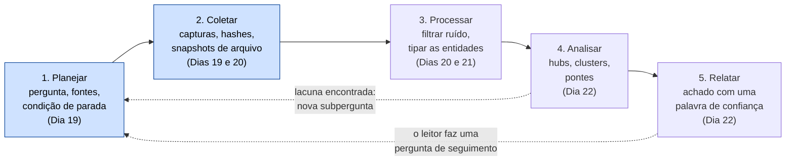
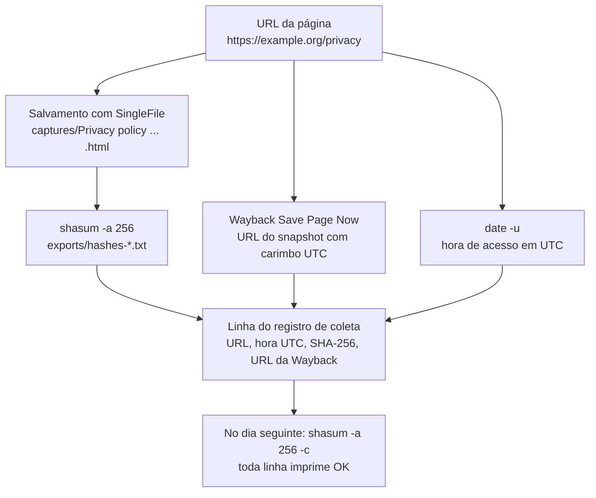

# Dia 19: O ciclo OSINT, parte 1: planejamento e coleta com qualidade de evidência

> 🇺🇸 Original: [*Day 19: The OSINT cycle, part 1: planning and evidence-grade collection*](https://github.com/thiefdroppers/cyber-investigator-skills/blob/main/curriculum/phase-2-osint-digital-footprint/day-19.md) — © ThiefDroppers, licença MIT.
> Aqui: tradução fiel **+** camada brasileira. Nada do original foi removido; tudo o que é novo vem marcado com ➕.

**Fase 2. OSINT e pegada digital** · Meta da trilha: começar toda investigação em fontes abertas com uma pergunta escrita e um plano de coleta, e capturar as fontes de um jeito que prove depois o que você viu e quando.

Rank Jutsu: `C` · [](https://colab.research.google.com/github/Ridd1kulusC0d3r/investigador-cyber-90-dias/blob/main/curriculo/fase-2-osint-pegada-digital/dia-19/dia-19.ipynb)

---

## 🎬 ➕ Abertura do caso — *Quarenta abas e nenhuma prova*

A Fase 1 terminou com o laboratório montado e o site falso lido por dentro: DNS, HTTP, certificado, logs. Agora a Marta quer outra coisa.

— Quero saber tudo o que esse golpe tem pendurado na internet — diz ela na chamada. — Domínios, perfis, o que for.

Você passa a tarde abrindo abas. Às 17h tem quarenta, um print do Instagram sem data e um domínio que você jura ter visto "em algum lugar". Rafa olha a tela por cima do seu ombro.

— Esse print aqui. Que horas você tirou? De qual URL? Se o perfil sumir amanhã, como você prova que ele existiu?

Silêncio.

— "Tudo" não é pergunta. Fecha as abas. Escreve a pergunta, a lista de fontes e quando você vai parar. Depois a gente coleta, com hash.

É o Dia 19: o primeiro passo do ciclo que vai ocupar os próximos quatro dias. *(Personagens e cenário: [Operação Isca](../../../caso-continuo/).)*

---

## 📖 Conceito

O ciclo OSINT tem cinco etapas: planejar, coletar, processar, analisar e relatar. Iniciantes pulam a primeira e atropelam a segunda. Abrem um buscador, seguem o que parece interessante e, duas horas depois, têm quarenta abas abertas e nenhuma forma de dizer de onde veio cada fato. O plano evita isso. Ele transforma uma tarefa vaga ("dá uma olhada nessa organização") em perguntas que você consegue responder, uma lista das fontes que provavelmente respondem a cada uma e uma condição de parada.

Os Dias 19 a 22 percorrem o ciclo inteiro uma vez, sobre um único alvo. As setas pontilhadas são a parte que iniciantes não enxergam: a análise costuma expor uma lacuna, e a lacuna vira uma nova subpergunta no plano.



Uma pergunta de inteligência utilizável é estreita o bastante para você saber quando ela foi respondida. "Qual é a presença on-line desta organização?" é ampla demais. "Quais domínios esta organização opera, e quando cada um foi registrado pela primeira vez?" pode ser respondida, conferida e entregue a outra pessoa.

A coleta tem a sua própria disciplina. Páginas da web mudam e desaparecem, e uma captura de tela prova pouco sobre quando foi tirada ou se foi editada. A captura com qualidade de evidência registra quatro coisas para cada item: a URL exata, a hora UTC em que você a acessou, uma cópia do conteúdo num formato que preserve a página, e um hash criptográfico dessa cópia calculado no momento da captura. O hash permite que você, ou qualquer pessoa que revise seu trabalho, mostre que o arquivo não mudou desde que você o salvou. Um snapshot de arquivo feito por terceiro (a Wayback Machine) acrescenta uma testemunha independente que você não controlava.

É daqui que vem cada um dos quatro itens, mais o snapshot de arquivo, e é assim que eles se encontram numa linha do registro de coleta:



Quando um achado é contestado, "eu vi no site deles" perde para "aqui está a captura, o SHA-256 dela e o snapshot do Internet Archive feito no mesmo minuto".

## 📚 Recursos

- A extensão de navegador [SingleFile](https://github.com/gildas-lormeau/SingleFile) salva uma página completa (HTML, CSS e imagens embutidos) como um único arquivo `.html`. Gratuita, para Firefox e Chromium.
- O [Save Page Now da Wayback Machine](https://web.archive.org/save) cria uma cópia pública, com carimbo de tempo, feita por terceiro.
- O [Online Investigation Toolkit da Bellingcat](https://bellingcat.gitbook.io/toolkit) é um catálogo mantido de ferramentas, com notas sobre custo e confiabilidade. Use-o para preencher sua matriz de fontes.
- O [modelo de registro de reconhecimento OSINT](https://github.com/thiefdroppers/cyber-investigator-skills/blob/main/worksheets/osint-recon-log.md) é o registro que você vai usar de hoje até o fim da Fase 2.

### ➕ Recursos do contexto Brasil

- ➕ [Ficha de registro de reconhecimento OSINT em pt-BR](../../../fichas/registro-recon-osint.md): o mesmo modelo do original, traduzido, com os campos de registro de autorização, base legal LGPD e SHA-256 já na tabela. Use esta no lugar da versão em inglês.
- [Código de Processo Penal, arts. 158-A a 158-F](https://www.planalto.gov.br/ccivil_03/decreto-lei/del3689compilado.htm): a cadeia de custódia na lei brasileira (incluída pela Lei 13.964/2019). Leia o 158-B: as etapas que ele enumera são, na prática, o que a sua coleta de hoje faz.
- [RDAP do Registro.br](https://rdap.registro.br/): fonte primária para domínios `.br` (o equivalente brasileiro da linha "RDAP / WHOIS" da matriz de fontes).
- [OSINT Brazuca](https://github.com/osintbrazuca/osint-brazuca): catálogo de fontes brasileiras para completar a coluna "Fontes prováveis" quando o alvo é do Brasil.
- [Portal da Transparência](https://portaldatransparencia.gov.br/) e o [Diário Oficial da União](https://www.in.gov.br/): para quem escolher um órgão público brasileiro como alvo dos Dias 19 a 22, são fontes oficiais que ninguém no seu alvo controla.

## 🛠️ Prática: SingleFile, Save Page Now e `shasum`: um registro de coleta com hashes

Seu alvo nos Dias 19 a 22 é uma organização pública: uma prefeitura, uma universidade pública, uma entidade beneficente de alcance nacional ou um órgão de normalização. Escolha uma cujo site você consiga navegar normalmente. Não escolha uma pessoa privada nem uma pequena empresa tocada por uma pessoa só. Anote o domínio principal da organização; este guia o escreve como `example.org`.

> ➕ Sugestões brasileiras que cabem nessa regra: uma prefeitura de capital, uma universidade federal, a ABNT ou um conselho profissional. Todas publicam muito e têm vários domínios e subdomínios.

**Seu checklist de hoje.** Faça na ordem e marque cada item ao terminar:

- [ ] Passo 1: escrever o plano e a lista do que está fora do escopo.
- [ ] Passo 2: montar a matriz de fontes.
- [ ] Passo 3: preparar a pasta do caso.
- [ ] Passo 4: capturar dez páginas com SingleFile e Wayback Save Page Now.
- [ ] Passo 5: calcular o hash das capturas.
- [ ] Passo 6: preencher o registro de coleta.
- [ ] ➕ Passo 7: o mesmo plano na Operação Isca (Prática BR).
- [ ] ➕ Passo 8: o notebook do dia no Colab.

Passo 1: escreva o plano. Copie `worksheets/osint-recon-log.md` para as suas notas como `P2-recon-log.md` e preencha a seção de Planejamento. Use esta pergunta, ou outra de escopo parecido:

> Quais domínios e propriedades web públicas a organização opera, quando cada um apareceu e quais deles compartilham infraestrutura?

> ➕ Neste repositório, a cópia em pt-BR é [`fichas/registro-recon-osint.md`](../../../fichas/registro-recon-osint.md).

Em "Explicitamente fora do escopo", escreva pelo menos três itens. Bons itens para este laboratório: membros da equipe identificados pelo nome e suas contas pessoais; qualquer página atrás de login; qualquer varredura ativa (varredura de portas, força bruta de diretórios) contra os sistemas da organização.

Passo 2: monte uma matriz de fontes. Acrescente uma tabela abaixo da seção de Planejamento, com uma linha por subpergunta:

| Subpergunta | Fontes prováveis | Resultado esperado | Passiva? |
|---|---|---|---|
| Quais domínios ela opera? | Rodapé do site e páginas "legais", *certificate transparency* (crt.sh), SpiderFoot | Lista de domínios e subdomínios | Sim |
| Quando cada um foi registrado? | RDAP / WHOIS, WHOIS histórico | Datas de criação | Sim |
| Quais compartilham infraestrutura? | Registros DNS A/MX/NS, Maltego | Sobreposição de IP e de servidor de nomes | Sim |
| Quando o site principal mudou? | CDX da Wayback Machine | Linha do tempo de versões | Sim |

Passiva significa que você consulta terceiros (buscadores, arquivos, registros, resolvedores DNS públicos) e lê as páginas públicas da organização como qualquer visitante leria. Toda linha deste laboratório precisa dizer sim.

Passo 3: prepare a pasta do caso.

```bash
mkdir -p ~/cases/P2-ORG/{captures,exports,notes}
cd ~/cases/P2-ORG
```

Passo 4: capture dez páginas. Candidatas: a página inicial, a página "Sobre", a página de contato, a política de privacidade (que muitas vezes cita outros domínios e operadores de dados), as propriedades linkadas no rodapé do site e qualquer página que liste sites parceiros ou subsidiários. Para cada página:

1. Salve com o SingleFile (ícone na barra de ferramentas, ou botão direito > SingleFile > *Save page with SingleFile*). Mova o arquivo para `captures/`. Nas opções do SingleFile você pode editar o modelo de nome de arquivo para que todo arquivo leve data e hora; faça isso uma vez agora.
2. Envie a mesma URL para `https://web.archive.org/save/` e copie a URL de snapshot que ele devolve. URLs de snapshot embutem um carimbo de tempo UTC no formato `YYYYMMDDhhmmss`, por exemplo `https://web.archive.org/web/20260930141502/https://example.org/about`.
3. Anote a hora UTC. `date -u +%Y-%m-%dT%H:%M:%SZ` a imprime.

Passo 5: calcule o hash das capturas.

```bash
# macOS
shasum -a 256 captures/* | tee exports/hashes-$(date -u +%Y%m%dT%H%M%SZ).txt
# Linux
sha256sum captures/* | tee exports/hashes-$(date -u +%Y%m%dT%H%M%SZ).txt
# Windows PowerShell
Get-FileHash -Algorithm SHA256 .\captures\* | Format-List
```

Saída ilustrativa (valores de hash encurtados e inventados para este exemplo):

```
3f9a1c...e21b  captures/About us - example.org (2026-09-30 14_15_02).html
b07d44...9c0a  captures/Privacy policy - example.org (2026-09-30 14_18_40).html
```

Passo 6: preencha o registro de coleta. Uma linha por captura. A coluna Observações deve conter o SHA-256 e a URL do snapshot na Wayback. Uma linha pronta fica assim (ilustrativa):

| # | Dado | Fonte | Data/hora de acesso | Observações |
|---|---|---|---|---|
| 3 | A política de privacidade cita mais dois domínios (`example-events.org`, `examplefoundation.org`) como "nossos sites" | https://example.org/privacy | 2026-09-30T14:18:40Z | SHA-256 `b07d44...9c0a`; Wayback `.../web/20260930141901/https://example.org/privacy` |

Se um envio à Wayback falhou (às vezes acontece com páginas pesadas), escreva isso na linha; não deixe em branco.

O artefato é o `P2-recon-log.md` com a seção de Planejamento completa, a matriz de fontes e dez linhas de coleta, mais a pasta `captures/` e o arquivo de hashes.

### ➕ Prática BR: o plano da Operação Isca

O original trabalha numa organização pública que você escolhe. A Vigia trabalha na infraestrutura do golpe. Faça os dois: o `P2-ORG` continua sendo o laboratório do original; o `ISCA-P2` é o caso.

**Exercício 1: o plano (sem nenhuma consulta ainda).** Copie a [ficha pt-BR](../../../fichas/registro-recon-osint.md) para `~/cases/ISCA-P2/notes/ISCA-recon-log.md` e preencha o Planejamento:

- **Pergunta:** *Quais domínios, hosts e perfis públicos estão ligados à campanha do "Pix bloqueado" que se passa pela Serra Azul, quando cada um apareceu e quais compartilham infraestrutura?*
- **Registro de autorização:** o `notas/registro-de-autorizacao.md` do Dia 01, com o SHA-256 dele.
- **Base legal LGPD:** art. 7º, IX (legítimo interesse da cooperativa na prevenção à fraude), a mesma do Dia 01.
- **Fora do escopo (pelo menos três):** o painel do IscaKit e qualquer página atrás de login; os dados de cooperados que o kit capturou; qualquer pessoa física, inclusive quem esteja por trás do apelido "Pescador"; varredura ativa de `203.0.113.77`; contato com os perfis falsos (seguir, curtir, mandar mensagem).
- **Condição de parada:** o plano termina quando cada subpergunta da matriz tem pelo menos uma fonte coletada **ou** uma linha dizendo "fonte tentada, sem resultado"; e para imediatamente se aparecer credencial ou dado de cooperado exposto (escala para a Marta, como no Dia 01).

Matriz de fontes do caso (complete a coluna "Passiva?" você mesmo e justifique as duas linhas que pedem cuidado):

| Subpergunta | Fontes prováveis | Resultado esperado | Passiva? |
|---|---|---|---|
| Quais domínios imitação existem além de `serraazul-pix.example`? | crt.sh, SpiderFoot (Dia 20), operadores de busca (Dia 23) | Lista de domínios e subdomínios | |
| Quando cada um foi registrado e quando ganhou certificado? | RDAP (Dia 29), crt.sh | Datas de criação e de emissão | |
| Quais compartilham infraestrutura com `203.0.113.77`? | DNS A/MX/NS, Maltego (Dia 21) | Sobreposição de IP, NS, AS | |
| A página falsa mudou desde o disparo? | Wayback CDX (Dia 26), captura própria | Versões e janelas de mudança | |
| Quais perfis públicos usam o nome da cooperativa? | Busca nas plataformas (Dia 25), rodapé do `serraazul.example` | Lista de perfis oficiais × não linkados | |

**Exercício 2: dez capturas com recibo.** Num navegador de análise isolado (o do laboratório do Dia 18), capture dez páginas: as cinco páginas públicas de `serraazul.example` que a Marta indicou (início, "Segurança", "Canais oficiais", privacidade, contato) e as cinco páginas públicas do site falso que um cooperado veria ao clicar no SMS (página inicial, formulário, página de "chave desbloqueada" e as duas páginas de erro). Nada atrás de login, nada do painel. Para cada uma: SingleFile, Save Page Now, `date -u`, `sha256sum`, linha no registro.

> Pergunta do Rafa para responder nas suas notas: *por que capturar o site **verdadeiro** da cooperativa também?* (Dica: a página "Canais oficiais" de hoje é a régua para decidir, no Dia 25, que um perfil não linkado não é "deles". E páginas legítimas também mudam; o Dia 26 vai mostrar isso.)

Os dados sintéticos do exercício (um registro de coleta de exemplo e um arquivo de hashes com uma linha adulterada de propósito) estão em [`caso-continuo/dados/dia-19/`](../../../caso-continuo/dados/dia-19/).

### ➕ O notebook do dia

Abra o [notebook do Dia 19 no Colab](https://colab.research.google.com/github/Ridd1kulusC0d3r/investigador-cyber-90-dias/blob/main/curriculo/fase-2-osint-pegada-digital/dia-19/dia-19.ipynb). Nele você:

1. joga o **quiz "pergunta boa ou pergunta ruim"**: oito perguntas de inteligência para classificar como respondíveis ou amplas demais;
2. monta o plano e a matriz de fontes do caso por formulário e sai com o `.md` pronto;
3. faz uma **captura com recibo** só com `urllib` e `hashlib` (URL, hora UTC, cópia, SHA-256, cabeçalho `Date` do servidor) e consulta a disponibilidade na Wayback, com plano B offline;
4. reimplementa o `sha256sum -c` em Python e descobre qual captura do arquivo de exemplo foi adulterada.

## ✅ Checkpoint

- Amanhã, antes de começar o Dia 20, a verificação contra o arquivo de hashes de ontem imprime `OK` em todas as linhas:

  ```bash
  shasum -a 256 -c exports/hashes-*.txt     # Linux: sha256sum -c
  ```

- Toda subpergunta da matriz de fontes aponta para pelo menos uma fonte.
- Toda linha de coleta tem um carimbo de hora UTC.
- Toda linha de coleta tem um hash SHA-256.
- Toda linha de coleta tem uma URL de snapshot da Wayback, ou uma nota dizendo que o envio falhou; nenhuma célula de arquivo fica em branco.
- A lista do que está fora do escopo tem pelo menos três itens concretos.
- Sem consultar notas, você explica o que "passivo" significa neste laboratório: quais tipos de fonte você pode consultar e como pode ler as páginas da própria organização.

### ➕ Checkpoint BR

- O `ISCA-recon-log.md` tem pergunta, registro de autorização com SHA-256, base legal LGPD, pelo menos três itens fora do escopo e uma condição de parada.
- As dez capturas do caso estão na pasta e o `sha256sum -c` passa em todas.
- Você explica com suas palavras por que o painel do IscaKit está fora do escopo mesmo sendo "infraestrutura do golpe".
- No notebook, você achou a linha adulterada do arquivo de hashes e acertou pelo menos 6 das 8 perguntas do quiz.

## ⚖️ ➕ Camada jurídica BR

**Cadeia de custódia (CPP, arts. 158-A a 158-F, incluídos pela Lei 13.964/2019).** O art. 158-A define cadeia de custódia como o conjunto de procedimentos que documentam a história cronológica do vestígio, do reconhecimento ao descarte. O art. 158-B lista as etapas (reconhecimento, isolamento, fixação, coleta, acondicionamento, transporte, recebimento, processamento, armazenamento e descarte). A lei foi escrita pensando no vestígio físico e na perícia oficial, mas a lógica serve inteira para a sua captura: a URL e a hora UTC são a **fixação**, o SingleFile é a **coleta**, o hash é o **acondicionamento** lacrado, o `sha256sum -c` do dia seguinte prova que nada mudou no **armazenamento**.

**Ata notarial (CPC, art. 384).** Quando uma página precisa valer em juízo e há risco de ela sumir, o caminho clássico no Brasil é pedir a um tabelião que ateste o que viu na tela. A sua captura com hash e snapshot de terceiro não substitui a ata notarial, mas mostra ao jurídico (o Dr. Hélio, no caso) quais páginas merecem uma.

**LGPD, art. 6º (finalidade e necessidade).** O plano escrito com uma pergunta e uma lista de fora do escopo é também a sua prova de minimização: você coletou o que a pergunta pedia, não "tudo". Quarenta abas sem pergunta são o oposto disso.

> Material de estudo, não constitui orientação jurídica.

## 🧠 ➕ Camada 8 — o plano como trava contra o túnel

A cena das quarenta abas tem nome: **visão de túnel** alimentada pelo **viés de confirmação**, a tendência de procurar, notar e lembrar o que confirma a hipótese que já temos. Sem pergunta escrita, cada aba nova é escolhida porque "parece interessante", e o que parece interessante é o que combina com a primeira impressão ("isso tem cara de quadrilha grande"). Duas horas depois você tem uma história coerente e nenhuma linha de registro.

O plano funciona como um **pré-compromisso**: você decide o que vai procurar, onde e quando parar **antes** de ver os dados, quando ainda não tem uma história para proteger. A condição de parada é a parte mais difícil de escrever e a mais útil, porque o investigador cansado e empolgado das 17h é exatamente quem não vai querer parar.

Consequência prática: antes de abrir o navegador, escreva a pergunta e a condição de parada. Se uma aba nova não responde a nenhuma linha da matriz, ou ela vira uma nova subpergunta (registrada), ou ela fecha.

## 🤖 ➕ Skill do dia

O Dia 19 propõe acrescentar ao procedimento **"ciclo de reconhecimento OSINT"** a matriz de fontes com condição de parada e os quatro itens da captura com qualidade de evidência (URL, hora UTC, cópia, SHA-256) mais o snapshot de terceiro. Proposta em [`_skill-delta.md`](_skill-delta.md).

## 💡 ➕ Inovação OSINT do dia — captura com recibo, só com a biblioteca padrão

O SingleFile é o certo para guardar a página como o navegador a vê. Mas quando você só precisa do recibo de que uma URL respondia aquilo naquela hora (um robots.txt, uma política de privacidade em texto, um JSON público), o Python faz sozinho e ainda guarda uma testemunha que você não controla: o cabeçalho `Date` que o próprio servidor mandou. A [API de disponibilidade da Wayback](https://archive.org/help/wayback_api.php) diz, no mesmo passo, qual o snapshot mais próximo.

```python
import hashlib, json, urllib.request, urllib.parse
from datetime import datetime, timezone

url = "https://example.org/"                                   # página pública, alvo autorizado
quando = datetime.now(timezone.utc).strftime("%Y-%m-%dT%H:%M:%SZ")  # sua hora UTC
with urllib.request.urlopen(url, timeout=10) as r:
    corpo, data_servidor = r.read(), r.headers.get("Date")     # cópia + hora do servidor
print(quando, data_servidor, hashlib.sha256(corpo).hexdigest())

api = "https://archive.org/wayback/available?url=" + urllib.parse.quote(url)
with urllib.request.urlopen(api, timeout=10) as r:              # snapshot mais próximo
    print(json.load(r).get("archived_snapshots", {}))
```

Duas horas (a sua e a do servidor) que concordam valem mais do que uma. Se discordarem por minutos, anote: o relógio da sua máquina também é evidência e também pode estar errado.

## 📝 Diário de estudo

- Data:
- Tempo gasto:
- O que ficou claro:
- O que ainda está nebuloso:
- Artefato produzido: `P2-recon-log.md` (Planejamento, matriz de fontes, 10 linhas de coleta), `captures/`, `exports/hashes-*.txt`; ➕ `ISCA-recon-log.md`

---
<sub>Baseado em [cyber-investigator-skills](https://github.com/thiefdroppers/cyber-investigator-skills) por ThiefDroppers (MIT). Tradução, camada BR, Camada 8, skill pt-BR e notebook por Deivison Lourenço (@Ridd1kulusC0d3r).</sub>
