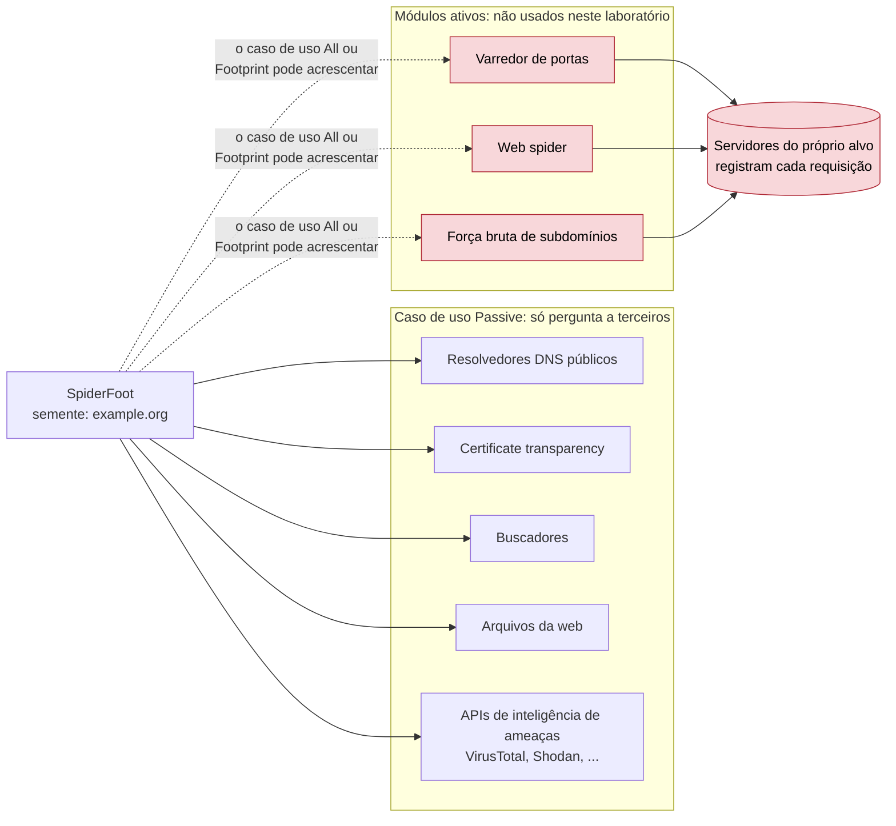
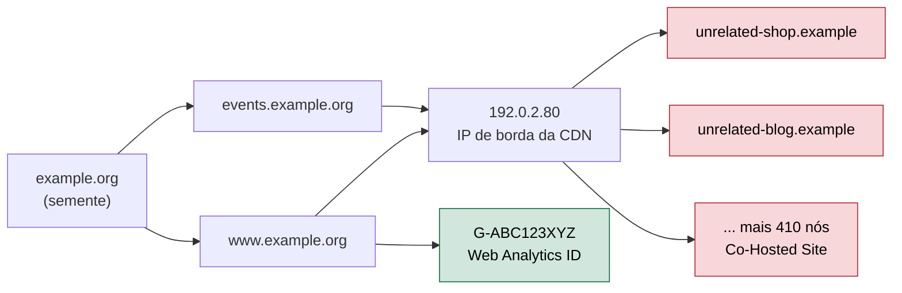

# Dia 20: O ciclo OSINT, parte 2: coleta passiva automatizada com SpiderFoot

> 🇺🇸 Original: [*Day 20: The OSINT cycle, part 2: automated passive collection with SpiderFoot*](https://github.com/thiefdroppers/cyber-investigator-skills/blob/main/curriculum/phase-2-osint-digital-footprint/day-20.md) — © ThiefDroppers, licença MIT.
> Aqui: tradução fiel **+** camada brasileira. Nada do original foi removido; tudo o que é novo vem marcado com ➕.

**Fase 2. OSINT e pegada digital** · Meta da trilha: rodar uma coleta automatizada, só passiva, sobre o alvo do Dia 19, exportá-la como grafo e aprender a separar relações reais de ruído antes de confiar em qualquer parte dela.

Rank Jutsu: `C` · [](https://colab.research.google.com/github/Ridd1kulusC0d3r/investigador-cyber-90-dias/blob/main/curriculo/fase-2-osint-pegada-digital/dia-20/dia-20.ipynb)

---

## 🎬 ➕ Abertura do caso — *Quatrocentos e doze vizinhos*

O SpiderFoot terminou às 10h40 de terça. A aba Summary mostra 485 dados sobre `serraazul-pix.example`. Você manda um print no chat da equipe: "olha o tamanho disso".

Rafa responde com outro print, do mesmo resumo, com um número circulado: **Co-Hosted Site: 412**.

— Quatrocentos e doze sites "ligados" ao golpe. Você vai dizer para a Marta que o Pescador tem 412 sites?

— Não...?

— Então me diz quantos você joga fora, por quê, e me prova que nenhum módulo bateu na porta do `203.0.113.77`. O Dr. Hélio vai querer saber.

Antes de fechar o chat, ele manda mais uma linha: "E não joga fora o Similar Domain. Hoje ele não é ruído."

O Dia 20 ensina a usar a automação sem deixar ela pensar por você. *(Personagens e cenário: [Operação Isca](../../../caso-continuo/).)*

---

## 📖 Conceito

A coleta manual não escala além de algumas dezenas de dados. Ferramentas de automação como o SpiderFoot rodam muitas consultas pequenas (DNS, *certificate transparency*, buscadores, arquivos, *feeds* de inteligência de ameaças) e as encadeiam: cada resultado vira a entrada da rodada seguinte. Um domínio semente pode gerar várias centenas de dados em vinte minutos.

Essa velocidade tem dois custos. O primeiro é o contato com o alvo. Alguns módulos do SpiderFoot falam diretamente com os servidores do alvo: varredores de portas, *web spiders*, força bruta de subdomínios. Isso é reconhecimento ativo e, contra um sistema que você não está autorizado a testar, pode violar a lei de uso indevido de computadores, e com certeza aparece nos logs do alvo. O perfil de varredura que você escolhe decide isso, então você o escolhe de propósito.



O segundo custo é o ruído. O encadeamento automático segue toda aresta, inclusive as que não significam nada. Se o site da organização fica atrás de uma CDN grande, "sites co-hospedados" devolve milhares de domínios sem relação que só compartilham um IP de borda. O analista que importa isso sem filtrar vai relatar um hub que, na verdade, é só a Cloudflare ou a Akamai.

Veja como isso acontece, em miniatura. Dois *hostnames* reais resolvem para um IP de borda de CDN, e o módulo "co-hosted" pendura nele todos os outros clientes daquele IP. Os nós vermelhos são o que você vai apagar no Passo 7. O nó verde é pequeno e específico, que é como costuma ser uma pista real.



Este dia fica entre "coletar" e "processar" no ciclo. O SpiderFoot coleta; a exportação e a passada de falsos positivos são processamento. O grafo que você monta hoje alimenta a análise do Dia 22.

## 📚 Recursos

- [SpiderFoot no GitHub](https://github.com/smicallef/spiderfoot) é a versão de código aberto (licença MIT). O SpiderFoot HX comercial é outro produto; você não precisa dele.
- [SpiderFoot no Kali](https://www.kali.org/tools/spiderfoot/) vem como pacote, a instalação mais fácil se você já usa Kali.
- [Gephi](https://gephi.org/) é um software livre e de código aberto para grafos que abre a exportação GEXF do SpiderFoot.
- O [guia rápido do Gephi (PDF)](https://gephi.org/users/quick-start/) cobre os painéis de layout, estatísticas e aparência que você vai usar.

### ➕ Recursos do contexto Brasil

- [Lista de módulos do SpiderFoot](https://github.com/smicallef/spiderfoot/tree/master/modules): cada `sfp_*.py` declara no próprio código se é passivo; ler o cabeçalho do módulo antes de ativá-lo é o equivalente técnico do "escopo escrito" do Dia 01.
- [Formato GEXF](https://gexf.net/): a especificação do XML que o Gephi lê. O notebook de hoje gera um GEXF à mão, só com a biblioteca padrão, para você entender o que o SpiderFoot exporta.
- [CERT.br — notificações de incidentes](https://www.cert.br/): quando o ruído vira pista (um domínio imitação real), é para o CERT.br e para o provedor que a notificação vai; guarde o link para o Dia 29.

## 🛠️ Prática: varredura passiva do SpiderFoot exportada para o Gephi: um grafo de infraestrutura colorido

**Seu checklist de hoje.** Faça na ordem e marque cada item ao terminar:

- [ ] Passo 1: instalar e iniciar o SpiderFoot.
- [ ] Passo 2: acrescentar chaves de API gratuitas (opcional).
- [ ] Passo 3: configurar e rodar uma varredura passiva.
- [ ] Passo 4: ler a aba Summary.
- [ ] Passo 5: revisar a aba Graph.
- [ ] Passo 6: exportar a varredura como GEXF e CSV.
- [ ] Passo 7: montar o grafo filtrado no Gephi.
- [ ] Passo 8: escrever a tabela de falsos positivos.
- [ ] Passo 9: confirmar que a varredura ficou passiva.
- [ ] ➕ Passo 10: o mesmo processamento no caso brasileiro (Prática BR).
- [ ] ➕ Passo 11: o notebook do dia no Colab.

Passo 1: instale e inicie o SpiderFoot.

```bash
git clone https://github.com/smicallef/spiderfoot.git
cd spiderfoot
python3 -m venv .venv && source .venv/bin/activate
pip install -r requirements.txt
python3 ./sf.py -l 127.0.0.1:5001
```

No Kali, `sudo apt install spiderfoot` e depois `spiderfoot -l 127.0.0.1:5001`. Abra `http://127.0.0.1:5001`. Faça o *bind* em `127.0.0.1`, nunca em `0.0.0.0`: a interface web não tem login por padrão, e qualquer pessoa na sua rede poderia usá-la. Se as dependências falharem numa versão muito nova do Python, use o pacote do Kali ou um Python mais antigo no ambiente virtual.

Passo 2: acrescente chaves de API gratuitas (opcional, mas vale a pena). Settings lista todos os módulos. Vários dos úteis só funcionam com chave, e muitos provedores oferecem um plano gratuito: VirusTotal, SecurityTrails, Shodan, AbuseIPDB. Cole cada chave nas configurações do módulo correspondente e clique em Save Changes. As varreduras rodam sem chaves, com menos resultados.

Passo 3: configure uma varredura passiva. Clique em New Scan. Scan Name: `P2-ORG-passive-01`. Scan Target: o seu domínio do Dia 19. Na aba By Use Case, escolha Passive. O SpiderFoot descreve Passive como coletar informação sem tocar no alvo, então ele evita os módulos de varredura de portas e de *spider*. Não escolha All nem Footprint neste laboratório: os dois podem incluir módulos que contatam o alvo diretamente. Clique em Run Scan Now.

A mesma varredura pela linha de comando, se você preferir automatizar:

```bash
python3 ./sf.py -s example.org -u passive -o csv > exports/sf-passive-01.csv
```

`-s` é o alvo, `-u passive` seleciona o caso de uso, `-o csv` define o formato de saída (`tab` e `json` também funcionam).

Passo 4: leia a aba Summary. Quando a varredura terminar (10 a 40 minutos é o comum), a aba Summary lista contagens por tipo de dado. Ilustrativo, para um órgão público de porte médio:

```
Internet Name                         64
Domain Name                           11
IP Address                            23
Co-Hosted Site                       412
Email Address                          9
SSL Certificate - Issued to           38
Web Analytics ID                       2
Similar Domain                        57
```

Duas linhas merecem desconfiança antes de você olhar mais. "Co-Hosted Site" com 412 quase sempre significa CDN compartilhada ou hospedagem compartilhada. "Similar Domain" lista registros parecidos (*typosquats* e empresas sem relação com nomes parecidos); é útil numa investigação de phishing e ruído na pegada da própria organização. "Web Analytics ID", ao contrário, é pequeno e específico, e no Dia 22 pode se revelar uma ponte entre clusters.

Passo 5: a aba Graph. Abra a aba Graph nos resultados da varredura. Ela desenha cada dado como um nó, ligado ao dado que o produziu. Nesse tamanho, é um novelo. Use-a para enxergar onde os 412 sites co-hospedados se prendem (normalmente a um ou dois IPs) e depois passe para o Gephi, onde você pode filtrar.

Passo 6: exporte. Nos resultados da varredura, use o controle Export e escolha GEXF. Salve como `exports/sf-passive-01.gexf`. Exporte também em CSV; você vai pivotar com ele amanhã.

Passo 7: monte o grafo no Gephi.

1. File > Open > `sf-passive-01.gexf`. Aceite o relatório de importação como grafo não direcionado.
2. Filtre o ruído. No Data Laboratory, ordene os nós por tipo e apague os nós Co-Hosted Site e Similar Domain (anote quantos removeu e por quê; essa nota faz parte do seu registro de processamento).
3. Painel Statistics > Modularity > Run (resolução padrão 1.0). Isso atribui uma comunidade a cada nó.
4. Painel Appearance > Nodes > Color > Partition > Modularity Class > Apply.
5. Painel Appearance > Nodes > Size > Ranking > Degree, mínimo 10, máximo 60 > Apply.
6. Painel Layout > ForceAtlas 2 > Run. Marque Prevent Overlap quando o layout estabilizar, depois Stop.
7. Vá para Preview, marque Show Labels, clique em Refresh e exporte para PNG.

Passo 8: escreva uma tabela de falsos positivos no seu registro de reconhecimento:

| Nó ou grupo removido | Quantidade | Motivo |
|---|---|---|
| Co-Hosted Site | 412 | Todos presos a dois IPs de borda de CDN; hospedagem compartilhada, não propriedade |
| Similar Domain | 57 | Registros parecidos, sem evidência de controle comum |
| `mail.example-partner.com` | 1 | Apareceu por um *include* de SPF; pertence ao provedor de e-mail |

Passo 9: confirme que a varredura ficou passiva. Abra a aba Log da varredura no SpiderFoot e procure qualquer módulo que tenha feito uma requisição HTTP direta ao domínio alvo. Se algum fez, você escolheu o caso de uso errado; anote isso no registro de reconhecimento e rode de novo.

O artefato é `exports/sf-passive-01.png`: um grafo do Gephi da varredura filtrada, com os nós coloridos por classe de modularidade e dimensionados por grau, mais a tabela de falsos positivos.

### ➕ Prática BR: o SpiderFoot no golpe, e o ruído que deixa de ser ruído

**Exercício 1: a varredura que você não roda contra o site falso.** Antes de qualquer coisa, responda nas notas: rodar o caso de uso Passive com semente `serraazul-pix.example` passa no portão do Dia 01? E `All`? (Resposta esperada: Passive passa, porque só consulta terceiros; `All` falha na checagem 2, escopo, porque o escopo escrito pela Marta não autoriza varredura ativa de sistema de terceiros, e o `203.0.113.77` vai registrar cada requisição sua, o que ainda avisa o operador de que alguém está olhando.)

**Exercício 2: processar a exportação do caso.** Em [`caso-continuo/dados/dia-20/`](../../../caso-continuo/dados/dia-20/) está `sf-isca-passive-01.csv`, uma exportação sintética no formato CSV do SpiderFoot (colunas `Updated`, `Type`, `Module`, `Source`, `F/P`, `Data`) de uma varredura Passive sobre `serraazul-pix.example`, e `sf-isca-passive-01.log`, um trecho sintético da aba Log. Faça o Passo 7 e o Passo 8 com uma diferença decisiva:

- **Co-Hosted Site** continua sendo ruído: os 412 estão presos a `203.0.113.77`, que é uma hospedagem compartilhada barata.
- **Similar Domain** **não** é ruído aqui. O original já avisa: é "útil numa investigação de phishing". Na pegada de uma organização, um domínio parecido é coincidência; no caso de um golpe que se passa pela cooperativa, `serraazul-seguranca.example` e `coopserra-azul.example` são exatamente o que você procura. Mantenha-os no grafo e mande-os para a fila de confirmação do Dia 22.
- Separe, dentro de Similar Domain, o que parece com a **cooperativa** (pista) do que só parece com a palavra "serra" ou "azul" (ruído, ex.: uma loja de material de construção fictícia). Escreva o critério que você usou.

A tabela de falsos positivos do caso precisa ter uma linha "mantido de propósito", com o motivo. É a primeira vez no curso que o mesmo tipo de dado é ruído num laboratório e pista no outro, e isso é a lição: **o ruído é definido pela pergunta, não pela ferramenta**.

**Exercício 3: o Log.** Procure no `sf-isca-passive-01.log` uma linha que denuncie contato direto com `serraazul-pix.example` ou `203.0.113.77`. Há uma. Diga qual módulo foi, por que ele entrou numa varredura "Passive" (no cenário, o analista anterior ativou um módulo à mão depois de escolher o caso de uso) e o que você anota no registro.

### ➕ O notebook do dia

Abra o [notebook do Dia 20 no Colab](https://colab.research.google.com/github/Ridd1kulusC0d3r/investigador-cyber-90-dias/blob/main/curriculo/fase-2-osint-pegada-digital/dia-20/dia-20.ipynb). Nele você:

1. lê a exportação CSV sintética com `csv` e reconstrói o "Summary" do SpiderFoot;
2. joga o **quiz "ruído ou pista?"** com os tipos de dado, primeiro com a pergunta do laboratório original e depois com a pergunta do golpe;
3. aplica o filtro, gera a tabela de falsos positivos automaticamente e escreve um `.gexf` válido só com `xml.etree`, pronto para abrir no Gephi;
4. varre o Log atrás de contato direto com o alvo.

## ✅ Checkpoint

- Os rótulos do seu PNG podem ser lidos no zoom normal.
- O grafo filtrado tem no máximo cerca de 150 nós.
- A tabela de falsos positivos tem uma linha para cada tipo de nó que você removeu.
- Toda linha da tabela de falsos positivos tem uma quantidade.
- Toda linha da tabela de falsos positivos tem um motivo.
- Nenhum módulo na aba Log do seu SpiderFoot fez uma requisição HTTP direta ao domínio alvo.
- Sem consultar notas, você explica por que uma contagem de "Co-Hosted Site" na casa das centenas quase sempre aponta para CDN compartilhada ou hospedagem compartilhada, e não para propriedade.

### ➕ Checkpoint BR

- Sua tabela de falsos positivos do caso tem uma linha "mantido de propósito" para os Similar Domain que imitam a cooperativa, com o critério escrito.
- Você achou no Log a linha de contato direto e registrou o que fez a respeito.
- O `.gexf` gerado no notebook abre no Gephi (ou, se você não tem o Gephi, passa no `xml.etree` sem erro).
- Sem consultar notas, você explica por que o mesmo tipo de dado (Similar Domain) é ruído no laboratório do original e pista no caso do golpe.

## ⚖️ ➕ Camada jurídica BR

**Passivo e ativo, em lei.** O art. 154-A do Código Penal pune invadir dispositivo informático alheio. Uma varredura de portas ou uma força bruta de diretórios, sozinha, não é "invadir", e não há no Brasil um tipo penal específico para varredura. Mas o problema não é só penal: a varredura ativa sai do escopo escrito (checagem 2 do Dia 01), e uma força bruta de subdomínios ou de diretórios que encontra e abre uma área restrita já encosta no 154-A. Na dúvida, a regra do original resolve: no laboratório, só passivo.

**Marco Civil, art. 15 (guarda dos registros de acesso).** Provedores de aplicação com fins econômicos guardam registros de acesso por seis meses. Ou seja: cada requisição ativa sua ao `203.0.113.77` pode ficar registrada por meses do lado de lá, ligada ao IP de saída da Vigia. Quem prova que a Vigia "visitou" o servidor do golpe é o log dele.

**Termos de uso das APIs (Passo 2).** As chaves gratuitas do VirusTotal, Shodan e outros vêm com termos que limitam uso comercial. A Vigia é uma empresa; leia os termos antes de usar a chave gratuita num caso pago. É tema do Dia 33.

> Material de estudo, não constitui orientação jurídica.

## 🧠 ➕ Camada 8 — o viés da automação e o efeito do tamanho

Dois vieses aparecem no print do Summary. O primeiro é o **viés de automação**: a tendência de confiar mais na saída de uma máquina do que no próprio julgamento, e de deixar de procurar o erro quando a ferramenta "já fez o trabalho". O segundo é a sedução do número grande: 485 dados *parecem* uma descoberta, e quem relata o número sente que relatou algo. A pergunta do Rafa ("quantos você joga fora?") inverte isso: o trabalho do analista é medido pelo que ele **descarta com motivo**, não pelo que a ferramenta trouxe.

Existe ainda uma armadilha do lado oposto, que o Exercício 2 mostra: aprender a regra "Similar Domain é ruído" e aplicá-la mecanicamente. Isso é a **fixação funcional** do analista: usar a ferramenta (ou a regra) só do jeito que se aprendeu primeiro.

Consequência prática: antes de apagar uma categoria inteira, escreva a pergunta do caso no topo da tabela de falsos positivos e pergunte "este tipo de dado responde à minha pergunta?". O motivo de cada linha tem que citar a pergunta, não a ferramenta.

## 🤖 ➕ Skill do dia

O Dia 20 propõe acrescentar ao procedimento **"ciclo de reconhecimento OSINT"** a regra de coleta automatizada só passiva (com a checagem do log) e a passada de falsos positivos com contagem e motivo, sendo o ruído definido pela pergunta. Proposta em [`_skill-delta.md`](_skill-delta.md).

## 💡 ➕ Inovação OSINT do dia — o seu próprio GEXF, só com a biblioteca padrão

O Gephi lê GEXF, que é só XML. Gerar o arquivo você mesmo permite filtrar com regras escritas (e versionadas) antes de abrir a ferramenta gráfica, em vez de apagar nós à mão no Data Laboratory, onde o motivo se perde:

```python
import xml.etree.ElementTree as ET

g = ET.Element("gexf", xmlns="http://gexf.net/1.3", version="1.3")
grafo = ET.SubElement(g, "graph", defaultedgetype="undirected")
nos, arestas = ET.SubElement(grafo, "nodes"), ET.SubElement(grafo, "edges")
for i, rotulo in enumerate(["serraazul-pix.example", "203.0.113.77"]):
    ET.SubElement(nos, "node", id=str(i), label=rotulo)            # um nó por entidade
ET.SubElement(arestas, "edge", id="0", source="0", target="1", label="resolve para")
ET.ElementTree(g).write("isca.gexf", encoding="utf-8", xml_declaration=True)
```

O filtro vira código e o código vira registro de processamento: quem revisar seu trabalho roda o mesmo script e chega ao mesmo grafo.

## 📝 Diário de estudo

- Data:
- Tempo gasto:
- O que ficou claro:
- O que ainda está nebuloso:
- Artefato produzido: `exports/sf-passive-01.png`, tabela de falsos positivos no `P2-recon-log.md`; ➕ `isca-filtrado.gexf` e tabela de falsos positivos do caso

---
<sub>Baseado em [cyber-investigator-skills](https://github.com/thiefdroppers/cyber-investigator-skills) por ThiefDroppers (MIT). Tradução, camada BR, Camada 8, skill pt-BR e notebook por Deivison Lourenço (@Ridd1kulusC0d3r).</sub>
