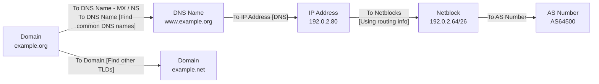
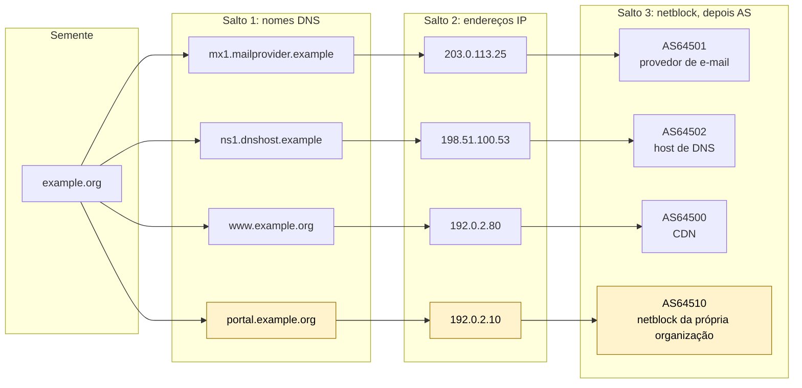

# Dia 21: O ciclo OSINT, parte 3: processamento em um grafo no Maltego

> 🇺🇸 Original: [*Day 21: The OSINT cycle, part 3: processing into a Maltego graph*](https://github.com/thiefdroppers/cyber-investigator-skills/blob/main/curriculum/phase-2-osint-digital-footprint/day-21.md) — © ThiefDroppers, licença MIT.
> Aqui: tradução fiel **+** camada brasileira. Nada do original foi removido; tudo o que é novo vem marcado com ➕.

**Fase 2. OSINT e pegada digital** · Meta da trilha: modelar os dados coletados como entidades e relações tipadas no Maltego, expandi-los com *transforms* dentro dos limites do plano gratuito e manter cada entidade rastreável até uma fonte.

Rank Jutsu: `C` · [](https://colab.research.google.com/github/Ridd1kulusC0d3r/investigador-cyber-90-dias/blob/main/curriculo/fase-2-osint-pegada-digital/dia-21/dia-21.ipynb)

---

## 🎬 ➕ Abertura do caso — *Um salto de cada vez*

Quarta de manhã. O grafo filtrado de ontem tem 17 nós e cabe numa tela. Rafa puxa uma cadeira.

— O SpiderFoot te disse o que **dá para achar**. Agora eu quero saber **como essas coisas se ligam**. Uma pergunta por vez.

Ele aponta para `cdn.serraazul-pix.example`.

— Esse aqui resolve para onde?

— Para o `192.0.2.80`.

— E o `192.0.2.80` é de quem?

Você não sabe. O grafo de ontem não diz. Rafa sorri.

— Então hoje você vai do domínio até o AS, salto por salto, e anota de onde veio cada caixinha. Se o Dr. Hélio apontar para qualquer nó e perguntar "quem disse?", você responde em dez segundos.

O Dia 21 é o processamento com tipos: domínio não é IP, IP não é rede, rede não é dono. *(Personagens e cenário: [Operação Isca](../../../caso-continuo/).)*

---

## 📖 Conceito

O SpiderFoot responde "o que dá para encontrar?". O Maltego é melhor em "como estas coisas específicas se relacionam?", porque você controla cada passo de expansão e todo nó tem um tipo. Uma entidade Domain é um tipo de objeto diferente de um DNS Name, de um IP Address, de um Netblock ou de um número de AS, e os *transforms* são escritos para tipos específicos. Rodar "To IP Address [DNS]" num DNS Name o resolve; o mesmo *transform* não aparece num Email Address. Os tipos obrigam você a ser preciso sobre o que cada fato é.

Um *transform* é uma pequena consulta a uma fonte de dados. Você seleciona entidades, roda um *transform*, e o Maltego acrescenta os resultados como novas entidades ligadas à entrada. Cada execução é um salto deliberado, e é por isso que os grafos do Maltego ficam menores e mais explicáveis do que a saída de uma varredura automatizada.

A cadeia que você vai montar hoje, um *transform* por seta. Cada caixa é um tipo de entidade, e o tipo decide quais *transforms* aparecem quando você clica nela com o botão direito:



O plano gratuito mudou. O que antes era o Maltego Community Edition agora é o plano Maltego Basic: Maltego Graph (Desktop), até 24 resultados por execução de *transform* e 200 créditos de Maltego Data por mês, com acesso limitado a provedores de dados. O antigo conjunto "Standard Transforms" agora é legado, disponível só em planos pagos antigos. Os *transforms* que você vê dependem do seu plano e de quais itens do Transform Hub você instala, e esse catálogo muda. Então aprenda o método, não um menu decorado: clique com o botão direito numa entidade, procure na lista de *transforms* por palavra-chave e confira quanto um *transform* custa antes de rodá-lo em cinquenta entidades.

O limite de 24 resultados importa analiticamente. Um *transform* que devolve exatamente 24 resultados provavelmente foi truncado, então escreva "pelo menos 24" nas suas notas, nunca "24".

## 📚 Recursos

- [Produtos e planos do Maltego](https://docs.maltego.com/en/support/solutions/articles/15000036759-maltego-products-and-plans) traz os limites atuais do plano gratuito. Confira; eles já mudaram antes.
- [Guia para iniciantes: configurando o plano Basic](https://www.maltego.com/blog/beginners-guide-to-maltego-setting-up-maltego-community-edition-ce/) cobre o registro do Maltego ID e o primeiro login.
- [Como usar transforms do Maltego para mapear infraestrutura de rede](https://www.maltego.com/blog/how-to-use-maltego-transforms-to-map-network-infrastructure-an-in-depth-guide/) percorre a cadeia de *transforms* de DNS, netblock e AS usada abaixo.
- [Dados de plano gratuito no Transform Hub](https://www.maltego.com/blog/free-tier-data-in-the-transform-hub/) lista os parceiros que oferecem integrações gratuitas.

### ➕ Recursos do contexto Brasil

- [Registro.br — consulta de ASN e blocos IP](https://registro.br/tecnologia/numeracao/): o Registro.br/NIC.br também é o registro nacional de números IP e ASN do Brasil (vinculado ao LACNIC). Para um IP brasileiro, o "dono do netblock" do salto 3 é confirmado no RDAP do Registro.br (`https://rdap.registro.br/ip/<ip>`).
- [LACNIC RDAP](https://rdap.lacnic.net/): o registro regional da América Latina; responde por blocos de toda a região.
- [PeeringDB](https://www.peeringdb.com/) e [bgp.he.net](https://bgp.he.net/): duas fontes públicas, independentes do Maltego, para conferir quem opera um AS. São a segunda fonte que transforma um AS "provável" em "confirmado".
- [IX.br](https://ix.br/): os pontos de troca de tráfego brasileiros; útil para entender por que tantos provedores de hospedagem nacionais aparecem com AS próprio.

## 🛠️ Prática: Maltego Graph (Desktop), plano Basic: um grafo de infraestrutura de três saltos, com a fonte anotada

**Seu checklist de hoje.** Faça na ordem e marque cada item ao terminar:

- [ ] Passo 1: instalar o Maltego e entrar.
- [ ] Passo 2: semear o grafo com a entidade de domínio.
- [ ] Passo 3: salto 1, expandir nomes DNS a partir do domínio.
- [ ] Passo 4: salto 2, resolver nomes DNS para endereços IP.
- [ ] Passo 5: salto 3, resolver endereços para netblocks e números de AS.
- [ ] Passo 6: importar os achados filtrados do SpiderFoot do Dia 20.
- [ ] Passo 7: anotar a proveniência de toda entidade acrescentada.
- [ ] Passo 8: organizar o layout do grafo e exportá-lo.
- [ ] Passo 9: auditar o grafo e a sessão.
- [ ] ➕ Passo 10: o mesmo grafo no caso brasileiro (Prática BR).
- [ ] ➕ Passo 11: o notebook do dia no Colab.

Passo 1: instale e entre. Registre um Maltego ID, instale o Maltego Graph (Desktop) para o seu sistema operacional e faça login. No Transform Hub (a página inicial), use o filtro de itens gratuitos e instale os que cobrem DNS, certificados ou DNS passivo. Anote no seu registro de reconhecimento quais itens instalou; outro analista precisa disso para reproduzir seu grafo.

Passo 2: semeie o grafo. Pressione Ctrl+T (Cmd+T no macOS) para um grafo novo. Na Entity Palette, à esquerda, abra o grupo Infrastructure e arraste uma entidade Domain para a tela. Dê um duplo clique no rótulo e digite o seu domínio do Dia 19.

Passo 3: salto 1, a partir do domínio. Clique com o botão direito no Domain. O menu de contexto lista os conjuntos de *transforms* e tem uma caixa de busca no topo. Digite `DNS`, `MX`, `NS` ou `TLD` para achar os *transforms* relevantes. Na documentação e nos guias do próprio Maltego, eles se chamam assim:

- `To DNS Name - MX (mail server)`
- `To DNS Name - NS (name server)`
- `To DNS Name [Find common DNS names]`
- `To Domain [Find other TLDs]`

Se um *transform* com esse nome exato não estiver no seu menu, escolha o do seu plano que faz o mesmo trabalho (a caixa de busca o encontra) e escreva no registro o nome que você realmente rodou. Antes de rodar qualquer coisa marcada como consumidora de créditos, passe o mouse sobre ela ou confira o custo na página do item no Transform Hub.

Passo 4: salto 2, de nomes DNS para endereços. Selecione todas as entidades DNS Name (arraste uma caixa de seleção em volta delas, ou ordene a visão Entity List por tipo e selecione as linhas DNS Name), clique com o botão direito e rode `To IP Address [DNS]`. Agora você tem os hosts para os quais os nomes da organização resolvem.

Passo 5: salto 3, de endereços para redes. Selecione as entidades IP Address e rode `To Netblocks [Using natural boundaries]` ou `To Netblocks [Using routing info]`; depois, nas entidades Netblock, rode `To AS Number`. A entidade AS diz quem opera a rede: a própria organização, uma empresa de hospedagem ou uma CDN.

Passo 6: traga os achados do SpiderFoot. Você tem um CSV filtrado do Dia 20. O Maltego consegue criar entidades a partir de uma tabela: aba Import | Export > Import Graph from Table, e depois mapeie as colunas para tipos de entidade no assistente. Um caminho mais simples para poucos itens: copie uma lista de domínios, clique na tela e cole; o Maltego cria uma entidade por linha e pergunta o tipo. Importe só o que sobreviveu à sua passada de falsos positivos do Dia 20.

Passo 7: anote a proveniência. Para toda entidade que você acrescentou à mão ou importou, abra-a (duplo clique) e use o campo Notes para registrar a fonte e o número da linha do registro de coleta, por exemplo `crt.sh, log #14, 2026-09-30T15:02Z`. Entidades criadas por um *transform* já registram qual *transform* as produziu; você vê isso na Detail View.

Passo 8: organize e exporte. Use os botões de layout da aba Layout: Organic para uma visão geral, Hierarchical para ver a estrutura de saltos a partir da semente. Salve o grafo como `exports/P2-ORG.mtgl`. Exporte uma imagem pela aba Export (Export Graph as Image) num tamanho em que os rótulos fiquem legíveis.

Um mini exemplo resolvido (ilustrativo: domínio de exemplo reservado e faixas de IP de documentação, não uma captura real):

```
Domain  example.org
 ├─ MX  mx1.mailprovider.example        -> 203.0.113.25  -> AS64501 (email provider)
 ├─ NS  ns1.dnshost.example             -> 198.51.100.53 -> AS64502 (DNS host)
 ├─ DNS www.example.org                 -> 192.0.2.80    -> AS64500 (CDN)
 ├─ DNS portal.example.org              -> 192.0.2.10    -> AS64510 (organization's own netblock)
 └─ Other TLDs: example.net, example.ca (same registrar; check on Day 29)
```

O mesmo exemplo desenhado por salto, mais ou menos o formato que o layout Hierarchical lhe dá. Leia cada linha da esquerda para a direita para ir da semente até o operador da rede. A linha destacada é a que não termina num provedor:



`portal.example.org` é o interessante: ele resolve para um netblock registrado em nome da organização, e não de um provedor. É um sistema hospedado por ela mesma e, num trabalho real, é o tipo de detalhe que vai para o relatório com cuidado.

Passo 9: audite o grafo e a sessão.

1. Escolha três entidades quaisquer ao acaso e rastreie cada uma até um *transform* nomeado (visível na Detail View) ou uma linha numerada do seu registro de coleta.
2. Liste toda execução de *transform* que devolveu exatamente 24 resultados e confira se suas notas dizem "pelo menos 24" em cada uma.
3. Conte os créditos usados nesta sessão (aparecem na sua conta do Maltego) e escreva o número no registro, para planejar o Dia 22.

O artefato é o `P2-ORG.mtgl` mais a imagem exportada: um grafo com pelo menos três saltos de profundidade a partir do domínio semente, em que toda entidade acrescentada à mão carrega uma nota de fonte.

### ➕ Prática BR: do site falso até quem opera a rede

**Exercício 1: o grafo do golpe.** Semeie um grafo novo, `ISCA-P2.mtgl`, com o Domain `serraazul-pix.example` e importe (Passo 6) os 17 nós que sobreviveram ao filtro do Dia 20, inclusive os três Similar Domain mantidos de propósito. Como os domínios do caso são fictícios, os *transforms* não vão responder; use a tabela de resolução sintética em [`caso-continuo/dados/dia-21/resolucao-isca.csv`](../../../caso-continuo/dados/dia-21/resolucao-isca.csv) como se fosse a saída de cada *transform* e anote em Notes a linha da tabela. O resultado esperado, salto por salto:

```
Domain  serraazul-pix.example
 ├─ NS  ns1.dnsbarato.example               -> 198.51.100.53  -> AS64502 (host de DNS barato)
 ├─ DNS www.serraazul-pix.example           -> 203.0.113.77   -> 203.0.113.64/26 -> AS64501 (hospedagem barata)
 ├─ DNS admin.serraazul-pix.example         -> 203.0.113.77   -> (mesmo bloco)
 ├─ DNS cdn.serraazul-pix.example           -> 192.0.2.80     -> AS64500 (CDN)
 └─ Similar Domain (Dia 20):
     ├─ serraazul-seguranca.example         -> 203.0.113.77   -> AS64501   ← mesmo IP do site falso
     ├─ coopserra-azul.example              -> 198.51.100.140 -> AS64503   ← outro host
     └─ serraazull.example                  -> 198.51.100.200 -> AS64504   ← outro host, página "domínio à venda"
```

**Exercício 2: três perguntas do Rafa, por escrito.**

1. `serraazul-seguranca.example` resolve para o mesmo `203.0.113.77` que o site falso. Isso prova que é do mesmo operador? (Não, sozinho: `203.0.113.77` tem 412 vizinhos, você mesmo contou ontem. É o hub do Dia 22. Marque como **provável** e procure uma segunda ligação independente.)
2. O `cdn.` aponta para uma CDN e o resto para uma hospedagem barata. O que isso diz sobre o operador? (Que ele usa dois provedores; o AS diz quem opera a **rede**, não quem opera o **site**.)
3. `coopserra-azul.example` não compartilha IP, NS nem AS com o site falso. Ele sai do grafo? (Ainda não. Amanhã você vai procurar uma ponte que não é infraestrutura.)

**Exercício 3: o limite de 24.** Na tabela sintética, a consulta de *reverse IP* de `203.0.113.77` devolveu exatamente 24 linhas. Escreva a nota como o original manda.

### ➕ O notebook do dia

Abra o [notebook do Dia 21 no Colab](https://colab.research.google.com/github/Ridd1kulusC0d3r/investigador-cyber-90-dias/blob/main/curriculo/fase-2-osint-pegada-digital/dia-21/dia-21.ipynb). Nele você:

1. modela entidades tipadas e *transforms* em Python (um *transform* só aceita o tipo para o qual foi escrito, como no Maltego);
2. joga o **quiz "qual transform cabe nesta entidade?"**;
3. expande o grafo do caso salto por salto a partir da tabela sintética, com o limite de 24 resultados simulado e a nota "pelo menos 24" gerada automaticamente;
4. faz a auditoria do Passo 9 (três entidades ao acaso, rastreadas até a fonte) e, se tiver rede, resolve um domínio real de exemplo com `socket`.

## ✅ Checkpoint

- As três entidades conferidas ao acaso remetem a um *transform* nomeado ou a uma linha numerada do registro de coleta.
- Suas notas listam toda execução de *transform* que devolveu exatamente 24 resultados.
- Para cada uma dessas execuções, suas notas dizem "pelo menos 24", nunca "24".
- O registro de reconhecimento registra o número de créditos usados nesta sessão.
- Sem consultar notas, você explica o que a entidade AS Number no fim do salto 3 diz sobre quem opera uma rede.

### ➕ Checkpoint BR

- O `ISCA-P2.mtgl` tem os três saltos para cada nome do site falso e toda entidade importada tem Notes com a linha da tabela.
- Suas notas respondem às três perguntas do Rafa, com a palavra de confiança certa para `serraazul-seguranca.example` (provável, não confirmado).
- A nota do *reverse IP* diz "pelo menos 24".
- Você sabe onde confirmar o dono de um bloco IP brasileiro (RDAP do Registro.br ou do LACNIC).

## ⚖️ ➕ Camada jurídica BR

**O AS não é o réu.** O salto 3 leva a um provedor de hospedagem. Pelo Marco Civil, o provedor de aplicação só pode ser responsabilizado civilmente por conteúdo de terceiro se, depois de ordem judicial específica, não o tornar indisponível (art. 19). Na prática, isso significa que a sua notificação ao provedor (a derrubada que a Marta pediu) é um pedido, não uma ordem; muitos provedores atendem por conta própria quando o golpe é evidente, mas a obrigação legal nasce da ordem judicial.

**Quem pede os dados do cliente do provedor.** Saber que `203.0.113.77` está no AS64501 não dá à Vigia o direito de saber quem contratou aquele servidor. Dados cadastrais e registros de conexão saem do provedor por requisição de autoridade ou ordem judicial (Marco Civil, arts. 10 e 22). O seu grafo é o que fundamenta esse pedido feito pela polícia ou pelo jurídico da cooperativa.

**LGPD e o "IP de quem".** IP de um servidor de hospedagem é dado técnico de infraestrutura. Mas se um salto levar a um IP residencial (um bloco de provedor de acesso doméstico), ele pode ser dado pessoal de alguém que nem sabe que está no seu grafo. Anote, não aprofunde, e trate como tal.

> Material de estudo, não constitui orientação jurídica.

## 🧠 ➕ Camada 8 — o grafo bonito e a ilusão de explicação

Um grafo hierárquico de três saltos, colorido, com setas limpas, *parece* uma explicação. Os psicólogos Leonid Rozenblit e Frank Keil chamaram de **ilusão de profundidade explicativa** a tendência de achar que entendemos um mecanismo melhor do que entendemos, até alguém pedir para explicarmos passo a passo. O grafo intensifica essa ilusão: a seta entre `serraazul-seguranca.example` e `203.0.113.77` tem a mesma espessura da seta entre `www` e o mesmo IP, mas uma vale muito menos que a outra.

A auditoria do Passo 9 é o antídoto: pegar três nós ao acaso e explicar, em voz alta, de onde veio cada um. Se você travar em algum, a ilusão apareceu.

Consequência prática: para cada aresta que vai entrar no relatório, escreva uma frase "X liga-se a Y porque [transform/fonte], e isso significa [...]". Aresta que você não consegue descrever numa frase não sai do grafo para o relatório.

## 🤖 ➕ Skill do dia

O Dia 21 propõe acrescentar ao procedimento **"grafo de vínculos"** a regra de proveniência por entidade, a leitura do AS como operador da rede (não do site) e a nota "pelo menos N" para resultados truncados. Proposta em [`_skill-delta.md`](_skill-delta.md).

## 💡 ➕ Inovação OSINT do dia — o salto 3 sem Maltego: RDAP de IP

O "To Netblocks" e o "To AS Number" consultam, no fundo, os registros regionais de internet. Você pode fazer o salto 3 direto na fonte primária, sem gastar créditos, com o *bootstrap* RDAP da IANA, que diz qual registro (ARIN, RIPE, LACNIC...) responde por cada bloco:

```python
import json, urllib.request

ip = "8.8.8.8"                                          # IP público de exemplo (não do caso)
with urllib.request.urlopen(f"https://rdap.org/ip/{ip}", timeout=10) as r:   # rdap.org redireciona ao RIR certo
    d = json.load(r)
print(d.get("handle"), d.get("startAddress"), "-", d.get("endAddress"), d.get("name"))
```

Para IPs no Brasil, o mesmo pedido cai no LACNIC ou no Registro.br. É a "fonte primária" que o Dia 22 vai exigir para confirmar o dono de um bloco: uma consulta reproduzível, com URL, que qualquer revisor pode refazer.

## 📝 Diário de estudo

- Data:
- Tempo gasto:
- O que ficou claro:
- O que ainda está nebuloso:
- Artefato produzido: `exports/P2-ORG.mtgl` e a imagem exportada; ➕ `ISCA-P2.mtgl` e `isca-saltos.csv`

---
<sub>Baseado em [cyber-investigator-skills](https://github.com/thiefdroppers/cyber-investigator-skills) por ThiefDroppers (MIT). Tradução, camada BR, Camada 8, skill pt-BR e notebook por Deivison Lourenço (@Ridd1kulusC0d3r).</sub>
