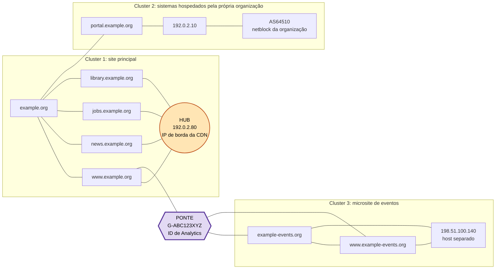
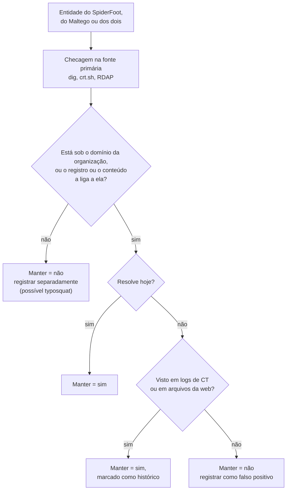

# Dia 22: O ciclo OSINT, parte 4: analisando um grafo de vínculos e relatando

> 🇺🇸 Original: [*Day 22: The OSINT cycle, part 4: analyzing a link graph and reporting it*](https://github.com/thiefdroppers/cyber-investigator-skills/blob/main/curriculum/phase-2-osint-digital-footprint/day-22.md) — © ThiefDroppers, licença MIT.
> Aqui: tradução fiel **+** camada brasileira. Nada do original foi removido; tudo o que é novo vem marcado com ➕.

**Fase 2. OSINT e pegada digital** · Meta da trilha: ler os grafos dos Dias 20 e 21 em busca de hubs, clusters e pontes, conciliar aquilo em que as duas ferramentas discordam e escrever um achado cuja confiança corresponda à evidência.

Rank Jutsu: `C` · [](https://colab.research.google.com/github/Ridd1kulusC0d3r/investigador-cyber-90-dias/blob/main/curriculo/fase-2-osint-pegada-digital/dia-22/dia-22.ipynb)

---

## 🎬 ➕ Abertura do caso — *O nó que não parecia nada*

Quinta, 8h30. A Marta pediu "uma página, até o meio-dia, dizendo o que é do golpe". Você abre o grafo e, depois da semente, o nó que salta aos olhos é `203.0.113.77`, com o `www.`, o `admin.` e o `serraazul-seguranca.example` pendurados nele (e, você sabe desde o Dia 20, mais 412 vizinhos fora do grafo filtrado).

— É ele — você diz. — Tudo passa pelo `.77`.

Rafa cobre o nó com o polegar na tela.

— E agora, o que caiu?

Nada caiu. Todo mundo continua ligado à semente. Ele tira o polegar e põe em cima de um nó pequeno no canto, com grau 2: `G-ISCA7K2Q9P`.

— E agora?

O `coopserra-azul.example` fica sozinho no canto da tela, sem nenhum caminho até o golpe.

— Esse aqui não divide IP, não divide DNS, não divide AS. Divide uma linha de JavaScript. É a coisa mais importante do seu grafo, e você ia deixar fora do relatório.

O Dia 22 fecha o ciclo: ler o grafo, desconfiar do centro e escrever uma frase cuja confiança aguente o Dr. Hélio. *(Personagens e cenário: [Operação Isca](../../../caso-continuo/).)*

---

## 📖 Conceito

Uma lista de quinze fatos sobre um domínio é dado. Um grafo que mostra quais desses fatos compartilham infraestrutura, quais se agrupam e qual item sozinho une dois grupos que, de outro modo, pareceriam separados é o começo da análise. Você lê um grafo procurando três estruturas.

Um *hub* é um nó com muito mais conexões do que os vizinhos. Hubs atraem a atenção e muitas vezes enganam. Um IP de borda de CDN, o host MX de um grande provedor de e-mail ou o servidor de nomes de um registrador se conectam a milhares de domínios sem relação entre si. Um hub só significa alguma coisa quando você consegue dizer por que ele se conecta a tudo, e "todos usam o mesmo serviço popular" geralmente quer dizer que ele não significa nada.

Um *cluster* é um grupo de nós densamente ligados entre si e esparsamente ligados ao resto. Numa pegada, um cluster costuma ser um sistema ou um projeto: um *microsite* de campanha com seus próprios subdomínios, certificado e hospedagem.

Uma ponte é um nó cuja remoção dividiria o grafo em pedaços. Pontes muitas vezes são o achado. Em trabalho de fraude, a ponte clássica é um identificador compartilhado (um ID de medição de *analytics*, um ID de publicador de rede de anúncios, o e-mail de um registrante, um número de telefone) unindo duas operações que se apresentam como sem relação. O Gephi mede isso como centralidade de intermediação (*betweenness centrality*): com que frequência um nó está no caminho mais curto entre outros nós.

Aqui estão os três numa única pegada ilustrativa, montada com os nomes reservados usados desde o Dia 19. O círculo laranja é um hub, as três caixas são clusters e o hexágono roxo é uma ponte.



Faça o teste da remoção nele. Cubra o nó da CDN com o polegar: todo *hostname* continua alcançando `example.org` diretamente, então nada cai. Isso é um hub com grau alto e intermediação baixa, que corresponde à linha `192.0.2.80` da tabela do Passo 2. Agora cubra `G-ABC123XYZ`: o cluster de eventos inteiro fica isolado de todo o resto. Isso é uma ponte, e é por isso que o Passo 1 redimensiona os nós por intermediação, e não por grau.

Um cuidado quando fizer isso no seu próprio grafo: o domínio semente geralmente também terá intermediação alta, porque todo salto começou nele. Isso vem de como você coletou os dados, então não é um achado.

Duas ferramentas que coletam de formas diferentes vão discordar. Trate a discordância como pista. Um domínio que o SpiderFoot achou e o Maltego não pode vir de uma fonte que o plano gratuito do Maltego não alcança, ou pode ser um falso positivo do SpiderFoot. Você resolve isso indo à fonte primária (DNS, log de certificados, registro do domínio), não por votação da maioria.

A etapa de relatório tem então uma regra: a palavra de confiança da sua frase final precisa corresponder à tabela de análise do seu registro de reconhecimento.

## 📚 Recursos

- [Gephi](https://gephi.org/) para as estatísticas de centralidade abaixo.
- [Layouts e visões do Maltego Graph](https://docs.maltego.com/) (procure "layouts" na documentação): o layout Centrality coloca as entidades de maior intermediação no meio.
- [ICD 203, Analytic Standards](https://www.dni.gov/files/documents/ICD/ICD-203.pdf), do Escritório do Diretor de Inteligência Nacional dos EUA. Leia a seção D.6.e.(2), o padrão de *tradecraft* sobre como expressar incerteza (a tabela de probabilidades é a D.6.e.(2)(a)); é a origem da escala de linguagem estimativa padrão que muitos analistas usam.
- [Wayback Machine](https://web.archive.org/) para conferir o estado histórico de qualquer nó que pareça ter mudado recentemente.

### ➕ Recursos do contexto Brasil

- ➕ [Ficha de registro de reconhecimento OSINT em pt-BR](../../../fichas/registro-recon-osint.md): as seções Análise e Relatório que você preenche hoje. A escala de confiança da ficha é a do curso: **confirmado** (2 ou mais fontes independentes concordam), **provável** (1 fonte), **contestado** (as fontes divergem).
- [Doutrina Nacional de Atividade de Inteligência (ABIN)](https://www.gov.br/abin/pt-br): a doutrina brasileira de inteligência também trabalha com graus de certeza na produção de conhecimento; vale comparar com o ICD 203 para ver que o problema (dizer quanto você sabe) é o mesmo em qualquer serviço.
- [Busca de normas do Banco Central](https://www.bcb.gov.br/estabilidadefinanceira/buscanormas): o que a cooperativa faz com o seu achado passa pelas regras do BCB/CMN sobre compartilhamento, entre instituições, de dados sobre indícios de fraude (procure "compartilhamento de dados indícios de fraudes"). <!-- TODO jurídico: confirmar o número da Resolução Conjunta BCB/CMN (provavelmente nº 6/2023) antes de citá-lo -->

## 🛠️ Prática: Gephi e Maltego: um grafo de análise anotado e um achado de uma página

**Seu checklist de hoje.** Faça na ordem e marque cada item ao terminar:

- [ ] Passo 1: calcular a centralidade no Gephi.
- [ ] Passo 2: classificar os nós do topo por grau e por intermediação.
- [ ] Passo 3: encontrar e nomear os clusters.
- [ ] Passo 4: conciliar os achados das duas ferramentas.
- [ ] Passo 5: marcar hubs e pontes no grafo do Maltego.
- [ ] Passo 6: preencher as seções Análise e Relatório.
- [ ] ➕ Passo 7: a página da Marta (Prática BR).
- [ ] ➕ Passo 8: o notebook do dia no Colab.

Passo 1: calcule a centralidade no Gephi. Abra o seu projeto do Gephi do Dia 20 (ou reimporte o GEXF filtrado).

1. Painel Statistics > Average Degree > Run.
2. Painel Statistics > Network Diameter > Run. Isso calcula a centralidade de intermediação, a centralidade de proximidade e a excentricidade de cada nó.
3. Data Laboratory > ordene por Betweenness Centrality, decrescente. Copie as cinco primeiras linhas para as suas notas.
4. Appearance > Nodes > Size > Ranking > Betweenness Centrality > Apply. Agora as pontes parecem maiores que os hubs, e é essa a ideia.

Passo 2: classifique os nós do topo. Para cada um dos cinco primeiros por grau e dos cinco primeiros por intermediação, escreva uma linha: o que ele é, por que tem essa pontuação e se isso é significativo. Ilustrativo (nomes reservados e IPs de documentação):

| Nó | Grau | Intermediação | Leitura |
|---|---|---|---|
| `192.0.2.80` | 31 | 0.02 | Hub. IP de borda de CDN (AS64500). Compartilhado por muitos sites sem relação; não é evidência de propriedade comum. |
| `ns1.dnshost.example` | 12 | 0.05 | Hub. Host de DNS comercial. Mesmo raciocínio. |
| `G-ABC123XYZ` (Web Analytics ID) | 3 | 0.41 | Ponte. A única ligação entre o cluster do site principal e o cluster de `example-events.org`. |
| `portal.example.org` | 4 | 0.11 | Fica no netblock da própria organização; âncora do cluster de sistemas hospedados por ela. |

O ID de *analytics* é o tipo de ponte que importa. Um ID de medição pertence a uma propriedade de *analytics*, então dois sites que reportam para o mesmo ID muito provavelmente são operados pelas mesmas pessoas. Confirme na fonte primária: veja o código-fonte dos dois sites (Ctrl+U) e procure o ID. Capture as duas páginas com o SingleFile e calcule o hash como no Dia 19.

Passo 3: encontre os clusters. As cores de modularidade do Dia 20 dão os clusters. Dê a cada um um nome em palavras simples ("site principal e CMS", "provedores de e-mail e DNS", "microsite de eventos") e conte os nós. Acrescente o nó que ancora cada cluster e o que, se houver algo, o liga aos outros. Ilustrativo, ampliando o diagrama da seção Conceito com o cluster de e-mail e DNS que ele deixa de fora para ficar legível:

| Classe de modularidade | Nome em palavras simples | Nós | Nó âncora | Liga-se a outros clusters por |
|---|---|---|---|---|
| 0 | Site principal e CMS | 38 | `192.0.2.80` (hub da CDN) | `example.org` |
| 1 | Sistemas hospedados pela organização | 6 | `portal.example.org` | `example.org` |
| 2 | Microsite de eventos | 9 | `example-events.org` | só `G-ABC123XYZ` |
| 3 | Provedores de e-mail e DNS | 11 | `ns1.dnshost.example` | `example.org` |

Um cluster cuja última coluna nomeia um único identificador está pendurado numa ponte. Confirme esse identificador na fonte primária, como no Passo 2, antes de ele entrar num achado.

Passo 4: concilie as duas ferramentas. Monte uma tabela com todo domínio e nome DNS que aparece em qualquer um dos grafos:

| Entidade | SpiderFoot | Maltego | Checagem na fonte primária | Manter? |
|---|---|---|---|---|
| `events.example.org` | sim | sim | `dig +short` resolve | sim |
| `old.example.org` | sim | não | No crt.sh (certificado de 2019), não resolve mais | sim, marcado como histórico |
| `examp1e.org` | sim (Similar Domain) | não | RDAP: outro registrador, registrado em 2025 | não; possível *typosquat*, anotar separadamente |

Cada linha passa pelas mesmas checagens. Qual ferramenta encontrou a entidade só decide que você vai checá-la; a fonte primária decide a coluna Manter:



Passo 5: marque o grafo do Maltego. Abra `P2-ORG.mtgl`. Mude para o layout Centrality. Use as cores de marcação do Maltego (o ícone de estrela numa entidade) para marcar hubs com uma cor e pontes com outra, e acrescente uma nota em cada ponte registrando a checagem na fonte primária. Exporte a imagem.

Passo 6: preencha as seções Análise e Relatório do seu registro de reconhecimento. Cada achado recebe uma palavra de confiança de uma única escala e pelo menos uma fonte. Use os termos do ICD 203 ou uma escala mais simples de três níveis (confirmado / provável / possível), mas escolha uma e fique com ela.

> ➕ Neste repositório a escala padrão é a da [ficha pt-BR](../../../fichas/registro-recon-osint.md) e da skill: **confirmado / provável / contestado**. Repare que ela não é a mesma escala de três níveis citada acima: "contestado" não é um grau de probabilidade, é o registro de que as fontes divergem. Escolha uma e fique com ela, como o original manda.

Um achado pronto fica assim (ilustrativo):

> `example.org` e `example-events.org` muito provavelmente são operados pela mesma organização. As duas páginas carregam o mesmo ID de medição do Google Analytics, `G-ABC123XYZ` (código-fonte capturado em 2026-10-02, SHA-256 nas linhas 21 e 22 do registro), e a política de privacidade do site de eventos nomeia a organização principal como controladora dos dados (linha 3 do registro). Os dois sites não compartilham hospedagem: o site principal fica atrás de uma CDN e o de eventos está num provedor separado, então sobreposição de hospedagem não faz parte desta conclusão.

Se o seu grafo não tem ponte, diga isso no relatório; é um achado válido.

O artefato são duas imagens (o grafo do Gephi dimensionado por intermediação e o grafo do Maltego no layout Centrality, com hubs e pontes marcados), a tabela de conciliação e uma seção de Relatório de no máximo uma página.

Mantenha o `P2-recon-log.md` aberto. Os Dias 23 a 30 acrescentam linhas a ele.

### ➕ Prática BR: a página da Marta

O grafo do caso (Dias 20 e 21) tem um hub que parece o centro de tudo e uma ponte que parece nada. Os dados estão em [`caso-continuo/dados/dia-22/`](../../../caso-continuo/dados/dia-22/): a lista de arestas `isca-grafo.csv` e duas capturas sintéticas de código-fonte com hash, `captura-serraazul-pix.html` e `captura-coopserra-azul.html`.

**Exercício 1: hub × ponte no caso.** Rode o Passo 1 e o Passo 2 no grafo do caso (no Gephi ou no notebook). Preencha a tabela:

| Nó | Grau | Intermediação | Leitura |
|---|---|---|---|
| `203.0.113.77` | | | |
| `G-ISCA7K2Q9P` | | | |
| `serraazul-pix.example` (semente) | | | |

O esperado: o `.77` empata com a semente no maior grau e tem intermediação menor que a da ponte, porque quase tudo o que está pendurado nele também alcança o resto por outro caminho (hub de hospedagem barata, já sabido desde o Dia 20); o `G-ISCA7K2Q9P` tem grau 2 e é a única ligação de `coopserra-azul.example` com o resto (ponte); a semente tem intermediação alta "por construção", o que não é achado.

**Exercício 2: confirmar a ponte na fonte primária.** Procure `G-ISCA7K2Q9P` nas duas capturas e confira os SHA-256 com o `hashes.txt` da pasta. A ponte só entra no relatório depois disso.

**Exercício 3: conciliação com a régua do caso.** Monte a tabela do Passo 4 para os três Similar Domain mantidos no Dia 20, adaptando a pergunta do fluxograma: em vez de "está sob o domínio da organização?", pergunte "o conteúdo ou o registro o liga **à campanha**?".

| Entidade | SpiderFoot | Maltego | Checagem na fonte primária | Manter? | Confiança |
|---|---|---|---|---|---|
| `serraazul-seguranca.example` | sim | sim (via IP e NS) | Resolve para `203.0.113.77` e usa `ns1.dnsbarato.example`; nada além disso | sim | provável (duas ligações, ambas por hubs) |
| `coopserra-azul.example` | sim | sim | Mesmo ID de *analytics* na captura (hash conferido) | sim | ? |
| `serraazull.example` | sim | sim | Página "domínio à venda", outro AS, nenhuma ligação | ? | ? |

**Exercício 4: a página.** Preencha Análise e Relatório da [ficha pt-BR](../../../fichas/registro-recon-osint.md) no `ISCA-recon-log.md` e escreva o relatório da Marta em **no máximo uma página**. Ele começa pelo achado, em uma frase, com a palavra de confiança da tabela. Modelo de frase (complete com os seus números de linha):

> `coopserra-azul.example` é **confirmado** como parte da mesma operação que `serraazul-pix.example`: as duas páginas carregam o mesmo ID de medição `G-ISCA7K2Q9P` (capturas com SHA-256 nas linhas __ e __ do registro) e o kit IscaKit deixa o mesmo comentário de versão nas duas (linhas __ e __). Os dois sites não compartilham hospedagem, DNS nem AS, então a infraestrutura não faz parte desta conclusão. `serraazul-seguranca.example` é **provável**: as únicas ligações são o IP `203.0.113.77`, uma hospedagem compartilhada com pelo menos 24 outros sites, e o servidor de nomes `ns1.dnsbarato.example`, um DNS comercial barato; dois hubs não somam uma ponte.

Pergunte-se antes de entregar: "confirmado" aqui significa **duas fontes independentes que concordam**. O ID de *analytics* e o comentário do kit são independentes? (Ambos vêm do mesmo código-fonte; a ficha pede fontes independentes. Discuta nas notas se você manteria "confirmado" ou baixaria para "provável", e por quê. Não há uma única resposta certa; há uma resposta justificada.)

### ➕ O notebook do dia

Abra o [notebook do Dia 22 no Colab](https://colab.research.google.com/github/Ridd1kulusC0d3r/investigador-cyber-90-dias/blob/main/curriculo/fase-2-osint-pegada-digital/dia-22/dia-22.ipynb). Nele você:

1. calcula grau e intermediação (algoritmo de Brandes) só com a biblioteca padrão, primeiro no grafo ilustrativo do original e depois no grafo do caso;
2. faz o **teste do polegar** em código: remove um nó e conta os pedaços;
3. joga o **quiz "hub, ponte ou nenhum dos dois?"**;
4. confirma a ponte nas capturas (hash e busca do ID) e gera a seção Análise e Relatório da ficha, com uma checagem automática de que toda palavra de confiança do relatório bate com a tabela.

## ✅ Checkpoint

- Toda frase do relatório que afirma um fato cita uma linha do registro.
- Toda palavra de confiança do relatório corresponde exatamente à tabela de Análise.
- O relatório nomeia pelo menos um hub.
- O relatório diz se as conexões desse hub são significativas, com o motivo.
- O relatório nomeia pelo menos uma ponte, ou declara que o grafo não tem ponte.
- Toda ponte nomeada no relatório tem confirmação na fonte primária.
- Sem consultar notas, você explica a diferença entre um hub e uma ponte, e qual medida do Gephi (grau ou centralidade de intermediação) destaca cada um.

### ➕ Checkpoint BR

- A página da Marta tem no máximo uma página, começa pelo achado e usa só confirmado / provável / contestado.
- O `203.0.113.77` aparece no relatório como hub **não significativo para propriedade**, com o motivo (hospedagem compartilhada, pelo menos 24 vizinhos).
- A ponte `G-ISCA7K2Q9P` foi confirmada nas duas capturas, com os hashes conferidos.
- Suas notas discutem se o ID de *analytics* e o comentário do kit são fontes independentes.
- No notebook, a checagem automática "confiança do relatório = confiança da tabela" passou.

## ⚖️ ➕ Camada jurídica BR

**O relatório é o que vai para fora.** A página da Marta vai circular: ela vai para a diretoria da cooperativa, para o jurídico, talvez para a polícia junto com o boletim de ocorrência. Um "confirmado" que não aguenta revisão pode virar problema para quem assinou. Escrever que um domínio "pertence ao golpista" quando você só tem um IP compartilhado pode, se o domínio for de um terceiro inocente na mesma hospedagem, expor a cooperativa a uma discussão de dano à imagem e calúnia/difamação (Código Penal, arts. 138 e 139, e responsabilidade civil). A palavra de confiança certa é também proteção jurídica.

**Ponte não é pessoa.** O `G-ISCA7K2Q9P` liga dois sites a uma mesma conta de *analytics*. Quem é o titular dessa conta é um dado cadastral que o provedor do serviço só entrega por requisição de autoridade ou ordem judicial (Marco Civil, arts. 10 e 22). No relatório, o achado é "mesma operação", nunca "mesma pessoa", e o pedido de dados ao provedor fica como **recomendação** para a autoridade.

**Cadeia de custódia (CPP, art. 158-B).** As duas capturas que confirmam a ponte são vestígios: o relatório cita o hash e a linha do registro, e as capturas ficam guardadas sem alteração.

> Material de estudo, não constitui orientação jurídica.

## 🧠 ➕ Camada 8 — saliência, o centro que não é centro

O `203.0.113.77` desenhado no meio do grafo, grande e cheio de linhas, é o exemplo perfeito de **viés de saliência**: damos peso desproporcional ao que é visualmente chamativo. Somado à **heurística da disponibilidade** (o que vem fácil à mente parece mais importante), o nó grande vira "o servidor do Pescador" na cabeça do analista em segundos. O nó pequeno com grau 2, que de fato prova alguma coisa, passa despercebido.

O teste do polegar é uma técnica de **pensamento contrafactual** deliberado: "e se este nó não existisse, o que mudaria?". Ele desloca a pergunta de "o que chama atenção?" para "o que sustenta a estrutura?".

Há ainda a outra metade do dia: a palavra de confiança. Pesquisas sobre linguagem estimativa (a motivação do ICD 203, desde o trabalho de Sherman Kent na CIA) mostram que leitores diferentes atribuem probabilidades muito diferentes a palavras como "provável". Por isso a regra do original é rígida: a palavra do relatório é a palavra da tabela, e a tabela diz o que ela significa.

Consequência prática: dimensione os nós por intermediação antes de olhar o grafo pela primeira vez, e escreva a tabela de Análise **antes** do texto do relatório, nunca depois.

## 🤖 ➕ Skill do dia

O Dia 22 propõe acrescentar ao procedimento **"grafo de vínculos"** o teste de remoção para separar hub de ponte, a confirmação de ponte na fonte primária e a regra de que a palavra de confiança do relatório é copiada da tabela de análise. Proposta em [`_skill-delta.md`](_skill-delta.md).

## 💡 ➕ Inovação OSINT do dia — intermediação sem instalar nada

O Gephi e a biblioteca `networkx` (opcional, `pip install networkx`, real e muito usada) calculam intermediação com o algoritmo de Ulrik Brandes (2001). Mas para grafos de caso, de dezenas ou centenas de nós, a versão em Python puro cabe em vinte linhas e roda em qualquer lugar, inclusive num ambiente sem permissão para instalar pacotes:

```python
from collections import deque

def intermediacao(adj):                       # adj: {nó: {vizinhos}}
    bc = dict.fromkeys(adj, 0.0)
    for s in adj:                             # um BFS a partir de cada nó
        pilha, pred = [], {v: [] for v in adj}
        sigma, dist = dict.fromkeys(adj, 0), dict.fromkeys(adj, -1)
        sigma[s], dist[s], fila = 1, 0, deque([s])
        while fila:
            v = fila.popleft(); pilha.append(v)
            for w in adj[v]:
                if dist[w] < 0: dist[w] = dist[v] + 1; fila.append(w)
                if dist[w] == dist[v] + 1: sigma[w] += sigma[v]; pred[w].append(v)
        delta = dict.fromkeys(adj, 0.0)
        while pilha:                          # acumula de trás para frente
            w = pilha.pop()
            for v in pred[w]: delta[v] += sigma[v] / sigma[w] * (1 + delta[w])
            if w != s: bc[w] += delta[w]
    return {v: b / 2 for v, b in bc.items()}  # /2: grafo não direcionado
```

O notebook do dia usa exatamente esta função e compara com o grafo ilustrativo do original: a ponte `G-ABC123XYZ` sai no topo, o hub da CDN não.

## 📝 Diário de estudo

- Data:
- Tempo gasto:
- O que ficou claro:
- O que ainda está nebuloso:
- Artefato produzido: grafo do Gephi por intermediação, grafo do Maltego em Centrality, tabela de conciliação, seção Relatório do `P2-recon-log.md`; ➕ página da Marta (`ISCA-recon-log.md`, seções Análise e Relatório)

---
<sub>Baseado em [cyber-investigator-skills](https://github.com/thiefdroppers/cyber-investigator-skills) por ThiefDroppers (MIT). Tradução, camada BR, Camada 8, skill pt-BR e notebook por Deivison Lourenço (@Ridd1kulusC0d3r).</sub>
