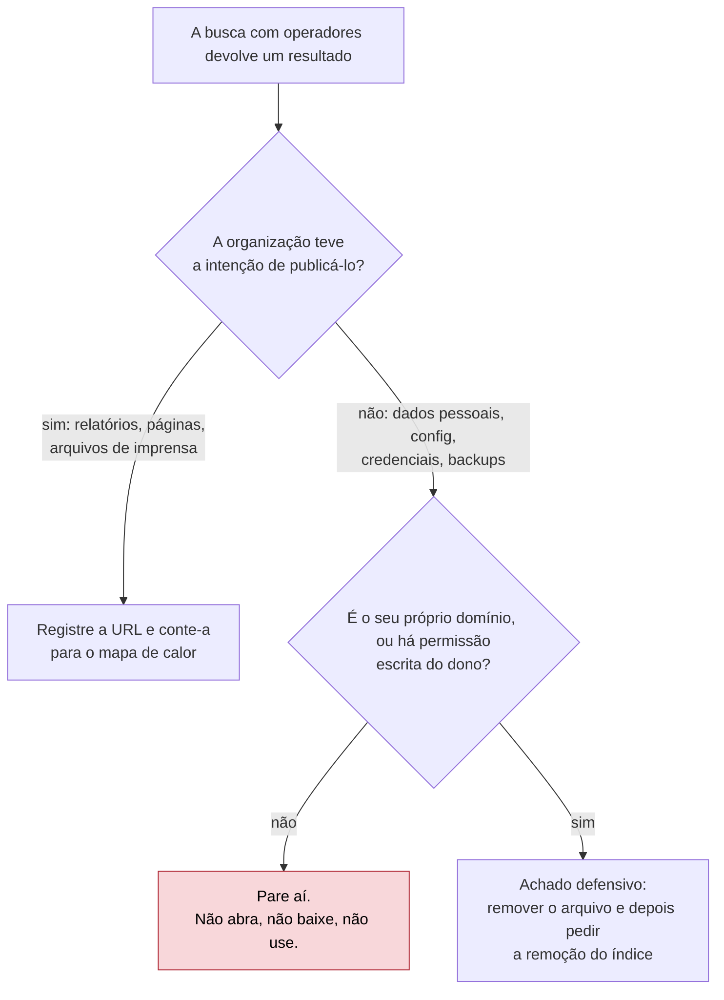
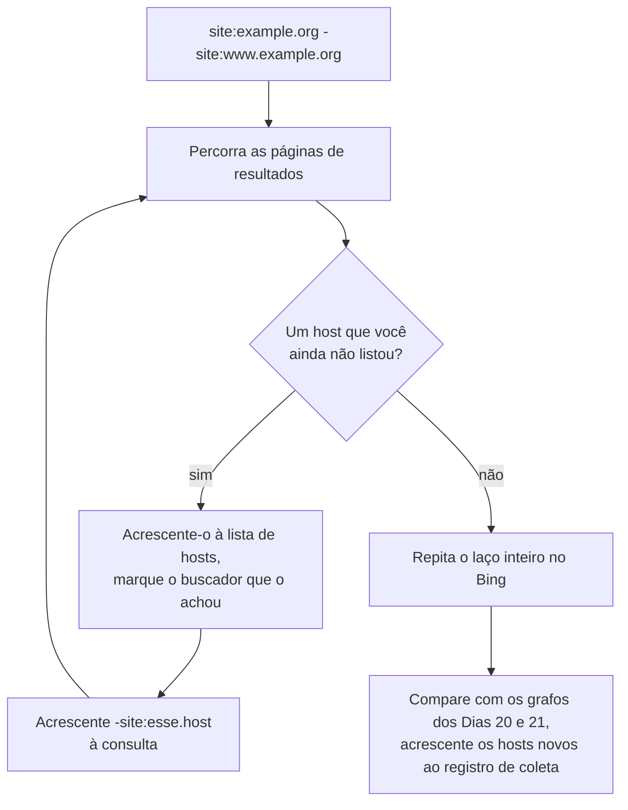

# Dia 23: Operadores de busca para mapear a pegada de uma organização

> 🇺🇸 Original: [*Day 23: Search operators for organizational footprinting*](https://github.com/thiefdroppers/cyber-investigator-skills/blob/main/curriculum/phase-2-osint-digital-footprint/day-23.md) — © ThiefDroppers, licença MIT.
> Aqui: tradução fiel **+** camada brasileira. Nada do original foi removido; tudo o que é novo vem marcado com ➕.

**Fase 2. OSINT e pegada digital** · Meta da trilha: usar operadores de buscadores para enumerar os subdomínios, documentos e menções de terceiros indexados de uma organização, e transformar os resultados num mapa de calor de exposição.

Rank Jutsu: `C` · [](https://colab.research.google.com/github/Ridd1kulusC0d3r/investigador-cyber-90-dias/blob/main/curriculo/fase-2-osint-pegada-digital/dia-23/dia-23.ipynb)

---

## 🎬 ➕ Abertura do caso — *O que o buscador lembra*

Sexta-feira. A página da Marta foi entregue ontem e voltou com uma pergunta escrita à mão: *"E o que mais existe por aí com o nosso nome que a gente não sabe?"*

Rafa digita no buscador, sem pressa: `site:serraazul.example -site:www.serraazul.example`. Aparecem `portal.`, `intranet-antiga.` e `eventos.`.

— `intranet-antiga`? — você lê em voz alta.

— Pois é. O buscador lembra o que a cooperativa esqueceu. E se ele lembra, o Pescador também consegue achar.

Ele abre outra aba, digita `"serraazul.example" -site:serraazul.example`, e os primeiros resultados são posts num grupo público de golpes copiando o texto do SMS.

— Duas regras hoje. Do golpe, você mapeia o que foi publicado para ser visto. Da cooperativa, você pode olhar o que estiver exposto, porque a Marta autorizou por escrito, mas se achar uma planilha de cooperados, você **não abre**: anota a URL e liga para ela.

O Dia 23 é o mapa de calor do que está indexado. *(Personagens e cenário: [Operação Isca](../../../caso-continuo/).)*

---

## 📖 Conceito

Buscadores já rastrearam a maior parte do que uma organização publicou, inclusive o que ela esqueceu que publicou. Operadores estreitam o índice exatamente na fatia de que você precisa. Uma consulta simples pelo nome da organização devolve a página inicial e notícias. `site:example.org -site:www.example.org` devolve páginas em todos os outros hosts indexados sob aquele domínio, o que muitas vezes é a lista passiva de subdomínios mais rápida que você consegue.

O suporte a operadores difere entre buscadores e muda sem aviso. O Google abandonou o operador `cache:` em 2024, e o Bing removeu os links de página em cache mais tarde no mesmo ano, então a Wayback Machine (Dia 26) agora é o substituto prático. Sempre teste um operador com uma consulta cuja resposta você já conhece antes de confiar nele.

Dois cuidados moldam este dia. Primeiro, as contagens de resultados ("Aproximadamente 1.240 resultados") são estimativas que podem variar uma ordem de grandeza entre páginas da mesma consulta. Registre o número de resultados que você de fato percorreu, não a estimativa. Segundo, buscas com operadores às vezes trazem à tona material que nunca deveria ter sido público: planilhas de dados pessoais, arquivos de configuração, credenciais. Encontrá-lo por um buscador geralmente é lícito. Abri-lo, baixá-lo ou usá-lo pode deixar de ser lícito rapidamente, e usar uma credencial encontrada é acesso não autorizado em quase todas as jurisdições. As consultas de exposição sensível abaixo são para a sua própria organização ou para um domínio que você controla. Contra a organização pública que você estudou nos Dias 19 a 22, fique nos documentos e páginas que a organização teve a intenção de publicar.



## 📚 Recursos

- [Operadores de busca do Google (Search Central)](https://developers.google.com/search/docs/monitor-debug/search-operators/all-search-site) é a documentação do próprio Google sobre o `site:` e comportamentos relacionados.
- [Palavras-chave de pesquisa avançada do Bing](https://support.microsoft.com/en-us/topic/advanced-search-keywords-ea595928-5d63-4a0b-9c6b-0b769865e78a) lista os operadores do Bing, incluindo vários que o Google não tem.
- [Google Hacking Database (Exploit-DB)](https://www.exploit-db.com/google-hacking-database) é um catálogo de consultas que encontram arquivos expostos. Leia para entender o que os defensores devem checar nos próprios domínios.
- [Sintaxe de busca do DuckDuckGo](https://duckduckgo.com/duckduckgo-help-pages/results/syntax/) para um segundo índice com cobertura diferente.

### ➕ Recursos do contexto Brasil

- [Google Search Console — Remoções](https://support.google.com/webmasters/answer/9689846): o caminho do Passo 6 para a cooperativa pedir a retirada de uma URL do índice depois de tirar o arquivo do ar.
- [ANPD — comunicação de incidente de segurança](https://www.gov.br/anpd/pt-br/canais_atendimento/agente-de-tratamento/comunicado-de-incidente-de-seguranca-cis): se uma busca revelar uma planilha de cooperados indexada, a decisão de comunicar o incidente à ANPD e aos titulares é do controlador (a cooperativa). Saber que esse canal existe faz parte do seu achado defensivo.
- Operadores úteis para alvos brasileiros: `site:gov.br`, `site:jus.br` e `site:leg.br` delimitam fontes oficiais; `site:in.gov.br "Serra Azul"` (no caso real, o nome da organização) procura atos no Diário Oficial da União.

## 🛠️ Prática: Google, Bing e uma planilha: um mapa de calor de exposição por host e tipo de arquivo

Use a mesma organização pública e o `P2-recon-log.md` dos Dias 19 a 22.

**Seu checklist de hoje.** Faça na ordem e marque cada item ao terminar:

- [ ] Passo 1: aprender e testar os operadores de busca.
- [ ] Passo 2: enumerar hosts com `site:` e `-site:`.
- [ ] Passo 3: contar tipos de documento por host.
- [ ] Passo 4: encontrar menções de terceiros ao domínio.
- [ ] Passo 5: montar o mapa de calor de exposição.
- [ ] Passo 6: rodar a checagem de exposição sensível, só no próprio domínio (opcional).
- [ ] Passo 7: explicar uma diferença entre buscadores.
- [ ] ➕ Passo 8: os dois lados do caso (Prática BR).
- [ ] ➕ Passo 9: o notebook do dia no Colab.

Passo 1: aprenda os operadores que vai usar. Teste cada um no seu alvo.

| Operador | Buscador | Exemplo | O que faz |
|---|---|---|---|
| `site:` | Google, Bing, DDG | `site:example.org` | Resultados daquele domínio e de seus subdomínios |
| `-site:` | Google, Bing | `site:example.org -site:www.example.org` | Exclui um host; use para descascar subdomínios já conhecidos |
| `filetype:` / `ext:` | Google (os dois), Bing (`filetype:`) | `site:example.org filetype:pdf` | Restringe a uma extensão de arquivo |
| `intitle:` | Google, Bing, DDG | `site:example.org intitle:"annual report"` | Palavra ou frase no título da página |
| `inurl:` | Google, DDG | `site:example.org inurl:careers` | Palavra na URL |
| `intext:` / `inbody:` | Google / Bing | `intext:"example.org" -site:example.org` | Palavra no corpo do texto |
| `"..."` | todos | `"Example Organization"` | Frase exata |
| `OR`, `-` | todos | `site:example.org (filetype:xlsx OR filetype:csv)` | Booleano; `OR` precisa estar em maiúsculas |
| `before:` / `after:` | Google | `site:example.org filetype:pdf after:2024-01-01` | Filtra pela data que o Google associa à página |

O Bing também documenta o `ip:`, que devolve páginas hospedadas num determinado endereço IP. Experimente `ip:192.0.2.80` com um dos seus IPs do Dia 21. Num IP de CDN compartilhado, ele devolve sites sem relação, o que é a lição do hub do Dia 22 em forma de busca.

Passo 2: enumere os hosts. Rode e repita, acrescentando um `-site:` para cada host que encontrar, até os resultados pararem de trazer hosts novos:

```
site:example.org -site:www.example.org
site:example.org -site:www.example.org -site:events.example.org
site:example.org -site:www.example.org -site:events.example.org -site:library.example.org
```

O laço fica assim:



Rode a mesma sequência no Bing. Registre cada host numa lista e marque qual buscador o encontrou. Compare com os seus grafos dos Dias 20 e 21 e acrescente os hosts novos ao registro de coleta.

Passo 3: conte os tipos de documento por host. Para cada host, rode:

```
site:events.example.org filetype:pdf
site:events.example.org filetype:docx
site:events.example.org filetype:xlsx
site:events.example.org filetype:pptx
```

Percorra os resultados e registre o número que você de fato viu, limitado a 50 (as cinco primeiras páginas). Não registre a estimativa "Aproximadamente N resultados".

Passo 4: encontre menções de terceiros. Estas mostram onde o domínio da organização aparece fora do próprio site:

```
"example.org" -site:example.org
site:github.com "example.org"
site:linkedin.com/company "Example Organization"
```

A consulta no GitHub muitas vezes revela repositórios públicos que a organização publica e, às vezes, configurações que citam os hosts dela. Leia, registre a URL e não clone nem rode nada.

Passo 5: monte o mapa de calor. No Google Sheets ou no LibreOffice Calc, ponha os hosts nas linhas, os tipos de arquivo nas colunas e as contagens observadas nas células. Ilustrativo:

| Host | pdf | docx | xlsx | pptx |
|---|---|---|---|---|
| www.example.org | 50 | 12 | 3 | 7 |
| events.example.org | 18 | 0 | 0 | 2 |
| library.example.org | 50 | 4 | 9 | 0 |
| archive.example.org | 31 | 22 | 14 | 0 |

Selecione os números e aplique uma escala de cores (Sheets: Formatar > Formatação condicional > Escala de cores; Calc: Formatar > Condicional > Escala de cor). Um host como `archive.example.org`, com muitos documentos Office editáveis, é onde a análise de metadados do Dia 28 vai encontrar mais coisa.

Passo 6 (só no próprio domínio): uma checagem de exposição. Se você controla um domínio (um site pessoal, um domínio de laboratório ou o domínio do seu empregador com permissão escrita do time de segurança), rode estas consultas nele e em nenhum outro:

```
site:yourdomain.example intitle:"index of"
site:yourdomain.example (ext:env OR ext:log OR ext:sql OR ext:bak)
site:yourdomain.example inurl:admin
```

Se algo sensível aparecer, a correção é remover o arquivo e pedir ao buscador para retirar a URL (Google Search Console > Remoções). Escreva isso nas suas notas como um achado defensivo.

Passo 7: explique uma diferença entre buscadores. Escolha um host que só um buscador encontrou e escreva uma frase nas suas notas sobre por que isso pode ter acontecido (diferenças de indexação, robots.txt, atualidade).

O artefato é o mapa de calor (exportado como PNG ou PDF) e uma lista de hosts anotada com o buscador que encontrou cada um, acrescentada ao registro de reconhecimento.

### ➕ Prática BR: os dois lados do caso

O fluxograma do original tem duas saídas para o mesmo resultado: "pare aí" (domínio alheio) e "achado defensivo" (domínio próprio ou com permissão escrita). A Operação Isca usa as duas no mesmo dia.

**Exercício 1: o lado da cooperativa (com permissão escrita).** A Marta autorizou, no aditivo ao contrato, a checagem do Passo 6 em `serraazul.example`. Em [`caso-continuo/dados/dia-23/resultados-busca-serraazul.csv`](../../../caso-continuo/dados/dia-23/resultados-busca-serraazul.csv) estão resultados sintéticos de busca (consulta, buscador, URL, título, tipo) que o Rafa salvou. Monte o mapa de calor host × tipo, a lista de hosts com o buscador que achou cada um, e classifique cada resultado pelo fluxograma. Um deles é `intranet-antiga.serraazul.example/rh/cooperados-2025.xlsx`, com título "Planilha cooperados - CPF e telefone". O que você faz:

1. **não abre e não baixa** (mesmo autorizado, você não precisa do conteúdo para o achado, e baixá-lo põe dado pessoal de 40 mil cooperados no seu disco);
2. registra a URL, o título como aparece no buscador e a hora UTC;
3. liga para a Marta, que aciona o time de TI para tirar o arquivo do ar, depois pede a remoção no Search Console e avalia com o Dr. Hélio a comunicação à ANPD.

**Exercício 2: o lado do golpe.** Do lado do golpe, só o que foi publicado para ser visto. Rode (no seu buscador real, sobre o nome real de alguma cooperativa que tenha sofrido golpe noticiado, **ou** sobre os resultados sintéticos do CSV) as consultas de menção de terceiros:

```
"serraazul-pix.example" -site:serraazul-pix.example
"sua chave Pix foi bloqueada" "Serra Azul"
site:github.com "IscaKit"
```

O CSV sintético traz, para a terceira consulta, um repositório público chamado `iscakit-mirror` com um arquivo `config.php` no título. Pelo fluxograma: a organização (aqui, o operador do golpe) **não** teve a intenção de publicar isso, e o domínio não é seu. **Pare aí.** Registre a URL do repositório como achado (o kit circula publicamente), mas não abra o `config.php`: se ele tiver credenciais do painel, você não quer tê-las visto. É a mesma linha do Dia 01.

**Exercício 3: a frase do Passo 7.** O CSV traz `eventos.serraazul.example` só no Bing. Escreva a frase.

### ➕ O notebook do dia

Abra o [notebook do Dia 23 no Colab](https://colab.research.google.com/github/Ridd1kulusC0d3r/investigador-cyber-90-dias/blob/main/curriculo/fase-2-osint-pegada-digital/dia-23/dia-23.ipynb). Nele você:

1. usa um **construtor de consultas** por formulário que monta o laço `site:` / `-site:` e as consultas por tipo de arquivo (o notebook não busca nada sozinho: buscadores proíbem automação nos termos de uso, então você copia e cola);
2. joga o **quiz do fluxograma** ("registra", "pare aí" ou "achado defensivo");
3. lê os resultados sintéticos, enumera os hosts, monta o mapa de calor em texto (com escala de cores em blocos ░▒▓█) e salva o CSV para a planilha;
4. confere quais hosts foram achados por qual buscador e quais o grafo dos Dias 20 e 21 não tinha.

## ✅ Checkpoint

- Toda célula do mapa de calor tem uma contagem observada, não uma estimativa "Aproximadamente N resultados".
- A legenda do mapa de calor declara que as contagens são observadas.
- Todo host da sua lista está marcado como encontrado pelo Google, pelo Bing, pelos dois ou por nenhum (encontrado só pelas ferramentas anteriores).
- Suas notas contêm uma frase sobre por que um host de buscador único foi encontrado só por aquele buscador.
- Se você fez o Passo 6, suas notas mostram que o domínio é um que você controla.
- Sem consultar notas, você explica por que o operador `ip:` do Bing, rodado num IP de CDN compartilhado, devolve sites sem relação com o seu alvo.

### ➕ Checkpoint BR

- O mapa de calor de `serraazul.example` tem legenda "contagens observadas" e a lista de hosts marca o buscador.
- A planilha de cooperados aparece no registro como **URL e título**, sem conteúdo, com a hora UTC e o encaminhamento à Marta.
- O `config.php` do repositório aparece no registro como "não aberto", com o motivo.
- Você explica por que, mesmo com autorização escrita da Marta, não abriu a planilha (minimização, LGPD art. 6º, III).

## ⚖️ ➕ Camada jurídica BR

**Encontrar, abrir, usar.** O original separa os três verbos, e a lei brasileira também. Encontrar uma URL num buscador é ler um índice público. Usar uma credencial encontrada para entrar num sistema é invasão de dispositivo informático (CP, art. 154-A), mesmo que a credencial estivesse "pública": a autorização é do titular do sistema, não do buscador. Abrir e baixar uma planilha de dados pessoais alheia, sem base legal, é tratamento de dado pessoal fora da LGPD, e guardar o arquivo agrava o problema.

**LGPD, art. 6º, III (necessidade).** Mesmo no domínio da cooperativa, com autorização escrita, o princípio da necessidade limita o tratamento ao mínimo para a finalidade. O achado defensivo ("a planilha está indexada nesta URL") não precisa do conteúdo da planilha.

**LGPD, art. 48 (comunicação de incidente).** Quando um incidente de segurança puder causar risco ou dano relevante aos titulares, o **controlador** deve comunicá-lo à ANPD e aos titulares. A cooperativa é a controladora; a decisão é dela e do jurídico. O seu papel é entregar o achado rápido e bem documentado.

> Material de estudo, não constitui orientação jurídica.

## 🧠 ➕ Camada 8 — a curiosidade como vulnerabilidade do investigador

O título "Planilha cooperados - CPF e telefone" funciona sobre o investigador como uma isca funciona sobre a vítima: ele explora a **lacuna de informação** que George Loewenstein descreveu como motor da curiosidade (quando percebemos que falta uma peça, sentimos um impulso quase físico de completá-la). O golpista usa o mesmo mecanismo no SMS ("sua chave foi bloqueada"; o que aconteceu?). Do lado do analista, a lacuna vem disfarçada de dever: "preciso saber quantos cooperados estão expostos".

Você não precisa. A Marta precisa saber **que** a planilha está indexada; o número de linhas a TI dela conta, dentro de casa, com base legal.

Consequência prática: escreva no plano do dia, antes de buscar, o que você fará se encontrar dado pessoal ou credencial ("registro URL e título, não abro, ligo para X"). Decidir antes da tentação é o mesmo pré-compromisso do Dia 19, aplicado a outro impulso.

## 🤖 ➕ Skill do dia

O Dia 23 propõe um procedimento novo, **"busca com operadores e exposição indexada"**, com o laço `site:`/`-site:`, as contagens observadas e o fluxograma "registra / pare aí / achado defensivo". Proposta em [`_skill-delta.md`](_skill-delta.md).

## 💡 ➕ Inovação OSINT do dia — subdomínios que o buscador não mostra, pelo crt.sh

O laço do Passo 2 só acha o que foi indexado. Os logs de *Certificate Transparency* acham o que ganhou certificado, indexado ou não, e o [crt.sh](https://crt.sh/) tem uma saída JSON documentada (`output=json`). Cruzar as duas listas mostra hosts que existem mas o buscador não viu (ou que o `robots.txt` esconde):

```python
import json, urllib.request, urllib.parse

dominio = "example.com"                                   # troque pelo seu alvo AUTORIZADO
url = "https://crt.sh/?q=" + urllib.parse.quote("%." + dominio) + "&output=json"
with urllib.request.urlopen(url, timeout=20) as r:
    nomes = {n.strip().lower() for c in json.load(r) for n in c["name_value"].split("\n")}
achados_busca = {"www.example.com"}                       # sua lista do Passo 2
print("Só no CT:", sorted(nomes - achados_busca)[:20])
```

É passivo (você consulta um terceiro), é a fonte primária que o Dia 22 pediu para conciliar e, no Dia 30, vira rotina.

## 📝 Diário de estudo

- Data:
- Tempo gasto:
- O que ficou claro:
- O que ainda está nebuloso:
- Artefato produzido: mapa de calor (PNG/PDF) e lista de hosts anotada no `P2-recon-log.md`; ➕ mapa de calor de `serraazul.example` e registro dos dois achados "não abertos"

---
<sub>Baseado em [cyber-investigator-skills](https://github.com/thiefdroppers/cyber-investigator-skills) por ThiefDroppers (MIT). Tradução, camada BR, Camada 8, skill pt-BR e notebook por Deivison Lourenço (@Ridd1kulusC0d3r).</sub>
