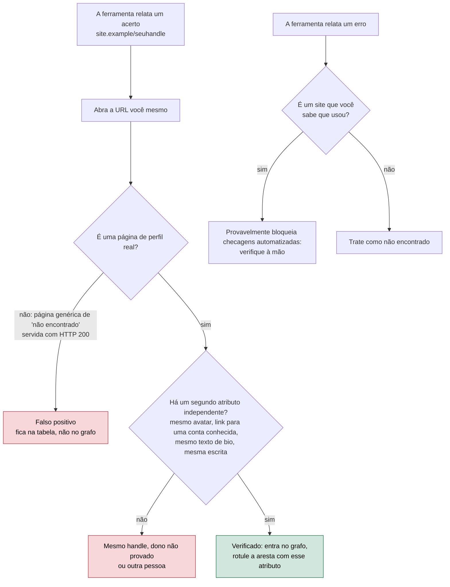
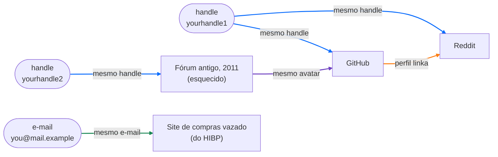

# Dia 24: Enumeração de username e mapeamento da pegada digital (a sua)

> 🇺🇸 Original: [*Day 24: Username enumeration and digital-footprint mapping (your own)*](https://github.com/thiefdroppers/cyber-investigator-skills/blob/main/curriculum/phase-2-osint-digital-footprint/day-24.md) — © ThiefDroppers, licença MIT.
> Aqui: tradução fiel **+** camada brasileira. Nada do original foi removido; tudo o que é novo vem marcado com ➕.

**Fase 2. OSINT e pegada digital** · Meta da trilha: mapear as suas próprias identidades on-line com ferramentas de enumeração de *username*, verificar cada acerto à mão e montar um grafo de pegada que mostre o que um investigador (ou um golpista) conseguiria ligar sobre você.

Rank Jutsu: `C` · [](https://colab.research.google.com/github/Ridd1kulusC0d3r/investigador-cyber-90-dias/blob/main/curriculo/fase-2-osint-pegada-digital/dia-24/dia-24.ipynb)

> ⚠️ **Regra do dia, sem exceção.** As ferramentas de hoje só rodam sobre **handles seus** (ou de alguém que pediu e está sentado ao seu lado, como diz o original) e, na Prática BR, sobre os **handles oficiais fictícios da cooperativa**, que a Marta autorizou por escrito. Nunca sobre um terceiro, nunca sobre um suspeito, nunca sobre o "Pescador".

---

## 🎬 ➕ Abertura do caso — *O espelho*

Segunda-feira, 12 de outubro. Um cooperado manda para a ouvidoria o print de um perfil no Instagram, `@serraazul.oficial`, oferecendo "suporte para desbloqueio de Pix". A Marta quer saber em que outros lugares o nome da cooperativa está sendo usado.

Você já está com o Sherlock instalado e digita `sherlock pesc`, metade do apelido do kit. Rafa segura seu pulso antes do Enter.

— Para. Em quem você ia rodar isso?

— No Pescador. Ele deve reusar o apelido em algum lugar.

— E se o "pesc" que você achar no fórum de pesca for um aposentado de Lavras? Você acabou de montar um dossiê de um inocente. E se for mesmo ele, você acabou de fazer o trabalho da polícia sem ordem judicial. Nenhum dos dois cabe no contrato.

Ele vira o seu monitor para você.

— Você não sabe ainda quanto essas ferramentas erram. Então hoje você roda em **você mesmo**, onde sabe a resposta, e mede. Depois, se a Marta autorizar, roda nos handles oficiais da cooperativa, que ela também sabe quais são. Quem estiver usando o nome dela sem estar na lista vira uma linha para ela denunciar à plataforma. Não vira uma pessoa para você caçar.

O Dia 24 é calibração: medir a ferramenta antes de confiar nela. *(Personagens e cenário: [Operação Isca](../../../caso-continuo/).)*

---

## 📖 Conceito

As pessoas reaproveitam *handles*. Um *username* escolhido aos quinze anos muitas vezes sobrevive num fórum de jogos, numa conta de hospedagem de código e num site de fotos vinte anos depois. As ferramentas de enumeração de *username* exploram isso: pegam um *handle* e verificam centenas de sites procurando um perfil na URL esperada (`https://example-site.com/{username}`), e então relatam quais existem.

Em investigação de golpes e fraudes, essa é uma técnica de nível de padrão. Um operador de golpe de recrutamento que publica como `hr_talentdesk` num site de vagas frequentemente usa o mesmo *handle* num aplicativo de mensagens, num serviço de pagamento e num segundo site de vagas; esse reaproveitamento é como denúncias de golpe separadas são ligadas numa única operação no Dia 68. O objeto, ali, são os *handles* de uma operação. O objeto, aqui, é você, porque a pegada de uma pessoa privada montada sem autorização é um dossiê, e este roteiro não monta dossiês.

As ferramentas de enumeração produzem falsos positivos nas duas direções. Um site que devolve HTTP 200 para qualquer URL, inclusive perfis inexistentes, parece um acerto para todo *handle*. Um site que bloqueia requisições automatizadas parece um erro. Um acerto real também pode ser outra pessoa que escolheu o mesmo *handle*. Um resultado significa apenas que existe uma página de perfil; a atribuição precisa de um segundo atributo independente (o mesmo avatar, um link de volta para uma conta conhecida, o mesmo texto de bio, a mesma escrita).

Todo acerto e todo erro passa pelas mesmas checagens antes de contar:



A sua própria pegada lhe dá a verdade de referência (*ground truth*). Você sabe quais contas são suas, então consegue medir diretamente a precisão de cada ferramenta. Essa calibração é a coisa mais útil que você vai levar de hoje.

## 📚 Recursos

- O [aplicativo web WhatsMyName](https://whatsmyname.app/) roda a lista curada de sites do projeto WhatsMyName no seu navegador. Sem instalação.
- O [Sherlock](https://github.com/sherlock-project/sherlock) é um verificador de *username* de linha de comando, instalável com pip.
- O [Maigret](https://github.com/soxoj/maigret) é um *fork* do Sherlock que também lê as páginas de perfil em busca de identificadores ligados e consegue desenhar um grafo.
- O [Have I Been Pwned](https://haveibeenpwned.com/) mostra quais vazamentos conhecidos incluem o seu próprio endereço de e-mail.

### ➕ Recursos do contexto Brasil

- [Lista de sites do WhatsMyName (`wmn-data.json`)](https://github.com/WebBreacher/WhatsMyName): o arquivo de dados aberto que define, para cada site, a URL de checagem, o código esperado e o texto que aparece quando a conta existe ou não existe. Vale procurar nele os sites brasileiros que você usou (fóruns, marketplaces, redes de nicho) e ver se estão cobertos.
- [Central de Ajuda do Instagram — denunciar uma conta que finge ser outra pessoa ou empresa](https://help.instagram.com/): o canal que a Marta usa para o resultado da Prática BR. A denúncia de imitação de marca é feita por quem representa a marca.
- [SaferNet Brasil — canal de ajuda](https://new.safernet.org.br/helpline): orientação gratuita sobre privacidade e segurança on-line, útil se a sua própria pegada revelar algo que você não quer público e não sabe como remover.
- [ANPD — direitos do titular](https://www.gov.br/anpd/pt-br): a LGPD dá a você o direito de pedir eliminação de dados a um controlador (art. 18, VI). É a base para o Passo 10 quando o site não oferece um botão de "excluir conta".

## 🛠️ Prática: Sherlock, Maigret e WhatsMyName: um grafo verificado da própria pegada

Escolha de dois a quatro *handles* que você já usou e um endereço de e-mail seu. Não rode nenhuma ferramenta de hoje sobre o *handle* de outra pessoa, inclusive amigos, a menos que eles tenham pedido e estejam sentados ao seu lado.

**Seu checklist de hoje.** Faça na ordem e marque cada item ao terminar:

- [ ] Passo 1: instalar o Sherlock e o Maigret num ambiente isolado.
- [ ] Passo 2: rodar o Sherlock nos seus *handles*.
- [ ] Passo 3: rodar o Maigret nos seus *handles*.
- [ ] Passo 4: rodar o WhatsMyName nos seus *handles*.
- [ ] Passo 5: verificar cada acerto à mão.
- [ ] Passo 6: checar seu e-mail no Have I Been Pwned.
- [ ] Passo 7: montar o grafo da pegada.
- [ ] Passo 8: anotar quais ligações são as mais fortes.
- [ ] Passo 9: medir a precisão de cada ferramenta.
- [ ] Passo 10: excluir ou limpar uma conta esquecida (opcional).
- [ ] ➕ Passo 11: os handles oficiais da cooperativa (Prática BR).
- [ ] ➕ Passo 12: o notebook do dia no Colab.

Passo 1: instale as ferramentas num ambiente isolado.

```bash
python3 -m pip install --user pipx && python3 -m pipx ensurepath
pipx install sherlock-project
pipx install maigret
```

Passo 2: rode o Sherlock.

```bash
mkdir -p ~/cases/self-footprint && cd ~/cases/self-footprint
sherlock yourhandle1 yourhandle2 --csv --timeout 10 --folderoutput sherlock/
```

`--csv` grava um CSV por *username* na pasta de saída. `--timeout 10` impede que sites lentos travem a execução. Por padrão, o Sherlock imprime só os perfis encontrados; `--print-all` também mostra os não encontrados, o que é útil quando você está medindo a precisão. Saída de console ilustrativa:

```
[*] Checking username yourhandle1 on:
[+] GitHub: https://www.github.com/yourhandle1
[+] Reddit: https://www.reddit.com/user/yourhandle1
[+] Chess: https://www.chess.com/member/yourhandle1
[+] Pinterest: https://www.pinterest.com/yourhandle1/
[*] Search completed with 4 results
```

Passo 3: rode o Maigret.

```bash
maigret yourhandle1 --html --graph
```

`--html` grava um relatório em `reports/`. `--graph` grava um grafo interativo das contas e dos identificadores que o Maigret extraiu delas (*usernames* ligados, nomes completos, links de perfil). O Maigret verifica por padrão os 500 sites do topo da lista; acrescente `-a` para verificar todos, o que demora bem mais.

Passo 4: rode o WhatsMyName. Digite o mesmo *handle* em whatsmyname.app. Ele usa uma lista curada e separada de sites, então os acertos dele não vão bater exatamente com os do Sherlock. Exporte ou copie os resultados.

Passo 5: verifique cada acerto à mão. Monte uma tabela nas suas notas. Para cada site que qualquer ferramenta relatou, abra a URL e decida:

| Site | Sherlock | Maigret | WMN | É meu? | Evidência |
|---|---|---|---|---|---|
| GitHub | acerto | acerto | acerto | sim | meus repositórios |
| Chess.com | acerto | acerto | erro | não | outra pessoa; entrou em 2012, país diferente |
| Pinterest | acerto | erro | erro | não há perfil | a página carrega um "usuário não encontrado" genérico com HTTP 200 (falso positivo) |
| Fórum antigo | erro | erro | acerto | sim, esquecido | meus posts de 2011; ainda públicos |

A linha "esquecido" costuma ser a mais interessante. Contas que você esqueceu são exatamente o que um atacante encontra e você não defende.

Passo 6: cheque seu e-mail. Digite o seu próprio endereço em haveibeenpwned.com. Cada vazamento listado diz quais serviços guardavam aquele endereço, e algumas dessas contas podem estar faltando nos resultados de *username* porque você usou outro *handle* nelas. Acrescente-as à tabela como "ligada por e-mail".

Passo 7: monte o grafo da pegada. Comece pela saída de grafo do Maigret, ou monte um à mão no Maltego (paleta Personal: entidades Alias e Email Address; paleta Social para as contas) ou no diagrams.net. Os nós são os seus *handles*, o seu e-mail e cada conta verificada. As arestas são o atributo que as liga: mesmo *handle*, mesmo e-mail, um perfil que linka outro perfil, o mesmo avatar. Pinte as arestas por tipo. Deixe os falsos positivos fora do grafo, mas mantenha-os na tabela.

Um resultado ilustrativo, usando as linhas da tabela do Passo 5. Arestas azuis são *handle* compartilhado, verdes são e-mail compartilhado, laranja é um perfil linkando outro, roxas são avatar reaproveitado. A conta esquecida do fórum só se junta ao resto pelo avatar, que é exatamente o tipo de ligação que as pessoas não pensam em quebrar.



Passo 8: anote quais ligações são as mais fortes. Uma frase para cada um dos dois ou três atributos que unem a maior parte das suas contas. Para a maioria das pessoas, é um *handle* reaproveitado mais um avatar reaproveitado.

Passo 9: meça cada ferramenta. Calcule a precisão de cada ferramenta nos seus *handles*: acertos verificados como seus divididos por todos os acertos que ela relatou. Escreva os três números nas suas notas.

Passo 10 (opcional): se você encontrou uma conta esquecida que não quer mais pública, excluí-la ou limpá-la é um bom fim para o laboratório. Anote o que fez na linha dessa conta na tabela de verificação.

O artefato é o grafo da própria pegada (PNG) e a tabela de verificação com uma coluna por ferramenta.

### ➕ Prática BR: os handles oficiais da cooperativa

O original diz que o objeto da enumeração numa investigação de golpe são **os handles de uma operação**, e deixa isso para o Dia 68, com casos autorizados. O caso brasileiro de hoje fica um passo antes e do lado seguro: o objeto é **a própria marca da cliente**, com autorização escrita dela, e a verdade de referência é a lista de canais oficiais que ela mesma publica. É o mesmo raciocínio da sua pegada: você sabe a resposta, então mede.

**O que pode e o que não pode.** Pode: rodar as ferramentas sobre `serraazul` e `serraazulcoop`, os handles que a página [Canais oficiais](../../../caso-continuo/dados/dia-19/capturas/03-serraazul-canais-oficiais.html) (capturada no Dia 19) lista como da cooperativa, com o aditivo de autorização da Marta. Não pode: rodar sobre `pesc`, `pescador`, sobre o *handle* de qualquer funcionário da cooperativa ou sobre qualquer *handle* que apareça nos resultados.

**Exercício 1: verificação contra a lista oficial.** Em [`caso-continuo/dados/dia-24/`](../../../caso-continuo/dados/dia-24/) estão saídas sintéticas das três ferramentas para `serraazul` e `serraazulcoop` (sem rede: os domínios são fictícios) e a lista oficial da cooperativa. Monte a tabela do Passo 5, com uma mudança na coluna "É meu?": ela vira **"É da cooperativa?"**, e a evidência aceita é a página Canais oficiais **mais** um segundo atributo (o perfil linka de volta para `serraazul.example`, mesmo logotipo, mesmo CNPJ fictício na bio).

**Exercício 2: as três categorias que importam para a Marta.** Separe cada acerto em:

1. **oficial verificado**: está na lista e tem o segundo atributo;
2. **falso positivo técnico**: página genérica com HTTP 200, ou site que bloqueia checagem;
3. **mesmo handle, não oficial**: perfil real, não está na lista. Aqui o fluxograma do original manda parar em "mesmo handle, dono não provado ou outra pessoa". Pode ser uma loja de tintas chamada Serra Azul em outro estado, pode ser um perfil imitador. Você **não** investiga quem está por trás. Você registra URL, captura com hash (Dia 19) e entrega à Marta numa lista "uso do nome não listado nos canais oficiais", para que ela, como titular da marca, decida o que denunciar à plataforma. O `@serraazul.oficial` do Instagram está nessa lista; o Dia 25 volta a ele pelo lado da plataforma.

**Exercício 3: precisão na marca.** Calcule a precisão de cada ferramenta como no Passo 9, contando como "acerto verdadeiro" só os oficiais verificados. Compare com a precisão que você mediu na sua própria pegada. Se forem muito diferentes, escreva uma frase sobre por quê (handles de marca comuns, como "serraazul", colidem mais com outras pessoas e empresas que um handle pessoal inventado).

### ➕ O notebook do dia

Abra o [notebook do Dia 24 no Colab](https://colab.research.google.com/github/Ridd1kulusC0d3r/investigador-cyber-90-dias/blob/main/curriculo/fase-2-osint-pegada-digital/dia-24/dia-24.ipynb). Nele você:

1. vê, num servidor HTTP local de brinquedo, por que um site que responde 200 para tudo engana o checador ingênuo, e escreve um checador melhor que lê o texto de "não encontrado" (é assim que o WhatsMyName define cada site);
2. joga o **quiz do fluxograma** (falso positivo, mesmo handle sem dono provado, verificado, verificar à mão);
3. cruza as saídas sintéticas das três ferramentas com a lista oficial da cooperativa e calcula a precisão de cada uma;
4. preenche a sua própria tabela de verificação por formulário (com a trava "confirmo que os handles são meus") e gera o grafo da pegada em Mermaid, pronto para colar no GitHub.

## ✅ Checkpoint

- Suas notas têm três números de precisão, um para o Sherlock, um para o Maigret e um para o WhatsMyName.
- Cada número é igual aos acertos verificados como seus daquela ferramenta divididos por todos os acertos que ela relatou.
- Toda conta do seu grafo é uma que você verificou como sua no Passo 5 ou ligou por e-mail no Passo 6; nenhum falso positivo aparece nele.
- Toda aresta do seu grafo está rotulada com o atributo que a liga.
- A tabela de verificação inclui pelo menos um falso positivo.
- Todo falso positivo da tabela diz o motivo de ser falso.
- Se você fez o Passo 10, a linha da conta na tabela de verificação registra se você a excluiu ou a limpou.
- Sem consultar notas, você explica por que um site que devolve uma página genérica de "usuário não encontrado" com HTTP 200 aparece como falso positivo nas ferramentas de *username*.

### ➕ Checkpoint BR

- A tabela da cooperativa tem as três categorias e cada linha "mesmo handle, não oficial" tem só URL, captura com hash e a frase "não investigado; encaminhado à titular da marca".
- Nenhuma ferramenta foi rodada sobre um *handle* que não fosse seu ou da lista oficial da cooperativa. Escreva isso nas notas, como o Passo 8 do Dia 25 vai pedir para as plataformas.
- Você tem os números de precisão na marca e a frase comparando com a sua pegada.
- No notebook, o seu checador "melhorado" deixou de ver o falso positivo do servidor de brinquedo.

## ⚖️ ➕ Camada jurídica BR

**Perseguição (CP, art. 147-A).** Enumerar *handles* de uma pessoa, cruzar contas e montar o grafo da vida on-line dela é, tecnicamente, a mesma coisa que você fez em si mesmo hoje. Feito repetidamente sobre outra pessoa, sem caso nem autorização, pode encostar no crime de perseguição, que pune perseguir alguém de forma reiterada, por qualquer meio, invadindo ou perturbando sua esfera de liberdade ou privacidade. A técnica é neutra; o objeto não é.

**LGPD: dado público continua sendo dado pessoal.** O perfil público de uma pessoa é dado pessoal tornado público pelo titular. A LGPD permite tratá-lo, mas respeitando a finalidade, a boa-fé e o interesse público que justificaram a publicação (art. 7º, §§ 3º e 4º). "Estava público" não é base legal para montar um dossiê.

**Falsa identidade e uso de marca.** O perfil `@serraazul.oficial` pode envolver falsa identidade (CP, art. 307) e uso indevido de marca. Quem tem legitimidade para pedir a remoção e, se for o caso, ir à justiça é a cooperativa, titular da marca. Pelo Marco Civil (art. 19), a plataforma pode ser obrigada judicialmente a remover; muitas removem antes, por denúncia da titular. O seu papel termina na lista bem documentada.

> Material de estudo, não constitui orientação jurídica.

## 🧠 ➕ Camada 8 — por que o mesmo handle parece a mesma pessoa

Quando o Sherlock devolve `pesc` em cinco sites, o cérebro conclui "é ele" antes de qualquer checagem. Isso é a **heurística da representatividade** (Kahneman e Tversky): julgamos a probabilidade de algo pela semelhança com um protótipo e ignoramos a **taxa de base**, quantas pessoas no mundo escolheriam aquele mesmo handle. Para um handle curto e comum ("pesc", "serraazul", "joao"), a taxa de base é enorme; para um handle inventado e longo, pequena. A mesma ferramenta, com a mesma saída, merece confianças muito diferentes.

Do outro lado, a sua própria pegada mostra o que o golpista vê. A conta esquecida do fórum, o avatar reaproveitado, o e-mail no vazamento: é com isso que se monta engenharia social sob medida ("oi, vi que você joga xadrez, sou do clube..."). A calibração de hoje serve também como higiene pessoal.

Consequência prática: antes de ler qualquer resultado de enumeração, escreva quão comum o handle é (curto/comum, médio, longo/único) e exija mais atributos independentes quanto mais comum ele for.

## 🤖 ➕ Skill do dia

O Dia 24 propõe um procedimento novo, **"enumeração de username"**, que só roda sobre handles do próprio usuário ou de uma organização que autorizou por escrito, exige verificação manual com um segundo atributo e trata "mesmo handle, não oficial" como encaminhamento ao titular, nunca como alvo de investigação. Proposta em [`_skill-delta.md`](_skill-delta.md).

## 💡 ➕ Inovação OSINT do dia — o checador que lê a página, não só o código

O falso positivo clássico do dia (HTTP 200 com "usuário não encontrado") é resolvido no projeto WhatsMyName com uma ideia simples: para cada site, o arquivo de dados define o código esperado **e** um texto que só aparece quando a conta existe (`e_string`) e um que só aparece quando não existe (`m_string`). Em Python puro, para o **seu** handle:

```python
import urllib.request, urllib.error

def existe(url, texto_existe, texto_nao_existe):
    try:
        with urllib.request.urlopen(url, timeout=10) as r:
            corpo = r.read().decode("utf-8", "replace")
    except urllib.error.HTTPError as e:
        return False if e.code == 404 else None      # 404 = não existe; outros = inconclusivo
    if texto_nao_existe in corpo:
        return False                                  # 200 com "não encontrado": o falso positivo
    return True if texto_existe in corpo else None    # sem o texto esperado: verificar à mão

print(existe("https://github.com/SEU_HANDLE", "repositories", "Not Found"))
```

Três respostas, não duas: existe, não existe e **inconclusivo**. O "inconclusivo" é o que separa um checador honesto de um que inventa acertos. (Os textos de cada site mudam; confira no `wmn-data.json` atual antes de confiar.)

## 📝 Diário de estudo

- Data:
- Tempo gasto:
- O que ficou claro:
- O que ainda está nebuloso:
- Artefato produzido: grafo da própria pegada (PNG) e tabela de verificação com uma coluna por ferramenta; ➕ tabela da cooperativa com as três categorias e lista "uso do nome não listado" para a Marta

---
<sub>Baseado em [cyber-investigator-skills](https://github.com/thiefdroppers/cyber-investigator-skills) por ThiefDroppers (MIT). Tradução, camada BR, Camada 8, skill pt-BR e notebook por Deivison Lourenço (@Ridd1kulusC0d3r).</sub>
