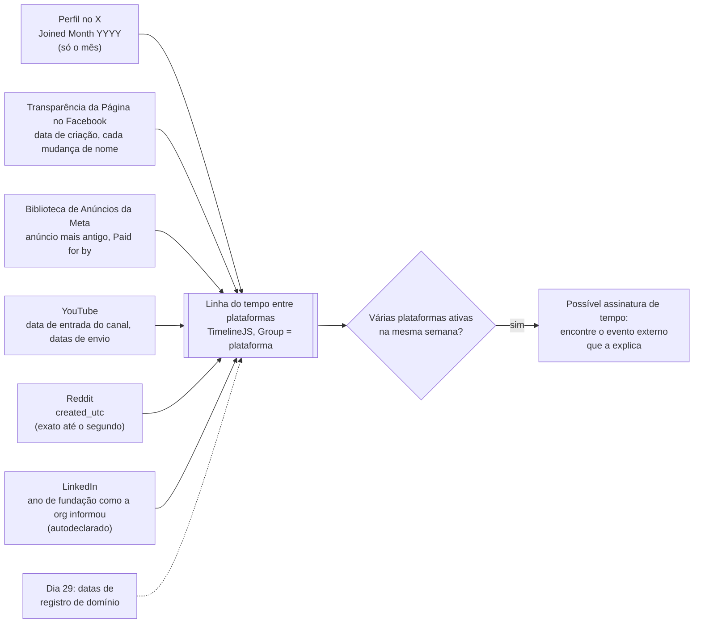
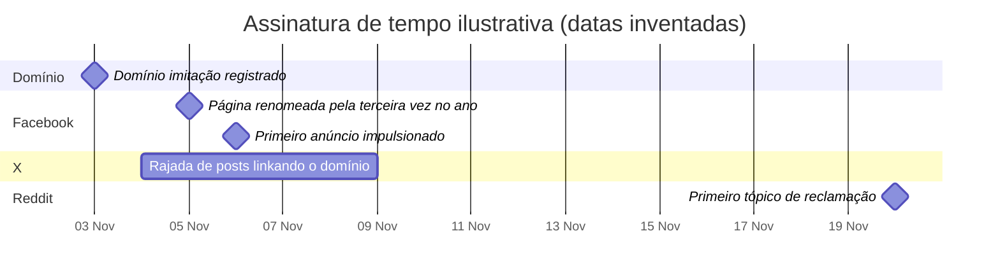

# Dia 25: Investigação em redes sociais, parte 1: reconhecimento por plataforma

> 🇺🇸 Original: [*Day 25: Social media investigation, part 1: platform-specific recon*](https://github.com/thiefdroppers/cyber-investigator-skills/blob/main/curriculum/phase-2-osint-digital-footprint/day-25.md) — © ThiefDroppers, licença MIT.
> Aqui: tradução fiel **+** camada brasileira. Nada do original foi removido; tudo o que é novo vem marcado com ➕.

**Fase 2. OSINT e pegada digital** · Meta da trilha: usar a sintaxe de busca e os recursos de transparência de cada grande plataforma para reconstruir a atividade de uma organização pública e montá-la numa linha do tempo entre plataformas.

Rank Jutsu: `C` · [](https://colab.research.google.com/github/Ridd1kulusC0d3r/investigador-cyber-90-dias/blob/main/curriculo/fase-2-osint-pegada-digital/dia-25/dia-25.ipynb)

---

## 🎬 ➕ Abertura do caso — *Três nomes, um perfil*

Terça, 13 de outubro. A Marta já denunciou o `@serraazul.oficial` ao Instagram, mas quer saber "desde quando isso existe". Junto com o print, um cooperado mandou outro: uma conta de WhatsApp Business chamada "Serra Azul Atendimento", com o logotipo da cooperativa.

Você abre a página de transparência do perfil e lê em voz alta:

— Conta criada em março de 2025. Nome anterior: "Promoções Mineiras". Antes disso: "Achadinhos BH". Trocou para o nome atual em... 4 de outubro.

— Véspera do certificado do site falso — diz Rafa. — Coincidência, ou assinatura de tempo? A linha do tempo responde. Só uma coisa: você vai ler. Não segue, não curte, não comenta, não manda "oi" no WhatsApp para "ver se responde".

— Mas e se...

— Até o Dia 31, sua conta pessoal é só olho. Perfil de fachada é outro dia, com outra autorização.

O Dia 25 é a linha do tempo entre plataformas. *(Personagens e cenário: [Operação Isca](../../../caso-continuo/).)*

---

## 📖 Conceito

Cada plataforma indexa o próprio conteúdo de um jeito, e a busca dela costuma ser melhor que um buscador geral para alcançá-lo. O X tem uma linguagem de operadores para filtrar por autor, data e tipo de conteúdo. A Meta publica um painel de transparência de Páginas e uma Biblioteca de Anúncios que mostram quando uma Página foi criada, se mudou de nome e o que pagou para impulsionar. Canais do YouTube mostram a data de entrada e as datas exatas de envio. A busca do Reddit aceita `site:` e `url:`, o que permite encontrar toda discussão que linkou um domínio. Páginas de empresa no LinkedIn mostram tendências de número de funcionários e publicações.

Cada plataforma lhe entrega um tipo diferente de data, com uma precisão diferente, e todas alimentam uma única linha do tempo:



Para um investigador, o valor está no tempo. Operações de fraude e de influência deixam assinaturas de tempo: uma Página renomeada três vezes num ano, uma rajada de contas criadas na mesma semana, publicações impulsionadas que começam no dia em que um domínio é registrado. Uma linha do tempo entre plataformas é onde essas assinaturas aparecem. As suas datas de registro do Dia 29 vão se alinhar com as datas de criação de conta de hoje.

Como fica uma assinatura de tempo depois de posta numa linha do tempo. Esta é uma operação de golpe inventada, não a sua organização do Dia 19. Um registro de domínio e atividade em duas plataformas caem dentro de uma semana, e a primeira reclamação pública chega duas semanas depois.



Valem três limites. A maioria das plataformas agora exige uma conta logada para buscar. Até o Dia 31 tratar de perfis de fachada (*sock puppets*), use a sua própria conta e aja de forma estritamente passiva: busque e leia, nunca siga, curta, comente ou mande mensagem. Segundo, os termos das plataformas geralmente proíbem coleta automatizada; tudo hoje é manual. Terceiro, o que a plataforma mostra é o que ela escolhe mostrar. Uma data de criação num painel de transparência é uma afirmação da plataforma, boa, mas ainda assim uma fonte só.

O objeto, de novo, são as contas oficiais de uma organização pública. Não monte a linha do tempo do histórico de publicações de uma pessoa privada.

## 📚 Recursos

- A [busca avançada do X](https://x.com/search-advanced) é a versão em formulário dos operadores abaixo; monte uma consulta ali e depois leia a sequência de operadores que ela produz.
- A [Biblioteca de Anúncios da Meta](https://www.facebook.com/ads/library/) permite buscar anúncios por Página, inclusive anúncios inativos, com retenção estendida para anúncios sobre temas sociais, eleições ou política.
- O [TimelineJS da Knight Lab](https://timeline.knightlab.com/) monta uma linha do tempo interativa a partir de um modelo do Google Sheets. Gratuito.
- A [seção de redes sociais do toolkit da Bellingcat](https://bellingcat.gitbook.io/toolkit) acompanha quais ferramentas de plataforma ainda funcionam.

### ➕ Recursos do contexto Brasil

- [Biblioteca de Anúncios da Meta, filtro Brasil](https://www.facebook.com/ads/library/?country=BR): no Brasil, anúncios sobre temas sociais, eleições ou política ficam com o aviso "Pago por" e retenção estendida; para golpes, o que interessa é o anúncio comum, que aparece enquanto está ativo (capture no ato, Dia 19).
- [WhatsApp Business — perfil comercial](https://faq.whatsapp.com/): o perfil de uma conta comercial mostra nome, descrição, categoria e, às vezes, site e endereço, mas **não** mostra data de criação. A data, para o WhatsApp, você só consegue de fora: a primeira denúncia, o primeiro print. Anote a precisão.
- [Selo de conta comercial oficial do WhatsApp](https://faq.whatsapp.com/): saber como uma conta comercial verificada aparece ajuda a cooperativa a orientar os cooperados ("o nosso tem tal selo; desconfie de qualquer outro").
- [Reclame Aqui](https://www.reclameaqui.com.br/) e [consumidor.gov.br](https://www.consumidor.gov.br/): no Brasil, são o "Reddit das reclamações". As datas de publicação das queixas entram na linha do tempo como a "primeira reclamação pública" do diagrama.

## 🛠️ Prática: sintaxe de busca das plataformas e TimelineJS: uma linha do tempo de atividade entre plataformas

Escolha as contas oficiais da organização em pelo menos três plataformas. O rodapé do site dela geralmente as linka; registre esses links no registro de reconhecimento como a fonte da atribuição. Uma conta que a organização não linka não é "dela" até você ter outra evidência.

**Seu checklist de hoje.** Faça na ordem e marque cada item ao terminar:

- [ ] Passo 1: buscar no X com operadores.
- [ ] Passo 2: checar a transparência da Página no Facebook e a Biblioteca de Anúncios.
- [ ] Passo 3: checar a data de entrada e os envios do canal do YouTube.
- [ ] Passo 4: buscar links e menções no Reddit.
- [ ] Passo 5: checar a página da empresa no LinkedIn.
- [ ] Passo 6: montar a linha do tempo entre plataformas no TimelineJS.
- [ ] Passo 7: ler a linha do tempo em busca de uma assinatura de agrupamento.
- [ ] Passo 8: confirmar que você não fez nada além de buscar e ler.
- [ ] ➕ Passo 9: a linha do tempo do golpe (Prática BR).
- [ ] ➕ Passo 10: o notebook do dia no Colab.

Passo 1: X. Estes operadores funcionam na caixa de busca principal (logado):

```
from:ExampleOrg since:2025-01-01 until:2025-07-01
from:ExampleOrg filter:media
from:ExampleOrg filter:links -filter:replies
to:ExampleOrg
@ExampleOrg -from:ExampleOrg
url:example.org
from:ExampleOrg min_retweets:100
```

`since:` e `until:` recebem `YYYY-MM-DD`, com `until:` exclusivo. `url:example.org` encontra posts de qualquer pessoa que linkem o domínio, o que revela tanto campanhas quanto reclamações. Use a aba Mais recentes (*Latest*) para a ordem cronológica. O X já mudou o comportamento de operadores antes; teste cada um contra um post que você sabe que existe.

A página de perfil mostra "Joined Month YYYY". Registre.

Passo 2: Facebook. Na Página da organização, abra Sobre e depois Transparência da Página (em alguns layouts é uma seção na própria Página principal). Ela lista a data de criação, os nomes anteriores com a data de cada mudança e os países onde estão as pessoas que gerenciam a Página. Tire um print e capture com o SingleFile. Depois abra a Biblioteca de Anúncios da Meta, defina o país e "Todos os anúncios" e busque o nome da Página. Anote a data do anúncio mais antigo, se há anúncios ativos agora e, para anúncios sobre temas sociais ou políticos, o aviso "Pago por".

Passo 3: YouTube. Na página do canal, abra a descrição ou o painel "mais" para achar a data de entrada e o total de visualizações. Em Vídeos, ordene por Mais antigos. Para datas exatas de envio, a data sob o título de cada vídeo basta para uma linha do tempo.

Passo 4: Reddit. A busca do Reddit aceita:

```
site:example.org
url:example.org
"Example Organization" subreddit:yourcity
```

Ordene por Novos. Cada resultado é uma discussão pública sobre a organização ou os links dela. Para um tópico, acrescente `.json` à URL (`https://www.reddit.com/r/SUB/comments/ID/SLUG/.json`) para ver os carimbos Unix `created_utc` exatos; converta um com `date -u -r 1735689600` (macOS) ou `date -u -d @1735689600` (Linux). Leia o JSON no navegador; não faça download em massa por script.

Passo 5: LinkedIn. A aba Sobre da página da empresa mostra o ano de fundação, a faixa de tamanho e a sede, como a organização os informou. A aba Publicações dá as datas. O Contrato do Usuário do LinkedIn proíbe *scraping* e acesso automatizado, então este passo é só manual.

Passo 6: monte a linha do tempo. Abra o modelo do Google Sheets do TimelineJS (linkado em timeline.knightlab.com, "Get the Spreadsheet Template"), faça uma cópia e acrescente uma linha por evento. Mantenha os cabeçalhos de coluna do modelo; os essenciais são Year, Month, Day, Headline, Text, Media e Group. Use Group para a plataforma, para que os eventos se empilhem por plataforma. Linhas ilustrativas:

| Year | Month | Day | Headline | Text | Group |
|---|---|---|---|---|---|
| 2014 | 3 | 11 | Página do Facebook criada | Painel de transparência da Página; registro de captura #31 | Facebook |
| 2016 | 9 | | Conta no X criada | Perfil "Joined September 2016"; registro #33 | X |
| 2021 | 5 | 4 | Página renomeada | Nome anterior "Example Org Events"; registro #31 | Facebook |
| 2023 | 2 | 1 | Primeiro anúncio impulsionado | Biblioteca de Anúncios da Meta; registro #34 | Facebook |
| 2024 | 11 | 18 | Tópico no Reddit linka o site de eventos | `created_utc` 1731888000; registro #36 | Reddit |

Toda célula Text cita uma linha do registro de coleta. Depois, na planilha, use Arquivo > Compartilhar > Publicar na Web, cole o link publicado na página do TimelineJS e copie o link de incorporação ou de pré-visualização gerado.

Passo 7: leia a linha do tempo em busca de agrupamento: qualquer semana ou mês em que várias plataformas mostram atividade ao mesmo tempo. Escreva duas frases sobre o agrupamento mais denso e qual evento externo (um lançamento, uma mudança de marca, uma notícia) o explica, com uma fonte.

Passo 8: acrescente uma linha às suas notas confirmando que você não tomou nenhuma ação em nenhuma plataforma além de buscar e ler.

O artefato é a linha do tempo publicada no TimelineJS com pelo menos 12 eventos de pelo menos três plataformas, e as linhas correspondentes no registro de reconhecimento.

### ➕ Prática BR: a linha do tempo do golpe

O original monta a linha do tempo da organização legítima e mostra, num exemplo inventado, como aparece a de um golpe. Na Operação Isca você monta as duas e as põe lado a lado.

**Exercício 1: a régua (contas oficiais).** As contas oficiais da Serra Azul são as da página Canais oficiais capturada no Dia 19 (`@serraazul` no Instagram, `/serraazulcoop` no Facebook, `@serraazulcoop` no YouTube, `cooperativa-serra-azul` no LinkedIn). A atribuição vem dessa página, como o original manda. Monte as linhas oficiais da linha do tempo a partir de [`caso-continuo/dados/dia-25/eventos-isca.csv`](../../../caso-continuo/dados/dia-25/eventos-isca.csv) (grupo `Oficial`).

**Exercício 2: o lado do golpe.** No mesmo CSV estão os eventos sintéticos (grupos `Domínio`, `Instagram falso`, `WhatsApp falso`, `Reclamações`), cada um com a fonte e a linha do registro: a criação do `@serraazul.oficial` em março de 2025 como "Achadinhos BH", as duas mudanças de nome, o certificado de `serraazul-pix.example` (4/out), o anúncio impulsionado na Biblioteca de Anúncios (ativo de 4 a 6/out, capturado no dia 6), o primeiro print do WhatsApp "Serra Azul Atendimento" (5/out, enviado por um cooperado) e as reclamações (Reclame Aqui e ouvidoria). Monte a planilha do TimelineJS com Group = plataforma.

**Exercício 3: as duas frases do Passo 7.** O agrupamento mais denso é a janela de sete dias de 4 a 10/out/2026, com os cinco grupos ativos (o notebook calcula). O evento externo que o explica, nesse caso, **é** o golpe: os disparos de SMS de 5/out. Escreva as duas frases, citando as linhas. Depois responda: qual das datas tem a pior precisão? (O WhatsApp: a "data" é a do primeiro print recebido, não a da criação da conta, que o WhatsApp não mostra. Na linha do tempo, ela entra como "visto pela primeira vez em", não como "criado em".)

**Exercício 4: o Passo 8, ampliado.** Escreva nas notas: *"Não segui, curti, comentei, denunciei nem enviei mensagem a nenhuma conta. Não iniciei conversa com o número do WhatsApp 'Serra Azul Atendimento'. A denúncia do perfil falso foi feita pela Marta, como titular da marca."*

### ➕ O notebook do dia

Abra o [notebook do Dia 25 no Colab](https://colab.research.google.com/github/Ridd1kulusC0d3r/investigador-cyber-90-dias/blob/main/curriculo/fase-2-osint-pegada-digital/dia-25/dia-25.ipynb). Nele você:

1. monta consultas do X e do Reddit por formulário e converte carimbos `created_utc` com `datetime` (o mesmo que o `date -u -d @...` faz);
2. joga o **quiz "qual a precisão desta data?"** (segundo, dia, mês, ano autodeclarado, "visto pela primeira vez");
3. carrega os eventos do caso, gera o CSV no formato exato do modelo do TimelineJS e detecta automaticamente a semana com mais plataformas ativas;
4. desenha a linha do tempo em texto, com a precisão de cada data visível.

## ✅ Checkpoint

- Todo evento da linha do tempo cita uma linha do registro de coleta.
- Suas notas contêm duas frases sobre o agrupamento mais denso.
- Essas frases nomeiam o evento externo que explica o agrupamento.
- Esse evento externo tem uma fonte.
- Suas notas confirmam que você não tomou nenhuma ação em nenhuma plataforma além de buscar e ler.
- Sem consultar notas, você explica por que uma conta que a organização não linka a partir do próprio site não é tratada como "dela".

### ➕ Checkpoint BR

- A linha do tempo do caso tem pelo menos 12 eventos, de pelo menos três grupos, e separa visualmente o oficial do falso.
- O evento do WhatsApp está como "visto pela primeira vez", não como "criado".
- Suas duas frases ligam a renomeação do `@serraazul.oficial` (4/out) ao certificado do site falso (4/out) e aos disparos (5/out), citando as linhas.
- O Passo 8 ampliado está nas notas.

## ⚖️ ➕ Camada jurídica BR

**Ler não é interagir.** Buscar e ler conteúdo público com a sua conta é o mesmo que qualquer usuário faz. Seguir, curtir, comentar ou mandar mensagem a um perfil falso **muda** o caso: avisa o operador, pode contaminar a evidência (a plataforma registra a sua interação) e, se você se apresentar como outra pessoa, já é perfil de fachada, que tem regras próprias (Dia 31). Iniciar conversa com o golpista "para ver se responde" também foge do escopo escrito da Marta ("não contatar suspeitos").

**Termos de uso e coleta automatizada.** O original lembra que o LinkedIn proíbe *scraping*. No Brasil, violar termos de uso é, em regra, questão contratual entre você e a plataforma, não crime; mas a coleta automatizada de dados pessoais em massa precisa de base legal na LGPD, e a ANPD já tratou de *scraping* como tratamento de dados. O Dia 33 aprofunda.

**Falsa identidade e marca.** O `@serraazul.oficial` e o WhatsApp "Serra Azul Atendimento" usam nome e logotipo da cooperativa para obter vantagem: o enquadramento provável é estelionato/fraude eletrônica (CP, art. 171, § 2º-A) com uso indevido de marca. A linha do tempo que você monta hoje é parte do material que a cooperativa leva ao boletim de ocorrência; por isso cada evento cita a linha do registro e a captura com hash.

> Material de estudo, não constitui orientação jurídica.

## 🧠 ➕ Camada 8 — a renomeação como roubo de reputação

Por que o golpista renomeia uma conta antiga em vez de criar uma nova? Uma conta criada em março, com seguidores e posts, carrega **prova social** (Cialdini): números que sinalizam "outras pessoas confiam nisto". Uma conta nova, com zero seguidores, não convence. "Achadinhos BH" acumulou seguidores reais com promoções; no dia 4 de outubro, essa audiência foi "herdada" pela Serra Azul falsa. O cooperado que olha o perfil vê histórico, não vê o histórico de **nomes**.

Do lado do analista, a linha do tempo combate outra ilusão: a de que eventos próximos são independentes. Sem pôr as datas lado a lado, "a conta mudou de nome" e "o certificado foi emitido" parecem dois fatos soltos. Juntos na mesma semana, viram uma assinatura. O risco oposto também existe: **correlação ilusória**, ver padrão em coincidência. Por isso o Passo 7 exige um evento externo **com fonte** que explique o agrupamento.

Consequência prática: na Camada 8 da comunicação com os cooperados (que a Marta vai fazer), a mensagem útil não é "desconfie de perfis falsos"; é "o nosso perfil é o @serraazul e existe desde [ano]; confira o histórico de nomes na transparência da página".

## 🤖 ➕ Skill do dia

O Dia 25 propõe acrescentar ao procedimento **"ciclo de reconhecimento OSINT"** a regra de atribuição de contas pelo site oficial, a postura só-leitura em plataformas e a linha do tempo com a precisão de cada data. Proposta em [`_skill-delta.md`](_skill-delta.md).

## 💡 ➕ Inovação OSINT do dia — o modelo do TimelineJS gerado em Python

O TimelineJS lê uma planilha com colunas fixas. Gerar o CSV a partir do seu registro de coleta, em vez de digitar à mão, garante que toda linha cite a fonte e que a precisão da data não seja inventada (dia em branco quando você só sabe o mês):

```python
import csv
from datetime import datetime, timezone

eventos = [  # (data ISO ou parcial, título, texto com a linha do registro, grupo)
    ("2026-10-04", "Perfil renomeado para @serraazul.oficial", "Transparência; registro #44", "Instagram falso"),
    ("2026-10", "Conta WhatsApp vista pela 1ª vez", "Print do cooperado; registro #47", "WhatsApp falso"),
]
COLS = ["Year", "Month", "Day", "Time", "End Year", "End Month", "End Day", "End Time",
        "Display Date", "Headline", "Text", "Media", "Media Credit", "Media Caption",
        "Media Thumbnail", "Type", "Group", "Background"]
with open("timeline.csv", "w", newline="", encoding="utf-8") as f:
    w = csv.DictWriter(f, fieldnames=COLS); w.writeheader()
    for data, titulo, texto, grupo in eventos:
        partes = data.split("-") + ["", ""]
        w.writerow({"Year": partes[0], "Month": partes[1], "Day": partes[2],
                    "Headline": titulo, "Text": texto, "Group": grupo})
print(datetime.fromtimestamp(1731888000, timezone.utc))   # created_utc do Reddit → UTC
```

Importe o `timeline.csv` na cópia do modelo (Arquivo > Importar) e publique. As colunas são as do modelo oficial da Knight Lab; confira o cabeçalho da sua cópia antes de importar.

## 📝 Diário de estudo

- Data:
- Tempo gasto:
- O que ficou claro:
- O que ainda está nebuloso:
- Artefato produzido: linha do tempo no TimelineJS (12+ eventos, 3+ plataformas) e linhas no `P2-recon-log.md`; ➕ linha do tempo do caso (oficial × falso) e a nota do Passo 8 ampliado

---
<sub>Baseado em [cyber-investigator-skills](https://github.com/thiefdroppers/cyber-investigator-skills) por ThiefDroppers (MIT). Tradução, camada BR, Camada 8, skill pt-BR e notebook por Deivison Lourenço (@Ridd1kulusC0d3r).</sub>
