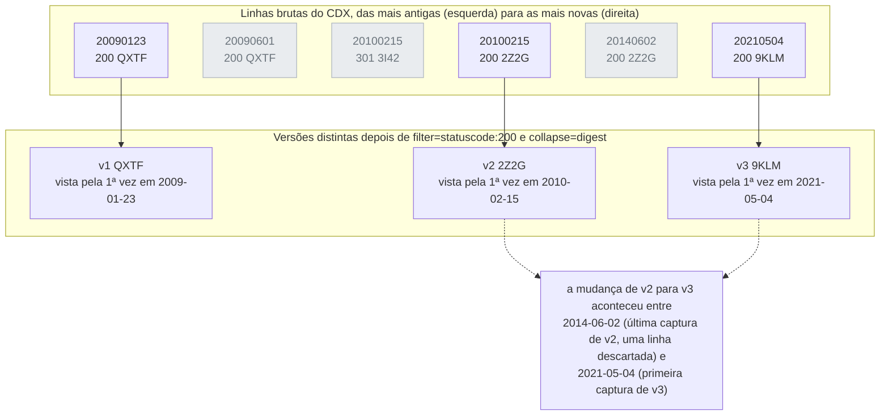

# Dia 26: Investigação em redes sociais, parte 2: conteúdo arquivado e apagado

> 🇺🇸 Original: [*Day 26: Social media investigation, part 2: archived and deleted content*](https://github.com/thiefdroppers/cyber-investigator-skills/blob/main/curriculum/phase-2-osint-digital-footprint/day-26.md) — © ThiefDroppers, licença MIT.
> Aqui: tradução fiel **+** camada brasileira. Nada do original foi removido; tudo o que é novo vem marcado com ➕.

**Fase 2. OSINT e pegada digital** · Meta da trilha: recuperar versões anteriores de páginas e perfis em arquivos da web, consultar diretamente o índice da Wayback Machine e produzir uma linha do tempo de versões que mostre o que mudou e quando.

Rank Jutsu: `C` · [](https://colab.research.google.com/github/Ridd1kulusC0d3r/investigador-cyber-90-dias/blob/main/curriculo/fase-2-osint-pegada-digital/dia-26/dia-26.ipynb)

---

## 🎬 ➕ Abertura do caso — *Entre duas capturas*

Quarta, 14 de outubro. O Dr. Hélio entra na sala de reunião com uma folha impressa.

— O advogado de um cooperado diz que a página "Segurança" da cooperativa **não** avisava sobre SMS com link quando o golpe aconteceu. Que esse aviso só apareceu depois. Isso é verdade?

A Marta olha para você. A página hoje diz, com todas as letras, "nunca enviamos SMS com link".

— A gente mudou no dia 5 — ela diz. — Ou no dia 6. Ou... antes?

Rafa fala baixo, para você:

— Ninguém aqui lembra. A Wayback lembra. Mas presta atenção: ela não vai te dizer **o dia** em que mudou. Vai te dizer entre quais duas capturas mudou. E é essa janela que vai na resposta para o Dr. Hélio, nem um dia a mais, nem a menos.

E, já que está com a Wayback aberta, ele pede mais uma coisa: o site falso também mudou depois que as reclamações começaram.

O Dia 26 é o que foi apagado, e a honestidade de dizer "entre" em vez de "em". *(Personagens e cenário: [Operação Isca](../../../caso-continuo/).)*

---

## 📖 Conceito

Conteúdo retirado de um site ao vivo muitas vezes sobrevive em outro lugar. A Wayback Machine do Internet Archive capturou centenas de bilhões de páginas desde 1996, o archive.today guarda snapshots pedidos por usuários, e as versões passadas de uma página muitas vezes dizem mais do que a atual: uma página "Sobre" antiga nomeando outra empresa controladora, uma lista de parceiros removida, um número de telefone trocado depois de reclamações.

Até 2024, muitos investigadores usavam os *caches* dos buscadores para versões recentes. O Google removeu o operador `cache:` em 2024 e o Bing removeu os links de *cache* mais tarde naquele ano, então os arquivos agora são o caminho principal.

A Wayback Machine tem uma interface de consulta que a maioria das pessoas nunca vê: a API CDX. A visão de calendário mostra as capturas um dia de cada vez. A API CDX devolve todas as capturas de uma URL, ou de todas as URLs sob um prefixo, como linhas que você pode filtrar e contar. Cada linha traz um *digest*: um hash do conteúdo capturado. Duas capturas com o mesmo *digest* são idênticas byte a byte, então colapsar pelo *digest* deixa só as capturas em que algo mudou. Isso transforma "percorrer 900 snapshots" em "ler as 14 versões".

As linhas abaixo são as linhas ilustrativas do Passo 1, com duas capturas posteriores acrescentadas. As linhas cinza são descartadas: uma é um redirecionamento, as outras repetem o *digest* da linha anterior. O que sobra é uma linha por versão. As datas das linhas vizinhas também dão a resposta honesta para "quando mudou?", que é uma janela, e não um dia. Leia essa janela na lista não colapsada, porque `collapse=digest` guarda a primeira captura de cada sequência e joga fora a última.



Plataformas sociais são mais difíceis de arquivar. As páginas delas são montadas por JavaScript depois do login, e muitos snapshots de perfis no X, no Instagram ou no Facebook são cascas vazias ou muros de login. Arquivos funcionam melhor em páginas web comuns e no próprio site da organização, que normalmente é onde estão as edições interessantes, de qualquer forma.

Capturas de arquivo são evidência forte porque foram feitas por um terceiro, mas confira se o carimbo de tempo é a hora da captura, e não a data que a própria página exibe, e lembre que alguém pode ter pedido um snapshot de propósito.

## 📚 Recursos

- A [documentação da API do servidor CDX da Wayback](https://github.com/internetarchive/wayback/tree/master/wayback-cdx-server) lista todos os parâmetros usados abaixo.
- A própria [Wayback Machine](https://web.archive.org/), incluindo a visão Changes para comparar duas capturas.
- O [archive.today](https://archive.ph/) é um arquivo separado, com capturas próprias; busque nele pela URL.
- O [Memento Time Travel](https://timetravel.mementoweb.org/) busca vários arquivos da web ao mesmo tempo, por URL e data.

### ➕ Recursos do contexto Brasil

- [Arquivo.pt](https://arquivo.pt/): o arquivo da web português, com API pública e boa cobertura de sites em língua portuguesa, inclusive alguns `.br`. É uma segunda testemunha independente da Wayback.
- [Ata notarial (CPC, art. 384)](https://www.planalto.gov.br/ccivil_03/_ato2015-2018/2015/lei/l13105.htm): quando a versão de uma página vai ser discutida em juízo, como na pergunta do Dr. Hélio, o jurídico pode querer uma ata notarial da página arquivada, além da sua captura com hash. A sua janela de datas diz ao tabelião quais capturas abrir.
- [Internet Archive — pedidos de remoção](https://help.archive.org/): donos de sites podem pedir exclusão de capturas. Por isso, capture com hash o que importa assim que achar; a Wayback de amanhã pode não ter a captura de hoje.

## 🛠️ Prática: API CDX da Wayback e a visão Changes: uma linha do tempo de versões e um gráfico de densidade de capturas

Use a sua organização do Dia 19. Escolha duas URLs com boa chance de terem mudado: a página "Sobre" ou "Quem somos", e a política de privacidade ou a página de parceiros.

**Seu checklist de hoje.** Faça na ordem e marque cada item ao terminar:

- [ ] Passo 1: listar todas as capturas da Wayback com a API CDX.
- [ ] Passo 2: colapsar a lista em versões únicas pelo *digest*.
- [ ] Passo 3: contar a densidade de capturas por ano.
- [ ] Passo 4: baixar uma cópia limpa `id_` de cada versão.
- [ ] Passo 5: comparar versões com a visão Changes ou com um diff.
- [ ] Passo 6: checar o archive.today e um post de rede social apagado.
- [ ] Passo 7: montar a linha do tempo de versões.
- [ ] Passo 8: datar a mudança mais significativa como uma janela.
- [ ] ➕ Passo 9: as duas páginas do caso (Prática BR).
- [ ] ➕ Passo 10: o notebook do dia no Colab.

Passo 1: liste todas as capturas.

```bash
curl -s "https://web.archive.org/cdx/search/cdx?url=example.org/about&output=json&fl=timestamp,statuscode,digest,length" | jq -r '.[] | @tsv' | head
```

A primeira linha é o cabeçalho. Saída ilustrativa (*digests* encurtados):

```
timestamp	statuscode	digest	length
20090123021509	200	QXTF6ZNN...	4412
20090601183322	200	QXTF6ZNN...	4410
20100215094410	301	3I42H3S6...	402
20100215094412	200	2Z2G4AWV...	5120
```

Os carimbos de tempo estão em UTC, no formato `YYYYMMDDhhmmss`. Um status `301` ou `302` é um redirecionamento, o que já é um achado: a página mudou de lugar.

Passo 2: colapse em versões únicas.

```bash
curl -s "https://web.archive.org/cdx/search/cdx?url=example.org/about&output=json&fl=timestamp,statuscode,digest&filter=statuscode:200&collapse=digest" \
  | jq -r '.[1:][] | @tsv' > exports/about-versions.tsv
wc -l exports/about-versions.tsv
```

`filter=statuscode:200` descarta redirecionamentos e erros. `collapse=digest` descarta cada captura idêntica à anterior. A contagem de linhas é o número de versões distintas. Note que o `collapse` compara só linhas adjacentes; uma página que mudou e depois voltou ao que era aparece duas vezes, o que é correto para uma linha do tempo.

Passo 3: conte a densidade de capturas.

```bash
curl -s "https://web.archive.org/cdx/search/cdx?url=example.org/*&fl=timestamp" \
  | cut -c1-4 | sort | uniq -c
```

`url=example.org/*` é uma consulta por prefixo que cobre toda URL arquivada sob o domínio. Cortar o carimbo em quatro caracteres conta as capturas por ano; use `cut -c1-6` para contar por mês. Ponha as contagens num gráfico de barras na sua planilha. Um pico repentino muitas vezes significa que alguém começou a pedir snapshots, o que às vezes significa uma disputa ou uma campanha.

Passo 4: baixe uma cópia limpa de cada versão.

```bash
curl -s "https://web.archive.org/web/20090123021509id_/https://example.org/about" -o captures/about-2009-01.html
```

O `id_` depois do carimbo de tempo pede os bytes originais capturados, sem a barra de ferramentas da Wayback e sem os links reescritos. Calcule o hash do arquivo como no Dia 19.

Passo 5: compare as versões. Dois caminhos:

1. No navegador, abra o calendário da Wayback para a URL e use a visão Changes (a partir do resumo de capturas da página) para escolher duas capturas; ela destaca o texto acrescentado e removido.
2. Na linha de comando, tire a marcação e faça o diff:

```bash
for f in captures/about-*.html; do sed -e 's/<[^>]*>//g' "$f" | tr -s ' \n' > "${f%.html}.txt"; done
diff -u captures/about-2009-01.txt captures/about-2021-05.txt | less
```

A remoção de tags com `sed` é grosseira, mas serve para encontrar frases alteradas. Registre cada mudança substantiva (um nome, um número, uma afirmação, um link) no registro de reconhecimento.

Passo 6: cheque o archive.today e um post de rede social apagado. Cole a URL "Sobre" na busca do archive.ph para ver se alguém a capturou lá. Depois, para um post do Dia 25 que a organização mais tarde apagou ou editou (se não houver nenhum, use qualquer URL de post antigo da conta), procure na Wayback Machine com uma listagem curinga:

```
https://web.archive.org/web/*/x.com/ExampleOrg/status/*
https://web.archive.org/web/*/twitter.com/ExampleOrg/status/*
```

Cheque os dois domínios; capturas mais antigas ficam sob `twitter.com`. Espere que algumas capturas estejam em branco.

Passo 7: monte a linha do tempo de versões. Acrescente uma seção ao registro de reconhecimento, uma linha por versão distinta:

| Versão | Primeira captura (UTC) | Última captura idêntica | O que mudou | Evidência |
|---|---|---|---|---|
| v1 | 2009-01-23 02:15 | 2010-02-15 | Texto original | `about-2009-01.html`, SHA-256 no registro |
| v2 | 2010-02-15 09:44 | 2014-06-02 | URL mudou (301); acrescentada a frase "subsidiária de" | diff, registro #41 |
| v3 | 2021-05-04 11:20 | atual | Lista de parceiros removida | diff, registro #42 |

Passo 8: date a mudança mais significativa. Pegue a mudança que você julga mais significativa, encontre a janela de datas em que ela aconteceu (última captura da versão antiga, primeira captura da nova) e escreva essa janela no registro de reconhecimento como o achado: o arquivo lhe diz que a mudança aconteceu entre essas duas capturas, não num dia específico. Ponha o mesmo evento na sua linha do tempo do TimelineJS do Dia 25, se couber.

O artefato é a linha do tempo de versões de duas URLs mais o gráfico de barras de densidade de capturas.

### ➕ Prática BR: as duas páginas do caso

**Exercício 1: a pergunta do Dr. Hélio.** Em [`caso-continuo/dados/dia-26/`](../../../caso-continuo/dados/dia-26/) está `cdx-serraazul-seguranca.json`: a resposta sintética da API CDX, no formato `output=json` real (primeira linha é o cabeçalho), para `serraazul.example/seguranca`, mais as cópias `id_` sintéticas de cada versão. Rode os Passos 2, 4, 5 e 7 sobre ela e responda ao Dr. Hélio com uma frase no formato do Passo 8. O que os dados mostram (confira você mesmo):

- até a captura de **2026-09-28**, a página falava em "nunca pedimos sua senha", mas **não** falava de SMS;
- a primeira captura com "nunca enviamos SMS com link" é de **2026-10-05 às 18h** (UTC);
- não há captura entre as duas.

Então a resposta honesta é: *"O aviso sobre SMS com link foi acrescentado entre 2026-09-28 (última captura sem o aviso) e 2026-10-05 18:xx UTC (primeira captura com ele). O arquivo não permite dizer se foi antes ou depois dos disparos das 07h12 BRT de 5/out."* Note o que a frase **não** diz: nem "foi depois do golpe" (o advogado gostaria), nem "já existia" (a cooperativa gostaria). Se o jurídico precisar de mais precisão, a fonte não é a Wayback: é o log de publicação do CMS da própria cooperativa, um dado interno que a Marta pode pedir à TI.

**Exercício 2: o site falso mudou.** `cdx-serraazul-pix.json` traz as capturas de `serraazul-pix.example/regularizar`. Há três versões: o formulário original (agência, conta, senha), uma versão de 2026-10-06 que **acrescenta** um campo de CPF (sim, o mesmo campo que alguém "plantou" na captura adulterada do Dia 19, só que agora de verdade, pela Wayback) e uma versão final em que a página vira "conta suspensa" do provedor. Monte a tabela de versões, date as duas mudanças como janelas e ponha-as na linha do tempo do Dia 25. Pergunta para as notas: *por que a versão "conta suspensa" é boa notícia e má notícia ao mesmo tempo?* (Boa: a derrubada funcionou. Má: a partir dali, o arquivo é a única testemunha do kit; capture com hash agora.)

**Exercício 3: densidade.** `cdx-densidade-serraazul.txt` traz os carimbos de todas as capturas sob `serraazul.example/*`. Conte por mês (Passo 3) e explique o pico de outubro de 2026 com uma frase e uma fonte. (Quem começou a pedir snapshots? A própria Vigia, no Dia 19, e provavelmente jornalistas e cooperados depois dos disparos. Um pico de capturas pode ser **efeito** da investigação, não pista dela; diga isso.)

### ➕ O notebook do dia

Abra o [notebook do Dia 26 no Colab](https://colab.research.google.com/github/Ridd1kulusC0d3r/investigador-cyber-90-dias/blob/main/curriculo/fase-2-osint-pegada-digital/dia-26/dia-26.ipynb). Nele você:

1. consulta a API CDX real com `urllib` (para `example.com`, que é reservado para exemplos) e, sem rede, cai nos dados sintéticos do caso;
2. reimplementa `filter=statuscode:200` e `collapse=digest` em Python e vê por que o `collapse` esconde a última captura de cada versão;
3. joga o **quiz "em ou entre?"**: frases de achado para classificar como honestas ou não;
4. calcula a janela de cada mudança, faz o diff das cópias `id_` com `difflib`, desenha o gráfico de densidade em texto e responde ao Dr. Hélio.

## ✅ Checkpoint

- Toda versão da tabela tem uma cópia limpa `id_` no disco.
- Toda cópia `id_` tem o hash no registro.
- O registro de reconhecimento declara a mudança mais significativa como uma janela de datas, da última captura da versão antiga à primeira captura da nova.
- Esse achado não nomeia um único dia como a data da mudança.
- Sem consultar notas, você explica o que o `id_` depois do carimbo de tempo numa URL da Wayback pede ao arquivo.

### ➕ Checkpoint BR

- A resposta ao Dr. Hélio é uma janela, nomeia as duas capturas e diz explicitamente o que o arquivo não permite concluir.
- A tabela de versões de `serraazul-pix.example/regularizar` tem as três versões, com hash das cópias `id_` e as duas janelas na linha do tempo do Dia 25.
- O pico de capturas de outubro tem uma frase que considera a própria investigação como causa possível.
- Você sabe qual fonte daria mais precisão que a Wayback no Exercício 1 (o log de publicação do CMS da cooperativa).

## ⚖️ ➕ Camada jurídica BR

**Prova de conteúdo que mudou.** No processo civil brasileiro, a ata notarial (CPC, art. 384) é o caminho clássico para atestar o conteúdo de uma página. A captura de terceiro (Wayback) com a sua cópia `id_` e o hash é um elemento técnico forte, mas quem decide o valor é o juiz, e a outra parte pode contestar. A janela honesta protege a cooperativa: uma afirmação exagerada ("o aviso já existia") derrubada em juízo contamina o resto do relatório.

**Cadeia de custódia (CPP, arts. 158-A a 158-F).** Para o lado criminal (o boletim de ocorrência do golpe), as versões do site falso são vestígios. A cópia `id_`, o hash, a URL da captura e a hora UTC do download são a fixação e a coleta. Se o kit sumir da Wayback amanhã (pedido de remoção), a sua cópia com hash e registro continua sendo a evidência.

**Direito ao esquecimento?** O STF, no Tema 786 (2021), entendeu que a ideia de um direito ao esquecimento, como poder de impedir a divulgação de fatos verídicos licitamente obtidos, é incompatível com a Constituição, ressalvada a análise de abusos caso a caso. Isso não obriga nenhum arquivo a manter nada, e não impede pedidos de remoção ao Internet Archive; apenas não torna ilícito, por si, consultar versões antigas de páginas públicas. <!-- TODO jurídico: confirmar redação da tese do Tema 786 (RE 1.010.606) antes de publicar -->

> Material de estudo, não constitui orientação jurídica.

## 🧠 ➕ Camada 8 — o viés retrospectivo e a pressão para dar um dia

A pergunta do Dr. Hélio vem carregada: as duas partes querem uma data que as favoreça. É o terreno do **viés retrospectivo** (*hindsight bias*, estudado por Baruch Fischhoff): depois que sabemos o resultado (houve golpe, houve vítimas), reconstruímos o passado como se ele fosse óbvio, e "lembramos" de ordens de eventos que não presenciamos. A Marta, com sinceridade, oscila entre "dia 5", "dia 6" e "antes". Nenhuma das três é memória; são reconstruções.

O analista sofre outra pressão: **aversão à ambiguidade**. "Entre 28/09 e 05/10" parece uma resposta pior do que "dia 3", e a vontade de entregar um dia (o meio da janela, a data "mais provável") é grande. Mas o dia inventado é exatamente o tipo de afirmação que desmorona sob o contraditório.

Consequência prática: quando alguém pedir "o dia", responda primeiro com a janela e com o nome da fonte que daria mais precisão (log do CMS, e-mail de aprovação da mudança). A janela não é falta de resposta; é a resposta que a evidência sustenta.

## 🤖 ➕ Skill do dia

O Dia 26 propõe acrescentar ao procedimento **"ciclo de reconhecimento OSINT"** o uso da API CDX (versões por *digest*, cópia `id_` com hash) e a regra de datar mudanças como janela entre capturas, nunca como um dia. Proposta em [`_skill-delta.md`](_skill-delta.md).

## 💡 ➕ Inovação OSINT do dia — duas testemunhas: Wayback e Arquivo.pt

Uma captura de terceiro é forte; duas capturas de terceiros **independentes** são melhores (é a regra de "confirmado" do Dia 22). O [Arquivo.pt](https://arquivo.pt/) tem uma API compatível com o protocolo Memento e um servidor CDX próprio. Uma consulta, só com a biblioteca padrão, à API CDX da Wayback (documentada no Recurso do dia):

```python
import json, urllib.request, urllib.parse

def cdx(url, extra=""):
    q = "https://web.archive.org/cdx/search/cdx?url=" + urllib.parse.quote(url) \
        + "&output=json&fl=timestamp,statuscode,digest" + extra
    with urllib.request.urlopen(q, timeout=20) as r:
        linhas = json.load(r)
    return linhas[1:]                                   # a primeira linha é o cabeçalho

versoes = cdx("example.com/", "&filter=statuscode:200&collapse=digest&limit=20")
for ts, status, digest in versoes:
    print(ts[:8], digest[:8])
```

Para a segunda testemunha, o [Memento Time Travel](https://timetravel.mementoweb.org/) (Recurso do original) consulta Wayback, Arquivo.pt, archive.today e outros de uma vez; use-o para achar capturas que a Wayback não tem e preencher a janela do Passo 8 com datas mais próximas.

## 📝 Diário de estudo

- Data:
- Tempo gasto:
- O que ficou claro:
- O que ainda está nebuloso:
- Artefato produzido: linha do tempo de versões de duas URLs e gráfico de densidade de capturas; ➕ resposta ao Dr. Hélio (janela) e tabela de versões do site falso

---
<sub>Baseado em [cyber-investigator-skills](https://github.com/thiefdroppers/cyber-investigator-skills) por ThiefDroppers (MIT). Tradução, camada BR, Camada 8, skill pt-BR e notebook por Deivison Lourenço (@Ridd1kulusC0d3r).</sub>
