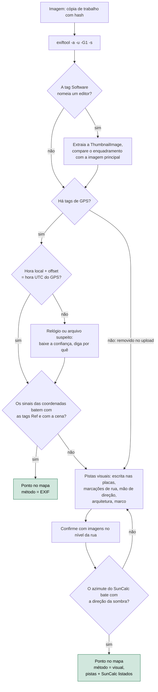

# Dia 27: Forense de metadados, parte 1: imagens e geolocalização

> 🇺🇸 Original: [*Day 27: Metadata forensics, part 1: images and geolocation*](https://github.com/thiefdroppers/cyber-investigator-skills/blob/main/curriculum/phase-2-osint-digital-footprint/day-27.md) — © ThiefDroppers, licença MIT.
> Aqui: tradução fiel **+** camada brasileira. Nada do original foi removido; tudo o que é novo vem marcado com ➕.

**Fase 2. OSINT e pegada digital** · Meta da trilha: extrair e interpretar metadados de imagem com `exiftool`, saber em quais campos dá para confiar e em quais não, e geolocalizar cinco imagens (pelos metadados ou por evidência visual) num mapa com fontes.

Rank Jutsu: `C` · [](https://colab.research.google.com/github/Ridd1kulusC0d3r/investigador-cyber-90-dias/blob/main/curriculo/fase-2-osint-pegada-digital/dia-27/dia-27.ipynb)

---

## 🎬 ➕ Abertura do caso — *A foto que veio como documento*

Quarta-feira, 7 de outubro. Marta encaminha um arquivo que um cooperado recebeu num grupo de WhatsApp da cidade: a foto da fachada da agência Centro com uma faixa vermelha por cima, *"ATENDIMENTO SUSPENSO — REGULARIZE SUA CHAVE PIX"*.

— Isso está rodando em todo grupo. As pessoas acham que a agência fechou mesmo.

O cooperado mandou a imagem "como documento", não como foto. Rafa sorri de lado.

— Então ela veio inteira. Com EXIF. Antes de abrir qualquer coisa: cópia, hash, e me diz o que o arquivo **afirma** sobre si mesmo. Depois a gente vê o que dá para acreditar.

Você abre o terminal. Rafa completa, já saindo:

— E se aparecer coordenada, lembra: coordenada é pista, não endereço de ninguém.

É isso que o Dia 27 ensina. *(Personagens e cenário: [Operação Isca](../../../caso-continuo/). Arquivo sintético do capítulo: [`caso-continuo/dados/dia-27/`](../../../caso-continuo/dados/dia-27/).)*

---

## 📖 Conceito

Uma foto tirada com celular ou câmera carrega metadados EXIF e, muitas vezes, XMP: a hora da captura, a marca e o modelo do aparelho, a lente, os parâmetros de exposição, o software de edição e, quando os serviços de localização estão ligados, as coordenadas GPS. Para um investigador, esses campos respondem onde e quando e, às vezes, com qual aparelho.

Cada campo tem um modo de falhar. `DateTimeOriginal` é o relógio local da câmera, sem fuso horário, a menos que o aparelho também tenha gravado `OffsetTimeOriginal`; uma câmera cujo relógio nunca foi acertado pode estar errada em anos. Os carimbos de tempo do GPS (`GPSDateStamp`, `GPSTimeStamp`) estão em UTC, vindos do *fix* de satélite, então servem como checagem cruzada da hora local. `Software` revela edição: um valor como o nome de um editor de imagens significa que o arquivo que você tem não é o original. Algumas câmeras gravam um `SerialNumber`, que pode ligar várias imagens a uma mesma câmera física. Uma `ThumbnailImage` embutida às vezes sobra de antes de uma edição, de modo que uma foto recortada ainda pode carregar uma pequena prévia sem recorte.

Tudo nos metadados pode ser editado com a mesma ferramenta que você usa para lê-los. Metadado é uma pista: forte quando concorda com o conteúdo visual e com outras fontes, fraca quando está sozinha.

A maioria das grandes plataformas sociais remove o EXIF, inclusive o GPS, das imagens no *upload*, então uma foto baixada de um *feed* social típico raramente tem algum. Sites que servem o arquivo original (alguns sites de compartilhamento de fotos, o Wikimedia Commons, downloads de *press kit*, anexos de e-mail) muitas vezes o mantêm. Quando o metadado some, a geolocalização visual assume: placas, fachadas de lojas, marcações de rua, relevo e o ângulo do sol, comparados com mapas e imagens no nível da rua.

Toda imagem do laboratório de hoje passa por este caminho, e cada ponto do seu mapa registra por qual ramo saiu:



Trate arquivos de evidência como somente leitura. O `exiftool` grava um backup `_original` quando edita, mas você nunca deveria estar editando evidência. Trabalhe numa cópia com hash.

## 📚 Recursos

- [ExifTool, de Phil Harvey](https://exiftool.org/), a ferramenta de referência, com a documentação completa dos nomes de tags em "Tag Names".
- [exif-samples](https://github.com/ianare/exif-samples) é um repositório público (arquivado) no GitHub com imagens de exemplo; `jpg/gps/` contém fotos com tags de GPS.
- [SunCalc](https://www.suncalc.org/) mostra azimute e elevação do sol para qualquer lugar e horário, para conferir sombras.
- [uMap](https://umap.openstreetmap.fr/) cria mapas baseados no OpenStreetMap e importa CSV com colunas de coordenadas. Gratuito, sem conta Google.
- [Primeiros passos da Bellingcat para geolocalizar imagens](https://www.bellingcat.com/resources/how-tos/) (procure "geolocation"): exemplos resolvidos de investigações publicadas.

### ➕ Recursos do contexto Brasil

- [Constituição Federal, art. 5º, X](https://www.planalto.gov.br/ccivil_03/constituicao/constituicao.htm): intimidade, vida privada, honra e imagem das pessoas são invioláveis. É o fundamento do "nada de pessoas como tema" do original.
- [LGPD — Lei 13.709/2018](https://www.planalto.gov.br/ccivil_03/_ato2015-2018/2018/lei/l13709.htm), art. 5º, I: dado pessoal é informação relacionada a pessoa natural identificada ou identificável. Uma coordenada GPS ligada a quem fotografou é dado pessoal.
- [Código de Processo Penal, arts. 158-A a 158-F](https://www.planalto.gov.br/ccivil_03/decreto-lei/del3689.htm): cadeia de custódia. A cópia com hash do Passo 1 é exatamente a etapa de coleta e acondicionamento que esses artigos descrevem.
- [Mapillary](https://www.mapillary.com/) tem boa cobertura colaborativa em cidades brasileiras onde o Street View é antigo ou não chega.
- [OSINT Brazuca](https://github.com/osintbrazuca/osint-brazuca): seção de geolocalização com fontes nacionais.

## 🛠️ Prática: `exiftool`, SunCalc e uMap: um mapa de geolocalização com cinco pontos e fontes

Instale o exiftool: `brew install exiftool` (macOS), `sudo apt install libimage-exiftool-perl` (Debian, Ubuntu, Kali) ou o executável para Windows em exiftool.org.

Escolha cinco imagens, todas de fontes que você tem direito de usar: pelo menos duas fotos que você mesmo tirou com a localização ligada, duas de `exif-samples/jpg/gps/` e uma imagem sem GPS que mostre um lugar público (uma foto sua com a localização desligada, ou uma foto publicada de um marco na página de imprensa da organização do Dia 19). Nada de fotos de casas de pessoas privadas, e nada de imagens com pessoas como tema.

**Seu checklist de hoje.** Faça na ordem e marque cada item ao terminar:

- [ ] Passo 1: copie, calcule o hash e leia os metadados de todas as imagens.
- [ ] Passo 2: extraia os campos-chave de todas as imagens.
- [ ] Passo 3: exporte as coordenadas em graus decimais para CSV.
- [ ] Passo 4: procure uma miniatura remanescente nas imagens editadas.
- [ ] Passo 5: geolocalize visualmente a imagem sem GPS.
- [ ] Passo 6: monte o mapa de cinco pontos no uMap.
- [ ] Passo 7: faça a checagem cruzada das horas do EXIF com a hora UTC do GPS.
- [ ] ➕ Passo 8: a Prática BR, com o "aviso" da agência Centro.
- [ ] ➕ Passo 9: o notebook do dia no Colab.

Passo 1: copie, calcule o hash e leia tudo.

```bash
mkdir -p ~/cases/geo/{orig,work} && cd ~/cases/geo
cp /path/to/images/* orig/ && chmod a-w orig/*
cp orig/* work/
shasum -a 256 orig/* > hashes.txt
exiftool -a -u -G1 -s work/IMG_4821.HEIC | less
```

`-a` mostra tags duplicadas, `-u` mostra tags desconhecidas, `-G1` prefixa cada tag com o seu grupo (assim você distingue EXIF de XMP e de *maker notes*), `-s` imprime os nomes das tags em vez das descrições. Saída ilustrativa, reduzida:

```
[IFD0]          Make                            : Apple
[IFD0]          Model                           : iPhone 13
[IFD0]          Software                        : 17.5.1
[ExifIFD]       DateTimeOriginal                : 2024:06:14 17:42:08
[ExifIFD]       OffsetTimeOriginal              : -04:00
[GPS]           GPSLatitude                     : 43 deg 38' 32.40" N
[GPS]           GPSLongitude                    : 79 deg 23' 13.20" W
[GPS]           GPSTimeStamp                    : 21:42:07
[GPS]           GPSDateStamp                    : 2024:06:14
[GPS]           GPSHPositioningError            : 4.8 m
```

17:42:08 local com offset -04:00 dá 21:42:08 UTC, e o relógio do GPS diz 21:42:07 UTC. Os dois concordam, o que aumenta a confiança na hora. Um `GPSHPositioningError` de 4,8 m diz a qualidade do *fix*.

Passo 2: extraia os campos que importam de todas as imagens.

```bash
exiftool -G1 -s -DateTimeOriginal -OffsetTimeOriginal -GPSDateStamp -GPSTimeStamp \
  -Make -Model -SerialNumber -Software -ImageWidth -ImageHeight work/
```

Passo 3: exporte as coordenadas em graus decimais num CSV.

```bash
exiftool -n -csv -GPSLatitude -GPSLongitude -DateTimeOriginal -Model work/ > points.csv
```

`-n` imprime números brutos, então latitude e longitude saem como decimais com sinal (oeste e sul são negativos), que é o que as ferramentas de mapa precisam. Confira os sinais: uma longitude `79.387` sem o sinal de menos põe uma foto de Toronto na China. Se as tags de referência (`GPSLongitudeRef`) e o número discordarem, não confie em nenhum dos dois até olhar a imagem.

Passo 4: procure uma miniatura remanescente. Para qualquer imagem cuja tag `Software` sugira edição:

```bash
exiftool -b -ThumbnailImage work/edited.jpg > work/edited_thumb.jpg
```

Abra a miniatura e compare com a imagem principal. Enquadramento diferente significa que a miniatura é anterior à edição.

Passo 5: geolocalize a imagem sem GPS. Anote cada pista visual: língua e alfabeto das placas, cores das marcações de rua, de que lado o trânsito anda, arquitetura, vegetação, qualquer marco único. Estreite a área com um mapa e confirme com imagens no nível da rua (Google Street View, Mapillary ou Apple Look Around). Com um ponto candidato, abra o SunCalc, informe o local e a data e hora em que você acredita que a foto foi tirada, e compare a linha de azimute do sol com a direção das sombras na foto. Se apontarem para o mesmo lado, registre como evidência de apoio; se não, o lugar ou a hora está errado.

Passo 6: monte o mapa no uMap. Acrescente uma quinta linha ao `points.csv` para a imagem geolocalizada visualmente, com as coordenadas que você definiu. Acrescente as colunas `name`, `method` (EXIF ou visual), `confidence` e `source`. No uMap: Create a map > ícone de importar (seta para cima) > escolha o arquivo CSV e o formato CSV > Import. O uMap lê colunas chamadas `lat` e `lon` (renomeie antes os cabeçalhos `GPSLatitude` e `GPSLongitude` do exiftool). O *popup* de cada ponto mostra as outras colunas.

`points.csv` ilustrativo depois da edição. As linhas `IMG_4821` e `harbour_front` representam fotos suas; a linha `DSCN0010` é o valor de GPS real desse arquivo público de exemplo (uma imagem de uma Nikon COOLPIX P6000, data GPS 2008:10:23), para você conferir a sua saída com ela:

```
name,lat,lon,method,confidence,source
IMG_4821,43.642333,-79.387000,EXIF GPS (4.8 m error),high,own photo; orig hash in hashes.txt
DSCN0010,43.467448,11.885127,EXIF GPS,medium (sample file; camera clock unverified),exif-samples/jpg/gps
harbour_front,43.6389,-79.3806,visual (signage + SunCalc shadow match),medium,own photo; location services off
```

Passo 7: faça a checagem cruzada das horas do EXIF. Para cada ponto EXIF, aplique a checagem do Passo 1: a hora local mais o offset bate com a hora UTC do GPS? Escreva sim ou não para cada um nas suas notas.

O artefato é o link compartilhado do uMap (ou uma imagem exportada dele) com cinco pontos, cada *popup* informando método, confiança e fonte.

### ➕ Prática BR

**Exercício 1: o "aviso" da agência Centro.** O arquivo é [`caso-continuo/dados/dia-27/aviso-agencia-centro.jpg`](../../../caso-continuo/dados/dia-27/), sintético e fictício. Faça nele os Passos 1, 2, 4 e 7:

```bash
mkdir -p ~/cases/ISCA-P2/img/{orig,work} && cd ~/cases/ISCA-P2/img
cp /caminho/aviso-agencia-centro.jpg orig/ && chmod a-w orig/* && cp orig/* work/
shasum -a 256 orig/* > hashes.txt
exiftool -a -u -G1 -s work/aviso-agencia-centro.jpg
exiftool -b -ThumbnailImage work/aviso-agencia-centro.jpg > work/aviso_thumb.jpg
exiftool -n -GPSLatitude -GPSLatitudeRef -GPSLongitude -GPSLongitudeRef work/aviso-agencia-centro.jpg
```

Responda por escrito, cada item com a tag que o sustenta:

1. O arquivo foi editado? Com o quê, e quando (hora local e UTC)?
2. A miniatura mostra a mesma coisa que a imagem principal? O que a edição acrescentou?
3. A hora local + offset bate com o GPS UTC?
4. As coordenadas fazem sentido para uma agência no interior de Minas Gerais? Olhe o `GPSLatitudeRef` com atenção.
5. Qual destes campos você **não** vai usar para procurar uma pessoa, e para quem ele vai no pacote final: `SerialNumber`, `Make`/`Model`?

**Exercício 2: o ponto honesto.** Monte uma linha de `points.csv` para essa imagem com `method`, `confidence` e `source`. A confiança tem que refletir o problema do item 4. A coordenada aponta para uma área genérica do interior mineiro escolhida para o exercício, não para nenhum estabelecimento real.

### ➕ O notebook do dia

Abra o [notebook do Dia 27 no Colab](https://colab.research.google.com/github/Ridd1kulusC0d3r/investigador-cyber-90-dias/blob/main/curriculo/fase-2-osint-pegada-digital/dia-27/dia-27.ipynb). Nele você:

1. escreve um leitor de EXIF só com `struct` (sem exiftool, sem Pillow) e entende o que é um IFD;
2. converte graus/minutos/segundos em decimal **com** o sinal certo, e vê o ponto pular de hemisfério quando o `Ref` mente;
3. extrai a miniatura escondida do "aviso" e compara com a imagem principal;
4. calcula o azimute do sol (aproximação da NOAA) para checar sombras sem internet;
5. joga o quiz "confio ou não confio?" campo a campo.

## ✅ Checkpoint

- Todo ponto do mapa tem um método.
- Todo ponto do mapa tem uma fonte.
- Suas notas dizem, para cada ponto EXIF, se a hora local mais o offset bate com a hora UTC do GPS.
- Suas notas sobre o ponto visual listam pelo menos três pistas independentes.
- Suas notas sobre o ponto visual registram o resultado do SunCalc.
- A partir de `~/cases/geo`, `shasum -a 256 -c hashes.txt` imprime `OK` para cada arquivo em `orig/`, confirmando que os originais nunca foram modificados.
- Sem consultar notas, você explica o que o `-n` muda na saída de coordenadas do exiftool, e o que uma longitude sem o sinal de menos faz com um ponto no mapa.

### ➕ Checkpoint BR

- Você respondeu às cinco perguntas do Exercício 1, cada uma com a tag que a sustenta.
- Sua linha do `points.csv` para o "aviso" tem confiança baixa ou contestada e diz por quê (o `GPSLatitudeRef` contradiz a cena).
- Você sabe explicar por que "mandar como documento" no WhatsApp preserva metadados que "mandar como foto" costuma remover, e por isso pede ao cliente o arquivo original, não um print.
- Você acertou pelo menos 7 das 9 perguntas do quiz do notebook.

## ⚖️ ➕ Camada jurídica BR

**Coordenada é dado pessoal quando aponta para alguém.** Pela LGPD (art. 5º, I), dado pessoal é qualquer informação relacionada a pessoa natural identificada ou identificável. O GPS de uma foto de fachada pública é, em si, sobre um lugar; mas o mesmo GPS numa foto tirada da janela de alguém revela onde essa pessoa mora. Por isso o original proíbe casas de pessoas privadas, e por isso a sua base legal (art. 7º) precisa cobrir o que você guarda. No caso Isca, a base é a mesma do Dia 01 (legítimo interesse da cooperativa na prevenção à fraude, art. 7º, IX).

**Imagem de pessoas.** A Constituição (art. 5º, X) protege a imagem. Quando uma imagem do caso tiver pessoas, elas não são o tema: borre, recorte ou descreva, e registre que fez isso.

**Cadeia de custódia.** O CPP (arts. 158-A a 158-F, incluídos pela Lei 13.964/2019) descreve a cadeia de custódia do vestígio, da coleta ao descarte. O `chmod a-w orig/*` e o `hashes.txt` do Passo 1 são a sua versão de bancada disso. Se a imagem um dia virar prova num inquérito, a pergunta "como você garante que é o mesmo arquivo?" tem resposta pronta.

**O número de série não é seu para perseguir.** Um `SerialNumber` liga várias imagens a uma mesma câmera; é um ótimo artefato para agrupar campanhas. Transformá-lo em "quem é o dono desse celular" é atribuição de pessoa, e isso é trabalho da polícia com ordem judicial.

> Este repositório é material de estudo e não constitui orientação jurídica.

## 🧠 ➕ Camada 8 — o número que a ferramenta cuspiu

Quando o `exiftool` imprime `GPSLatitude: 20 deg 9' 0.00" N`, a saída parece mais verdadeira do que um palpite seu, porque veio de uma máquina, alinhada, com unidade. Raja Parasuraman e Victor Riley descreveram esse padrão como **viés de automação**: a tendência de aceitar a saída de um sistema automatizado sem conferir, e de deixar de procurar sinais que a contradigam. No laboratório de hoje, ele aparece duas vezes: no sinal da coordenada (o número está "certo", a referência está errada) e na hora (o relógio da câmera pode nunca ter sido acertado).

Do lado da vítima, o mecanismo é o espelho: uma foto da fachada real da agência, com a placa verdadeira, empresta credibilidade à faixa falsa colada por cima. O golpista não precisa falsificar o prédio; precisa falsificar só a faixa.

Consequência prática: para cada campo que você usar num achado, escreva **o que o contradiria** e confira esse ponto. Se não existe nada que possa contradizê-lo, ele não é um achado, é uma crença.

## 🤖 ➕ Skill do dia

Hoje o dia propõe para a [skill pt-BR](../../../skills/investigador-cyber/SKILL.md) o procedimento novo **"Metadados de arquivo"**, começando por imagens: hash antes, `Software` e miniatura, hora local × GPS UTC, sinal × `Ref`, e a regra de que número de série é artefato, não pessoa. Proposta completa em [`_skill-delta.md`](_skill-delta.md).

## 💡 ➕ Inovação OSINT do dia — EXIF e sol sem instalar nada

Em máquina de cliente, em VM limpa ou no celular com Pydroid, nem sempre dá para instalar o exiftool. O EXIF é um pequeno TIFF dentro do segmento APP1 do JPEG, e dá para lê-lo só com `struct`, da biblioteca padrão:

```python
import struct
dados = open("aviso-agencia-centro.jpg", "rb").read()
i = dados.find(b"Exif\x00\x00") + 6          # o TIFF começa logo depois desse marcador
ordem = "<" if dados[i:i+2] == b"II" else ">" # II = little-endian (Intel), MM = big-endian
ifd0 = struct.unpack(ordem + "I", dados[i+4:i+8])[0]   # onde fica o primeiro diretório de tags
print("ordem de bytes:", ordem, "| IFD0 no offset", ifd0)
```

O notebook completa o leitor (IFD0, ExifIFD, GPS e IFD1 com a miniatura) e soma uma função de posição do sol com a aproximação de baixa precisão publicada pela NOAA, boa para checar se uma sombra aponta para leste ou oeste sem depender do SunCalc. A ideia que vale levar: conhecer o formato por dentro faz você desconfiar do formato, e é exatamente isso que o viés de automação apaga.

## 📝 Diário de estudo

- Data:
- Tempo gasto:
- O que ficou claro:
- O que ainda está nebuloso:
- Artefato produzido: link do uMap com cinco pontos, `points.csv`, `hashes.txt`, notas de checagem de hora; ➕ respostas do Exercício 1 sobre o "aviso"

---
<sub>Baseado em [cyber-investigator-skills](https://github.com/thiefdroppers/cyber-investigator-skills) por ThiefDroppers (MIT). Tradução, camada BR, Camada 8, skill pt-BR e notebook por Deivison Lourenço (@Ridd1kulusC0d3r).</sub>
