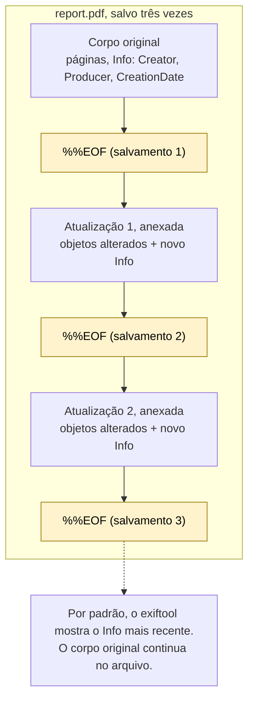
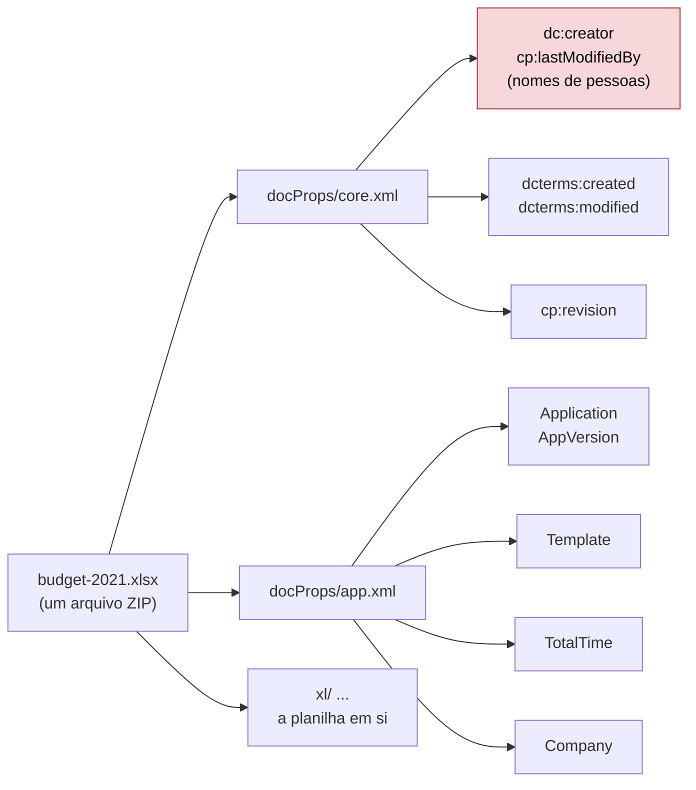

# Dia 28: Forense de metadados, parte 2: PDFs e documentos Office

> 🇺🇸 Original: [*Day 28: Metadata forensics, part 2: PDFs and Office documents*](https://github.com/thiefdroppers/cyber-investigator-skills/blob/main/curriculum/phase-2-osint-digital-footprint/day-28.md) — © ThiefDroppers, licença MIT.
> Aqui: tradução fiel **+** camada brasileira. Nada do original foi removido; tudo o que é novo vem marcado com ➕.

**Fase 2. OSINT e pegada digital** · Meta da trilha: ler os metadados dentro de arquivos PDF e Office, reconhecer os campos que expõem o software de autoria, os modelos e o histórico de edição, e transformar um conjunto de documentos públicos de uma organização num mapa de calor de software por ano.

Rank Jutsu: `C` · [](https://colab.research.google.com/github/Ridd1kulusC0d3r/investigador-cyber-90-dias/blob/main/curriculo/fase-2-osint-pegada-digital/dia-28/dia-28.ipynb)

---

## 🎬 ➕ Abertura do caso — *Três vezes `%%EOF`*

Quinta, 8 de outubro. Junto com a foto da agência, os grupos passaram a circular um PDF: `Comunicado_Oficial_SerraAzul.pdf`. Logo da cooperativa, texto em tom institucional, *"chaves Pix sem recadastro serão BLOQUEADAS em 24 horas"*, e o link `serraazul-pix.example`.

Marta está irritada.

— O pior é que parece nosso. A fonte é a nossa, o rodapé é o nosso.

Rafa pede o arquivo, calcula o hash e roda um único comando antes de abrir: `grep -ac '%%EOF'`. A tela mostra `3`.

— Parece de vocês porque **é** de vocês. Ou foi, na primeira vez que alguém salvou. Vamos ver o que tem embaixo.

É isso que o Dia 28 ensina. *(Personagens e cenário: [Operação Isca](../../../caso-continuo/). Arquivo sintético do capítulo: [`caso-continuo/dados/dia-28/`](../../../caso-continuo/dados/dia-28/).)*

---

## 📖 Conceito

Documentos carregam mais histórico do que imagens. Um PDF tem um dicionário Info (Author, Creator, Producer, CreationDate, ModDate) e normalmente um pacote XMP com as próprias cópias desses campos, mais identificadores de documento e de instância. `Creator` costuma ser o aplicativo em que o documento foi escrito; `Producer` é a biblioteca que gravou o PDF. Um arquivo do Word exportado para PDF normalmente mostra um processador de texto como Creator e um exportador de PDF como Producer; uma carta escaneada mostra o software do scanner; um documento montado num editor de PDF online mostra o nome desse serviço.

PDFs também suportam atualizações incrementais. Uma edição pode ser anexada ao fim do arquivo em vez de reescrevê-lo, deixando a versão anterior dentro do mesmo arquivo. Cada revisão salva costuma terminar com o próprio marcador `%%EOF`, então um arquivo com três deles provavelmente foi salvo três vezes, e o conteúdo anterior pode ser recuperável.



Arquivos Office Open XML (`.docx`, `.xlsx`, `.pptx`) são arquivos ZIP. `docProps/core.xml` guarda o criador, a última pessoa que modificou o arquivo, os carimbos de criação e modificação e um contador de revisões. `docProps/app.xml` guarda o aplicativo e a versão, o nome do modelo, o tempo total de edição e, às vezes, o nome da empresa em que o software foi registrado.



A caixa vermelha contém os campos que você vai retirar do `meta.csv` no Passo 5.

Dois usos importam para este roteiro. Nos documentos públicos de uma organização, o agregado mostra padrões: quais gerações de software os produziram, quando um modelo mudou, quais departamentos publicam o quê. No trabalho com fraude (Fase 5), o metadado de documento é uma das checagens de falsificação mais rápidas. Um "extrato bancário" cujo Producer é um editor de PDF online gratuito, ou uma "carta de oferta" datada de março cujo CreationDate é de julho, é um indicador forte de que o documento não é o que diz ser.

Os campos de autor e de última modificação contêm nomes reais. O tema de hoje é o padrão, não as pessoas. O seu artefato agrega software e datas e descarta as colunas de nomes.

## 📚 Recursos

- [Tags PDF do ExifTool](https://exiftool.org/TagNames/PDF.html) documenta cada campo PDF que o exiftool lê e explica como ele trata atualizações incrementais.
- [Poppler `pdfinfo`](https://poppler.freedesktop.org/) é um segundo leitor, independente, do dicionário Info.
- [ECMA-376 (Office Open XML)](https://ecma-international.org/publications-and-standards/standards/ecma-376/) é a norma que define `core.xml` e `app.xml`, se você quiser as definições dos campos na fonte.
- [Ferramentas de PDF de Didier Stevens](https://blog.didierstevens.com/programs/pdf-tools/) (`pdfid.py`, `pdf-parser.py`) para olhar dentro da estrutura do PDF, inclusive as revisões.

### ➕ Recursos do contexto Brasil

- [Verificador de conformidade do ITI](https://validar.iti.gov.br/): valida assinaturas digitais ICP-Brasil em PDF. Um "comunicado oficial" ou "boleto" com assinatura digital pode ser conferido ali; um documento sem assinatura não ganha nem perde nada.
- [Código Penal compilado](https://www.planalto.gov.br/ccivil_03/decreto-lei/del2848compilado.htm): arts. 297 (falsificação de documento público), 298 (falsificação de documento particular) e 299 (falsidade ideológica). Leia para saber o nome das coisas; quem enquadra é a autoridade.
- [FEBRABAN — dicas de segurança](https://portal.febraban.org.br/): material público sobre golpes com boletos e comunicados falsos, útil para contextualizar o padrão para o cliente.
- `qpdf` (no Debian/Ubuntu: `sudo apt install qpdf`): `qpdf --check` e `qpdf --show-xref` mostram a estrutura de revisões sem depender de Python.

## 🛠️ Prática: `exiftool`, `pdfinfo` e `unzip`: um mapa de calor de metadados de documentos

Use a organização do Dia 19. O seu mapa de calor do Dia 23 mostrou quais hosts publicam mais documentos.

**Seu checklist de hoje.** Faça na ordem e marque cada item ao terminar:

- [ ] Passo 1: colete de 25 a 40 documentos públicos.
- [ ] Passo 2: leia os metadados de um PDF com exiftool e pdfinfo.
- [ ] Passo 3: conte as revisões `%%EOF` no conjunto.
- [ ] Passo 4: abra o `core.xml` e o `app.xml` de um documento Office.
- [ ] Passo 5: extraia todos os metadados para CSV.
- [ ] Passo 6: normalize as famílias de software e cruze por ano.
- [ ] Passo 7: acrescente as anomalias ao registro de reconhecimento.
- [ ] Passo 8: faça a checagem cruzada de uma anomalia entre ferramentas.
- [ ] Passo 9: calibre com um PDF que você mesmo fez.
- [ ] ➕ Passo 10: a Prática BR, com o "comunicado" da Serra Azul.
- [ ] ➕ Passo 11: o notebook do dia no Colab.

Passo 1: colete de 25 a 40 documentos públicos. Use as consultas do Dia 23 (`site:example.org filetype:pdf`, mais `filetype:docx` e `filetype:xlsx`). Baixe-os clicando, a partir de páginas que a organização publicou, cobrindo pelo menos três anos diferentes, se possível. Registre cada URL no registro de coleta.

```bash
mkdir -p ~/cases/P2-ORG/docs/{orig,work} && cd ~/cases/P2-ORG/docs
# depois de baixar em orig/
chmod a-w orig/* && cp orig/* work/ && shasum -a 256 orig/* > hashes.txt
```

Passo 2: leia um PDF por inteiro, de dois jeitos.

```bash
exiftool -a -G1 -s work/annual-report-2022.pdf
pdfinfo work/annual-report-2022.pdf
```

Saída ilustrativa do exiftool, reduzida:

```
[PDF]           PDFVersion                      : 1.7
[PDF]           Linearized                      : Yes
[PDF]           Author                          : (name redacted for this example)
[PDF]           Creator                         : Microsoft® Word for Microsoft 365
[PDF]           Producer                        : Microsoft® Word for Microsoft 365
[PDF]           CreateDate                      : 2022:06:03 10:14:52-04:00
[PDF]           ModifyDate                      : 2022:06:03 10:14:52-04:00
[XMP-xmpMM]     DocumentID                      : uuid:5E1A...
[XMP-xmpMM]     InstanceID                      : uuid:5E1A...
[PDF]           PageCount                       : 48
```

E os campos correspondentes do `pdfinfo` (ilustrativos):

```
Creator:         Microsoft® Word for Microsoft 365
Producer:        Microsoft® Word for Microsoft 365
CreationDate:    Fri Jun  3 10:14:52 2022 EDT
ModDate:         Fri Jun  3 10:14:52 2022 EDT
Pages:           48
PDF version:     1.7
```

Duas ferramentas concordando nos mesmos campos é uma checagem cruzada pequena, mas real. Se discordarem, o arquivo provavelmente tem mais de uma revisão com metadados diferentes; o exiftool mostra os valores mais recentes por padrão.

Passo 3: conte as revisões.

```bash
for f in work/*.pdf; do printf "%s\t%s\n" "$(grep -ac '%%EOF' "$f")" "$f"; done | sort -rn | head
```

Uma contagem acima de 1 significa atualizações incrementais (um PDF linearizado costuma mostrar 2 mesmo quando foi salvo uma vez, então trate 2 como normal e 3 ou mais como algo a examinar). Para o arquivo do topo, rode `pdfid.py work/that-file.pdf` e veja as contagens de `%%EOF` e `/Info`.

Passo 4: abra um documento Office.

```bash
unzip -p work/budget-2021.xlsx docProps/core.xml | xmllint --format -
unzip -p work/budget-2021.xlsx docProps/app.xml  | xmllint --format -
```

Elementos ilustrativos do `core.xml`: `<dc:creator>`, `<cp:lastModifiedBy>`, `<dcterms:created>2019-11-04T15:22:00Z</dcterms:created>`, `<dcterms:modified>2021-02-10T09:03:00Z</dcterms:modified>`. Um arquivo criado em 2019 e publicado como o orçamento de 2021 foi construído a partir de um arquivo mais antigo; isso é uma linhagem de modelo, muitas vezes inofensiva e às vezes exatamente o que expõe uma falsificação. No `app.xml`, olhe `<Application>`, `<AppVersion>`, `<Template>`, `<TotalTime>` e `<Company>`.

Passo 5: extraia tudo para CSV.

```bash
exiftool -csv -r -FileName -FileType -Creator -Producer -CreateDate -ModifyDate -Application -AppVersion work/ > meta.csv
```

Abra o `meta.csv` numa planilha. Apague as colunas Author, Creator com nome de pessoa ou LastModifiedBy que contenham nomes de pessoas antes de salvar a cópia de trabalho. O padrão não precisa delas.

Passo 6: normalize e cruze. Acrescente uma coluna `SoftwareFamily` que agrupe as strings brutas de Producer em famílias (por exemplo, "Word export", "Acrobat", "macOS Quartz", "LibreOffice", "online PDF service", "scanner"). Acrescente `Year` a partir do CreateDate. Monte uma tabela dinâmica: SoftwareFamily nas linhas, Year nas colunas, contagem de arquivos nos valores. Aplique uma escala de cores como no Dia 23. Ilustrativo:

| SoftwareFamily | 2018 | 2019 | 2020 | 2021 | 2022 |
|---|---|---|---|---|---|
| Acrobat | 6 | 5 | 1 | 0 | 0 |
| Word export | 1 | 2 | 7 | 8 | 9 |
| online PDF service | 0 | 0 | 2 | 1 | 0 |
| scanner | 3 | 1 | 0 | 0 | 0 |

Neste exemplo, a organização migrou do Acrobat para exportações do Word por volta de 2020 e parou de escanear papel. Os dois arquivos de um serviço de PDF online em 2020 são os pontos fora da curva que vale ler: quais documentos eram, e por que foram produzidos de outro jeito?

Passo 7: acrescente as anomalias ao registro de reconhecimento. Para cada ponto fora da curva, uma linha: o arquivo, o que é incomum (software, um CreateDate posterior à data impressa no documento, um número alto de revisões) e uma explicação benigna ou preocupante que você consiga checar.

Passo 8: faça a checagem cruzada de uma anomalia. Para uma anomalia, mostre nas suas notas que `exiftool` e `pdfinfo` (ou o `core.xml`) concordam no campo que a torna anômala.

Passo 9: calibre. Pegue um PDF que você mesmo fez na semana passada, rode nele os Passos 2 e 3 e compare a saída com o que você sabe sobre como o fez; essa é a sua checagem de calibração.

O artefato é o mapa de calor (PNG ou PDF), o `meta.csv` sem as colunas de nomes de pessoas e as notas de anomalias.

### ➕ Prática BR

**Exercício 1: o comunicado com três vidas.** O arquivo é [`caso-continuo/dados/dia-28/Comunicado_Oficial_SerraAzul.pdf`](../../../caso-continuo/dados/dia-28/), sintético e fictício. Faça nele os Passos 2 e 3 e, depois, recupere a primeira revisão cortando o arquivo no primeiro `%%EOF`:

```bash
mkdir -p ~/cases/ISCA-P2/docs/{orig,work} && cd ~/cases/ISCA-P2/docs
cp /caminho/Comunicado_Oficial_SerraAzul.pdf orig/ && chmod a-w orig/* && cp orig/* work/
shasum -a 256 orig/* > hashes.txt
exiftool -a -G1 -s work/Comunicado_Oficial_SerraAzul.pdf
pdfinfo work/Comunicado_Oficial_SerraAzul.pdf
grep -ac '%%EOF' work/Comunicado_Oficial_SerraAzul.pdf
grep -abo '%%EOF' work/Comunicado_Oficial_SerraAzul.pdf          # posição (em bytes) de cada %%EOF
head -c <posição_do_1º + 6> work/Comunicado_Oficial_SerraAzul.pdf > work/rev1.pdf
pdfinfo work/rev1.pdf && pdftotext work/rev1.pdf - | head -20
```

Responda por escrito:

1. Quantas revisões? O PDF é linearizado (o que justificaria um `%%EOF` a mais)?
2. O que diz o Info da revisão 1 (Creator, Producer, CreationDate, Title) e o que diz o da última?
3. O que o texto da revisão 1 dizia? Ele foi publicado pela cooperativa? (A Marta confirma que o comunicado de fim de ano de dezembro de 2025 está no site `serraazul.example`.)
4. Em que dia e hora (BRT e UTC) o golpista salvou as revisões 2 e 3? Como isso se encaixa na linha do tempo: domínio registrado em 2/out, certificado emitido em 4/out, SMS em 5/out?
5. Escreva o achado em uma frase, no nível de confiança certo.

**Exercício 2: o mapa de calor da casa.** No notebook, você monta o mapa de calor de 30 documentos públicos (fictícios) de `serraazul.example` e vê onde o "comunicado" cairia se fosse da cooperativa. Spoiler: numa linha que não existe.

### ➕ O notebook do dia

Abra o [notebook do Dia 28 no Colab](https://colab.research.google.com/github/Ridd1kulusC0d3r/investigador-cyber-90-dias/blob/main/curriculo/fase-2-osint-pegada-digital/dia-28/dia-28.ipynb). Nele você:

1. conta os `%%EOF` e lê o dicionário Info de **cada** revisão com `re` (sem biblioteca de PDF);
2. recorta a revisão 1 e lê o texto que o golpista sobrescreveu;
3. monta um `.docx` mínimo com `zipfile` e lê `core.xml`/`app.xml` com `xml.etree`, vendo de perto a caixa vermelha do diagrama;
4. constrói o mapa de calor software × ano em texto, com as colunas de nomes já descartadas;
5. joga o quiz "normal ou anomalia?".

## ✅ Checkpoint

- Seu mapa de calor cobre pelo menos 25 arquivos.
- Seu mapa de calor cobre pelo menos três anos.
- A legenda do mapa de calor informa o número de arquivos.
- A legenda do mapa de calor informa que os campos com nomes de pessoas foram removidos.
- Para uma anomalia, suas notas mostram `exiftool` e `pdfinfo` (ou o `core.xml`) concordando no campo que a torna anômala.
- A saída dos Passos 2 e 3 para o seu próprio PDF bate com o que você sabe sobre como o fez.
- Sem consultar notas, você explica por que uma contagem de `%%EOF` igual a 2 é tratada como normal e qual contagem merece um olhar.

### ➕ Checkpoint BR

- Você recuperou a revisão 1 do comunicado e citou seu Producer e seu CreationDate.
- Seu achado sobre o comunicado está em uma frase, com confiança declarada, e diz que o golpista reaproveitou um documento legítimo da cooperativa (padrão), sem apontar quem fez.
- Você sabe dizer por que o campo `Author` = "Comunicacao Serra Azul" **não** prova autoria da cooperativa.
- Você acertou pelo menos 6 das 8 perguntas do quiz do notebook.

## ⚖️ ➕ Camada jurídica BR

**Falsificação de documento.** O Código Penal trata da falsificação de documento público (art. 297) e particular (art. 298), e da falsidade ideológica (art. 299, inserir declaração falsa em documento verdadeiro). O "comunicado" usa o documento real da cooperativa e troca o conteúdo; enquadrar isso é tarefa da autoridade. O seu trabalho é entregar a prova técnica bem amarrada: hash, revisões, datas, as duas ferramentas concordando.

**Estelionato e fraude eletrônica.** O uso do comunicado para obter dados e transferências se encaixa no padrão do art. 171, com a qualificadora de fraude eletrônica do §2º-A (Lei 14.155/2021), quando a vítima é induzida a erro por meio eletrônico. Mesma observação: você descreve o mecanismo; quem tipifica é o delegado e o promotor.

**Nomes nos metadados.** Campos como `dc:creator` e `cp:lastModifiedBy` muitas vezes trazem o nome do funcionário que redigiu o documento. Isso é dado pessoal (LGPD, art. 5º, I). Pelo princípio da necessidade (art. 6º, III), se o achado não depende do nome, o nome sai do `meta.csv`, exatamente como o original manda.

**Cadeia de custódia.** A revisão 1 recuperada é um vestígio derivado. Registre o comando que a gerou, o hash do arquivo de origem e o hash do recorte (CPP, art. 158-B descreve as etapas, da coleta ao processamento).

> Este repositório é material de estudo e não constitui orientação jurídica.

## 🧠 ➕ Camada 8 — por que o comunicado "parece nosso"

O golpista não escreveu um comunicado do zero. Ele pegou um verdadeiro e trocou o miolo. Isso explora a **heurística da familiaridade** (o que reconhecemos parece mais confiável) e o princípio da **autoridade** que Robert Cialdini descreve: logo, rodapé e tom institucional sinalizam "fonte oficial" antes que o leitor avalie o conteúdo. A urgência ("em 24 horas") completa o golpe, porque reduz o tempo de checagem.

Do lado do investigador, o perigo é o mesmo com sinal trocado: o documento parece tão "da cooperativa" que dá vontade de procurar um vazamento interno ou um funcionário cúmplice. As revisões contam outra história: um PDF público, baixado do site, editado num serviço online. Antes de suspeitar de pessoas, esgote a explicação que o arquivo dá sobre si mesmo.

Consequência prática: no alerta aos cooperados, ensine o **padrão** ("a Serra Azul nunca pede recadastro de Pix por link"), não o arquivo. Na próxima rodada, o golpista troca o PDF; o padrão continua.

## 🤖 ➕ Skill do dia

Hoje o dia propõe acrescentar ao procedimento **"Metadados de arquivo"** (Dia 27) três itens para documentos: contar revisões e ler o Info de cada uma, retirar campos com nomes de pessoas do agregado, e comparar com a linha de base de software da organização. Proposta em [`_skill-delta.md`](_skill-delta.md).

## 💡 ➕ Inovação OSINT do dia — o Info de cada revisão, com uma expressão regular

O exiftool mostra o Info mais recente. Mas cada atualização incremental grava um dicionário Info novo, e os antigos continuam no arquivo. Com a biblioteca padrão dá para listar todos, na ordem em que foram gravados:

```python
import re
pdf = open("Comunicado_Oficial_SerraAzul.pdf", "rb").read()
for m in re.finditer(rb"/Producer \((.*?)\).*?/ModDate \((.*?)\)", pdf, re.S):
    print(m.start(), m.group(1).decode("latin-1"), m.group(2).decode())
print("revisões:", pdf.count(b"%%EOF"))
```

Funciona em PDFs simples, sem compressão de objetos; PDFs modernos podem guardar o Info dentro de *object streams* comprimidos, e aí o caminho é `pdf-parser.py` ou `qpdf --qdf`. O ganho é a linha do tempo de edição inteira de um arquivo em quatro linhas: em fraude documental (Fase 5) é muitas vezes a checagem que decide se um "comprovante" merece um segundo olhar.

## 📝 Diário de estudo

- Data:
- Tempo gasto:
- O que ficou claro:
- O que ainda está nebuloso:
- Artefato produzido: mapa de calor (PNG/PDF), `meta.csv` sem nomes, notas de anomalias; ➕ notas sobre as três revisões do comunicado e `rev1.pdf` com hash

---
<sub>Baseado em [cyber-investigator-skills](https://github.com/thiefdroppers/cyber-investigator-skills) por ThiefDroppers (MIT). Tradução, camada BR, Camada 8, skill pt-BR e notebook por Deivison Lourenço (@Ridd1kulusC0d3r).</sub>
