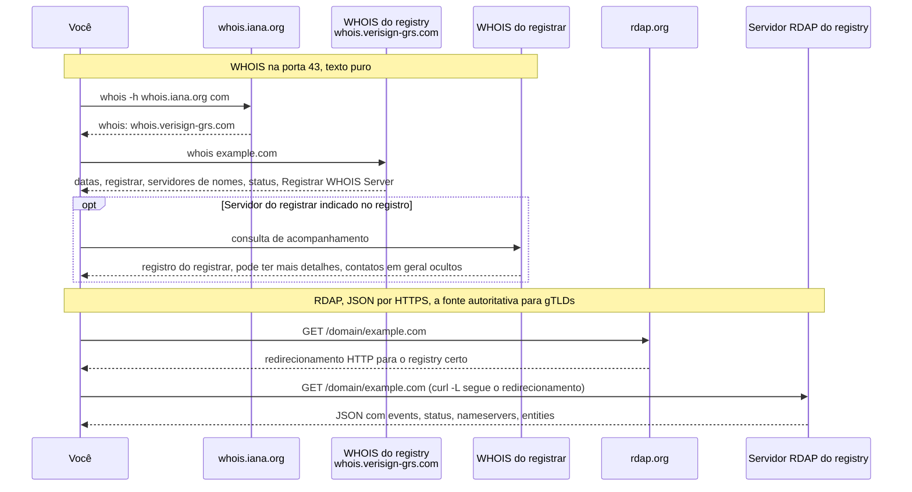
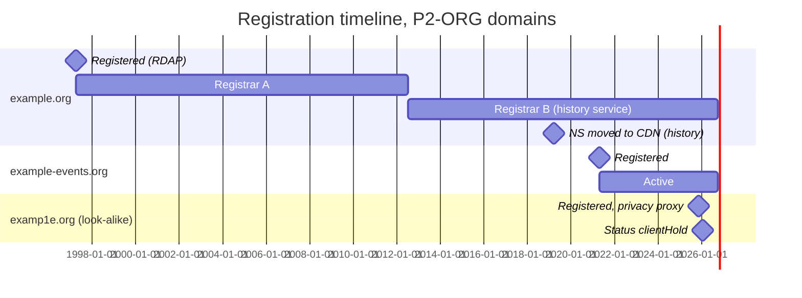
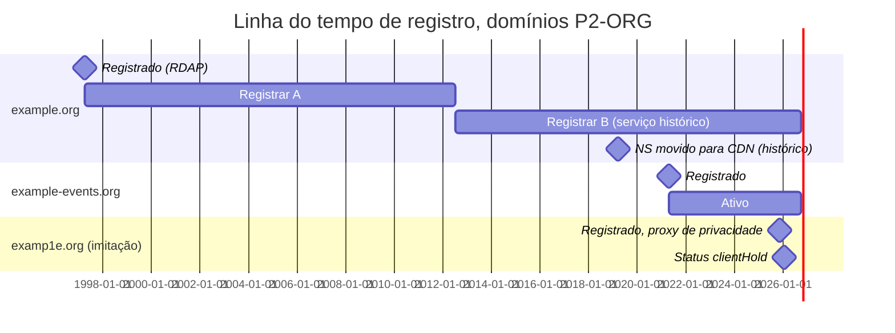

# Dia 29: Registro de domínios: WHOIS, RDAP e histórico de registro

> 🇺🇸 Original: [*Day 29: Domain registration: WHOIS, RDAP, and registration history*](https://github.com/thiefdroppers/cyber-investigator-skills/blob/main/curriculum/phase-2-osint-digital-footprint/day-29.md) — © ThiefDroppers, licença MIT.
> Aqui: tradução fiel **+** camada brasileira. Nada do original foi removido; tudo o que é novo vem marcado com ➕.

**Fase 2. OSINT e pegada digital** · Meta da trilha: consultar dados de registro de domínios com `whois` e RDAP, ler os campos que têm peso investigativo, recuperar estados de registro anteriores num serviço de WHOIS histórico e desenhar o resultado como uma linha do tempo de registro.

Rank Jutsu: `C` · [](https://colab.research.google.com/github/Ridd1kulusC0d3r/investigador-cyber-90-dias/blob/main/curriculo/fase-2-osint-pegada-digital/dia-29/dia-29.ipynb)

---

## 🎬 ➕ Abertura do caso — *Três minutos de diferença*

Sexta, 9 de outubro. O comunicado de ontem tinha a data de edição: noite de 4 de outubro. Rafa quer saber desde quando o palco estava montado.

— Domínio não nasce na véspera por acaso. Pega os três imitadores e o da cooperativa. RDAP, WHOIS, e o histórico do que der.

Dez minutos depois você volta com uma tabela. `serraazul-pix.example` e `serraazul-seguranca.example` foram registrados com três minutos de diferença, no mesmo registrar, numa sexta à tarde, 2 de outubro. Menos de três dias antes dos SMS.

— E o `coopserra-azul`?

— Registrado no dia 3. O ID de analytics já o tinha ligado ao site falso. Mas o histórico mostra que o nome existiu antes, de outro dono. Uma associação de feirantes.

Rafa levanta a sobrancelha.

— Então cuidado com o "mesmo nome, mesma história". O que liga o `coopserra` ao caso é o analytics de agora, não o dono de 2019. Data cada linha.

É isso que o Dia 29 ensina. *(Personagens e cenário: [Operação Isca](../../../caso-continuo/). Dados sintéticos: [`caso-continuo/dados/dia-29/`](../../../caso-continuo/dados/dia-29/).)*

---

## 📖 Conceito

Todo domínio sob um TLD genérico (`.com`, `.org`, `.net` e os gTLDs mais novos) tem um registro mantido pelo *registry* (o registro do TLD) e pelo *registrar* (a empresa registradora). Para um investigador, os campos úteis são a data de criação, o registrar, os servidores de nomes, os códigos de status e a data de expiração. Um domínio criado nove dias antes da campanha de phishing que o usou conta uma história diferente de um registrado em 1998.

A identidade do titular está quase sempre oculta hoje. Desde que o GDPR entrou em vigor em maio de 2018, os registrars ocultam os dados de contato pessoais na maioria dos registros, e muitos domínios também usam um serviço de privacidade ou de *proxy*. Você normalmente vai ver "REDACTED FOR PRIVACY" ou os dados da empresa de proxy. O campo de organização às vezes sobrevive para titulares corporativos, e registros históricos de antes de 2018 ainda podem mostrar o que hoje está oculto.

O protocolo também mudou. Para gTLDs, os contratos da ICANN deixaram de exigir o antigo serviço WHOIS (porta TCP 43 e WHOIS web) em 28 de janeiro de 2025, e o RDAP (*Registration Data Access Protocol*) passou a ser a fonte autoritativa. O RDAP devolve JSON estruturado por HTTPS. Muitos registries ainda respondem ao WHOIS na porta 43, e os TLDs de código de país (`.ca`, `.uk`, `.de`) definem as próprias regras, então você precisa conhecer os dois.

Os dois caminhos de consulta que você vai rodar nos Passos 1 e 2, lado a lado:



Vale ler os códigos de status. `clientTransferProhibited` é uma trava de rotina. `serverHold` ou `clientHold` significa que o domínio está registrado mas não resolve, muitas vezes depois de uma denúncia de abuso ou de falta de pagamento. `pendingDelete` significa que ele está prestes a ser liberado.

Serviços de WHOIS histórico coletam retratos de registro há anos. Eles mostram trocas de registrar, mudanças de servidor de nomes e dados do titular anteriores a 2018. A cobertura varia por serviço e por domínio, e um retrato registra o que o serviço viu no dia em que olhou, então ponha data em toda afirmação.

## 📚 Recursos

- [ICANN Lookup](https://lookup.icann.org/) é o cliente RDAP da própria ICANN, no navegador.
- [rdap.org](https://about.rdap.org/) é um redirecionador que envia uma consulta RDAP para o servidor do registry certo.
- [Códigos de status EPP da ICANN](https://www.icann.org/resources/pages/epp-status-codes-2014-06-16-en) explica cada valor de status que você vai ver.
- WHOIS histórico, *freemium*: [WhoisFreaks history lookup](https://whoisfreaks.com/tools/whois/history/lookup) (poucas consultas gratuitas), [Whoxy WHOIS history](https://www.whoxy.com/whois-history/) (conta gratuita, pagamento por consulta, histórico desde 2012), [WhoisXML API WHOIS History](https://whois-history.whoisxmlapi.com/) (algumas consultas gratuitas no cadastro). A DomainTools tem histórico mais profundo, mas é um produto pago.

### ➕ Recursos do contexto Brasil

- **RDAP do Registro.br**: `https://rdap.registro.br/domain/<nome>` (por exemplo, `curl -s https://rdap.registro.br/domain/registro.br | jq`). É a fonte autoritativa para `.br`.
- **WHOIS do Registro.br na porta 43**: `whois -h whois.registro.br <nome>`. É o caminho do "achar o servidor autoritativo de um ccTLD desconhecido" do original, resolvido: `whois -h whois.iana.org br` aponta para ele.
- No `.br`, o registro é feito em nome de um titular identificado por CPF ou CNPJ. Para titular pessoa jurídica, o WHOIS do Registro.br costuma exibir a organização e o documento; dados de pessoa física são protegidos. Leia a política vigente no site do Registro.br antes de tirar conclusões a partir da ausência de um campo.
- [Consulta pública de CNPJ da Receita Federal](https://solucoes.receita.fazenda.gov.br/servicos/cnpjreva/cnpjreva_solicitacao.asp): quando um `.br` traz um CNPJ, ele é pivô para a razão social e o endereço da **empresa** (não de pessoas).
- **SACI-Adm** (Sistema Administrativo de Conflitos de Internet), no site do [Registro.br](https://registro.br/): é o caminho administrativo para disputa de domínio `.br` que imita uma marca. Para domínios genéricos, o equivalente é a [UDRP da ICANN](https://www.icann.org/resources/pages/help/dndr/udrp-en).

## 🛠️ Prática: `whois`, RDAP com `jq` e um serviço de WHOIS histórico: uma linha do tempo de registro

Use três domínios: o domínio principal da sua organização do Dia 19, um dos outros domínios dela dos Dias 20 a 22 e um domínio imitação da lista "Similar Domain" do Dia 20 ou da tabela de reconciliação do Dia 22.

**Seu checklist de hoje.** Faça na ordem e marque cada item ao terminar:

- [ ] Passo 1: consulte o WHOIS na porta 43 e siga o encaminhamento.
- [ ] Passo 2: consulte o RDAP com `jq`.
- [ ] Passo 3: rode os Passos 1 e 2 nos três domínios.
- [ ] Passo 4: procure o WHOIS histórico do domínio mais antigo e do domínio imitação.
- [ ] Passo 5: monte a linha do tempo de registro como um gráfico de Gantt em Mermaid.
- [ ] Passo 6: ponha o registro do domínio imitação em contexto.
- [ ] ➕ Passo 7: a Prática BR, com os quatro domínios da Operação Isca e um `.br` real.
- [ ] ➕ Passo 8: o notebook do dia no Colab.

Passo 1: WHOIS na porta 43, seguindo o encaminhamento.

```bash
whois example.org
whois -h whois.iana.org org        # which server is authoritative for .org
whois -h whois.verisign-grs.com example.com   # ask the .com registry directly
```

A primeira forma deixa o seu cliente escolher o servidor. A consulta à IANA mostra o servidor `whois:` de um TLD, que é como você descobre o servidor certo para um ccTLD desconhecido. Consultar o registry diretamente dá o registro do registry; o servidor do próprio registrar (indicado na linha `Registrar WHOIS Server`, quando existe) pode ter mais detalhes.

Saída real, capturada em 2026-09-30, para `example.com` (um domínio que a IANA reserva para documentação), reduzida:

```
   Domain Name: EXAMPLE.COM
   Registry Domain ID: 2336799_DOMAIN_COM-VRSN
   Updated Date: 2026-08-14T08:01:43Z
   Creation Date: 1995-08-14T04:00:00Z
   Registry Expiry Date: 2027-08-13T04:00:00Z
   Registrar: RESERVED-Internet Assigned Numbers Authority
   Registrar IANA ID: 376
   Domain Status: clientDeleteProhibited https://icann.org/epp#clientDeleteProhibited
   Domain Status: clientTransferProhibited https://icann.org/epp#clientTransferProhibited
   Domain Status: clientUpdateProhibited https://icann.org/epp#clientUpdateProhibited
   Name Server: ELLIOTT.NS.CLOUDFLARE.COM
   Name Server: HERA.NS.CLOUDFLARE.COM
```

Passo 2: RDAP.

```bash
curl -sL https://rdap.org/domain/example.com | jq -r '.events[] | "\(.eventAction)\t\(.eventDate)"'
curl -sL https://rdap.org/domain/example.com | jq '{ldhName, status, nameservers: [.nameservers[].ldhName], dnssec: .secureDNS.delegationSigned}'
```

`-L` segue o redirecionamento do rdap.org para o servidor RDAP do registry. Saída real para `example.com`, mesma data:

```
registration	1995-08-14T04:00:00Z
expiration	2027-08-13T04:00:00Z
last changed	2026-08-14T08:01:43Z
last update of RDAP database	2026-09-30T05:10:13Z
```

```json
{
  "ldhName": "EXAMPLE.COM",
  "status": ["client delete prohibited", "client transfer prohibited", "client update prohibited"],
  "nameservers": ["ELLIOTT.NS.CLOUDFLARE.COM", "HERA.NS.CLOUDFLARE.COM"],
  "dnssec": true
}
```

O RDAP escreve os códigos de status em palavras ("client transfer prohibited") onde o WHOIS usa *camel case*. Os dados do registrar e de contato ficam no array `entities`; `jq '.entities'` os mostra, em geral ocultos para qualquer registro feito por pessoa física.

O RDAP também cobre endereços IP, que você vai usar no Dia 30:

```bash
curl -sL https://rdap.org/ip/192.0.2.1 | jq '{handle, name, startAddress, endAddress}'
```

Passo 3: rode os Passos 1 e 2 nos seus três domínios. Registre para cada um: data de criação, registrar e IANA ID, servidores de nomes, códigos de status, expiração, DNSSEC e qualquer campo de organização titular que esteja visível. Se a consulta RDAP de um ccTLD falhar, use o WHOIS web do registry dele (para `.ca`, a consulta da CIRA) e anote a fonte.

Passo 4: WHOIS histórico. Crie uma conta gratuita num dos serviços dos Recursos e consulte os dois domínios com mais chance de ter histórico (o mais antigo e o imitação). Procure trocas de registrar, mudanças de servidor de nomes, organização titular antes de 2018 e lacunas (um domínio que expirou e foi registrado de novo por outra pessoa). Faça captura de tela ou exporte cada registro e anote-o com o nome do serviço e a data da consulta, já que os bancos desses serviços diferem.

Passo 5: monte a linha do tempo como um gráfico de Gantt em Mermaid. O GitHub renderiza Mermaid em Markdown, então essa linha do tempo vive nas suas notas ou no seu repositório como texto. Ilustrativo (nomes reservados, datas inventadas):

````markdown

````

Renderizado, esse código-fonte dá isto. As barras longas são estados que duraram; os losangos são eventos únicos com data.



Cada barra e cada marco devem corresponder a uma linha do registro de coleta.

Passo 6: ponha o domínio imitação em contexto. Escreva uma frase situando a data de registro do domínio imitação em relação à linha do tempo social do Dia 25: ele foi registrado perto de algum evento público da organização?

O artefato é a linha do tempo Gantt renderizada (faça *commit* dela, ou cole-a em qualquer editor Mermaid online e exporte PNG) e a tabela de registro dos três domínios.

### ➕ Prática BR

**Exercício 1: os quatro domínios da Operação Isca.** Os `.example` não existem na internet de verdade, então as respostas RDAP e o histórico estão em [`caso-continuo/dados/dia-29/`](../../../caso-continuo/dados/dia-29/) (`rdap-isca.json` no formato RDAP real e `whois-historico-isca.csv`). Use `jq` como no Passo 2:

```bash
cd caso-continuo/dados/dia-29
jq -r 'to_entries[] | .key as $d | .value.events[] | "\($d)\t\(.eventAction)\t\(.eventDate)"' rdap-isca.json
jq 'to_entries[] | {dominio: .key, status: .value.status, ns: [.value.nameservers[].ldhName],
    titular: [.value.entities[] | select(.roles[0]=="registrant") | .vcardArray[1][1][3]]}' rdap-isca.json
```

Monte a tabela do Passo 3 para `serraazul.example`, `serraazul-pix.example`, `serraazul-seguranca.example` e `coopserra-azul.example`, e responda:

1. Quantos dias e horas separam o registro de `serraazul-pix.example` do primeiro SMS (5/out, 07h12 BRT)?
2. O que liga `serraazul-pix` e `serraazul-seguranca` no registro? Isso é aresta forte ou fraca para o grafo? Ela muda a confiança "provável" que o `serraazul-seguranca` tinha até agora (mesmo IP e mesmo NS)?
3. Os dois imitadores usam o mesmo NS `ns1.dnsbarato.example`. Por que isso, sozinho, vale pouco?
4. O `coopserra-azul.example` já está ligado ao caso pelo ID de analytics `G-ISCA7K2Q9P`, mas o histórico mostra outro titular entre 2019 e 2024, sem relação com o caso. O que você **não** pode concluir a partir desse histórico? Que status ele teve em 2024?

**Exercício 2: um `.br` de verdade.** Rode no seu terminal o caminho brasileiro para um domínio público institucional (por exemplo, `registro.br` ou o domínio `.br` da sua organização do Dia 19):

```bash
whois -h whois.iana.org br                 # quem é o servidor autoritativo do .br
whois -h whois.registro.br registro.br     # WHOIS na porta 43
curl -s https://rdap.registro.br/domain/registro.br | jq -r '.events[] | "\(.eventAction)\t\(.eventDate)"'
```

Compare a data de criação dos dois caminhos e anote a fonte e a hora UTC da consulta, como no Checkpoint.

Depois, monte o Gantt da Operação Isca (o notebook gera o código Mermaid para você).

### ➕ O notebook do dia

Abra o [notebook do Dia 29 no Colab](https://colab.research.google.com/github/Ridd1kulusC0d3r/investigador-cyber-90-dias/blob/main/curriculo/fase-2-osint-pegada-digital/dia-29/dia-29.ipynb). Nele você:

1. consulta o RDAP real do Registro.br e do rdap.org com `urllib` (com plano B offline, se a rede falhar);
2. lê o RDAP da Operação Isca e transforma `events`, `status` e `entities` numa tabela;
3. calcula a distância entre cada registro e o primeiro SMS;
4. gera o Gantt em Mermaid, com cada linha marcada "registry" ou "histórico";
5. joga o quiz dos códigos de status EPP.

## ✅ Checkpoint

- Para cada domínio, a data de criação do WHOIS bate com a do RDAP, ou suas notas explicam por que não (diferenças de ccTLD, um novo registro).
- Todo fato na linha do tempo está marcado como vindo do registry ao vivo ou de um serviço histórico.
- Suas notas contêm uma frase situando a data de registro do domínio imitação em relação à linha do tempo social do Dia 25.
- Essa frase diz se o domínio imitação foi registrado perto de um evento público da organização.
- Sem consultar notas, você explica como achar o servidor WHOIS autoritativo de um ccTLD desconhecido.

### ➕ Checkpoint BR

- Sua tabela dos quatro domínios da Isca tem data de criação, registrar, NS, status e titular visível, com a fonte de cada linha.
- Você escreveu: "`serraazul-pix.example` foi registrado em 02/10/2026 às 14h22 UTC, 2 dias e cerca de 20 horas antes do primeiro SMS" (ou o equivalente com as suas contas), marcado como confirmado/provável conforme as fontes.
- Você sabe explicar por que o histórico de outro titular do `coopserra-azul.example` não pode virar aresta para o "Pescador".
- Você rodou o caminho `.br` (IANA → `whois.registro.br` → `rdap.registro.br`) num domínio real e anotou fonte e hora.
- Você acertou pelo menos 6 das 8 perguntas do quiz do notebook.

## ⚖️ ➕ Camada jurídica BR

**Dados de registro também são dados pessoais.** Quando o titular é pessoa física, nome, e-mail e telefone no WHOIS são dados pessoais (LGPD, art. 5º, I). É por isso que o Registro.br, como os registrars sob o GDPR, protege esses campos. Um dado tornado público continua protegido: a LGPD (art. 7º, §3º e §4º) admite tratar dado de acesso público ou tornado manifestamente público, mas manda respeitar a finalidade, a boa-fé e o interesse público que justificaram a publicação. "Estava no WHOIS de 2015" não autoriza montar um perfil da pessoa.

**Quem pode pedir o que está oculto.** Os dados reais do titular de um domínio usado em golpe existem no registrar. Pelo Marco Civil (arts. 10 e 22), dados cadastrais e registros guardados por provedores são obtidos por ordem judicial ou, para dados cadastrais, por requisição das autoridades com competência legal (art. 10, §3º). A Vigia não pede: prepara o material para a cooperativa e a autoridade.

**Derrubada é outro caminho.** Para tirar o domínio do ar, a via é a denúncia de abuso ao registrar e à hospedagem (com evidência), e, para `.br`, o procedimento administrativo de conflito do Registro.br. Isso não exige identificar ninguém.

> Este repositório é material de estudo e não constitui orientação jurídica.

## 🧠 ➕ Camada 8 — a data que parece um motivo

Menos de três dias. Três minutos de diferença entre dois registros. Numa sexta à tarde. A mente monta a história sozinha: "um operador organizado, que planejou tudo com calma". Daniel Kahneman chamou a tendência de construir a narrativa mais coerente com o pouco que se tem de **WYSIATI** ("o que você vê é tudo o que existe"): a confiança na história depende da coerência, não da quantidade de evidência.

O `coopserra-azul.example` é o antídoto deste capítulo. Ele está, sim, ligado ao caso de hoje (pelo ID de analytics), e é exatamente aí que mora a tentação: o mesmo nome já pertenceu a uma associação sem relação nenhuma com o golpe, e ficou anos estacionado. Se você emendasse o retrato de 2019 no achado de 2026, "provaria" um dono que não existe.

Consequência prática: na linha do tempo, separe **o que o registro diz** (data, registrar, NS) do **que você infere** (planejamento, mesmo operador). A inferência pode ir no relatório, mas rotulada como inferência, com o que a contradiria.

## 🤖 ➕ Skill do dia

Hoje o dia propõe acrescentar ao procedimento **"Ciclo de reconhecimento OSINT"** três itens sobre registro de domínio: RDAP como fonte autoritativa (com o caminho `.br`), data em toda linha de histórico e a distância entre registro e campanha relatada como fato separado da inferência. Proposta em [`_skill-delta.md`](_skill-delta.md).

## 💡 ➕ Inovação OSINT do dia — RDAP sem `jq`, sem `whois`, sem instalar nada

RDAP é só JSON por HTTPS. Com a biblioteca padrão, a consulta inteira cabe em quatro linhas e roda em qualquer lugar onde haja Python (inclusive numa VM de análise mínima, onde o pacote `whois` não está instalado):

```python
import json, urllib.request
url = "https://rdap.registro.br/domain/registro.br"      # para gTLD: https://rdap.org/domain/<nome>
dados = json.load(urllib.request.urlopen(url, timeout=15))
print({e["eventAction"]: e["eventDate"] for e in dados.get("events", [])}, dados.get("status"))
```

Um detalhe que pouca gente usa: a IANA publica o *bootstrap* do RDAP em `https://data.iana.org/rdap/dns.json`, a lista de qual servidor RDAP atende cada TLD. Com ele, o seu script descobre sozinho o servidor certo para um ccTLD desconhecido, que é exatamente a pergunta final do Checkpoint, respondida por máquina.

## 📝 Diário de estudo

- Data:
- Tempo gasto:
- O que ficou claro:
- O que ainda está nebuloso:
- Artefato produzido: tabela de registro de três domínios, Gantt renderizado; ➕ tabela dos quatro domínios da Isca e Gantt do caso

---
<sub>Baseado em [cyber-investigator-skills](https://github.com/thiefdroppers/cyber-investigator-skills) por ThiefDroppers (MIT). Tradução, camada BR, Camada 8, skill pt-BR e notebook por Deivison Lourenço (@Ridd1kulusC0d3r).</sub>
