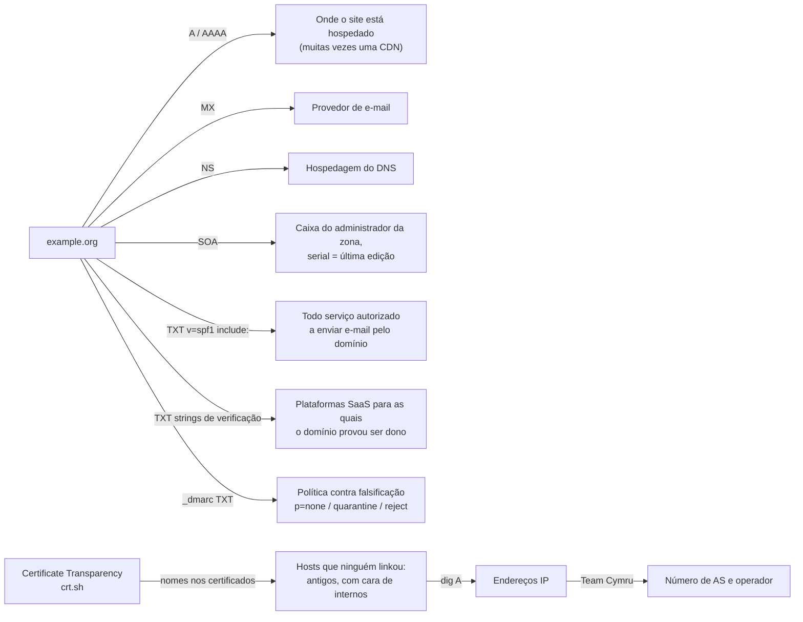
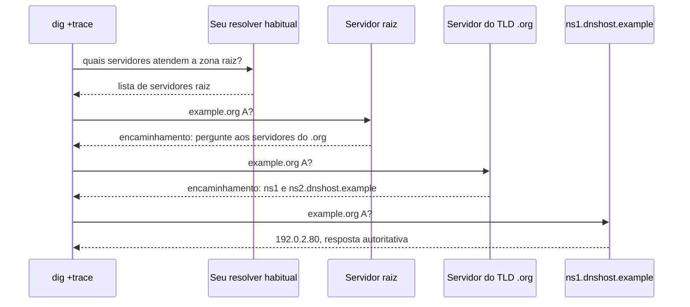
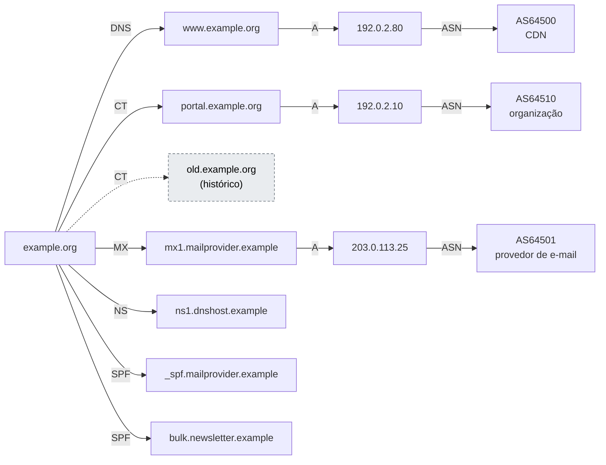

# Dia 30: Reconhecimento DNS com dig, nslookup e Certificate Transparency

> 🇺🇸 Original: [*Day 30: DNS reconnaissance with `dig`, `nslookup`, and certificate transparency*](https://github.com/thiefdroppers/cyber-investigator-skills/blob/main/curriculum/phase-2-osint-digital-footprint/day-30.md) — © ThiefDroppers, licença MIT.
> Aqui: tradução fiel **+** camada brasileira. Nada do original foi removido; tudo o que é novo vem marcado com ➕.

**Fase 2. OSINT e pegada digital** · Meta da trilha: ler os registros DNS públicos de uma organização e o histórico dela no *Certificate Transparency*, resolver o que encontrar até redes e operadores, e montar um mapa de infraestrutura que você consegue defender registro por registro.

Rank Jutsu: `C` · [](https://colab.research.google.com/github/Ridd1kulusC0d3r/investigador-cyber-90-dias/blob/main/curriculo/fase-2-osint-pegada-digital/dia-30/dia-30.ipynb)

---

## 🎬 ➕ Abertura do caso — *Um certificado, quatro nomes*

Sábado de plantão, 10 de outubro. Rafa espalha na mesa a saída do crt.sh que você imprimiu.

— Olha a linha de cima. Um certificado gratuito, emitido na tarde de 4 de outubro, véspera dos SMS. Quantos nomes ele cobre?

— Quatro. O `serraazul-pix`, o `www`, um `painel`... e o `serraazul-seguranca`.

— Pois é. Até ontem o `seguranca` era só "provável": mesmo IP, mesmo NS, registrado três minutos depois. Agora quem diz é o próprio certificado. Isso é aresta com rótulo.

Ele vira a folha.

— E antes de você se empolgar com o `painel`: a gente **lê** que ele existe. Não abre, não tenta senha, não faz força bruta de subdomínio no servidor deles. Passivo.

Depois aponta o `_dmarc` da cooperativa, que você colou ao lado.

— E isso aqui, `p=none`, explica por que o golpista nem precisou de domínio imitação para mandar e-mail. Anota. Vai para a Marta.

É isso que o Dia 30 ensina. *(Personagens e cenário: [Operação Isca](../../../caso-continuo/). Dados sintéticos: [`caso-continuo/dados/dia-30/`](../../../caso-continuo/dados/dia-30/).)*

---

## 📖 Conceito

O DNS é público por definição. Qualquer pessoa pode pedir a um *resolver* os registros A, AAAA, MX, NS, TXT e SOA de um domínio, e as respostas descrevem como a organização está ligada à internet: onde seus sites estão hospedados, quem cuida do seu e-mail, quem opera seu DNS e para quais serviços de terceiros ela já provou ser dona do domínio.

Os registros TXT merecem mais atenção. Registros SPF (`v=spf1 ...`) listam todos os serviços autorizados a enviar e-mail em nome do domínio, então as entradas `include:` nomeiam provedores de e-mail e de marketing. O DMARC fica em `_dmarc.<domínio>` e mostra a política da organização contra falsificação de e-mail: `p=reject` significa que e-mail falsificado deve ser recusado, `p=none` significa que ele só é monitorado, o que importa quando, mais tarde, você avaliar quão fácil é se passar pelo domínio numa campanha de phishing. Strings de verificação (`google-site-verification=`, `MS=` e similares) mostram a quais plataformas SaaS o domínio foi conectado.

O *Certificate Transparency* (CT) cobre a lacuna que o DNS deixa. O DNS só responde sobre um nome se você souber perguntar. Desde 2018, certificados TLS publicamente confiáveis precisam estar registrados em logs públicos de CT para serem aceitos pelos principais navegadores, e cada certificado lista os nomes de host que cobre. Buscar um domínio no CT devolve nomes de host que a organização nunca linkou em lugar nenhum, inclusive antigos e com cara de internos.

O que cada fonte diz, e como os passos de hoje as encadeiam:



A fronteira entre passivo e ativo é concreta aqui. Consultar *resolvers* públicos e logs de CT é passivo. Fazer força bruta de subdomínios enviando milhares de palpites aos servidores de nomes da própria organização, ou pedir a eles uma transferência de zona (AXFR), é ativo e só deve ser feito contra domínios que você controla ou que está autorizado a testar. Para praticar, o pesquisador de segurança Robin Wood (DigiNinja) mantém o `zonetransfer.me` justamente para que as pessoas aprendam como é uma transferência de zona mal configurada.

## 📚 Recursos

- [crt.sh](https://crt.sh/) é a busca gratuita de Certificate Transparency da Sectigo, com opção de saída em JSON.
- [Team Cymru IP to ASN mapping](https://www.team-cymru.com/ip-asn-mapping) é uma consulta gratuita, baseada em WHOIS, de IP para número de AS e operador.
- [DigiNinja: zonetransfer.me](https://digi.ninja/projects/zonetransferme.php) explica a zona de prática deliberadamente aberta.
- [RFC 7489 (DMARC)](https://www.rfc-editor.org/rfc/rfc7489), seção 6.3, para o significado das tags (`p=`, `sp=`, `adkim=`, `aspf=`, `rua=`).

### ➕ Recursos do contexto Brasil

- [Registro.br — informações técnicas e DNSSEC](https://registro.br/): o `.br` foi um dos primeiros ccTLDs a adotar DNSSEC; vale saber ler o `ad` (dados autenticados) na resposta do `dig`.
- [CERT.br — boas práticas antispam (SPF, DKIM, DMARC)](https://www.cert.br/): material em português para explicar ao cliente por que `p=none` é um risco.
- [IX.br](https://ix.br/): os pontos de troca de tráfego brasileiros; útil para entender por que um IP de provedor nacional aparece com um AS que você não conhece.
- [RDAP do NIC.br/LACNIC para IPs](https://rdap.registro.br/): blocos alocados no Brasil respondem em `https://rdap.registro.br/ip/<ip>`; para a região inteira, o LACNIC (`https://rdap.lacnic.net/rdap/ip/<ip>`).

## 🛠️ Prática: `dig`, crt.sh e Gephi: um mapa de infraestrutura defensável

Use a organização do Dia 19. O `dig` vem com o macOS e com a maioria das distribuições Linux (pacote `dnsutils` no Debian/Ubuntu); no Windows, use o `nslookup` ou instale as ferramentas do BIND.

**Seu checklist de hoje.** Faça na ordem e marque cada item ao terminar:

- [ ] Passo 1: consulte os registros DNS principais.
- [ ] Passo 2: trace a delegação e faça consultas reversas.
- [ ] Passo 3: busque no Certificate Transparency pelo crt.sh.
- [ ] Passo 4: resolva os hosts do CT para IPs e números de AS.
- [ ] Passo 5: faça uma transferência de zona, só contra a zona de prática.
- [ ] Passo 6: monte o mapa de infraestrutura no Gephi.
- [ ] Passo 7: audite e compare com os Dias 20 e 21.
- [ ] ➕ Passo 8: a Prática BR, com a infraestrutura da Operação Isca.
- [ ] ➕ Passo 9: o notebook do dia no Colab.

Passo 1: os registros principais.

```bash
D=example.org
dig $D A +noall +answer
dig $D AAAA +short
dig $D MX +short
dig $D NS +short
dig $D SOA +short
dig $D TXT +short
dig _dmarc.$D TXT +short
```

`+noall +answer` imprime só a seção de resposta, com TTLs e tipos de registro; `+short` imprime só os valores. Saída ilustrativa (nomes reservados e IPs de documentação):

```
example.org.		300	IN	A	192.0.2.80
10 mx1.mailprovider.example.
20 mx2.mailprovider.example.
ns1.dnshost.example.
ns2.dnshost.example.
ns1.dnshost.example. hostmaster.example.org. 2026091501 7200 3600 1209600 300
"v=spf1 include:_spf.mailprovider.example include:bulk.newsletter.example -all"
"google-site-verification=AbC123..."
"v=DMARC1; p=quarantine; rua=mailto:dmarc@example.org"
```

Lendo: o segundo campo do SOA é a caixa de e-mail do administrador da zona, com o primeiro ponto valendo `@` (`hostmaster@example.org`); o serial `2026091501` segue a convenção comum `YYYYMMDDnn`, então a zona foi editada pela última vez em 15 de setembro de 2026 ou depois. O SPF nomeia dois remetentes, um provedor de e-mail e um serviço de newsletter. O DMARC está em `quarantine`, mais rígido que `none` e mais frouxo que `reject`.

As mesmas consultas com o `nslookup`, útil no Windows:

```
nslookup -type=mx example.org
nslookup -type=txt example.org 1.1.1.1
nslookup
> set type=ns
> example.org
> exit
```

O `1.1.1.1` no fim envia a consulta para esse *resolver* em vez do seu padrão. Comparar respostas de dois *resolvers* é uma checagem rápida de DNS *split-horizon* ou de cache desatualizado.

Passo 2: trace a delegação e as consultas reversas.

```bash
dig +trace $D
dig -x 192.0.2.80 +short
```

`+trace` caminha a partir dos servidores raiz para baixo, mostrando quais servidores de nomes são autoritativos em cada nível. Com os nomes ilustrativos do Passo 1, a caminhada é assim:



`-x` faz uma consulta reversa (PTR); um PTR como `server-192-0-2-80.cdn.example` identifica o provedor de hospedagem mais rápido do que qualquer outra coisa.

Passo 3: Certificate Transparency.

```bash
curl -s "https://crt.sh/?q=%25.$D&output=json" \
  | jq -r '.[].name_value' | tr 'A-Z' 'a-z' | sed 's/^\*\.//' | sort -u > exports/ct-hosts.txt
wc -l exports/ct-hosts.txt
```

`%25` é um `%` codificado para URL, o curinga, então a consulta significa "qualquer nome que termine em .example.org". `name_value` pode ter vários nomes por certificado, separados por quebras de linha; `jq -r` imprime um por linha. O `sed` tira o `*.` dos certificados curinga. O crt.sh dá *timeout* em dias movimentados e em domínios muito grandes; espere e tente de novo, ou use o formulário web. Cada registro JSON também traz `not_before` e `not_after`, que datam quando cada nome de host estava em uso.

Passo 4: resolva os hosts do CT e mapeie-os para redes.

```bash
while read h; do
  for ip in $(dig +short A "$h" | grep -E '^[0-9.]+$'); do printf "%s,%s\n" "$h" "$ip"; done
done < exports/ct-hosts.txt > exports/host-ip.csv

( echo begin; echo verbose; cut -d, -f2 exports/host-ip.csv | sort -u; echo end; sleep 10 ) \
  | nc whois.cymru.com 43 > exports/ip-asn.txt
```

O segundo comando envia cada IP único para a interface em lote da Team Cymru numa única conexão (`begin`, `verbose`, um IP por linha, `end`). O `sleep` mantém a conexão aberta tempo suficiente para a resposta; sem ele, o `nc` do macOS fecha antes de a resposta chegar e você fica com um arquivo vazio. Aumente o valor para listas longas. Respostas em lote começam com uma linha `Bulk mode;` e não têm cabeçalho de colunas. Para um único IP, `whois -h whois.cymru.com " -v 192.0.2.80"` funciona. Formato real da saída, de uma consulta ao vivo em 2026-09-30 para um IP atrás de uma CDN:

```
AS      | IP               | BGP Prefix          | CC | Registry | Allocated  | AS Name
13335   | 104.20.23.154    | 104.20.16.0/20      | US | arin     | 2014-03-28 | CLOUDFLARENET - Cloudflare, Inc., US
```

Hosts do CT que não resolvem mais são históricos; mantenha-os, marcados como tais.

Passo 5 (só a zona de prática): uma transferência de zona.

```bash
dig +short NS zonetransfer.me
dig axfr zonetransfer.me @nsztm1.digi.ninja
```

Quando o servidor de prática permite, você recebe a zona inteira, inclusive registros que ninguém acharia chutando. É por isso que o AXFR deve ser restrito aos servidores de nomes secundários. Se você vir `; Transfer failed.`, essa também é a resposta de um servidor corretamente configurado; em setembro de 2026 a zona de prática ainda respondia ao AXFR (verificado a partir de um ponto de observação de terceiros), então uma falha provavelmente é da sua rede: algumas VPNs, provedores e redes corporativas interceptam a porta 53 e respondem no lugar do servidor. Teste com `dig +tcp SOA zonetransfer.me @nsztm1.digi.ninja`: uma resposta do servidor real traz a flag `aa` (autoritativa) e um TTL cheio de 7200 segundos, enquanto uma resposta interceptada mostra `ra` sem `aa` e um TTL abaixo de 7200. Se você estiver sendo interceptado, tente de outra rede em vez de contornar. Não rode AXFR contra os servidores de nomes do seu alvo.

Passo 6: monte o mapa no Gephi. Faça um arquivo de arestas com as colunas `Source,Target,Label`: domínio para cada host (`label: CT` ou `label: DNS`), host para IP (`A`), IP para AS (`ASN`), domínio para os hosts MX e NS (`MX`, `NS`) e domínio para cada `include:` do SPF (`SPF`).

```
Source,Target,Label
example.org,www.example.org,DNS
example.org,portal.example.org,CT
portal.example.org,192.0.2.10,A
192.0.2.10,AS64510,ASN
example.org,mx1.mailprovider.example,MX
example.org,_spf.mailprovider.example,SPF
```

No Gephi: File > Import spreadsheet > escolha o arquivo, "Edges table", depois Append to existing workspace ou New workspace. O Gephi reconhece as colunas `Source` e `Target`. Rode o ForceAtlas 2, colora os nós por Modularity Class como no Dia 20 e exporte PNG.

Desenhadas, as seis arestas de exemplo acima, mais algumas da saída do Passo 1, ficam assim. Cada seta é uma linha da sua tabela de registros, rotulada com o tipo de registro que a produziu. O nó tracejado é um nome de host do CT que não resolve mais, mantido e marcado como histórico.



Passo 7: audite e compare.

1. Escolha quaisquer cinco arestas do mapa e reproduza cada uma com um único comando desta página.
2. Compare a lista de hosts de hoje com a do SpiderFoot (Dia 20) e a do Maltego (Dia 21). Nas suas notas, nomeie um host que só o CT encontrou e um que só uma ferramenta anterior encontrou.
3. Escreva uma frase sobre a política DMARC e o que ela significa para a facilidade de falsificar o domínio num e-mail de phishing.

O artefato é o mapa de infraestrutura do Gephi mais uma tabela de registros (uma linha por aresta, com o comando ou a fonte que a produziu).

### ➕ Prática BR

**Exercício 1: a infraestrutura da Isca.** Os `.example` não resolvem na internet, então as saídas estão em [`caso-continuo/dados/dia-30/`](../../../caso-continuo/dados/dia-30/): `crtsh-isca.json` (formato JSON real do crt.sh) e `dns-isca.txt` (saídas de `dig` e da Team Cymru de 9/out, horas antes de a hospedagem do site falso ser suspensa). Rode o pipeline do Passo 3 sobre o arquivo:

```bash
cd caso-continuo/dados/dia-30
jq -r '.[].name_value' crtsh-isca.json | tr 'A-Z' 'a-z' | sed 's/^\*\.//' | sort -u
jq -r '.[] | "\(.not_before)\t\(.issuer_name)\t\(.name_value | gsub("\n"; ", "))"' crtsh-isca.json
```

Responda:

1. Qual certificado liga `serraazul-pix.example` a `serraazul-seguranca.example`? Quando foi emitido, e por qual tipo de autoridade?
2. Que nome de host, só visível no CT, você **não** vai visitar, e o que registra sobre ele?
3. Qual host da própria cooperativa aparece no CT com certificado vencido desde 2022, mas ainda responde no DNS? O que o Dia 23 já registrou sobre ele, e o que você **não** faz agora?
4. O que diz o DMARC de `serraazul.example`? Escreva a frase do Passo 7.3 para a Marta.
5. Monte o `arestas-isca.csv` (`Source,Target,Label`) e importe no Gephi, ou use o grafo em texto do notebook.

**Exercício 2: um `.br` de verdade, passivo.** No seu terminal, rode os Passos 1 e 3 contra um domínio público institucional brasileiro (por exemplo, o da sua organização do Dia 19, se for `.br`) e consulte `rdap.registro.br/ip/<ip>` para um dos IPs. Nada de AXFR nem força bruta: só *resolvers* públicos e crt.sh.

### ➕ O notebook do dia

Abra o [notebook do Dia 30 no Colab](https://colab.research.google.com/github/Ridd1kulusC0d3r/investigador-cyber-90-dias/blob/main/curriculo/fase-2-osint-pegada-digital/dia-30/dia-30.ipynb). Nele você:

1. consulta o crt.sh de verdade com `urllib` (com plano B: o JSON da Isca embutido);
2. faz consultas DNS reais com `socket` e, mais fundo, monta uma consulta DNS à mão com `struct` (sem `dig`, sem `dnspython`);
3. lê SPF e DMARC e calcula o "risco de falsificação" do domínio;
4. monta a tabela de arestas e o grafo de vínculos em texto, com hubs e nós históricos;
5. joga o quiz "o que o mapa sustenta?".

## ✅ Checkpoint

- As cinco arestas escolhidas ao acaso, reproduzidas com um único comando cada, batem com o mapa.
- Suas notas nomeiam um host que só o CT encontrou.
- Suas notas nomeiam um host que só o SpiderFoot ou o Maltego encontrou.
- Suas notas contêm uma frase sobre a política DMARC e o que ela significa para a facilidade de falsificar o domínio num e-mail de phishing.
- Sem consultar notas, você explica como o teste `dig +tcp SOA` distingue uma resposta do servidor de nomes real de uma interceptada.

### ➕ Checkpoint BR

- Sua tabela de arestas da Isca tem a aresta `serraazul-pix.example — serraazul-seguranca.example` rotulada "SAN do mesmo certificado (crt.sh, id ...)".
- `painel.serraazul-pix.example` está no mapa como nó **observado no CT, não visitado**.
- `intranet-antiga.serraazul.example` está no mapa com certificado vencido (2022) e host ainda ativo, com a nota de que as exposições achadas no Dia 23 foram comunicadas e **não** abertas.
- Sua frase sobre o DMARC `p=none` da cooperativa recomenda uma ação concreta (subir para `quarantine` e depois `reject`, depois de monitorar os relatórios `rua`).
- Você acertou pelo menos 6 das 8 perguntas do quiz do notebook.

## ⚖️ ➕ Camada jurídica BR

**Passivo × ativo, na lei brasileira.** Consultar *resolvers* públicos e logs de CT é ler informação que o próprio sistema publica para todos. Força bruta de subdomínios e AXFR contra servidores de terceiros são outra coisa: dependendo do que for feito e obtido, podem encostar no art. 154-A do Código Penal (invasão de dispositivo informático, na redação da Lei 14.155/2021) e, no mínimo, ficam fora do seu escopo escrito. A regra do original ("só em domínios que você controla ou está autorizado a testar") é a mesma régua do portão de autorização do Dia 01.

**O `painel` que você não abre.** Saber que `painel.serraazul-pix.example` existe é dado público (CT). Tentar entrar nele é acesso a sistema alheio, mesmo sendo de um criminoso. Registre o nome, a fonte e a data, e entregue à cooperativa e à polícia.

**Dados de terceiros na infraestrutura.** IPs e nomes de servidores de empresas (provedores, CDNs) não são dados pessoais. Um PTR ou um SOA com nome de pessoa (`fulano.silva.dominio`) é: aplique a minimização da LGPD (art. 6º, III) e não leve o nome para o mapa se o achado não depende dele.

> Este repositório é material de estudo e não constitui orientação jurídica.

## 🧠 ➕ Camada 8 — o hub que não é suspeito

Num grafo de infraestrutura, o nó com mais arestas chama a atenção, e a mente tende a ler "muito conectado" como "importante para o caso". É o que a psicologia chama de **saliência**: o que salta à vista ganha um peso que a evidência não lhe deu. Num golpe, o hub costuma ser uma hospedagem barata ou uma CDN onde milhares de sites sem relação entre si moram. O procedimento de grafo da skill já avisa: provedor de hospedagem pode parecer hub só porque muita gente o usa.

Do lado do golpista, o DMARC `p=none` da cooperativa é engenharia social pela porta dos fundos: quando a política não manda rejeitar, um e-mail com remetente `@serraazul.example` forjado pode chegar à caixa de entrada com a "autoridade" do domínio verdadeiro, e nenhum filtro avisa o cooperado.

Consequência prática: para cada hub, escreva **por que** ele está conectado (o "mesmo AS" de dois sites falsos vale pouco se o AS hospeda 40 mil sites). E transforme o achado de DMARC em recomendação defensiva para o cliente: é a coisa mais útil do dia.

## 🤖 ➕ Skill do dia

Hoje o dia propõe acrescentar ao procedimento **"Grafo de vínculos"** três itens sobre infraestrutura: rótulo de aresta pelo tipo de registro, nomes vistos só no CT tratados como observados e não visitados, e a fronteira passivo/ativo (sem força bruta nem AXFR fora de zona própria ou autorizada). Proposta em [`_skill-delta.md`](_skill-delta.md).

## 💡 ➕ Inovação OSINT do dia — uma consulta DNS feita à mão

O `dig` nem sempre está instalado, e o `socket.getaddrinfo` do Python só devolve A/AAAA. Mas uma consulta DNS é só um pacote UDP pequeno, que a biblioteca padrão monta e lê com `struct`:

```python
import socket, struct, random
def consulta(nome, tipo=16, servidor="1.1.1.1"):          # 16 = TXT, 1 = A, 15 = MX
    cab = struct.pack(">HHHHHH", random.randint(0, 65535), 0x0100, 1, 0, 0, 0)  # id, RD=1, 1 pergunta
    q = b"".join(bytes([len(p)]) + p.encode() for p in nome.split(".")) + b"\x00"
    s = socket.socket(socket.AF_INET, socket.SOCK_DGRAM); s.settimeout(5)
    s.sendto(cab + q + struct.pack(">HH", tipo, 1), (servidor, 53))
    return s.recv(4096)                                     # resposta crua: o notebook decodifica
print(len(consulta("_dmarc.registro.br")), "bytes de resposta")
```

O notebook completa o decodificador (cabeçalho, perguntas, respostas e a compressão de nomes com ponteiros `0xC0`). Saber montar o pacote também ensina por que a "consulta passiva" ainda deixa rastro: quem responde é um *resolver*, e é o IP dele, não o seu, que chega aos servidores do alvo. Isso volta no Dia 32.

## 📝 Diário de estudo

- Data:
- Tempo gasto:
- O que ficou claro:
- O que ainda está nebuloso:
- Artefato produzido: mapa de infraestrutura (Gephi), tabela de registros; ➕ `arestas-isca.csv` e a frase do DMARC para a Marta

---
<sub>Baseado em [cyber-investigator-skills](https://github.com/thiefdroppers/cyber-investigator-skills) por ThiefDroppers (MIT). Tradução, camada BR, Camada 8, skill pt-BR e notebook por Deivison Lourenço (@Ridd1kulusC0d3r).</sub>
