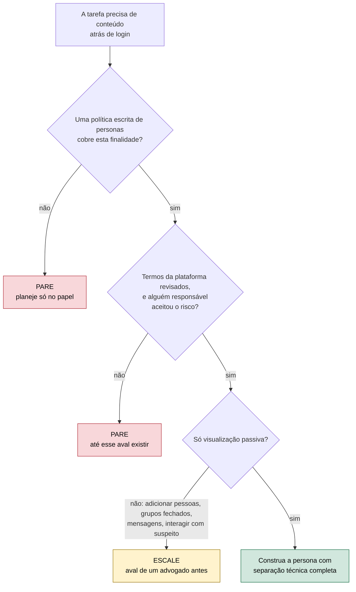
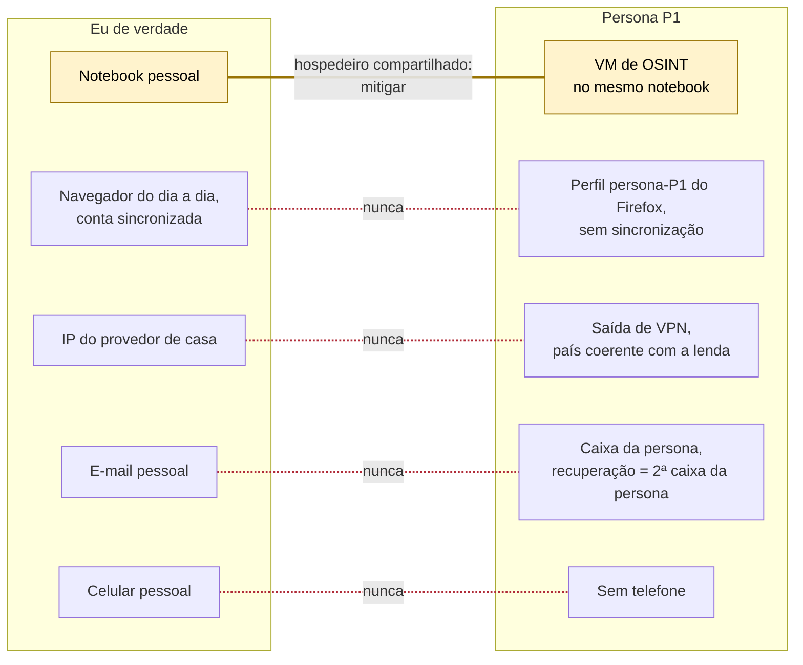

# Dia 31: Perfis de fachada (sock puppets): quando são permitidos e como mantê-los limpos

> 🇺🇸 Original: [*Day 31: Sock puppets: when they are allowed, and how to keep them clean*](https://github.com/thiefdroppers/cyber-investigator-skills/blob/main/curriculum/phase-2-osint-digital-footprint/day-31.md) — © ThiefDroppers, licença MIT.
> Aqui: tradução fiel **+** camada brasileira. Nada do original foi removido; tudo o que é novo vem marcado com ➕.

**Fase 2. OSINT e pegada digital** · Meta da trilha: decidir se uma persona de pesquisa se justifica para uma tarefa e, se sim, construí-la dentro de uma política escrita, com separação técnica completa da sua identidade real.

Rank Jutsu: `C` · [](https://colab.research.google.com/github/Ridd1kulusC0d3r/investigador-cyber-90-dias/blob/main/curriculo/fase-2-osint-pegada-digital/dia-31/dia-31.ipynb)

---

## 🎬 ➕ Abertura do caso — *A pergunta que vem por escrito*

Segunda, 12 de outubro. O perfil `@serraazul.oficial` no Instagram já tem 2 mil seguidores, e o "Serra Azul Atendimento" no WhatsApp Business responde cooperados com o link do golpe. Parte do que eles publicam só aparece para quem está logado.

Você sugere o óbvio:

— Cria uma conta qualquer e segue o perfil. Rapidinho.

Rafa não responde. Abre o contrato da Serra Azul na tela e procura a palavra "persona". Não acha. Procura "perfil". Acha só no trecho que diz *"não contatar suspeitos"*.

— A Vigia tem política de persona?

— Não sei.

— Eu sei. Não tem. Então hoje a gente faz o que o original manda: desenha no papel, decide por escrito, e **não cria conta nenhuma**. E pensa no que dá para fazer sem login. Spoiler: dá muita coisa.

É isso que o Dia 31 ensina. *(Personagens e cenário: [Operação Isca](../../../caso-continuo/).)*

---

## 📖 Conceito

Um perfil de fachada (*sock puppet*, ou persona de pesquisa) é uma conta que não identifica você, usada para ver conteúdo que exige login sem expor o investigador. Ele existe porque plataformas com login mostram quem vê para quem é visto (o "quem viu seu perfil" do LinkedIn, a lista de quem viu os *stories*, as sugestões de "pessoas que você talvez conheça" montadas a partir de contatos enviados), e porque um investigador que navega num grupo de fraude com o próprio nome alerta o grupo e se expõe.

Três restrições vêm antes de qualquer técnica.

Autorização. No ambiente profissional, personas são criadas sob uma política escrita do seu empregador ou cliente que diz quem pode criá-las, para quais finalidades e quem revisa o uso. Investigadores policiais e de setores regulados muitas vezes precisam de aprovação caso a caso. Sem essa política, você é uma pessoa criando contas falsas, e não deve.

Termos das plataformas. Muitas plataformas proíbem contas que deturpam a identidade. Os termos da Meta pedem que os usuários usem o nome que usam no dia a dia e que não criem contas para outras pessoas; o Contrato do Usuário do LinkedIn proíbe perfis falsos. Violar termos costuma ser uma questão contratual, não um crime (o Dia 33 trata da diferença), mas pode fazer contas serem banidas, evidências serem questionadas e a sua organização ser processada. A sua política deve registrar que a organização aceitou esse risco para uma finalidade declarada.

Uso passivo. O padrão seguro é olhar, não tocar. Ver conteúdo público ou semipúblico é uma coisa. Adicionar pessoas reais, entrar em grupos fechados, mandar mensagens ou interagir com um suspeito leva a *pretexting* (obter algo sob pretexto falso) e, dependendo de quem você é e de onde está, a trabalho infiltrado que exige autoridade legal. Alguns tipos de *pretexting* são crime por si só: nos Estados Unidos, obter registros telefônicos ou informações financeiras de alguém sob falso pretexto é proibido por lei federal. Qualquer interação ativa precisa antes do aval de um advogado.

As três restrições, na ordem em que você as checa. Uma persona só é construída se todas as respostas caírem no caminho da direita:



Tecnicamente, uma persona falha por vínculo, não por um nome ruim: o mesmo endereço IP das suas contas reais, a mesma impressão digital de navegador, um telefone de recuperação que é seu, uma lista de contatos sincronizada do seu celular, uma foto de perfil roubada que uma busca reversa de imagem leva a uma pessoa real.

## 📚 Recursos

- [Firefox Multi-Account Containers](https://addons.mozilla.org/firefox/addon/multi-account-containers/) separa cookies e dados de sites por contêiner, num mesmo navegador.
- [Perfis do Firefox (`about:profiles`)](https://support.mozilla.org/kb/profile-manager-create-remove-switch-firefox-profiles) dá separação completa de histórico, extensões e configurações por perfil.
- [Trace Labs OSINT VM](https://www.tracelabs.org/initiatives/osint-vm) é uma imagem de máquina virtual gratuita feita para trabalho de OSINT, uma base limpa para trabalho com personas.
- [Termos de Serviço da Meta](https://www.facebook.com/terms.php) e [Contrato do Usuário do LinkedIn](https://www.linkedin.com/legal/user-agreement): leia você mesmo as seções sobre identidade e condutas proibidas antes que qualquer persona toque em uma das duas plataformas.

### ➕ Recursos do contexto Brasil

- [Termos de Uso do Instagram](https://help.instagram.com/581066165581870) e [Termos de Serviço do WhatsApp Business](https://www.whatsapp.com/legal/business-terms): as duas plataformas dos perfis falsos da Operação Isca. Leia as partes sobre identidade e uso permitido.
- **Canais de denúncia de falsa identidade de marca**: o Instagram e o WhatsApp têm formulários para que a **própria empresa** imitada denuncie perfis que se passam por ela. É o caminho que dispensa persona.
- [Lei 12.850/2013 (organizações criminosas)](https://www.planalto.gov.br/ccivil_03/_ato2011-2014/2013/lei/l12850.htm) e [ECA (Lei 8.069/1990)](https://www.planalto.gov.br/ccivil_03/leis/l8069.htm): preveem a infiltração de **agentes de polícia** na internet, com autorização judicial. Leia para entender o que **não** é o seu papel.
- [Código Penal compilado](https://www.planalto.gov.br/ccivil_03/decreto-lei/del2848compilado.htm): art. 307 (falsa identidade).

## 🛠️ Prática: perfis do Firefox e diagrams.net: a lenda da persona e o diagrama de compartimentos

Você vai projetar uma persona e sua infraestrutura no papel e num perfil de navegador. Hoje você não vai criar conta em nenhuma plataforma social. Se o seu empregador tem uma política de personas, siga-a e use isto como exercício de planejamento dentro dela.

**Seu checklist de hoje.** Faça na ordem e marque cada item ao terminar:

- [ ] Passo 1: escreva a justificativa da persona.
- [ ] Passo 2: escreva a lenda da persona.
- [ ] Passo 3: monte o compartimento isolado do navegador.
- [ ] Passo 4: desenhe o diagrama de compartimentos no diagrams.net.
- [ ] Passo 5: escreva os critérios de descarte e o formato do registro de uso.
- [ ] Passo 6: cace no diagrama os vínculos com a sua identidade real.
- [ ] Passo 7: registre o responsável pelo risco.
- [ ] ➕ Passo 8: a Prática BR, a decisão da Vigia sobre os perfis falsos da Serra Azul.
- [ ] ➕ Passo 9: o notebook do dia no Colab.

Passo 1: escreva a justificativa. Três linhas no topo de `persona-P1.md`:

```
Purpose: view posts in open (public) job-scam reporting groups to catalog scam patterns (Phase 5 lab)
Authorized by: [policy name / supervisor] or "planning exercise only; no accounts created"
Activity limit: passive viewing only. No friending, joining closed groups, posting, reacting, or messaging.
```

(Em português: *Finalidade: ver publicações em grupos abertos (públicos) de denúncia de golpes de emprego para catalogar padrões de golpe (laboratório da Fase 5). Autorizado por: [nome da política / supervisor] ou "só exercício de planejamento; nenhuma conta criada". Limite de atividade: só visualização passiva. Sem adicionar pessoas, entrar em grupos fechados, publicar, reagir ou mandar mensagens.*)

Passo 2: escreva a lenda. A lenda é a história mínima e coerente da persona. Mantenha-a sem graça: um nome e sobrenome genéricos, comuns na região que a persona diz ser, uma cidade ampla, um emprego comum, poucos interesses. Registre:

| Campo | Valor | Observações |
|---|---|---|
| Nome | (genérico, conferido por busca na web para garantir que nenhuma pessoa real conhecida o use com esta foto e esta cidade) | |
| Foto | nenhuma, ou uma imagem sem rosto (paisagem, animal, objeto) cujos direitos você tem | Nunca uma foto roubada de uma pessoa real |
| E-mail | uma caixa nova, criada só para esta persona | E-mail de recuperação: uma segunda caixa só da persona, nunca a sua |
| Telefone | número fornecido pela organização e destinado a trabalho com personas, ou nenhum | Nunca o seu número pessoal |
| Criada em | data | Contas envelhecem; anote |
| Critérios de descarte | veja o Passo 5 | |

Sobre fotos: uma foto roubada personifica uma pessoa real e é achada com uma única busca reversa de imagem. Rostos gerados por IA em geradores públicos têm sinais conhecidos (posição dos olhos sempre igual, artefatos no fundo) e algumas plataformas os tratam como inautênticos; uma imagem sem rosto é o padrão honesto.

Passo 3: monte o compartimento do navegador.

1. No Firefox, vá em `about:profiles` > Create a New Profile e dê o nome `persona-P1`. Abra-o num novo navegador (ou pela linha de comando: `firefox -P persona-P1 --no-remote`).
2. Só nesse perfil: Settings > Privacy & Security > Enhanced Tracking Protection: Strict. Desligue "Remember history" ou configure para limpar ao fechar, se as suas notas forem guardadas em outro lugar.
3. Não entre numa conta Firefox nesse perfil; a sincronização o ligaria a você.
4. Não instale as extensões que você usa no seu navegador pessoal. Um conjunto característico de extensões faz parte da sua impressão digital.
5. Se usar contêineres em vez de perfis, crie um contêiner por persona e nunca abra um site da persona fora dele. Perfis dão separação mais forte; use-os quando puder.

Melhor ainda: rode o perfil dentro de uma máquina virtual (a Trace Labs OSINT VM ou qualquer VM Linux limpa) que você não use para mais nada. O Dia 32 testa quanto cada opção esconde você.

Passo 4: desenhe o diagrama de compartimentos no diagrams.net (app.diagrams.net, gratuito, sem conta). Uma coluna por identidade: "Eu de verdade", "Persona P1" e, se planejar uma, "Persona P2". Linhas: dispositivo ou VM, perfil de navegador, saída de rede (provedor de casa, VPN, Tor), e-mail, telefone, meio de pagamento e contas em plataformas. Preencha cada célula. Trace uma linha vermelha entre duas células que nunca podem se tocar, e um ícone de alerta amarelo em qualquer célula compartilhada (por exemplo, o mesmo notebook rodando a VM e o seu navegador pessoal). Conjunto ilustrativo de linhas para uma coluna de persona:

```
Device:   OSINT VM (VirtualBox), host laptop shared   [yellow]
Browser:  Firefox profile persona-P1, no sync
Network:  commercial VPN, fixed exit country matching legend
Email:    persona mailbox, recovery = second persona mailbox
Phone:    none (platforms requiring phone: not used)
Payment:  none
Accounts: none created (planning exercise)
```

(Dispositivo: VM de OSINT no VirtualBox, notebook hospedeiro compartilhado [amarelo]. Navegador: perfil `persona-P1`, sem sincronização. Rede: VPN comercial, país de saída fixo e coerente com a lenda. E-mail: caixa da persona, recuperação = segunda caixa da persona. Telefone: nenhum; plataformas que exigem telefone não são usadas. Pagamento: nenhum. Contas: nenhuma criada, exercício de planejamento.)

É mais ou menos isto que o diagrama pronto deve mostrar, para essa coluna de persona ao lado de "Eu de verdade". As linhas vermelhas tracejadas são pares que nunca podem se tocar. O par amarelo é o notebook hospedeiro compartilhado, que precisa de uma mitigação escrita. Qualquer ligação que você não consiga desenhar como vermelha ou amarela é um vínculo em que você ainda não pensou.



Passo 5: escreva os critérios de descarte e o formato do registro de uso. Critérios de descarte são os eventos que aposentam uma persona na hora: entrar a partir do seu IP real, uma plataforma sugerir "adicionar pessoas que você talvez conheça" que são seus contatos reais, um alvo interagir com a persona, um pedido de verificação de identidade com documento. Acrescente uma tabela de registro de uso (data/hora UTC, plataforma, finalidade, referência do caso, ações realizadas) e preencha uma linha para a sessão de planejamento de hoje.

Passo 6: cace os vínculos. Revise o diagrama em busca de qualquer caminho da coluna da persona até a coluna "Eu de verdade" que não atravesse uma linha vermelha: uma recuperação de e-mail compartilhada, um telefone compartilhado, a mesma saída de rede, o mesmo perfil de navegador. Cada um que você achar é um vínculo para corrigir, ou para marcar de amarelo com uma mitigação.

Passo 7: registre o responsável pelo risco. Responda por escrito em `persona-P1.md`: quais termos específicos de plataforma se aplicam ao uso pretendido desta persona, e quem na sua organização aceitou esse risco? Se a resposta for "ninguém", a persona fica no papel.

O artefato é o `persona-P1.md` (justificativa, lenda, critérios de descarte, registro de uso) e o diagrama de compartimentos exportado em PNG.

### ➕ Prática BR

**Exercício 1: a decisão da Vigia, por escrito.** Passe a pergunta "criar uma persona para ver o conteúdo do `@serraazul.oficial` e do 'Serra Azul Atendimento'?" pelo fluxograma do Conceito e escreva `notas/decisao-persona-isca.md` com:

1. Cada uma das três perguntas, a resposta e de onde ela vem (contrato, política da Vigia, termos lidos).
2. O resultado (no cenário: **PARE na primeira pergunta**, porque a Vigia não tem política de personas e o contrato da Serra Azul não prevê isso; e mesmo "conversar com o atendimento falso para ver o roteiro" cairia em ESCALE, por ser interação com suspeito).
3. **O que dá para fazer sem persona**, que é a parte útil do exercício. Pelo menos quatro itens. Pistas: o que aparece do perfil sem login (nome, foto, bio, link, número de seguidores), capturas que os próprios cooperados já mandaram à cooperativa, o número do WhatsApp nas mensagens que eles receberam, o link na bio que leva ao domínio que você já conhece, e a denúncia de falsa identidade feita **pela cooperativa**, como dona da marca.

**Exercício 2: a persona que fica no papel.** Mesmo com o PARE, faça os Passos 2, 4, 5 e 6 como planejamento para uma futura política da Vigia: lenda sem rosto, diagrama com a coluna "Eu de verdade", critérios de descarte. O notebook verifica automaticamente os vínculos do seu diagrama.

### ➕ O notebook do dia

Abra o [notebook do Dia 31 no Colab](https://colab.research.google.com/github/Ridd1kulusC0d3r/investigador-cyber-90-dias/blob/main/curriculo/fase-2-osint-pegada-digital/dia-31/dia-31.ipynb). Nele você:

1. transforma o fluxograma das três restrições numa função e roda seis cenários;
2. descreve o seu diagrama de compartimentos como um pequeno grafo e deixa o código caçar vínculos (Passo 6) por busca em largura;
3. checa a lenda contra as regras do original (foto sem rosto, recuperação nunca sua, telefone nunca pessoal);
4. gera o `persona-P1.md` com justificativa, lenda, critérios de descarte e registro de uso;
5. joga o quiz "descarta ou mantém?".

## ✅ Checkpoint

- Todo caminho da coluna da persona até a coluna "Eu de verdade" atravessa uma linha vermelha ou termina numa célula amarela.
- Toda célula amarela tem uma mitigação escrita.
- O `persona-P1.md` nomeia os termos específicos de plataforma que se aplicam ao uso pretendido desta persona.
- O `persona-P1.md` nomeia quem na sua organização aceitou esse risco, ou diz "ninguém".
- Se diz "ninguém", não existe conta em plataforma para esta persona.
- Sem consultar notas, você explica por que uma imagem sem rosto é a foto padrão da persona, em vez de uma foto roubada ou de um rosto gerado por IA.

### ➕ Checkpoint BR

- `notas/decisao-persona-isca.md` mostra o caminho pelo fluxograma, com a fonte de cada resposta, e termina em PARE.
- A lista "o que dá para fazer sem persona" tem pelo menos quatro itens concretos.
- Você explica por que "só conversar com o atendimento falso para ver o roteiro" é ESCALE, e não visualização passiva.
- Você sabe dizer quem, no Brasil, pode se infiltrar em ambiente virtual para investigar crime, e com que autorização (e que não é a Vigia).
- O verificador de vínculos do notebook não encontra nenhum caminho sem linha vermelha no seu diagrama.

## ⚖️ ➕ Camada jurídica BR

**Infiltração virtual é coisa de polícia, com juiz.** A lei brasileira prevê a infiltração de agentes de polícia na internet para investigar certos crimes, sempre com autorização judicial: o ECA (art. 190-A, incluído pela Lei 13.441/2017) para crimes contra a dignidade sexual de crianças e adolescentes, e a Lei 12.850/2013 (art. 10-A, incluído pela Lei 13.964/2019) para organizações criminosas. Um analista de MSSP privado não está nessas hipóteses. É por isso que o "uso passivo" do original pesa ainda mais aqui: interagir com o golpista sob identidade falsa não tem cobertura legal para você.

**Falsa identidade.** O art. 307 do Código Penal pune atribuir-se falsa identidade para obter vantagem, em proveito próprio ou alheio, ou para causar dano. Se uma persona "sem graça" de mera visualização encosta ou não nesse tipo é discussão de advogado, caso a caso; o ponto prático é outro: não use persona para obter nada de ninguém (dados, documentos, acesso) e nunca use a identidade de uma pessoa real. <!-- TODO jurídico: confirmar com o jurídico se há entendimento consolidado sobre persona de mera visualização e o art. 307. -->

**Termos de uso.** No Brasil, como no original, violar os termos de uma plataforma é, em regra, questão contratual (Código Civil), com risco de banimento e de questionamento da prova. Registrar quem aceitou o risco (Passo 7) é o que transforma um impulso individual numa decisão institucional auditável.

**A alternativa que a lei favorece.** A Serra Azul é titular da marca imitada; ela mesma pode denunciar os perfis às plataformas e, se for o caso, pedir em juízo a remoção e os dados dos responsáveis (Marco Civil, arts. 19 e 22). Isso protege os cooperados sem nenhuma conta falsa.

> Este repositório é material de estudo e não constitui orientação jurídica.

## 🧠 ➕ Camada 8 — a deriva da persona

Uma persona raramente vira problema num salto. Ela desliza: hoje só olha; amanhã segue o perfil "para ver os stories"; depois curte uma publicação "para parecer real"; depois responde uma mensagem "só para ver o roteiro". Cada passo parece pequeno em relação ao anterior. Os pesquisadores de ética comportamental chamam isso de **declive escorregadio** (*slippery slope*): pequenas transgressões graduais são aceitas com mais facilidade do que uma transgressão grande de uma vez, porque cada uma é comparada só com a anterior. E o anonimato da persona soma o que Bandura chamou de **difusão e deslocamento de responsabilidade**: "não fui eu, foi a Ana Souza".

O mesmo mecanismo trabalha a favor do golpista: o "Serra Azul Atendimento" começa com uma pergunta inocente ("qual a sua agência?") e só no terceiro passo pede a senha.

Consequência prática: o limite de atividade do Passo 1 precisa estar escrito **antes** do primeiro login, e cada sessão vai para o registro de uso com as ações realizadas. Se uma linha do registro tiver uma ação que não está no limite, a persona é descartada. Não há "só desta vez".

## 🤖 ➕ Skill do dia

Hoje o dia propõe para a [skill pt-BR](../../../skills/investigador-cyber/SKILL.md) o procedimento novo **"Perfil de fachada (persona): decisão antes da técnica"**: as três restrições na ordem, o padrão de recusa quando não há política escrita, e a lista de alternativas sem login. Proposta em [`_skill-delta.md`](_skill-delta.md).

## 💡 ➕ Inovação OSINT do dia — caçar vínculos com uma busca em largura

O Passo 6 do original pede que você procure, a olho, caminhos da persona até você que não atravessem linha vermelha. Num diagrama pequeno dá; com duas personas, três dispositivos e duas VPNs, o olho falha. Se você descrever o diagrama como pares de células que se tocam, a biblioteca padrão faz a caça:

```python
from collections import deque
toca = {("persona:email", "persona:email2"), ("persona:vm", "real:notebook"), ("real:notebook", "real:email")}
viz = {}
for a, b in toca: viz.setdefault(a, set()).add(b); viz.setdefault(b, set()).add(a)
fila, visto = deque([("persona:email", ["persona:email"])]), set()
while fila:
    no, caminho = fila.popleft()
    if no.startswith("real:"): print("VÍNCULO:", " → ".join(caminho)); break
    for v in viz.get(no, ()):
        if v not in visto: visto.add(v); fila.append((v, caminho + [v]))
```

O notebook completa a ideia: células amarelas (com mitigação) bloqueiam o caminho, e tudo o que sobra é um vínculo em que você ainda não pensou. É a mesma busca em largura que você vai usar nos grafos de quadrilha da Fase 5, aplicada a você mesmo.

## 📝 Diário de estudo

- Data:
- Tempo gasto:
- O que ficou claro:
- O que ainda está nebuloso:
- Artefato produzido: `persona-P1.md`, diagrama de compartimentos (PNG); ➕ `notas/decisao-persona-isca.md`

---
<sub>Baseado em [cyber-investigator-skills](https://github.com/thiefdroppers/cyber-investigator-skills) por ThiefDroppers (MIT). Tradução, camada BR, Camada 8, skill pt-BR e notebook por Deivison Lourenço (@Ridd1kulusC0d3r).</sub>
