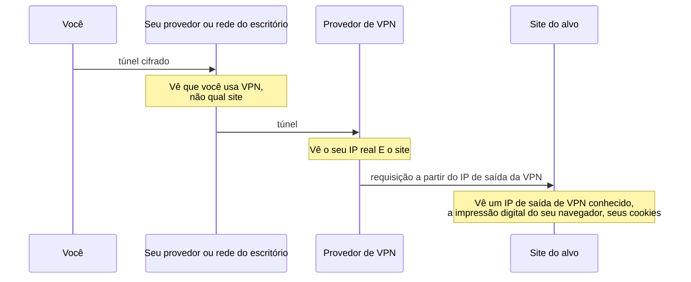
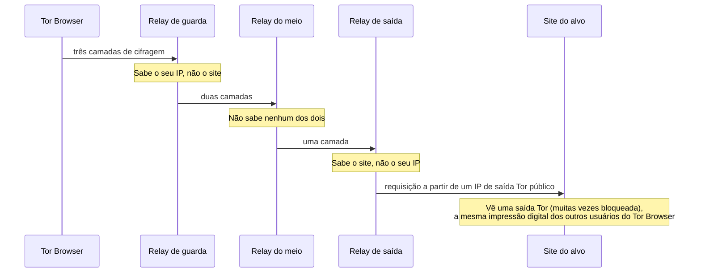

# Dia 32: OPSEC do investigador: VPN, Tor, isolamento e teste de vazamentos

> 🇺🇸 Original: [*Day 32: Investigator OPSEC: VPN, Tor, isolation, and leak testing*](https://github.com/thiefdroppers/cyber-investigator-skills/blob/main/curriculum/phase-2-osint-digital-footprint/day-32.md) — © ThiefDroppers, licença MIT.
> Aqui: tradução fiel **+** camada brasileira. Nada do original foi removido; tudo o que é novo vem marcado com ➕.

**Fase 2. OSINT e pegada digital** · Meta da trilha: medir o que o seu navegador e a sua rede revelam sobre você em quatro configurações, escolher a certa para cada tarefa e conhecer os erros do dia a dia que expõem investigadores.

Rank Jutsu: `C` · [](https://colab.research.google.com/github/Ridd1kulusC0d3r/investigador-cyber-90-dias/blob/main/curriculo/fase-2-osint-pegada-digital/dia-32/dia-32.ipynb)

---

## 🎬 ➕ Abertura do caso — *A página em branco*

Terça, 13 de outubro. Na reunião, Marta comenta, quase de passagem:

— Uma coisa que eu não entendi. Antes de o site cair, na sexta, quem abria da cooperativa via uma página em branco desde o dia 6. Mas cooperado no celular continuava vendo o formulário.

Rafa para de escrever. Puxa na tela um arquivo que montou de manhã: um log **ilustrativo**, do tipo que o servidor do kit grava, reconstruído a partir do que a Vigia e a cooperativa sabem que fizeram.

— Olha a linha das 14h02 do dia 5. IP da Vigia. Navegador Linux. Direto, sem *referer*. Duas vezes em quinze segundos.

Silêncio. Era você, na primeira tarde do caso, abrindo o site falso da rede do escritório "só para dar uma olhada", antes de montar o navegador de análise.

— Ninguém foi preso por isso. Mas o kit aprendeu que alguém de fora estava olhando, e agora ele esconde o jogo de quem vem da cooperativa e da gente. Hoje você descobre o que cada clique seu conta para o outro lado.

É isso que o Dia 32 ensina. *(Personagens e cenário: [Operação Isca](../../../caso-continuo/). Log ilustrativo: [`caso-continuo/dados/dia-32/`](../../../caso-continuo/dados/dia-32/).)*

---

## 📖 Conceito

Toda requisição que você faz deixa rastros do outro lado: o seu endereço IP e a rede a que ele pertence, a impressão digital (*fingerprint*) do seu navegador (*user agent*, tamanho de tela, fontes, renderização de canvas e WebGL, fuso horário, idioma) e sinais de comportamento, como a página de onde você veio e a hora do dia em que trabalha. Um operador de golpe que mantém o próprio site vê tudo isso nos logs do servidor. Se um site investigado de repente mostra visitas da rede do seu empregador em horário comercial, você contou ao alvo que ele está sendo observado.

Cada ferramenta comum esconde alguns desses rastros e transfere confiança para um novo intermediário.

Uma VPN esconde o seu IP do site e esconde o seu tráfego da sua rede local, e os substitui pelo provedor da VPN, que vê os dois. IPs de saída de VPN estão listados em bases comerciais, então sites sofisticados sabem que uma VPN está em uso. Ela não faz nada pela impressão digital do navegador nem pelos cookies.

O Tor Browser roteia o tráfego por três *relays* (retransmissores), de modo que nenhum *relay* sabe ao mesmo tempo quem você é e o que você visita, e tenta fazer a impressão digital de todo usuário do Tor Browser parecer igual. Os IPs de saída são públicos, então muitos sites bloqueiam o Tor ou acrescentam CAPTCHAs, e o próprio uso do Tor é um sinal para um alvo desconfiado. Entrar em qualquer conta pelo Tor liga aquela sessão à conta.

Quem vê o quê em cada caminho. Uma VPN muda só o caminho de rede, então o site ainda recebe a impressão digital e os cookies do seu navegador. O Tor Browser muda o caminho e também faz a impressão digital parecer a de todos os outros usuários do Tor Browser.





O isolamento (uma VM separada ou, no mínimo, um perfil de navegador separado) evita contaminação cruzada: cookies, sessões logadas, extensões e histórico da sua vida real nunca tocam a investigação. Ele não esconde o seu IP; isso é trabalho da camada de rede.

Os erros que expõem investigadores costumam ser banais: clicar num link de um e-mail de golpe a partir da caixa de trabalho (pixels de rastreamento e links únicos disparam), abrir a URL encurtada de um suspeito que registra cada visitante, enviar evidência para um analisador público cujos resultados qualquer um pode pesquisar, um vazamento de WebRTC que revela o seu IP real por trás da VPN, ou pesquisar o nome de um alvo logado na sua conta pessoal do buscador.

## 📚 Recursos

- [EFF Cover Your Tracks](https://coveryourtracks.eff.org/) testa o bloqueio de rastreadores e quão única é a sua impressão digital.
- [BrowserLeaks](https://browserleaks.com/) tem páginas separadas para IP, WebRTC, canvas, WebGL, fontes e mais.
- [Tor Browser](https://www.torproject.org/download/) e [check.torproject.org](https://check.torproject.org/) para confirmar que você está saindo pelo Tor.
- [urlscan.io](https://urlscan.io/) analisa uma URL suspeita a partir da própria infraestrutura; ponha a visibilidade em Private ou Unlisted (análises Public são pesquisáveis por qualquer pessoa, inclusive o alvo).

### ➕ Recursos do contexto Brasil

- [CERT.br — Cartilha de Segurança para Internet](https://cartilha.cert.br/): fascículos em português sobre privacidade, redes e golpes; bom material para a "norma de uma página" que você vai escrever.
- [Marco Civil da Internet — Lei 12.965/2014](https://www.planalto.gov.br/ccivil_03/_ato2011-2014/2014/lei/l12965.htm), arts. 13 e 15: provedores de conexão guardam registros de conexão por 1 ano, e aplicações por 6 meses. Os rastros que você deixa não ficam só no servidor do alvo.
- [LGPD — Lei 13.709/2018](https://www.planalto.gov.br/ccivil_03/_ato2015-2018/2018/lei/l13709.htm), art. 46: o dever de segurança do agente de tratamento. Vazar dados do caso por falha de OPSEC é incidente de segurança, não só "gafe".

## 🛠️ Prática: Cover Your Tracks, BrowserLeaks e Tor Browser: um mapa de calor de vazamentos de OPSEC

Você vai testar quatro configurações com o mesmo conjunto de checagens e registrar os resultados numa grade.

As configurações:

- A: o seu navegador do dia a dia, na rede de casa ou do escritório.
- B: o seu perfil `persona-P1` do Firefox, do Dia 31, através de uma VPN.
- C: o Tor Browser no nível de segurança padrão.
- D: o perfil `persona-P1` dentro de uma VM (Trace Labs OSINT VM ou outra), através de uma VPN.

Se você não tiver VPN, rode B e D sem ela e anote isso; as colunas de rede vão mostrar por que uma VPN ou o Tor importam.

**Seu checklist de hoje.** Faça na ordem e marque cada item ao terminar:

- [ ] Passo 1: cheque a exposição de IP e de rede em cada configuração.
- [ ] Passo 2: cheque vazamentos de WebRTC.
- [ ] Passo 3: cheque vazamentos de DNS.
- [ ] Passo 4: cheque a impressão digital do navegador.
- [ ] Passo 5: cheque a coerência de fuso horário e idioma.
- [ ] Passo 6: monte o mapa de calor de vazamentos.
- [ ] Passo 7: escreva a norma de OPSEC de uma página.
- [ ] Passo 8: mitigue e teste de novo cada célula vermelha ou âmbar.
- [ ] Passo 9: nomeie o risco residual.
- [ ] ➕ Passo 10: a Prática BR, com o log ilustrativo do kit.
- [ ] ➕ Passo 11: o notebook do dia no Colab.

Passo 1: IP e rede. Em cada configuração, abra `https://ipleak.net/` ou `https://browserleaks.com/ip`. Anote o IP, o provedor ou ASN mostrado e o país. Num terminal na mesma máquina, você também pode checar:

```bash
curl -s https://ipinfo.io/json
curl -s https://check.torproject.org/api/ip
```

O endpoint do Tor Project devolve um JSON como `{"IsTor":false,"IP":"..."}` (formato real, de uma chamada ao vivo). Rode-o pelo Tor para ver `"IsTor":true`; com o Tor Browser aberto, a porta SOCKS local costuma ser a 9150:

```bash
curl -s --socks5-hostname 127.0.0.1:9150 https://check.torproject.org/api/ip
```

`--socks5-hostname` faz a resolução de DNS também acontecer pelo Tor; o `--socks5` simples resolveria os nomes localmente e vazaria as consultas.

Passo 2: WebRTC. Abra `https://browserleaks.com/webrtc`. Se algum endereço listado for o seu IP público real ou o endereço local da sua rede de casa enquanto a VPN está ligada, o WebRTC está vazando. No Firefox, você pode desativá-lo em `about:config`, pondo `media.peerconnection.enabled` em `false`, ao custo de quebrar chamadas de vídeo nesse perfil.

Passo 3: DNS. Rode o teste estendido em `https://www.dnsleaktest.com/`. Se os *resolvers* listados forem do seu provedor enquanto a VPN está ligada, o DNS está vazando por fora do túnel.

Passo 4: impressão digital. Rode o Cover Your Tracks ("Test your browser"). Anote se ele diz que o seu navegador tem uma impressão digital única, e os bits de informação identificadora. Depois veja `https://browserleaks.com/canvas` e anote a assinatura de canvas. Compare as configurações: o Tor Browser deve informar os mesmos valores da maioria dos outros usuários do Tor; o seu navegador do dia a dia em geral será único.

Passo 5: fuso horário e idioma. A página de JavaScript do BrowserLeaks mostra o fuso horário e os idiomas do seu navegador. Uma saída de VPN num país com o fuso do navegador em outro é uma incoerência que um operador de site atento percebe.

Passo 6: monte o mapa de calor. Numa planilha, configurações nas linhas, checagens nas colunas. Valor da célula: 0 = sem vazamento ou coerente, 1 = parcial, 2 = vaza a identidade real. Aplique uma escala de cores do verde ao vermelho. Ilustrativo:

| Config | IP real oculto | WebRTC | DNS | Impressão digital única | Fuso bate com a saída | Sessões logadas |
|---|---|---|---|---|---|---|
| A dia a dia | 2 | 2 | 2 | 2 | 0 | 2 |
| B perfil + VPN | 0 | 2 | 0 | 2 | 2 | 0 |
| C Tor Browser | 0 | 0 | 0 | 0 | 0 | 0 |
| D VM + perfil + VPN | 0 | 0 | 0 | 1 | 0 | 0 |

Neste exemplo, a configuração B ainda vaza o IP real pelo WebRTC e tem uma incoerência de fuso, duas configurações que dá para corrigir.

Passo 7: escreva uma norma de OPSEC de uma página. Para cada tipo de tarefa (navegação passiva no site de uma organização pública, visita a um site suspeito de golpe, visualização de uma plataforma que exige login com uma persona, manuseio de um link suspeito do e-mail de uma vítima), diga qual configuração você usa e por quê. Escreva como tabela, uma linha por tipo de tarefa. Uma linha preenchida de modelo; as outras três são suas:

| Tarefa | Configuração | Por quê | Nunca |
|---|---|---|---|
| Manusear um link suspeito do e-mail de uma vítima | urlscan.io com visibilidade Private primeiro; se precisar abrir você mesmo, C ou D | O link pode ser único daquela vítima e registrar cada visita, então um clique da configuração A entrega ao remetente o seu IP real, o seu navegador e a sua hora do dia | Clicar nele num cliente de e-mail; uma análise Public no urlscan |
| Navegação passiva no site de uma organização pública | | | |
| Visita a um site suspeito de golpe | | | |
| Visualização de uma plataforma que exige login, com uma persona | | | |

Depois acrescente estas regras permanentes:

- Links suspeitos vão para o urlscan.io com visibilidade Private, ou são abertos na configuração C ou D, nunca na A.
- Nunca clique em links nem carregue imagens de um e-mail suspeito na sua caixa real; salve o `.eml` e analise offline.
- Nunca entre numa conta pessoal nas configurações B, C ou D.
- Hashes, não arquivos, vão para analisadores públicos de malware, a menos que a sua política permita *upload*; um *upload* torna o arquivo disponível para outras pessoas.

Passo 8: mitigue e teste de novo. Para cada célula vermelha ou âmbar do mapa de calor, escreva uma mitigação ao lado (uma configuração alterada, ou uma configuração que você não vai usar para aquela tarefa), depois rode de novo aquela checagem e escreva o resultado do novo teste ao lado também.

Passo 9: nomeie o risco residual. Pegue a tarefa mais sensível da sua norma e explique em duas frases o que o alvo ainda poderia saber sobre você, mesmo na configuração recomendada.

O artefato é o mapa de calor de vazamentos (PNG ou PDF) e a norma de OPSEC de uma página.

### ➕ Prática BR

**Exercício 1: o que o kit viu.** O arquivo [`caso-continuo/dados/dia-32/log-do-kit-ilustrativo.txt`](../../../caso-continuo/dados/dia-32/) é um log **fictício e ilustrativo** do tipo que o servidor do IscaKit grava. A Vigia não tem esse log (e não deve tentar obtê-lo; ver a camada jurídica): ele foi reconstruído para mostrar o que o operador provavelmente vê. Leia as nove linhas e responda:

1. Quais linhas são de cooperados vindos do SMS, e como você sabe (ASN, *user agent*, *referer*)?
2. Quais linhas são da Vigia? Que três sinais, juntos, as distinguem dos cooperados?
3. A partir de quando o kit passou a servir `pagina-em-branco`, e para quem? O que isso diz sobre o que o operador aprendeu?
4. A linha das 09h52 de 6/out vem de uma VPN comercial, mas o kit serviu o formulário. Mesmo assim, que dois campos ainda são iguais aos da Vigia, e por que isso é risco?
5. Qual configuração (A, B, C ou D) cada linha da Vigia **deveria** ter usado, segundo a sua norma do Passo 7?

**Exercício 2: a norma da Vigia.** Preencha a tabela do Passo 7 para a Operação Isca, acrescentando uma quinta linha: "abrir o encurtador `lnk.example/sa7` que veio no SMS". (Dica: encurtadores registram cada clique.)

### ➕ O notebook do dia

Abra o [notebook do Dia 32 no Colab](https://colab.research.google.com/github/Ridd1kulusC0d3r/investigador-cyber-90-dias/blob/main/curriculo/fase-2-osint-pegada-digital/dia-32/dia-32.ipynb). Nele você:

1. vê o que o **próprio Colab** revela sobre a máquina dele (IP de saída via `check.torproject.org/api/ip`, fuso, idioma), com plano B offline;
2. lê o log ilustrativo do kit e deixa o código achar as visitas "de fora do padrão" (o que o operador provavelmente fez);
3. monta o mapa de calor das quatro configurações por formulário, com a escala 0-1-2 e cores em texto;
4. gera a norma de OPSEC de uma página em Markdown;
5. joga o quiz "qual configuração?".

## ✅ Checkpoint

- Toda célula vermelha ou âmbar do mapa de calor tem uma mitigação escrita ao lado.
- Toda célula vermelha ou âmbar do mapa de calor tem um resultado de novo teste ao lado.
- A sua norma de OPSEC nomeia uma configuração para os quatro tipos de tarefa.
- Suas notas contêm duas frases, para a tarefa mais sensível da sua norma, sobre o que o alvo ainda poderia saber de você na configuração recomendada.
- Sem consultar notas, você explica por que se usa `curl --socks5-hostname` com o Tor em vez do `--socks5` simples.

### ➕ Checkpoint BR

- Você identificou as linhas da Vigia no log ilustrativo e nomeou os três sinais que as distinguem.
- Você explicou o "página em branco" como reação do kit a visitas fora do padrão, e o que isso custou ao caso.
- A sua norma tem a quinta linha (encurtador do SMS), com configuração e "nunca".
- Você sabe dizer por que pedir os logs reais do servidor do kit ao provedor não é caminho da Vigia.
- Você acertou pelo menos 6 das 8 perguntas do quiz do notebook.

## ⚖️ ➕ Camada jurídica BR

**Os rastros também ficam aqui.** Pelo Marco Civil, o provedor de conexão guarda os registros de conexão por 1 ano (art. 13) e os provedores de aplicação guardam os registros de acesso por 6 meses (art. 15). Isso vale para você também: a sua visita ao site falso existe no log do kit **e** nos registros do seu provedor. OPSEC não apaga nada; só decide o que o outro lado vê.

**Não "peça o log do kit".** Os registros reais do servidor do golpe só podem ser obtidos por ordem judicial (Marco Civil, arts. 10, §1º, e 22). Acessar o servidor para pegá-los encostaria no art. 154-A do Código Penal. O log desta aula é ilustrativo por isso.

**Falha de OPSEC é incidente de segurança.** A LGPD (art. 46) impõe ao agente de tratamento medidas de segurança para proteger dados pessoais. Uma evidência com dados de cooperados enviada a um analisador público "Public", ou um link único de vítima clicado da rede do escritório, pode expor dados de terceiros. O art. 48 trata da comunicação de incidentes de segurança à ANPD e aos titulares quando houver risco ou dano relevante. A norma de uma página é parte do seu dever de segurança, não só de autoproteção.

**VPN e Tor são lícitos.** Usar VPN ou Tor no Brasil não é crime. O que importa é o que se faz com eles, e o escopo do seu contrato.

> Este repositório é material de estudo e não constitui orientação jurídica.

## 🧠 ➕ Camada 8 — o investigador também é observado

O analista se pensa como o observador, e por isso esquece que é observado. Psicólogos sociais chamam algo próximo disso de **ilusão de transparência invertida**: subestimamos quanto os outros conseguem ler sobre nós a partir de sinais que nós mesmos não percebemos emitir. No log da Isca, você não "fez nada": só abriu um site. Mas o IP, o horário comercial, o Linux e a falta de *referer* contaram uma história que nenhum cooperado conta.

Do lado do golpista, a página em branco é uma técnica de **cloaking** (mostrar uma coisa para as vítimas e outra para quem investiga). Ela não exige sofisticação: basta uma lista de faixas de IP "suspeitas". E ela custa caro ao caso, porque as capturas seguintes passam a mostrar um site "vazio" que não serve como evidência do golpe.

Consequência prática: antes de cada visita, pergunte "o que esta linha vai parecer no log deles?". Se a resposta for "parece com alguém que não é vítima", troque de configuração antes de clicar, e não depois.

## 🤖 ➕ Skill do dia

Hoje o dia propõe para a [skill pt-BR](../../../skills/investigador-cyber/SKILL.md) o procedimento novo **"OPSEC antes de tocar a infraestrutura do alvo"**: configuração por tipo de tarefa, regras permanentes (urlscan Private, `.eml` offline, hash e não arquivo, sem conta pessoal) e a pergunta "o que esta linha vai parecer no log deles?". Proposta em [`_skill-delta.md`](_skill-delta.md).

## 💡 ➕ Inovação OSINT do dia — veja o seu próprio rastro, com a stdlib

O endpoint do Tor Project do Passo 1 devolve JSON simples, então dá para fazer o seu "pré-voo de OPSEC" em Python puro antes de cada sessão, junto com o fuso e o idioma que a sua máquina anuncia:

```python
import json, urllib.request, time, locale
ip = json.load(urllib.request.urlopen("https://check.torproject.org/api/ip", timeout=10))
print("IP visto pelo mundo:", ip["IP"], "| Tor?", ip["IsTor"])
print("Fuso local:", time.tzname, "| idioma:", locale.getlocale())
```

Se o IP que aparece for o do escritório quando você pretendia sair pela VPN, a sessão para ali. É um *checklist* de piloto em três linhas, e a mesma ideia escala: o notebook mostra como cruzar esse resultado com o país do fuso para pegar a incoerência do Passo 5 antes que o alvo a pegue.

## 📝 Diário de estudo

- Data:
- Tempo gasto:
- O que ficou claro:
- O que ainda está nebuloso:
- Artefato produzido: mapa de calor de vazamentos (PNG/PDF), norma de OPSEC de uma página; ➕ respostas sobre o log ilustrativo do kit

---
<sub>Baseado em [cyber-investigator-skills](https://github.com/thiefdroppers/cyber-investigator-skills) por ThiefDroppers (MIT). Tradução, camada BR, Camada 8, skill pt-BR e notebook por Deivison Lourenço (@Ridd1kulusC0d3r).</sub>
