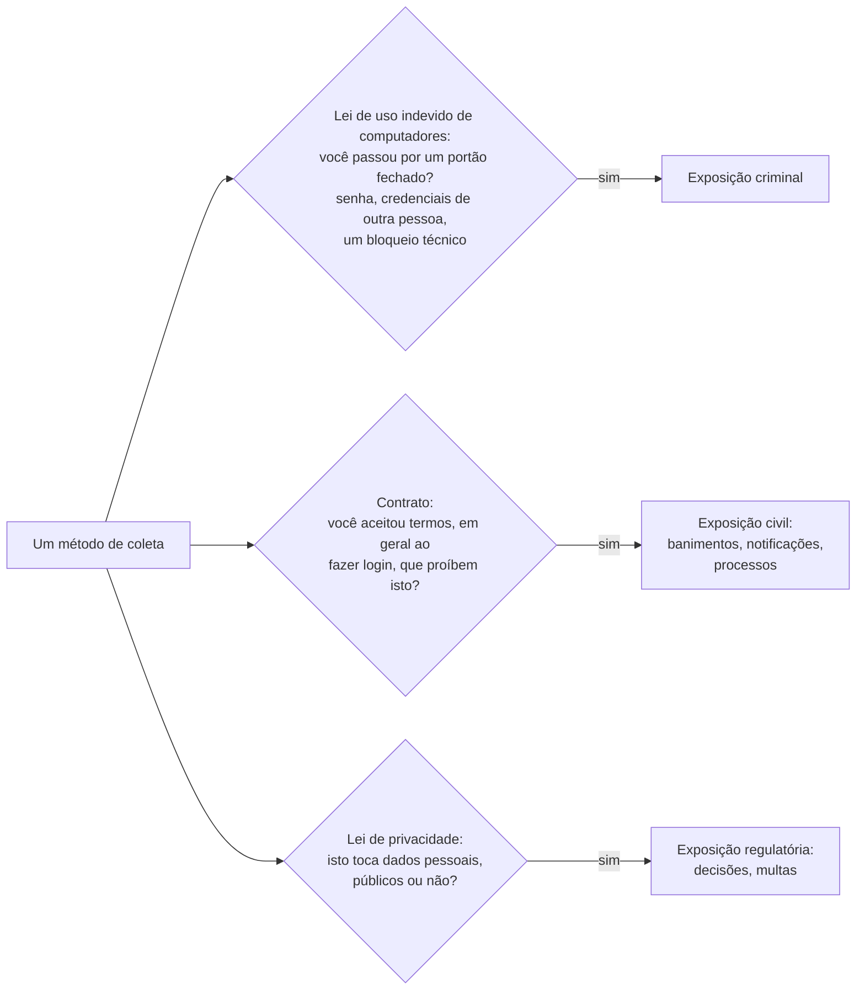
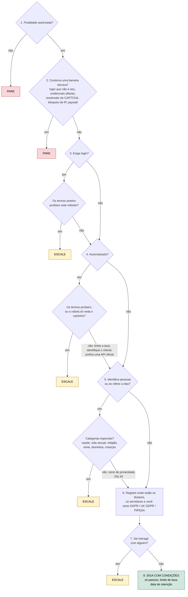

# Dia 33: Direito e OSINT, parte 1: acesso, raspagem e termos de uso

> 🇺🇸 Original: [*Day 33: OSINT law, part 1: access, scraping, and terms of service*](https://github.com/thiefdroppers/cyber-investigator-skills/blob/main/curriculum/phase-2-osint-digital-footprint/day-33.md) — © ThiefDroppers, licença MIT.
> Aqui: tradução fiel **+** camada brasileira. Nada do original foi removido; tudo o que é novo vem marcado com ➕.

**Fase 2. OSINT e pegada digital** · Meta da trilha: distinguir violar os termos de uma plataforma, infringir a lei de uso indevido de computadores e infringir a lei de privacidade, e transformar isso numa árvore de decisão que você roda antes de qualquer novo método de coleta.

Rank Jutsu: `C` · [](https://colab.research.google.com/github/Ridd1kulusC0d3r/investigador-cyber-90-dias/blob/main/curriculo/fase-2-osint-pegada-digital/dia-33/dia-33.ipynb)

---

## 🎬 ➕ Abertura do caso — *Três perguntas sobre o mesmo ato*

Quarta, 14 de outubro. Pela primeira vez, o Dr. Hélio Brandão, do jurídico da Serra Azul, entra na reunião. Ele tem três propostas impressas na mão, todas da equipe de TI da cooperativa:

— Um: um script que lê, a cada minuto, as postagens públicas com "Serra Azul" no X e no Instagram, para ver onde o golpe está circulando. Dois: alguém achou num fórum um "banco de dados de vítimas do golpe do Pix" e quer baixar para cruzar com os nossos cooperados. Três: um gerente se ofereceu para entrar num grupo fechado de WhatsApp de "vendedores de painel" com o celular da filha, que já está lá.

Ele põe as folhas na mesa.

— Para cada uma eu quero saber: é crime? Quebra contrato com a plataforma? Fere a LGPD? São três perguntas diferentes, e a resposta de uma não responde a outra.

Rafa olha para você.

— Monta a árvore. A gente roda as três propostas nela hoje.

É isso que o Dia 33 ensina. *(Personagens e cenário: [Operação Isca](../../../caso-continuo/).)*

---

## 📖 Conceito

O Dia 1 traçou a linha ética. Este dia é sobre as linhas legais, e elas são várias, traçadas por ramos diferentes do direito que não andam juntos.

A lei de uso indevido de computadores torna crime o acesso não autorizado a um computador: o *Computer Fraud and Abuse Act* dos EUA (18 U.S.C. § 1030), o Código Penal do Canadá, s. 342.1 (uso não autorizado de computador), o *Computer Misuse Act 1990* do Reino Unido, s. 1, e equivalentes em outros lugares. A Suprema Corte dos EUA restringiu o CFAA em *Van Buren v. United States* (2021): "exceder o acesso autorizado" significa entrar em partes de um sistema que estão fechadas para você, e não fazer mau uso de informação que você tinha direito de alcançar. A Corte descreveu isso como uma questão de portão aberto ou fechado. Contornar uma senha, usar as credenciais de outra pessoa ou derrotar um bloqueio técnico é passar por um portão fechado. Ler uma página que qualquer um carrega não é.

Termos de serviço são um contrato. Descumpri-los (raspar onde a raspagem é proibida, criar uma conta falsa) costuma ser uma questão civil entre você e a plataforma: banimento de contas, notificações extrajudiciais (*cease-and-desist*), processos. Em *hiQ Labs v. LinkedIn*, o Nono Circuito decidiu em abril de 2022, confirmando uma liminar, que raspar perfis publicamente acessíveis provavelmente não era acesso "sem autorização" sob o CFAA. Esse não foi o fim do caso: em novembro de 2022 o tribunal distrital concluiu que a hiQ tinha violado o Contrato do Usuário do LinkedIn (pela raspagem automatizada e por perfis falsos criados por trabalhadores pagos), e em dezembro de 2022 o caso terminou com uma sentença homologada por acordo contra a hiQ e uma ordem permanente para que ela parasse de raspar o LinkedIn e apagasse os dados. Em *Meta v. Bright Data* (N.D. Cal., janeiro de 2024), o tribunal decidiu que os termos da Meta não cobriam a raspagem feita sem login, porque os termos regem o uso de contas logadas. A lição prática: fazer login normalmente significa que você aceitou os termos, e aceitar os termos é o que faz a maioria das restrições à raspagem valer para você.

A lei de privacidade e proteção de dados se aplica quer o dado seja público, quer não. O Comissário de Privacidade do Canadá e três comissários provinciais concluíram em 2021 que a coleta de fotos publicadas publicamente pela Clearview AI violou a lei canadense de privacidade, e a Autoridade de Proteção de Dados da Holanda multou a Clearview em 30,5 milhões de euros sob o GDPR em 2024. "Era público" não é defesa perante um regulador de privacidade. O Dia 34 trata do que isso significa para guardar o que você encontra.

Os três ramos do direito fazem perguntas separadas sobre o mesmo ato, e passar num teste não diz nada sobre os outros:



Outras leis também podem se aplicar: direito autoral sobre o conteúdo que você copia, o direito *sui generis* de bases de dados da UE, regras contra a quebra de proteções técnicas, e leis de assédio e perseguição quando a coleta mira uma pessoa.

A jurisdição depende de onde estão as pessoas e os sistemas, além de onde você está. Um investigador canadense raspando um site da UE sobre residentes da UE pode estar dentro do alcance territorial do GDPR, os termos de uma plataforma americana costumam eleger um tribunal americano, e uma lei penal pode se aplicar onde o servidor está.

Isto é um roteiro de treinamento, não orientação jurídica. Antes que um novo método de coleta entre em trabalho real, um advogado que conheça a sua jurisdição deve vê-lo.

## 📚 Recursos

- [*Van Buren v. United States*, 593 U.S. 374 (2021)](https://www.supremecourt.gov/opinions/20pdf/19-783_k53l.pdf), a própria decisão. Leia o voto da maioria e a nota de rodapé 8, que deixa em aberto se os limites precisam ser técnicos ou podem ser contratuais.
- [Código Penal do Canadá, s. 342.1](https://laws-lois.justice.gc.ca/eng/acts/c-46/section-342.1.html), sobre uso não autorizado de computador.
- [Investigação conjunta do OPC sobre a Clearview AI (PIPEDA Findings #2021-001)](https://www.priv.gc.ca/en/opc-actions-and-decisions/investigations/investigations-into-businesses/2021/pipeda-2021-001/) expõe o raciocínio dos reguladores sobre "publicamente disponível".
- [Technology & Marketing Law Blog, de Eric Goldman](https://blog.ericgoldman.org/), acompanha os casos americanos de raspagem e termos de serviço à medida que são decididos.

### ➕ Recursos do contexto Brasil

O "equivalente do seu país" para cada um dos três ramos:

- **Uso indevido de computadores:** [Código Penal compilado](https://www.planalto.gov.br/ccivil_03/decreto-lei/del2848compilado.htm), art. 154-A (invasão de dispositivo informático, criado pela [Lei 12.737/2012](https://www.planalto.gov.br/ccivil_03/_ato2011-2014/2012/lei/l12737.htm), redação da Lei 14.155/2021).
- **Contrato:** [Código Civil (Lei 10.406/2002)](https://www.planalto.gov.br/ccivil_03/leis/2002/l10406compilada.htm) — os termos de uso são contrato de adesão; o descumprimento é questão civil.
- **Privacidade:** [LGPD (Lei 13.709/2018)](https://www.planalto.gov.br/ccivil_03/_ato2015-2018/2018/lei/l13709.htm), arts. 5º (definições, inclusive dado sensível), 7º (bases legais e o tratamento de dados públicos, §§ 3º e 4º), 11 (dados sensíveis) e 14 (crianças e adolescentes). Regulador: [ANPD](https://www.gov.br/anpd/).
- **Outros:** [Marco Civil da Internet (Lei 12.965/2014)](https://www.planalto.gov.br/ccivil_03/_ato2011-2014/2014/lei/l12965.htm); [Lei de Direitos Autorais (Lei 9.610/1998)](https://www.planalto.gov.br/ccivil_03/leis/l9610.htm), para o conteúdo que você copia; CP art. 147-A (perseguição), quando a coleta mira uma pessoa.

## 🛠️ Prática: diagrams.net: uma árvore de decisão de legalidade da coleta, testada em cinco cenários

Passo 1: desenhe a árvore no diagrams.net (app.diagrams.net). Use losangos para as perguntas e caixas arredondadas para os resultados. Os resultados são SIGA, SIGA COM CONDIÇÕES (escreva as condições), ESCALE (para o jurídico ou o seu supervisor) e PARE. O conjunto mínimo de perguntas, nesta ordem:

**Seu checklist de hoje.** Faça na ordem e marque cada item ao terminar:

- [ ] Desenhe a pergunta da finalidade autorizada.
- [ ] Desenhe a pergunta da barreira técnica.
- [ ] Desenhe a pergunta do login e dos termos aceitos.
- [ ] Desenhe a pergunta da automação e dos termos/robots.txt.
- [ ] Desenhe a pergunta dos dados pessoais e das categorias especiais.
- [ ] Registre o ramo dos titulares, dos servidores e da jurisdição.
- [ ] Desenhe a pergunta da interação.
- [ ] Acrescente o resultado SIGA COM CONDIÇÕES.
- [ ] ➕ Acrescente o ramo LGPD na pergunta 6.

1. Existe uma finalidade autorizada (um caso, um contrato, uma política) que cubra esta coleta? Não: PARE.
2. O método exige contornar uma barreira técnica: um login a que você não tem direito, as credenciais de outra pessoa, um resolvedor de CAPTCHA, um bloqueio de IP, um *paywall*? Sim: PARE.
3. Exige fazer login? Sim: quais termos a conta aceitou, e eles proíbem este método (coleta automatizada, identidade falsa, exportação de dados)? Proíbem: ESCALE.
4. É automatizado (scripts, raspadores, chamadas de API em massa)? Sim: cheque os termos do site e o `robots.txt`, limite a taxa, identifique o seu cliente com honestidade e prefira uma API oficial. Os termos proíbem: ESCALE.
5. Os dados identificam pessoas ou se referem a elas? Sim: vá para o ramo de privacidade (base legal, minimização, retenção; Dia 34). Categorias especiais (saúde, vida sexual, religião, etnia, biometria, crianças): ESCALE.
6. Onde estão os titulares, os servidores e você? Algum titular na UE/Reino Unido: ramo GDPR/UK GDPR. Contexto comercial canadense: ramo PIPEDA. Registre a resposta.
7. Você vai interagir com alguém (mandar mensagem, adicionar, entrar num grupo fechado, comprar algo)? Sim: ESCALE (regras de *pretexting* e de trabalho infiltrado; Dia 31).
8. Tudo limpo: SIGA COM CONDIÇÕES, listando as condições (só passivo, limite de taxa, data de retenção).

As mesmas oito perguntas desenhadas como árvore, como ponto de partida. Refaça-a no diagrams.net para poder anexar as condições a cada ramo e acrescentar os ramos de privacidade da sua jurisdição na pergunta 6.



> ➕ **Ramo LGPD na pergunta 6.** Titulares no Brasil, ou coleta feita no Brasil, ou dados coletados no Brasil: a LGPD se aplica (art. 3º). Registre a base legal do art. 7º (dado sensível: art. 11) e, para dados tornados públicos pelo titular, as condições dos §§ 3º e 4º do art. 7º (finalidade, boa-fé, interesse público que justificou a publicação). Nota: a exceção do art. 4º, III (segurança pública, investigação e repressão de infrações penais) é das autoridades, não de um MSSP privado.

Passo 2: rode cinco cenários pela árvore. Escreva um parágrafo para cada um, com o caminho pela árvore e o resultado.

**Seu checklist de hoje.** Faça na ordem e marque cada item ao terminar:

- [ ] Rode o cenário 1: ler e salvar comunicados de imprensa públicos.
- [ ] Rode o cenário 2: um script automatizado puxando postagens públicas sem login.
- [ ] Rode o cenário 3: buscar num diretório de membros com a sua conta pessoal.
- [ ] Rode o cenário 4: usar as credenciais emprestadas de um colega.
- [ ] Rode o cenário 5: baixar um banco de dados vazado de um fórum público.
- [ ] ➕ Rode os três cenários do Dr. Hélio (Prática BR).

1. Ler os comunicados de imprensa de uma organização pública e salvá-los com o SingleFile (Dias 19 a 22).
2. Um script em Python que puxa todas as postagens públicas da página de busca de uma plataforma, sem login, uma vez por segundo, para catalogar a redação de golpes de recrutamento.
3. Usar a sua conta pessoal para buscar no diretório de membros de uma plataforma todos os que listam um certo empregador, e exportar os resultados.
4. Um colega oferece o usuário e a senha de um membro "amigo" de um grupo fechado de vítimas de golpe, para você poder lê-lo.
5. Baixar um banco de dados vazado, publicado num fórum público, para verificar se números de telefone de golpes dos seus casos aparecem nele.

Resposta resolvida ilustrativa para o cenário 2:

> Q1 finalidade autorizada: sim, pesquisa de padrões da Fase 5. Q2 barreira: nenhuma enquanto sem login, mas se a plataforma começar a devolver CAPTCHAs ou bloquear o IP e o script for alterado para contornar isso, a resposta passa a ser sim e o resultado é PARE. Q3 login: não, então os termos de usuário logado discutivelmente não vinculam (compare com *Meta v. Bright Data*), embora os termos do site ainda possam pretender cobrir visitantes; anote. Q4 automatizado: sim; o `robots.txt` veda o caminho de busca, então ESCALE. Q5 dados pessoais: as postagens trazem nomes de usuário; se aprovado, guarde só o texto das mensagens e as datas, descartando os nomes de usuário na coleta. Resultado: ESCALE, com a proposta de usar a API oficial de pesquisa da plataforma.

O cenário 4 deve terminar em PARE na Q2 (credenciais de outra pessoa), sejam quais forem as boas intenções. O cenário 5 deve chegar a ESCALE ou PARE dependendo da sua jurisdição: possuir dados roubados pode ser crime em si em alguns lugares, e os dados são dados pessoais de qualquer forma.

Passo 3: acrescente um cenário seu, a partir de uma tarefa real que você espera fazer, e rode-o pela árvore. Escreva do mesmo jeito: o caminho pela árvore e o resultado.

Passo 4: rode de novo às cegas. Troque os seus cinco cenários com um colega de estudo, ou volte a eles daqui a uma semana, e rode-os de novo pela árvore sem olhar as suas respostas. Registre o segundo conjunto de resultados ao lado do primeiro.

O artefato é a árvore de decisão (PNG e o arquivo-fonte `.drawio`) e os cinco relatos de cenário.

### ➕ Prática BR

**Exercício 1: as três propostas do Dr. Hélio.** Rode cada uma pela árvore (com o ramo LGPD) e escreva o parágrafo no formato do exemplo resolvido:

- **H1.** Script que lê, a cada minuto, postagens públicas com "Serra Azul" no X e no Instagram, para ver onde o golpe circula.
- **H2.** Baixar de um fórum o "banco de dados de vítimas do golpe do Pix" para cruzar com a base de cooperados.
- **H3.** Um gerente entrar num grupo fechado de WhatsApp de "vendedores de painel" usando o celular da filha, que já está no grupo.

Pistas, sem dar a resposta inteira: H1 depende de login, dos termos e do `robots.txt` de cada plataforma, e de você conseguir descartar os nomes de usuário na coleta; H2 envolve dados pessoais obtidos ilicitamente e de terceiros, e "cruzar com a base" é um novo tratamento; H3 encosta na Q2 (a conta é de outra pessoa) **e** na Q7 (interação), e ainda põe uma pessoa da família no meio.

**Exercício 2: o que fazer no lugar.** Para cada proposta que terminar em PARE ou ESCALE, escreva uma alternativa que siga a árvore até SIGA COM CONDIÇÕES (por exemplo: para H1, a API oficial ou o monitoramento de marca da própria plataforma; para H2, avisar a autoridade e a ANPD do vazamento, sem baixar; para H3, a denúncia do grupo à plataforma e o material à polícia).

### ➕ O notebook do dia

Abra o [notebook do Dia 33 no Colab](https://colab.research.google.com/github/Ridd1kulusC0d3r/investigador-cyber-90-dias/blob/main/curriculo/fase-2-osint-pegada-digital/dia-33/dia-33.ipynb). Nele você:

1. transforma a árvore de oito perguntas (com o ramo LGPD) numa função que devolve o resultado **e a pergunta que o disparou**;
2. roda os cinco cenários do original e os três do Dr. Hélio;
3. lê um `robots.txt` com `urllib.robotparser` (real, com plano B embutido) para responder à Q4;
4. faz o **re-teste às cegas** do Passo 4: o notebook embaralha os cenários e compara as suas respostas com a primeira rodada;
5. gera os relatos em Markdown.

## ✅ Checkpoint

- Os resultados do re-teste às cegas batem com os seus resultados originais nos cinco cenários.
- Todo PARE e todo ESCALE nos seus relatos nomeia a pergunta específica que o disparou.
- Os seus relatos incluem um sexto cenário, de uma tarefa real que você espera fazer, com o caminho pela árvore e o resultado.
- Sem consultar notas, você diz qual pergunta para o cenário 4, e por que boas intenções não mudam esse resultado.

### ➕ Checkpoint BR

- A sua árvore tem o ramo LGPD na pergunta 6, com base legal (art. 7º; art. 11 para sensíveis) e a nota de que o art. 4º, III não cobre um MSSP privado.
- H1, H2 e H3 têm parágrafo com caminho, pergunta disparadora e resultado.
- H3 termina em PARE na Q2, e o seu parágrafo também cita a Q7.
- Cada PARE/ESCALE tem uma alternativa que chega a SIGA COM CONDIÇÕES.
- Sem consultar notas, você explica por que "estava num fórum público" não torna o banco vazado um dado que você pode tratar livremente.

## ⚖️ ➕ Camada jurídica BR

**As três perguntas, em direito brasileiro.**

1. **Crime (portão fechado).** O art. 154-A do Código Penal pune invadir dispositivo informático de uso alheio para obter, adulterar ou destruir dados sem autorização expressa ou tácita do usuário. A redação da Lei 14.155/2021 tirou a exigência de "violação indevida de mecanismo de segurança". Usar a conta de outra pessoa (H3, cenário 4) entra no território do portão fechado. Ler uma página pública, não. <!-- TODO jurídico: confirmar com o jurídico se o acesso a um aplicativo de mensagens já autenticado no aparelho de terceiro, com consentimento do dono do aparelho mas sem o dos demais membros do grupo, tem tratamento específico na jurisprudência. -->
2. **Contrato.** Termos de uso são contrato de adesão regido pelo Código Civil. O efeito prático é o mesmo do original: banimento, notificação, ação de indenização e prova questionada.
3. **Privacidade.** A LGPD vale para dado pessoal **público ou não**. Para dados de acesso público, o art. 7º, § 3º manda considerar a finalidade, a boa-fé e o interesse público que justificaram a disponibilização; o § 4º dispensa o consentimento para dados tornados manifestamente públicos pelo titular, mas resguarda os direitos dele e os princípios da lei. "Era público" não encerra a análise, como no caso Clearview do original. Dado sensível (art. 5º, II; art. 11) e dado de criança e adolescente (art. 14) têm regras mais estritas: é o ESCALE da pergunta 5.

**Dados vazados (H2).** Um banco de vítimas vazado é dado pessoal de terceiros obtido ilicitamente. Baixá-lo e "cruzá-lo com a base" é um novo tratamento, sem base legal clara e com risco de incidente de segurança na sua própria casa. O caminho é registrar a existência e o local da publicação, avisar a cooperativa, a autoridade policial e, se for o caso de incidente da própria cooperativa, a ANPD (art. 48). Se a posse em si configura algum crime específico depende dos fatos; não presuma que não. <!-- TODO jurídico: confirmar com o jurídico o enquadramento penal da mera posse/download de base vazada no Brasil. -->

**Marco Civil.** A coleta de registros de conexão e de acesso de terceiros não é caminho de particular: só por ordem judicial (arts. 10 e 22).

**Perseguição.** Se a coleta automatizada mirar uma pessoa e não o padrão, encosta no art. 147-A. É o "cace padrões" do Dia 1, com número de artigo.

> Este repositório é material de estudo e não constitui orientação jurídica.

## 🧠 ➕ Camada 8 — "é para o bem"

As três propostas do Dr. Hélio têm uma coisa em comum: nasceram de gente da própria cooperativa, querendo proteger os cooperados. Ninguém ali se vê fazendo algo errado. Bandura chamou isso de **justificação moral**, o primeiro mecanismo de desengajamento moral do Dia 01: a conduta condenável é reapresentada como servindo a um propósito digno. Some a isso a **urgência** (o golpe está acontecendo agora) e a **difusão de responsabilidade** (o celular é "da filha", o banco é "do fórum"), e a proposta fica parecendo óbvia.

A árvore funciona como um **dispositivo de pré-compromisso**: uma decisão tomada a frio, que amarra a decisão tomada a quente. É o mesmo princípio do Ulisses amarrado ao mastro. Ela não depende de você se sentir antiético na hora; depende só de você responder às perguntas na ordem.

Consequência prática: quando a resposta de uma pergunta vier acompanhada de "mas é para...", trate isso como sinal para responder a pergunta de novo, mais devagar. E nunca apresente ao cliente um PARE sem uma alternativa: a pressão para "fazer alguma coisa" é real, e a melhor forma de resistir a ela é oferecer o caminho lícito.

## 🤖 ➕ Skill do dia

Hoje o dia propõe para a [skill pt-BR](../../../skills/investigador-cyber/SKILL.md) o procedimento novo **"Legalidade de um método de coleta (árvore de 8 perguntas)"**, com o ramo LGPD e a regra de sempre nomear a pergunta que disparou um PARE ou ESCALE, e de propor uma alternativa. Proposta em [`_skill-delta.md`](_skill-delta.md).

## 💡 ➕ Inovação OSINT do dia — o `robots.txt` lido pela própria biblioteca padrão

A pergunta 4 da árvore pede que você cheque o `robots.txt`. O Python já traz um leitor oficial dele, `urllib.robotparser`, que responde "este agente pode buscar este caminho?" do mesmo jeito que um rastreador bem-comportado:

```python
from urllib.robotparser import RobotFileParser
rp = RobotFileParser("https://www.gov.br/robots.txt")
rp.read()                                                 # baixa e interpreta o arquivo
print(rp.can_fetch("estudo-investigador-cyber/1.0", "https://www.gov.br/anpd/pt-br"))
print("atraso pedido:", rp.crawl_delay("*"))             # None se o site não pedir
```

Duas cautelas: o `robots.txt` é um pedido do site, não uma autorização nem uma proibição legal; e um "pode" do `robotparser` não responde às perguntas 3 e 5 (termos e dados pessoais). Ele é **uma** das checagens da Q4, a mais fácil de automatizar, e por isso a mais fácil de esquecer de registrar.

## 📝 Diário de estudo

- Data:
- Tempo gasto:
- O que ficou claro:
- O que ainda está nebuloso:
- Artefato produzido: árvore de decisão (PNG + `.drawio`), cinco relatos de cenário + o sexto; ➕ parágrafos H1–H3 e alternativas

---
<sub>Baseado em [cyber-investigator-skills](https://github.com/thiefdroppers/cyber-investigator-skills) por ThiefDroppers (MIT). Tradução, camada BR, Camada 8, skill pt-BR e notebook por Deivison Lourenço (@Ridd1kulusC0d3r).</sub>
