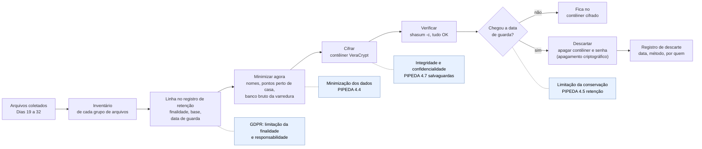

# Dia 34: Direito e OSINT, parte 2: armazenar, reter e descartar o que você coleta

> 🇺🇸 Original: [*Day 34: OSINT law, part 2: storing, retaining, and disposing of what you collect*](https://github.com/thiefdroppers/cyber-investigator-skills/blob/main/curriculum/phase-2-osint-digital-footprint/day-34.md) — © ThiefDroppers, licença MIT.
> Aqui: tradução fiel **+** camada brasileira. Nada do original foi removido; tudo o que é novo vem marcado com ➕.

**Fase 2. OSINT e pegada digital** · Meta da trilha: aplicar os princípios de proteção de dados aos seus próprios dossiês de caso: justificar o que você guarda, protegê-lo, marcar uma data para destruí-lo e fechar a Fase 2 com um pacote de caso que sobreviveria a uma auditoria de privacidade.

Rank Jutsu: `C` · [](https://colab.research.google.com/github/Ridd1kulusC0d3r/investigador-cyber-90-dias/blob/main/curriculo/fase-2-osint-pegada-digital/dia-34/dia-34.ipynb)

---

## 🎬 ➕ Abertura do caso — *O que fica, e até quando*

Sexta, 16 de outubro. Os perfis falsos foram derrubados depois da denúncia da cooperativa, a hospedagem do `serraazul-pix.example` está suspensa desde o dia 9, e os SMS pararam. Marta manda um e-mail curto: *"Obrigada. Podemos fechar esta etapa?"*

Antes de responder, o Dr. Hélio liga.

— Uma pergunta só. A Vigia está guardando o quê, sobre quem, com que base, e até quando?

Você abre a pasta `~/cases/ISCA-P2`. Capturas com nome de cooperado no print do WhatsApp. A foto da agência com coordenadas. O comunicado. Os retratos de DNS. O CSV de metadados que, numa primeira versão, ainda tinha a coluna de autores. Um export do SpiderFoot com e-mails de funcionários que ninguém usou.

Rafa está lendo por cima do seu ombro.

— Pacote de caso não é a pasta com tudo. É a pasta com o que **precisa** ficar, cifrada, com uma data de morte. O resto sai hoje. E por escrito, para o Dr. Hélio poder mostrar se alguém perguntar.

É isso que o Dia 34 ensina, e é assim que a Fase 2 fecha. *(Personagens e cenário: [Operação Isca](../../../caso-continuo/).)*

---

## 📖 Conceito

A coleta é um momento; o armazenamento é contínuo. Assim que você salva uma captura de tela com o nome de alguém, você está tratando dados pessoais enquanto os guardar, e a lei de proteção de dados se importa com esse período inteiro.

Sob o GDPR da UE (e o UK GDPR, que o espelha), o Artigo 5 estabelece os princípios que você vai aplicar hoje: limitação da finalidade (coletados para uma finalidade específica e não reutilizados para outra incompatível), minimização dos dados (adequados, pertinentes e limitados ao necessário), limitação da conservação (guardados não mais do que o necessário) e integridade e confidencialidade (segurança adequada). O Artigo 5(2) acrescenta a responsabilidade (*accountability*): você precisa conseguir demonstrar que cumpriu. Investigadores do setor privado costumam se apoiar no interesse legítimo do Artigo 6(1)(f), que exige um teste de ponderação documentado: uma finalidade legítima, a necessidade, e a verificação de que os direitos da pessoa não prevalecem sobre ela. Dados de categoria especial (saúde, etnia, religião, vida sexual, biometria e outros) sob o Artigo 9, e dados de infrações penais sob o Artigo 10, precisam de uma condição legal adicional. O Artigo 14 em geral exige informar as pessoas quando você coleta os dados delas de outras fontes, com exceções. O Artigo 14(5)(b) cobre os casos em que dar o aviso seria impossível ou envolveria esforço desproporcional, ou provavelmente tornaria impossível ou prejudicaria seriamente os objetivos do tratamento; mesmo então o controlador precisa tomar medidas adequadas para proteger os direitos da pessoa, e você deve documentar por que a exceção se aplica em vez de presumi-la. Polícia e Ministério Público na UE ficam sob um instrumento separado, a Diretiva de Aplicação da Lei (UE) 2016/680.

No Canadá, a PIPEDA rege organizações do setor privado em atividade comercial (algumas províncias têm leis próprias substancialmente semelhantes). Os princípios do seu Anexo 1 incluem limitar a coleta (4.4), limitar o uso, a divulgação e a retenção (4.5, inclusive destruir ou anonimizar a informação que não é mais necessária) e salvaguardas (4.7). A seção 7(1)(b) permite a coleta sem conhecimento ou consentimento quando é razoável esperar que coletar com conhecimento ou consentimento comprometeria a disponibilidade ou a exatidão da informação, e a coleta é razoável para finalidades relacionadas à investigação de uma violação de contrato ou de uma infração às leis do Canadá ou de uma província. A exceção de "publicamente disponível" é estreita: o regulamento lista fontes específicas, como listas telefônicas e diretórios profissionais, registros públicos, autos judiciais e revistas e jornais publicados. As conclusões sobre a Clearview AI (Dia 33) rejeitaram o argumento de que conteúdo de redes sociais se encaixa nela.

Falhas de segurança têm obrigações próprias: a PIPEDA exige comunicar violações que criem risco real de dano significativo, e o GDPR prevê notificação ao regulador em 72 horas para a maioria das violações. Um notebook sem cifragem cheio de capturas de OSINT é uma violação esperando para acontecer.

O padrão investigativo para manusear evidência digital de fontes abertas, o Protocolo de Berkeley, aponta na mesma direção: preserve com integridade o que o caso precisa e minimize o resto.

A prática de hoje passa os seus arquivos da Fase 2 por este ciclo de vida. As notas tracejadas mostram qual princípio cada passo põe em prática, de modo que o pacote de caso pronto também é o seu registro de responsabilidade.



## 📚 Recursos

- [Texto integral do GDPR (EUR-Lex, Regulamento (UE) 2016/679)](https://eur-lex.europa.eu/eli/reg/2016/679/oj); leia os Artigos 5, 6(1)(f), 9, 14, 30 e 32.
- [PIPEDA (Justice Laws)](https://laws-lois.justice.gc.ca/eng/acts/p-8.6/), inclusive o Anexo 1 e a seção 7.
- [Protocolo de Berkeley sobre Investigações Digitais de Fontes Abertas](https://www.ohchr.org/en/publications/policy-and-methodological-publications/berkeley-protocol-digital-open-source) (ACNUDH da ONU e Human Rights Center da UC Berkeley), capítulos sobre preservação e segurança de dados.
- [VeraCrypt](https://www.veracrypt.fr/) é cifragem de disco e de contêiner gratuita e de código aberto, para Windows, macOS e Linux.

### ➕ Recursos do contexto Brasil

O equivalente brasileiro de cada artigo que o original manda ler:

| No original | No Brasil (LGPD, Lei 13.709/2018) |
|---|---|
| GDPR art. 5 (princípios) | art. 6º: finalidade (I), adequação (II), necessidade (III), segurança (VII), prevenção (VIII), responsabilização e prestação de contas (X) |
| GDPR art. 6(1)(f) (interesse legítimo) | art. 7º, IX, e art. 10 (legítimo interesse, com transparência e só os dados estritamente necessários) |
| GDPR art. 9 (categorias especiais) | art. 5º, II, e art. 11 (dado pessoal sensível) |
| GDPR art. 30 (registro das atividades) | art. 37 (registro das operações de tratamento) |
| GDPR art. 32 (segurança) | art. 46 (medidas de segurança) e art. 48 (comunicação de incidente) |
| PIPEDA 4.5 (destruir o que não é necessário) | arts. 15 e 16 (término do tratamento e eliminação, com as hipóteses de conservação) |

- [LGPD — texto compilado](https://www.planalto.gov.br/ccivil_03/_ato2015-2018/2018/lei/l13709.htm) e [ANPD](https://www.gov.br/anpd/), a autoridade nacional, com guias e o formulário de comunicação de incidente.
- [Código de Processo Penal](https://www.planalto.gov.br/ccivil_03/decreto-lei/del3689.htm), arts. 158-A a 158-F: a cadeia de custódia vai até o **descarte** do vestígio (art. 158-B, X).
- [Marco Civil da Internet](https://www.planalto.gov.br/ccivil_03/_ato2011-2014/2014/lei/l12965.htm), arts. 13 e 15: prazos legais de guarda para provedores, que **não** são os seus. Você define o seu prazo pela finalidade.

## 🛠️ Prática: VeraCrypt e um registro de retenção: um pacote de caso da Fase 2 cifrado e minimizado

**Seu checklist de hoje.** Faça na ordem e marque cada item ao terminar:

- [ ] Passo 1: crie um contêiner VeraCrypt cifrado.
- [ ] Passo 2: inventarie cada grupo de arquivos da Fase 2.
- [ ] Passo 3: monte o registro de retenção.
- [ ] Passo 4: faça a passada de minimização.
- [ ] Passo 5: mova o caso para dentro do contêiner e verifique os hashes.
- [ ] Passo 6: escreva o registro de descarte e o índice `README.md` da Fase 2.
- [ ] Passo 7: faça a checagem por amostragem da minimização e da lista de fora do escopo.
- [ ] ➕ Passo 8: a Prática BR, o pacote da Operação Isca com o registro do art. 37.
- [ ] ➕ Passo 9: o notebook do dia no Colab.

Passo 1: crie um contêiner cifrado. Instale o VeraCrypt (no macOS ele também precisa do macFUSE ou do FUSE-T; a página do instalador diz qual). Depois:

1. Create Volume > Create an encrypted file container > Standard VeraCrypt volume.
2. Volume Location: `~/cases/P2-case.hc`.
3. Encryption Options: AES, hash SHA-512 (os padrões servem).
4. Volume Size: grande o bastante para as suas pastas da Fase 2, com folga para crescer (confira com `du -sh ~/cases/*`).
5. Password: uma frase-senha longa, gerada no seu gerenciador de senhas. Guarde-a lá, não nas notas do caso.
6. Filesystem: exFAT, se você precisar abri-lo em mais de um sistema operacional. Mexa o mouse para gerar aleatoriedade e clique em Format.
7. Monte-o: escolha um *slot*, Select File, escolha `P2-case.hc`, Mount.

Passo 2: inventarie o que você guarda. Liste cada pasta e grupo de arquivos da Fase 2: capturas do Dia 19, exports do SpiderFoot, grafo do Maltego, pegada própria do Dia 24, planilha da linha do tempo do Dia 25, imagens e mapa do Dia 27, conjunto de documentos e `meta.csv` do Dia 28, exports dos Dias 29 e 30, arquivo de persona do Dia 31, mapa de calor do Dia 32.

Passo 3: monte o registro de retenção. Uma planilha ou tabela Markdown dentro do pacote do caso, uma linha por grupo de arquivos:

| Conjunto de dados | Contém dados pessoais? | De quem / de que tipo | Finalidade | Base legal ou autoridade | Minimização aplicada | Guardar até | Método de descarte |
|---|---|---|---|---|---|---|---|
| Capturas do Dia 19 | Incidentais (nomes de funcionários nas páginas) | Funcionários da organização, papel público | Caso de treinamento da Fase 2 | Exercício de treinamento; sem autoridade de caso | Nenhuma além da regra de escopo | fim do roteiro (Dia 90) | Apagar com o contêiner |
| Pegada própria do Dia 24 | Sim | Seus | Autoavaliação | Seus próprios dados | Perfis de outras pessoas com o mesmo *handle* removidos | sua escolha | n/a |
| Imagens do Dia 27 | Sim, localização | Suas | Laboratório de geolocalização | Seus próprios dados | Pontos a menos de 1 km de casa removidos do mapa | Dia 90 | Apagar com o contêiner |
| `meta.csv` do Dia 28 | Removidos | n/a | Mapa de calor de metadados | Exercício de treinamento | Colunas Author e LastModifiedBy descartadas | Dia 90 | Apagar com o contêiner |
| Banco do SpiderFoot | Sim (e-mails encontrados) | Contatos da organização | Laboratório do Dia 20 | Exercício de treinamento | Export mantido; banco completo da varredura apagado | agora | Apagar a varredura na interface |

Em casos reais, a coluna "Base legal ou autoridade" traz o número do caso e a base (por exemplo, interesse legítimo com referência ao teste de ponderação arquivado, ou um mandado ou ordem de exibição, para a polícia).

Passo 4: faça a passada de minimização. Percorra o registro e aja agora, não depois:

- Apague a varredura completa do SpiderFoot na interface dele (lista de Scans, selecione, Delete) depois de guardar o export filtrado que você de fato usou. O banco bruto da varredura guarda tudo, inclusive o ruído que você filtrou.
- Remova ou borre nomes de pessoas em capturas de que você não precisa para nenhum achado.
- Remova qualquer ponto do mapa do Dia 27 que mostre onde você mora.
- Mantenha os arquivos de hash. Eles não contêm dados pessoais e são o que torna confiável a evidência que resta.

Passo 5: mova o caso para dentro do contêiner e verifique.

```bash
rsync -a --checksum ~/cases/P2-ORG/ "/Volumes/P2-case/P2-ORG/"      # macOS mount path; Linux: /media/veracrypt1/
cd "/Volumes/P2-case/P2-ORG" && shasum -a 256 -c exports/hashes-*.txt
```

Toda linha precisa dizer `OK`. Depois apague os originais não cifrados. Num SSD, apagar um arquivo não apaga de forma confiável os blocos dele, então a proteção duradoura vem da cifragem de disco inteiro na máquina (FileVault, BitLocker, LUKS) mais o contêiner. Na data de retenção, apagar o contêiner e a frase-senha dele é o seu método de descarte (apagamento criptográfico, *crypto-erasure*); registre a data em que você fez isso.

Passo 6: escreva o registro de descarte e o índice da Fase 2. Acrescente um `README.md` dentro do contêiner com: a pergunta do caso do Dia 19, uma lista de artefatos por dia, o local do registro de retenção e uma tabela vazia de registro de descarte (conjunto de dados, data da destruição, método, por quem).

Passo 7: checagem por amostragem e de escopo. Escolha ao acaso uma linha do registro de retenção e confira, nos arquivos, que a minimização dela foi de fato aplicada. Depois volte à sua lista de fora do escopo do Dia 19: se algo no contêiner a contradiz, remova e registre isso no registro de descarte.

O artefato é o contêiner VeraCrypt montado com o caso da Fase 2 minimizado, o registro de retenção preenchido e o índice `README.md`.

### ➕ Prática BR

**Exercício 1: o registro de retenção da Operação Isca.** Monte o registro do Passo 3 para o caso real (fictício) da Vigia, com as colunas do original **mais** duas: `Base LGPD (art.)` e `Vestígio de custódia? (CPP 158-A)`. Pelo menos estas linhas:

| Conjunto | O que tem de pessoal |
|---|---|
| Capturas do site falso e do site real (Dia 19) | quase nada |
| Prints de WhatsApp enviados pelos cooperados | nomes e telefones de cooperados |
| `aviso-agencia-centro.jpg` e `points.csv` (Dia 27) | coordenada; número de série do aparelho |
| Comunicado e `rev1.pdf` (Dia 28) | `Author` institucional |
| RDAP, crt.sh, DNS (Dias 29 e 30) | nada de pessoa física |
| `decisao-persona-isca.md` e `persona-P1.md` (Dia 31) | nada de terceiros |
| `norma-opsec.md` e log ilustrativo (Dia 32) | IPs de documentação |
| Export do SpiderFoot com e-mails de funcionários da cooperativa (Dia 20) | e-mails de funcionários |
| Notas sobre as exposições de `intranet-antiga.serraazul.example` (Dia 23: planilha de cooperados e `/backup`, **não** abertas) | só a URL e a data; nenhum conteúdo |

Para cada linha, decida: fica (até quando, e por quê), minimiza (o quê) ou sai hoje. Lembre que o que pode virar prova num inquérito (o comunicado, a foto, os registros técnicos) tem outro peso: preserve com custódia até a cooperativa e a polícia dizerem que não precisam mais.

**Exercício 2: a resposta ao Dr. Hélio.** Escreva o e-mail de um parágrafo que responde à pergunta da abertura (o quê, sobre quem, com que base, até quando), apontando para o registro. O notebook gera um rascunho.

### ➕ O notebook do dia

Abra o [notebook do Dia 34 no Colab](https://colab.research.google.com/github/Ridd1kulusC0d3r/investigador-cyber-90-dias/blob/main/curriculo/fase-2-osint-pegada-digital/dia-34/dia-34.ipynb). Nele você:

1. monta um "caso de bancada" com arquivos fictícios, gera o `hashes.txt` e reproduz o `shasum -a 256 -c` em Python;
2. preenche o registro de retenção da Isca e deixa o código conferir que toda linha tem data ou motivo (Checkpoint);
3. faz a minimização de um CSV (remove colunas de nomes, mascara telefones) e prova, por amostragem, que ela foi aplicada;
4. vê o **apagamento criptográfico** numa demonstração didática (cifra de brinquedo com `hashlib`, explicitamente **não** segura) e entende por que apagar a chave basta;
5. gera o índice `README.md` da Fase 2, o registro de descarte e o rascunho do e-mail para o Dr. Hélio.

## ✅ Checkpoint

- Os arquivos da linha do registro escolhida ao acaso mostram que a minimização dela foi de fato aplicada.
- Toda linha do registro de retenção tem uma data de guarda ou um motivo declarado para não ter.
- Com o contêiner desmontado, os arquivos do caso estão ilegíveis.
- Depois que você monta o contêiner de novo, os arquivos do caso abrem de novo.
- Nada no contêiner contradiz a sua lista de fora do escopo do Dia 19.
- Todo item que você removeu por contradizer essa lista tem uma linha no registro de descarte.
- Sem consultar notas, você explica por que apagar um arquivo num SSD não o apaga de forma confiável, e o que dá a proteção duradoura no lugar disso.

### ➕ Checkpoint BR

- O registro da Isca tem as colunas `Base LGPD (art.)` e `Vestígio de custódia?` preenchidas em todas as linhas.
- Os prints de WhatsApp dos cooperados têm minimização aplicada (ou um motivo escrito para não ter).
- O export do SpiderFoot com e-mails de funcionários sai hoje, com linha no registro de descarte.
- O e-mail para o Dr. Hélio responde às quatro perguntas (o quê, sobre quem, com que base, até quando).
- Você sabe dizer qual artigo da LGPD é o equivalente do art. 30 do GDPR e qual trata da eliminação ao fim do tratamento.

## ⚖️ ➕ Camada jurídica BR

**Os princípios, na LGPD.** O art. 6º traz os princípios que o original tira do art. 5 do GDPR: **finalidade** (I), **adequação** (II), **necessidade** (III, a minimização: o mínimo necessário para a finalidade), **segurança** (VII), **prevenção** (VIII) e **responsabilização e prestação de contas** (X, o *accountability*: demonstrar que cumpriu). O registro de retenção é a sua prova de X.

**Legítimo interesse.** A base mais comum de um MSSP privado no caso Isca é o legítimo interesse (art. 7º, IX), cujo art. 10 exige finalidade legítima a partir de situação concreta, uso só dos dados estritamente necessários e transparência; a ANPD pode pedir relatório de impacto quando o tratamento se basear nessa hipótese (art. 10, § 3º). Na prática: guarde, junto do registro, o raciocínio de ponderação, como o original pede.

**Registro das operações.** O controlador e o operador devem manter registro das operações de tratamento, especialmente quando baseado em legítimo interesse (art. 37). É o equivalente do art. 30 do GDPR, e é o que o seu registro de retenção vira num caso real. No caso Isca, a cooperativa é a controladora e a Vigia, contratada por ela, atua como operadora: o contrato deve dizer quem guarda o quê.

**Fim do tratamento.** Os arts. 15 e 16 tratam do término do tratamento e mandam eliminar os dados, autorizando a conservação em hipóteses específicas, entre elas o cumprimento de obrigação legal ou regulatória pelo controlador (art. 16, I). Uma ordem de preservação ou um inquérito em curso são o motivo mais comum para a coluna "Guardar até" dizer "até liberação da autoridade".

**Segurança e incidente.** O art. 46 exige medidas de segurança aptas a proteger os dados; o art. 48 manda comunicar à ANPD e ao titular o incidente que possa acarretar risco ou dano relevante. O notebook sem cifragem do original é, aqui, um incidente esperando acontecer.

**Custódia até o descarte.** O CPP (art. 158-B) descreve as etapas da cadeia de custódia, e a última é o **descarte**. O vestígio que pode virar prova não é descartado pela sua data de retenção comercial: ele segue a custódia até a liberação, e o descarte é registrado.

> Este repositório é material de estudo e não constitui orientação jurídica.

## 🧠 ➕ Camada 8 — "vai que precisa"

A pasta do caso tende a crescer e nunca diminuir. A frase que a faz crescer é sempre a mesma: "vai que precisa". Daniel Kahneman, Jack Knetsch e Richard Thaler mostraram o **efeito dotação**: atribuímos mais valor ao que já possuímos do que atribuiríamos à mesma coisa se não a tivéssemos. Some a **aversão à perda** (apagar parece perder; guardar não parece custar nada) e o resultado é uma pasta cheia de dados de pessoas que nunca foram parte de achado nenhum.

O custo de guardar é invisível até o dia em que deixa de ser: o notebook roubado, o print com o telefone de um cooperado enviado sem querer, a auditoria que pergunta "por que vocês têm isto?". E quem paga esse custo não é você, são os cooperados.

Consequência prática: inverta a pergunta. Não é "por que apagar?", é "**qual achado depende disto?**". Se a resposta for "nenhum", o arquivo sai hoje e ganha uma linha no registro de descarte. O registro transforma o desconforto de apagar num ato profissional documentado.

## 🤖 ➕ Skill do dia

Hoje o dia propõe para a [skill pt-BR](../../../skills/investigador-cyber/SKILL.md) o procedimento novo **"Fechamento de pacote de caso (retenção, minimização, cifragem, descarte)"**, com os artigos da LGPD e a regra de que vestígio de custódia segue até liberação. Proposta em [`_skill-delta.md`](_skill-delta.md).

## 💡 ➕ Inovação OSINT do dia — o `shasum -c` em Python, para qualquer máquina

O Passo 5 depende de `shasum -a 256 -c`, que nem toda máquina tem com o mesmo nome (`sha256sum` no Linux, `Get-FileHash` no Windows). O formato do arquivo de hashes é o mesmo, e a biblioteca padrão confere em poucas linhas, lendo em blocos para não estourar a memória com arquivos grandes:

```python
import hashlib, pathlib
for linha in pathlib.Path("hashes.txt").read_text().splitlines():
    esperado, nome = linha.split(maxsplit=1)
    h = hashlib.sha256()
    with open(nome.lstrip("*"), "rb") as f:
        for bloco in iter(lambda: f.read(1 << 20), b""):   # 1 MiB por vez
            h.update(bloco)
    print(f"{nome}: {'OK' if h.hexdigest() == esperado else 'FALHOU'}")
```

O mesmo script roda no Windows, no Linux, no macOS e dentro do contêiner montado. Para um pacote de caso que vai passar de mão em mão (Vigia → cooperativa → delegacia), um verificador que não depende do sistema de quem recebe é um detalhe que evita uma discussão inteira sobre integridade.

## 📝 Diário de estudo

- Data:
- Tempo gasto:
- O que ficou claro:
- O que ainda está nebuloso:
- Artefato produzido: contêiner VeraCrypt com o caso da Fase 2 minimizado, registro de retenção, `README.md` índice e registro de descarte; ➕ registro da Isca com base LGPD e custódia, e-mail ao Dr. Hélio

---
<sub>Baseado em [cyber-investigator-skills](https://github.com/thiefdroppers/cyber-investigator-skills) por ThiefDroppers (MIT). Tradução, camada BR, Camada 8, skill pt-BR e notebook por Deivison Lourenço (@Ridd1kulusC0d3r).</sub>
