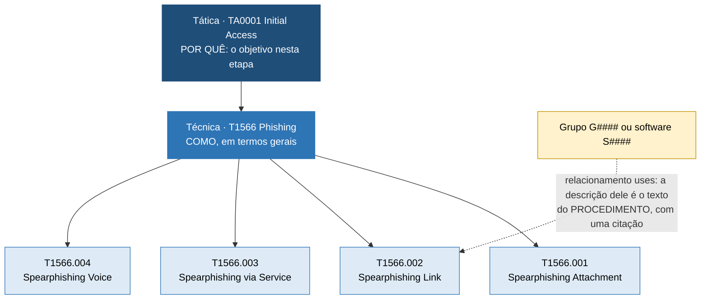
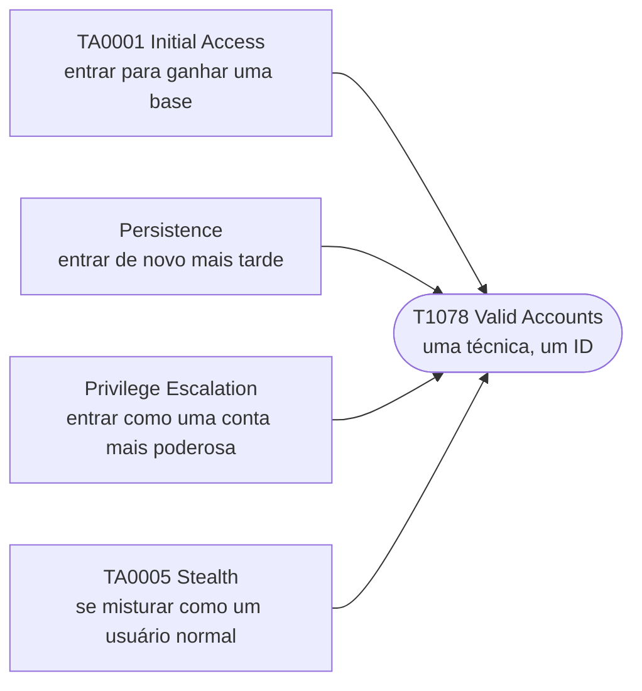
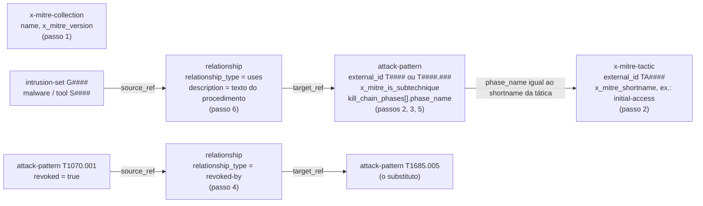

# Dia 35: Como o ATT&CK é construído, da tática ao procedimento

> 🇺🇸 Original: [*Day 35: How ATT&CK is built, from tactic to procedure*](https://github.com/thiefdroppers/cyber-investigator-skills/blob/main/curriculum/phase-3-cyber-threat-intelligence/day-35.md) — © ThiefDroppers, licença MIT.
> Aqui: tradução fiel **+** camada brasileira. Nada do original foi removido; tudo o que é novo vem marcado com ➕.

**Fase 3. Inteligência de ameaças cibernéticas** · Meta da trilha: ler o ATT&CK como um modelo de dados que você consegue consultar, para que todo ID de técnica que você escrever daqui em diante nesta fase seja um ID que você conferiu, e não um que você lembrou.

Rank Jutsu: `B` · [](https://colab.research.google.com/github/Ridd1kulusC0d3r/investigador-cyber-90-dias/blob/main/curriculo/fase-3-inteligencia-de-ameacas/dia-35/dia-35.ipynb)

---

## 🎬 ➕ Abertura do caso — *Quatro cooperativas, um kit*

Segunda-feira, 12 de outubro, uma semana depois do primeiro SMS. A Marta Quintão encaminha à Vigia uma mensagem do grupo de segurança das cooperativas mineiras: a CoopVale, a CredMinas, a Unicoop Sul e a Cooperouro receberam, nos últimos dias, SMS do "Pix bloqueado" com o nome delas. Mesmo texto, mesma página, só o logotipo trocado.

— É o IscaKit — você diz. — Igualzinho. Vou montar o mapeamento no ATT&CK: T1566, Phishing, e o resto eu…

— E o resto você o quê? — Rafa nem tira os olhos da tela. — Lembra? Em que versão? Na matriz Enterprise ou na Mobile? O SMS chegou num celular, não num servidor de e-mail.

Silêncio.

— Quatro cooperativas vão ler esse mapeamento e montar detecção em cima dele. Hoje você não mapeia nada. Hoje você aprende a **consultar** o ATT&CK, para que cada ID que você escrever amanhã tenha vindo do dado, e não da sua memória.

É isso que o Dia 35 ensina. *(Personagens e cenário: [Operação Isca](../../../caso-continuo/).)*

---

## 📖 Conceito

O MITRE ATT&CK é um catálogo de comportamentos de adversários montado a partir de relatos públicos de incidentes. Ele cobre três domínios (*Enterprise*, *Mobile*, *ICS*). Esta fase usa o Enterprise.

A matriz tem quatro camadas, e investigadores confundem essas camadas o tempo todo:

| Camada | Responde | Formato do ID | Exemplo |
|---|---|---|---|
| Tática (*tactic*) | Por que o adversário fez aquilo (o objetivo naquela etapa) | `TA####` | TA0001 Initial Access |
| Técnica (*technique*) | Como, em termos gerais | `T####` | T1566 Phishing |
| Subtécnica (*sub-technique*) | Como, de forma mais específica | `T####.###` | T1566.002 Spearphishing Link |
| Procedimento (*procedure*) | O que um grupo ou ferramenta nomeada fez de fato, com uma citação | sem ID; fica guardado como o texto de um relacionamento "uses" | "APT29 has bypassed UAC" (da camada do APT29, citando a Mandiant) |

A família de phishing desenhada nessas quatro camadas. Cada seta aponta um passo mais específico, e o procedimento é a única camada sem ID próprio:



Uma técnica pode servir a mais de uma tática. T1078 Valid Accounts fica sob Initial Access, Persistence, Privilege Escalation e Stealth, porque entrar com uma senha roubada pode cumprir qualquer um desses objetivos. Quando você mapeia um comportamento, a tática vem do propósito do adversário naquele momento da intrusão. A técnica, sozinha, não diz isso.



O ATT&CK também acompanha grupos (`G####`), software (`S####`), campanhas (`C####`), mitigações (`M####`), fontes de dados (`DS####`) e componentes de dados (`DC####`). Versões mais novas acrescentam estratégias de detecção (`DET####`) e analíticas (`AN####`).

A matriz muda. No ATT&CK v19.0 (abril de 2026), o MITRE dividiu a antiga tática Defense Evasion em Stealth (que ficou com o TA0005) e uma nova tática, Defense Impairment (TA0112), e revogou alguns IDs no processo. T1070.001 Clear Windows Event Logs, que aparece em anos de relatórios publicados, agora resolve para T1685.005. Um relatório escrito em 2023 e uma camada (*layer*) montada hoje podem usar IDs diferentes para o mesmo comportamento. Registre a versão do ATT&CK ao lado de todo mapeamento que você fizer.

## 📚 Recursos

- [Dados STIX do ATT&CK no GitHub](https://github.com/mitre-attack/attack-stix-data): a base de conhecimento completa como JSON STIX 2.1, um arquivo por domínio e versão.
- [ATT&CK data and tools](https://attack.mitre.org/resources/attack-data-and-tools/): o índice do MITRE com as formas oficiais de consumir os dados.
- [ATT&CK Navigator](https://mitre-attack.github.io/attack-navigator/) e a [especificação do formato de camada](https://github.com/mitre-attack/attack-navigator/tree/master/layers/spec): a ferramenta de mapa de calor (*heatmap*) usada a fase inteira. O formato de camada atual é o 4.5.
- [Treinamento de CTI do MITRE ATT&CK](https://attack.mitre.org/resources/learn-more-about-attack/training/cti/): curso gratuito. O Módulo 1 cobre o conteúdo deste dia.
- [Manual do jq](https://jqlang.org/manual/): a linguagem de consulta usada abaixo.

### ➕ Recursos do contexto Brasil

- [Matriz ATT&CK Mobile](https://attack.mitre.org/matrices/mobile/): golpe por SMS (*smishing*) acontece no celular. O domínio Mobile tem a técnica [T1660 Phishing](https://attack.mitre.org/techniques/T1660/), cuja descrição cita mensagens de texto com engenharia social para obter credenciais. O original usa Enterprise; a Operação Isca vai precisar dos dois.
- [`index.json` do attack-stix-data](https://raw.githubusercontent.com/mitre-attack/attack-stix-data/master/index.json): lista todas as versões publicadas de cada domínio, com a URL de cada arquivo. É o jeito de descobrir a versão vigente por código, sem adivinhar.
- [CERT.br — Cartilha de Segurança para Internet](https://cartilha.cert.br/): o fascículo de golpes descreve, em português e para o público leigo, os mesmos comportamentos que o ATT&CK descreve em linguagem técnica. Útil para "traduzir" o mapeamento para a Marta.
- [Glossário do Febraban Tech / alertas de golpes da Febraban](https://portal.febraban.org.br/): a federação dos bancos publica campanhas sobre golpes do Pix e da falsa central. Não usa IDs do ATT&CK, e é exatamente por isso que serve de exercício de tradução.

## 🛠️ Prática: jq e ATT&CK Navigator (um mapa de calor de densidade de subtécnicas e uma ficha de IDs de técnicas)

Você vai consultar o conjunto de dados bruto do ATT&CK pela linha de comando, rastrear um ID revogado até o substituto e depois gerar uma camada do Navigator a partir dos dados. Tudo aqui lê o conjunto de dados publicado pelo MITRE. Nada toca nenhum sistema ativo.

O arquivo é um grande *bundle* STIX. Estes são os objetos e campos que as consultas abaixo leem, e como eles apontam uns para os outros:



**Seu checklist de hoje.** Faça na ordem e marque cada item ao terminar:

- [ ] 1. Obter os dados e registrar a versão
- [ ] 2. Contar o que existe na matriz
- [ ] 3. Puxar uma família de técnicas
- [ ] 4. Resolver um ID revogado
- [ ] 5. Gerar uma camada de mapa de calor a partir dos dados
- [ ] 6. Escrever uma ficha de IDs de técnicas
- [ ] 7. Conferir um ID de um relatório antigo
- [ ] ➕ 8. Prática BR: o vocabulário do IscaKit, conferido no dado (Enterprise **e** Mobile)
- [ ] ➕ 9. O notebook do dia no Colab

### 1. Obter os dados e registrar a versão

```bash
mkdir -p ~/cti-lab/day35 && cd ~/cti-lab/day35
curl -sL https://raw.githubusercontent.com/mitre-attack/attack-stix-data/master/enterprise-attack/enterprise-attack.json -o enterprise-attack.json
jq -r '.objects[] | select(.type=="x-mitre-collection") | .name + " v" + .x_mitre_version' enterprise-attack.json
```

O arquivo tem cerca de 50 MB. Em setembro de 2026, o comando imprimiu `Enterprise ATT&CK v19.2`. Escreva a sua versão no topo das suas notas.

### 2. Contar o que existe na matriz

Objetos revogados e obsoletos (*deprecated*) continuam no arquivo por compatibilidade, então filtre-os ou suas contagens vão sair erradas:

```bash
# técnicas-mãe
jq '[.objects[] | select(.type=="attack-pattern" and .revoked!=true and .x_mitre_deprecated!=true and .x_mitre_is_subtechnique!=true)] | length' enterprise-attack.json
# subtécnicas
jq '[.objects[] | select(.type=="attack-pattern" and .revoked!=true and .x_mitre_deprecated!=true and .x_mitre_is_subtechnique==true)] | length' enterprise-attack.json
# táticas, com IDs e os nomes curtos que o Navigator usa
jq -r '.objects[] | select(.type=="x-mitre-tactic") | [(.external_references[] | select(.source_name=="mitre-attack") | .external_id), .name, .x_mitre_shortname] | @tsv' enterprise-attack.json
```

Na v19.2, esses comandos devolveram 222 técnicas, 475 subtécnicas e 15 táticas, incluindo `TA0005 Stealth` e `TA0112 Defense Impairment`. Espere números diferentes numa versão posterior.

### 3. Puxar uma família de técnicas

```bash
jq -r '.objects[] | select(.type=="attack-pattern" and .revoked!=true)
  | select(.external_references[0].external_id | startswith("T1566"))
  | [.external_references[0].external_id, .name, (.kill_chain_phases | map(.phase_name) | join(","))] | @tsv' enterprise-attack.json | sort
```

Saída observada na v19.2:

```
T1566      Phishing                     initial-access
T1566.001  Spearphishing Attachment     initial-access
T1566.002  Spearphishing Link           initial-access
T1566.003  Spearphishing via Service    initial-access
T1566.004  Spearphishing Voice          initial-access
```

O campo `kill_chain_phases` é onde mora o vínculo entre técnica e tática. Rode a mesma consulta para `T1078` e você vai ver quatro nomes de fase numa única técnica.

### 4. Resolver um ID revogado

Relatórios mais antigos citam `T1070.001`. Descubra o que o substituiu:

```bash
OLD=$(jq -r '.objects[] | select(.type=="attack-pattern") | select(any(.external_references[]; .external_id=="T1070.001")) | .id' enterprise-attack.json)
jq -r --arg old "$OLD" '.objects as $o
  | ($o[] | select(.type=="relationship" and .relationship_type=="revoked-by" and .source_ref==$old) | .target_ref) as $new
  | $o[] | select(.id==$new) | .external_references[0].external_id + " " + .name' enterprise-attack.json
```

Na v19.2, isso imprime `T1685.005 Clear Windows Event Logs`. Use este padrão sempre que o ID de um relatório não aparecer no Navigator.

### 5. Gerar uma camada de mapa de calor a partir dos dados

Salve isto como `sublayer.jq`. Ele dá a cada técnica-mãe uma pontuação igual ao número de subtécnicas ativas que ela tem:

```jq
[.objects[] | select(.type=="attack-pattern" and .revoked!=true and .x_mitre_deprecated!=true)
  | (.external_references[] | select(.source_name=="mitre-attack") | .external_id)] as $ids
| ($ids | map(select(contains(".")) | split(".")[0]) | group_by(.) | map({key:.[0], value:length}) | from_entries) as $subs
| {
    name: "Sub-technique density",
    versions: {layer: "4.5", attack: "19", navigator: "5.3.2"},
    domain: "enterprise-attack",
    description: "Score = number of active sub-techniques under each parent technique",
    techniques: [ $ids[] | select(contains(".") | not) | {techniqueID: ., score: ($subs[.] // 0)} ],
    gradient: {colors: ["#ffffff", "#ff6666"], minValue: 0, maxValue: 10}
  }
```

```bash
jq -f sublayer.jq enterprise-attack.json > sub-density-layer.json
jq -c '.techniques | sort_by(-.score) | .[0:5]' sub-density-layer.json
```

Na v19.2, as cinco primeiras foram T1027 e T1546 (18 cada), depois T1547, T1564 e T1218 (14 cada). Ajuste `versions.attack` para a sua versão principal (*major*).

Abra o Navigator, escolha "Open Existing Layer", depois "Upload from local", e carregue `sub-density-layer.json`. Exporte com o controle "render layer to SVG" na barra de ferramentas da camada e depois baixe o SVG da tela de renderização.

### 6. Escrever uma ficha de IDs de técnicas

Escolha cinco técnicas entre as células mais escuras. Para cada uma, preencha uma linha a partir do conjunto de dados (não da memória):

| ID | Nome | Tática(s) | Nº de subtécnicas | Um exemplo real de procedimento e a fonte dele |
|---|---|---|---|---|
| T1027 | Obfuscated Files or Information | stealth | 18 | (copie a descrição de um relacionamento "uses" e a citação dela) |

Para obter o texto de procedimento de uma técnica, consulte os objetos `relationship` cujo `target_ref` é o `id` STIX daquela técnica e leia o campo `description` deles.

### 7. Conferir um ID de um relatório antigo

Escolha um ID de técnica de um relatório publicado antes de abril de 2026 e resolva-o para o ID atual com o padrão do passo 4, ou confirme que ele não mudou. Registre o ID antigo e o resultado no seu arquivo de notas.

### O que você tem ao terminar

- `sub-density-layer.json` mais a exportação em SVG: um mapa de calor em que cada técnica Enterprise está sombreada pelo número de subtécnicas.
- Uma ficha de IDs com cinco linhas, com tática, contagem e um procedimento citado por linha.
- Um arquivo de notas que registra a versão do ATT&CK, a consulta de ID revogado que você rodou e o ID do relatório antigo do passo 7.

### ➕ 8. Prática BR: o vocabulário do IscaKit, conferido no dado

Rafa pediu que você não mapeasse nada hoje, só que **conferisse o vocabulário**. Abaixo está a lista de rascunho que você escreveu de memória na abertura. Seu trabalho é conferir cada linha no conjunto de dados (Enterprise **e** Mobile v19.x), corrigir o que estiver errado e anotar a versão.

| Comportamento do IscaKit (Fases 1 e 2) | Seu palpite de memória | Domínio a consultar |
|---|---|---|
| SMS com link para o site falso, recebido no celular do cooperado | T1566.002 Spearphishing Link | Enterprise **e** Mobile |
| Página que imita a cooperativa e coleta a senha digitada | T1056.003 Web Portal Capture | Enterprise |
| Registro dos domínios imitação (`serraazul-pix.example` e os das outras quatro) | T1583.001 Domains | Enterprise |
| Certificado TLS gratuito obtido na véspera do disparo | T1588.004 Digital Certificates | Enterprise |
| Encurtador `lnk.example/sa7` apontando para o site falso | T1608.005 Link Target | Enterprise |
| Mensagem que se passa pela cooperativa | T1656 Impersonation | Enterprise |
| Transferências Pix não reconhecidas | T1657 Financial Theft | Enterprise |

Para cada linha, rode (ou faça no notebook):

```bash
ID=T1656
jq -r --arg id "$ID" '.objects[] | select(.type=="attack-pattern")
  | select(any(.external_references[]; .external_id==$id))
  | [$id, .name, (.revoked // false), (.kill_chain_phases // [] | map(.phase_name) | join(","))] | @tsv' enterprise-attack.json
```

e, para a matriz Mobile, baixe o arquivo do domínio:

```bash
curl -sL https://raw.githubusercontent.com/mitre-attack/attack-stix-data/master/mobile-attack/mobile-attack.json -o mobile-attack.json
jq -r '.objects[] | select(.type=="attack-pattern" and .revoked!=true)
  | select(.external_references[0].external_id | startswith("T1660"))
  | [.external_references[0].external_id, .name, (.kill_chain_phases | map(.phase_name) | join(","))] | @tsv' mobile-attack.json
```

Duas surpresas esperam por você (conferidas na v19.2 em 2026-10-12):

1. **Uma das linhas está revogada.** Ache qual, e resolva para o substituto com o padrão do passo 4. Escreva os dois IDs nas notas, como o passo 7 pede.
2. **O SMS tem casa própria na matriz Mobile.** O Enterprise descreve phishing que chega a contas e sistemas corporativos; o Mobile tem T1660 Phishing, sob a tática Initial Access *do domínio Mobile* (que tem IDs de tática próprios, diferentes dos do Enterprise: ache-os com a consulta de táticas do passo 2 rodada no `mobile-attack.json`). Escreva nas notas, em duas frases, qual domínio você vai usar para o disparo dos SMS e por quê. Não há resposta única: há resposta justificada. (O Dia 43 vai carregar as duas opções no STIX até a revisão.)

Sua saída é a tabela acima com três colunas a mais: **ID conferido**, **nome oficial no dataset** e **versão / domínio**.

### ➕ 9. O notebook do dia

Abra o [notebook do Dia 35 no Colab](https://colab.research.google.com/github/Ridd1kulusC0d3r/investigador-cyber-90-dias/blob/main/curriculo/fase-3-inteligencia-de-ameacas/dia-35/dia-35.ipynb). Nele você:

1. carrega o ATT&CK (o arquivo completo do GitHub, se quiser e tiver rede, ou uma **amostra enxuta da v19.2 embutida** no notebook) e lê a versão;
2. refaz os passos 2 a 5 do original em Python puro, sem `jq`, comentado linha a linha;
3. gera o `sub-density-layer.json` pronto para o Navigator;
4. joga o quiz **"tática, técnica, subtécnica ou procedimento?"**;
5. confere o vocabulário do IscaKit da Prática BR e sai com a tabela corrigida em Markdown.

## ✅ Checkpoint

- Seu mapa de calor carrega no Navigator sem aviso de versão, ou você consegue explicar o aviso que recebeu.
- Para cada linha da sua ficha de IDs, aponte a saída do jq ou a descrição de relacionamento de onde ela veio. Qualquer célula preenchida de memória está errada por definição, mesmo que no fim esteja correta.
- Seu arquivo de notas registra um ID de técnica de um relatório publicado antes de abril de 2026, ao lado do ID atual ou de uma nota dizendo que ele não mudou.
- Sem consultar notas, explique por que T1078 aparece em quatro colunas da matriz.

### ➕ Checkpoint BR

- Sua tabela do IscaKit tem as sete linhas conferidas no dataset, cada uma com a versão do ATT&CK e o domínio (Enterprise ou Mobile).
- Você achou a linha revogada e registrou o ID antigo e o substituto.
- Você escreveu, em duas frases, qual domínio (Enterprise ou Mobile) vai usar para o disparo do SMS, e por quê.
- Sem consultar notas, você explica por que "TA0001" não é o ID da tática Initial Access na matriz Mobile.

## ⚖️ ➕ Camada jurídica BR

**Técnica não é tipo penal.** Um mapeamento no ATT&CK descreve *comportamento*; ele não qualifica crime. A mesma T1566 pode estar por trás de uma fraude eletrônica (CP art. 171, §2º-A, incluído pela Lei 14.155/2021), de uma invasão de dispositivo (CP art. 154-A) ou de nada criminoso (um teste de phishing autorizado pela própria empresa). Quando o informe da Vigia chegar ao Dr. Hélio, ele não deve ler "T1566.002" como "crime de tal artigo". A tradução de comportamento para tipo penal é trabalho do jurídico e, depois, da autoridade policial e do Ministério Público.

**Uso do dado do MITRE.** O ATT&CK é publicado pelo MITRE com termos de uso próprios, que permitem reproduzir e usar o conteúdo, inclusive comercialmente, desde que se mantenha o aviso de direitos autorais e a atribuição ao MITRE. Ao colocar trechos de procedimentos do ATT&CK num relatório para cliente, cite a fonte e a versão. <!-- TODO jurídico: conferir o texto vigente dos Terms of Use do ATT&CK em https://attack.mitre.org/resources/legal-and-branding/terms-of-use/ antes de citar condições específicas. -->

**Prova e versão.** No CPP, a cadeia de custódia (arts. 158-A a 158-F) trata de vestígios. O mapeamento não é vestígio, mas é análise sobre vestígios, e uma análise que não diz com qual versão do catálogo foi feita fica fácil de contestar ("o ID citado nem existe mais"). Registrar a versão é o equivalente analítico de registrar o hash.

> Este repositório é material de estudo e não substitui orientação jurídica.

## 🧠 ➕ Camada 8 — a ilusão de que você "sabe" o ID

Por que o original insiste tanto em "nada de memória"? Porque a memória humana é **reconstrutiva**: a cada vez que você lembra um ID, você o reconstrói a partir de pedaços, e a sensação de certeza não acompanha a exatidão. Dois mecanismos bem documentados aparecem aqui:

- **Heurística de disponibilidade** (Tversky e Kahneman): julgamos como mais correto ou mais frequente aquilo que vem à mente com facilidade. T1566 vem à mente fácil porque é a técnica que mais aparece em palestras; por isso ela vira o "chute padrão" para tudo que envolve uma mensagem, inclusive um SMS que mora melhor na matriz Mobile.
- **Fluência como falso sinal de verdade**: o que lemos muitas vezes parece mais verdadeiro (o chamado efeito da verdade ilusória). Você leu "T1656 Impersonation" em dezenas de relatórios de 2023 a 2025; a fluência não avisa que o ID foi revogado em 2026.

Consequência prática: trate a sensação de "isso eu sei" como um **gatilho para conferir**, não como dispensa de conferir. No trabalho real, o analista que escreve "conferido no ATT&CK v19.2 em 2026-10-12" ao lado do ID é o que não passa vergonha na reunião com quatro cooperativas.

## 🤖 ➕ Skill do dia

Este dia propõe para a [skill pt-BR](../../../skills/investigador-cyber/SKILL.md) o procedimento **"Consulta e conferência de IDs do ATT&CK"**: nunca escrever um ID de memória, registrar domínio e versão, e resolver IDs revogados antes de usar. Detalhes e caso de teste em [`_skill-delta.md`](_skill-delta.md).

## 💡 ➕ Inovação OSINT do dia — descobrir a versão vigente do ATT&CK por código

O `attack-stix-data` publica um `index.json` com todas as versões de cada domínio e a URL de cada arquivo. Com ele, sua ferramenta nunca fica presa a uma versão "lembrada":

```python
import json, urllib.request                                    # só biblioteca padrão
URL = "https://raw.githubusercontent.com/mitre-attack/attack-stix-data/master/index.json"
with urllib.request.urlopen(URL, timeout=20) as r:             # timeout: nunca trave esperando a rede
    indice = json.load(r)
for col in indice["collections"]:                              # Enterprise, Mobile, ICS
    atual = col["versions"][0]                                 # a primeira da lista é a mais recente
    print(col["name"], atual["version"], atual["url"])
```

Em 2026-10-12, o índice listava Enterprise, Mobile e ICS, todos na 19.2. Guarde a URL **versionada** (`enterprise-attack-19.2.json`) nas notas do caso, e não a `enterprise-attack.json`, que muda de conteúdo a cada versão nova. Assim, quem refizer sua análise daqui a um ano baixa exatamente o mesmo arquivo.

## 📝 Diário de estudo

- Data:
- Tempo gasto:
- O que ficou claro:
- O que ainda está nebuloso:
- Artefato produzido: `sub-density-layer.json` (+ SVG), ficha de IDs, notas com versão e ID revogado, tabela do IscaKit conferida

---
<sub>Baseado em [cyber-investigator-skills](https://github.com/thiefdroppers/cyber-investigator-skills) por ThiefDroppers (MIT). Tradução, camada BR, Camada 8, skill pt-BR e notebook por Deivison Lourenço (@Ridd1kulusC0d3r).</sub>
