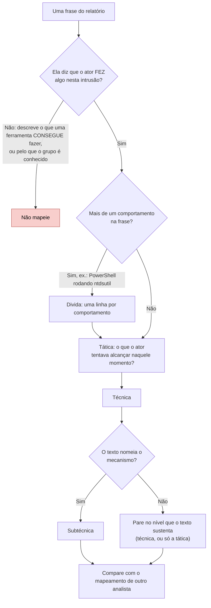
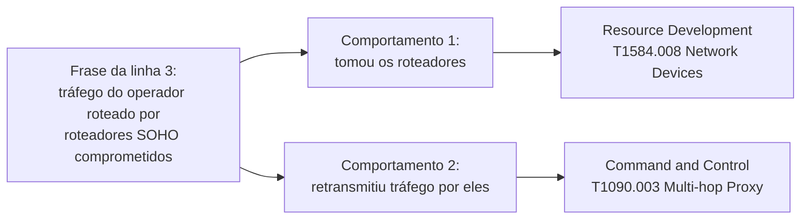
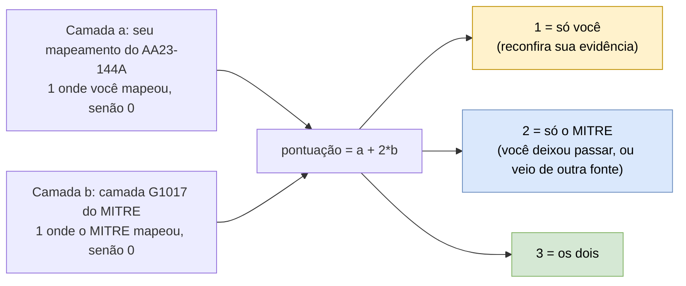

# Dia 36: Mapeando um alerta publicado no ATT&CK

> 🇺🇸 Original: [*Day 36: Mapping a published advisory to ATT&CK*](https://github.com/thiefdroppers/cyber-investigator-skills/blob/main/curriculum/phase-3-cyber-threat-intelligence/day-36.md) — © ThiefDroppers, licença MIT.
> Aqui: tradução fiel **+** camada brasileira. Nada do original foi removido; tudo o que é novo vem marcado com ➕.

**Fase 3. Inteligência de ameaças cibernéticas** · Meta da trilha: transformar a prosa de um alerta governamental real em IDs de técnicas do ATT&CK que você consiga defender frase por frase, e depois medir o seu mapeamento contra o do próprio MITRE.

Rank Jutsu: `B` · [](https://colab.research.google.com/github/Ridd1kulusC0d3r/investigador-cyber-90-dias/blob/main/curriculo/fase-3-inteligencia-de-ameacas/dia-36/dia-36.ipynb)

---

## 🎬 ➕ Abertura do caso — *O alerta que tinha mais do que aconteceu*

O rascunho do alerta conjunto **ALR-2026-01** chega às 9h40, escrito a seis mãos: Vigia, CoopVale e CredMinas. Doze frases numeradas. Às 14h, as cinco cooperativas querem a camada do Navigator para alimentar as detecções.

Você passa o olho e já começa a colorir: T1660, T1583.001, T1056.003… e, na frase 2, "módulos de captura de código de SMS e envio por WhatsApp". Mais duas células pintadas.

Rafa aponta para a frase 2 com a caneta.

— Isso aconteceu aqui? Alguém viu o kit pedir código de SMS de algum cooperado?

— Não… o fórum onde vendem o kit diz que ele tem.

— Então é capacidade, não observação. E a frase 9, "mantiveram presença"? Qual mecanismo?

— Não diz.

— Então não invente um. Cinco cooperativas vão escrever regra de detecção em cima da sua camada. Cada célula pintada tem que voltar a uma frase.

É isso que o Dia 36 ensina. *(Personagens e cenário: [Operação Isca](../../../caso-continuo/).)*

---

## 📖 Conceito

Mapear é um trabalho de tradução. Um relatório diz o que um invasor fez em linguagem comum, e você converte cada comportamento observado numa tática e numa técnica. O guia de mapeamento da CISA divide isso em passos: encontrar o comportamento, pesquisá-lo, identificar a tática, depois a técnica, depois a subtécnica, se a evidência sustentar esse nível de detalhe, e por fim comparar os seus resultados com os de outro analista.

A maioria dos erros de mapeamento cai em poucos padrões:

- Mapear a ferramenta em vez do comportamento. "O ator usou PowerShell para rodar o ntdsutil" contém dois comportamentos: T1059.001 PowerShell para execução e T1003.003 NTDS para acesso a credenciais. O objetivo daquele passo era o roubo de credenciais.
- Mapear capacidade como se fosse observação. Uma família de *malware* que *consegue* fazer capturas de tela não significa que o ator fez capturas de tela nesta intrusão. Mapeie só o que o relatório diz que aconteceu.
- Chutar uma subtécnica que o texto não sustenta. "O ator estabeleceu persistência", sem nenhum mecanismo nomeado, mapeia no máximo para a tática. Deixe a técnica em branco em vez de inventar *Registry Run Keys*.
- Deduzir a tática a partir da técnica. A tática é o propósito naquele momento. O mesmo comando `netsh` pode ser descoberta (*discovery*) numa intrusão e comando e controle em outra.

Os passos da CISA como um caminho de decisão, com cada um desses erros colocado no ponto em que acontece:



A fonte de hoje é um alerta conjunto sobre o Volt Typhoon, um *cluster* que os Estados Unidos e governos parceiros atribuem à República Popular da China. A Microsoft publicou a própria análise no mesmo dia. Os dois documentos descrevem *living off the land* ("viver da terra"): o ator se apoiou em ferramentas nativas do Windows em vez de *malware* próprio, o que faz do mapeamento de comportamento o principal jeito de descrever o que aconteceu.

## 📚 Recursos

- [CISA AA23-144A, "People's Republic of China State-Sponsored Cyber Actor Living off the Land to Evade Detection"](https://www.cisa.gov/news-events/cybersecurity-advisories/aa23-144a) (24 de maio de 2023): sua fonte principal hoje.
- [Microsoft Threat Intelligence, "Volt Typhoon targets US critical infrastructure with living-off-the-land techniques"](https://www.microsoft.com/en-us/security/blog/2023/05/24/volt-typhoon-targets-us-critical-infrastructure-with-living-off-the-land-techniques/) (24 de maio de 2023): segunda fonte, para checagem cruzada.
- [CISA, "Best Practices for MITRE ATT&CK Mapping"](https://www.cisa.gov/news-events/news/best-practices-mitre-attckr-mapping): o método passo a passo e uma lista de erros comuns.
- [Página do grupo G1017 no ATT&CK, Volt Typhoon](https://attack.mitre.org/groups/G1017/): o mapeamento do MITRE, com o qual você vai comparar o seu.
- [CISA AA24-038A](https://www.cisa.gov/news-events/cybersecurity-advisories/aa24-038a) (fevereiro de 2024): um alerta posterior e mais longo sobre o mesmo ator, para a extensão opcional.

### ➕ Recursos do contexto Brasil

- [CTIR Gov (GSI/PR)](https://www.gov.br/ctir/pt-br): o Centro de Prevenção, Tratamento e Resposta a Incidentes Cibernéticos de Governo publica alertas e recomendações em português. É o equivalente brasileiro mais próximo dos alertas da CISA para treinar o mesmo método em textos nacionais.
- [CERT.br — notas e estatísticas](https://www.cert.br/): o grupo de resposta do NIC.br publica estatísticas de incidentes notificados e documentos técnicos.
- [CAIS/RNP — alertas](https://www.rnp.br/sistema-rnp/cais): o centro de atendimento a incidentes da Rede Nacional de Ensino e Pesquisa publica alertas de segurança.
- [`caso-continuo/dados/dia-36/alerta-ALR-2026-01.md`](../../../caso-continuo/dados/dia-36/alerta-ALR-2026-01.md): o alerta fictício da Operação Isca, com 12 frases numeradas, para a Prática BR.

## 🛠️ Prática: ATT&CK Navigator (uma camada de técnicas sustentada por evidência e um mapa de calor de comparação)

Você está mapeando um documento publicado. Não pesquise, não resolva nem visite nenhuma infraestrutura nomeada no alerta.

**Seu checklist de hoje.** Faça na ordem e marque cada item ao terminar:

- [ ] 1. Montar uma tabela de evidências antes de tocar no Navigator
- [ ] 2. Converter a tabela numa camada do Navigator
- [ ] 3. Puxar o mapeamento do MITRE para o mesmo grupo
- [ ] 4. Montar o mapa de calor de comparação
- [ ] 5. Escrever a nota de lacunas
- [ ] 6. Extensão opcional: um segundo alerta
- [ ] ➕ 7. Prática BR: mapear o alerta ALR-2026-01 da Operação Isca e comparar com o mapeamento do Rafa
- [ ] ➕ 8. O notebook do dia no Colab

### 1. Montar uma tabela de evidências antes de tocar no Navigator

Leia o AA23-144A de ponta a ponta uma vez, sem mapear. Na segunda leitura, copie para uma planilha cada frase que descreve uma ação que o ator executou, com estas colunas:

| # | Citação (literal, do relatório) | Comportamento com suas palavras | Tática | Técnica / subtécnica | Confiança no mapeamento |
|---|---|---|---|---|---|

Linhas resolvidas (parafraseadas aqui; as suas linhas precisam conter o texto exato do relatório):

| # | Comportamento descrito no alerta | Tática | Técnica | Por que este nível |
|---|---|---|---|---|
| 1 | Usou o `ntdsutil` para criar uma cópia do banco de dados do Active Directory a partir de um controlador de domínio | Credential Access | T1003.003 NTDS | O relatório nomeia o banco de dados e a ferramenta, o que basta para a subtécnica |
| 2 | Configurou `netsh interface portproxy` para encaminhar tráfego entre hosts dentro da rede | Command and Control | T1090.001 Internal Proxy | Encaminhamento dentro da rede da vítima, não para fora, para a internet |
| 3 | Roteou o tráfego do operador por roteadores de pequenos escritórios e residências (SOHO) comprometidos | Command and Control; Resource Development | T1090.003 Multi-hop Proxy; T1584.008 Network Devices | Dois comportamentos: comprometer os roteadores, e depois usá-los como retransmissores |
| 4 | Obteve acesso inicial por um equipamento de rede exposto à internet | Initial Access | T1190 Exploit Public-Facing Application | Mapeie só T1190, a menos que o texto diga como o equipamento foi explorado |
| 5 | Consultou os logs de eventos de segurança do Windows em busca de logons bem-sucedidos | Discovery | T1654 Log Enumeration | O propósito era conhecer contas e hosts; os logs não foram apagados |

A linha 3 é o padrão que o checkpoint pede: uma frase, dois comportamentos, duas táticas. Desenhada, fica assim:



A linha 5 é uma armadilha que vale a pena estudar. Ler logs não é o mesmo comportamento que apagá-los. Se você mapeou essa linha para qualquer coisa sob Defense Impairment, volte e releia a frase.

Mire em 15 a 25 linhas. Marque como confiança baixa qualquer linha em que você precisou chutar.

### 2. Converter a tabela numa camada do Navigator

Escreva a camada à mão, para que cada técnica carregue a evidência no campo de comentário. Um arquivo mínimo:

```json
{
  "name": "Volt Typhoon, my mapping of AA23-144A",
  "versions": {"layer": "4.5", "attack": "19", "navigator": "5.3.2"},
  "domain": "enterprise-attack",
  "description": "Mapped from CISA AA23-144A (2023-05-24). One technique per evidence row.",
  "techniques": [
    {"techniqueID": "T1003.003", "score": 1, "comment": "Row 1: ntdsutil copy of AD database", "showSubtechniques": true},
    {"techniqueID": "T1090.001", "score": 1, "comment": "Row 2: netsh portproxy between internal hosts", "showSubtechniques": true},
    {"techniqueID": "T1654", "score": 1, "comment": "Row 5: security log queries for logon events"}
  ],
  "gradient": {"colors": ["#ffffff", "#66b1ff"], "minValue": 0, "maxValue": 1}
}
```

Confira o arquivo com `jq . my-volt-typhoon.json` antes de carregar. Uma vírgula sobrando no fim quebra o *upload*.

### 3. Puxar o mapeamento do MITRE para o mesmo grupo

```bash
curl -sL https://attack.mitre.org/groups/G1017/G1017-enterprise-layer.json -o attack-G1017.json
jq '[.techniques[] | select(.score==1)] | length' attack-G1017.json
```

O mesmo padrão de URL funciona para qualquer grupo (`/groups/G0016/G0016-enterprise-layer.json` para o APT29). A camada do MITRE junta todas as fontes públicas que ele revisou sobre o grupo, das quais este alerta é uma. Ela também incorpora técnicas de campanhas atribuídas ao grupo, então vai ser bem maior que a sua. Na conferência de setembro de 2026 (ATT&CK v19.2), o comando acima devolveu 98.

### 4. Montar o mapa de calor de comparação

No Navigator, abra as duas camadas. Depois escolha "Create New Layer" e então "Create Layer from other layers". O Navigator dá uma letra a cada camada aberta. Se o seu mapeamento é `a` e o do MITRE é `b`, defina a expressão de pontuação como:

```
a + 2*b
```

Cada técnica fica então com pontuação 1 se só você a mapeou, 2 se só o MITRE a mapeou, e 3 se os dois mapearam.



Defina um gradiente de três cores (por exemplo, amarelo, azul, verde) e acrescente itens de legenda dizendo o que cada pontuação significa.

### 5. Escrever a nota de lacunas

Abaixo do mapa de calor, escreva uma nota curta em três partes:

- Técnicas que só você mapeou (pontuação 1). Para cada uma, cite sua evidência e diga se você ainda a sustenta.
- Técnicas que só o MITRE mapeou (pontuação 2) e que você consegue rastrear até o AA23-144A. Diga por que você as deixou passar.
- Técnicas que o MITRE mapeou a partir de outras fontes. Não precisa listar todas. Conte-as, e diga por que uma camada de grupo não é a mesma coisa que o mapeamento de um relatório.

### 6. Extensão opcional: um segundo alerta

Mapeie o AA24-038A do mesmo jeito e use `a + 2*b` de novo para ver como os relatos sobre o ator mudaram entre 2023 e 2024.

### O que você tem ao terminar

- Uma tabela de evidências com 15 linhas ou mais, cada uma com uma citação literal do AA23-144A.
- `my-volt-typhoon.json`, uma camada em que o comentário de cada técnica aponta para uma linha de evidência.
- Um mapa de calor de comparação exportado em SVG, com uma legenda explicando as pontuações 1, 2 e 3.
- Uma nota de lacunas de meia página ou menos.

### ➕ 7. Prática BR: o alerta ALR-2026-01 da Operação Isca

O alerta fictício está em [`caso-continuo/dados/dia-36/alerta-ALR-2026-01.md`](../../../caso-continuo/dados/dia-36/alerta-ALR-2026-01.md): 12 frases numeradas (`[S01]` a `[S12]`). Ele foi escrito de propósito com as quatro armadilhas do Conceito.

1. Monte a mesma tabela de evidências do passo 1, com a frase literal. Para cada frase, decida primeiro: **mapeia** ou **não mapeia** (e por quê).
2. Confira cada ID no dataset, como no Dia 35 (lembre: T1656 foi revogado; o disparo de SMS pode ir para a matriz Mobile, T1660, que **não** entra numa camada `enterprise-attack`; registre-o à parte ou numa segunda camada `mobile-attack`).
3. Gere `minha-camada-alr-2026-01.json` (Enterprise) com o comentário apontando para a frase (`"S05: ..."`).
4. Compare com o **mapeamento do Rafa**, que está no notebook, usando a mesma lógica `a + 2*b` (no notebook, sem precisar do Navigator).

Dicas sem entregar o jogo: há **uma** frase de capacidade (não mapeia), **uma** de persistência sem mecanismo (só tática), **pelo menos duas** frases com mais de um comportamento, **uma** de artefato do kit que serve para rastrear (Dia 38), mas não é comportamento a mapear, **uma** de resumo que só repete o que outra frase detalha, e **duas** frases que não descrevem ação nenhuma do ator.

### ➕ 8. O notebook do dia

Abra o [notebook do Dia 36 no Colab](https://colab.research.google.com/github/Ridd1kulusC0d3r/investigador-cyber-90-dias/blob/main/curriculo/fase-3-inteligencia-de-ameacas/dia-36/dia-36.ipynb). Nele você:

1. joga o quiz **"mapeia ou não mapeia?"** com as 12 frases do ALR-2026-01, uma por vez;
2. monta a tabela de evidências e a camada do Navigator por código, com a frase no comentário e validação do JSON (a "vírgula sobrando" que o original avisa);
3. calcula o `a + 2*b` entre a sua camada e a do Rafa em Python e lê as pontuações 1, 2 e 3;
4. tenta baixar a camada G1017 do MITRE (passo 3 do original), com plano B se a rede falhar;
5. escreve a nota de lacunas a partir do resultado.

## ✅ Checkpoint

- Escolha três células quaisquer da sua camada, ao acaso. Cada uma tem que levar de volta a uma frase citada do AA23-144A em uma consulta.
- Toda técnica na sua camada tem um comentário apontando para uma linha de evidência, então nenhuma foi escolhida porque o Volt Typhoon é "conhecido por" ela.
- Pelo menos uma linha da sua tabela mapeia uma única frase para duas ou mais técnicas, com o raciocínio escrito.
- Opcional (passo 6): sua camada do AA24-038A e o mapa de calor de comparação `a + 2*b` dela ficam ao lado dos do AA23-144A.
- Sem consultar notas, diga o que significam as pontuações 1, 2 e 3 no seu mapa de calor de comparação.

### ➕ Checkpoint BR

- Sua tabela do ALR-2026-01 tem as 12 frases, cada uma com "mapeia / não mapeia" e o motivo.
- A frase S02 não gerou nenhuma técnica, e você sabe dizer qual armadilha ela é.
- A frase S09 parou na tática (Persistence), sem técnica inventada.
- Você registrou à parte o disparo de SMS na matriz Mobile (T1660) ou justificou por que ficou só com o Enterprise.
- No `a + 2*b` com a camada do Rafa, você explicou cada técnica com pontuação 1 ou 2.

## ⚖️ ➕ Camada jurídica BR

**O alerta circula; a responsabilidade vai junto.** O ALR-2026-01 é TLP:AMBER e foi escrito para cinco cooperativas. Se uma frase dele afirmar como fato algo que foi só capacidade (o erro da S02), e uma cooperativa tomar uma decisão com base nisso (por exemplo, comunicar aos cooperados que "o golpe rouba códigos de SMS"), a imprecisão vira problema de comunicação e, potencialmente, de responsabilidade. Mapear só o observado é também uma regra de cautela jurídica.

**Dados pessoais no alerta.** O alerta fala de "três cooperados" sem nome, sem CPF, sem chave Pix. É o certo: um alerta de compartilhamento entre instituições precisa de padrão, não de vítima. A LGPD (Lei 13.709/2018) exige que o tratamento de dados pessoais respeite os princípios do art. 6º, entre eles **finalidade**, **necessidade** (o mínimo de dados para o propósito) e **segurança**. Para que uma camada do ATT&CK sirva de detecção, nenhum dado pessoal é necessário.

**Compartilhamento entre instituições financeiras.** Cooperativas de crédito são instituições autorizadas pelo Banco Central e estão sujeitas a regras próprias de segurança cibernética e de compartilhamento de informações sobre fraudes. A Res. CMN 4.893/2021 se dirige às instituições financeiras e demais instituições autorizadas a funcionar pelo Banco Central, o que inclui as cooperativas de crédito. Ela foi alterada pela Res. CMN 5.274/2025 (publicada em 22/12/2025, com adequação até 1º/3/2026), que acrescentou, entre outros pontos, testes de intrusão ao menos anuais por terceiro independente e controles específicos para os ambientes Pix. <!-- TODO jurídico: confirmar o número e o alcance da Resolução Conjunta BCB/CMN sobre compartilhamento de dados de indícios de fraude entre instituições. -->

> Este repositório é material de estudo e não substitui orientação jurídica.

## 🧠 ➕ Camada 8 — a reputação pinta células que a evidência não pintou

O segundo erro do Conceito ("capacidade mapeada como observação") tem um nome na psicologia: **efeito halo**, descrito por Edward Thorndike em 1920. Uma impressão geral sobre algo contamina o julgamento de atributos específicos. Se o IscaKit "é um kit sofisticado", cada capacidade anunciada parece ter sido usada aqui.

Ele anda junto com o **viés de confirmação**: depois que você decidiu que é "o kit do Pescador", você lê a frase 9 ("mantiveram presença") e preenche o mecanismo que combina com a sua história. Nos dois casos, o que pinta a célula é a reputação do ator na sua cabeça, não a frase no papel.

O antídoto já está no método do original: a tabela de evidências **antes** do Navigator, e o comentário obrigatório com a frase em cada técnica. Consequência prática: se você não consegue colar a frase no comentário, a célula não existe. Pergunte "onde está escrito?" antes de "faz sentido?".

## 🤖 ➕ Skill do dia

Este dia propõe para a [skill pt-BR](../../../skills/investigador-cyber/SKILL.md) o procedimento **"Mapeamento de um relatório no ATT&CK"**: tabela de evidências com citação literal antes de qualquer camada, uma linha por comportamento, nada de capacidade como observação e parar no nível que o texto sustenta. Detalhes e caso de teste em [`_skill-delta.md`](_skill-delta.md).

## 💡 ➕ Inovação OSINT do dia — a camada do Navigator validada em Python puro

O original avisa que "uma vírgula sobrando quebra o *upload*". Melhor do que só checar a sintaxe é checar o **conteúdo**: todo ID existe? toda técnica tem comentário? Com a biblioteca padrão:

```python
import json, re                                              # só biblioteca padrão
camada = json.load(open("my-volt-typhoon.json"))             # falha aqui = JSON inválido (a vírgula)
padrao = re.compile(r"^T\d{4}(\.\d{3})?$")                   # formato T#### ou T####.###
for t in camada["techniques"]:
    assert padrao.match(t["techniqueID"]), f"ID malformado: {t['techniqueID']}"
    assert t.get("comment"), f"{t['techniqueID']} sem evidência no comentário"
print("Camada ok:", len(camada["techniques"]), "técnicas, todas com evidência.")
```

Somado ao `resolver()` do Dia 35, você confere também se nenhum ID está revogado. É um "linter" de mapeamento: roda em segundos e pega exatamente os erros que, numa reunião com cinco cooperativas, custariam a credibilidade do alerta.

## 📝 Diário de estudo

- Data:
- Tempo gasto:
- O que ficou claro:
- O que ainda está nebuloso:
- Artefato produzido: tabela de evidências (AA23-144A), `my-volt-typhoon.json`, mapa de calor `a + 2*b` (SVG), nota de lacunas; tabela e camada do ALR-2026-01

---
<sub>Baseado em [cyber-investigator-skills](https://github.com/thiefdroppers/cyber-investigator-skills) por ThiefDroppers (MIT). Tradução, camada BR, Camada 8, skill pt-BR e notebook por Deivison Lourenço (@Ridd1kulusC0d3r).</sub>
