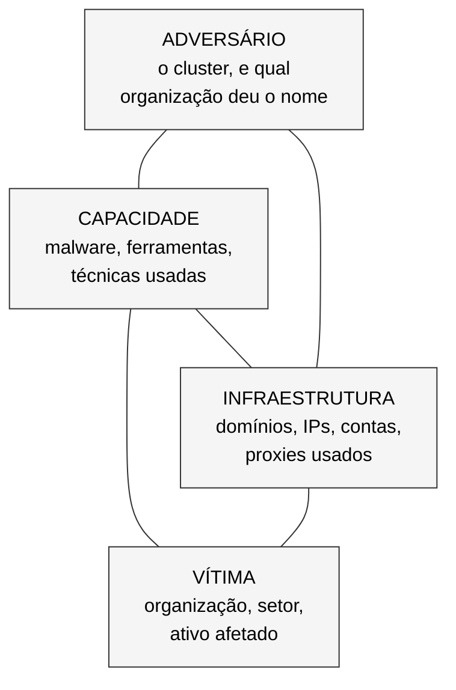
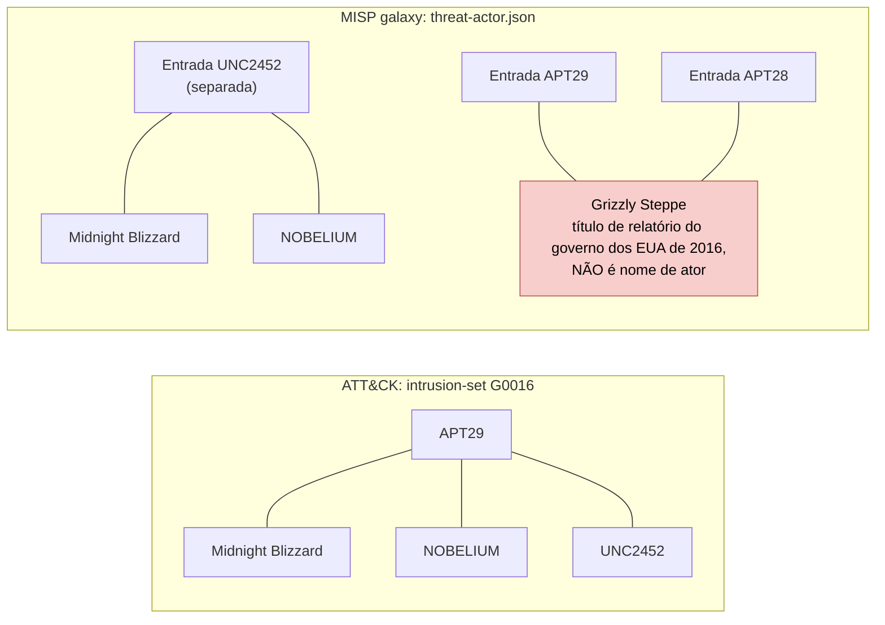

# Dia 37: O que contém um perfil de ator de ameaça

> 🇺🇸 Original: [*Day 37: What a threat actor profile contains*](https://github.com/thiefdroppers/cyber-investigator-skills/blob/main/curriculum/phase-3-cyber-threat-intelligence/day-37.md) — © ThiefDroppers, licença MIT.
> Aqui: tradução fiel **+** camada brasileira. Nada do original foi removido; tudo o que é novo vem marcado com ➕.

**Fase 3. Inteligência de ameaças cibernéticas** · Meta da trilha: montar um perfil de ator com fontes, em que cada campo mostra quem fez a afirmação, em vez de uma colagem de apelidos dados por fornecedores.

Rank Jutsu: `B` · [](https://colab.research.google.com/github/Ridd1kulusC0d3r/investigador-cyber-90-dias/blob/main/curriculo/fase-3-inteligencia-de-ameacas/dia-37/dia-37.ipynb)

---

## 🎬 ➕ Abertura do caso — *Três nomes para a mesma coisa (ou não)*

A Marta Quintão liga às 10h15.

— Me mandaram três coisas hoje. O SOC da CoopVale chama o golpe de "PixLure". Um fornecedor publicou um *post* chamando de "Garça Azul" e dizendo que é uma quadrilha do Sudeste ligada a facção. E vocês chamam de "Pescador". É tudo a mesma gente? Quem são eles?

Você abre um documento novo e escreve, no título: *"Perfil do Pescador"*. Rafa lê por cima do seu ombro e apaga a palavra.

— Pescador é uma string num JavaScript. Não é ninguém. O que você vai perfilar é um **cluster de atividade**: o que foi visto, por quem, quando. O nome de trabalho é CA-ISCA-01. E o "ligada a facção" do *post*? Quem afirmou, com base em quê?

— O *post* não mostra evidência.

— Então isso entra no perfil com a nota que merece, e não na primeira linha.

É isso que o Dia 37 ensina. *(Personagens e cenário: [Operação Isca](../../../caso-continuo/).)*

---

## 📖 Conceito

Um perfil de ator de ameaça é um resumo estruturado do que os relatos publicados dizem sobre um *cluster* de atividade. A unidade perfilada é quase sempre um *cluster* de atividade observada, que analistas agrupam por ferramentas, infraestrutura e comportamento compartilhados. Raramente é um conjunto conhecido de pessoas. Tenha essa distinção em mente sempre que um perfil disser quem está por trás da atividade.

Um perfil que funciona tem estes campos:

| Campo | O que entra nele | Falha comum |
|---|---|---|
| Nomes e *aliases* | Todo nome, com a organização que o usa | Tratar *aliases* como equivalentes exatos |
| Patrocinador ou afiliação suspeitos | A afirmação e quem a fez (governo, fornecedor) | Apresentar a avaliação de um fornecedor como fato |
| Motivação | Espionagem, financeira, disrupção, influência | Chutar a partir da lista de alvos |
| Alvos (*targeting*) | Setores, regiões, tipos de organização, ao longo do tempo | Listar todo setor já relatado |
| TTPs | Técnicas do ATT&CK com evidência (Dia 36) | Copiar a camada do grupo sem datas |
| Ferramental (*tooling*) | Famílias de *malware* e ferramentas; se cada uma é exclusiva ou compartilhada | Tratar o Mimikatz como impressão digital |
| Padrões de infraestrutura | Hábitos de registrador, hospedagem, padrões de certificado e de nomes | Listar IOCs crus que expiraram há anos |
| Linha do tempo | Primeiro relato, grandes campanhas, mudanças de comportamento | Nenhuma data |
| Fontes e confiança | Cada afirmação ligada a uma fonte, com nota de confiabilidade | Um despejo de "Referências" no fim |

Cada fornecedor dá nome aos atores do seu jeito. A Microsoft usa famílias de fenômenos climáticos por origem (*Blizzard* para a Rússia, *Typhoon* para a China, *Sandstorm* para o Irã, *Sleet* para a Coreia do Norte, *Tempest* para atores com motivação financeira) e `Storm-####` para *clusters* ainda em desenvolvimento. A CrowdStrike usa animais (*Bear*, *Panda*, *Kitten*, *Chollima*, e *Spider* para crime eletrônico). A Mandiant usa `APT##` e `FIN##` para grupos estabelecidos e `UNC####` para *clusters* não categorizados, que ela mais tarde funde ou promove.

Esses nomes não são intercambiáveis. Dois fornecedores enxergam telemetrias diferentes, então "APT29" e "Midnight Blizzard" podem cobrir conjuntos de atividade que se sobrepõem, mas são diferentes. O Modelo Diamante (*Diamond Model*; Caltagirone, Pendergast e Betz, 2013) oferece uma checagem: todo evento de intrusão tem um adversário, uma capacidade, uma infraestrutura e uma vítima. Um perfil que não consegue preencher os quatro vértices das suas principais campanhas é raso.



Cada vértice de um evento de intrusão guarda uma afirmação e a fonte que a fez. O passo 4 da prática preenche um diamante para um evento real.

## 📚 Recursos

- [Grupo G0016 do ATT&CK, APT29](https://attack.mitre.org/groups/G0016/): a lista de *aliases* do MITRE, com uma citação para cada *alias*.
- [Repositório MISP galaxy](https://github.com/MISP/misp-galaxy): o *cluster* aberto `threat-actor.json`, um conjunto de *aliases* e metadados mantido pela comunidade.
- [Malpedia](https://malpedia.caad.fkie.fraunhofer.de/): referências de ator para família de *malware*, com links para os relatórios originais.
- [ETDA Threat Group Cards](https://apt.etda.or.th/cgi-bin/listgroups.cgi): uma grande enciclopédia de *aliases*, com referências cruzadas.
- [Nomenclatura de atores da Microsoft](https://learn.microsoft.com/en-us/unified-secops/microsoft-threat-actor-naming): a taxonomia climática e um mapeamento publicado para os nomes de outros fornecedores.
- [The Diamond Model of Intrusion Analysis](https://www.activeresponse.org/wp-content/uploads/2013/07/diamond.pdf): o artigo original. As seções 3 e 4 bastam para hoje.
- Relatórios-semente para o perfil: [CISA e parceiros, AA24-057A, "SVR Cyber Actors Adapt Tactics for Initial Cloud Access"](https://www.cisa.gov/news-events/cybersecurity-advisories/aa24-057a) (fevereiro de 2024), [MSRC da Microsoft sobre a intrusão do Midnight Blizzard](https://msrc.microsoft.com/blog/2024/01/microsoft-actions-following-attack-by-nation-state-actor-midnight-blizzard/) (janeiro de 2024) e [Mandiant, "APT29 Uses WINELOADER to Target German Political Parties"](https://cloud.google.com/blog/topics/threat-intelligence/apt29-wineloader-german-political-parties) (março de 2024).

### ➕ Recursos do contexto Brasil

- [Malpedia](https://malpedia.caad.fkie.fraunhofer.de/) e [MISP galaxy](https://github.com/MISP/misp-galaxy) também cobrem famílias de *malware* bancário de origem brasileira (por exemplo, Grandoreiro, Mekotio e Guildma/Astaroth) e trazem as referências originais. É um bom exercício de *crosswalk* em contexto local: compare os nomes que cada fonte dá às mesmas famílias.
- [Doutrina de inteligência — ABIN / Revista Brasileira de Inteligência](https://rbi.enap.gov.br/): artigos em português sobre análise de inteligência, avaliação de fontes e produção de conhecimento.
- [`caso-continuo/dados/dia-37/fontes-ca-isca-01.json`](../../../caso-continuo/dados/dia-37/fontes-ca-isca-01.json): as seis fontes fictícias sobre o *cluster* CA-ISCA-01, os nomes que cada uma usa e as dez afirmações a perfilar na Prática BR.

## 🛠️ Prática: jq, o MISP galaxy e uma folha do Modelo Diamante (um perfil de ator completo com um *crosswalk* de *aliases*)

O objeto do perfil é o APT29, porque ele tem anos de relatos públicos de governos e fornecedores. Você está perfilando um *cluster* de atividade relatado publicamente, a partir de fontes publicadas. Não pesquise indivíduos nomeados, incluindo pessoas nomeadas em acusações formais (*indictments*).

**Seu checklist de hoje.** Faça na ordem e marque cada item ao terminar:

- [ ] 1. Puxar *aliases* de duas fontes estruturadas
- [ ] 2. Montar o *crosswalk* de *aliases*
- [ ] 3. Preencher o perfil a partir dos três relatórios-semente
- [ ] ➕ 4. Desenhar o Diamante (o original numera este passo, mas não o lista no checklist)
- [ ] ➕ 5. Prática BR: o perfil do *cluster* CA-ISCA-01, com *crosswalk* e Admiralty
- [ ] ➕ 6. O notebook do dia no Colab

### 1. Puxar *aliases* de duas fontes estruturadas

```bash
mkdir -p ~/cti-lab/day37 && cd ~/cti-lab/day37
curl -sL https://raw.githubusercontent.com/MISP/misp-galaxy/main/clusters/threat-actor.json -o misp-threat-actor.json

# A visão do MISP sobre o APT29
jq -c '.values[] | select(.value=="APT29") | {value, synonyms: .meta.synonyms, country: .meta.country, confidence: .meta["attribution-confidence"]}' misp-threat-actor.json

# A visão do ATT&CK (reaproveite o dataset do Dia 35)
jq -r '.objects[] | select(.type=="intrusion-set" and .name=="APT29") | .aliases | join("; ")' ../day35/enterprise-attack.json
```

Rode esses comandos você mesmo e compare as listas. Na conferência de setembro de 2026, elas discordavam de formas que dão bons exercícios:

- O ATT&CK lista Midnight Blizzard, NOBELIUM e UNC2452 como *aliases* do APT29. O MISP mantém uma entrada `UNC2452` separada e coloca Midnight Blizzard e NOBELIUM lá. Descubra por quê com esta consulta:
  ```bash
  jq -r '.values[] | select((.meta.synonyms // []) | index("Midnight Blizzard")) | .value' misp-threat-actor.json
  ```
- O MISP lista "Grizzly Steppe" como sinônimo tanto do APT28 quanto do APT29. Grizzly Steppe foi o nome de um relatório do governo dos EUA, de 2016, que cobria atividade dos serviços de inteligência civil e militar russos. É um título de relatório, não um *alias* de nenhum dos dois grupos. Confira:
  ```bash
  jq -r '.values[] | select((.meta.synonyms // []) | index("Grizzly Steppe")) | .value' misp-threat-actor.json
  ```

As duas fontes agrupam os mesmos nomes de modo diferente. Como observado em setembro de 2026 (rode as consultas de novo; qualquer das fontes pode mudar):



> ➕ Conferido de novo em 2026-10-12: a entrada `APT29` do MISP lista "Nobelium" (com essa grafia) entre os sinônimos, enquanto a entrada `UNC2452` traz "NOBELIUM" e "Midnight Blizzard". Diferença de maiúsculas também é diferença para o `index()` do jq. Anote a grafia exata que cada fonte usa.

### 2. Montar o *crosswalk* de *aliases*

Uma linha por nome. A coluna "afirmado por" é o objetivo do exercício:

| Nome | Organização que dá o nome | Afirmado equivalente ao APT29 por | Nota de escopo |
|---|---|---|---|
| Midnight Blizzard | Microsoft | ATT&CK G0016 (citando a página de nomenclatura da Microsoft) | A Microsoft renomeou NOBELIUM em 2023 |
| UNC2452 | Mandiant | ATT&CK G0016; a Mandiant fundiu o UNC2452 ao APT29 em 2022 | Originalmente, o *cluster* do ataque à cadeia de suprimentos da SolarWinds |
| Cozy Bear | CrowdStrike | ATT&CK G0016; MISP | |
| Grizzly Steppe | Título de relatório do governo dos EUA | MISP (sob APT28 e APT29) | Não é nome de ator. Sinalize, não adote |

Confira cada linha na fonte citada antes de mantê-la. A tabela acima é um formato inicial. As células dela não são fatos que você pode copiar.

### 3. Preencher o perfil a partir dos três relatórios-semente

Use este modelo (copie para as suas notas):

```markdown
# Perfil de ator: APT29
Versão do ATT&CK: 19.x | Data do perfil: AAAA-MM-DD | Analista: você

## Resumo (no máximo 3 frases)
## Aliases -> ver tabela de crosswalk
## Patrocinador suspeito
- Afirmação: ... | Fonte: AA24-057A (alerta conjunto de governos) | Confiabilidade: B
## Motivação
## Alvos (com datas)
| Período | Setores / regiões | Fonte |
## TTPs (com datas, IDs do ATT&CK)
| Técnica | Citação de evidência | Fonte | Data da atividade |
## Ferramental
| Família / ferramenta | Exclusiva ou compartilhada? | Fonte |
## Padrões de infraestrutura
## Linha do tempo
## Perguntas em aberto
## Fontes (com nota Admiralty A-F / 1-6)
```

Dê nota a cada fonte com o sistema Admiralty: a confiabilidade da fonte de A (totalmente confiável) a F (não pode ser avaliada), e a credibilidade da informação de 1 (confirmada por outras fontes) a 6 (não pode ser avaliada). Um alerta conjunto de vários governos e um *post* de blog de fornecedor não devem receber a mesma nota automaticamente. Escreva por que você deu cada nota.

Para a tabela de TTPs, o AA24-057A descreve acesso inicial focado em nuvem. Procure comportamentos como *password spraying* (T1110.003) e uso de contas de serviço ou inativas (T1078 e suas subtécnicas), e mapeie só o que o alerta afirma.

### 4. Desenhar o Diamante

Para a intrusão de janeiro de 2024 na Microsoft descrita pelo MSRC, preencha um único Diamante:

```
            Adversário
     (Midnight Blizzard, como nomeado pela Microsoft)
              /        \
   Capacidade            Infraestrutura
 (password spray,        (o que o MSRC diz sobre
  abuso de app OAuth)     IPs de origem / proxies)
              \        /
              Vítima
   (e-mail corporativo da Microsoft, segundo o MSRC)
```

Desenhe em qualquer ferramenta de diagramas, ou mantenha como texto. Cada vértice guarda uma afirmação e a fonte dela. Deixe um vértice marcado "não informado na fonte" em vez de preenchê-lo com outros relatos.

### O que você tem ao terminar

- Um *crosswalk* de *aliases* com pelo menos oito nomes, cada um com a organização que dá o nome e uma citação de "afirmado por", e pelo menos uma linha sinalizada como falsa equivalência.
- Um perfil completo no modelo acima, com fonte e nota Admiralty em toda afirmação.
- Uma folha do Modelo Diamante para um único evento datado.

### ➕ 5. Prática BR: o perfil do *cluster* CA-ISCA-01

As fontes estão em [`caso-continuo/dados/dia-37/fontes-ca-isca-01.json`](../../../caso-continuo/dados/dia-37/fontes-ca-isca-01.json): seis documentos fictícios (F1 a F6), seis nomes e dez afirmações (A1 a A10).

1. **Crosswalk.** Uma linha por nome, com a coluna "afirmado equivalente por". Três deles merecem sinalização: um é nome de **ferramenta** e não de *cluster*; um é nome de **tipo de golpe** usado por muitos grupos (o "Grizzly Steppe" da Operação Isca); e um junta atividade de 2025 que nenhuma fonte primária nossa viu (escopo maior que o nosso, igual ao caso Midnight Blizzard × UNC2452 no MISP).
2. **Admiralty.** Dê nota a F1–F6 e escreva o porquê. Pistas: a análise própria da Vigia tem evidência primária com hash; o *post* do fornecedor não publica IOCs; o print do anúncio chegou sem cadeia de custódia.
3. **Perfil.** Preencha o modelo do passo 3 com o título `Perfil de cluster de atividade: CA-ISCA-01`. Toda frase com fonte e data de atividade.
4. **A afirmação A10** ("grupo criminoso do Sudeste ligado a facção", do *post* F4) entra no campo "Patrocinador ou afiliação suspeitos" **com a nota que merece**, e nunca no resumo. Escreva o que faltaria para ela subir de nota.
5. **Ferramental.** O IscaKit é vendido. Marque-o como **compartilhado / comercial** e escreva por que ele não identifica o *cluster* sozinho.
6. **Diamante** do evento de 5/out/2026 na Serra Azul, com "não informado na fonte" onde couber.
7. **Nenhum dado pessoal** de ninguém no perfil: nem dos cooperados, nem de quem quer que esteja por trás do "Pescador".

### ➕ 6. O notebook do dia

Abra o [notebook do Dia 37 no Colab](https://colab.research.google.com/github/Ridd1kulusC0d3r/investigador-cyber-90-dias/blob/main/curriculo/fase-3-inteligencia-de-ameacas/dia-37/dia-37.ipynb). Nele você:

1. compara os *aliases* do APT29 no ATT&CK e no MISP galaxy (rede, com plano B embutido conferido em 2026-10-12) e acha as duas discordâncias do original por código;
2. monta o *crosswalk* do CA-ISCA-01 e marca as falsas equivalências;
3. joga o quiz **"Admiralty: que nota essa fonte merece?"**;
4. gera o perfil em Markdown a partir das afirmações, e um verificador recusa qualquer frase sem fonte e data;
5. desenha o Diamante do evento de 5/out em texto e em mermaid.

## ✅ Checkpoint

- Qualquer frase do seu perfil, escolhida ao acaso, nomeia o documento de onde veio e a data da atividade que descreve. Corte qualquer frase que não faça isso.
- A tabela "Ferramental" marca pelo menos uma entrada como compartilhada ou disponível comercialmente.
- Seu perfil não trata essa entrada compartilhada como identificadora.
- Seu *crosswalk* explica em uma ou duas frases a discordância entre MISP e ATT&CK sobre o Midnight Blizzard.
- O perfil não contém nenhuma informação pessoal sobre nenhum indivíduo.
- Sem consultar notas, diga por que "Grizzly Steppe" não é um *alias* do APT29.

### ➕ Checkpoint BR

- O título do seu perfil diz "*cluster* de atividade CA-ISCA-01", e "Pescador" aparece só como apelido de artefato (a string no JavaScript).
- Seu *crosswalk* sinaliza "IscaKit" como nome de ferramenta e "Golpe do Pix bloqueado" como nome de tipo de golpe, não de *cluster*.
- A afirmação A10 está com nota Admiralty baixa, fora do resumo, com o que faltaria para subir.
- O Diamante do evento de 5/out tem pelo menos um vértice ou parte de vértice marcado "não informado na fonte".
- Sem consultar notas, você explica por que "PixLure" e "CA-ISCA-01" podem não cobrir exatamente a mesma atividade.

## ⚖️ ➕ Camada jurídica BR

**Perfil de *cluster* não é acusação de pessoa.** No Brasil, imputar falsamente a alguém fato definido como crime é calúnia (CP art. 138), e atribuir fato ofensivo à reputação é difamação (CP art. 139). Um perfil que escreve "o grupo de Fulano" ou "a facção X" sem prova não é só má análise: pode ter consequência penal e civil para quem escreve e para quem repassa. Por isso a afirmação A10 fica com nota baixa e fora do resumo, e por isso o perfil é de um *cluster*.

**Organização criminosa é conceito legal, não rótulo analítico.** A Lei 12.850/2013 define organização criminosa (art. 1º, §1º) com requisitos próprios (número mínimo de pessoas, estrutura ordenada, divisão de tarefas, entre outros). "Quadrilha ligada a facção" num *post* de blog não equivale a essa qualificação; quem a faz é o Ministério Público e, ao fim, o Judiciário.

**LGPD e perfis.** Se, em algum momento, uma fonte trouxer dado pessoal de um suspeito, ele não entra no perfil de inteligência compartilhado com as cooperativas. O tratamento de dados pessoais por um MSSP privado continua sujeito à LGPD (finalidade, necessidade, art. 6º); a exceção do art. 4º, III, é da autoridade pública que investiga. Encaminhe pelo canal certo (cooperativa → jurídico → autoridade).

> Este repositório é material de estudo e não substitui orientação jurídica.

## 🧠 ➕ Camada 8 — o nome cria a criatura

Dar nome a um *cluster* muda a forma como pensamos sobre ele. Dois efeitos conhecidos:

- **Reificação e o erro fundamental de atribuição.** Um apelido como "Pescador" convida a mente a imaginar *uma pessoa* com intenções e personalidade, e a explicar tudo por essa personalidade, em vez de pelas circunstâncias (um kit vendido que muitos podem usar). Lee Ross chamou de erro fundamental de atribuição essa tendência de superestimar causas pessoais e subestimar causas situacionais.
- **Viés de autoridade.** Um *post* bem diagramado de um fornecedor com logotipo conhecido pesa mais na nossa cabeça do que a evidência que ele mostra. O sistema Admiralty existe justamente para separar a reputação da fonte (letra) da credibilidade da informação (número).

Do lado da vítima, há outra camada: para a Marta e o conselho da cooperativa, um "inimigo com nome e rosto" reduz a ansiedade, porque a incerteza é desconfortável. A tentação de entregar um nome vem de dois lados. Consequência prática: escreva o nome do *cluster* como código (CA-ISCA-01), não como personagem, e responda à pergunta "quem são eles?" com "o que vimos, quem afirmou e com que confiança".

## 🤖 ➕ Skill do dia

Este dia propõe para a [skill pt-BR](../../../skills/investigador-cyber/SKILL.md) o procedimento **"Perfil de *cluster* de atividade"**: perfil de *cluster*, não de pessoa; *crosswalk* com "afirmado por"; nota Admiralty em cada fonte; ferramenta comercial não identifica. Detalhes e caso de teste em [`_skill-delta.md`](_skill-delta.md).

## 💡 ➕ Inovação OSINT do dia — *crosswalk* de *aliases* direto do MISP galaxy, em Python puro

O `threat-actor.json` do MISP galaxy é público e não precisa de chave. Com a biblioteca padrão, dá para achar todas as entradas que mencionam um nome, ignorando diferenças de maiúsculas (que o `index()` do jq não ignora):

```python
import json, urllib.request                                          # só biblioteca padrão
URL = "https://raw.githubusercontent.com/MISP/misp-galaxy/main/clusters/threat-actor.json"
with urllib.request.urlopen(URL, timeout=30) as r:
    galaxy = json.load(r)["values"]
def quem_cita(nome):
    alvo = nome.casefold()                                           # casefold: comparação sem maiúsculas
    return [v["value"] for v in galaxy
            if alvo == v["value"].casefold()
            or alvo in (s.casefold() for s in v.get("meta", {}).get("synonyms", []))]
print(quem_cita("nobelium"))   # em 2026-10-12: ['APT29', 'UNC2452']
```

O resultado já é um achado: o mesmo nome aparece em duas entradas. É exatamente o tipo de discordância que o *crosswalk* precisa explicar, e que uma busca sensível a maiúsculas esconderia.

## 📝 Diário de estudo

- Data:
- Tempo gasto:
- O que ficou claro:
- O que ainda está nebuloso:
- Artefato produzido: *crosswalk* do APT29 (8+ nomes), perfil do APT29 com Admiralty, folha do Diamante (MSRC jan/2024); perfil do *cluster* CA-ISCA-01 com *crosswalk* e Diamante

---
<sub>Baseado em [cyber-investigator-skills](https://github.com/thiefdroppers/cyber-investigator-skills) por ThiefDroppers (MIT). Tradução, camada BR, Camada 8, skill pt-BR e notebook por Deivison Lourenço (@Ridd1kulusC0d3r).</sub>
