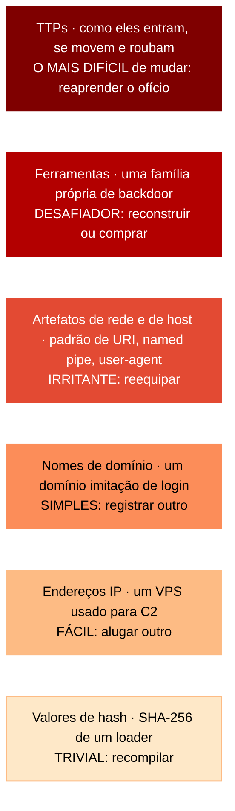
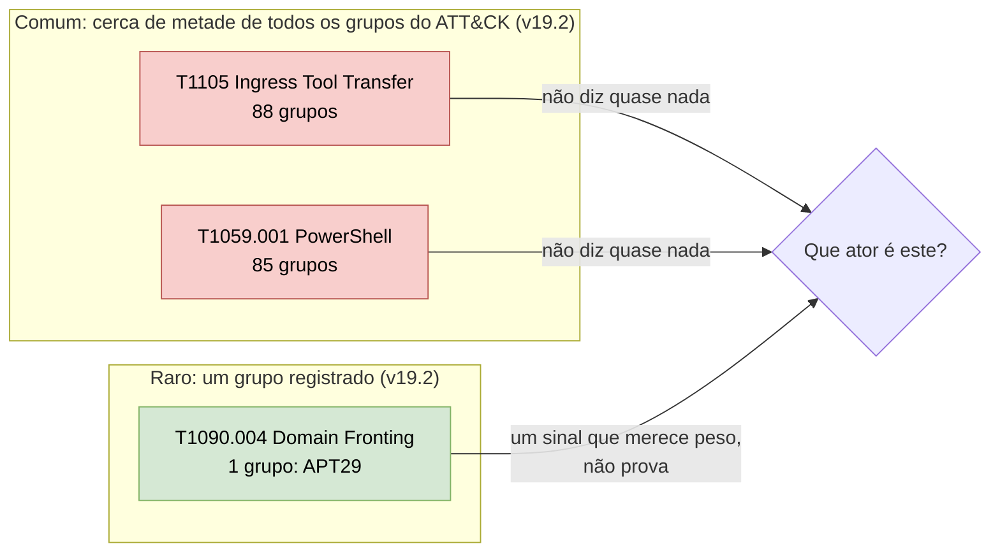
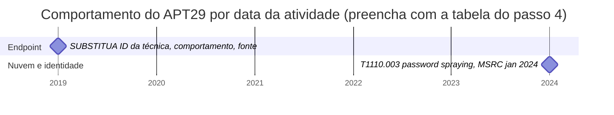

# Dia 38: Rastreando atores pelo que é distintivo neles

> 🇺🇸 Original: [*Day 38: Tracking actors by what is distinctive about them*](https://github.com/thiefdroppers/cyber-investigator-skills/blob/main/curriculum/phase-3-cyber-threat-intelligence/day-38.md) — © ThiefDroppers, licença MIT.
> Aqui: tradução fiel **+** camada brasileira. Nada do original foi removido; tudo o que é novo vem marcado com ➕.

**Fase 3. Inteligência de ameaças cibernéticas** · Meta da trilha: separar as técnicas que distinguem um ator das técnicas que todo invasor usa, e mostrar essa diferença num mapa de calor.

Rank Jutsu: `B` · [](https://colab.research.google.com/github/Ridd1kulusC0d3r/investigador-cyber-90-dias/blob/main/curriculo/fase-3-inteligencia-de-ameacas/dia-38/dia-38.ipynb)

---

## 🎬 ➕ Abertura do caso — *O IP que todo mundo queria bloquear*

Reunião por vídeo com as cinco cooperativas. O analista da CredMinas abre a câmera já com uma lista na tela.

— Bloqueamos o 203.0.113.77 ontem. Pronto, estamos protegidos do Pescador.

— O kit de vocês nem passou por esse IP — responde a analista da CoopVale. — O de vocês estava no 198.51.100.40.

Rafa desliga o microfone e se vira para você.

— Pergunta para a turma: o que o operador do IscaKit precisaria fazer para escapar do bloqueio de IP? Alugar outro servidor, dez minutos. E para escapar de uma regra que detecta "SMS de Pix bloqueado com link encurtado para domínio registrado há menos de dez dias"?

— Mudar o golpe inteiro.

— Isso. E o comentário `// pescador` no JavaScript? Ele apagaria em um segundo, mas não apagou em seis dias. Hoje você vai separar o que é caro do que é barato para ele, e o que só ele faz do que todo golpista faz.

É isso que o Dia 38 ensina. *(Personagens e cenário: [Operação Isca](../../../caso-continuo/).)*

---

## 📖 Conceito

Analistas rastreiam um ator observando as partes do comportamento dele que são caras de mudar e incomuns entre outros atores. A Pirâmide da Dor (*Pyramid of Pain*) de David Bianco (2013) ordena os indicadores pelo quanto dói ao adversário quando os defensores os detectam:

| Nível (de baixo para cima) | Exemplo | Custo para o adversário mudar |
|---|---|---|
| Valores de *hash* | SHA-256 de um *loader* | Trivial: recompilar |
| Endereços IP | Um VPS usado para comando e controle | Fácil: alugar outro |
| Nomes de domínio | Um domínio imitação de login | Simples: registrar outro |
| Artefatos de rede e de *host* | Um padrão distintivo de URI, um *named pipe*, uma *string* de *user-agent* | Irritante: reequipar |
| Ferramentas | Uma família própria de *backdoor* | Desafiador: reconstruir ou comprar |
| TTPs | Como eles entram, se movem e roubam | O mais difícil: reaprender o ofício |

Os mesmos seis níveis como uma pilha. A detecção perto do topo custa mais ao adversário; as camadas de baixo são o que a maioria dos *feeds* de IOC contém:



Rastrear significa saber em qual desses níveis você está se apoiando. Um *cluster* definido só por IPs de um relatório desaparece quando o ator troca de hospedagem.

A segunda ideia é a de taxas de base (*base rates*). Um comportamento que a maioria dos atores compartilha não diz nada sobre qual ator você está vendo. No ATT&CK v19.2, 88 grupos têm um relacionamento "uses" com T1105 Ingress Tool Transfer e 85 com T1059.001 PowerShell. Isso é cerca de metade de todos os grupos do dataset, para cada técnica. Ver PowerShell numa intrusão não aponta para nenhum ator em particular. Do outro lado, só um grupo no ATT&CK tem registro de uso de T1090.004 Domain Fronting, e esse grupo é o APT29.



A cobertura do ATT&CK reflete o que foi publicado e revisado. Não é um censo do que os atores fazem. Uma técnica que parece rara no ATT&CK pode simplesmente ser pouco relatada, então trate essas contagens como uma estimativa inicial grosseira (*prior*), não como uma medição.

Os atores também mudam. Os relatos sobre o APT29 anteriores a 2021 giram em torno de phishing e *malware* próprio em *endpoints*. Os relatos de 2023 e 2024 giram em torno de identidade na nuvem: *password spraying*, aplicações OAuth e abuso de *tokens*. Um perfil que não registra quando cada comportamento foi visto vai continuar associando um ator a um ofício que ele abandonou há anos.

## 📚 Recursos

- [David Bianco, "The Pyramid of Pain"](https://detect-respond.blogspot.com/2013/03/the-pyramid-of-pain.html): o *post* original, ainda a explicação mais clara.
- [ATT&CK Navigator](https://mitre-attack.github.io/attack-navigator/): as operações de camada ("Create Layer from other layers") fazem a comparação.
- [Páginas de grupo do ATT&CK para o APT29 (G0016)](https://attack.mitre.org/groups/G0016/) e [o APT28 (G0007)](https://attack.mitre.org/groups/G0007/): as duas têm camadas para baixar.
- [Treinamento de CTI do MITRE ATT&CK](https://attack.mitre.org/resources/learn-more-about-attack/training/cti/): o módulo sobre comparar camadas cobre o mesmo fluxo de trabalho.

### ➕ Recursos do contexto Brasil

- [CERT.br — estatísticas de incidentes](https://stats.cert.br/): dá uma noção, em números brasileiros, de quais tipos de incidente são comuns (a "taxa de base" nacional) antes de você achar que algo é raro.
- [Cartilha de Segurança do CERT.br, fascículo de golpes](https://cartilha.cert.br/): golpes de "atualização de cadastro", "conta bloqueada" e "falsa central" aparecem lá como padrões comuns. Comum no Brasil = pouco distintivo para um *cluster*.
- [`caso-continuo/dados/dia-38/observacoes-ca-isca-01.csv`](../../../caso-continuo/dados/dia-38/observacoes-ca-isca-01.csv): 18 observações datadas e fictícias do *cluster* CA-ISCA-01, de 2/out a 11/out, com o nível da Pirâmide e a fonte.

## 🛠️ Prática: jq e ATT&CK Navigator (um mapa de calor de taxa de base e uma comparação entre dois atores)

Tudo hoje é calculado a partir do dataset publicado pelo MITRE e das camadas de grupo. Reaproveite o `enterprise-attack.json` do Dia 35.

**Seu checklist de hoje.** Faça na ordem e marque cada item ao terminar:

- [ ] 1. Gerar uma camada de taxa de base para um ator
- [ ] 2. Comparar dois atores com uma expressão de camadas
- [ ] 3. Anotar a sobreposição
- [ ] 4. Montar uma linha do tempo de mudança de comportamento
- [ ] 5. Registrar quais técnicas você citaria e quais não citaria
- [ ] ➕ 6. Prática BR: a Pirâmide da Dor e a taxa de base do CA-ISCA-01
- [ ] ➕ 7. O notebook do dia no Colab

### 1. Gerar uma camada de taxa de base para um ator

Salve como `baserate.jq`:

```jq
# Usage: jq --arg g "APT29" -f baserate.jq enterprise-attack.json > layer.json
(.objects | map(select(.type=="attack-pattern")) | map({key: .id, value: .external_references[0].external_id}) | from_entries) as $tid
| ([.objects[] | select(.type=="intrusion-set" and .name==$g) | .id][0]) as $gid
| [.objects[] | select(.type=="relationship" and .relationship_type=="uses" and .revoked!=true
      and (.source_ref|startswith("intrusion-set")) and (.target_ref|startswith("attack-pattern")))
    | {g: .source_ref, t: $tid[.target_ref]}] | unique as $uses
| ($uses | group_by(.t) | map({key: .[0].t, value: length}) | from_entries) as $freq
| ($uses | map(select(.g==$gid) | .t) | unique) as $mine
| {
    name: "\($g): how many ATT&CK groups share each technique",
    versions: {layer: "4.5", attack: "19", navigator: "5.3.2"},
    domain: "enterprise-attack",
    description: "Score = number of groups in ATT&CK with a uses relationship to the technique. Low = more distinctive.",
    techniques: [ $mine[] | {techniqueID: ., score: $freq[.], comment: "\($freq[.]) groups use this"} ],
    gradient: {colors: ["#1a9850", "#fee08b", "#d73027"], minValue: 1, maxValue: 60}
  }
```

```bash
mkdir -p ~/cti-lab/day38 && cd ~/cti-lab/day38
jq --arg g "APT29" -f baserate.jq ../day35/enterprise-attack.json > apt29-baserate.json
jq -r '.techniques | sort_by(.score) | .[0:6][] | "\(.score)\t\(.techniqueID)"' apt29-baserate.json
```

Saída observada na v19.2 (as seis técnicas mais raras do APT29, cada uma registrada para um único grupo):

```
1   T1027.006
1   T1090.004
1   T1098.005
1   T1556.007
1   T1649
1   T1685.002
```

Procure cada uma pelo nome (*HTML Smuggling*, *Domain Fronting*, *Device Registration*, *Hybrid Identity*, *Steal or Forge Authentication Certificates*, *Disable or Modify Cloud Log*). A maioria é de técnicas de identidade e de nuvem, o que combina com a mudança nos relatos sobre o APT29 desde 2021.

Carregue a camada no Navigator. Células verdes são distintivas e células vermelhas são comuns. Este é o seu mapa de calor de taxa de base.

### 2. Comparar dois atores com uma expressão de camadas

Baixe as duas camadas de grupo:

```bash
curl -sL https://attack.mitre.org/groups/G0016/G0016-enterprise-layer.json -o G0016.json
curl -sL https://attack.mitre.org/groups/G0007/G0007-enterprise-layer.json -o G0007.json
```

Abra as duas no Navigator (o APT29 vira `a`, o APT28 vira `b`), depois "Create New Layer", depois "Create Layer from other layers", com a expressão:

```
a + 2*b
```

Pontuação 1 significa só o APT29, 2 significa só o APT28, 3 significa os dois. Conte a sobreposição você mesmo, sem o Navigator:

```bash
jq -r '.techniques[] | select(.score==1) | .techniqueID' G0016.json | sort -u > a.txt
jq -r '.techniques[] | select(.score==1) | .techniqueID' G0007.json | sort -u > b.txt
comm -12 a.txt b.txt | wc -l
```

Os dois números que você pode obter aqui são diferentes, e o motivo importa. As camadas de grupo também incluem técnicas de campanhas atribuídas ao grupo (as células vermelhas e roxas da legenda do MITRE). Na conferência da v19.2, as camadas baixadas se sobrepunham em 47 técnicas, mas contar só os relacionamentos diretos de grupo para técnica no dataset deu 29. Anote qual definição você usou sempre que citar um número de sobreposição.

### 3. Anotar a sobreposição

Para cada técnica com pontuação 3 (compartilhada), procure a taxa de base dela no passo 1. Monte uma tabela curta:

| Técnica | Compartilhada por APT29 e APT28 | Grupos do ATT&CK que a usam | Distingue os dois? |
|---|---|---|---|
| T1059.001 PowerShell | sim | 85 | não |
| (preencha) | | | |

Depois responda em duas ou três frases: se um incidente mostrasse só as técnicas compartilhadas, o que você poderia dizer sobre qual dos dois grupos estava envolvido? (A resposta honesta é "nada".)

### 4. Montar uma linha do tempo de mudança de comportamento

Usando os três relatórios-semente do Dia 37, mais qualquer relatório mais antigo sobre o APT29 que você achar nas referências da página do grupo no ATT&CK, liste observações datadas:

| Data da atividade | Comportamento (ID do ATT&CK) | Fonte | Nível da Pirâmide |
|---|---|---|---|
| 2024-01 | *Password spraying* contra um *tenant* legado (T1110.003) | MSRC, jan. 2024 | TTP |

Mire em pelo menos oito linhas, cobrindo pelo menos quatro anos. Coloque-as numa linha do tempo simples (um gráfico de planilha ou uma linha desenhada à mão serve), com técnicas de *endpoint* acima da linha e técnicas de nuvem ou identidade abaixo dela.

Se você preferir manter a linha do tempo como texto ao lado da sua tabela, este modelo de gantt em Mermaid lhe dá as duas faixas. Cole em [mermaid.live](https://mermaid.live/) para editar e visualizar, ou em qualquer arquivo Markdown no GitHub. Só a linha de 2024-01 vem de uma fonte nomeada. A linha de *endpoint* é um marcador provisório: substitua-a e acrescente uma linha `milestone` por linha da sua tabela, na faixa que corresponde à técnica. Quando uma fonte der só o mês, use esse mês.



Com as oito linhas preenchidas, procure o ponto em que as linhas param de aparecer numa faixa e começam a aparecer na outra. A última linha datada de uma faixa que silencia é o fim do intervalo de datas que o checkpoint pede.

### 5. Registrar quais técnicas você citaria e quais não citaria

Usando o seu mapa de calor de taxa de base do passo 1, escreva nas suas notas:

- Três técnicas que você nunca citaria como evidência de envolvimento do APT29, cada uma com a contagem de grupos.
- Uma técnica que você trataria como sinal significativo (não conclusivo), e o que mais você precisaria ver antes de aumentar a sua confiança.

### O que você tem ao terminar

- `apt29-baserate.json` e a exportação em SVG dele: um mapa de calor que sombreia cada técnica do APT29 pelo quanto ela é comum entre os grupos do ATT&CK.
- Uma camada de comparação (APT29 × APT28, `a + 2*b`) com legenda.
- Uma tabela de sobreposição com taxas de base e uma conclusão de duas frases.
- Uma linha do tempo datada com pelo menos oito comportamentos do APT29, rotulados pelo nível da Pirâmide da Dor.
- Uma entrada de notas listando três técnicas que você nunca citaria e um sinal significativo.

### ➕ 6. Prática BR: a Pirâmide da Dor e a taxa de base do CA-ISCA-01

As 18 observações estão em [`caso-continuo/dados/dia-38/observacoes-ca-isca-01.csv`](../../../caso-continuo/dados/dia-38/observacoes-ca-isca-01.csv).

1. **Pirâmide.** Conte quantas observações caem em cada nível. A resposta à pergunta "o que as cinco cooperativas devem bloquear?" muda quando você vê que a maioria está nos três níveis de baixo.
2. **O que mudou e o que ficou.** Entre a Serra Azul (5/out) e a CredMinas (9/out), o IP mudou e o *hash* do `isca.js` mudou. O que **não** mudou? (Pista: um artefato de *host* e um comportamento.) Esses são os seus candidatos a rastreamento.
3. **Taxa de base no ATT&CK.** Calcule, como no passo 1, quantos grupos do ATT&CK v19.2 usam cada técnica do vocabulário do IscaKit (Dia 35). Resultados de referência (relacionamentos diretos, conferidos em 2026-10-12): T1566.002 em 46 grupos, T1583.001 em 46, T1078 em 47, T1588.004 em 7, T1608.005 em 3, T1056.003 em 2. Leia com o aviso do original: o ATT&CK quase não cobre crime financeiro brasileiro por SMS, então "raro no ATT&CK" aqui quer dizer sobretudo "pouco relatado", não "distintivo".
4. **Taxa de base local.** Por isso, a pergunta que importa é outra: o golpe do "Pix bloqueado" é comum no Brasil (é tipo de golpe, Dia 37). O que é distintivo do CA-ISCA-01 não é o golpe; é a **combinação** de artefatos (favicon customizado, a *string* no JavaScript) com o padrão de infraestrutura (domínio registrado poucos dias antes, certificado na véspera, vários nomes no SAN).
5. **Linha do tempo de mudança.** Encontre no CSV o comportamento que **aparece** no meio da semana (pista: a partir de 6/out o kit muda o que mostra a certas origens; compare com o log ilustrativo do [Dia 32](../../../caso-continuo/dados/dia-32/log-do-kit-ilustrativo.txt)). Dê o intervalo de datas antes e depois.
6. **Notas.** Três coisas que você nunca citaria como evidência de que um novo SMS é do CA-ISCA-01 (com o motivo) e um sinal significativo, com o que mais faltaria.

### ➕ 7. O notebook do dia

Abra o [notebook do Dia 38 no Colab](https://colab.research.google.com/github/Ridd1kulusC0d3r/investigador-cyber-90-dias/blob/main/curriculo/fase-3-inteligencia-de-ameacas/dia-38/dia-38.ipynb). Nele você:

1. refaz o `baserate.jq` em Python (com o ATT&CK completo, se tiver rede, ou com as contagens da v19.2 embutidas) e gera `apt29-baserate.json`;
2. calcula a sobreposição APT29 × APT28 pelos relacionamentos diretos (29 na v19.2) e entende por que a camada baixada dá outro número;
3. joga o quiz **"Pirâmide da Dor: em que nível está?"**;
4. classifica as 18 observações do CA-ISCA-01 e descobre o que sobreviveu à troca de infraestrutura;
5. desenha a linha do tempo do *cluster* em gantt Mermaid, com o *cloaking* aparecendo em 6/out.

## ✅ Checkpoint

- Suas notas listam três técnicas que você nunca citaria como evidência de envolvimento do APT29.
- Cada uma dessas três traz uma contagem de grupos que bate com a pontuação dela em `apt29-baserate.json`.
- Suas notas nomeiam uma técnica que você trataria como sinal significativo (não conclusivo).
- Essa técnica tem uma nota escrita do que mais você precisaria ver antes de aumentar a sua confiança.
- Sua linha do tempo mostra pelo menos um comportamento que aparece em relatos mais antigos e não nos recentes.
- Sua linha do tempo dá o intervalo de datas (da primeira à última linha datada) em que esse comportamento foi relatado.
- Tudo nos seus artefatos remonta ao dataset do MITRE ou a um relatório público nomeado.
- Sem consultar notas, explique por que as camadas de grupo baixadas e os relacionamentos diretos do dataset dão contagens diferentes de sobreposição entre APT29 e APT28.

### ➕ Checkpoint BR

- Sua contagem por nível da Pirâmide para o CA-ISCA-01 está nas notas, e você diz o que isso implica para a lista de bloqueio das cooperativas.
- Você nomeia o artefato de *host* e o comportamento que sobreviveram à troca de IP e de *hash* entre a Serra Azul e a CredMinas.
- Você explica, em uma frase, por que "raro no ATT&CK" não quer dizer "distintivo" para um golpe brasileiro por SMS.
- Sua linha do tempo do *cluster* dá a data em que o *cloaking* por origem aparece.
- Sem consultar notas, você explica por que "golpe do Pix bloqueado" sozinho não liga um SMS novo ao CA-ISCA-01.

## ⚖️ ➕ Camada jurídica BR

**Indicadores e LGPD.** Endereços IP e números de telefone podem ser dados pessoais quando identificam (ou permitem identificar) uma pessoa natural. Um IP de servidor de hospedagem raramente identifica alguém; um IP de operadora móvel de um cooperado, sim. Ao montar listas de bloqueio para compartilhar entre cooperativas, fique nos indicadores de **infraestrutura do golpe** (domínios, IPs de hospedagem, *hashes* de artefatos), e não em dados de vítimas. O princípio da necessidade (LGPD, art. 6º, III) é o filtro.

**Indicador não é prova de autoria.** Um mesmo favicon ou *string* em dois sites sustenta uma ligação técnica entre as infraestruturas. Não sustenta, sozinho, que a mesma pessoa operou as duas, sobretudo quando o kit é vendido. Para o processo penal, a autoria é demonstrada por um conjunto de provas obtido pelas autoridades (com cadeia de custódia, CPP arts. 158-A a 158-F). O informe da Vigia descreve ligações técnicas com confiança calibrada; não aponta autores.

> Este repositório é material de estudo e não substitui orientação jurídica.

## 🧠 ➕ Camada 8 — negligência da taxa de base

Kahneman e Tversky mostraram que, diante de uma descrição vívida, as pessoas ignoram a frequência de fundo de um evento: a **negligência da taxa de base** (*base-rate neglect*). No problema clássico dos táxis, a testemunha "viu um táxi azul" e quase todo mundo ignora que 85% dos táxis da cidade são verdes.

No trabalho de CTI, ela aparece assim: "o SMS fala em Pix bloqueado e tem link encurtado, então é o Pescador". A descrição é vívida e combina com a história, mas a taxa de base desse tipo de golpe no Brasil é altíssima; centenas de operadores sem relação nenhuma usam a mesma isca. Do lado das cooperativas, o mesmo viés empurra para o bloqueio do IP: é concreto, dá sensação de controle, mas está no nível mais barato da pirâmide.

Consequência prática: antes de ligar um evento novo a um *cluster*, pergunte "quantos outros atores fariam exatamente isso?". Se a resposta for "muitos", aquilo é contexto, não evidência. Procure o que é **raro e caro de mudar**.

## 🤖 ➕ Skill do dia

Este dia propõe acrescentar ao procedimento **"Perfil de *cluster* de atividade"** (Dia 37) três itens sobre taxa de base, Pirâmide da Dor e datas de comportamento. Detalhes e caso de teste em [`_skill-delta.md`](_skill-delta.md).

## 💡 ➕ Inovação OSINT do dia — taxa de base do ATT&CK em 10 linhas de Python

O `baserate.jq` do original, só com a biblioteca padrão, sobre o arquivo oficial:

```python
import json, collections                                           # só biblioteca padrão
objs = json.load(open("enterprise-attack.json"))["objects"]
tid = {o["id"]: o["external_references"][0]["external_id"] for o in objs if o["type"] == "attack-pattern"}
usos = {(r["source_ref"], tid[r["target_ref"]]) for r in objs        # pares (grupo, técnica), sem repetição
        if r["type"] == "relationship" and r.get("relationship_type") == "uses" and not r.get("revoked")
        and r["source_ref"].startswith("intrusion-set") and r["target_ref"].startswith("attack-pattern")}
freq = collections.Counter(t for _, t in usos)                       # técnica -> nº de grupos
for t in ["T1105", "T1059.001", "T1090.004", "T1056.003"]:
    print(t, freq[t])                                                # v19.2: 88, 85, 1, 2
```

Com `freq` em mãos, qualquer lista de técnicas de um incidente vira imediatamente "comum / incomum". É o tipo de checagem que vale rodar antes de qualquer frase do tipo "isso aponta para o grupo X".

## 📝 Diário de estudo

- Data:
- Tempo gasto:
- O que ficou claro:
- O que ainda está nebuloso:
- Artefato produzido: `apt29-baserate.json` (+ SVG), camada APT29 × APT28, tabela de sobreposição, linha do tempo do APT29, notas de citação; Pirâmide e linha do tempo do CA-ISCA-01

---
<sub>Baseado em [cyber-investigator-skills](https://github.com/thiefdroppers/cyber-investigator-skills) por ThiefDroppers (MIT). Tradução, camada BR, Camada 8, skill pt-BR e notebook por Deivison Lourenço (@Ridd1kulusC0d3r).</sub>
