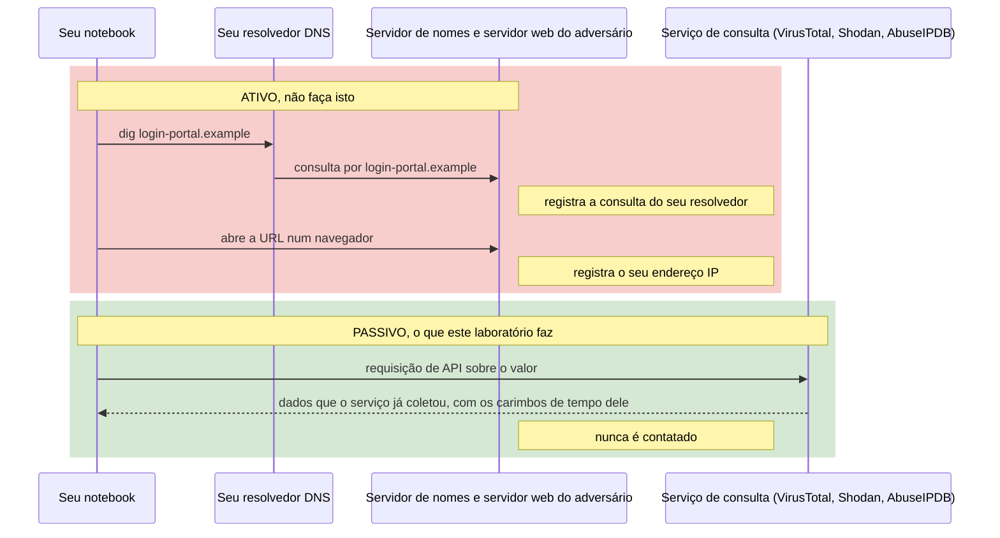
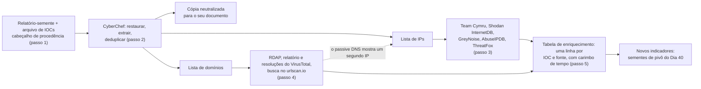

# Dia 39: Coletando e enriquecendo IOCs sem tocar no adversário

> 🇺🇸 Original: [*Day 39: Collecting and enriching IOCs without touching the adversary*](https://github.com/thiefdroppers/cyber-investigator-skills/blob/main/curriculum/phase-3-cyber-threat-intelligence/day-39.md) — © ThiefDroppers, licença MIT.
> Aqui: tradução fiel **+** camada brasileira. Nada do original foi removido; tudo o que é novo vem marcado com ➕.

**Fase 3. Inteligência de ameaças cibernéticas** · Meta da trilha: pegar a lista crua de indicadores de um relatório publicado e transformá-la numa tabela de enriquecimento em que cada valor tem fonte e carimbo de tempo, coletada só por consultas passivas a terceiros.

Rank Jutsu: `B` · [](https://colab.research.google.com/github/Ridd1kulusC0d3r/investigador-cyber-90-dias/blob/main/curriculo/fase-3-inteligencia-de-ameacas/dia-39/dia-39.ipynb)

---

## 🎬 ➕ Abertura do caso — *O histórico do terminal*

Terça-feira, 13 de outubro. O anexo de IOCs do ALR-2026-01 tem cinco domínios, um encurtador, dois IPs e dois *hashes*. Você abre o terminal e digita, quase por reflexo, `dig coopvale-pix.example`.

O dedo para em cima do Enter. Você lembra do log ilustrativo do Dia 32: o servidor do kit registrou **duas visitas** do IP do escritório da Vigia no dia 5. No dia 6, o mesmo IP passou a receber uma página em branco.

Rafa não precisa falar nada. Ele só aponta para o arquivo `.bash_history` aberto na outra janela.

— A partir de hoje, este arquivo é auditado. Nenhum comando seu encosta num indicador. Você pergunta a quem já perguntou: *passive DNS*, bases de varredura, reputação, varreduras públicas antigas. E cada resposta ganha uma hora de coleta.

É isso que o Dia 39 ensina. *(Personagens e cenário: [Operação Isca](../../../caso-continuo/).)*

---

## 📖 Conceito

Um indicador de comprometimento (IOC) é um observável deixado por atividade maliciosa: um *hash* de arquivo, um endereço IP, um domínio, uma URL, um endereço de e-mail, uma chave de registro. Sozinhos, os IOCs são a base da Pirâmide da Dor do Dia 38. São baratos para o adversário mudar e envelhecem rápido. O valor deles para um investigador vem do enriquecimento (o que mais se sabe sobre este valor?) e do pivô (o que mais compartilha uma propriedade com ele?), que é o Dia 40.

Três regras regem o trabalho de enriquecimento.

Fique passivo. Resolver um domínio malicioso com `dig`, carregar a URL dele num navegador ou dar `ping` no IP dele manda tráfego da sua rede para uma infraestrutura que o adversário pode estar observando. O servidor de nomes dele vê a consulta do seu resolvedor, e o servidor web dele registra o seu IP. Use serviços que já coletaram os dados: *passive DNS*, bases de varredura da internet, *feeds* de reputação e arquivos públicos de varreduras. Se você precisa de uma visão ao vivo, ela acontece num *sandbox* autorizado, dentro de um processo do empregador. Não acontece a partir do seu notebook.

A diferença entre as duas abordagens, rastreada requisição por requisição:



Carimbe o tempo de tudo. Um IP que hospedava um kit de phishing em março pode ser o site de uma clínica odontológica em setembro. Todo valor de enriquecimento precisa da hora em que você o obteve e, quando a fonte informar, da hora em que a fonte o observou.

Mantenha os IOCs neutralizados (*defanged*) nos documentos. Escreva `hxxps://login-portal[.]example/` e `203.0.113[.]7`, para que ninguém clique neles e para que os filtros de e-mail não coloquem seu relatório em quarentena. Restaure (*refang*) só dentro das ferramentas que precisam do valor real.

As faixas de endereços de documentação (192.0.2.0/24, 198.51.100.0/24, 203.0.113.0/24) e o domínio `.example` usados abaixo são reservados para exemplos. Os seus valores reais vêm do relatório-semente.

## 📚 Recursos

- [ESET malware-ioc](https://github.com/eset/malware-ioc), [Unit 42 timely threat intel](https://github.com/PaloAltoNetworks/Unit42-timely-threat-intel) e [Volexity threat-intel](https://github.com/volexity/threat-intel): arquivos de IOC publicados junto com relatórios reais de fornecedores. Escolha a sua semente aqui.
- [CyberChef](https://gchq.github.io/CyberChef/): extração, neutralização e restauração no navegador.
- [Documentação da API do VirusTotal](https://docs.virustotal.com/reference/public-vs-premium-api): a API pública gratuita tem limite de taxa e é para uso não comercial.
- [API do AbuseIPDB](https://docs.abuseipdb.com/), [documentação do GreyNoise](https://docs.greynoise.io/) e [Shodan InternetDB](https://internetdb.shodan.io/): contexto gratuito sobre IPs.
- [Portal de autenticação do abuse.ch](https://auth.abuse.ch/): ThreatFox, URLhaus e MalwareBazaar agora rejeitam chamadas de API sem uma `Auth-Key`. Obtenha uma chave gratuita aqui.
- [Documentação de busca do urlscan.io](https://urlscan.io/docs/search/): busque varreduras públicas existentes. Buscar não varre nada.
- [iocextract](https://github.com/InQuest/iocextract): uma biblioteca Python para extrair IOCs neutralizados do texto de relatórios.

### ➕ Recursos do contexto Brasil

- [RDAP do Registro.br](https://rdap.registro.br/): para domínios `.br`, a consulta de registro passiva oficial (formato `https://rdap.registro.br/domain/<domínio>`). O `rdap.org` do original redireciona para o servidor certo de cada TLD; para `.br`, ir direto ao Registro.br é mais limpo.
- [Bootstrap RDAP da IANA](https://data.iana.org/rdap/dns.json): a lista oficial de qual servidor RDAP responde por cada TLD.
- [CERT.br — notificações de incidentes](https://www.cert.br/): para onde reportar abuso envolvendo redes brasileiras, com orientação sobre o que enviar.
- [`caso-continuo/dados/dia-39/`](../../../caso-continuo/dados/dia-39/): o anexo de IOCs fictício do ALR-2026-01 e um arquivo de **respostas simuladas** de cada serviço do dia, para treinar a tabela sem depender de chave de API.

## 🛠️ Prática: CyberChef, curl e jq (uma tabela de enriquecimento de IOCs)

O laboratório inteiro numa imagem. As duas caixas de enriquecimento são serviços de terceiros, e a aresta pontilhada mostra como um enriquecimento revela o indicador seguinte:



**Seu checklist de hoje.** Faça na ordem e marque cada item ao terminar:

- [ ] 1. Escolher a semente e registrar a procedência
- [ ] 2. Extrair e normalizar com o CyberChef
- [ ] 3. Enriquecer IPs
- [ ] 4. Enriquecer domínios
- [ ] 5. Montar a tabela de enriquecimento
- [ ] ➕ 6. Prática BR: enriquecer o anexo de IOCs do ALR-2026-01 (com respostas simuladas)
- [ ] ➕ 7. O notebook do dia no Colab

### 1. Escolher a semente e registrar a procedência

Escolha um arquivo de IOCs da ESET, da Unit 42 ou da Volexity que pertença a um relatório publicado nos últimos 12 meses, e leia o *post* correspondente. No topo das suas notas, registre:

```
Seed report: <title>, <vendor>, <publication date>, <URL>
IOC file:    <repo path and commit hash>
Retrieved:   2026-09-30T14:05Z
```

Se o relatório não disser quando os indicadores estiveram ativos, escreva "datas de atividade não informadas" e trate todo IOC como possivelmente desatualizado.

### 2. Extrair e normalizar com o CyberChef

Cole a seção de IOCs do relatório (ou o arquivo cru) no CyberChef e monte esta receita:

1. `Fang URL` (transforma `hxxp` e `[.]` de volta em valores reais para processamento)
2. `Extract domains`, depois, separadamente, `Extract IP addresses`, `Extract URLs` e `Extract hashes`, com "Display total" e "Unique" ligados
3. Salve cada lista e depois rode `Defang URL` ou `Defang IP Addresses` na cópia que vai para o seu documento

Deduplique e ordene cada lista no *shell*:

```bash
mkdir -p ~/cti-lab/day39 && cd ~/cti-lab/day39
sort -u domains.txt -o domains.txt; sort -u ips.txt -o ips.txt
wc -l domains.txt ips.txt
```

Escolha 10 indicadores para enriquecer, com pelo menos 3 IPs e 3 domínios.

### 3. Enriquecer IPs

Coloque as chaves de API em variáveis de ambiente, não em *scripts* que você vai compartilhar.

```bash
IP=203.0.113.7   # troque por um IP real da sua semente

# Roteamento e propriedade (Team Cymru, sem chave)
whois -h whois.cymru.com " -v $IP"

# Portas abertas e hostnames que o Shodan viu (sem chave)
curl -s https://internetdb.shodan.io/$IP | jq .

# Este IP está varrendo a internet em massa, ou é um serviço benigno conhecido? (chave opcional)
curl -s https://api.greynoise.io/v3/community/$IP | jq .

# Denúncias da comunidade nos últimos 90 dias
curl -sG https://api.abuseipdb.com/api/v2/check \
  --data-urlencode "ipAddress=$IP" -d maxAgeInDays=90 \
  -H "Key: $ABUSEIPDB_KEY" -H "Accept: application/json" \
  | jq '.data | {abuseConfidenceScore, countryCode, isp, usageType, totalReports, lastReportedAt}'

# O abuse.ch já rastreou este IP como infraestrutura de malware?
curl -s -X POST https://threatfox-api.abuse.ch/api/v1/ \
  -H "Auth-Key: $ABUSECH_KEY" \
  -d "{\"query\":\"search_ioc\",\"search_term\":\"$IP\"}" \
  | jq '.data[]? | {ioc, threat_type, malware_printable, first_seen, last_seen, confidence_level}'
```

Saída de exemplo (ilustrativa, não é uma consulta real):

```
AS      | IP           | BGP Prefix      | CC | Registry | Allocated  | AS Name
64500   | 203.0.113.7  | 203.0.113.0/24  | NL | ripencc  | 2019-04-02 | EXAMPLE-VPS-HOSTING, NL

{"cpes":[],"hostnames":[],"ip":"203.0.113.7","ports":[22,443,8443],"tags":["self-signed"],"vulns":[]}
```

Leia a saída como contexto, não como veredito. Um resultado do GreyNoise `"noise": false` significa que o IP não foi visto varrendo a internet em massa. Não diz nada sobre se o IP rodou comando e controle.

### 4. Enriquecer domínios

```bash
D=login-portal.example   # troque por um domínio real da sua semente

# Dados de registro via RDAP (substitui a maior parte do uso de WHOIS)
curl -sL https://rdap.org/domain/$D | jq '{handle, events: [.events[] | {eventAction, eventDate}], nameservers: [.nameservers[]?.ldhName]}'

# Relatório de domínio e resoluções de passive DNS do VirusTotal (chave gratuita)
curl -s -H "x-apikey: $VT_API_KEY" https://www.virustotal.com/api/v3/domains/$D \
  | jq '.data.attributes | {creation_date, registrar, last_analysis_stats, categories}'
curl -s -H "x-apikey: $VT_API_KEY" "https://www.virustotal.com/api/v3/domains/$D/resolutions?limit=10" \
  | jq -r '.data[].attributes | "\(.date | todate)\t\(.ip_address)"'

# Varreduras públicas anteriores no urlscan.io (só busca; não precisa de chave para uso leve)
curl -s "https://urlscan.io/api/v1/search/?q=page.domain:$D&size=10" \
  | jq -r '.results[] | "\(.task.time)\t\(.page.ip)\t\(.page.asnname)\t\(.page.title)"'
```

A chamada `resolutions` do VirusTotal é *passive DNS*: um histórico de para quais IPs o domínio apontou e quando, coletado pelo VirusTotal. É o substituto seguro para rodar `dig` você mesmo.

Saída de exemplo (ilustrativa):

```
2026-06-14T09:12:40Z   198.51.100.23
2026-07-02T17:45:03Z   203.0.113.7
```

Um domínio que passou de 198.51.100.23 para 203.0.113.7 lhe dá um segundo IP para enriquecer e uma data em que o ator (ou um novo dono) trocou de hospedagem.

### 5. Montar a tabela de enriquecimento

Uma linha por par indicador e fonte:

| IOC (neutralizado) | Tipo | No relatório-semente como | Fonte consultada | Campo | Valor | Hora de observação da fonte | Obtido (UTC) | Notas |
|---|---|---|---|---|---|---|---|---|
| 203.0.113[.]7 | ipv4 | servidor de C2 | Team Cymru | ASN / org | AS64500 EXAMPLE-VPS-HOSTING | n/d | 2026-09-30T14:10Z | Provedor de VPS, não um provedor residencial |
| 203.0.113[.]7 | ipv4 | servidor de C2 | Resoluções do VT | domínio visto | login-portal[.]example | 2026-07-02 | 2026-09-30T14:12Z | Liga o IP ao domínio D |
| login-portal[.]example | domain | página de phishing | RDAP | registro | 2026-06-12 | n/d | 2026-09-30T14:15Z | Registrado 2 dias antes da primeira resolução |

Acrescente uma última coluna, "Ainda útil para detecção?", com sim, não ou desconhecido, e uma linha de justificativa. Um IP de hospedagem compartilhada com centenas de domínios benignos é um "não", mesmo que o relatório o tenha listado.

### O que você tem ao terminar

- Um cabeçalho de procedência com o relatório-semente, o *commit* do arquivo de IOCs e a hora da coleta.
- Uma tabela de enriquecimento com pelo menos 10 indicadores e pelo menos 30 linhas, toda linha com carimbo de tempo e fonte.
- Uma lista curta de novos indicadores que o enriquecimento revelou (como o segundo IP acima). Eles são as sementes de pivô de amanhã.

### ➕ 6. Prática BR: o anexo de IOCs do ALR-2026-01

Arquivos em [`caso-continuo/dados/dia-39/`](../../../caso-continuo/dados/dia-39/):

- `anexo-iocs-ALR-2026-01.txt`: o anexo do alerta, já neutralizado, com uma duplicata e uma "pegadinha" (o *hash* do arquivo vazio);
- `respostas-servicos-simuladas.json`: o que cada serviço do dia **teria** respondido sobre cada indicador, no formato das APIs reais, mas com valores fictícios. Assim você monta a tabela sem chave de API e sem encostar em nada.

Faça:

1. Cabeçalho de procedência com "Seed report: ALR-2026-01 (Vigia, 2026-10-12, TLP:AMBER)" e as datas de atividade que o anexo informa.
2. Restaure, extraia, deduplique (5 domínios no anexo viram 4 únicos + o encurtador) e escreva a cópia neutralizada.
3. Monte a tabela de enriquecimento com as respostas simuladas: pelo menos 10 indicadores e 30 linhas.
4. Coluna "Ainda útil para detecção?": decida para `203.0.113.77` (41 domínios em *passive DNS*, hospedagem compartilhada), para `lnk.example` (encurtador público) e para o *hash* `e3b0c442...` (arquivo vazio). Pelo menos um "não", com motivo.
5. Ache o **indicador novo** que o enriquecimento revelou e que não estava no anexo (pista: a resolução passiva de um dos domínios). Ele vai para a lista de sementes do Dia 40.
6. **Audite o seu histórico**: nada de `dig`, `ping`, `nslookup`, `curl` ou navegador apontando para `serraazul-pix.example`, `coopvale-pix.example` ou para os IPs.

### ➕ 7. O notebook do dia

Abra o [notebook do Dia 39 no Colab](https://colab.research.google.com/github/Ridd1kulusC0d3r/investigador-cyber-90-dias/blob/main/curriculo/fase-3-inteligencia-de-ameacas/dia-39/dia-39.ipynb). Nele você:

1. escreve as funções `restaurar()` e `neutralizar()` (o *fang/defang* do CyberChef) e um extrator de IOCs com `re` e `ipaddress`;
2. registra a procedência com hora UTC e o SHA-256 do anexo;
3. monta a tabela de enriquecimento a partir das respostas simuladas, com fonte e duas horas (observação e coleta) em cada linha;
4. tenta uma consulta passiva **real** e sem chave (RDAP), com plano B se a rede falhar, e confere que o alvo é sempre o serviço, nunca o indicador;
5. joga o quiz **"ativo ou passivo?"** e roda o **auditor de histórico** num `.bash_history` de exemplo.

## ✅ Checkpoint

- Nenhum comando nas suas notas contata um indicador diretamente. Procure no seu histórico do *shell* por `dig`, `ping` e `nslookup` em valores de indicadores, e por qualquer `curl` cujo *host* de destino é o próprio indicador, e não um serviço de consulta.
- Todo IOC escrito no seu documento está neutralizado.
- Pelo menos uma linha está marcada como "não útil para detecção", com o motivo.
- Para um IP, você consegue dizer numa frase o que a resposta do GreyNoise significa e o que ela não significa.

### ➕ Checkpoint BR

- Seu cabeçalho de procedência do ALR-2026-01 tem a hora da coleta em UTC e o SHA-256 do anexo.
- O *hash* `e3b0c442...` está marcado como "não útil", e você sabe dizer por quê.
- O indicador novo (que não estava no anexo) está na sua lista de sementes do Dia 40, com a fonte que o revelou.
- O auditor do notebook não acusou nenhum comando ativo no seu histórico.
- Sem consultar notas, você explica por que o IP do escritório da Vigia passou a receber página em branco no dia 6 (Dia 32), e o que isso tem a ver com a regra "fique passivo".

## ⚖️ ➕ Camada jurídica BR

**Consulta passiva a serviço público não é invasão.** O art. 154-A do Código Penal trata de invadir dispositivo informático alheio. Perguntar ao VirusTotal, ao Shodan ou ao RDAP o que eles já sabem sobre um IP não invade nada. Já tentar acessar áreas não públicas do servidor do kit (o "painel" do Dia 1) continua proibido, mesmo que seja tecnicamente fácil.

**Termos de uso das APIs.** Várias APIs do dia têm camada gratuita restrita a uso **não comercial** (o original lembra isso para o VirusTotal). Um MSSP que presta serviço pago a uma cooperativa está em uso comercial. Antes de automatizar consultas num caso real, confira a licença de cada serviço; usar a camada gratuita fora dos termos é problema contratual da empresa, não só seu.

**Dados de terceiros nas respostas.** Respostas de *passive DNS* e de varreduras públicas podem trazer domínios e páginas de terceiros inocentes que dividem o mesmo IP (os 41 domínios do `203.0.113.77`). Eles não entram no relatório como suspeitos. A LGPD (art. 6º, III, necessidade) e o bom senso pedem que só o que é relevante ao caso fique registrado.

> Este repositório é material de estudo e não substitui orientação jurídica.

## 🧠 ➕ Camada 8 — a curiosidade que avisa o adversário

O impulso de "só dar uma olhadinha" no site do golpe é forte, e tem nome: a **lacuna de informação** que George Loewenstein descreveu como motor da curiosidade. Quando falta uma peça para completar o quadro, a vontade de preenchê-la cresce, e a ação mais rápida (abrir o link, rodar um `dig`) vence a mais segura.

O custo aparece do outro lado: o operador do kit também tem curiosidade. O log ilustrativo do Dia 32 mostra o que ele vê de quem visita, e o *cloaking* de 6/out mostra o que ele faz com isso. Cada consulta ativa sua é um dado para ele.

Consequência prática: transforme o impulso em procedimento. Quando bater a vontade de "ver ao vivo", escreva a pergunta que você quer responder e procure quem já respondeu (urlscan, *passive DNS*, VirusTotal). Se ninguém respondeu e a pergunta é importante, o caminho é um *sandbox* autorizado, com o Rafa sabendo, e não o seu terminal.

## 🤖 ➕ Skill do dia

Este dia propõe para a [skill pt-BR](../../../skills/investigador-cyber/SKILL.md) o procedimento **"Enriquecimento passivo de IOCs"**: nada que contate o indicador, IOCs neutralizados, duas horas em cada valor (observação e coleta) e a coluna "ainda útil para detecção?". Detalhes e caso de teste em [`_skill-delta.md`](_skill-delta.md).

## 💡 ➕ Inovação OSINT do dia — neutralizar, restaurar e reconhecer endereços de documentação só com a biblioteca padrão

O CyberChef faz *fang/defang* no navegador; o `iocextract` faz em Python, mas é dependência externa. Para o básico, a biblioteca padrão resolve, e o módulo `ipaddress` ainda avisa quando um IP é de documentação, privado ou reservado (útil para não "enriquecer" um 10.x interno ou um IP de exemplo copiado de um tutorial):

```python
import ipaddress, re                                             # só biblioteca padrão
def neutralizar(t): return "[.]".join(t.replace("http", "hxxp").rsplit(".", 1))  # só o último ponto
def restaurar(t):   return t.replace("[.]", ".").replace("hxxp", "http")
DOC = [ipaddress.ip_network(n) for n in ("192.0.2.0/24", "198.51.100.0/24", "203.0.113.0/24")]
for bruto in ["203.0.113[.]77", "10.20.40.57"]:                  # um IP do caso e um interno
    ip = ipaddress.ip_address(restaurar(bruto))
    rotulo = "documentação" if any(ip in n for n in DOC) else ("privado" if ip.is_private else "público")
    print(neutralizar(str(ip)), "→", rotulo)
```

`10.20.40.57` sai como "privado": é o notebook `SA-CX-07` da Fase 4, um endereço interno da cooperativa que não faz sentido consultar em nenhum serviço externo.

## 📝 Diário de estudo

- Data:
- Tempo gasto:
- O que ficou claro:
- O que ainda está nebuloso:
- Artefato produzido: cabeçalho de procedência, tabela de enriquecimento (10+ IOCs, 30+ linhas), lista de novos indicadores; tabela do ALR-2026-01 e auditoria do histórico

---
<sub>Baseado em [cyber-investigator-skills](https://github.com/thiefdroppers/cyber-investigator-skills) por ThiefDroppers (MIT). Tradução, camada BR, Camada 8, skill pt-BR e notebook por Deivison Lourenço (@Ridd1kulusC0d3r).</sub>
