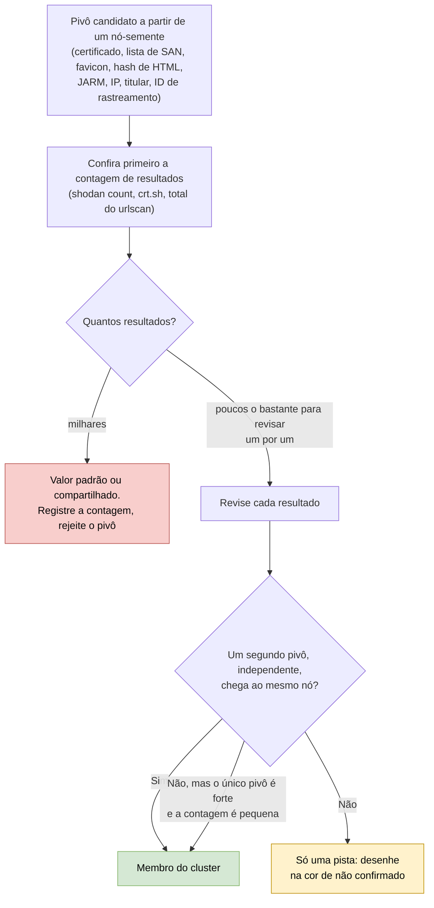
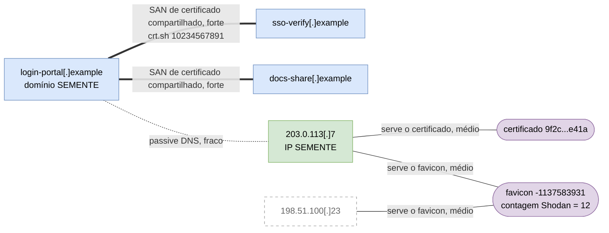

# Dia 40: Pivotando infraestrutura de ameaça em um grafo

> 🇺🇸 Original: [*Day 40: Pivoting threat infrastructure into a graph*](https://github.com/thiefdroppers/cyber-investigator-skills/blob/main/curriculum/phase-3-cyber-threat-intelligence/day-40.md) — © ThiefDroppers, licença MIT.
> Aqui: tradução fiel **+** camada brasileira. Nada do original foi removido; tudo o que é novo vem marcado com ➕.

**Fase 3. Inteligência de ameaças cibernéticas** · Meta da trilha: expandir um indicador publicado num mapa de infraestrutura relacionada, em que cada aresta nomeia o pivô que a produziu e os vínculos fracos aparecem visivelmente fracos.

Rank Jutsu: `B` · [](https://colab.research.google.com/github/Ridd1kulusC0d3r/investigador-cyber-90-dias/blob/main/curriculo/fase-3-inteligencia-de-ameacas/dia-40/dia-40.ipynb)

---

## 🎬 ➕ Abertura do caso — *Quarenta e um vizinhos*

Quarta-feira, 14 de outubro. Você tem duas sementes (`serraazul-pix.example` e `203.0.113.77`) e um indicador novo do Dia 39 (`203.0.113.78`). Às 11h, sua primeira versão do grafo está na tela do Rafa: 47 nós, tudo ligado a tudo.

— O que é isto aqui? — ele aponta para um nó chamado `padaria-do-bairro.example`.

— Estava no mesmo IP. O urlscan mostrou 41 domínios no 203.0.113.77.

— E a padaria vende pão ou rouba Pix?

Você não responde. Rafa apaga 38 nós com três cliques.

— Hospedagem compartilhada é vizinhança, não parentesco. Cada aresta sua vai dizer **qual pivô** a criou e **quantos resultados** esse pivô devolveu. Quem entra no *cluster* tem dois pivôs independentes, ou um forte com contagem pequena. O resto fica numa cor de "não confirmado". O Dia 43 vai pôr isso em STIX, e lá não tem como esconder um vínculo fraco.

É isso que o Dia 40 ensina. *(Personagens e cenário: [Operação Isca](../../../caso-continuo/).)*

---

## 📖 Conceito

Atacantes reaproveitam infraestrutura porque montar servidores, certificados e kits de phishing novos para cada campanha custa tempo e dinheiro. Esse reaproveitamento é o que permite a um analista partir de um indicador de um relatório e achar infraestrutura relacionada que o relatório não listou, às vezes antes de ela ser usada.

Um pivô é uma propriedade que duas peças de infraestrutura compartilham. Os pivôs variam muito no quanto provam:

| Pivô | Onde consultar | Força | Principal fonte de falso positivo |
|---|---|---|---|
| Mesmo certificado TLS (impressão digital SHA-256) | crt.sh, Shodan `ssl.cert.fingerprint`, Censys | Forte quando o certificado é autoassinado ou lista SANs incomuns | Certificados compartilhados de CDN ou de hospedagem |
| Mesma lista de SAN ou mesmo padrão de *subject* num certificado | crt.sh | Forte | Certificados multi-inquilino de provedores de hospedagem |
| Mesmo *hash* de favicon | Shodan `http.favicon.hash`, Censys, urlscan `hash:` | Forte se o ícone é customizado e a contagem de resultados é pequena | Ícones padrão (nginx, Apache, cPanel, páginas de login de roteador) |
| Mesmo *hash* de corpo HTML ou mesmo título de página | Shodan `http.html_hash`, `http.title`; urlscan `page.title` | Médio a forte | Páginas estacionadas, páginas padrão de servidor, modelos de kit usados por muitos operadores sem relação |
| Mesma impressão TLS JARM | Shodan `ssl.jarm` | Fraco sozinho | Todo servidor rodando a mesma pilha e configuração TLS |
| Mesmo IP (*passive DNS*) | Resoluções do VirusTotal, urlscan `page.ip` | Fraco sozinho | Hospedagem compartilhada, CDNs, *sinkholes* |
| Mesmo e-mail ou nome de titular | RDAP, WHOIS histórico | Forte quando presente, raro desde a ocultação por privacidade | Marcadores de *proxy* de privacidade |
| Mesmo ID de *analytics* ou de rastreamento | Conteúdo de página no urlscan, capturas históricas de página | Forte | Modelos copiados |

Um único pivô é uma pista. Um *cluster* vira achado quando vários pivôs independentes convergem nos mesmos nós. "Independentes" importa: um certificado e um IP do mesmo registro de *passive DNS* são uma observação vista duas vezes.

As contagens de resultados dizem quanto um pivô vale. Um *hash* de favicon que devolve 14 *hosts* vale uma revisão um por um. Um que devolve 40.000 é um ícone padrão, e um grafo construído em cima dele ligaria você à metade da internet.

Todo pivô que você tenta passa pelo mesmo teste antes de ganhar uma aresta:



## 📚 Recursos

- [crt.sh](https://crt.sh/): busca em *Certificate Transparency*, com saída em JSON.
- [Filtros de busca do Shodan](https://www.shodan.io/search/filters): a referência completa dos filtros. Vários filtros usados aqui exigem pelo menos uma assinatura paga, e buscas pela API gastam créditos de consulta.
- [Censys Query Language](https://docs.censys.com/docs/censys-query-language): a sintaxe de campos da Censys Platform atual, que substituiu a sintaxe de busca antiga que você vai ver em *posts* de blog.
- [Documentação de busca do urlscan.io](https://urlscan.io/docs/search/): campos para buscar varreduras públicas existentes.
- [Gephi](https://gephi.org/): ferramenta gratuita de grafos usada no artefato. O [Maltego CE](https://www.maltego.com/pricing/) é a alternativa, se você já o tem do Dia 22.
- Relatórios-semente com infraestrutura publicada: os repositórios de IOCs do Dia 39 ([ESET](https://github.com/eset/malware-ioc), [Unit 42](https://github.com/PaloAltoNetworks/Unit42-timely-threat-intel), [Volexity](https://github.com/volexity/threat-intel)).

### ➕ Recursos do contexto Brasil

- [Registro.br — RDAP](https://rdap.registro.br/): para domínios `.br`, a data de registro e os servidores de nomes saem daqui, e o pivô "mesmo titular" às vezes ainda funciona para pessoa jurídica (o CNPJ do titular de domínio `.br` costuma ser visível no RDAP para PJ). Use isso só no escopo do caso. <!-- TODO técnico: confirmar quais campos de titular PJ o RDAP do Registro.br expõe hoje antes de citar como pivô garantido. -->
- [`caso-continuo/dados/dia-40/respostas-pivo-simuladas.json`](../../../caso-continuo/dados/dia-40/respostas-pivo-simuladas.json): respostas fictícias de crt.sh, Shodan (*host*, *count*, *search*), urlscan.io e *passive DNS* para a Prática BR, com as armadilhas do original (JARM com milhares de resultados, *hash* do arquivo vazio, IP compartilhado, título genérico, certificado de estacionamento).
- [`caso-continuo/dados/dia-30/crtsh-isca.json`](../../../caso-continuo/dados/dia-30/crtsh-isca.json): o crt.sh da Fase 2, de onde vem o certificado com SAN compartilhado entre `serraazul-pix` e `serraazul-seguranca`.

## 🛠️ Prática: crt.sh, Shodan, urlscan.io e Gephi (um grafo de pivô de infraestrutura com arestas rotuladas)

Comece por um domínio e um IP da sua semente do Dia 39. Toda consulta abaixo vai a um conjunto de dados de terceiros. Não peça nada à infraestrutura-semente, nem mesmo o favicon dela.

**Seu checklist de hoje.** Faça na ordem e marque cada item ao terminar:

- [ ] 1. *Certificate transparency* (crt.sh)
- [ ] 2. Dados de varredura (Shodan)
- [ ] 3. Pivôs de página e de recurso (urlscan.io)
- [ ] 4. Montar as tabelas de nós e arestas
- [ ] 5. Dispor no Gephi
- [ ] 6. Mapear o comportamento de infraestrutura no ATT&CK
- [ ] ➕ 7. Prática BR: o grafo do *cluster* CA-ISCA-01
- [ ] ➕ 8. O notebook do dia no Colab

### 1. *Certificate transparency* (crt.sh)

Os *logs* de *certificate transparency* registram todo certificado que uma CA pública emite, então um ator que pede certificados para um lote de domínios deixa uma trilha pública.

```bash
mkdir -p ~/cti-lab/day40 && cd ~/cti-lab/day40
D=login-portal.example   # seu domínio-semente

# Todo certificado que nomeia o domínio ou seus subdomínios (%25 é um % codificado para URL)
curl -s "https://crt.sh/?q=%25.$D&output=json" > crt-$D.json
jq -r '.[] | [.id, .not_before, .issuer_name, .common_name, (.name_value | gsub("\n"; ","))] | @tsv' crt-$D.json | sort -u -k5
```

Saída de exemplo (ilustrativa):

```
10234567891  2026-06-12T00:00:00  C=US, O=Let's Encrypt, CN=R11  login-portal.example  login-portal.example,sso-verify.example,docs-share.example
```

Um certificado cuja lista de SAN nomeia o seu domínio-semente junto com `sso-verify.example` e `docs-share.example` é um pivô forte. Um único pedido de certificado cobriu os três nomes. Acrescente os dois como nós, com uma aresta rotulada `shared cert SAN (crt.sh id 10234567891)`.

O crt.sh também aceita `%` dentro de um nome, por exemplo `?q=%25sso-verify%25&output=json`, para achar outros domínios com o mesmo padrão de nome. Padrões amplos são lentos e frequentemente estouram o tempo. Uma correspondência só por padrão de nome é uma pista fraca. Marque qualquer aresta assim como `name pattern` e não a conte para a convergência.

O crt.sh é um serviço comunitário gratuito e vive sobrecarregado. Se você receber uma página de erro em HTML em vez de JSON, espere e tente de novo, em vez de martelar o serviço.

### 2. Dados de varredura (Shodan)

Veja o que o Shodan já registrou sobre o IP-semente. Isto lê o banco de dados do Shodan e não varre nada:

```bash
IP=203.0.113.7
curl -s "https://api.shodan.io/shodan/host/$IP?key=$SHODAN_API_KEY" \
  | jq -r '.data[] | [.port, (.http.favicon.hash // "-"), (.http.title // "-"), (.ssl.cert.fingerprint.sha256 // "-"), (.ssl.jarm // "-")] | @tsv'
```

Saída de exemplo (ilustrativa):

```
443   -1137583931   Sign in to your account   9f2c...e41a   2ad2ad16d2ad2ad22c42d42d00000069...
```

Cada coluna não vazia é um pivô que você pode buscar. Rode sempre `count` antes de `search`, para ver o tamanho de um conjunto de resultados antes de pagar por ele:

```bash
shodan count 'http.favicon.hash:-1137583931'
shodan count 'ssl.cert.fingerprint:9f2c...e41a'
shodan search --fields ip_str,port,hostnames,http.title 'http.favicon.hash:-1137583931'
```

Se o *hash* do favicon devolve 12 *hosts*, revise os 12. Se devolve 30.000, é um ícone padrão ou amplamente clonado. Registre a contagem nas suas notas e pare.

Se o Shodan não tem *hash* de favicon, mas uma varredura do urlscan.io capturou a página, você pode calcular o *hash* a partir da cópia do arquivo guardada pelo urlscan, para nunca buscá-lo no servidor ativo. O *hash* do Shodan é MurmurHash3 sobre a codificação base64 do ícone, com quebras de linha a cada 76 caracteres:

```python
import base64, mmh3
data = open("favicon.ico", "rb").read()   # o arquivo salvo do resultado do urlscan, não do site ativo
print(mmh3.hash(base64.encodebytes(data)))
```

A Censys indexa *hashes* de favicon MD5 e SHA-256 em vez do inteiro no estilo Shodan. Na sintaxe da Censys Platform:

```
host.services.endpoints.http.favicons.hash_md5 = "<md5 of the icon>"
host.services.cert.fingerprint_sha256 = "<sha256 of the certificate>"
```

### 3. Pivôs de página e de recurso (urlscan.io)

O urlscan.io guarda varreduras públicas que outras pessoas já submeteram. Busque nelas. Não submeta a sua URL-semente para uma varredura nova: isso manda o *scanner* do urlscan ao servidor do adversário e publica o seu interesse.

```bash
# Outras varreduras públicas que carregaram páginas do mesmo IP
curl -s "https://urlscan.io/api/v1/search/?q=page.ip:%22$IP%22&size=50" \
  | jq -r '.results[] | "\(.task.time)\t\(.page.domain)\t\(.page.title)"' | sort -u -k2

# Páginas que carregaram um recurso idêntico (um JavaScript do kit, um logotipo), pelo SHA-256 do recurso
curl -s "https://urlscan.io/api/v1/search/?q=hash:<sha256-of-resource>&size=50" \
  | jq -r '.results[] | "\(.task.time)\t\(.page.domain)\t\(.page.ip)"'
```

Pegue os *hashes* de recursos da lista "HTTP transactions" na página de resultado do urlscan de um dos seus domínios-semente. Escolha um arquivo específico do kit, como um *script* próprio ou um logotipo. Bibliotecas comuns (jQuery, Bootstrap) coincidem com milhões de sites sem relação.

Há um *hash* que você deve reconhecer de cara: `e3b0c44298fc1c149afbf4c8996fb92427ae41e4649b934ca495991b7852b855` é o SHA-256 de um arquivo vazio. Buscá-lo no urlscan devolve milhares de sites sem relação. Uma aresta construída nele é sempre falsa.

### 4. Montar as tabelas de nós e arestas

`nodes.csv`:

```csv
Id,Label,Type
login-portal.example,login-portal[.]example,domain
sso-verify.example,sso-verify[.]example,domain
docs-share.example,docs-share[.]example,domain
203.0.113.7,203.0.113[.]7,ip
198.51.100.23,198.51.100[.]23,ip
cert-9f2c,cert 9f2c...e41a,certificate
fav--1137583931,favicon -1137583931,favicon
```

`edges.csv` (no Gephi, a coluna `Type` significa dirigida ou não dirigida, então o nome do pivô vai em `Label`):

```csv
Source,Target,Type,Label,Strength,Evidence,Retrieved
login-portal.example,sso-verify.example,Undirected,shared cert SAN,strong,crt.sh id 10234567891,2026-09-30T15:02Z
login-portal.example,203.0.113.7,Undirected,passive DNS,weak,VT resolutions 2026-07-02,2026-09-30T14:12Z
203.0.113.7,cert-9f2c,Undirected,serves cert,medium,Shodan host 443/tcp,2026-09-30T15:10Z
203.0.113.7,fav--1137583931,Undirected,serves favicon,medium,Shodan host 443/tcp (count=12),2026-09-30T15:11Z
198.51.100.23,fav--1137583931,Undirected,serves favicon,medium,Shodan favicon search,2026-09-30T15:14Z
```

Trate o certificado e o favicon como nós, e não como arestas. Assim o grafo mostra a propriedade compartilhada como um *hub*, e você vê de relance quantos *hosts* estão pendurados nela.

É isto que as duas tabelas descrevem, desenhado antes de você abrir o Gephi. Linhas grossas são pivôs fortes, finas são médios, pontilhadas são fracos. A segunda aresta de SAN (para `docs-share`) é a que o passo 1 mandou acrescentar e que o `edges.csv` de exemplo deixa de fora:



`198.51.100.23` está pendurado num único pivô, o favicon, que o `edges.csv` classifica como médio. Pela regra do checkpoint, ele fica no estilo "não confirmado" até que um segundo pivô independente o alcance. O Dia 43 lhe dá uma confiança STIX menor pelo mesmo motivo.

### 5. Dispor no Gephi

1. File, depois Import spreadsheet: carregue `nodes.csv` como tabela de nós, depois `edges.csv` como tabela de arestas, anexando ao mesmo *workspace*.
2. Layout: ForceAtlas 2 com "Prevent Overlap" ligado.
3. Appearance: cor dos nós pela partição `Type`. Cor ou espessura das arestas a partir de `Strength`.
4. Ligue os rótulos das arestas (coluna `Label`) nas configurações de *preview* e depois exporte em PNG ou SVG.

### 6. Mapear o comportamento de infraestrutura no ATT&CK

Acrescente uma pequena camada do Navigator com o que o seu grafo mostra sobre como o ator adquiriu infraestrutura. Por exemplo: T1583.001 Domains (domínios registrados), T1583.003 Virtual Private Server, T1588.004 Digital Certificates (obtidos de uma CA) ou T1587.003 (autoassinados) e T1608.003 Install Digital Certificate. Ponha a evidência do grafo no comentário de cada técnica. Só marque uma técnica que o seu grafo sustenta.

### O que você tem ao terminar

- Uma exportação do grafo no Gephi com pelo menos 8 nós, crescido a partir de uma semente, com os tipos de nó coloridos e toda aresta rotulada com o pivô e a força.
- `nodes.csv` e `edges.csv`, com evidência e hora da coleta em toda aresta.
- Um registro de pivôs listando cada busca que você rodou, a contagem de resultados e se você a usou ou rejeitou (e por quê).
- Uma pequena camada do ATT&CK para técnicas de *Resource Development* sustentadas pelo grafo.

### ➕ 7. Prática BR: o grafo do *cluster* CA-ISCA-01

Sementes: `serraazul-pix.example` e `203.0.113.77` (Dia 39), mais `lnk.example/sa7` (o encurtador do SMS) e `203.0.113.78` (o indicador novo do Dia 39). As respostas dos serviços estão em [`respostas-pivo-simuladas.json`](../../../caso-continuo/dados/dia-40/respostas-pivo-simuladas.json).

1. **crt.sh**: ache os certificados cujo SAN liga `serraazul-pix` a `serraazul-seguranca` e `credminas-seguranca` a `unicoop-sul-pix`. Há um certificado de **estacionamento** com 98 nomes (um deles é `coopserra-azul.example`): é o "certificado multi-inquilino" da tabela do Conceito. Rejeite e registre.
2. **Shodan**: `count` antes de `search`, sempre. O favicon customizado (`-1029384756`) devolve 9; o JARM devolve 18.544 (rejeite); o título genérico "Regularização de Chave Pix" devolve 214 (rejeite como pivô, guarde como pista). E há um favicon padrão de painel com 412.907 resultados para você reconhecer de cara.
3. **urlscan**: o `page.ip` do `203.0.113.77` devolve 41 domínios, incluindo uma padaria e uma escola de música (hospedagem compartilhada). O `hash:` do `isca.js` devolve 2. O `hash:` do arquivo vazio devolve 10.000.
4. **Nós e arestas**: monte `nodes.csv` e `edges.csv` com evidência e hora em toda aresta; certificado, favicon e *hash* de HTML como nós-*hub*.
5. **Quem é membro?** Aplique o teste do fluxograma: dois pivôs independentes ou um forte com contagem pequena. Esperado: `serraazul-seguranca`, `coopvale-pix`, `credminas-seguranca`, `unicoop-sul-pix` e `198.51.100.40` entram; `coopserra-azul` (só nome e certificado de estacionamento), `cooperouro-regulariza` (só título genérico), `192.0.2.150` (um único pivô médio) e `203.0.113.78` (só *passive DNS*) ficam "não confirmados". Esse é o grafo que o [Dia 43](../dia-43/) transforma em STIX.
6. **Registro de pivôs** com pelo menos três rejeitados (JARM, arquivo vazio, IP compartilhado) e as contagens.
7. **ATT&CK**: camada de *Resource Development* com T1583.001 e T1588.004 sustentados pelo grafo. T1608.003 só se você tiver evidência de *instalação* (tem? o Shodan mostra o certificado servido na porta 443).

### ➕ 8. O notebook do dia

Abra o [notebook do Dia 40 no Colab](https://colab.research.google.com/github/Ridd1kulusC0d3r/investigador-cyber-90-dias/blob/main/curriculo/fase-3-inteligencia-de-ameacas/dia-40/dia-40.ipynb). Nele você:

1. consulta o **crt.sh em JSON via `urllib`** para um domínio público à sua escolha (com plano B embutido se o crt.sh estiver fora do ar, o que é comum);
2. calcula o *hash* de favicon no formato do Shodan **sem `mmh3`**, com um MurmurHash3 em Python puro conferido contra a biblioteca;
3. aplica o "contagem antes de busca" a todos os pivôs do caso e gera o registro de pivôs;
4. monta `nodes.csv` e `edges.csv` prontos para o Gephi e classifica cada nó como membro ou não confirmado pela regra do checkpoint;
5. desenha o grafo em Mermaid (com o estilo tracejado para não confirmados) e gera a camada do ATT&CK.

## ✅ Checkpoint

- Toda aresta nomeia um pivô específico. Uma aresta rotulada "relacionado" não é permitida.
- Todo nó que você chama de parte do *cluster* do ator está ligado por pelo menos dois pivôs independentes, ou por um pivô forte com contagem de resultados pequena.
- Os nós que não se qualificam estão desenhados numa cor separada de "não confirmado".
- O seu registro de pivôs inclui pelo menos um pivô rejeitado com a contagem de resultados (um favicon padrão, um IP de CDN ou o *hash* do arquivo vazio).
- Nada no seu histórico de *shell* ou de navegador tocou a infraestrutura-semente diretamente.
- Sem consultar notas, explique por que você roda `shodan count` antes de `shodan search` num pivô.

### ➕ Checkpoint BR

- Seu grafo do CA-ISCA-01 tem os membros justificados por pivô e contagem, e os quatro não confirmados na cor separada.
- O certificado de estacionamento com 98 nomes está no registro de pivôs como rejeitado, com o motivo.
- Você explica por que a aresta `coopvale-pix` → `203.0.113.77` (*passive DNS*, 41 resultados) não conta sozinha, e qual outro pivô coloca a CoopVale no *cluster*.
- Seu `nodes.csv` e o JSON do Dia 43 descrevem os mesmos membros.

## ⚖️ ➕ Camada jurídica BR

**Terceiros inocentes no grafo.** A padaria e a escola de música do `203.0.113.77` são vizinhas, não suspeitas. Colocá-las num grafo compartilhado com cinco cooperativas, como se fossem parte do golpe, pode gerar bloqueios indevidos e dano à reputação delas (o risco civil e penal de imputação falsa já apareceu no Dia 37: CP arts. 138 e 139). A regra do checkpoint ("dois pivôs independentes") é também uma regra de proteção a terceiros.

**Pivô passivo × acesso ao painel.** Ver no Shodan que um IP serve uma página com o título "Painel de teste" é dado público. Tentar entrar nesse painel é o art. 154-A do Código Penal, como no Dia 1. Se um pivô revelar algo que parece administrativo, o procedimento é documentar e escalar.

**Marco Civil e quem guarda o quê.** Os provedores de aplicação e de conexão guardam registros que ligariam a infraestrutura a pessoas (Marco Civil, arts. 13 e 15), mas só os entregam por ordem judicial (arts. 10 e 22). O grafo da Vigia é o que justifica, para a autoridade, o pedido judicial certo: "estes cinco domínios e estes dois IPs, ligados por estes pivôs".

> Este repositório é material de estudo e não substitui orientação jurídica.

## 🧠 ➕ Camada 8 — apofenia: ver ligações onde há só vizinhança

A mente humana é uma máquina de achar padrões, e às vezes acha demais. A tendência de perceber conexões significativas entre coisas sem relação se chama **apofenia** (o termo vem do psiquiatra Klaus Conrad). Num grafo de infraestrutura, ela aparece como os 47 nós da primeira versão: cada aresta "fazia sentido", e juntas desenhavam uma quadrilha que não existe.

Dois reforços dela no trabalho de pivô:

- **Ilusão de agrupamento** (*clustering illusion*): sequências aleatórias parecem ter grupos. Quarenta e um domínios num IP *parecem* uma operação; são um servidor barato.
- **Custo afundado**: depois de uma tarde de pivô, apagar 38 nós dói. A tentação é rebaixar o critério para "salvar" o trabalho.

Consequência prática: decida o critério de pertencimento **antes** de pivotar (é o fluxograma do Conceito) e registre as contagens de cada busca. A contagem é o antídoto mais barato contra a apofenia: 41, 214, 18.544 e 10.000 são números que nenhuma intuição consegue ignorar.

## 🤖 ➕ Skill do dia

Este dia propõe acrescentar ao procedimento existente **"Grafo de vínculos (link analysis)"** da [skill pt-BR](../../../skills/investigador-cyber/SKILL.md) três itens: contagem antes de busca, regra de pertencimento por pivôs independentes e o estilo "não confirmado". Detalhes e caso de teste em [`_skill-delta.md`](_skill-delta.md).

## 💡 ➕ Inovação OSINT do dia — *hash* de favicon no formato do Shodan, sem instalar nada

O original usa a biblioteca `mmh3`. Dá para fazer o mesmo só com a biblioteca padrão, implementando o MurmurHash3 de 32 bits (é curto) e usando `base64.encodebytes`, que já quebra linha a cada 76 caracteres como o Shodan espera:

```python
import base64                                                      # só biblioteca padrão
def murmur3_32(dados: bytes, semente: int = 0) -> int:
    c1, c2, h = 0xcc9e2d51, 0x1b873593, semente
    rot = lambda x, r: ((x << r) | (x >> (32 - r))) & 0xFFFFFFFF   # rotação de 32 bits
    n = len(dados) // 4 * 4
    for i in range(0, n, 4):                                       # blocos de 4 bytes
        k = rot(int.from_bytes(dados[i:i + 4], "little") * c1 & 0xFFFFFFFF, 15) * c2 & 0xFFFFFFFF
        h = (rot(h ^ k, 13) * 5 + 0xe6546b64) & 0xFFFFFFFF
    k = int.from_bytes(dados[n:], "little")                        # sobra de 1 a 3 bytes
    if dados[n:]:
        h ^= rot(k * c1 & 0xFFFFFFFF, 15) * c2 & 0xFFFFFFFF
    h ^= len(dados)
    for s, m in ((16, 0x85ebca6b), (13, 0xc2b2ae35), (16, None)):   # mistura final
        h ^= h >> s
        h = h * m & 0xFFFFFFFF if m else h
    return h - (1 << 32) if h & 0x80000000 else h                  # inteiro com sinal, como o Shodan
icone = open("favicon.ico", "rb").read()      # o arquivo salvo do urlscan, NUNCA do site ativo
print(murmur3_32(base64.encodebytes(icone)))
```

Esta implementação foi conferida contra a `mmh3` em entradas de 0 a 256 bytes (o notebook repete o teste se você tiver `mmh3` instalada). Com ela, a sua ferramenta de pivô não depende de compilar extensão C em nenhuma máquina.

## 📝 Diário de estudo

- Data:
- Tempo gasto:
- O que ficou claro:
- O que ainda está nebuloso:
- Artefato produzido: grafo (Gephi PNG/SVG), `nodes.csv`, `edges.csv`, registro de pivôs, camada de *Resource Development*; grafo do CA-ISCA-01

---
<sub>Baseado em [cyber-investigator-skills](https://github.com/thiefdroppers/cyber-investigator-skills) por ThiefDroppers (MIT). Tradução, camada BR, Camada 8, skill pt-BR e notebook por Deivison Lourenço (@Ridd1kulusC0d3r).</sub>
