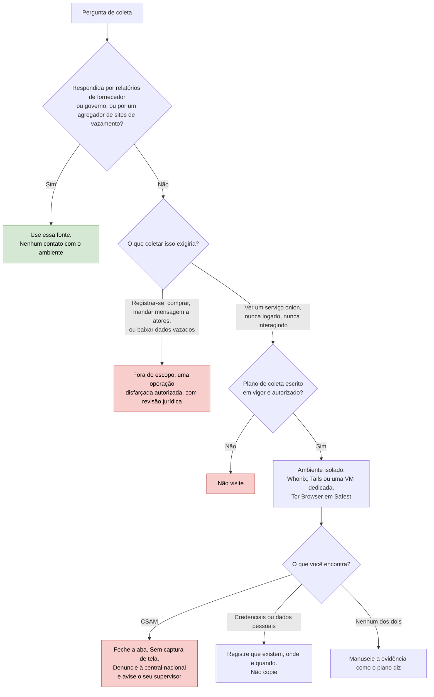

# Dia 41: Monitoramento de dark web: o que é realista, e um setup seguro de Tor

> 🇺🇸 Original: [*Day 41: Dark web monitoring, what is realistic, and a safe Tor setup*](https://github.com/thiefdroppers/cyber-investigator-skills/blob/main/curriculum/phase-3-cyber-threat-intelligence/day-41.md) — © ThiefDroppers, licença MIT.
> Aqui: tradução fiel **+** camada brasileira. Nada do original foi removido; tudo o que é novo vem marcado com ➕.

**Fase 3. Inteligência de ameaças cibernéticas** · Meta da trilha: saber que coleta na *dark web* é viável e lícita no seu nível, configurar o Tor Browser de um jeito que proteja você, e escrever o plano de coleta que precisa existir antes de alguém olhar um ambiente criminoso.

Rank Jutsu: `B` · [](https://colab.research.google.com/github/Ridd1kulusC0d3r/investigador-cyber-90-dias/blob/main/curriculo/fase-3-inteligencia-de-ameacas/dia-41/dia-41.ipynb)

---

## 🎬 ➕ Abertura do caso — *O convite do grupo*

Quinta-feira, 15 de outubro. A Marta encaminha um print que um cooperado mandou à ouvidoria: um anúncio do IscaKit num grupo de mensagens, com um "link de convite" e a frase *"versão 2 com módulo Pix, também no nosso fórum .onion"*.

— Se a gente entrar no grupo, descobre quem vende — ela escreve. — O conselho quer saber se vão atacar de novo.

Você já está com o Tor Browser baixado na outra aba. Rafa chega com dois cafés e põe um deles em cima do seu teclado.

— Entrar no grupo é criar conta, talvez se apresentar, talvez comprar. Isso é operação disfarçada. Não está no nosso contrato, não temos autorização para isso, e o Dr. Hélio vai ter um infarto. — Ele senta. — A pergunta do conselho, "vão atacar de novo?", alguém já respondeu sem entrar em fórum nenhum? Comece por aí. E antes de qualquer pessoa da Vigia abrir um endereço `.onion`, quero um plano de coleta escrito e assinado.

É isso que o Dia 41 ensina. *(Personagens e cenário: [Operação Isca](../../../caso-continuo/).)*

---

## 📖 Conceito

"*Dark web*" geralmente significa serviços acessíveis só por meio de uma rede de anonimato, na maioria serviços *onion* do Tor. Para a inteligência de ameaças, os ambientes que importam são fóruns de cibercrime, mercados, sites de vazamento de dados de *ransomware* e, cada vez mais, canais do Telegram e fóruns na *clearnet* (a internet comum). Muitos serviços criminosos hoje anunciam no Telegram tanto quanto em sites *onion*, então uma visão "só Tor" da *dark web* deixa muita coisa de fora.

O monitoramento profissional de *dark web* depende sobretudo de acesso e de arquivos. Os provedores comerciais (Flashpoint, Intel 471, KELA, Recorded Future e outros) mantêm contas verificadas em fóruns fechados, arquivam postagens ao longo de anos, traduzem do russo e de outros idiomas, e deixam os analistas buscarem nesse arquivo sem tocar nos ambientes. Entrar em fóruns fechados normalmente exige indicação (*vouching*), reputação ou pagamento, e fazer isso como indivíduo significa enganar e, possivelmente, interagir com criminosos. Isso é trabalho disfarçado. Exige autorização do empregador, revisão jurídica e um plano de operação documentado, e está fora deste roteiro.

O que um iniciante consegue fazer sem acesso pago, de forma lícita e segura:

| Atividade | Viável de graça? | Notas |
|---|---|---|
| Ler relatórios de fornecedores e de governos que citam atividade de fóruns e de sites de vazamento | Sim | A maior parte do que você precisa, já traduzida e contextualizada |
| Usar agregadores públicos de postagens de sites de vazamento de *ransomware* (Dia 42) | Sim | Outra pessoa coleta; você analisa padrões |
| Buscar serviços *onion* a partir da *clearnet* com o Ahmia | Sim | O Ahmia filtra material de abuso conhecido; os resultados continuam sem verificação |
| Visitar um serviço *onion* no Tor Browser para confirmar que ele existe, só olhando | Às vezes | Só com um plano escrito, nunca logado, nunca interagindo |
| Registrar-se num fórum criminoso, comprar acesso, mandar mensagens a atores | Não | Engano e possíveis crimes. Exige uma operação autorizada |
| Baixar dados vazados de um site de vazamento | Não | Você estaria manuseando dados pessoais roubados. Exposição jurídica na maioria das jurisdições |

Duas regras de parada absolutas valem em toda jurisdição. Se você encontrar material de abuso sexual infantil (CSAM), feche a aba imediatamente. Não faça captura de tela, não baixe, não "documente". Denuncie a URL à central nacional (a CyberTipline do NCMEC nos EUA, o Cybertip.ca no Canadá, a IWF no Reino Unido) e avise o seu supervisor. Segundo: se você vir credenciais ou dados pessoais de pessoas identificáveis, não os copie para as suas notas. Registre que os dados existem, onde e quando você os viu.

A tabela e as duas regras de parada se combinam num único caminho de decisão. A maioria das perguntas sai no primeiro losango:



## 📚 Recursos

- [Download do Tor Browser](https://www.torproject.org/download/) e [guia de verificação da assinatura](https://support.torproject.org/tbb/how-to-verify-signature/): o único lugar de onde baixar o navegador.
- [Whonix](https://www.whonix.org/): uma configuração de duas VMs (Gateway e Workstation) que força todo o tráfego da Workstation a passar pelo Tor.
- [Tails](https://tails.net/): um sistema operacional *live* em USB que roteia tudo pelo Tor e esquece a sessão ao desligar.
- [Ahmia](https://ahmia.fi/): busca de serviços *onion* a partir da *clearnet*, com filtragem de abuso.
- Denúncia de CSAM: [NCMEC CyberTipline](https://report.cybertip.org/) (EUA), [Cybertip.ca](https://www.cybertip.ca/) (Canadá).

### ➕ Recursos do contexto Brasil

- **Denúncia de CSAM e de crimes contra direitos humanos na internet, no Brasil:** a central de denúncias da [SaferNet Brasil](https://new.safernet.org.br/denuncie), o **Disque 100** (Disque Direitos Humanos) e, em risco imediato, o **190**. É a "central nacional" que o original manda procurar.
- [Polícia Federal — comunicação de crimes](https://www.gov.br/pf/pt-br/canais_atendimento/comunicacao-de-crimes): canal para comunicar crimes de competência federal.
- [Guia de verificação de assinatura do Tor Project](https://support.torproject.org/tbb/how-to-verify-signature/): o mesmo do original; a página está disponível em português pelo seletor de idioma do site.
- Relatórios públicos em português sobre o ecossistema criminoso brasileiro (Telegram, venda de kits, "painéis"): procure as publicações de pesquisa de fornecedores com operação no Brasil e de órgãos como o CERT.br. A regra do primeiro losango vale aqui também: o que já foi publicado responde à maior parte das perguntas.

## 🛠️ Prática: Tor Browser numa VM isolada (um registro de instalação verificado, um plano de coleta e um mapa de calor de risco de fontes)

**Seu checklist de hoje.** Faça na ordem e marque cada item ao terminar:

- [ ] 1. Montar um ambiente isolado
- [ ] 2. Baixar e verificar o Tor Browser
- [ ] 3. Configurar o navegador
- [ ] 4. Praticar a verificação num serviço *onion* benigno
- [ ] 5. Escrever o plano de coleta
- [ ] 6. Montar o mapa de calor de risco de fontes
- [ ] ➕ 7. Prática BR: o plano de coleta da Operação Isca (o anúncio do IscaKit)
- [ ] ➕ 8. O notebook do dia no Colab

### 1. Montar um ambiente isolado

Escolha um:

- Whonix no VirtualBox ou no KVM. Tire um *snapshot* da Workstation logo depois do primeiro *boot*, para poder voltar a ele depois de cada sessão.
- Tails num *pen drive* USB dedicado. Nada persiste, a menos que você configure armazenamento persistente, o que você não deve fazer neste laboratório.
- No mínimo, uma VM dedicada, usada para nada mais, com pastas compartilhadas e área de transferência compartilhada desligadas.

Não use o perfil do seu navegador do dia a dia nem o sistema operacional hospedeiro do seu notebook de trabalho.

### 2. Baixar e verificar o Tor Browser

Dentro da VM (Whonix e Tails já trazem o Tor Browser; se você está numa VM comum, faça este passo nela):

```bash
# Importe a chave de assinatura dos Tor Browser Developers via WKD
gpg --auto-key-locate nodefault,wkd --locate-keys torbrowser@torproject.org

# Exporte-a para um arquivo de chaveiro, identificada pela impressão digital completa
gpg --output ./tor.keyring --export 0xEF6E286DDA85EA2A4BA7DE684E2C6E8793298290

# Verifique o pacote que você baixou contra a assinatura .asc dele
gpgv --keyring ./tor.keyring tor-browser-linux-x86_64-<version>.tar.xz.asc tor-browser-linux-x86_64-<version>.tar.xz
```

A impressão digital acima é a que o Tor Project publicava na página de verificação quando isto foi escrito. Compare-a, caractere por caractere, com essa página antes de confiar nela. Um bom resultado contém `Good signature from "Tor Browser Developers (signing key) <torbrowser@torproject.org>"`. Cole a saída completa do `gpgv` no seu registro de instalação.

### 3. Configurar o navegador

- Abra o ícone do escudo, depois Settings, e ponha o Security Level em Safest. O JavaScript fica desligado em todos os sites e muitos tipos de mídia ficam bloqueados.
- Deixe a janela do tamanho com que ela abre. O Tor Browser aplica *letterboxing* para que o tamanho da sua janela não identifique você, e maximizar trabalha contra isso.
- Não instale nenhuma extensão, e não entre em nenhuma conta pessoal neste navegador.
- Nunca abra documentos baixados com a VM conectada. PDFs e arquivos do Office podem buscar recursos remotos e revelar o seu IP real fora do Tor.

### 4. Praticar a verificação num serviço *onion* benigno

Sites *onion* criminosos são clonados o tempo todo para aplicar golpes em pesquisadores e compradores, então você precisa saber confirmar que um endereço *onion* pertence a quem diz.

1. No Tor Browser, abra `https://www.torproject.org/`.
2. A barra de endereço mostra um botão ".onion available". Ele aparece porque o site envia um cabeçalho `Onion-Location`. Clique nele.
3. Registre o endereço *onion* para onde ele leva você e a data.
4. Confirme o endereço por um segundo caminho: encontre-o publicado pela mesma organização numa página a que você chegou de forma independente.

Faça o mesmo com uma organização de notícias que publique um serviço *onion*. Registre os dois no seu registro de instalação. Não visite nenhum ambiente criminoso neste laboratório.

> ➕ Neste repositório não escrevemos nenhum endereço `.onion` real, nem os benignos. O endereço que você registrar deve vir **do seu próprio passo 2 e 3** acima (o botão ".onion available") e da confirmação independente do passo 4. Copiar um endereço *onion* de um README, de um *post* ou de uma lista é exatamente o erro que este passo ensina a evitar.

### 5. Escrever o plano de coleta

Ninguém deveria abrir um ambiente criminoso sem um plano como este. Preencha-o para uma tarefa hipotética: "monitorar a atividade pública de sites de vazamento de *ransomware* que afeta o setor de saúde no seu país."

```markdown
# Plano de coleta na dark web
Requisito (que pergunta estamos respondendo?):
Autorizado por / data:
Base legal e notas de jurisdição:
Fontes no escopo (tipo, método de acesso):
Fontes explicitamente fora do escopo:
Ações permitidas: só visualizar | captura de tela de conteúdo não pessoal | ...
Ações proibidas: registrar-se, mandar mensagens, comprar, baixar dados vazados
Ambiente: snapshot do Whonix <id> / Tails; nenhuma conta pessoal
Tratamento de dados pessoais encontrados:
Condições de parada e escalonamento (CSAM, ameaças à vida, intrusão em andamento):
Manuseio de evidência: capturas de tela guardadas onde, com hash como, retidas por quanto tempo:
Data de revisão:
```

Para este requisito, a resposta correta para "fontes no escopo" é, na maior parte, os agregadores que você vai usar amanhã. Escreva por que essa é uma escolha melhor do que visitar os sites de vazamento você mesmo.

### 6. Montar o mapa de calor de risco de fontes

Numa planilha, dê a cada tipo de fonte uma nota de 1 (baixo) a 5 (alto) em quatro colunas, e depois aplique uma escala de cores:

| Tipo de fonte | Risco jurídico | Risco de OPSEC | Custo de acesso | Valor para um iniciante |
|---|---|---|---|---|
| Relatórios de fornecedores e de governos | 1 | 1 | 1 | 4 |
| Agregadores de sites de vazamento (ransomware.live, RansomLook) | 1 | 1 | 1 | 4 |
| Sites de vazamento de *ransomware* diretamente (só visualização) | | | | |
| Fóruns abertos de cibercrime (só visualização, sem conta) | | | | |
| Fóruns fechados ou verificados | | | | |
| Canais do Telegram | | | | |
| Mercados | | | | |

Preencha as linhas vazias e dê uma frase de justificativa por nota.

### O que você tem ao terminar

- Um registro de instalação: detalhes da VM ou do Tails, a saída completa do `gpgv`, a configuração do Security Level e dois endereços *onion* verificados, com datas e a segunda fonte que confirmou cada um.
- Um plano de coleta preenchido para o requisito dos sites de vazamento do setor de saúde.
- Um mapa de calor de risco de fontes com escala de cores e justificativa para cada célula.

### ➕ 7. Prática BR: o plano de coleta da Operação Isca

O requisito da Marta, reescrito como requisito de inteligência: *"O CA-ISCA-01 (ou outro comprador do IscaKit) deve atacar outras cooperativas de crédito de Minas Gerais nas próximas quatro semanas? Que sinais antecipariam isso?"*

1. **Passe o requisito pelo primeiro losango.** Liste o que já responde sem tocar em ambiente nenhum: o grafo do Dia 40 (domínios novos com o mesmo favicon e o mesmo padrão de certificado aparecem no crt.sh **antes** do disparo), o *Certificate Transparency* monitorado por padrão de nome (pista fraca, mas barata), os alertas das cooperativas parceiras e os relatórios públicos sobre kits de phishing à venda.
2. **Classifique cada ação proposta** na tabela do Conceito: entrar no grupo de mensagens pelo convite do print; abrir o "fórum .onion" citado no anúncio; mandar mensagem ao vendedor "como cliente"; buscar o nome do kit no Ahmia; pedir a um fornecedor comercial com arquivo de fóruns que busque o nome do kit.
3. **Preencha o plano de coleta** do passo 5 para este requisito. Nas ações proibidas, inclua as três da Marta (entrar no grupo, comprar, conversar). Nas condições de parada, a de CSAM com os canais brasileiros, e a de dados de cooperados (por exemplo, se um *print* do painel do kit mostrar CPFs: registrar que existe, onde e quando; não copiar; avisar a Marta e o Dr. Hélio).
4. **Mapa de calor BR.** Acrescente duas linhas ao mapa do passo 6: "grupos de venda de kits em aplicativos de mensagens (só ler o que já foi encaminhado)" e "grupos de venda de kits (entrar com conta)". Justifique a diferença em termos de legalidade **e** de engano, como o checkpoint pede para os fóruns fechados.
5. **O print do anúncio.** Ele chegou de um cooperado, sem cadeia de custódia (é a fonte F5 do Dia 37). Registre o *hash* do arquivo que você recebeu, a hora, quem enviou e por qual canal, e marque o conteúdo como "não verificado". O link de convite fica neutralizado e **não é seguido**.

### ➕ 8. O notebook do dia

Abra o [notebook do Dia 41 no Colab](https://colab.research.google.com/github/Ridd1kulusC0d3r/investigador-cyber-90-dias/blob/main/curriculo/fase-3-inteligencia-de-ameacas/dia-41/dia-41.ipynb). Nele você:

1. percorre o fluxograma do Conceito como um jogo de decisão, com as ações da Prática BR;
2. escreve um **validador de endereço onion v3** (formato e *checksum*, só com `base64` e `hashlib`) e o testa num endereço **sintético**, gerado no próprio notebook, que não aponta para nada; e aprende o que esse teste **não** prova (quem é o dono);
3. lê uma saída de `gpgv` de exemplo e confere a impressão digital caractere por caractere por código;
4. preenche o plano de coleta da Operação Isca por formulário e sai com o `.md` e o SHA-256;
5. monta o mapa de calor de risco de fontes em texto, com as justificativas.

## ✅ Checkpoint

- O seu registro de instalação nomeia o ambiente que você usou (Whonix, Tails ou uma VM dedicada), com os detalhes.
- O seu registro de instalação contém a saída completa do `gpgv`, incluindo a linha `Good signature from`.
- O seu registro de instalação registra a configuração do Security Level.
- O seu registro de instalação registra dois endereços *onion*, cada um com uma data e a segunda fonte que o confirmou.
- O seu plano de coleta nomeia pelo menos três ações proibidas.
- O seu plano de coleta nomeia pelo menos duas condições de parada.
- Uma dessas condições de parada é a regra de CSAM.
- A justificativa do seu mapa de calor para fóruns fechados ou verificados explica, em termos de legalidade, por que esse acesso está fora do alcance deste roteiro.
- A mesma justificativa também explica isso em termos de engano.
- Você não visitou nenhum ambiente criminoso.
- Sem consultar notas, diga como você confirma que um endereço *onion* pertence à organização que diz ser dona dele.

### ➕ Checkpoint BR

- O plano de coleta da Operação Isca responde ao requisito da Marta sem nenhuma ação de contato com ambiente criminoso.
- A condição de parada de CSAM cita a SaferNet Brasil e o Disque 100.
- A condição de parada de dados de cooperados diz o que registrar e a quem avisar, sem copiar os dados.
- O print do anúncio está registrado com *hash*, hora, remetente e canal, e o link de convite não foi seguido.
- Sem consultar notas, você explica por que um endereço onion com *checksum* válido ainda pode ser um clone de golpe.

## ⚖️ ➕ Camada jurídica BR

**Entrar no grupo não é "só olhar".** Criar conta com identidade falsa para entrar num grupo criminoso pode encostar na falsa identidade (CP art. 307), e interagir com vendedores, combinar compra ou pagar por um kit pode configurar participação ou facilitação de crimes. A infiltração de agentes em ambiente virtual existe no direito brasileiro, mas é instrumento da **polícia**, com autorização judicial e regras próprias (Lei 12.850/2013, com as alterações da Lei 13.964/2019, e, para crimes contra a dignidade sexual de crianças e adolescentes, o ECA). Um analista de MSSP privado não tem esse instrumento. <!-- TODO jurídico: confirmar os artigos exatos da infiltração virtual (Lei 12.850/2013, arts. 10-A a 10-D; ECA, arts. 190-A a 190-E) antes de citar números. -->

**CSAM: tolerância zero, inclusive para "documentar".** O ECA tipifica, entre outras condutas, adquirir, possuir ou armazenar material de abuso sexual infantil (art. 241-B). Fazer captura de tela "para documentar" é armazenar. A regra do original (fechar a aba, não capturar, denunciar) é também a regra jurídica brasileira. Denuncie pela SaferNet Brasil ou pelo Disque 100, e avise o supervisor.

**Dados vazados são dados pessoais de terceiros.** Baixar um vazamento "para ver se a cooperativa está lá" é tratamento de dados pessoais sem base legal (LGPD, art. 7º) e pode configurar receptação de dados de origem ilícita, conforme o caso. Agregadores que já fizeram a coleta (Dia 42) e notificações da própria vítima são os caminhos.

> Este repositório é material de estudo e não substitui orientação jurídica.

## 🧠 ➕ Camada 8 — o fascínio do proibido e o "só desta vez"

A *dark web* tem um apelo próprio: o mistério, a sensação de acesso exclusivo, a promessa de "ver o que ninguém viu". Esse apelo empurra o analista para as duas pontas erradas da tabela: superestimar o valor de entrar no fórum e subestimar o risco.

Três mecanismos se somam:

- **Viés de otimismo** (Tali Sharot estudou esse viés a fundo): "comigo não vai dar problema, eu sei o que estou fazendo". É o que faz alguém pular a VM isolada "só desta vez".
- **Comprometimento gradual** (*foot-in-the-door*, Freedman e Fraser): entrar no grupo "só para ler" parece pequeno; depois responder uma pergunta, depois pedir um preço. Cada passo parece só um pouco maior que o anterior.
- **Pressão de autoridade e de urgência**: a pergunta vem do conselho, com prazo. A urgência reduz a deliberação.

E há o custo humano que o original menciona de passagem: exposição a conteúdo perturbador (inclusive acidental) deixa marca. Equipes de moderação e de investigação de abuso infantil estudam o **trauma vicário** e o estresse traumático secundário há anos. Ninguém precisa "aguentar" isso sozinho.

Consequência prática: o plano de coleta escrito é a ferramenta contra os três vieses, porque decide os limites **antes** da tentação, como o `minha-linha.md` do Dia 1. E se você for exposto a algo perturbador, fale com o supervisor e procure apoio; isso faz parte do protocolo, não é fraqueza.

## 🤖 ➕ Skill do dia

Este dia propõe para a [skill pt-BR](../../../skills/investigador-cyber/SKILL.md) o procedimento **"Pedido de coleta na *dark web*"**: primeiro as fontes que já responderam, nada de registrar, comprar, conversar ou baixar vazamento, plano escrito antes de qualquer visita, e as duas regras de parada com os canais brasileiros. Detalhes e caso de teste em [`_skill-delta.md`](_skill-delta.md).

## 💡 ➕ Inovação OSINT do dia — validar o formato de um endereço onion v3 (e entender o que isso não prova)

Um endereço *onion* v3 tem 56 caracteres em base32 que codificam a chave pública do serviço (32 bytes), um *checksum* (2 bytes) e a versão (1 byte, valor 3). O *checksum* é `SHA3-256(".onion checksum" + chave + versão)`, truncado em 2 bytes, conforme a especificação de serviços *onion* do Tor (rend-spec-v3). Dá para conferir só com a biblioteca padrão:

```python
import base64, hashlib                                                # só biblioteca padrão
def onion_v3_valido(endereco: str) -> bool:
    nome = endereco.lower().removesuffix(".onion")
    if len(nome) != 56:
        return False
    try:
        bruto = base64.b32decode(nome.upper())                        # 35 bytes: chave + checksum + versão
    except ValueError:
        return False
    chave, checksum, versao = bruto[:32], bruto[32:34], bruto[34:]
    esperado = hashlib.sha3_256(b".onion checksum" + chave + versao).digest()[:2]
    return versao == b"\x03" and checksum == esperado
```

Isso pega erro de digitação e endereço inventado. **Não** prova a quem o serviço pertence: um golpista gera um endereço válido em segundos, e há ferramentas que geram endereços com prefixo parecido com o de um site conhecido. A pertença só se confirma como o passo 4 manda: `Onion-Location` do próprio site, e a mesma organização publicando o endereço numa página que você alcançou por outro caminho.

## 📝 Diário de estudo

- Data:
- Tempo gasto:
- O que ficou claro:
- O que ainda está nebuloso:
- Artefato produzido: registro de instalação (ambiente, `gpgv`, Security Level, dois *onions* verificados), plano de coleta (saúde), mapa de calor de risco de fontes; plano de coleta da Operação Isca e registro do print do anúncio

---
<sub>Baseado em [cyber-investigator-skills](https://github.com/thiefdroppers/cyber-investigator-skills) por ThiefDroppers (MIT). Tradução, camada BR, Camada 8, skill pt-BR e notebook por Deivison Lourenço (@Ridd1kulusC0d3r).</sub>
