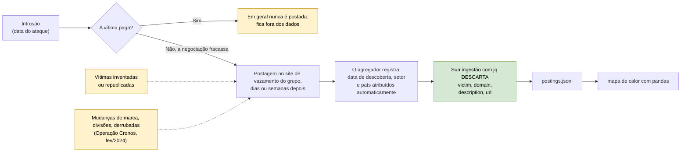

# Dia 42: Medindo atividade de sites de vazamento de ransomware sem coletar vítimas

> 🇺🇸 Original: [*Day 42: Measuring ransomware leak-site activity without collecting victims*](https://github.com/thiefdroppers/cyber-investigator-skills/blob/main/curriculum/phase-3-cyber-threat-intelligence/day-42.md) — © ThiefDroppers, licença MIT.
> Aqui: tradução fiel **+** camada brasileira. Nada do original foi removido; tudo o que é novo vem marcado com ➕.

**Fase 3. Inteligência de ameaças cibernéticas** · Meta da trilha: analisar com segurança a atividade de sites de vazamento da *dark web* por meio de um agregador público, e produzir um mapa de calor que mostre tendências por grupo e por setor sem deixar nenhum nome de vítima entrar no seu trabalho.

Rank Jutsu: `B` · [](https://colab.research.google.com/github/Ridd1kulusC0d3r/investigador-cyber-90-dias/blob/main/curriculo/fase-3-inteligencia-de-ameacas/dia-42/dia-42.ipynb)

---

## 🎬 ➕ Abertura do caso — *"Somos os próximos?"*

O e-mail da Marta Quintão chega às 8h03, com o conselho de administração em cópia. Alguém encaminhou ao presidente da Serra Azul uma postagem de rede social: *"cooperativas de crédito são o alvo nº 1 do ransomware no Brasil em 2026"*. Logo abaixo, um print borrado de um site de vazamento com o logotipo de uma cooperativa.

— Eles querem um número até sexta — diz Rafa, lendo por cima do seu ombro. — "O setor está sendo mais atacado?"

Você já está abrindo o navegador Tor do Dia 41. Rafa balança a cabeça.

— Não vamos visitar site de vazamento nenhum, e não vamos anotar nome de cooperativa vítima. A pergunta do conselho é sobre **tendência**, não sobre quem. E repara: o IscaKit é phishing de credencial, não é ransomware. Se você misturar as duas coisas no relatório, o conselho vai sair achando que o Pescador sequestra servidores.

O Dia 42 ensina a medir sem coletar vítimas, e a dizer o que o gráfico **não** mostra. *(Personagens e cenário: [Operação Isca](../../../caso-continuo/).)*

---

## 📖 Conceito

A maioria dos grupos de ransomware mantém um site de vazamento de dados (*data leak site*), geralmente um serviço *onion*, onde publicam as organizações que se recusaram a pagar e ameaçam divulgar os dados roubados. Vários projetos públicos observam esses sites e registram cada nova postagem: o grupo, a vítima alegada, a data em que a postagem apareceu e, muitas vezes, um setor e um país. Para um analista sem acesso credenciado (*vetted access*), esses dados agregados são o conjunto de dados de *dark web* mais prático que existe. Outra pessoa já fez a coleta arriscada.

Trate cada postagem como uma alegação feita por um grupo criminoso. Várias coisas distorcem os dados:

- Grupos publicam organizações que nunca invadiram, ou republicam vítimas tiradas dos vazamentos de outros grupos, para parecer maiores. O ransomware.live sinaliza alguns grupos por isso. Uma entrada da lista de grupos dele diz: "O grupo parece não confiável. A maioria, senão todas, das vítimas alegadas não pode ser verificada e parece ser de organizações escolhidas ao acaso."
- Grupos mudam de marca (*rebrand*) e se dividem. Uma queda nas postagens de um grupo seguida de uma alta com um nome novo pode ser a mesma equipe de operadores.
- As forças policiais derrubam sites de vazamento. Quando a *National Crime Agency* (NCA) do Reino Unido e parceiros assumiram o controle do site de vazamento do LockBit na Operação Cronos (fevereiro de 2024), as postagens com esse nome pararam e depois voltaram em infraestrutura nova.
- A data da postagem não é a data do ataque. As vítimas costumam aparecer dias ou semanas depois da intrusão, e normalmente só se a negociação fracassa; por isso, as organizações que pagaram ficam, na maior parte, de fora.
- Setor e país são atribuídos pelo agregador, muitas vezes de forma automática, e às vezes estão errados ou vazios.

Onde cada uma dessas distorções entra no fluxo que termina no seu mapa de calor:



As pessoas neste conjunto de dados são vítimas. Você consegue estudar grupos, setores, regiões e calendário sem anotar um único nome de vítima, e deve fazer isso. Nada no laboratório de hoje precisa de um.

## 📚 Recursos

- [ransomware.live](https://www.ransomware.live/) e a sua [API](https://api.ransomware.live/): um rastreador público de postagens em sites de vazamento. A API tem limite de requisições (*rate limit*). Leia os termos de uso antes de escrever scripts contra ela, e guarde em cache o que você baixar.
- [RansomLook](https://www.ransomlook.io/): um rastreador de código aberto que você pode usar para conferir contagens.
- [Comunicado da NCA sobre a Operação Cronos](https://www.nationalcrimeagency.gov.uk/the-nca-announces-the-disruption-of-lockbit-with-operation-cronos): a fonte primária da desarticulação do LockBit em fevereiro de 2024.
- [Alertas #StopRansomware da CISA](https://www.cisa.gov/stopransomware/resources): relatórios de governo sobre grupos específicos, úteis para pôr em contexto um pico no mapa de calor.

### ➕ Recursos do contexto Brasil

- [CERT.br — Cartilha de Segurança para Internet](https://cartilha.cert.br/): o material de referência em português para explicar segurança a quem não é da área; procure o fascículo sobre códigos maliciosos e ransomware (útil para a resposta ao conselho da cooperativa).
- [ANPD — Autoridade Nacional de Proteção de Dados](https://www.gov.br/anpd/pt-br): procure a página de comunicação de incidente de segurança, que explica como o controlador comunica um incidente com dados pessoais; é o outro lado de uma postagem em site de vazamento.
- [LGPD — Lei 13.709/2018](https://www.planalto.gov.br/ccivil_03/_ato2015-2018/2018/lei/l13709.htm): arts. 46 a 48 (segurança e comunicação de incidentes).
- [Código Penal compilado](https://www.planalto.gov.br/ccivil_03/decreto-lei/del2848compilado.htm): art. 158 (extorsão), que é o enquadramento natural da ameaça de publicar dados se a vítima não pagar.

## 🛠️ Prática: API do ransomware.live, jq e pandas (um mapa de calor grupo × mês de sites de vazamento, com ressalvas anotadas)

**Seu checklist de hoje.** Faça na ordem e marque cada item ao terminar:

- [ ] 1. Escolher grupos e puxar as postagens deles
- [ ] 2. Montar os mapas de calor
- [ ] 3. Anotar o que o mapa de calor não consegue dizer
- [ ] 4. Conferir um número
- [ ] ➕ 5. Prática BR: responder ao conselho da Serra Azul com dados sintéticos e ressalvas
- [ ] ➕ 6. O notebook do dia no Colab

### 1. Escolher grupos e puxar as postagens deles

Liste os nomes de grupo que o agregador usa:

```bash
mkdir -p ~/cti-lab/day42 && cd ~/cti-lab/day42
curl -s https://api.ransomware.live/v2/groups -o groups.json
jq -r '.[].name' groups.json | sort | head -50
```

Os nomes de grupo são os *slugs* do rastreador, então uma mesma marca pode aparecer várias vezes (em setembro de 2026, a lista continha `lockbit`, `lockbit2`, `lockbit3`, `lockbit3_fs` e `lockbit5`). Escolha três ou quatro grupos, incluindo pelo menos um *slug* do LockBit, para você enxergar o efeito da Operação Cronos.

Puxe o histórico de cada grupo e descarte os campos de vítima já na ingestão. Os campos `victim`, `domain`, `description` e `url` nunca chegam ao seu disco:

```bash
for g in akira qilin play lockbit3; do
  curl -s "https://api.ransomware.live/v2/groupvictims/$g" \
  | jq -c --arg g "$g" '.[] | {group: $g, month: (.discovered[0:7]), attack_month: ((.attackdate // "")[0:7]), sector: (.activity // "Unknown"), country: (.country // "")}'
  sleep 5   # seja educado; a API limita clientes agressivos
done > postings.jsonl
wc -l postings.jsonl
head -2 postings.jsonl
```

Linhas de exemplo (a estrutura é real; os seus valores serão outros):

```
{"group":"akira","month":"2026-09","attack_month":"","sector":"Technology","country":""}
{"group":"qilin","month":"2026-09","attack_month":"2026-08","sector":"Manufacturing","country":"US"}
```

### 2. Montar os mapas de calor

Salve como `heat.py`:

```python
import pandas as pd
import matplotlib
matplotlib.use("Agg")
import matplotlib.pyplot as plt

df = pd.read_json("postings.jsonl", lines=True)
df = df[df["month"] >= "2023-01"]

def heatmap(pivot, title, path, width=16):
    fig, ax = plt.subplots(figsize=(width, 0.6 * len(pivot.index) + 1.5))
    im = ax.imshow(pivot.values, aspect="auto", cmap="Reds")
    ax.set_yticks(range(len(pivot.index)), pivot.index)
    ax.set_xticks(range(len(pivot.columns)), pivot.columns, rotation=90)
    for (i, j), v in pd.DataFrame(pivot.values).stack().items():
        ax.text(j, i, int(v), ha="center", va="center", fontsize=6)
    fig.colorbar(im, ax=ax, label="postings")
    ax.set_title(title)
    fig.tight_layout()
    fig.savefig(path, dpi=150)

by_month = df.pivot_table(index="group", columns="month", values="sector", aggfunc="count", fill_value=0)
heatmap(by_month, "Leak-site postings per month by group (discovery date, source: ransomware.live)", "group-by-month.png")

top_sectors = df["sector"].value_counts().head(10).index
by_sector = df[df["sector"].isin(top_sectors)].pivot_table(index="sector", columns="group", values="month", aggfunc="count", fill_value=0)
heatmap(by_sector, "Postings by sector and group (aggregator-assigned sectors)", "sector-by-group.png", width=8)

print(by_month.iloc[:, -6:])
```

```bash
pip install pandas matplotlib
python heat.py
```

A tabela impressa mostra os últimos seis meses de cada grupo, para você conferir a imagem contra os números.

### 3. Anotar o que o mapa de calor não consegue dizer

Abra `group-by-month.png` e faça as marcações (em qualquer editor de imagem, ou refaça o gráfico numa planilha com comentários):

- Marque fevereiro de 2024 na linha do LockBit e descreva o que aconteceu nos meses seguintes, citando o comunicado da NCA.
- Marque o mês de maior contagem de cada grupo. Procure um relatório público daquele período (um alerta da CISA ou um blog de fornecedor) que explique o pico, como uma campanha de exploração em massa. Se não encontrar, escreva "sem explicação".
- Para cada grupo, calcule a proporção de postagens sem data de ataque. Uma proporção alta significa que o eixo "mês" reflete quando o rastreador percebeu a postagem, e nada mais:
  ```bash
  jq -rs 'group_by(.group)[] | "\(.[0].group)\t\(map(select(.attack_month=="")) | length)/\(length) postings without an attack date"' postings.jsonl
  ```

### 4. Conferir um número

Escolha um grupo e um mês. Compare a contagem com o número do RansomLook para o mesmo grupo e período. Registre os dois números e a diferença. Dois rastreadores que observam os mesmos sites raramente concordam exatamente, por causa de republicações, remoções e horários de coleta diferentes.

### O que você tem ao terminar

- `group-by-month.png`: um mapa de calor de três ou quatro grupos ao longo de pelo menos 24 meses, anotado com a desarticulação da Cronos e o mês de pico de cada grupo.
- `sector-by-group.png`: os dez principais setores atribuídos pelo agregador contra esses grupos.
- Um quadro de ressalvas na mesma página, listando as proporções sem data de ataque, o resultado da conferência e pelo menos três vieses da seção Conceito que se aplicam ao seu gráfico.
- `postings.jsonl` sem nenhum nome de vítima, domínio ou URL.

### ➕ 5. Prática BR: o conselho da Serra Azul quer um número

A pergunta do conselho, reescrita como pergunta analítica: *"As postagens em sites de vazamento que mencionam o setor financeiro no Brasil aumentaram nos últimos 12 meses, e isso diz algo sobre o risco da Serra Azul?"*

Use o arquivo sintético [`caso-continuo/dados/dia-42/postagens-sinteticas.jsonl`](../../../caso-continuo/dados/dia-42/postagens-sinteticas.jsonl). Ele tem **o mesmo formato** que o seu `postings.jsonl` (grupo, mês, mês do ataque, setor, país), mas os grupos são fictícios (`grupo-alfa`, `grupo-bravo`, `grupo-charlie`, `grupo-delta`) e os números foram gerados por script. Não existe nome de vítima no arquivo, nem pode existir. O `grupo-delta` sofre uma "derrubada" simulada em fev/2024 e um `grupo-eco` aparece meses depois: é o seu exercício de *rebrand*.

1. Filtre `country == "BR"` e `sector == "Financial Services"`. Conte por mês.
2. Compare os últimos 12 meses com os 12 anteriores. Escreva a variação em números absolutos **e** em porcentagem (com contagens pequenas, a porcentagem engana: de 2 para 4 é "+100%").
3. Calcule a proporção de postagens BR sem `attack_month`.
4. Escreva a resposta ao conselho em **cinco linhas**, usando "postagens" e nunca "ataques", com pelo menos duas ressalvas do Conceito.
5. Escreva uma sexta linha separada: *"O golpe do 'Pix bloqueado' (IscaKit) é phishing de credencial e não tem relação demonstrada com ransomware."*

E o print borrado com logotipo de cooperativa? Você **não** procura o site, **não** tenta identificar a cooperativa, **não** baixa nada. Registra no caso: "alegação não verificada recebida por encaminhamento; não investigada por estar fora do escopo; nenhuma ação tomada". Se a própria Serra Azul quiser saber se ela mesma aparece em algum agregador, quem faz essa checagem é a cooperativa (ou a Vigia, com autorização escrita específica), registrando só "sim/não, data, fonte".

### ➕ 6. O notebook do dia

Abra o [notebook do Dia 42 no Colab](https://colab.research.google.com/github/Ridd1kulusC0d3r/investigador-cyber-90-dias/blob/main/curriculo/fase-3-inteligencia-de-ameacas/dia-42/dia-42.ipynb). Nele você:

1. monta uma **ingestão com lista de permissão** (*allowlist*) que joga fora `victim`, `domain`, `description` e `url` antes de qualquer coisa ser guardada, e prova isso com o equivalente do `grep -c victim`;
2. desenha o mapa de calor grupo × mês **só com a biblioteca padrão** (blocos de texto `░▒▓█`), com a derrubada simulada e o *rebrand* do `grupo-eco`;
3. calcula a proporção sem data de ataque e a variação BR/financeiro para a resposta ao conselho;
4. joga o quiz **"postagem ou ataque?"**: dez frases de relatório para classificar como defensáveis ou não;
5. opcionalmente, puxa dados reais da API do ransomware.live (desligado por padrão; só com o filtro de campos ativo).

## ✅ Checkpoint

- Rode `grep -c victim postings.jsonl`. O resultado deve ser 0.
- O título ou a legenda do seu gráfico diz "postagens" (*postings*) ou "vítimas alegadas" (*claimed victims*), nunca "ataques" ou "invasões" (*breaches*).
- Você consegue explicar em duas frases por que o setor no topo do seu gráfico não é necessariamente o setor que os grupos de ransomware mais miram.
- Toda anotação no gráfico cita uma fonte pública ou está marcada como inferência sua.

### ➕ Checkpoint BR

- A sua resposta ao conselho da Serra Azul cabe em cinco linhas, não usa a palavra "ataques" e traz pelo menos duas ressalvas.
- Você explicou por que "+100%" pode ser uma frase enganosa com contagens pequenas.
- A resposta separa explicitamente o golpe do IscaKit (phishing) do tema ransomware.
- O registro do caso mostra que o print encaminhado foi anotado como alegação não verificada, sem investigação da vítima.
- No notebook, a checagem de campos proibidos imprime `0` e o quiz deu pelo menos 8/10.

## ⚖️ ➕ Camada jurídica BR

**Extorsão (CP, art. 158).** A mecânica do site de vazamento ("pague ou publicamos") é extorsão: constranger alguém, com grave ameaça, a fazer algo para obter vantagem econômica indevida. A invasão que vem antes encosta no art. 154-A (invasão de dispositivo informático). O analista de CTI não é parte disso, mas precisa saber o nome do crime para escrever sobre ele sem exagero nem eufemismo.

**Dado vazado continua sendo dado pessoal (LGPD).** Os dados que um grupo publica não viram "públicos" no sentido de livres para uso. Baixar, guardar ou cruzar esses dados é tratamento de dado pessoal e exige base legal do art. 7º (ou do art. 11, se houver dado sensível), além de respeitar os princípios do art. 6º, especialmente finalidade e necessidade. É o motivo jurídico, além do ético, do filtro de campos deste dia: o que não entra no seu disco não precisa de base legal.

**Comunicação de incidente (LGPD, art. 48).** O controlador que sofre incidente com risco ou dano relevante aos titulares comunica à ANPD e aos titulares. A ANPD regulamentou o procedimento em resolução própria. <!-- TODO jurídico: confirmar número e ano da resolução da ANPD sobre comunicação de incidente (acredita-se Resolução CD/ANPD nº 15/2024) e o prazo vigente. --> Para o caso: se a Serra Azul um dia aparecer num site de vazamento, quem decide e comunica é a cooperativa (controladora), com o Dr. Hélio; a Vigia apoia com fatos.

> Este repositório é material de estudo e não constitui orientação jurídica.

## 🧠 ➕ Camada 8 — o print que vale mais que mil linhas

O conselho da Serra Azul ficou alarmado por **um** print com logotipo de cooperativa, não por uma série histórica. Tversky e Kahneman descreveram a **heurística da disponibilidade**: julgamos a frequência de algo pela facilidade com que exemplos vêm à mente. Um caso vívido e próximo pesa mais do que uma tabela, e um analista que passa o dia lendo postagens de vazamento sofre do mesmo efeito.

O segundo viés do dia é o de **sobrevivência** (*survivorship bias*): os dados só contêm quem não pagou e foi postado. As vítimas que pagaram, e as que nunca foram descobertas, são invisíveis no gráfico. Um setor "pouco atingido" pode ser só um setor que paga mais.

E há um terceiro efeito, mais silencioso: depois de algumas horas, a vítima vira "uma linha". O filtro de campos não serve só para a LGPD; ele protege você de se acostumar a ler nomes de organizações (e, por trás delas, de pessoas) como dados de exercício.

Consequência prática: toda resposta sobre tendência sai com a frase "isto conta postagens, não ataques" **antes** do número, não numa nota de rodapé.

## 🤖 ➕ Skill do dia

O dia propõe à skill um procedimento novo, **"medição de atividade em sites de vazamento"**: ingestão com lista de permissão de campos, vocabulário "postagens/vítimas alegadas", três ressalvas obrigatórias e recusa de listar vítimas. Detalhes em [`_skill-delta.md`](_skill-delta.md).

## 💡 ➕ Inovação OSINT do dia — ingestão por lista de permissão, só com stdlib

O `jq` do original descarta os campos de vítima. A mesma ideia em Python puro, útil quando você não tem `jq` ou quer que a regra fique no código do seu pipeline: em vez de apagar campos perigosos (lista de bloqueio, que falha quando a API cria um campo novo), você **só copia os campos permitidos**.

```python
import json                                                    # stdlib
PERMITIDOS = ("group", "month", "attack_month", "sector", "country")  # nada de victim/domain/url

def limpar(registro, grupo):
    bruto = {"group": grupo,
             "month": (registro.get("discovered") or "")[:7],          # AAAA-MM da descoberta
             "attack_month": (registro.get("attackdate") or "")[:7],   # vazio se o agregador não sabe
             "sector": registro.get("activity") or "Unknown",
             "country": registro.get("country") or ""}
    return {k: bruto[k] for k in PERMITIDOS}                   # só sai o que está na lista

# uso: for r in json.loads(resposta): saida.write(json.dumps(limpar(r, "akira")) + "\n")
```

Se amanhã a API acrescentar um campo `victim_contact`, a lista de bloqueio deixaria passar; a lista de permissão não. É o princípio da necessidade da LGPD (art. 6º, III) escrito em cinco linhas.

## 📝 Diário de estudo

- Data:
- Tempo gasto:
- O que ficou claro:
- O que ainda está nebuloso:
- Artefato produzido: `group-by-month.png`, `sector-by-group.png`, quadro de ressalvas, `postings.jsonl` (sem vítimas), resposta de cinco linhas ao conselho

---
<sub>Baseado em [cyber-investigator-skills](https://github.com/thiefdroppers/cyber-investigator-skills) por ThiefDroppers (MIT). Tradução, camada BR, Camada 8, skill pt-BR e notebook por Deivison Lourenço (@Ridd1kulusC0d3r).</sub>
