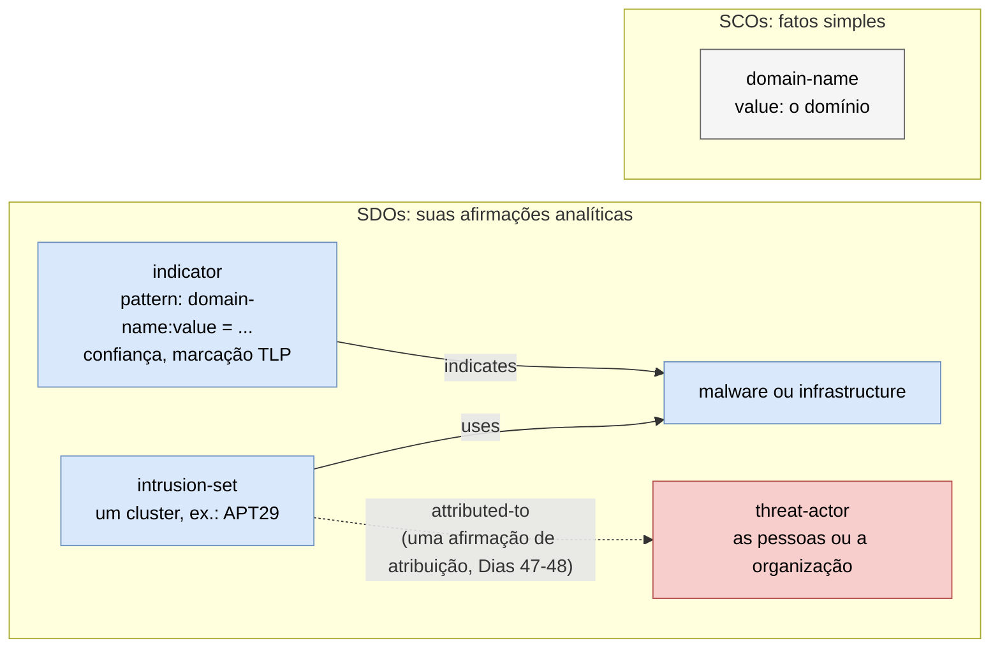
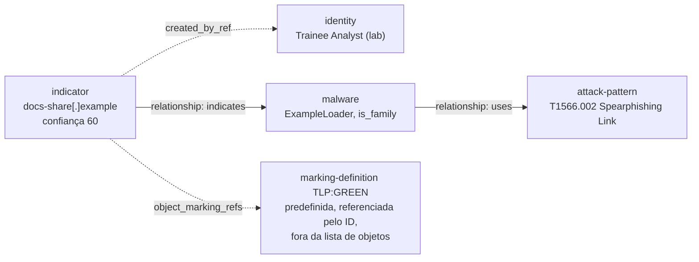

# Dia 43: Escrevendo inteligência de ameaças em STIX 2.1

> 🇺🇸 Original: [*Day 43: Writing threat intelligence in STIX 2.1*](https://github.com/thiefdroppers/cyber-investigator-skills/blob/main/curriculum/phase-3-cyber-threat-intelligence/day-43.md) — © ThiefDroppers, licença MIT.
> Aqui: tradução fiel **+** camada brasileira. Nada do original foi removido; tudo o que é novo vem marcado com ➕.

**Fase 3. Inteligência de ameaças cibernéticas** · Meta da trilha: expressar os achados do Dia 40 como um *bundle* STIX 2.1 válido, que as ferramentas de outro analista consigam ingerir, com a sua confiança e as restrições de compartilhamento levadas dentro dos próprios dados.

Rank Jutsu: `B` · [](https://colab.research.google.com/github/Ridd1kulusC0d3r/investigador-cyber-90-dias/blob/main/curriculo/fase-3-inteligencia-de-ameacas/dia-43/dia-43.ipynb)

---

## 🎬 ➕ Abertura do caso — *O grafo que só você entende*

A analista de CTI da CoopVale, uma das quatro cooperativas onde o IscaKit reapareceu, liga para a Vigia.

— Recebi o PNG do grafo de vocês. Lindo. Agora me diz: como eu ponho isso no meu SIEM?

Você olha para o seu grafo do Dia 40: dez nós, onze arestas, cores que só você sabe o que significam. O vermelho-claro de `coopserra-azul.example` quer dizer "não confirmado", mas isso está na sua cabeça, não no arquivo.

Rafa puxa uma cadeira.

— Um PNG não carrega confiança, nem TLP, nem de onde veio cada nó. Quando ela repassar, o "talvez" vira "é". Escreve em STIX. E repara no que você **não** vai escrever: nenhum `threat-actor`. "Pescador" é um apelido num comentário de código. Por enquanto, é um *cluster*.

O Dia 43 ensina a deixar a dúvida dentro do dado. *(Personagens e cenário: [Operação Isca](../../../caso-continuo/).)*

---

## 📖 Conceito

STIX (*Structured Threat Information Expression*) é um formato JSON padronizado pela OASIS para inteligência de ameaças. Você já o usou sem perceber: o arquivo do ATT&CK do Dia 35 é um *bundle* STIX 2.1, e cada grupo nele é um objeto do tipo `intrusion-set`.

O STIX 2.1 descreve o mundo como um grafo:

| Tipo | O que é | Exemplos |
|---|---|---|
| Objetos de Domínio STIX (*SDOs*) | Conceitos analíticos | `indicator`, `malware`, `attack-pattern`, `intrusion-set`, `threat-actor`, `infrastructure`, `campaign`, `report`, `vulnerability` |
| Objetos Ciber-observáveis STIX (*SCOs*) | Fatos vistos em uma rede ou em um host | `domain-name`, `ipv4-addr`, `url`, `file`, `x509-certificate` |
| Objetos de Relacionamento STIX | Arestas | `relationship` (com um `relationship_type` como `indicates`, `uses`, `attributed-to`), `sighting` |
| Metaobjetos | Tratamento e extensões | `marking-definition` (TLP), `extension-definition` |
| *Bundle* | Um invólucro para enviar objetos juntos | `bundle` (não tem significado próprio) |

Três distinções fazem as pessoas tropeçarem.

Um `indicator` é a afirmação de um analista de que vale a pena detectar um padrão, escrita na linguagem de padrões do STIX (*STIX patterning*), por exemplo `[domain-name:value = 'login-portal.example']`. Um SCO `domain-name` é simplesmente o fato de que o domínio existe. Ponha o seu julgamento nos indicadores e nos relacionamentos, e mantenha as observações simples como observáveis.

Um `intrusion-set` é um agrupamento (*cluster*) de atividade adversária, que é o que o APT29 é no ATT&CK. Um `threat-actor` são os indivíduos ou a organização que se acredita estarem por trás dele. Ligar os dois com `attributed-to` é uma afirmação de atribuição (Dias 47 e 48), então faça isso de forma deliberada.

As duas distinções num só grafo. Arestas contínuas são objetos `relationship` que você cria; a aresta pontilhada `attributed-to` é a que este laboratório ainda não desenha:



O padrão do indicador nomeia o mesmo domínio que o objeto `domain-name` registra, mas um é o julgamento de que vale a pena detectá-lo e o outro é só o fato de que ele existe.

Todo SDO e todo relacionamento podem levar `confidence` (um inteiro de 0 a 100) e `object_marking_refs` (como TLP:GREEN). A sua incerteza e as suas restrições de compartilhamento viajam com cada objeto, em vez de ficarem num e-mail de capa que se perde.

## 📚 Recursos

- [Especificação STIX 2.1](https://docs.oasis-open.org/cti/stix/v2.1/os/stix-v2.1-os.html): a seção 4 (SDOs) e a seção 9 (*patterning*) são as partes que você vai consultar.
- [Site de documentação OASIS CTI](https://oasis-open.github.io/cti-documentation/): exemplos e tutoriais de STIX e TAXII.
- [Documentação da biblioteca Python stix2](https://stix2.readthedocs.io/): monte objetos em código e deixe a biblioteca gerar IDs e carimbos de tempo.
- [cti-stix-validator](https://github.com/oasis-open/cti-stix-validator): o validador oficial (instalado do PyPI como `stix2-validator`).
- [STIX visualizer](https://oasis-open.github.io/cti-stix-visualization/): cole um *bundle* e receba um grafo de nós e arestas.

### ➕ Recursos do contexto Brasil

- [RFC 4122](https://www.rfc-editor.org/rfc/rfc4122) (UUID; atualizada pela RFC 9562): o formato dos IDs STIX. Em Python, `uuid.uuid4()` da biblioteca padrão gera o UUID versão 4 que o STIX pede para objetos novos.
- [CERT.br](https://www.cert.br/): o grupo de resposta a incidentes nacional para a internet brasileira; é um dos destinatários naturais de notificações sobre infraestrutura de phishing hospedada no país.
- [MISP Project](https://www.misp-project.org/): a plataforma que a maioria das comunidades de compartilhamento usa, inclusive no Brasil; importa e exporta STIX 2.1 (Dia 44).

## 🛠️ Prática: stix2 e o STIX visualizer (um *bundle* STIX validado e o seu grafo de relacionamentos)

Os dados que você codifica hoje vêm do seu trabalho do Dia 40, construído a partir de um relatório publicado de fornecedor e de consultas passivas. Não acrescente indicadores coletados de qualquer outra forma.

**Seu checklist de hoje.** Faça na ordem e marque cada item ao terminar:

- [ ] 1. Ler um *bundle* mínimo à mão
- [ ] 2. Validá-lo
- [ ] 3. Montar o seu cluster do Dia 40 em Python
- [ ] 4. Sintaxe útil de *patterning*
- [ ] 5. Visualizar o *bundle*
- [ ] ➕ 6. Prática BR: o cluster do IscaKit em STIX, sem `threat-actor`
- [ ] ➕ 7. O notebook do dia no Colab

### 1. Ler um *bundle* mínimo à mão

Este *bundle* passou no `stix2_validator` sem erros. Ele usa o domínio de exemplo do Dia 40:

```json
{
  "type": "bundle",
  "id": "bundle--ee1feaeb-4d87-4743-99f8-8b8dff5ec362",
  "objects": [
    {
      "type": "identity", "spec_version": "2.1",
      "id": "identity--054213a1-ee0a-4ddc-8ebb-4257cfe6e084",
      "created": "2026-09-30T12:00:00.000Z", "modified": "2026-09-30T12:00:00.000Z",
      "name": "Trainee Analyst (lab)", "identity_class": "individual"
    },
    {
      "type": "indicator", "spec_version": "2.1",
      "id": "indicator--54eac790-404d-4a24-9695-b4a96fd71033",
      "created_by_ref": "identity--054213a1-ee0a-4ddc-8ebb-4257cfe6e084",
      "created": "2026-09-30T12:00:00.000Z", "modified": "2026-09-30T12:00:00.000Z",
      "name": "Phishing landing domain from lab seed report",
      "description": "Domain listed in the seed report as hosting a credential phishing page.",
      "indicator_types": ["malicious-activity"],
      "pattern": "[domain-name:value = 'docs-share.example']",
      "pattern_type": "stix",
      "valid_from": "2026-09-30T12:00:00Z",
      "valid_until": "2026-12-31T00:00:00Z",
      "confidence": 60,
      "object_marking_refs": ["marking-definition--34098fce-860f-48ae-8e50-ebd3cc5e41da"]
    },
    {
      "type": "malware", "spec_version": "2.1",
      "id": "malware--c2a1012f-5dcf-43a9-aedb-882438e77826",
      "created": "2026-09-30T12:00:00.000Z", "modified": "2026-09-30T12:00:00.000Z",
      "name": "ExampleLoader", "description": "Illustrative downloader family used for this lab.",
      "is_family": true, "malware_types": ["downloader"]
    },
    {
      "type": "attack-pattern", "spec_version": "2.1",
      "id": "attack-pattern--f71f51a9-f77e-4eb4-8304-0f0a58410942",
      "created": "2026-09-30T12:00:00.000Z", "modified": "2026-09-30T12:00:00.000Z",
      "name": "Spearphishing Link",
      "external_references": [{"source_name": "mitre-attack", "external_id": "T1566.002", "url": "https://attack.mitre.org/techniques/T1566/002/"}]
    },
    {
      "type": "relationship", "spec_version": "2.1",
      "id": "relationship--bc3bf2cd-8f90-4b71-85f6-bf40c7d1d03a",
      "created": "2026-09-30T12:00:00.000Z", "modified": "2026-09-30T12:00:00.000Z",
      "relationship_type": "indicates",
      "source_ref": "indicator--54eac790-404d-4a24-9695-b4a96fd71033",
      "target_ref": "malware--c2a1012f-5dcf-43a9-aedb-882438e77826"
    },
    {
      "type": "relationship", "spec_version": "2.1",
      "id": "relationship--dbd0d499-303a-44fa-82a2-4f55de00ce98",
      "created": "2026-09-30T12:00:00.000Z", "modified": "2026-09-30T12:00:00.000Z",
      "relationship_type": "uses",
      "source_ref": "malware--c2a1012f-5dcf-43a9-aedb-882438e77826",
      "target_ref": "attack-pattern--f71f51a9-f77e-4eb4-8304-0f0a58410942"
    }
  ]
}
```

Desenhado como grafo, os seis objetos do *bundle* viram quatro nós e duas arestas contínuas (os dois objetos `relationship`), mais uma referência a uma marcação predefinida. `created_by_ref` e `object_marking_refs` são propriedades dentro do indicador, desenhadas pontilhadas:



Compare com o que o STIX visualizer desenha no passo 5. O *bundle* do `build.py` no passo 3 tem outro formato: vários indicadores, cada um com uma aresta `indicates` para um único nó `infrastructure`.

Antes de seguir, responda a estas perguntas só olhando o JSON:

- Quais campos são obrigatórios num indicador? (`pattern`, `pattern_type` e `valid_from`, mais os comuns `type`, `spec_version`, `id`, `created` e `modified`.)
- Por que `malware` leva `is_family: true`? (Ele descreve uma família, e não uma amostra. `name` é obrigatório quando o valor é verdadeiro.)
- O que significa `marking-definition--34098fce-...`? (É a marcação TLP:GREEN predefinida no STIX 2.1. O padrão também predefine WHITE, AMBER e RED do TLP 1.0. Os rótulos do TLP 2.0, como CLEAR e AMBER+STRICT, precisam de uma extensão, assunto do Dia 44.)
- Os IDs são o tipo do objeto, dois hífens e um UUID. Para objetos que você cria, use UUIDs aleatórios da versão 4.

### 2. Validá-lo

```bash
mkdir -p ~/cti-lab/day43 && cd ~/cti-lab/day43
python3 -m venv .venv && source .venv/bin/activate
pip install stix2 "stix2-validator==3.2.0"
stix2_validator minimal.json
```

Resultado esperado:

```
[+] STIX JSON: Valid
    [!] Warning: attack-pattern--f71f51a9-...: {302} External reference 'mitre-attack' has a URL but no hash.
```

Avisos (*warnings*) sinalizam regras "SHOULD" (deveria) da especificação. Erros sinalizam regras "MUST" (deve). Num teste de setembro de 2026 com Python 3.14, o `stix2-validator` 3.3.1 foi instalado sem os seus arquivos de *schema* e acusou todo arquivo como inválido com "Cannot locate a schema". Fixar a versão 3.2.0 resolveu. Se você vir essa mensagem num arquivo que acredita estar correto, confira o pacote instalado antes de depurar o seu JSON.

Quebre o arquivo de propósito para aprender as mensagens de erro: apague `valid_from`, troque `is_family` por `"yes"` e mude `spec_version` para `"2.0"`. Rode o validador depois de cada mudança.

### 3. Montar o seu cluster do Dia 40 em Python

Escrever UUIDs e carimbos de tempo à mão não escala. Salve como `build.py` e troque os marcadores pelos seus nós do Dia 40:

```python
from stix2 import Identity, Indicator, Infrastructure, Relationship, Bundle, TLP_GREEN

me = Identity(name="Trainee Analyst (lab)", identity_class="individual")

domain_ind = Indicator(
    name="Phishing domain from seed report",
    description="Listed in <seed report title>, <vendor>, <date>.",
    pattern="[domain-name:value = 'login-portal.example']",
    pattern_type="stix",
    valid_from="2026-09-30T00:00:00Z",
    indicator_types=["malicious-activity"],
    confidence=70,
    created_by_ref=me,
    object_marking_refs=[TLP_GREEN],
)
ip_ind = Indicator(
    name="IP sharing a favicon with the seed infrastructure",
    description="Found by Shodan favicon-hash pivot (12 results). Not listed in the seed report.",
    pattern="[ipv4-addr:value = '198.51.100.23']",
    pattern_type="stix",
    valid_from="2026-09-30T00:00:00Z",
    indicator_types=["malicious-activity"],
    confidence=40,
    created_by_ref=me,
    object_marking_refs=[TLP_GREEN],
)
infra = Infrastructure(name="Phishing cluster A (lab)", infrastructure_types=["phishing"], created_by_ref=me)

rels = [
    Relationship(domain_ind, "indicates", infra, created_by_ref=me),
    Relationship(ip_ind, "indicates", infra, created_by_ref=me,
                 description="Shared favicon hash -1137583931; single pivot, medium strength."),
]
bundle = Bundle(me, domain_ind, ip_ind, infra, *rels, TLP_GREEN)
open("cluster-a.json", "w").write(bundle.serialize(pretty=True))
print(len(bundle.objects), "objects written")
```

```bash
python build.py && stix2_validator cluster-a.json
```

Os dois indicadores levam valores de confiança diferentes. O domínio veio do relatório do fornecedor (70). O IP veio do seu único pivô de favicon (40). Os rótulos de força de aresta do seu Dia 40 devem corresponder a esses números de forma consistente. Anote o seu mapeamento, por exemplo forte = 70, média = 40, fraca = 20.

Estenda o script para que todo nó do Dia 40 que você colocou no cluster vire um indicador, e todo pivô vire um relacionamento cuja `description` nomeie o pivô e a sua contagem de resultados. Nós que você desenhou como "não confirmados" ficam de fora, ou entram com confiança 20 ou menos e uma descrição que diga por quê.

### 4. Sintaxe útil de *patterning*

| Necessidade | Padrão |
|---|---|
| Arquivo por hash | `[file:hashes.'SHA-256' = 'e3b0...b855']` |
| URL | `[url:value = 'https://login-portal.example/owa/']` |
| Qualquer um de dois IPs | `[ipv4-addr:value = '203.0.113.7' OR ipv4-addr:value = '198.51.100.23']` |
| Certificado pelo número de série | `[x509-certificate:serial_number = '2caeeaf0743459d7e5f82a75123c58f3']` |
| Duas observações em sequência | `[domain-name:value = 'login-portal.example'] FOLLOWEDBY [ipv4-addr:value = '203.0.113.7'] WITHIN 600 SECONDS` |

Use o hash de arquivo vazio da primeira linha só como exemplo de sintaxe. Como o Dia 40 mostrou, ele casa com tudo.

### 5. Visualizar o *bundle*

Abra o [STIX visualizer](https://oasis-open.github.io/cti-stix-visualization/), cole `cluster-a.json` e tire uma captura de tela do grafo. Compare com o seu grafo do Gephi do Dia 40. Qualquer coisa no Gephi sem correspondente no STIX é um achado que você ainda não expressou no formato compartilhado.

### O que você tem ao terminar

- `cluster-a.json`: um *bundle* STIX 2.1 validado do seu cluster do Dia 40, com marcações TLP:GREEN, confiança por objeto e evidência de pivô nas descrições dos relacionamentos.
- Uma captura de tela do *bundle* no STIX visualizer, ao lado da sua exportação do Gephi do Dia 40.
- Uma nota de três linhas mapeando os seus rótulos de força de aresta para valores de confiança STIX.

### ➕ 6. Prática BR: o cluster do IscaKit em STIX

Os nós e pivôs do cluster da Operação Isca estão em [`caso-continuo/dados/dia-43/cluster-pescador.json`](../../../caso-continuo/dados/dia-43/cluster-pescador.json) (10 nós, 11 arestas, tudo fictício, com o mapeamento forte = 70, média = 40, fraca = 20). Monte o *bundle* `cluster-iscakit.json`:

1. Uma `identity` para a Vigia (`identity_class: "organization"`), autora de tudo.
2. Um `infrastructure` "Cluster IscaKit (Operação Isca)" com `infrastructure_types: ["phishing"]`, e um `intrusion-set` **CA-ISCA-01** (o cluster de atividade, confiança 40) que `uses` essa infraestrutura. É o nome de trabalho que os Dias 44 a 48 vão usar: um agrupamento, não uma pessoa.
3. Um `indicator` por nó com status `semente` ou `membro`, com `confidence` pelo mapeamento e `description` dizendo de onde veio.
4. Os dois nós `nao-confirmado` (`coopserra-azul.example` e `cooperouro-regulariza.example`): decida e escreva por quê. Sugestão defensável: o primeiro entra com confiança 15 e descrição "só semelhança de nome"; o segundo fica de fora, porque um título com 214 resultados não é pivô.
5. Um `relationship` `indicates` de cada indicador para a infraestrutura, com `description` "pivô: … (N resultados)".
6. Um `attack-pattern` T1566.002 (*Spearphishing Link*) e um T1660 (*Phishing*, matriz Mobile), já que a isca chegou por SMS, ligados ao `intrusion-set` por `uses` (o validador oficial avisa, com razão, que `infrastructure uses attack-pattern` não é um relacionamento sugerido). <!-- TODO técnico: confirmar no ATT&CK vigente se o envio por SMS deve ser mapeado como T1660 (Mobile) ou T1566.002 (Enterprise) no caso; manter os dois até a revisão. -->
7. **Nenhum** `threat-actor`, **nenhum** `attributed-to`, e o apelido "Pescador" só aparece como texto dentro da `description` da infraestrutura ("string `// pescador` encontrada no JavaScript do kit"), nunca como nome de objeto que represente pessoa.
8. TLP:AMBER em tudo, por ora (a decisão formal de compartilhamento é o Dia 44).

Sem a biblioteca `stix2`? O notebook do dia faz o mesmo só com `json`, `uuid` e `datetime`.

### ➕ 7. O notebook do dia

Abra o [notebook do Dia 43 no Colab](https://colab.research.google.com/github/Ridd1kulusC0d3r/investigador-cyber-90-dias/blob/main/curriculo/fase-3-inteligencia-de-ameacas/dia-43/dia-43.ipynb). Nele você:

1. lê o *bundle* mínimo do original e responde às quatro perguntas do passo 1 por código;
2. escreve um **minivalidador stdlib** que checa as regras "MUST" do indicador (campos obrigatórios, formato de ID, `confidence` 0–100, `is_family` booleano) e quebra o arquivo de propósito, como o passo 2 pede;
3. monta o `cluster-iscakit.json` a partir do JSON do caso, **sem a biblioteca stix2** (dicionários Python + `uuid4`), com o mapeamento de confiança;
4. confere o checkpoint por código: sem `threat-actor`, sem `attributed-to`, toda descrição com origem;
5. desenha o grafo do *bundle* em texto e gera um diagrama mermaid para colar no GitHub;
6. joga o quiz **"indicator ou observable?"**.

Se quiser o validador oficial, há uma célula opcional com `!pip install stix2-validator==3.2.0`.

## ✅ Checkpoint

- `stix2_validator cluster-a.json` retorna *Valid* sem erros.
- A `description` de todo indicador diz de onde ele veio (o relatório semente ou um pivô específico).
- Nenhum objeto do *bundle* é um `threat-actor`.
- Nenhum relacionamento do *bundle* é `attributed-to`. Você ainda não fez uma afirmação de atribuição.
- Você consegue explicar, em uma frase, a diferença entre um `indicator` de um domínio e um observável `domain-name`.

### ➕ Checkpoint BR

- `cluster-iscakit.json` passa no minivalidador do notebook (e, se você instalou, no `stix2_validator`, que só deve mostrar os avisos {302} de URL sem hash).
- O mapeamento forte/média/fraca → 70/40/20 aparece aplicado de forma consistente.
- Você justificou por escrito o destino dos dois nós não confirmados.
- A palavra "Pescador" não é nome de nenhum objeto; aparece só como artefato textual do kit.
- Você explica por que um IP de hospedagem compartilhada (41 resultados em DNS passivo) não deveria subir a confiança de `coopvale-pix.example`.

## ⚖️ ➕ Camada jurídica BR

**Indicadores técnicos e LGPD.** Domínios e IPs de infraestrutura criminosa em geral não identificam uma pessoa natural, mas podem identificar: um domínio registrado em nome de pessoa física, um e-mail de registrante, um IP residencial. Quando um indicador puder ser associado a pessoa identificável, ele é dado pessoal (LGPD, art. 5º, I) e o compartilhamento precisa de base legal (art. 7º) e respeito à necessidade (art. 6º, III). Por isso a regra do dia: o que é do kit vai no indicador; o que poderia apontar para alguém fica fora do *bundle*.

**Cadeia de custódia.** Um *bundle* STIX é um produto analítico, não a evidência original. A evidência (capturas, respostas de crt.sh, registros de DNS) segue com o seu hash e o seu registro de custódia (CPP, arts. 158-A a 158-F). Boa prática: a `description` de cada indicador aponta para a entrada correspondente no registro de custódia.

**Não acusar sem base.** Escrever `attributed-to` ligando um cluster a uma pessoa ou empresa nomeada, e compartilhar isso, pode configurar imputação falsa de fato ofensivo à honra. <!-- TODO jurídico: confirmar enquadramento (CP, arts. 138 a 140, calúnia/difamação/injúria) para atribuição publicada sem base, com o jurídico. --> É mais um motivo para o STIX de hoje parar no `intrusion-set`/`infrastructure`.

> Este repositório é material de estudo e não constitui orientação jurídica.

## 🧠 ➕ Camada 8 — a precisão falsa do número

Quando "acho que sim" vira `"confidence": 40`, o número parece mais sólido do que o raciocínio que o produziu. É a **ilusão de precisão**: valores numéricos transmitem uma exatidão que a análise não tem, e quem lê tende a tratá-los como medidos. O risco piora com o **viés de ancoragem** (Tversky e Kahneman): o primeiro número posto num indicador vira a âncora para todos os analistas que o recebem, que ajustam pouco a partir dele.

O antídoto é o que o original já pede: um **mapeamento escrito** (forte = 70, média = 40, fraca = 20) e uma `description` que diz o porquê. O número sozinho é uma âncora; o número com o pivô e a contagem de resultados é um argumento que o próximo analista pode contestar.

Consequência prática: nunca invente um valor intermediário "porque parece 55". Se o pivô não se encaixa no seu mapeamento, o problema está no mapeamento ou no pivô, e isso precisa ser escrito.

## 🤖 ➕ Skill do dia

O dia propõe um procedimento novo, **"codificação em STIX 2.1"**: julgamento em `indicator`, fato em observável, confiança por mapeamento escrito, origem em toda `description`, e proibição de `threat-actor`/`attributed-to` sem uma afirmação de atribuição explícita. Detalhes em [`_skill-delta.md`](_skill-delta.md).

## 💡 ➕ Inovação OSINT do dia — STIX sem biblioteca, com IDs determinísticos

O STIX 2.1 pede UUID v4 (aleatório) para objetos que você cria, mas define UUID **v5** (determinístico) para os SCOs, calculado a partir das propriedades que identificam o objeto, usando um *namespace* fixo da especificação (`00abedb4-aa42-466c-9c01-fed23315a9b7`). Assim, dois analistas que observam o mesmo domínio geram o **mesmo ID** de `domain-name`, e os dados se fundem sem duplicar. Só com a biblioteca padrão:

```python
import json, uuid
NS_STIX_SCO = uuid.UUID("00abedb4-aa42-466c-9c01-fed23315a9b7")  # namespace de SCOs definido na spec STIX 2.1

def id_scos(tipo, contribuintes):
    # a spec serializa as propriedades de ID em JSON canônico; para casos simples, sort_keys + separadores compactos
    texto = json.dumps(contribuintes, sort_keys=True, separators=(",", ":"))
    return f"{tipo}--{uuid.uuid5(NS_STIX_SCO, texto)}"

print(id_scos("domain-name", {"value": "serraazul-pix.example"}))   # sempre o mesmo ID, em qualquer máquina
```

A especificação pede canonicalização JSON (RFC 8785) para o texto de entrada; para objetos de uma propriedade com texto ASCII, como acima, `sort_keys` com separadores compactos produz o mesmo resultado. Para casos com números ou Unicode, confira com a biblioteca `stix2` antes de confiar.

## 📝 Diário de estudo

- Data:
- Tempo gasto:
- O que ficou claro:
- O que ainda está nebuloso:
- Artefato produzido: `cluster-a.json`, captura do visualizer, nota de mapeamento de confiança, `cluster-iscakit.json`

---
<sub>Baseado em [cyber-investigator-skills](https://github.com/thiefdroppers/cyber-investigator-skills) por ThiefDroppers (MIT). Tradução, camada BR, Camada 8, skill pt-BR e notebook por Deivison Lourenço (@Ridd1kulusC0d3r).</sub>
