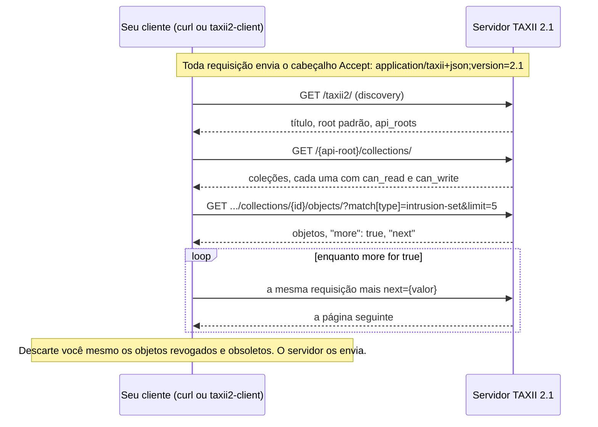
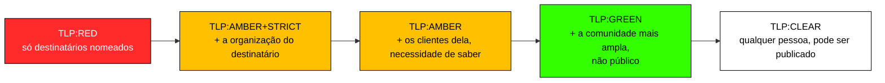
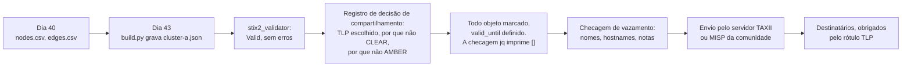

# Dia 44: Trafegando inteligência com TAXII e marcando com TLP

> 🇺🇸 Original: [*Day 44: Moving intelligence with TAXII and marking it with TLP*](https://github.com/thiefdroppers/cyber-investigator-skills/blob/main/curriculum/phase-3-cyber-threat-intelligence/day-44.md) — © ThiefDroppers, licença MIT.
> Aqui: tradução fiel **+** camada brasileira. Nada do original foi removido; tudo o que é novo vem marcado com ➕.

**Fase 3. Inteligência de ameaças cibernéticas** · Meta da trilha: puxar dados STIX de um servidor TAXII 2.1 público e real, e preparar o seu próprio *bundle* para compartilhamento, com uma decisão escrita sobre quem pode vê-lo.

Rank Jutsu: `B` · [](https://colab.research.google.com/github/Ridd1kulusC0d3r/investigador-cyber-90-dias/blob/main/curriculo/fase-3-inteligencia-de-ameacas/dia-44/dia-44.ipynb)

---

## 🎬 ➕ Abertura do caso — *Quem pode ver isto?*

Quinta-feira, 8 de outubro. As outras quatro cooperativas querem o `cluster-iscakit.json`. Um grupo de WhatsApp de analistas de fraude de cooperativas também quer. E um jornalista de tecnologia mandou e-mail perguntando se "a Vigia confirma um ataque hacker em série contra cooperativas mineiras".

Marta Quintão está na chamada, com o Dr. Hélio.

— Eu quero ajudar as outras cooperativas. Mas não quero ler o nome da Serra Azul no jornal amanhã.

Rafa abre o *bundle* na tela e rola até o primeiro indicador.

— Aqui diz TLP:AMBER, que pusemos ontem como provisório. Hoje a gente decide de verdade, por escrito. E antes de mandar, a gente procura nesse JSON tudo o que não pode sair daqui: nome de cooperado, nome da analista, o caminho da pasta interna.

O Dia 44 ensina a fazer a inteligência viajar, e a decidir até onde. *(Personagens e cenário: [Operação Isca](../../../caso-continuo/).)*

---

## 📖 Conceito

STIX é o formato. TAXII (*Trusted Automated Exchange of Intelligence Information*) é a API HTTPS que move STIX entre organizações. Um servidor TAXII 2.1 tem uma estrutura pequena e fixa:

| Endpoint | Padrão de caminho | Retorna |
|---|---|---|
| *Discovery* | `/taxii2/` | Título do servidor e uma lista de *API roots* |
| *API root* | `/<api-root>/` | Informações sobre um *root* |
| *Collections* | `/<api-root>/collections/` | As coleções que você pode ler ou escrever |
| *Objects* | `/<api-root>/collections/<id>/objects/` | Objetos STIX, filtráveis e paginados |
| *Manifest* | `/<api-root>/collections/<id>/manifest/` | IDs e versões dos objetos, sem os objetos completos |

Toda requisição precisa do cabeçalho `Accept: application/taxii+json;version=2.1`. Os filtros são parâmetros de consulta: `match[type]=intrusion-set`, `match[id]=...`, `added_after=2026-01-01T00:00:00Z` e `limit`. As respostas são paginadas com `"more": true` e um valor `"next"` que você devolve na próxima chamada.

Uma consulta do começo ao fim, como a prática a executa contra o servidor da MITRE:



A maior parte do compartilhamento acontece dentro de comunidades, como ISACs, *feeds* de CERTs nacionais e trocas entre fornecedores. Muitas usam o MISP, uma plataforma de compartilhamento de código aberto que importa e exporta STIX 2.1. O TAXII é a forma comum de esses sistemas enviarem e puxarem dados uns dos outros.

Antes que qualquer coisa saia das suas mãos, ela precisa de um rótulo do *Traffic Light Protocol* (TLP). O TLP 2.0, publicado pelo FIRST em 2022, tem cinco rótulos:

| Rótulo | Os destinatários podem compartilhar com |
|---|---|
| TLP:RED | Ninguém. Só para os destinatários nomeados |
| TLP:AMBER+STRICT | Apenas a própria organização |
| TLP:AMBER | A própria organização e os clientes dela, com base na necessidade de saber |
| TLP:GREEN | A comunidade deles, mas não publicamente |
| TLP:CLEAR | Qualquer pessoa. Pode ser publicado |

Cada rótulo à direita amplia o círculo de pessoas a quem o destinatário pode repassar a informação:



O TLP:CLEAR substituiu o TLP:WHITE, e o AMBER+STRICT é novo no 2.0. O padrão STIX 2.1 só predefine as marcações antigas do TLP 1.0 (WHITE, GREEN, AMBER, RED). O TLP 2.0 no STIX usa definições de marcação separadas, que a OASIS publicou depois. Verifique qual versão as ferramentas dos seus destinatários entendem antes de confiar no AMBER+STRICT dentro dos dados.

## 📚 Recursos

- [Especificação TAXII 2.1](https://docs.oasis-open.org/cti/taxii/v2.1/os/taxii-v2.1-os.html): a seção 3 trata de filtros e paginação.
- [Servidor TAXII 2.1 do MITRE ATT&CK](https://attack-taxii.mitre.org/taxii2/): um servidor público, somente leitura, para praticar. É lento; reserve 30 segundos ou mais por requisição.
- [taxii2-client](https://github.com/oasis-open/cti-taxii-client): o cliente Python da OASIS.
- [FIRST TLP 2.0](https://www.first.org/tlp/): as definições, por inteiro.
- [MISP](https://www.misp-project.org/): a plataforma de compartilhamento de código aberto que a maioria das comunidades usa.
- [Documentação OASIS CTI](https://oasis-open.github.io/cti-documentation/): procure aqui as definições de marcação STIX vigentes para o TLP 2.0.

### ➕ Recursos do contexto Brasil

- [FIRST TLP 2.0](https://www.first.org/tlp/): a página do FIRST oferece traduções oficiais da norma; confira se há versão em português antes de traduzir os rótulos por conta própria (os rótulos em si **não se traduzem**: escreve-se `TLP:AMBER`, nunca "TLP:ÂMBAR").
- [CERT.br](https://www.cert.br/): grupo de resposta a incidentes da internet brasileira, mantido pelo NIC.br; recebe notificações de incidentes e de phishing.
- [CTIR Gov](https://www.gov.br/ctir/pt-br): centro de prevenção, tratamento e resposta a incidentes cibernéticos do governo federal; publica alertas e recomendações.
- [LGPD — Lei 13.709/2018](https://www.planalto.gov.br/ccivil_03/_ato2015-2018/2018/lei/l13709.htm): arts. 6º (princípios, especialmente finalidade e necessidade) e 7º (bases legais) para o registro de decisão de compartilhamento.

## 🛠️ Prática: curl e taxii2-client (um registro de consultas TAXII e um *bundle* marcado, pronto para compartilhar, com registro de decisão de compartilhamento)

O servidor da MITRE é público e somente leitura, e você não tem acesso de escrita a ele. Só puxe dados de outros servidores TAXII para os quais você recebeu credenciais, e nunca compartilhe um *bundle* fora do público que o rótulo TLP dele permite.

**Seu checklist de hoje.** Faça na ordem e marque cada item ao terminar:

- [ ] 1. Percorrer o servidor à mão com curl
- [ ] 2. Fazer o mesmo com o cliente Python
- [ ] 3. Marcar o seu *bundle* do Dia 43 para compartilhamento
- [ ] 4. Retirar o que não deve viajar
- [ ] ➕ 5. Prática BR: três destinatários, três decisões
- [ ] ➕ 6. O notebook do dia no Colab

### 1. Percorrer o servidor à mão com curl

```bash
mkdir -p ~/cti-lab/day44 && cd ~/cti-lab/day44
H='Accept: application/taxii+json;version=2.1'

# Discovery
curl -s -H "$H" https://attack-taxii.mitre.org/taxii2/ | jq '{title, default, roots: (.api_roots | length)}'

# Collections no root padrão
curl -s -H "$H" https://attack-taxii.mitre.org/api/v21/collections/ | jq -r '.collections[] | [.id, .title, .can_read, .can_write] | @tsv'
```

Saída observada em setembro de 2026:

```
x-mitre-collection--90c00720-636b-4485-b342-8751d232bf09  ICS ATT&CK         true  false
x-mitre-collection--1f5f1533-f617-4ca8-9ab4-6a02367fa019  Enterprise ATT&CK  true  false
x-mitre-collection--dac0d2d7-8653-445c-9bff-82f934c1e858  Mobile ATT&CK      true  false
```

O documento de *discovery* também lista um *API root* por versão passada do ATT&CK (`/api/v21/attack-11.0`, `/api/v21/attack-12.0` e assim por diante), para que você possa puxar a matriz como ela estava quando um relatório antigo foi escrito.

Agora filtre objetos. Os colchetes em `match[type]` confundem o curl, que trata `[...]` como padrão de intervalo. Use `-g` para desligar isso:

```bash
C=x-mitre-collection--1f5f1533-f617-4ca8-9ab4-6a02367fa019
curl -sg -H "$H" "https://attack-taxii.mitre.org/api/v21/collections/$C/objects/?match[type]=intrusion-set&limit=5" \
  | jq '{more, next, names: [.objects[] | {name, revoked}]}'
```

Quando isto foi testado, a primeira página incluía um objeto chamado `UNC2452` com `"revoked": true`. O TAXII entrega objetos revogados junto com os atuais. O seu consumidor tem de filtrá-los, exatamente como as suas consultas jq fizeram no Dia 35.

Busque a página seguinte devolvendo o `next`:

```bash
curl -sg -H "$H" "https://attack-taxii.mitre.org/api/v21/collections/$C/objects/?match[type]=intrusion-set&limit=5&next=1" | jq -r '.objects[].name'
```

### 2. Fazer o mesmo com o cliente Python

```python
from taxii2client.v21 import Server, as_pages

server = Server("https://attack-taxii.mitre.org/taxii2/")
root = server.default
enterprise = next(c for c in root.collections if c.title == "Enterprise ATT&CK")

active = []
for page in as_pages(enterprise.get_objects, per_request=50, type="intrusion-set"):
    for obj in page.get("objects", []):
        if not obj.get("revoked") and not obj.get("x_mitre_deprecated"):
            active.append(obj["name"])
print(len(active), "active intrusion sets")
```

Anote a contagem e compare com a sua contagem jq de *intrusion sets* ativos do Dia 35. Se forem diferentes, descubra por quê (versão do *release* ou filtragem) antes de seguir.

Mantenha um registro de consultas (*pull log*): carimbo de tempo, URL, filtro, número de páginas, número de objetos e eventuais erros. *Feeds* reais falham, expiram e mudam, e o registro é como você mostra o que recebeu e quando.

### 3. Marcar o seu *bundle* do Dia 43 para compartilhamento

Imagine que você vai enviar o seu cluster do Dia 40 para uma comunidade regional de compartilhamento. O caminho que os seus dados percorrem a partir daqui, com as checagens que este passo e o passo 4 acrescentam antes de qualquer coisa sair:



Decida a marcação com um registro escrito:

```markdown
# Registro de decisão de compartilhamento
Conteúdo: cluster-a.json (N indicadores, N relacionamentos)
Fontes dentro dele: <relatório semente do fornecedor> (público), meus próprios pivôs (não publicados)
Algum objeto pode identificar uma vítima, uma pessoa ou a nossa própria organização? sim / não, detalhes:
Compartilhar pode alertar o ator ou queimar uma fonte? detalhes:
Destinatários: <nome da comunidade / "ISAC regional hipotético">
TLP escolhido: TLP:GREEN
Por que não CLEAR:
Por que não AMBER:
Expiração / revisão: valid_until definido como AAAA-MM-DD em todos os indicadores
Aprovado por: (no trabalho real, uma pessoa nomeada; neste laboratório, "eu mesmo")
```

Depois, aplique-a nos dados. No `build.py` do Dia 43, garanta que todo indicador, objeto de infraestrutura e relacionamento tenha `object_marking_refs=[TLP_GREEN]` e uma data `valid_until`. Gere de novo e valide:

```bash
python build.py && stix2_validator cluster-a.json
jq '[.objects[] | select(.type != "marking-definition" and .type != "identity") | select((.object_marking_refs // []) | length == 0) | .id]' cluster-a.json
```

A checagem jq deve imprimir `[]`, o que significa que não sobrou nenhum objeto sem marcação.

### 4. Retirar o que não deve viajar

Procure no *bundle* qualquer coisa que não deva sair das suas mãos: o seu nome real, *hostnames* internos, notas que revelem as suas fontes.

```bash
jq -r '.. | strings' cluster-a.json | grep -iE 'internal|corp|todo|my name|password' || echo "clean"
```

Ajuste o padrão para o seu próprio ambiente, e leia cada ocorrência antes de enviar qualquer coisa.

### O que você tem ao terminar

- Um registro de consultas TAXII: *discovery*, coleções, pelo menos três consultas filtradas de objetos e uma consulta paginada, cada uma com carimbo de tempo e contagem de objetos.
- Uma contagem de *intrusion sets* ativos vinda do TAXII, conciliada com a sua contagem do Dia 35.
- Um registro de decisão de compartilhamento preenchido.
- `cluster-a.json` gerado de novo com marcação e expiração em todo objeto, validado e verificado contra vazamentos.

### ➕ 5. Prática BR: três destinatários, três decisões

O `cluster-iscakit.json` do Dia 43 tem três pedidos em cima da mesa. Preencha **um registro de decisão para cada um** (o notebook gera os três):

| Destinatário | Pedido | Decisão sugerida (discuta) |
|---|---|---|
| Times de risco das 4 cooperativas afetadas (CoopVale, CredMinas, Unicoop Sul, CooperOuro) | O *bundle* inteiro, para bloquear e caçar | **TLP:AMBER**: elas precisam repassar aos seus próprios fornecedores de SOC (clientes/necessidade de saber), mas não a toda a comunidade, porque os pivôs da Vigia ainda não foram publicados e o ator poderia trocar de infraestrutura. |
| Grupo de analistas de fraude de cooperativas (comunidade fechada, ~60 pessoas) | "Os domínios, para alertar" | **TLP:GREEN**, só com os indicadores de confiança ≥ 40 e **sem** o nó de confiança 15. Por que não CLEAR: ainda há domínios no ar e a derrubada está em curso. |
| Jornalista de tecnologia | "A Vigia confirma ataque hacker em série?" | **Nada do *bundle***. Se a cooperativa quiser falar, o canal é a comunicação dela, com texto TLP:CLEAR próprio, sem indicadores, sem nomes de cooperativas afetadas. A Vigia não é a fonte. |

Depois, rode a checagem de vazamento do passo 4 adaptada ao caso: procure `vigia`, `C:` ou barras invertidas (caminhos de pastas internas), `cooperado`, `cpf`, `@` (e-mails), o nome da analista. Cada ocorrência é lida e justificada ou removida.

### ➕ 6. O notebook do dia

Abra o [notebook do Dia 44 no Colab](https://colab.research.google.com/github/Ridd1kulusC0d3r/investigador-cyber-90-dias/blob/main/curriculo/fase-3-inteligencia-de-ameacas/dia-44/dia-44.ipynb). Nele você:

1. escreve um **cliente TAXII 2.1 mínimo com `urllib`** (cabeçalho `Accept` correto, filtros `match[...]`, paginação por `next`) e o roda contra o servidor da MITRE, com plano B offline que simula as mesmas respostas, inclusive um objeto revogado;
2. mantém o **registro de consultas** (CSV) que o original pede;
3. gera os **três registros de decisão** da Prática BR por formulário;
4. aplica a marcação e a expiração ao *bundle* e roda o equivalente stdlib das duas checagens `jq` (sem marcação → `[]`; vazamento → "limpo");
5. joga o quiz **"qual TLP?"**.

## ✅ Checkpoint

- Explique por que uma resposta de `match[type]=intrusion-set` pode conter grupos que não existem mais na matriz atual.
- O seu registro de decisão dá um motivo específico para não escolher TLP:CLEAR.
- A checagem jq de objetos sem marcação imprime `[]`.
- Você sabe dizer qual rótulo do TLP 2.0 não existia no TLP 1.0, e o que um destinatário pode fazer com ele.

### ➕ Checkpoint BR

- Três registros de decisão preenchidos (cooperativas, comunidade, jornalista), cada um com "por que não CLEAR" e "por que não o nível mais restrito".
- A versão TLP:GREEN para a comunidade não contém indicadores com confiança abaixo de 40.
- A checagem de vazamento adaptada não encontra nome de cooperado, CPF, e-mail interno nem caminho de pasta da Vigia.
- Você explica por que "TLP:AMBER" no assunto de um e-mail não basta se o anexo STIX não tiver `object_marking_refs`.

## ⚖️ ➕ Camada jurídica BR

**TLP é acordo, não lei.** O TLP não tem força legal própria no Brasil: é uma convenção de confiança entre as partes. Quem quer obrigação jurídica formaliza em contrato ou acordo de confidencialidade (NDA) com os membros da comunidade. A quebra do TLP costuma ter como consequência a exclusão da comunidade; a quebra do contrato, consequências civis.

**Compartilhar é tratar (LGPD).** Se algum objeto puder levar a uma pessoa natural identificável, enviá-lo é tratamento de dado pessoal (LGPD, art. 5º, X) e precisa de base legal do art. 7º e de respeito aos princípios do art. 6º, sobretudo finalidade (o dado foi coletado para proteger cooperados contra fraude) e necessidade (só o mínimo para essa finalidade). O registro de decisão de compartilhamento é, na prática, a sua documentação de necessidade.

**Sigilo bancário.** Cooperativas de crédito são instituições financeiras sujeitas à Lei Complementar 105/2001 (sigilo das operações). Dados de transações de cooperados (como os Pix não reconhecidos) não entram em *bundle* de compartilhamento entre instituições por este caminho; trocas desse tipo seguem os canais e as hipóteses previstos na própria lei e na regulação do Banco Central. <!-- TODO jurídico: confirmar quais hipóteses da LC 105/2001 (art. 1º, §3º) e normas do BCB amparam o compartilhamento de informações sobre fraude entre instituições. -->

> Este repositório é material de estudo e não constitui orientação jurídica.

## 🧠 ➕ Camada 8 — a "maldição do conhecimento" no compartilhamento

Quem escreveu o *bundle* sabe o que cada número significa. Quem recebe, não. Isso é a **maldição do conhecimento** (*curse of knowledge*): depois de saber algo, temos dificuldade de imaginar como é não saber. É por isso que o original insiste que confiança e TLP viajem **dentro** do dado, e não num e-mail de capa.

Há também a pressão social do pedido. O grupo de WhatsApp quer "só os domínios", o jornalista quer "só uma confirmação", e recusar parece pouco colaborativo. Cialdini descreve a **reciprocidade** como um dos motores mais fortes da influência: se a comunidade já ajudou você antes, a tendência é abrir mais do que deveria. A decisão escrita, tomada **antes** do pedido chegar, protege contra isso.

Consequência prática: escreva o registro de decisão antes de abrir a conversa com quem pede, e responda ao pedido com o registro na mão.

## 🤖 ➕ Skill do dia

O dia propõe à skill o procedimento novo **"decisão de compartilhamento (TLP 2.0)"**: registro escrito por destinatário, marcação em todo objeto, expiração, e checagem de vazamento antes do envio. Detalhes em [`_skill-delta.md`](_skill-delta.md).

## 💡 ➕ Inovação OSINT do dia — um cliente TAXII em 15 linhas de stdlib

Para auditar um *feed* (ou entender o que a `taxii2-client` faz por baixo), `urllib` basta. O detalhe que mais derruba gente: os colchetes de `match[type]` precisam ir codificados na URL, e o `urlencode` cuida disso sozinho.

```python
import json, urllib.parse, urllib.request
H = {"Accept": "application/taxii+json;version=2.1"}            # sem isto o servidor recusa

def objetos(url_colecao, **filtros):
    params = {f"match[{k}]": v for k, v in filtros.items()}     # match[type]=intrusion-set
    proximo = None
    while True:
        q = dict(params, **({"next": proximo} if proximo else {}))
        req = urllib.request.Request(f"{url_colecao}objects/?{urllib.parse.urlencode(q)}", headers=H)
        with urllib.request.urlopen(req, timeout=60) as r:     # o servidor da MITRE é lento
            pagina = json.load(r)
        yield from pagina.get("objects", [])
        if not pagina.get("more"):                             # fim da paginação
            break
        proximo = pagina["next"]
```

Uso: `[o["name"] for o in objetos(URL, type="intrusion-set") if not o.get("revoked")]`.

## 📝 Diário de estudo

- Data:
- Tempo gasto:
- O que ficou claro:
- O que ainda está nebuloso:
- Artefato produzido: registro de consultas TAXII, contagem conciliada com o Dia 35, registro de decisão de compartilhamento, `cluster-a.json` marcado; três registros de decisão do caso Isca

---
<sub>Baseado em [cyber-investigator-skills](https://github.com/thiefdroppers/cyber-investigator-skills) por ThiefDroppers (MIT). Tradução, camada BR, Camada 8, skill pt-BR e notebook por Deivison Lourenço (@Ridd1kulusC0d3r).</sub>
