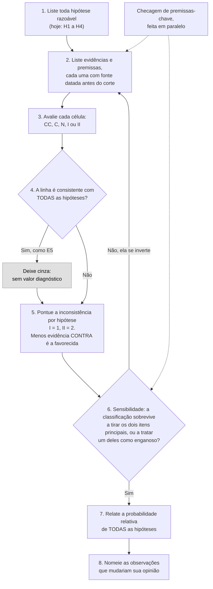

# Dia 45: Análise estruturada com hipóteses concorrentes (ACH)

> 🇺🇸 Original: [*Day 45: Structured analysis with competing hypotheses*](https://github.com/thiefdroppers/cyber-investigator-skills/blob/main/curriculum/phase-3-cyber-threat-intelligence/day-45.md) — © ThiefDroppers, licença MIT.
> Aqui: tradução fiel **+** camada brasileira. Nada do original foi removido; tudo o que é novo vem marcado com ➕.

**Fase 3. Inteligência de ameaças cibernéticas** · Meta da trilha: usar a Análise de Hipóteses Concorrentes e uma checagem de premissas-chave num incidente real e bem documentado, para que as suas conclusões venham de evidência que descarta hipóteses, e não de evidência que apenas se encaixa.

Rank Jutsu: `B` · [](https://colab.research.google.com/github/Ridd1kulusC0d3r/investigador-cyber-90-dias/blob/main/curriculo/fase-3-inteligencia-de-ameacas/dia-45/dia-45.ipynb)

---

## 🎬 ➕ Abertura do caso — *Um Pescador ou um cardume?*

Sexta-feira, 9 de outubro. Na reunião das cinco cooperativas, a analista da CredMinas resume o que todo mundo já está pensando:

— É o mesmo kit, com o mesmo `// pescador` no código, nas cinco. É uma pessoa só fazendo uma campanha em série no interior de Minas.

Rafa espera ela terminar e escreve no quadro, uma embaixo da outra:

**H1** um operador só · **H2** vários compradores do mesmo kit · **H3** um imitador copiando o kit · **H4** alguém de dentro de um fornecedor comum

— Essa string está no código do **kit**. Ela diz quem escreveu o kit, ou quem copiou o comentário. Ela não diz quem apertou o botão de disparar o SMS. Antes de concluir, a gente vai procurar o que **derruba** cada hipótese.

O Dia 45 ensina a trabalhar através das hipóteses, e não ao longo da primeira delas. *(Personagens e cenário: [Operação Isca](../../../caso-continuo/).)*

---

## 📖 Conceito

Analistas, como todo mundo, se fixam rápido numa primeira explicação e depois leem cada evidência nova como apoio a ela. O livro *Psychology of Intelligence Analysis*, de Richards Heuer (CIA, 1999), descreve isso em detalhe. O remédio dele, a Análise de Hipóteses Concorrentes (*Analysis of Competing Hypotheses*, ACH), obriga você a trabalhar através das hipóteses em vez de descer por uma só:

1. Liste toda hipótese razoável, inclusive as que você acha improváveis.
2. Liste a evidência e as premissas que importam.
3. Monte uma matriz: hipóteses no topo, evidências na lateral. Avalie cada célula: consistente (C), muito consistente (CC), inconsistente (I), muito inconsistente (II) ou não aplicável (N).
4. Apague a evidência que é consistente com todas as hipóteses. Ela não tem valor diagnóstico, por mais impressionante que seja.
5. Tire conclusões provisórias contando as inconsistências. A hipótese com menos evidência contra ela é a favorecida. A que tem mais evidência a favor não é automaticamente a favorecida, porque muitas evidências se encaixam em várias histórias ao mesmo tempo.
6. Verifique a sensibilidade: quais poucos itens decidem o resultado? E se um deles estiver errado ou for enganoso?
7. Relate a probabilidade relativa de todas as hipóteses, inclusive as que você rejeitou.
8. Nomeie as observações futuras que fariam você mudar de ideia.

Os oito passos como processo. O retorno a partir do passo 6 é a parte que as pessoas pulam: uma classificação que desmorona quando se tira um item ainda não é uma conclusão.



Uma checagem de premissas-chave (*key assumptions check*) corre em paralelo. Escreva toda premissa de que o seu raciocínio depende, e pergunte de cada uma: por que acredito nisto, o que a tornaria falsa, e ela já foi verdadeira no passado?

O caso de hoje é o NotPetya, o surto de malware destrutivo de 27 de junho de 2017. Ele foi apresentado como ransomware e atingiu primeiro e com mais força a Ucrânia, antes de se espalhar pelo mundo. Você vai trabalhar só com evidência que era pública até cerca de dez dias depois do surto, e depois comparar o seu resultado com o que governos declararam meses mais tarde.

## 📚 Recursos

- [Richards J. Heuer Jr., *Psychology of Intelligence Analysis*](https://www.cia.gov/resources/csi/books-monographs/psychology-of-intelligence-analysis-2/): o capítulo 8 é a ACH. Gratuito.
- [Governo dos EUA, *"A Tradecraft Primer: Structured Analytic Techniques for Improving Intelligence Analysis"* (2009)](https://www.cia.gov/resources/csi/static/Tradecraft-Primer-apr09.pdf): descrições curtas da checagem de premissas-chave, da ACH e de outras técnicas.
- Fontes de evidência para o laboratório, todas públicas:
  - [ESET, *"TeleBots are back: supply-chain attacks against Ukraine"*](https://www.welivesecurity.com/2017/06/30/telebots-back-supply-chain-attacks-against-ukraine/) (30 de junho de 2017)
  - [Kaspersky, *"ExPetr/Petya/NotPetya is a Wiper, Not Ransomware"*](https://securelist.com/expetrpetyanotpetya-is-a-wiper-not-ransomware/78902/) (28 de junho de 2017)
  - [Posteo, comunicado sobre o endereço de contato bloqueado](https://posteo.de/en/blog/info-on-the-petrwrappetya-ransomware-email-account-in-question-already-blocked-since-midday) (27 de junho de 2017, com atualizações posteriores)
  - Cisco Talos, *"The MeDoc Connection"* (julho de 2017), sobre o mecanismo de atualização de software usado na entrega inicial
- Só para a etapa de comparação: [comunicado do Foreign Office do Reino Unido atribuindo o NotPetya](https://www.gov.uk/government/news/foreign-office-minister-condemns-russia-for-notpetya-attacks) (15 de fevereiro de 2018).

### ➕ Recursos do contexto Brasil

- [Código de Processo Penal](https://www.planalto.gov.br/ccivil_03/decreto-lei/del3689compilado.htm): art. 155, sobre como o juiz forma a convicção (útil para entender o peso de um relatório analítico fora do contraditório).
- [ABIN — Agência Brasileira de Inteligência](https://www.gov.br/abin/pt-br): no site da ABIN fica a *Revista Brasileira de Inteligência* (RBI); procure artigos sobre técnicas analíticas estruturadas e vieses cognitivos.
- [LibreOffice](https://pt-br.libreoffice.org/): o Calc em português; a fórmula do passo 4 fica `CONT.SE` no lugar de `COUNTIF` (veja a Prática).

## 🛠️ Prática: LibreOffice Calc (um mapa de calor da matriz ACH com checagem de premissas-chave)

O exercício inteiro roda sobre relatórios publicados de fornecedores, provedores e governos sobre um incidente de 2017. Deixe as organizações atingidas pelo NotPetya fora da sua matriz; elas são vítimas e não acrescentam nada à pergunta.

Qualquer planilha serve. Os passos abaixo usam o LibreOffice Calc porque ele é gratuito e tem a formatação condicional de que você precisa.

**Seu checklist de hoje.** Faça na ordem e marque cada item ao terminar:

- [ ] 1. Definir a pergunta analítica e a data de corte
- [ ] 2. Listar as hipóteses
- [ ] 3. Listar as evidências, cada uma com uma fonte
- [ ] 4. Avaliar a matriz
- [ ] 5. Checagem de premissas-chave
- [ ] 6. Sensibilidade e conclusão
- [ ] ➕ 7. Prática BR: ACH do IscaKit (H1 a H4 da abertura)
- [ ] ➕ 8. O notebook do dia no Colab

### 1. Definir a pergunta analítica e a data de corte

Escreva no topo da planilha:

> Pergunta: Qual foi o propósito principal do surto de malware de 27 de junho de 2017?
> Corte da evidência: fontes públicas datadas de 7 de julho de 2017 ou antes.

O corte faz parte do exercício. Você está reconstruindo o que um analista cuidadoso poderia ter concluído na época, sem o benefício das atribuições de 2018.

### 2. Listar as hipóteses

Use pelo menos estas quatro:

| ID | Hipótese |
|---|---|
| H1 | Ransomware com motivação financeira, funcionando como projetado |
| H2 | Ransomware com motivação financeira, quebrado por engenharia ruim |
| H3 | Ataque destrutivo de um ator ligado a um Estado, disfarçado de ransomware |
| H4 | Ataque destrutivo de um ator não estatal (hacktivistas ou criminosos buscando perturbação) |

Mantenha a H2 na lista. Sem ela, todo sinal de falha na decifração conta automaticamente a favor da H3.

### 3. Listar as evidências, cada uma com uma fonte

Comece com estas e confira cada uma contra a fonte antes de usá-la. Acrescente pelo menos mais três a partir das fontes acima.

| ID | Evidência | Fonte |
|---|---|---|
| E1 | A entrega inicial veio pelo mecanismo de atualização do M.E.Doc, software de contabilidade muito usado por empresas na Ucrânia | ESET; Talos |
| E2 | A maioria das detecções foi na Ucrânia | ESET |
| E3 | As vítimas foram orientadas a contatar um único endereço num provedor de e-mail alemão popular. O provedor o bloqueou em 27 de junho e os atacantes não o substituíram | Posteo |
| E4 | A "chave de instalação" mostrada às vítimas era um dado aleatório, então os atacantes não poderiam produzir uma chave de decifração funcional nem para uma vítima que pagasse | Kaspersky |
| E5 | O malware se espalhava dentro das redes usando os *exploits* EternalBlue e EternalRomance, mais credenciais roubadas com ferramentas legítimas de administração | ESET e outros |
| E6 | O surto começou na véspera do Dia da Constituição da Ucrânia, um feriado nacional | Calendário |
| E7 | A ESET ligou a operação ao TeleBots, um grupo que ela acompanhava atacando alvos ucranianos, inclusive numa intrusão anterior pela cadeia de suprimentos | ESET |

### 4. Avaliar a matriz

Ponha as hipóteses nas colunas e as evidências nas linhas. Escreva um de `CC`, `C`, `N`, `I`, `II` em cada célula. Linhas resolvidas (avaliações ilustrativas; discuta com elas):

| | H1 ransomware, funcionando | H2 ransomware, quebrado | H3 ligado a Estado, disfarçado | H4 destrutivo não estatal |
|---|---|---|---|---|
| E3 e-mail único bloqueado, não substituído | II | C | C | C |
| E4 chave de instalação aleatória | II | C | CC | C |
| E5 worm se espalhando com exploits vazados | C | C | C | C |

A E5 é consistente com todas as hipóteses, então, pelo passo 4, ela é retirada da pontuação, mesmo sendo o fato tecnicamente mais interessante do caso. Mantenha-a visível numa linha cinza, para que os leitores vejam que você a considerou.

Aplique formatação condicional ao intervalo de avaliações (Formatar, depois Condicional, depois Condição, com "valor da célula é igual a"): II vermelho-escuro, I vermelho-claro, N cinza, C verde-claro, CC verde-escuro. Acrescente uma linha no fim que pontue a inconsistência de cada hipótese:

```
=COUNTIF(B4:B12;"I") + 2*COUNTIF(B4:B12;"II")
```

O LibreOffice usa ponto e vírgula entre os argumentos das funções por padrão. O Excel e o Google Sheets usam vírgulas.

> ➕ No LibreOffice ou no Excel **em português**, o nome da função é traduzido: `=CONT.SE(B4:B12;"I") + 2*CONT.SE(B4:B12;"II")`. No Google Sheets em português, `COUNTIF` costuma funcionar nos dois idiomas, mas o separador continua sendo `;` quando a localidade é Brasil.

### 5. Checagem de premissas-chave

Numa segunda planilha:

| Premissa | Por que acredito nela | O que a tornaria falsa | Avaliação (sólida / com ressalvas / sem apoio) |
|---|---|---|---|
| A chave de instalação aleatória foi uma decisão de projeto, não um *bug* | A análise do código pela Kaspersky | Uma análise posterior mostrando chave recuperável em algumas versões | |
| A infecção inicial veio principalmente pelas atualizações do M.E.Doc | ESET e Talos | Evidência de caminhos de entrega separados em grande escala | |
| A concentração geográfica reflete mira, e não só a base de clientes do M.E.Doc | | A base de usuários do M.E.Doc sozinha explica a disseminação | |

A terceira linha é o tipo de premissa que costuma ficar sem exame. Concentração na Ucrânia é exatamente o que se esperaria de uma cadeia de suprimentos de software ucraniana, qualquer que fosse o propósito do atacante. Decida se a E2 ainda tem peso depois disso.

### 6. Sensibilidade e conclusão

Escreva um parágrafo curto:

- Qual hipótese tem a menor pontuação de inconsistência, e por quanto.
- Os dois itens de evidência que decidem o resultado. O que acontece com a classificação se cada um for retirado?
- Um item que poderia ser enganoso (plantado para confundir), e o que mudaria se fosse.
- O que você precisaria ver para separar a H3 da H4. (A maior parte da matriz não vai separá-las. Diga isso.)

Só depois de escrever, leia o comunicado do Reino Unido de fevereiro de 2018. Registre onde a sua conclusão concordou com a atribuição posterior do governo e onde a sua matriz não conseguiria chegar a ela com a evidência disponível na época.

### O que você tem ao terminar

- Uma matriz ACH de pelo menos 4 hipóteses e 10 itens de evidência, colorida como mapa de calor, com pontuações de inconsistência e linhas não diagnósticas em cinza.
- Uma planilha de premissas-chave com pelo menos cinco premissas, cada uma avaliada.
- Um parágrafo de conclusão com análise de sensibilidade, e uma comparação curta com a atribuição de 2018.

### ➕ 7. Prática BR: a ACH do IscaKit

**Pergunta:** *As campanhas do IscaKit contra as cinco cooperativas (Serra Azul, CoopVale, CredMinas, Unicoop Sul, CooperOuro) são operadas por um único operador?*
**Corte da evidência:** 9/out/2026, 12h00 (BRT).

| ID | Hipótese |
|---|---|
| H1 | Um único operador (ou equipe) conduz todas as ondas |
| H2 | Vários compradores do mesmo kit, operando de forma independente |
| H3 | Um operador original e um ou mais imitadores que copiaram o kit publicado |
| H4 | Alguém de dentro de um fornecedor comum às cooperativas (por exemplo, um prestador de SMS) |

A matriz está em [`caso-continuo/dados/dia-45/ach-iscakit.csv`](../../../caso-continuo/dados/dia-45/ach-iscakit.csv), com 12 evidências fictícias, fonte e avaliações **sugeridas para discutir**. Faça como no original:

1. Antes de abrir a coluna de avaliações, avalie você mesmo as linhas E2 (`// pescador` nas cinco ondas) e E10 (SMS também chegaram a quem nunca foi cadastrado em nenhuma cooperativa).
2. Ache as linhas não diagnósticas. Dica: a "prova" que a analista da CredMinas usou na reunião é uma delas.
3. Pontue, rode a sensibilidade (tire os dois itens que mais pesam e trate a E6, o anúncio de venda do kit visto num print não verificado, como possivelmente enganosa).
4. Escreva o parágrafo de conclusão **sem nomear ninguém**: hipóteses são sobre modos de operação, não sobre pessoas.

### ➕ 8. O notebook do dia

Abra o [notebook do Dia 45 no Colab](https://colab.research.google.com/github/Ridd1kulusC0d3r/investigador-cyber-90-dias/blob/main/curriculo/fase-3-inteligencia-de-ameacas/dia-45/dia-45.ipynb). Nele você:

1. monta a matriz do NotPetya com as linhas do original, edita as avaliações por formulário e vê o **mapa de calor em emoji** (🟥 II, 🟧 I, ⬜ N, 🟩 C, 💚 CC) com as linhas não diagnósticas em cinza;
2. calcula a pontuação de inconsistência (`I = 1`, `II = 2`) exatamente como a fórmula do Calc;
3. roda a **sensibilidade automática**: tira cada item, tira os dois que mais pesam, e inverte um item "enganoso";
4. faz a mesma coisa com a matriz do IscaKit e escreve a checagem de premissas-chave;
5. joga o quiz **"isto é diagnóstico?"** e exporta a matriz em CSV para abrir no Calc.

## ✅ Checkpoint

- Toda linha de evidência nomeia uma fonte datada de 7 de julho de 2017 ou antes.
- Pelo menos uma linha de evidência está em cinza como não diagnóstica.
- Você consegue explicar por que essa linha é não diagnóstica.
- A sua conclusão nomeia uma hipótese favorecida.
- A sua conclusão também diz como você classifica as outras.
- O seu texto diz claramente qual pergunta a sua matriz não conseguiu responder (muito provavelmente H3 contra H4), em vez de deixar a atribuição de 2018 respondê-la por você.

### ➕ Checkpoint BR

- Na matriz do IscaKit, a linha da string `// pescador` está cinza, e você explica por quê em uma frase.
- A sua conclusão do IscaKit classifica as quatro hipóteses e diz qual pergunta a matriz não consegue responder (provavelmente H2 contra H3).
- A checagem de premissas-chave do IscaKit tem pelo menos cinco premissas, entre elas "o kit de todas as ondas é o mesmo kit, e não versões parecidas".
- Nenhuma hipótese, evidência ou conclusão nomeia uma pessoa.

## ⚖️ ➕ Camada jurídica BR

**Elemento informativo não é prova (CPP, art. 155).** O juiz forma a convicção pela livre apreciação da prova produzida em contraditório judicial, e não pode fundamentar a decisão exclusivamente nos elementos informativos colhidos na investigação, ressalvadas as provas cautelares, não repetíveis e antecipadas. Uma matriz ACH de um MSSP é, no máximo, um elemento informativo que orienta a cooperativa e a polícia. Isso não diminui o valor dela; define o lugar dela.

**Presunção de inocência (Constituição, art. 5º, LVII).** Ninguém será considerado culpado até o trânsito em julgado de sentença penal condenatória. Na linguagem do analista: uma hipótese "favorecida" não é uma acusação, e a H4 ("alguém de dentro de um fornecedor") nunca deve virar o nome de um funcionário num e-mail.

**Por que isto importa no caso.** Se a ACH apontar para H4, o caminho é a cooperativa acionar o fornecedor pelo contrato e, se for o caso, comunicar a autoridade policial. A Vigia não investiga funcionários de terceiros por conta própria (de novo, o portão do Dia 1).

> Este repositório é material de estudo e não constitui orientação jurídica.

## 🧠 ➕ Camada 8 — o ninho do viés de confirmação

Heuer conta que os analistas tendem a escolher a primeira hipótese que parece boa o bastante e parar ali: ele usa o termo ***satisficing*** (de Herbert Simon), satisfazer-se com o suficiente. O **viés de confirmação** faz o resto: cada nova evidência é lida como "mais uma a favor". A analista da CredMinas não estava errada por ter uma hipótese; estava em risco por ter só uma.

A ACH ataca isso por construção: ela pergunta *"o que é inconsistente com cada hipótese?"*, e não *"o que apoia a minha?"*. É a mesma lógica da falseabilidade de Karl Popper aplicada ao trabalho diário: uma evidência que cabe em todas as histórias não testa nenhuma.

Há ainda o **efeito de saliência**: a string `// pescador` é vívida, tem nome, parece assinatura. Justamente por isso ela ocupa mais espaço na cabeça do que o seu valor diagnóstico justifica.

Consequência prática: antes de defender uma conclusão numa reunião, diga em voz alta qual evidência a derrubaria. Se você não consegue dizer, ainda não tem uma conclusão.

## 🤖 ➕ Skill do dia

O dia acrescenta ao procedimento existente **"informe de inteligência ou relatório de caso"** um passo de ACH antes do veredito: hipóteses concorrentes, retirada de evidências não diagnósticas, pontuação por inconsistência e teste de sensibilidade. Detalhes em [`_skill-delta.md`](_skill-delta.md).

## 💡 ➕ Inovação OSINT do dia — ACH com sensibilidade automática, em stdlib

A parte do método que as pessoas pulam (o passo 6) é a mais fácil de automatizar. Com a matriz num dicionário, você testa a robustez da conclusão em uma linha por cenário:

```python
PESO = {"CC": 0, "C": 0, "N": 0, "I": 1, "II": 2}           # só inconsistência pontua (passo 5)

def placar(matriz, ignorar=()):
    hs = next(iter(matriz.values())).keys()
    diag = {e: r for e, r in matriz.items()                 # passo 4: tira linhas iguais para todas
            if e not in ignorar and len({PESO[v] for v in r.values()}) > 1}
    return {h: sum(PESO[r[h]] for r in diag.values()) for h in hs}

def sensibilidade(matriz):
    base = min(placar(matriz), key=placar(matriz).get)
    return [e for e in matriz if min(placar(matriz, {e}), key=placar(matriz, {e}).get) != base]
    # devolve as evidências que, sozinhas, trocam a hipótese favorecida
```

Se `sensibilidade()` devolver uma lista longa, a sua conclusão está pendurada em fios. Escreva isso no informe.

## 📝 Diário de estudo

- Data:
- Tempo gasto:
- O que ficou claro:
- O que ainda está nebuloso:
- Artefato produzido: matriz ACH do NotPetya (mapa de calor), checagem de premissas-chave, parágrafo de conclusão e comparação com 2018; matriz ACH do IscaKit

---
<sub>Baseado em [cyber-investigator-skills](https://github.com/thiefdroppers/cyber-investigator-skills) por ThiefDroppers (MIT). Tradução, camada BR, Camada 8, skill pt-BR e notebook por Deivison Lourenço (@Ridd1kulusC0d3r).</sub>
