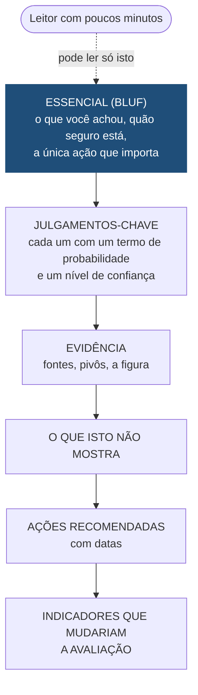
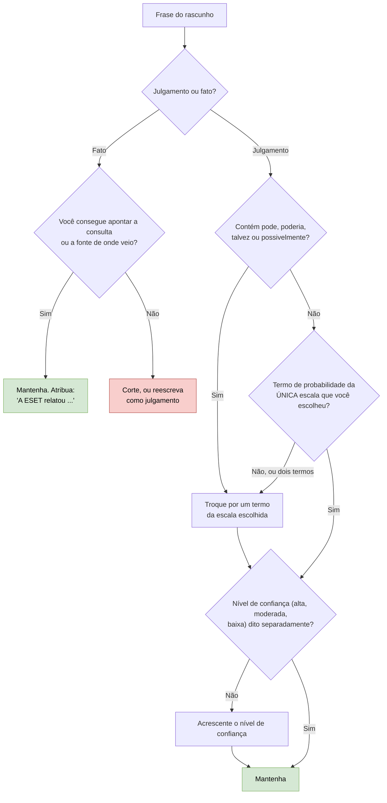

# Dia 46: Escrevendo um informe de inteligência com linguagem calibrada

> 🇺🇸 Original: [*Day 46: Writing an intelligence brief with calibrated language*](https://github.com/thiefdroppers/cyber-investigator-skills/blob/main/curriculum/phase-3-cyber-threat-intelligence/day-46.md) — © ThiefDroppers, licença MIT.
> Aqui: tradução fiel **+** camada brasileira. Nada do original foi removido; tudo o que é novo vem marcado com ➕.

**Fase 3. Inteligência de ameaças cibernéticas** · Meta da trilha: escrever um informe de uma página cujos leitores consigam dizer exatamente o quão provável você acha cada julgamento e o quanto você confia na evidência por trás dele.

Rank Jutsu: `B` · [](https://colab.research.google.com/github/Ridd1kulusC0d3r/investigador-cyber-90-dias/blob/main/curriculo/fase-3-inteligencia-de-ameacas/dia-46/dia-46.ipynb)

---

## 🎬 ➕ Abertura do caso — *Uma página para a Marta*

Segunda-feira, 12 de outubro, 7h40. A Marta Quintão tem reunião com o conselho às 9h.

— Eu não vou ler matriz, nem STIX. Me manda uma página. Mas eu preciso saber o quanto vocês têm certeza de cada coisa, porque o conselho vai perguntar.

Você abre o rascunho que escreveu na sexta e Rafa lê a primeira frase em voz alta:

— "O Pescador possivelmente pode estar expandindo a campanha para outros estados." — Ele larga o papel. — Possivelmente quanto? Pode quer dizer 10% ou 70%? E quem é "o Pescador"? Até ontem era um *cluster*. Reescreve. Começa pelo que você achou, diz quanto tem certeza, e qual é a única coisa que ela precisa fazer hoje.

O Dia 46 ensina a escrever de modo que a dúvida seja medida, e não decorativa. *(Personagens e cenário: [Operação Isca](../../../caso-continuo/).)*

---

## 📖 Conceito

Um informe existe para que alguém possa agir. O leitor costuma ser um líder de SOC, um gerente de TI ou um executivo com poucos minutos, então a estrutura põe a conclusão primeiro: o essencial no início (*bottom line up front*, BLUF), depois os julgamentos-chave, depois a evidência, depois o que fazer e o que observar.



A parte difícil é dizer o quão seguro você está. Palavras como "possivelmente" ou "pode" significam qualquer coisa entre 5% e 70% para leitores diferentes. Sherman Kent levantou esse problema na CIA nos anos 1960, e hoje os serviços de inteligência publicam escalas fixas que ligam palavras a faixas de probabilidade.

*Intelligence Community Directive 203* (ICD 203), da comunidade de inteligência dos EUA:

| Termo (qualquer das colunas) | | Probabilidade |
|---|---|---|
| quase nenhuma chance (*almost no chance*) | remota (*remote*) | 01-05% |
| muito improvável (*very unlikely*) | altamente improvável (*highly improbable*) | 05-20% |
| improvável (*unlikely*) | improvável (*improbable*) | 20-45% |
| chance mais ou menos igual (*roughly even chance*) | probabilidades mais ou menos iguais (*roughly even odds*) | 45-55% |
| provável (*likely*) | provável (*probable*) | 55-80% |
| muito provável (*very likely*) | altamente provável (*highly probable*) | 80-95% |
| quase certo(amente) (*almost certain(ly)*) | praticamente certo (*nearly certain*) | 95-99% |

A régua de probabilidade (*probability yardstick*) do *Professional Head of Intelligence Assessment* (PHIA) do Reino Unido, usada pelo NCSC entre outros:

| Termo | Probabilidade aproximada |
|---|---|
| Chance remota (*Remote chance*) | acima de 0% até cerca de 5% |
| Altamente improvável (*Highly unlikely*) | cerca de 10-20% |
| Improvável (*Unlikely*) | cerca de 25-35% |
| Possibilidade realista (*Realistic possibility*) | cerca de 40% até menos de 50% |
| Provável (*Likely or probable*) | cerca de 55-75% |
| Altamente provável (*Highly likely*) | cerca de 80-90% |
| Quase certo (*Almost certain*) | cerca de 95% até menos de 100% |

A escala PHIA deixa lacunas deliberadas entre as faixas, para que um julgamento perto de um limite tenha de se comprometer com um dos lados. Escolha uma escala por produto, diga qual está usando, e não misture termos de linhas ou escalas diferentes.

Probabilidade e confiança são coisas diferentes. Probabilidade (*likelihood*) é o quão provável você julga um evento ou fato. Confiança (alta, moderada, baixa) é o quão boa é a sua base: a qualidade das fontes, o quanto elas se corroboram e quantas premissas você teve de assumir. "Os domínios são provavelmente operados pelo mesmo ator. Temos baixa confiança neste julgamento" é coerente: a sua estimativa está acima de 55%, e ela se apoia em evidência fraca, que pode mudar facilmente. O ICD 203 pede aos analistas que expressem as duas, mas em frases separadas: a seção D.6.e.(2)(b) diz que um produto não deve combinar um nível de confiança e um grau de probabilidade na mesma frase.

> ➕ **Nota de tradução.** Em inglês os termos das escalas são palavras fixas; em português não há tradução oficial. Neste repositório usamos as traduções das tabelas acima e, num informe real, escrevemos o termo em português seguido do original em itálico na primeira ocorrência, e declaramos a escala no cabeçalho. Assim o leitor sabe que "provável" significa 55-80% (ICD 203) ou 55-75% (PHIA), e não "acho que sim". Cuidado com as colisões que a tradução cria: "provável", "improvável" e "quase certo" existem nas duas escalas, e "altamente provável/improvável" traduz tanto a segunda coluna do ICD 203 quanto a PHIA. Por isso, ao usar o ICD 203 em português, prefira os termos da primeira coluna ("muito provável", "muito improvável"), e o verificador do notebook trata "altamente ..." como PHIA.

## 📚 Recursos

- [ICD 203, *Analytic Standards*](https://www.dni.gov/files/documents/ICD/ICD-203.pdf): a tabela de probabilidade fica no padrão de *tradecraft* sobre expressar incerteza. Uma [versão em texto no GitHub](https://github.com/wesinator/ICD203-intel-analysis) é mais fácil de ler.
- [Governo do Reino Unido, *"Explaining uncertainty in UK intelligence assessment"*](https://www.gov.uk/government/publications/explaining-uncertainty-in-uk-intelligence-assessment/explaining-uncertainty-in-uk-intelligence-assessment): a régua PHIA e como ela é aplicada.
- [*Tradecraft Primer* do governo dos EUA](https://www.cia.gov/resources/csi/static/Tradecraft-Primer-apr09.pdf): combina bem com o Dia 45.
- [Pandoc](https://pandoc.org/): transforma o informe em Markdown num arquivo Word para distribuição.
- Como modelo de estilo, leia a seção de *key judgments* (julgamentos-chave) de qualquer alerta conjunto recente da CISA, ou as avaliações publicadas do NCSC, e repare em quantas frases trazem um termo de probabilidade.

### ➕ Recursos do contexto Brasil

- [Lei 9.883/1999](https://www.planalto.gov.br/ccivil_03/leis/l9883.htm): institui o Sistema Brasileiro de Inteligência (SISBIN) e cria a ABIN.
- [Decreto 8.793/2016](https://www.planalto.gov.br/ccivil_03/_ato2015-2018/2016/decreto/d8793.htm): fixa a Política Nacional de Inteligência (PNI).
- [ABIN](https://www.gov.br/abin/pt-br): publica a Doutrina Nacional da Atividade de Inteligência e a *Revista Brasileira de Inteligência*. Veja a Camada jurídica e a Camada 8 para a relação com o vocabulário deste dia.
- [Pandoc, manual do usuário](https://pandoc.org/MANUAL.html): `--reference-doc` permite usar um `.docx` de modelo com a identidade visual do cliente.

## 🛠️ Prática: Pandoc (um informe de inteligência de uma página construído com o seu trabalho dos Dias 40 a 44)

O informe vai para um público hipotético. Não nomeie uma organização real como destinatária ou como alvo, e mantenha todo indicador neutralizado (*defanged*) no texto.

**Seu checklist de hoje.** Faça na ordem e marque cada item ao terminar:

- [ ] 1. Reunir o que você tem
- [ ] 2. Reescrever primeiro as frases fracas
- [ ] 3. Redigir o informe
- [ ] 4. Fazer a checagem de calibração
- [ ] ➕ 5. Prática BR: o informe de uma página para a Marta
- [ ] ➕ 6. O notebook do dia no Colab

### 1. Reunir o que você tem

Você já tem um grafo de pivôs (Dia 40), um *bundle* STIX e uma decisão de compartilhamento (Dias 43 e 44) e uma camada ATT&CK. O seu informe trata do cluster do Dia 40 e vai para o SOC hipotético de uma organização do setor-alvo do relatório semente. O rótulo TLP vem do seu registro de decisão do Dia 44.

### 2. Reescrever primeiro as frases fracas

Pratique com estas antes de redigir. Para cada frase "antes", identifique o que está faltando (probabilidade, confiança, fonte ou escopo).

| Antes | Depois |
|---|---|
| Os domínios são definitivamente parte da mesma campanha. | Avaliamos que os três domínios são quase certamente operados pelo mesmo ator: um único certificado lista os três nomes (crt.sh, consultado em 2026-09-30). Confiança: alta. |
| 198.51.100.23 pode estar relacionado. | Avaliamos que é uma possibilidade realista que 198.51.100.23 pertença ao mesmo cluster. O único vínculo é um favicon compartilhado encontrado em 12 hosts, e não temos um segundo pivô. Confiança: baixa. |
| Este ator é sofisticado e perigoso. | (Cortar. Não nomeia nenhum comportamento e não dá ao leitor nada com que agir.) |
| O ator possivelmente poderia nos atacar em breve. | Não temos informação que indique que a nossa organização é alvo. O relatório semente descreve a mira em <setor> em <região> durante <meses>, o que inclui organizações como a nossa. |

Repare que o segundo "depois" usa um termo PHIA. Se você escolher o ICD 203 para o seu informe, "chance mais ou menos igual" é o equivalente mais próximo. Escolha uma escala e use-a do começo ao fim.

### 3. Redigir o informe

Salve como `brief.md`, uma página quando renderizado (cerca de 400 a 550 palavras):

```markdown
---
title: "Phishing infrastructure cluster A: assessment and actions"
subtitle: "TLP:GREEN | 2026-09-30 | Probability terms: PHIA yardstick"
---

## Bottom line
One or two sentences: what you found, how sure you are, and the single most important action.

## Key judgments
1. We assess that ... (likelihood term) (confidence level), because ...
2. ...
3. We do not know ... (name the gap explicitly)

## Evidence
- Seed: <vendor report>, <date> (source grade B2).
- Pivots: shared certificate SANs (strong), favicon hash with 12 results (medium) ...
- Graph: figure 1.

{ width=90% }

## What this does not show
Say what the evidence does not support, for example who operates the cluster or whether your sector is targeted now.

## Recommended actions
- Block and alert on: (defanged indicators, or "see attached STIX bundle cluster-a.json")
- Hunt for: ATT&CK techniques from the layer, with the log source to check
- Review by: (date when indicators expire from the bundle)

## Indicators that would change this assessment
- New certificate issued with the same SAN pattern (raises confidence)
- Favicon hash appears on hosts serving unrelated content (lowers confidence)
```

> ➕ O modelo acima é o do original, em inglês, intacto. A versão em português, para o caso brasileiro, está na Prática BR abaixo, e o notebook gera as duas.

Renderize:

```bash
pandoc brief.md -o brief.docx
```

Abra o resultado e confira se cabe numa página com a figura. Se não couber, corte palavras, não a figura.

### 4. Fazer a checagem de calibração

Passe cada frase do rascunho por este caminho, depois faça as marcações abaixo:



Marque uma cópia do rascunho:

- Destaque todo termo de probabilidade. Cada um precisa vir da escala escolhida.
- Sublinhe toda frase que afirma algo como fato. Cada uma precisa ser observada (você consegue apontar a consulta ou a fonte) ou explicitamente atribuída à fonte ("A ESET relatou ...").
- Circule qualquer "may", "might", "could" ou "possibly" (em português: "pode", "poderia", "talvez", "possivelmente"). Troque cada um por um termo da escala, ou apague a frase.
- Confira que nenhuma frase combina dois termos de probabilidade ("provavelmente possível").

### O que você tem ao terminar

- `brief.md` e `brief.docx`: um informe de uma página com linha de TLP, BLUF, pelo menos três julgamentos-chave numerados, cada um com termo de probabilidade e nível de confiança, uma figura, uma seção "o que isto não mostra" e ações com datas.
- Uma cópia marcada para calibração, mostrando todo termo de probabilidade destacado e toda palavra evasiva removida.
- As quatro frases de prática reescritas.

### ➕ 5. Prática BR: o informe de uma página para a Marta

Destinatária: Marta Quintão (gerente de risco da Serra Azul) e, por ela, o conselho. TLP: **AMBER** (decisão do Dia 44). Escala: **PHIA**, declarada no cabeçalho. Base: o grafo e o *bundle* do cluster CA-ISCA-01 (Dias 40 e 43) e a ACH do Dia 45.

```markdown
---
title: "Cluster CA-ISCA-01 (golpe do 'Pix bloqueado'): avaliação e ações"
subtitle: "TLP:AMBER | 2026-10-12 | Termos de probabilidade: régua PHIA"
---

## Essencial
Uma frase com o que achamos, quão seguros estamos, e a única ação que importa hoje.

## Julgamentos-chave
1. Avaliamos que ... (termo PHIA). Confiança: ... , porque ...
2. ...
3. Não sabemos ... (a lacuna, nomeada)

## Evidência
- Semente: SMS recebidos pelos cooperados em 2026-10-05 (07h12–08h40 BRT).
- Pivôs: SAN de certificado compartilhado (forte), hash de corpo HTML com 3 resultados (médio) ...
- Figura 1: grafo do cluster.

## O que isto não mostra
Quem opera o cluster; se a Serra Azul será alvo de novo; relação com ransomware (nenhuma demonstrada).

## Ações recomendadas
- Bloquear e alertar: ver bundle `cluster-iscakit.json` (TLP:AMBER), até 2026-12-31.
- Comunicar cooperados: ...
- Revisar em: ...

## Indicadores que mudariam esta avaliação
- ...
```

Três regras extras do caso:

1. "Pescador" só aparece entre aspas e como **apelido encontrado no código do kit**. O sujeito das frases é o cluster CA-ISCA-01.
2. Pelo menos um julgamento-chave sai da ACH do Dia 45 e mantém a lacuna dela ("não conseguimos separar compradores independentes de imitadores").
3. Todos os domínios neutralizados: `serraazul-pix[.]example`.

### ➕ 6. O notebook do dia

Abra o [notebook do Dia 46 no Colab](https://colab.research.google.com/github/Ridd1kulusC0d3r/investigador-cyber-90-dias/blob/main/curriculo/fase-3-inteligencia-de-ameacas/dia-46/dia-46.ipynb). Nele você:

1. consulta as duas escalas como dados (termo → faixa) e vê graficamente as **lacunas** da PHIA;
2. joga o quiz **"quanto é provável?"**: converte porcentagens em termos de cada escala;
3. roda um **verificador de calibração** em pt-BR e em inglês que implementa o fluxograma do passo 4: acha "pode/poderia/talvez/possivelmente", termos de duas escalas misturados, dois termos numa frase e frase de julgamento sem confiança, além de violar a regra do ICD 203 de não juntar probabilidade e confiança na mesma frase;
4. preenche o informe para a Marta por formulário, recebe o relatório de calibração e grava `brief.md` (e `brief.docx`, se o Pandoc estiver disponível) com contagem de palavras.

## ✅ Checkpoint

- As duas primeiras frases do seu informe dizem o que você achou.
- As duas primeiras frases dizem o quão seguro você está.
- As duas primeiras frases dizem qual é a única ação mais importante.
- Todo julgamento-chave diz a probabilidade e a confiança separadamente.
- Nenhum "may", "might", "could" ou "possibly" fica numa frase de julgamento.
- Pelo menos um julgamento-chave trata do que você não sabe.
- O informe não faz nenhuma afirmação sobre quem está por trás do cluster. Isso vem nos Dias 47 e 48, e a maioria dos informes nem deveria fazer uma.
- Sem consultar notas, explique a diferença entre probabilidade e confiança.

### ➕ Checkpoint BR

- O informe para a Marta tem entre 400 e 550 palavras e passa no verificador do notebook sem alertas.
- A escala PHIA aparece declarada no subtítulo, e nenhum termo do ICD 203 aparece no texto.
- "Pescador" não é sujeito de nenhuma frase.
- O julgamento derivado da ACH mantém a lacuna que a matriz não resolveu.
- Você consegue dizer a uma pessoa leiga, em uma frase, por que "provável, confiança baixa" não é uma contradição.

## ⚖️ ➕ Camada jurídica BR

**O vocabulário da inteligência de Estado no Brasil.** A atividade de inteligência de Estado no Brasil tem base legal na Lei 9.883/1999, que institui o SISBIN e cria a ABIN, e na Política Nacional de Inteligência (Decreto 8.793/2016). A ABIN publicou em 2016 a Doutrina Nacional da Atividade de Inteligência, que padroniza conceitos e produtos para o sistema. <!-- TODO doutrina: confirmar no texto oficial da Doutrina Nacional da Atividade de Inteligência (ABIN, 2016) os nomes dos tipos de conhecimento (ex.: informe, informação, apreciação, estimativa) e dos "estados da mente" em relação à verdade (ex.: certeza, opinião, dúvida, ignorância), e se a doutrina define uma escala verbal de probabilidade. Só então relacionar com ICD 203/PHIA. --> Um MSSP privado não integra o SISBIN, mas os clientes públicos e as forças de segurança com quem você conversa usam esse vocabulário. Atenção ao falso amigo: na doutrina brasileira, "informe" tende a designar um tipo específico de conhecimento, enquanto este repositório usa "informe de inteligência" como tradução de *intelligence brief*, o produto de uma página deste dia. Se o destinatário for de órgão público, diga isso no cabeçalho para evitar confusão.

**Responsabilidade pelo que se afirma.** Um informe que vai a um conselho de administração pode embasar decisões com efeitos sobre terceiros (bloqueios, comunicados, denúncias). Afirmar como fato o que é julgamento, ou nomear alguém sem base, expõe o autor e o cliente. A linguagem calibrada é também proteção jurídica: "avaliamos como provável, com confiança baixa" é uma opinião técnica fundamentada; "é o fulano" é uma afirmação de fato. <!-- TODO jurídico: confirmar com o jurídico os limites de responsabilidade civil e penal (CP, arts. 138 a 140) por afirmações em relatórios técnicos privados. -->

> Este repositório é material de estudo e não constitui orientação jurídica.

## 🧠 ➕ Camada 8 — palavras vagas, leitores diferentes

O problema de Sherman Kent não é retórico, é psicológico. Pesquisas de percepção de probabilidade mostram repetidamente que pessoas diferentes atribuem números muito diferentes à mesma palavra: "provável" pode significar 55% para um leitor e 90% para outro. O leitor não lê a sua dúvida; ele lê a dúvida **dele** na sua palavra.

Do lado do autor, há dois mecanismos. O primeiro é a **evasão defensiva**: "pode", "possivelmente" e "não se descarta" protegem quem escreve (nunca vai estar errado) e transferem o risco para quem decide. O segundo é o **excesso de confiança**: analistas experientes tendem a ser mais confiantes do que a taxa de acerto deles justifica. A escala fixa combate os dois: obriga você a se comprometer e permite, com o tempo, verificar se os seus "prováveis" acontecem mais ou menos na proporção que a escala diz.

E do lado da Marta: sob a pressão de uma reunião às 9h, a **carga cognitiva** é alta e ela vai ler o primeiro parágrafo e pular para as ações. O BLUF não é estilo; é desenho para um leitor cansado.

Consequência prática: guarde os seus julgamentos com termo e data, e revise-os quando o caso fechar. Calibração é um hábito que se mede.

## 🤖 ➕ Skill do dia

O dia acrescenta ao procedimento existente **"informe de inteligência ou relatório de caso"** a linguagem calibrada: escala declarada, probabilidade e confiança em frases separadas, proibição de palavras evasivas em julgamentos, e um julgamento sobre o que não se sabe. Detalhes em [`_skill-delta.md`](_skill-delta.md).

## 💡 ➕ Inovação OSINT do dia — um "linter" de calibração em pt-BR

O passo 4 é mecânico o bastante para virar código. Um verificador mínimo, com `re` da biblioteca padrão, que pega as palavras evasivas em português e os termos de duas escalas misturados:

```python
import re
EVASIVAS = r"\b(pode|podem|poderia|poderiam|talvez|possivelmente|eventualmente|não se descarta)\b"
PHIA = ["chance remota", "altamente improvável", "possibilidade realista", "altamente provável", "quase certo"]
ICD = ["quase nenhuma chance", "muito improvável", "chance mais ou menos igual", "muito provável", "praticamente certo"]

def checar(frase):
    alertas = [f"evasiva: '{m}'" for m in re.findall(EVASIVAS, frase, re.I)]
    usados = {"PHIA" for t in PHIA if t in frase.lower()} | {"ICD 203" for t in ICD if t in frase.lower()}
    if len(usados) > 1:
        alertas.append("mistura de escalas")
    if re.search(r"confiança", frase, re.I) and usados:
        alertas.append("probabilidade e confiança na mesma frase (ICD 203)")
    return alertas

print(checar("O cluster pode estar se expandindo; é altamente provável, com confiança alta."))
```

Atenção ao limite: "pode" também aparece em frases que não são julgamento ("a cooperativa pode bloquear o domínio"). O verificador **sinaliza**, você decide. O notebook do dia tem a versão completa.

## 📝 Diário de estudo

- Data:
- Tempo gasto:
- O que ficou claro:
- O que ainda está nebuloso:
- Artefato produzido: `brief.md`, `brief.docx`, cópia marcada para calibração, as quatro frases reescritas; informe CA-ISCA-01 para a Marta

---
<sub>Baseado em [cyber-investigator-skills](https://github.com/thiefdroppers/cyber-investigator-skills) por ThiefDroppers (MIT). Tradução, camada BR, Camada 8, skill pt-BR e notebook por Deivison Lourenço (@Ridd1kulusC0d3r).</sub>
