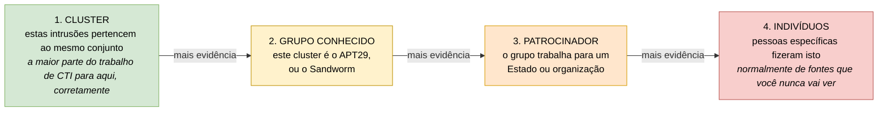
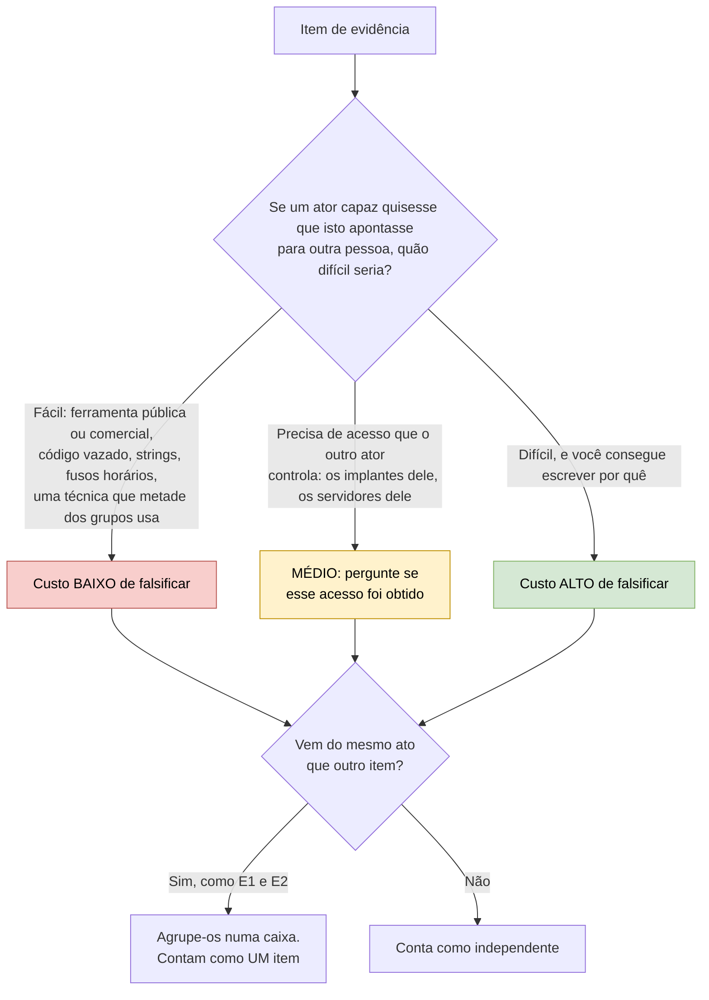
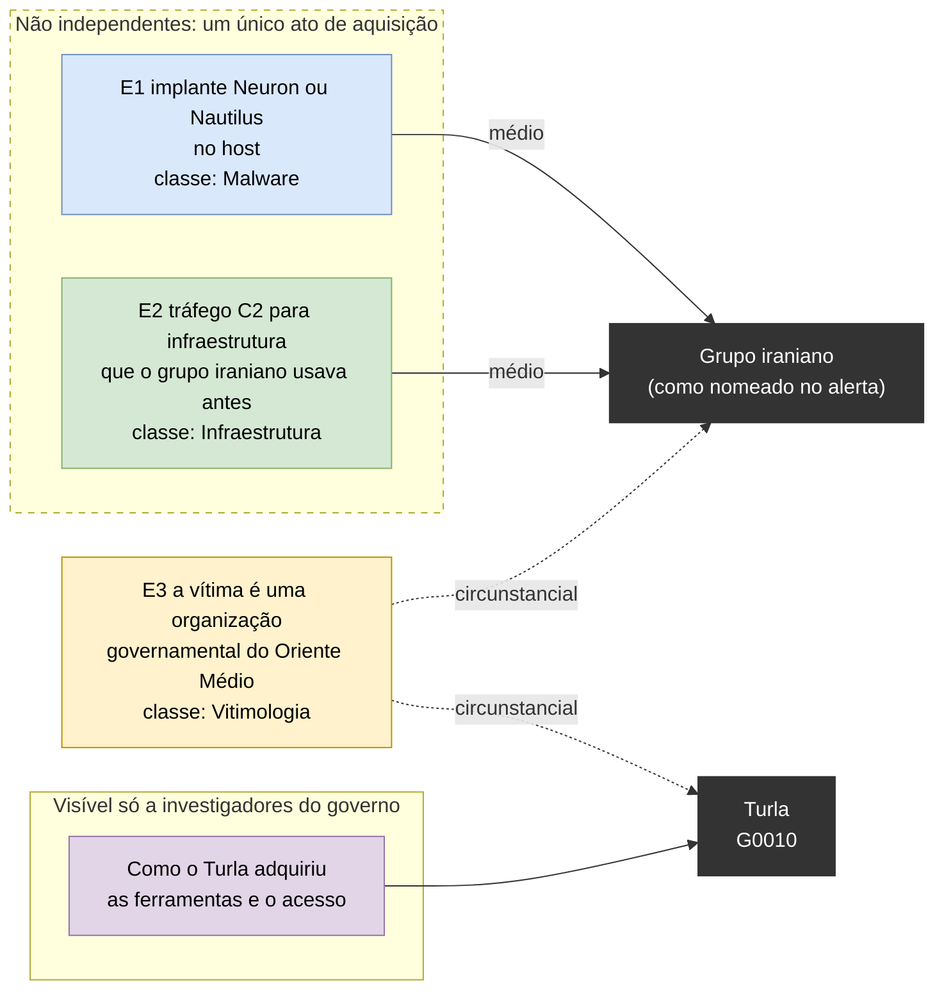

# Dia 47: Metodologia de atribuição e a armadilha do ferramental compartilhado

> 🇺🇸 Original: [*Day 47: Attribution methodology and the shared-tooling trap*](https://github.com/thiefdroppers/cyber-investigator-skills/blob/main/curriculum/phase-3-cyber-threat-intelligence/day-47.md) — © ThiefDroppers, licença MIT.
> Aqui: tradução fiel **+** camada brasileira. Nada do original foi removido; tudo o que é novo vem marcado com ➕.

**Fase 3. Inteligência de ameaças cibernéticas** · Meta da trilha: graduar a evidência de atribuição pelo quanto ela é fácil de copiar, roubar ou falsificar, e ver num caso real como ferramentas e infraestrutura acabam apontando para o ator errado.

Rank Jutsu: `B` · [](https://colab.research.google.com/github/Ridd1kulusC0d3r/investigador-cyber-90-dias/blob/main/curriculo/fase-3-inteligencia-de-ameacas/dia-47/dia-47.ipynb)

---

## 🎬 ➕ Abertura do caso — *"Mas quem é o Pescador?"*

O informe de uma página funcionou. O conselho entendeu o "provável" e o "confiança moderada". Mas na última linha da ata, o presidente da Serra Azul escreveu à mão: *"Quem é o Pescador? Queremos um nome para levar à polícia."*

Na mesma tarde, um analista de outra empresa posta no LinkedIn: *"O IscaKit usa o mesmo painel de um kit de 2024 vendido por um grupo conhecido no Telegram. Caso resolvido."*

Rafa lê o post em voz alta e suspira.

— O painel é vendido. O kit é vendido. O comentário `// pescador` está no código que qualquer comprador recebe. Se você somar três coisas que se compram, não chega numa pessoa: chega numa loja.

Ele abre uma planilha em branco.

— Para cada evidência, uma pergunta: quanto custaria para outra pessoa fazer isso apontar para outro lugar?

O Dia 47 ensina a graduar evidência de atribuição pelo custo de falsificar. *(Personagens e cenário: [Operação Isca](../../../caso-continuo/).)*

---

## 📖 Conceito

Atribuição significa responder "quem fez isto", e ela tem níveis, cada um exigindo mais evidência que o anterior:

1. Agrupamento (*clustering*): estas intrusões pertencem ao mesmo conjunto (mesmas ferramentas, infraestrutura, comportamento). A maior parte do trabalho de CTI para aqui, corretamente.
2. Ligação a um grupo conhecido: este cluster é o APT29, ou o Sandworm, como outros definiram esses grupos.
3. Ligação a um patrocinador: o grupo trabalha para, ou em nome de, um Estado ou organização específica.
4. Ligação a indivíduos: pessoas específicas fizeram isto. Isso normalmente vem de fontes policiais ou de inteligência que você nunca vai ver.



O artigo *"Attributing Cyber Attacks"*, de Thomas Rid e Ben Buchanan (*Journal of Strategic Studies*, 2015), descreve a atribuição como um processo que corre nos níveis técnico, operacional e estratégico, mais a decisão de comunicá-la. O ponto central deles é que a atribuição é um julgamento feito sob incerteza, e que o que conta como evidência suficiente depende de quem pergunta e do que pretende fazer com a resposta. O *"A Guide to Cyber Attribution"* do ODNI (2018) lista as classes de evidência que os governos usam (*tradecraft*, infraestrutura, malware, intenção e indicadores de fontes externas) e observa que as avaliações são expressas com níveis de confiança, não como prova.

O que você consegue ver como analista externo é, na maior parte, evidência técnica, e a maior parte dela pode ser copiada, roubada ou falsificada:

| Evidência | Por que aponta para algum lugar | Como engana |
|---|---|---|
| Código de malware compartilhado | Grupos reutilizam código privado | Código vaza, é vendido, copiado de código aberto ou emprestado de propósito |
| Ferramentas compartilhadas | Mesmo kit de ferramentas, mesmo operador | Muitas ferramentas são públicas ou comerciais e usadas por dezenas de grupos |
| Infraestrutura compartilhada | Mesmos servidores, mesmo operador | A infraestrutura pode ser alugada dos mesmos provedores, ou sequestrada de outro ator |
| *Strings* de idioma, horários de compilação, fusos horários | Indícios da localidade e do horário de trabalho dos autores | Triviais de plantar ou alterar |
| TTPs | Hábitos são difíceis de mudar | Técnicas comuns são compartilhadas por metade de todos os grupos (Dia 38) |
| Vitimologia e "a quem beneficia" | Os alvos refletem os interesses de um patrocinador | Muitos atores compartilham interesses. É circunstancial, na melhor das hipóteses |

A falácia do ferramental compartilhado é o salto de "esta intrusão usou a ferramenta X" e "o grupo Y usa a ferramenta X" para "o grupo Y fez isto". No ATT&CK v19.2, contando só os relacionamentos diretos entre grupo e software, o Mimikatz está ligado a 51 grupos, o PsExec a 38, o Cobalt Strike a 30, o PlugX a 15 e o AdFind a 12. Ferramentas vazadas espalham ainda mais o problema. O EternalBlue, publicado no vazamento dos Shadow Brokers em 2017, foi usado tanto no WannaCry quanto no NotPetya, que os governos dos EUA e do Reino Unido depois atribuíram a dois Estados diferentes. O vazamento do *builder* do ransomware LockBit 3.0 em 2022 permitiu que operadores sem relação entre si produzissem cargas com a marca LockBit.

## 📚 Recursos

- [NCSC e NSA, *"Turla group exploits Iranian APT to expand coverage of victims"*](https://www.ncsc.gov.uk/news/turla-group-exploits-iran-apt-to-expand-coverage-of-victims) (outubro de 2019): o caso de hoje. O [PDF completo do alerta conjunto](https://media.defense.gov/2019/Oct/18/2002197242/-1/-1/0/NSA_CSA_TURLA_20191021%20VER%203%20-%20COPY.PDF) tem o detalhe técnico.
- [ODNI, *"A Guide to Cyber Attribution"*](https://www.dni.gov/files/CTIIC/documents/ODNI_A_Guide_to_Cyber_Attribution.pdf): quatro páginas, vale ler inteiro.
- [Thomas Rid e Ben Buchanan, *"Attributing Cyber Attacks"*](https://doi.org/10.1080/01402390.2014.977382): o artigo do Modelo Q (*Q Model*). Procure a biblioteca de uma universidade se esbarrar no *paywall*.
- Páginas de grupo do ATT&CK para [Turla (G0010)](https://attack.mitre.org/groups/G0010/) e [OilRig (G0049)](https://attack.mitre.org/groups/G0049/).
- [diagrams.net](https://app.diagrams.net/): ferramenta gratuita de diagramas para o grafo de evidências.

### ➕ Recursos do contexto Brasil

- [Periódicos CAPES](https://www.periodicos.capes.gov.br/): acesso institucional, via CAFe, a periódicos como o *Journal of Strategic Studies*; é o caminho brasileiro para o artigo de Rid e Buchanan se você tiver vínculo com universidade participante.
- [Código de Processo Penal](https://www.planalto.gov.br/ccivil_03/decreto-lei/del3689compilado.htm): arts. 158-A a 158-F (cadeia de custódia), que definem como o vestígio digital precisa ser tratado para ter valor de prova, e por que um analista externo não "fecha" uma atribuição a pessoa.
- [MITRE ATT&CK, página de software](https://attack.mitre.org/software/): para o passo 6, a contagem de grupos por ferramenta.

## 🛠️ Prática: diagrams.net (um grafo de evidências de atribuição e uma tabela de graduação de evidências)

Você está reanalisando um alerta governamental publicado. Não tente reproduzir o trabalho das agências contra infraestrutura ativa, e não pesquise ninguém nomeado em reportagens sobre qualquer dos dois grupos.

**Seu checklist de hoje.** Faça na ordem e marque cada item ao terminar:

- [ ] 1. Entender o caso
- [ ] 2. Extrair os itens de evidência
- [ ] 3. Graduar cada item
- [ ] 4. Montar o grafo de evidências
- [ ] 5. Escrever o contrafactual
- [ ] 6. Aplicar a checagem da falácia ao seu próprio trabalho
- [ ] ➕ 7. Prática BR: a "atribuição" do LinkedIn, graduada
- [ ] ➕ 8. O notebook do dia no Colab

### 1. Entender o caso

Em outubro de 2019, o NCSC do Reino Unido e a NSA dos EUA publicaram um alerta conjunto. Ele dizia que o Turla, um grupo que os dois governos associam à Rússia (ATT&CK G0010, com aliases como Snake, Venomous Bear e Secret Blizzard), tinha obtido implantes chamados Neuron e Nautilus que as agências avaliaram como de origem iraniana. O Turla também obteve acesso a infraestrutura de um grupo iraniano, e usou essas ferramentas contra vítimas, muitas no Oriente Médio. O alerta avaliou que os operadores iranianos quase certamente não sabiam que as suas ferramentas estavam sendo usadas dessa forma.

Leia o alerta e o PDF. Depois, coloque-se no lugar de um analista que atendeu uma dessas vítimas antes de outubro de 2019 e só tinha os artefatos técnicos daquela rede.

### 2. Extrair os itens de evidência

Liste toda evidência descrita no alerta que um respondedor de incidente no local da vítima poderia ter encontrado, por exemplo:

| ID | Item de evidência | Aponta para | Classe de evidência (ODNI) |
|---|---|---|---|
| E1 | Implante Neuron ou Nautilus no host | Grupo iraniano (ferramentas avaliadas como de origem iraniana) | Malware |
| E2 | Tráfego de comando e controle para infraestrutura usada antes pelo grupo iraniano | Grupo iraniano | Infraestrutura |
| E3 | A vítima é uma organização governamental no Oriente Médio | Qualquer um; os dois grupos já miraram a região | Vitimologia |
| E4 | (continue a partir do alerta) | | |

Busque oito a doze itens. Acrescente uma coluna para itens que só as agências podiam ver (como o conhecimento de como o Turla adquiriu as ferramentas). Marque esses como "não visível a um respondedor".

### 3. Graduar cada item

Acrescente três colunas e preencha para todo item:

| ID | Custo para outro ator copiar ou falsificar (baixo / médio / alto) | Independente dos outros itens? | Peso que você teria dado antes de outubro de 2019 |
|---|---|---|---|
| E1 | Médio: exige obter o implante e os dados de operação dele, o que o Turla fez | Não, ligado a E2 | |
| E2 | Médio: exige acesso à infraestrutura do outro grupo, que o Turla tinha | Não, ligado a E1 | |

A pergunta a fazer de cada linha é: se um ator capaz quisesse que este item apontasse para outra pessoa, quão difícil seria? E1 e E2 parecem duas confirmações independentes, mas vêm do mesmo ato de aquisição. Registre essa dependência. Dois itens dependentes contam como um.

Gradue toda linha com as mesmas duas perguntas:



### 4. Montar o grafo de evidências

No diagrams.net, desenhe:

- Um nó por ator candidato: "Grupo iraniano (como nomeado no alerta)" e "Turla".
- Um nó por item de evidência, colorido pela classe de evidência do ODNI.
- Uma aresta de cada item de evidência para o ator que ele parece apoiar, rotulada com o seu custo de falsificação.
- Uma caixa tracejada em volta dos itens que não são independentes entre si.
- Um painel separado, "Visível só a investigadores do governo", com os itens que de fato resolveram o caso.

Exporte o diagrama como PNG e SVG.

Este é o layout do grafo pronto, preenchido só com as três linhas de exemplo do passo 2. Use-o como esqueleto: acrescente os itens restantes, colora cada um pela classe ODNI e escreva o rótulo de custo de falsificação da sua graduação do passo 3 em toda aresta. Você pode editar esta versão no [mermaid.live](https://mermaid.live/) para testar o layout antes de redesenhá-lo no diagrams.net.



Leia sozinha a parte visível ao respondedor. Tudo o que está fora do painel do governo aponta para o grupo iraniano ou para ninguém em particular, que é a situação a partir da qual o passo 5 pede que você raciocine.

### 5. Escrever o contrafactual

Em um parágrafo, responda: usando só a evidência da parte visível ao respondedor no seu grafo, o que um analista cuidadoso teria concluído em meados de 2019, e com que probabilidade e confiança (use a escala do Dia 46)? Depois diga qual foi a conclusão correta, e qual categoria única de evidência fez a diferença.

### 6. Aplicar a checagem da falácia ao seu próprio trabalho

Volte à tabela "Ferramental" (*Tooling*) do seu perfil do Dia 37 e à sua tabela de sobreposição do Dia 38. Para cada ferramenta ou técnica ali, acrescente o número de grupos do ATT&CK que a compartilham. Marque qualquer coisa compartilhada por mais de dez grupos como "não identificadora".

### O que você tem ao terminar

- Uma tabela de oito a doze itens de evidência do alerta sobre o Turla, graduados por custo de falsificação e independência.
- Um grafo de evidências no diagrams.net que mostra quais itens apontam para qual ator, como dependem uns dos outros, e o que só os investigadores do governo podiam ver.
- Um parágrafo contrafactual com probabilidade e confiança calibradas.
- As suas tabelas dos Dias 37 e 38 atualizadas com as contagens de compartilhamento.

### ➕ 7. Prática BR: a "atribuição" do LinkedIn, graduada

O post diz: *"O IscaKit usa o mesmo painel de um kit de 2024 vendido por um grupo conhecido no Telegram. Caso resolvido."* Os itens de evidência do caso estão em [`caso-continuo/dados/dia-47/evidencias-iscakit.csv`](../../../caso-continuo/dados/dia-47/evidencias-iscakit.csv) (fictícios). Para cada um:

1. Classe ODNI (malware, infraestrutura, *tradecraft*, intenção, fonte externa) e para onde aponta: "vendedor do kit", "cluster CA-ISCA-01" ou "ninguém em particular".
2. Custo de falsificar (baixo / médio / alto, **com motivo escrito** para todo "alto").
3. Dependência: quais itens nascem do **mesmo ato** (comprar o kit traz junto painel, comentário `// pescador` e caminho `/api/recebe`: três itens, um ato).
4. O painel "visível só a quem tem ordem judicial": dados cadastrais do registrante, logs do provedor de hospedagem, titularidade das contas que receberam os Pix. É ali, e só ali, que um caso como este chega a pessoas, e quem chega é a polícia.

Depois escreva o contrafactual do caso: *com só o que a Vigia vê, qual é o nível de atribuição defensável?* (Resposta esperada: nível 1, cluster. Ligar o cluster ao "grupo do Telegram" falha porque todos os itens que apontam para ele vêm de um único ato de compra.)

### ➕ 8. O notebook do dia

Abra o [notebook do Dia 47 no Colab](https://colab.research.google.com/github/Ridd1kulusC0d3r/investigador-cyber-90-dias/blob/main/curriculo/fase-3-inteligencia-de-ameacas/dia-47/dia-47.ipynb). Nele você:

1. gradua os itens do caso Turla e do IscaKit com o fluxograma do passo 3 transformado em função;
2. **colapsa itens dependentes** (os que nascem do mesmo ato) e vê quantas evidências *independentes* sobram para cada ator;
3. gera automaticamente o **mermaid do grafo de evidências** com caixa tracejada de dependência e painel "visível só a…";
4. roda a **checagem da falácia** com contagens de grupos por ferramenta (as cinco do Conceito, embutidas; e, se houver rede, a contagem tirada do *bundle* STIX do ATT&CK);
5. joga o quiz **"quanto custa falsificar?"**.

## ✅ Checkpoint

- Nenhum item de evidência do seu grafo está graduado como "alto custo de falsificar" sem um motivo declarado.
- O seu grafo mostra pelo menos um par de itens que pareciam independentes, mas não eram.
- O seu parágrafo contrafactual conclui pelo ator errado, ou conclui que a evidência não conseguia decidir.
- O seu parágrafo contrafactual explica por que chegou a essa conclusão.
- Todo item de evidência em que o seu parágrafo contrafactual se apoia fica fora do painel "Visível só a investigadores do governo". Se o parágrafo chega à resposta certa, é aqui que a visão retrospectiva costuma ter entrado.
- Toda entrada de ferramental do Dia 37 agora tem uma contagem de compartilhamento.

### ➕ Checkpoint BR

- A tabela do IscaKit mostra que painel, comentário `// pescador` e caminho `/api/recebe` são **um** item (mesmo ato de compra).
- Nenhum item do IscaKit está graduado como "alto" sem motivo escrito.
- O contrafactual do IscaKit para no nível 1 (cluster) e explica por que o post do LinkedIn não sobe para o nível 2.
- O painel "visível só com ordem judicial" está desenhado, e você explica por que ele fica com a polícia, e não com a Vigia.
- Nenhum nome de pessoa aparece em nenhum artefato do dia.

## ⚖️ ➕ Camada jurídica BR

**Quem chega a pessoas.** No Brasil, os dados que ligam infraestrutura a pessoas (registros de conexão e de acesso a aplicações, dados cadastrais) ficam com os provedores e só saem nas hipóteses do Marco Civil da Internet: os registros, por ordem judicial (art. 10, §1º, com o pedido nos termos do art. 22); os dados cadastrais, também para autoridades administrativas com competência legal (art. 10, §3º). A titularidade das contas que receberam os Pix é protegida por sigilo bancário (LC 105/2001). É por isso que o "painel do governo" do original, no caso brasileiro, se chama "visível só com ordem judicial", e é por isso que o nível 4 de atribuição é trabalho de delegacia, não de MSSP.

**Atribuir publicamente sem base tem custo.** Dizer num post que "o grupo X do Telegram fez" pode, se o grupo ou alguém nele for identificável, configurar crime contra a honra (CP, arts. 138 a 140: calúnia, difamação, injúria) e gerar responsabilidade civil. A graduação por custo de falsificação não é só boa análise; é o que impede a Vigia de repetir o erro do post.

**Cadeia de custódia.** Os vestígios que sustentariam uma atribuição em juízo precisam seguir a cadeia de custódia (CPP, arts. 158-A a 158-F). Um print de painel tirado de um post de rede social não tem essa cadeia: serve como pista, não como prova.

> Este repositório é material de estudo e não constitui orientação jurídica.

## 🧠 ➕ Camada 8 — a fome de um nome

O presidente da cooperativa quer um nome, o post do LinkedIn oferece um. As pessoas toleram mal a incerteza: Arie Kruglanski chamou de **necessidade de fechamento cognitivo** (*need for closure*) a tendência de buscar uma resposta firme, qualquer uma, e de "congelar" nela quando aparece. Sob pressão de tempo e de exposição pública, essa necessidade cresce, para o cliente e para o analista.

O segundo mecanismo é a **dupla contagem**: três itens que vieram de um mesmo ato (comprar o kit) parecem três confirmações. O cérebro soma por quantidade, não por independência. É exatamente o E1+E2 do caso Turla.

E há o **viés de autoridade**: um post confiante, com muitos *likes*, de alguém com cargo vistoso, recebe crédito que a evidência dele não merece.

Consequência prática: quando o cliente pedir um nome, entregue o nível de atribuição que você **consegue** defender, com o que seria necessário para subir de nível e quem pode buscar isso (a polícia, com ordem judicial). Um "não sabemos, e eis por quê" bem escrito acalma mais do que um nome errado.

## 🤖 ➕ Skill do dia

O dia propõe à skill o procedimento novo **"graduação de evidência de atribuição"**: níveis de atribuição, custo de falsificar por item, colapso de itens dependentes e checagem da falácia do ferramental compartilhado. Detalhes em [`_skill-delta.md`](_skill-delta.md).

## 💡 ➕ Inovação OSINT do dia — contar "quantos grupos usam isto" direto do ATT&CK

O passo 6 pede quantos grupos compartilham cada ferramenta. Você não precisa contar à mão no site: o ATT&CK publica o *bundle* STIX (o mesmo do Dia 35) no repositório [`mitre-attack/attack-stix-data`](https://github.com/mitre-attack/attack-stix-data), e os relacionamentos `uses` de `intrusion-set` para `malware`/`tool` fazem a conta.

```python
import json, collections
bundle = json.load(open("enterprise-attack.json"))          # baixado do attack-stix-data
vivos = {o["id"]: o for o in bundle["objects"]
         if not o.get("revoked") and not o.get("x_mitre_deprecated")}
nome = {i: o.get("name") for i, o in vivos.items()}
grupos_por_sw = collections.defaultdict(set)
for r in bundle["objects"]:
    if (r.get("relationship_type") == "uses" and r.get("source_ref", "").startswith("intrusion-set--")
            and r.get("target_ref", "").split("--")[0] in ("malware", "tool")
            and r["source_ref"] in vivos and r["target_ref"] in vivos and not r.get("revoked")):
        grupos_por_sw[nome[r["target_ref"]]].add(r["source_ref"])
for sw in ("Mimikatz", "PsExec", "Cobalt Strike", "PlugX", "AdFind"):
    print(sw, len(grupos_por_sw[sw]))                      # > 10 → "não identificador"
```

O resultado muda a cada versão do ATT&CK; registre a versão junto com a contagem, como o original faz ("ATT&CK v19.2").

## 📝 Diário de estudo

- Data:
- Tempo gasto:
- O que ficou claro:
- O que ainda está nebuloso:
- Artefato produzido: tabela de evidências do Turla graduada, grafo de evidências (PNG/SVG), parágrafo contrafactual, tabelas dos Dias 37 e 38 com contagens; graduação e contrafactual do IscaKit

---
<sub>Baseado em [cyber-investigator-skills](https://github.com/thiefdroppers/cyber-investigator-skills) por ThiefDroppers (MIT). Tradução, camada BR, Camada 8, skill pt-BR e notebook por Deivison Lourenço (@Ridd1kulusC0d3r).</sub>
