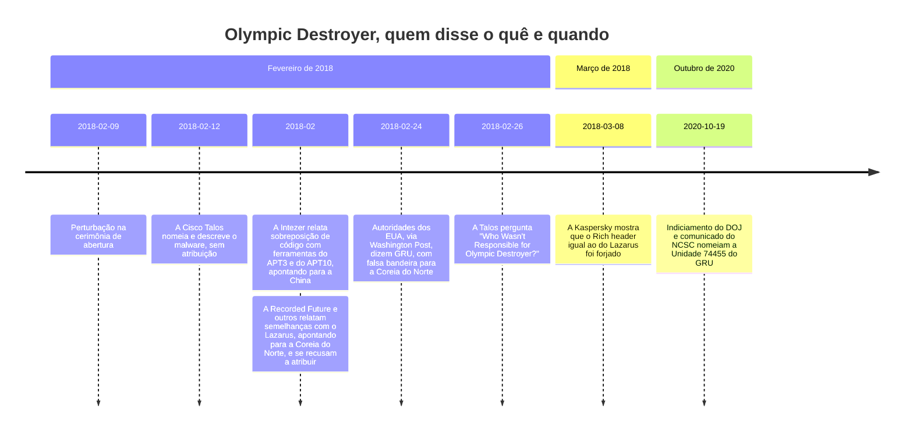
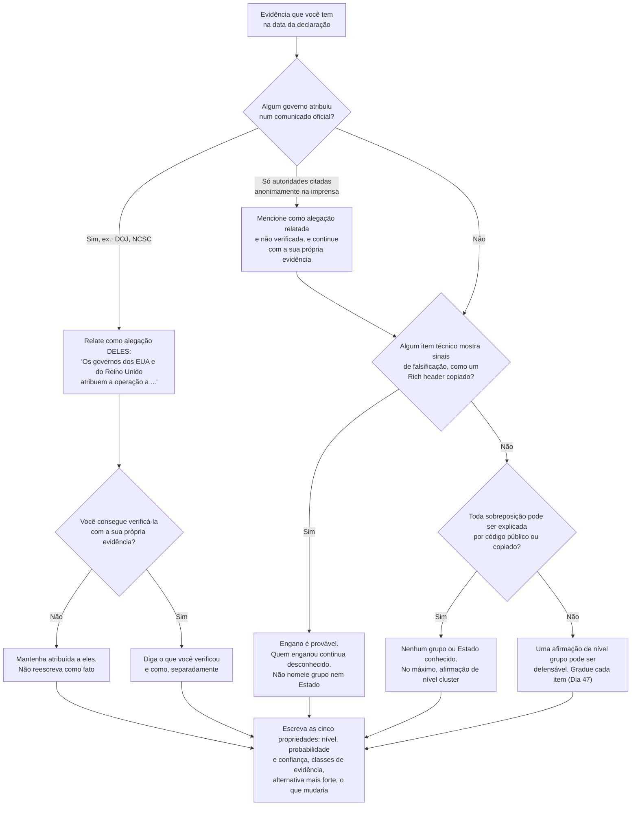

# Dia 48: Falsas bandeiras, e uma declaração de atribuição que você consegue defender

> 🇺🇸 Original: [*Day 48: False flags, and writing an attribution statement you can defend*](https://github.com/thiefdroppers/cyber-investigator-skills/blob/main/curriculum/phase-3-cyber-threat-intelligence/day-48.md) — © ThiefDroppers, licença MIT.
> Aqui: tradução fiel **+** camada brasileira. Nada do original foi removido; tudo o que é novo vem marcado com ➕.

**Fase 3. Inteligência de ameaças cibernéticas** · Meta da trilha: acompanhar como a atribuição pública de uma operação real de falsa bandeira mudou ao longo de dois anos e meio, e depois escrever uma declaração de atribuição cuja confiança corresponda à evidência. Este dia fecha a Fase 3.

Rank Jutsu: `B` · [](https://colab.research.google.com/github/Ridd1kulusC0d3r/investigador-cyber-90-dias/blob/main/curriculo/fase-3-inteligencia-de-ameacas/dia-48/dia-48.ipynb)

---

## 🎬 ➕ Abertura do caso — *A assinatura bonita demais*

Quarta-feira, 14 de outubro. Uma sexta onda do IscaKit aparece, agora contra uma cooperativa do Sul de Minas. Rafa chama você antes do almoço.

— Olha o JavaScript novo.

No topo do arquivo, onde antes havia só `// pescador`, agora há um bloco inteiro: `// pescador v2 — feito por [apelido de um grupo de golpistas conhecido de outro estado] — salve a quebrada`. Fuso horário UTC-3 nos metadados, gíria regional, e o nome de um grupo que aparece em notícia toda semana.

— É assinatura demais — diz Rafa. — Na primeira onda, o cara mal escreveu um comentário. Agora ele assina com nome, endereço e CEP? Ou ele ficou descuidado, ou alguém quer que a gente olhe para lá.

O Dr. Hélio entra na conversa por vídeo:

— A Marta quer mandar isso para a delegacia hoje. O que exatamente vocês podem afirmar?

O Dia 48 ensina a escrever uma declaração de atribuição que você consegue defender, inclusive quando a evidência foi plantada. *(Personagens e cenário: [Operação Isca](../../../caso-continuo/).)*

---

## 📖 Conceito

Uma falsa bandeira (*false flag*) é evidência plantada para fazer uma operação parecer obra de outra pessoa. O Olympic Destroyer é o exemplo público mais bem documentado. Em 9 de fevereiro de 2018, durante a cerimônia de abertura dos Jogos Olímpicos de Inverno de PyeongChang, um malware destrutivo perturbou os sistemas de TI dos organizadores, inclusive o site oficial e o Wi-Fi do centro de mídia olímpico. Nas semanas seguintes, pesquisadores confiáveis encontraram vínculos técnicos apontando para três países diferentes:

- A Intezer relatou código compartilhado com ferramentas atribuídas aos grupos APT3 e APT10, ligados à China. A Talos observou depois que a sobreposição com o APT3 vinha de um ladrão de credenciais baseado no Mimikatz, que qualquer pessoa pode baixar.
- Vários pesquisadores, entre eles a Recorded Future, relataram semelhanças de código com malware atribuído ao Lazarus Group, da Coreia do Norte.
- A Kaspersky descobriu que o *Rich header* do malware, metadados que as ferramentas de compilação da Microsoft gravam em executáveis do Windows, correspondia ao de um malware do Lazarus, mas era incoerente com a forma como o resto do arquivo tinha sido compilado. Alguém o tinha copiado. A Kaspersky intitulou seu texto de março de 2018 *"OlympicDestroyer is here to trick the industry"* ("O OlympicDestroyer está aqui para enganar o setor").

Em 24 de fevereiro de 2018, o *Washington Post* relatou que autoridades de inteligência dos EUA tinham concluído que a inteligência militar russa (GRU) realizou o ataque e tentou fazê-lo parecer obra da Coreia do Norte. Em outubro de 2020, o Departamento de Justiça dos EUA indiciou seis oficiais da Unidade 74455 do GRU por operações que incluíam o Olympic Destroyer e o NotPetya, e o NCSC do Reino Unido publicou a mesma atribuição. O ATT&CK hoje liga o software Olympic Destroyer (S0365) ao Sandworm Team (G0034).

As alegações públicas em ordem de data. As descobertas técnicas de pesquisadores externos apontam em três direções durante fevereiro; a resposta que se sustentou veio de governos:



A evidência técnica disponível a pesquisadores externos produziu três respostas contraditórias. A atribuição final veio de governos usando fontes de fora do malware. O texto da Talos de 26 de fevereiro de 2018 se intitulava *"Who Wasn't Responsible for Olympic Destroyer?"* ("Quem não foi responsável pelo Olympic Destroyer?") e, para analistas externos naquele momento, essa era a pergunta certa.

Uma declaração de atribuição que você consegue defender tem cinco propriedades. Ela nomeia o nível da atribuição (cluster, grupo, patrocinador ou indivíduo), dá uma probabilidade e um nível de confiança, declara as classes de evidência em que se apoia, nomeia a hipótese alternativa mais forte e diz o que mudaria a avaliação.

## 📚 Recursos

- [Cisco Talos, *"Who Wasn't Responsible for Olympic Destroyer?"*](https://blog.talosintelligence.com/2018/02/who-wasnt-responsible-for-olympic.html) (26 de fevereiro de 2018), e o [artigo mais longo do VB2018 pelos mesmos autores](https://www.virusbulletin.com/virusbulletin/2018/10/vb2018-paper-who-wasnt-responsible-olympic-destroyer/).
- [Kaspersky, *"OlympicDestroyer is here to trick the industry"*](https://securelist.com/olympicdestroyer-is-here-to-trick-the-industry/84295/) (8 de março de 2018): a análise do *Rich header*.
- [Recorded Future, *"Targeting of Olympic Games IT Infrastructure Remains Unattributed"*](https://www.recordedfuture.com/research/olympic-destroyer-malware) (fevereiro de 2018): um fornecedor se recusando publicamente a atribuir.
- [Washington Post, 24 de fevereiro de 2018](https://www.washingtonpost.com/world/national-security/russian-spies-hacked-the-olympics-and-tried-to-make-it-look-like-north-korea-did-it-us-officials-say/2018/02/24/44b5468e-18f2-11e8-92c9-376b4fe57ff7_story.html): a primeira notícia pública da conclusão do governo dos EUA (pode estar atrás de *paywall*).
- [Departamento de Justiça dos EUA, anúncio do indiciamento de 19 de outubro de 2020](https://www.justice.gov/opa/pr/six-russian-gru-officers-charged-connection-worldwide-deployment-destructive-malware-and).
- [TimelineJS](https://timeline.knightlab.com/): construtor gratuito de linhas do tempo que roda a partir de um modelo no Google Sheets.

### ➕ Recursos do contexto Brasil

- [Código Penal compilado](https://www.planalto.gov.br/ccivil_03/decreto-lei/del2848compilado.htm): art. 340 (comunicação falsa de crime ou de contravenção) e art. 339 (denunciação caluniosa), os dois limites de quem leva uma atribuição à delegacia.
- [Código de Processo Penal](https://www.planalto.gov.br/ccivil_03/decreto-lei/del3689compilado.htm): art. 5º, §3º, que permite a qualquer pessoa comunicar à autoridade policial a existência de infração penal.
- [SaferNet Brasil — Denúncie](https://new.safernet.org.br/denuncie) e as delegacias especializadas em crimes cibernéticos dos estados: os destinatários do pacote que fecha a Operação Isca na Fase 7.

## 🛠️ Prática: TimelineJS (uma linha do tempo das alegações de atribuição e uma declaração de atribuição calibrada)

O tema é uma operação reportada publicamente e as unidades governamentais nomeadas em comunicados oficiais. O indiciamento nomeia oficiais individualmente. Não pesquise, não perfile e não liste esses indivíduos. A sua linha do tempo registra alegações sobre grupos e organizações.

**Seu checklist de hoje.** Faça na ordem e marque cada item ao terminar:

- [ ] 1. Montar a tabela de alegações
- [ ] 2. Montar a linha do tempo
- [ ] 3. Escrever três declarações de atribuição
- [ ] 4. Montar o dossiê do caso da Fase 3
- [ ] 5. Testar uma declaração com um não especialista
- [ ] ➕ 6. Prática BR: a declaração do cluster CA-ISCA-01 para o Dr. Hélio
- [ ] ➕ 7. O notebook do dia no Colab

### 1. Montar a tabela de alegações

Cada linha é uma alegação pública sobre quem foi, ou quem não foi, responsável. Comece com estas e confira cada data e resumo contra a fonte. Acrescente pelo menos mais quatro a partir das fontes acima e dos links dentro delas.

| Data | Quem fez a alegação | Alegação (nível) | Classe de evidência | Falsificável? (graduação do Dia 47) |
|---|---|---|---|---|
| 2018-02-09 | (evento) | Perturbação durante a cerimônia de abertura | n/a | n/a |
| 2018-02-12 | Cisco Talos | Malware nomeado e descrito; sem atribuição | Análise de malware | n/a |
| 2018-02 | Intezer | Sobreposições de código com ferramentas do APT3 e do APT10 (grupo) | Código compartilhado | Sim: código derivado do Mimikatz é público |
| 2018-02 | Recorded Future e outros | Semelhanças com malware do Lazarus; recusaram-se a atribuir | Código compartilhado | Sim |
| 2018-02-24 | Autoridades dos EUA, via Washington Post | GRU, com falsa bandeira para a Coreia do Norte (patrocinador) | Não divulgada (fontes de governo) | Não avaliável de fora |
| 2018-03-08 | Kaspersky | O *Rich header* igual ao do Lazarus foi forjado | Metadados do malware | Esta descoberta expôs uma falsificação |
| 2020-10-19 | DOJ dos EUA; NCSC do Reino Unido | Unidade 74455 do GRU (patrocinador e indivíduos) | Processo judicial; inteligência | Não avaliável de fora |

### 2. Montar a linha do tempo

1. Abra o TimelineJS e faça uma cópia do modelo dele no Google Sheets.
2. Ponha uma alegação por linha. Use a coluna `Headline` para "quem alegou o quê" e a coluna `Text` para a classe de evidência e a sua nota de falsificabilidade. Ponha o link da fonte em `Media` ou no texto.
3. Use a coluna `Group` para pôr cada alegação numa faixa: "Apontou para a China", "Apontou para a Coreia do Norte", "Apontou para a Rússia", "Sem atribuição / evidência de falsificação".
4. Publique a planilha na web (Arquivo, depois Compartilhar, depois Publicar na web), cole a URL dela no gerador do TimelineJS e guarde o link de incorporação (*embed*) e uma captura de tela.

As faixas tornam o padrão visível: as primeiras alegações técnicas espalhadas por três faixas e depois concentradas numa só, após os comunicados de governo.

### 3. Escrever três declarações de atribuição

Escreva a declaração de atribuição que um analista externo cuidadoso poderia ter defendido em três momentos. Use as cinco propriedades da seção Conceito e a escala de probabilidade do seu Dia 46.

Antes de cada declaração, passe a evidência que você tem naquela data por este caminho. Ele decide que nível de afirmação você pode fazer e de quem é a afirmação:



Os insumos de 20 de fevereiro terminam em "nenhum grupo ou Estado conhecido", como no exemplo resolvido. Os insumos de 10 de março passam pelo ramo da imprensa (a notícia do *Washington Post*) e depois pelo ramo da falsificação (Kaspersky). Os insumos de 20 de outubro de 2020 seguem o ramo do comunicado oficial.

Em 20 de fevereiro de 2018 (exemplo resolvido):

> Avaliamos que a operação Olympic Destroyer foi conduzida por um ator capaz que plantou deliberadamente evidências enganosas (provável; confiança moderada). As sobreposições de código com ferramentas atribuídas a grupos ligados à China e ao Lazarus são, cada uma, explicáveis por código público ou copiado, e a evidência à nossa disposição não sustenta atribuição a nenhum grupo ou Estado conhecido. A alternativa mais forte é que uma dessas sobreposições seja genuína. A recuperação de ferramental ou infraestrutura não pública e exclusiva de um grupo conhecido mudaria esta avaliação.

Em 10 de março de 2018: escreva você mesmo. A descoberta da Kaspersky sobre o *Rich header* deve aumentar a sua confiança de que houve engano deliberado. Ela diz quem enganou?

Em 20 de outubro de 2020: escreva você mesmo. Separe o que os governos declararam do que você conseguiria verificar de forma independente. "Os governos dos EUA e do Reino Unido atribuem a operação à Unidade 74455 do GRU" é uma declaração de fato, com fonte, sobre a alegação deles. "A Unidade 74455 do GRU realizou a operação" é uma afirmação que você não verificou.

> ➕ **Nota de tradução.** O exemplo resolvido põe probabilidade e confiança juntas entre parênteses, como no original. A regra do ICD 203 do Dia 46 (frases separadas) é mais rígida; nas suas declarações, prefira separar: "Avaliamos como provável que... Confiança: moderada."

### 4. Montar o dossiê do caso da Fase 3

Reúna os artefatos da fase numa pasta com um índice curto:

| Dia | Artefato |
|---|---|
| 35 | Mapa de calor de densidade de subtécnicas; ficha de ID de técnica |
| 36 | Camada do Volt Typhoon com evidências; mapa de calor de comparação |
| 37 | Perfil do APT29; tabela de correspondência de aliases; ficha Diamond |
| 38 | Mapa de calor de taxa de base; comparação APT29 × APT28; linha do tempo de comportamento |
| 39 | Tabela de enriquecimento de IOCs |
| 40 | Grafo de pivôs de infraestrutura; registro de pivôs |
| 41 | Registro de instalação; plano de coleta; mapa de calor de risco de fontes |
| 42 | Mapas de calor de sites de vazamento com ressalvas |
| 43 | *Bundle* STIX validado; captura do visualizer |
| 44 | Registro de consultas TAXII; registro de decisão de compartilhamento |
| 45 | Matriz ACH do NotPetya; checagem de premissas-chave |
| 46 | Informe de uma página |
| 47 | Grafo de evidências do Turla |
| 48 | Linha do tempo do Olympic Destroyer; três declarações de atribuição |

### 5. Testar uma declaração com um não especialista

Leia uma das suas declarações em voz alta para alguém de fora da área. A pessoa deve conseguir dizer o quão seguro você está e por quê, sem perguntar nada a você. Se não conseguir, revise a declaração e tente de novo. Anote o resultado no índice do seu dossiê, sem nomear a pessoa.

### O que você tem ao terminar

- Uma linha do tempo publicada no TimelineJS com pelo menos onze alegações de atribuição datadas, em quatro faixas, cada uma com fonte e nota de falsificabilidade.
- Três declarações de atribuição datadas de fevereiro de 2018, março de 2018 e outubro de 2020, cada uma com nível, probabilidade, confiança, classes de evidência, a alternativa mais forte e o que mudaria a sua opinião.
- Um dossiê do caso da Fase 3 com índice, incluindo a anotação do passo 5.

### ➕ 6. Prática BR: a declaração do cluster CA-ISCA-01 para o Dr. Hélio

A sexta onda trouxe a "assinatura bonita demais". As alegações do caso, em ordem de data, estão em [`caso-continuo/dados/dia-48/alegacoes-iscakit.csv`](../../../caso-continuo/dados/dia-48/alegacoes-iscakit.csv) (fictícias), com as mesmas colunas da tabela do passo 1 e quatro faixas: "Apontou para o vendedor do kit", "Apontou para o grupo do outro estado", "Cluster CA-ISCA-01 (Vigia)", "Sem atribuição / evidência de falsificação".

1. Passe a evidência de **14/out/2026** pelo fluxograma do passo 3. Qual ramo? (Nenhum comunicado oficial; um item mostra sinais de falsificação: o bloco de "assinatura" é incoerente com as cinco ondas anteriores e nomeia um grupo que é notícia toda semana.)
2. Escreva a declaração com as cinco propriedades. Nível: **cluster**. Sem nome de pessoa, sem nome de grupo como autor; o grupo citado no comentário aparece só como "o grupo nomeado no comentário", entre aspas, como **alegação plantada no artefato**.
3. Escreva um segundo parágrafo para o Dr. Hélio: **o que a cooperativa pode comunicar à delegacia** (fatos e artefatos, com hashes e registro de custódia; a avaliação da Vigia como avaliação) e **o que não deve** (qualquer frase que impute o crime ao grupo nomeado no comentário).
4. Leia a declaração para alguém de fora da área (passo 5) e anote o resultado no índice, sem nomear a pessoa.

Modelo:

> Avaliamos que a sexta onda pertence ao cluster CA-ISCA-01 (provável). Confiança: moderada, porque o kit, o caminho de envio e o horário de disparo coincidem com as ondas anteriores, mas não há certificado nem servidor em comum. Avaliamos como provável que o bloco de comentários que cita "o grupo nomeado no comentário" foi plantado para desviar a atribuição. Confiança: moderada, porque ele é incoerente com cinco ondas anteriores sem assinatura e nomeia um grupo de alta visibilidade. A evidência à nossa disposição não sustenta atribuição a nenhum grupo ou pessoa. A alternativa mais forte é que o operador tenha passado a assinar por descuido ou vaidade. Dados cadastrais e registros de conexão obtidos por ordem judicial mudariam esta avaliação.

### ➕ 7. O notebook do dia

Abra o [notebook do Dia 48 no Colab](https://colab.research.google.com/github/Ridd1kulusC0d3r/investigador-cyber-90-dias/blob/main/curriculo/fase-3-inteligencia-de-ameacas/dia-48/dia-48.ipynb). Nele você:

1. carrega a tabela de alegações do Olympic Destroyer, vê a **linha do tempo em faixas** em texto e exporta o CSV com as colunas do modelo do TimelineJS (`Year`, `Month`, `Day`, `Headline`, `Text`, `Group`...), pronto para colar no Google Sheets;
2. percorre o **fluxograma do passo 3 como função** para as três datas do original e para 14/out/2026 do caso brasileiro;
3. escreve as declarações por formulário e passa cada uma por um **verificador das cinco propriedades** (nível, probabilidade, confiança, classes de evidência, alternativa, o que mudaria), que também reaproveita a checagem de calibração do Dia 46 e acusa nomes de pessoa e afirmações de governo reescritas como fato;
4. gera o **índice do dossiê da Fase 3** (com os artefatos dos Dias 35 a 48 e os do caso Isca) em Markdown.

## ✅ Checkpoint

- A sua declaração de fevereiro de 2018 não nomeia nenhum Estado como responsável.
- A sua declaração de outubro de 2020 atribui a alegação aos governos que a fizeram.
- A sua declaração de outubro de 2020 não apresenta essa alegação como algo que você verificou.
- Toda entrada da linha do tempo tem link para uma fonte primária ou para uma reportagem que cite uma.
- O índice do seu dossiê registra que um ouvinte de fora da área conseguiu dizer o quão seguro você está e por quê, sem perguntar nada a você, depois de ouvir uma declaração lida em voz alta.
- Nenhum indivíduo é nomeado em nenhum ponto da sua linha do tempo ou das suas declarações.
- Sem consultar notas, diga a diferença entre "Os governos dos EUA e do Reino Unido atribuem a operação à Unidade 74455 do GRU" e "A Unidade 74455 do GRU realizou a operação".

### ➕ Checkpoint BR

- A declaração do CA-ISCA-01 está no nível cluster e passa no verificador das cinco propriedades.
- O grupo citado no comentário da sexta onda aparece só como alegação plantada no artefato, nunca como sujeito de uma afirmação de autoria.
- O parágrafo para o Dr. Hélio separa fatos (com hash e custódia) de avaliação, e não imputa o crime a ninguém.
- O índice do dossiê da Fase 3 inclui os artefatos da Operação Isca dos Dias 42 a 48.
- Sem consultar notas, você explica por que "assinatura demais" é, por si só, um sinal para aplicar o ramo da falsificação.

## ⚖️ ➕ Camada jurídica BR

**Comunicar à polícia é direito; acusar sem base é crime.** Qualquer pessoa do povo que tiver conhecimento de infração penal pode comunicá-la à autoridade policial (CPP, art. 5º, §3º). A cooperativa pode e deve levar os fatos e os artefatos do golpe à delegacia. O limite está em imputar o crime a alguém: dar causa à instauração de investigação contra alguém, imputando-lhe crime de que o sabe inocente, é denunciação caluniosa (CP, art. 339); provocar a ação da autoridade comunicando crime que sabe não ter ocorrido é comunicação falsa de crime (CP, art. 340). Uma falsa bandeira é exatamente a armadilha que transforma a vítima num denunciante de inocentes.

**Na prática, para o Dr. Hélio.** O pacote para a delegacia leva: os fatos (datas, SMS, domínios, IPs de documentação do caso, número de reclamações), os artefatos com hash e registro de custódia (CPP, arts. 158-A a 158-F), e a avaliação da Vigia **identificada como avaliação**, com a declaração calibrada deste dia. Ele não leva nome de pessoa, nem o nome do grupo citado no comentário como suspeito. Os pedidos que chegam a pessoas (dados cadastrais, registros de conexão, titularidade das contas dos Pix) são da autoridade policial e do Judiciário (Marco Civil, arts. 10 e 22; LC 105/2001).

**Indivíduos nomeados em indiciamentos.** O original proíbe pesquisar os oficiais nomeados no indiciamento de 2020. No Brasil, o mesmo vale para pessoas citadas em inquéritos e denúncias: estar nomeado num documento público de acusação não torna a pessoa alvo legítimo de perfil, e a presunção de inocência (Constituição, art. 5º, LVII) segue valendo até o trânsito em julgado.

> Este repositório é material de estudo e não constitui orientação jurídica.

## 🧠 ➕ Camada 8 — o engano que explora o seu método

Uma falsa bandeira não engana pessoas descuidadas; engana pessoas **metódicas**, porque é desenhada para passar nos testes que elas aplicam. O *Rich header* do Olympic Destroyer foi plantado para quem sabe ler *Rich headers*. É a lógica clássica da dissimulação militar: mostrar ao adversário o que ele espera ver.

Dois mecanismos tornam o analista vulnerável. O primeiro é o **viés de confirmação** combinado com a **disponibilidade**: um grupo que aparece no noticiário toda semana é a primeira hipótese que vem à mente, e uma pista que aponta para ele "faz sentido" depressa demais. O segundo é a **pressão por fechamento** do Dia 47, agora com prazo: a Marta quer ir à delegacia hoje.

O antídoto do dia é a pergunta da Talos: *quem **não** foi?*. Ela inverte o ônus. Em vez de procurar quem a pista indica, você pergunta o que a pista **exclui** e quanto custaria plantá-la. Uma pista barata que aponta para um suspeito óbvio é, antes de tudo, um dado sobre quem quer ser confundido com ele.

E há uma consequência humana: uma atribuição errada a um grupo "conhecido" pode atingir pessoas reais, com nome e família, que não fizeram o que se diz. Cace padrões, não pessoas, vale ainda mais quando alguém está tentando escolher a pessoa por você.

## 🤖 ➕ Skill do dia

O dia propõe à skill o procedimento novo **"declaração de atribuição (cinco propriedades)"**: o fluxograma de quem afirma o quê, o ramo de falsificação, e as cinco propriedades obrigatórias, com proibição de nomear indivíduos. Ele fecha o arco de inteligência de ameaças da skill. Detalhes em [`_skill-delta.md`](_skill-delta.md).

## 💡 ➕ Inovação OSINT do dia — linha do tempo do TimelineJS gerada por código

O TimelineJS lê uma planilha com colunas fixas. Em vez de digitar onze linhas à mão, gere o CSV da sua tabela de alegações e cole no modelo do Google Sheets. Só com `csv`:

```python
import csv
COLUNAS = ["Year", "Month", "Day", "Time", "End Year", "End Month", "End Day", "End Time",
           "Display Date", "Headline", "Text", "Media", "Media Credit", "Media Caption",
           "Media Thumbnail", "Type", "Group", "Background"]           # cabeçalho do modelo do TimelineJS
alegacoes = [("2018-02-12", "Cisco Talos: malware nomeado, sem atribuição",
              "Classe: análise de malware.", "https://blog.talosintelligence.com/...", "Sem atribuição / evidência de falsificação")]
with open("timeline.csv", "w", newline="", encoding="utf-8") as f:
    w = csv.DictWriter(f, fieldnames=COLUNAS)
    w.writeheader()
    for data, titulo, texto, fonte, faixa in alegacoes:
        a, m, *d = data.split("-")                                   # "2018-02" (sem dia) também funciona
        w.writerow({"Year": a, "Month": m, "Day": d[0] if d else "",
                    "Headline": titulo, "Text": texto, "Media": fonte, "Group": faixa})
```

Confira o cabeçalho com o modelo atual do TimelineJS antes de colar: o projeto pode mudar colunas entre versões. O notebook do dia gera o arquivo completo do Olympic Destroyer e o do caso Isca.

## 📝 Diário de estudo

- Data:
- Tempo gasto:
- O que ficou claro:
- O que ainda está nebuloso:
- Artefato produzido: linha do tempo no TimelineJS (link + captura), três declarações de atribuição, índice do dossiê da Fase 3 com a anotação do passo 5; declaração do CA-ISCA-01 e parágrafo para o Dr. Hélio

---
<sub>Baseado em [cyber-investigator-skills](https://github.com/thiefdroppers/cyber-investigator-skills) por ThiefDroppers (MIT). Tradução, camada BR, Camada 8, skill pt-BR e notebook por Deivison Lourenço (@Ridd1kulusC0d3r).</sub>
