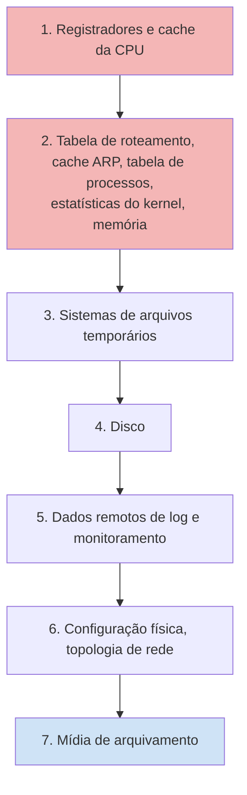
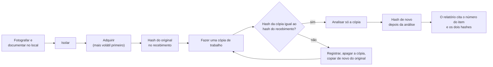
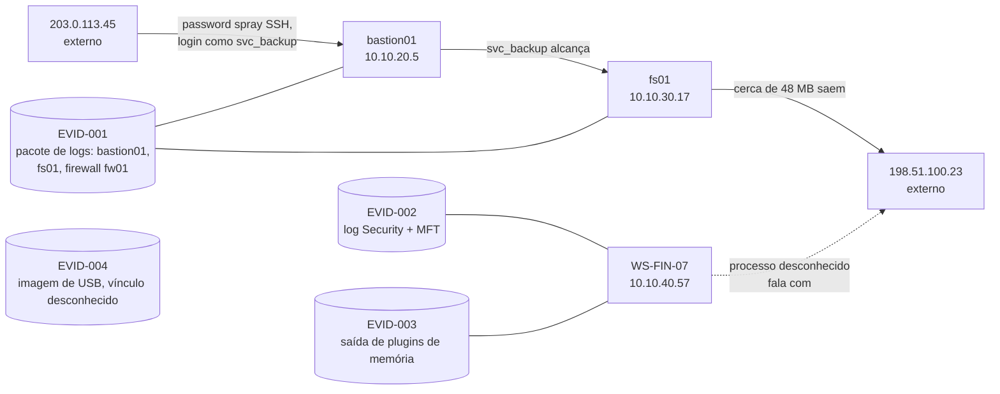

# Dia 49: Manuseio de evidência: hash e cadeia de custódia

> 🇺🇸 Original: [*Day 49: Evidence handling, hashing and chain of custody*](https://github.com/thiefdroppers/cyber-investigator-skills/blob/main/curriculum/phase-4-digital-forensics-incident-investigation/day-49.md) — © ThiefDroppers, licença MIT.
> Aqui: tradução fiel **+** camada brasileira. Nada do original foi removido; tudo o que é novo vem marcado com ➕.

**Fase 4. Forense digital e investigação de incidentes** · Meta da trilha: receber evidência de modo que cada achado posterior desta fase possa ser rastreado até um arquivo cuja integridade você consegue provar.

Rank Jutsu: `B` · [](https://colab.research.google.com/github/Ridd1kulusC0d3r/investigador-cyber-90-dias/blob/main/curriculo/fase-4-forense-e-resposta/dia-49/dia-49.ipynb)

---

## 🎬 ➕ Abertura do caso — *O pen drive lacrado*

Segunda-feira, 5 de outubro, 14h30. Marta Quintão liga de novo, agora com a voz baixa:

— Achamos uma coisa pior. A caixa da agência Centro clicou no link hoje cedo. No notebook do trabalho, o `SA-CX-07`. A TI quer desligar ele agora.

Rafa pega o telefone da sua mão: — Não desliga. Primeiro a memória, num disco externo. Depois desliga. Eu fico na linha.

Às 16h05, o analista de TI da cooperativa chega à Vigia com o notebook desligado numa sacola, um disco externo com a captura de memória e um pen drive num envelope pardo, lacre `SA-0001`, com os logs da manhã. Você estende a mão para o pen drive. Rafa segura seu pulso.

— Primeiro o formulário. Quem entregou, a que horas, em UTC, com qual lacre, por qual autorização. Depois o hash. Só depois a análise.

O Dr. Hélio Brandão, no viva-voz, completa:

— Se isso for parar num inquérito, a defesa vai perguntar quem tocou nesse pen drive entre as 16h e as 16h05. Quero uma resposta escrita.

Hoje a Operação Isca vira um caso de forense. *(Personagens e cenário: [Operação Isca](../../../caso-continuo/).)*

---

## 📖 Conceito

A Fase 4 acompanha um único caso sintético, o LAB-P4, do recebimento ao relatório final. Hoje você assume a custódia do primeiro item de evidência. Nada do que você concluir no Dia 64 vai resistir a um leitor cético se você não conseguir mostrar que o arquivo que analisou é o arquivo que recebeu.

Três hábitos carregam a maior parte do peso.

Ordem de volatilidade. A RFC 3227 ordena a evidência pela velocidade com que ela desaparece: registradores e cache da CPU, depois tabelas de roteamento e ARP, tabela de processos e memória, depois sistemas de arquivos temporários, depois disco, depois logs remotos, depois mídia de arquivamento. Você coleta do topo dessa lista para baixo. Puxar o cabo de uma máquina ligada para "preservar" o disco destrói a memória, e a memória é onde você teria encontrado a conexão de rede e o código injetado (Dias 53 e 54).

Hash no recebimento, hash antes da análise, hash depois da análise. Um hash criptográfico (use SHA-256; MD5 e SHA-1 continuam sendo impressos por muitas ferramentas por compatibilidade, mas os dois têm ataques de colisão práticos) é a impressão digital dos bytes exatos. Se o valor que você registra hoje bater com o valor do Dia 64, você pode dizer que os bytes não mudaram. Se você só calculou o hash uma vez, não pode dizer nada sobre o intervalo.

Custódia é um registro escrito. O formulário de cadeia de custódia diz quem guardou o item, quando, onde, por quê, e se o lacre e o hash ainda conferiam em cada passagem de mão. Uma lacuna entre duas linhas é uma lacuna que qualquer pessoa contestando o seu trabalho pode apontar. O formulário também registra a autoridade legal para a coleta. "Eu tinha acesso de administrador" não é autoridade; uma carta de contratação, uma política do empregador assinada, um termo de consentimento ou um mandado são.

A ordem importa porque cada passo protege o seguinte. Fotografe e documente antes de tocar, isole antes de adquirir, adquira antes de analisar, calcule o hash antes e depois de cada cópia, e analise só cópias.

A ordem de volatilidade da RFC 3227, do topo da lista para baixo. Colete nesta ordem num sistema ligado:



A sequência de manuseio, com a checagem de hash que decide se uma cópia pode ser usada:



O caso LAB-P4 como o *briefing* o descreve, com o item de evidência que cada host fornece. Trate cada seta como uma afirmação que você ainda não conferiu; até o Dia 64, cada uma precisa de uma referência de evidência ou de um rótulo dizendo que não está provada.



## 📚 Recursos

- [RFC 3227, *Guidelines for Evidence Collection and Archiving*](https://www.rfc-editor.org/rfc/rfc3227): a seção 2.1 é a ordem de volatilidade.
- [NIST SP 800-86, *Guide to Integrating Forensic Techniques into Incident Response*](https://csrc.nist.gov/pubs/sp/800/86/final): seções 3 e 4, sobre coleta e exame.
- [Documentos de boas práticas do SWGDE](https://www.swgde.org/documents/published-complete-listing/): procure "collection" e "acquisition".
- Manual do GNU coreutils, [invocação do `sha256sum`](https://www.gnu.org/software/coreutils/manual/html_node/sha2-utilities.html). No macOS use `shasum -a 256` (mesmo formato de saída).

### ➕ Recursos do contexto Brasil

- [Código de Processo Penal, compilado](https://www.planalto.gov.br/ccivil_03/decreto-lei/del3689compilado.htm): arts. 158-A a 158-F (cadeia de custódia), incluídos pela Lei 13.964/2019.
- [Lei 13.964/2019 ("Pacote Anticrime")](https://www.planalto.gov.br/ccivil_03/_ato2019-2022/2019/lei/l13964.htm): a lei que levou a cadeia de custódia para dentro do CPP.
- [ABNT NBR ISO/IEC 27037](https://www.abntcatalogo.com.br/): versão brasileira da norma de identificação, coleta, aquisição e preservação de evidência digital (norma paga; o catálogo da ABNT mostra a ficha).
- [CERT.br, documentação sobre tratamento de incidentes](https://www.cert.br/docs/): material em português para quem responde a incidentes no Brasil.

## 🛠️ Prática: sha256sum e o formulário de cadeia de custódia

O item de evidência EVID-001 deste laboratório é o pacote de logs sintético em [`resources/case-lab-p4/logs/`](https://github.com/thiefdroppers/cyber-investigator-skills/tree/main/curriculum/phase-4-digital-forensics-incident-investigation/resources/case-lab-p4/logs) (cópia local: [`upstream/.../case-lab-p4/logs/`](../../../upstream/curriculum/phase-4-digital-forensics-incident-investigation/resources/case-lab-p4/logs/)). Trate-o como se um administrador da fictícia Example Fabrication Co. tivesse acabado de entregá-lo a você num pen drive.

> ➕ Nos comandos abaixo, `resources/` é a pasta `upstream/curriculum/phase-4-digital-forensics-incident-investigation/resources/` deste repositório. Rode a partir de `upstream/curriculum/phase-4-digital-forensics-incident-investigation/`, ou troque o caminho.

**Seu checklist de hoje.** Faça na ordem e marque cada item ao terminar:

- [ ] Monte uma área de trabalho que mantém o original separado das suas cópias.
- [ ] Calcule o hash de cada arquivo no recebimento e salve o manifesto.
- [ ] Trabalhe só numa cópia, e prove que ela é idêntica.
- [ ] Veja a checagem de hash pegar um arquivo adulterado.
- [ ] Preencha `resources/chain-of-custody-form.md` para o EVID-001.
- [ ] Escreva manifestos de hash para o EVID-002 e o EVID-003.
- [ ] ➕ Prática BR: receba o EVID-SA-001 da Serra Azul com o formulário estendido pelo CPP.
- [ ] ➕ O notebook do dia: custódia em Python, teste de adulteração e o quiz das 10 etapas do art. 158-B.

1. Monte uma área de trabalho que mantém o original separado das suas cópias.

   ```bash
   mkdir -p ~/lab-p4/{evidence,work,notes}
   cp -a resources/case-lab-p4/logs ~/lab-p4/evidence/EVID-001
   chmod -R a-w ~/lab-p4/evidence/EVID-001
   ```

   `cp -a` preserva os *timestamps*; `chmod a-w` tira a permissão de escrita para que um redirecionamento acidental não sobrescreva o "original". Isto é um substituto de laboratório para um bloqueador de escrita (*write blocker*) de hardware, que você vai conhecer amanhã.

2. Calcule o hash de cada arquivo no recebimento e salve o manifesto.

   ```bash
   cd ~/lab-p4/evidence/EVID-001
   sha256sum * | tee ~/lab-p4/notes/EVID-001.receipt.sha256
   date -u +"%Y-%m-%dT%H:%M:%SZ received EVID-001" >> ~/lab-p4/notes/actions.log
   ```

   A saída tem uma linha por arquivo: 64 caracteres hexadecimais, dois espaços, nome do arquivo. Os valores que você obtiver precisam bater com os de qualquer outra cópia deste repositório no mesmo *commit*, porque os arquivos são determinísticos.

3. Trabalhe só numa cópia, e prove que a cópia é idêntica.

   ```bash
   cp -a ~/lab-p4/evidence/EVID-001 ~/lab-p4/work/EVID-001
   cd ~/lab-p4/work/EVID-001
   sha256sum -c ~/lab-p4/notes/EVID-001.receipt.sha256
   ```

   Toda linha deve terminar em `OK`. `sha256sum -c` lê o manifesto, recalcula o hash de cada arquivo nomeado e compara.

4. Veja a checagem pegar uma mudança. Acrescente um caractere à cópia de trabalho do log do firewall e confira de novo.

   ```bash
   chmod u+w firewall.log && printf ' ' >> firewall.log
   sha256sum -c ~/lab-p4/notes/EVID-001.receipt.sha256
   ```

   Você vai ver `firewall.log: FAILED` e um aviso de que 1 *checksum* calculado NÃO conferiu. Um único espaço muda o hash inteiro. Apague a cópia de trabalho e faça uma nova a partir de `evidence/`; escreva o que aconteceu no `actions.log`. Essa entrada de log faz parte do registro: examinadores erram, e um erro documentado e corrigido é defensável, enquanto um erro escondido não é.

5. Preencha [`resources/chain-of-custody-form.md`](../../../upstream/curriculum/phase-4-digital-forensics-incident-investigation/resources/chain-of-custody-form.md) para o EVID-001. Use estes valores de laboratório onde você não tiver valores reais:

   | Campo | Valor de laboratório |
   |---|---|
   | Número do caso | LAB-P4 |
   | Coletado de | Exportação do *relay* de syslog, Example Fabrication Co. (fictícia) |
   | Autoridade legal | Carta de contratação LAB-P4-EL, cláusula 3 (fictícia) |
   | Embalagem | Envelope lacrado, lacre LAB-0001 |

   As Partes B e C pedem os seus hashes e horários reais dos passos 2 e 3. Acrescente a linha de transferência 1 (administrador para você) e a linha 2 (você para o seu diretório de trabalho, hash reconferido).

   ➕ O formulário, traduzido (o original fica intacto em `upstream/`; esta é a versão pt-BR para as suas notas):

   ```markdown
   # Formulário de cadeia de custódia

   Use um formulário por item de evidência. Preencha à caneta ou num arquivo cujo hash você calcula
   no fim de cada dia. Nunca edite uma linha passada; corrija com uma nova linha datada que nomeie
   a linha que ela corrige. Uso de laboratório: o caso LAB-P4 é sintético.

   ## Parte A: identificação do item

   | Campo | Registro |
   |---|---|
   | Número do caso | |
   | Número do item de evidência | |
   | Descrição (marca, modelo, capacidade, cor, marcações) | |
   | Número de série | |
   | Coletado de (local, nome do host, papel do custodiante) | |
   | Autoridade legal para a coleta (mandado, termo de consentimento, cláusula de política do empregador, carta de contratação) | |
   | Coletado por (nome, papel) | |
   | Data e hora da coleta (UTC, e o fuso local em uso) | |
   | Condição na coleta (ligado/desligado, estado da tela, danos, lacres) | |
   | Fotografias tiradas (nomes dos arquivos e hashes) | |
   | Embalagem e número do lacre | |

   ## Parte B: registro de aquisição

   | Campo | Registro |
   |---|---|
   | Bloqueador de escrita usado (modelo de hardware ou método de software) | |
   | Ferramenta de aquisição e versão exata | |
   | Comando exato ou opções de GUI usadas | |
   | Hash do dispositivo de origem, algoritmo | |
   | Nome(s) e formato do(s) arquivo(s) de imagem (raw/dd, E01, AFF4) | |
   | Hash da imagem, algoritmo | |
   | Os hashes conferem? (sim/não, e o que foi feito se não) | |
   | Setores defeituosos ou erros de leitura relatados | |
   | Início e fim da aquisição (UTC) | |
   | Assinatura do examinador | |

   ## Parte C: registro de transferências

   Toda vez que o item ou a sua imagem muda de mãos ou de lugar, acrescente uma linha.
   Uma lacuna entre linhas é uma lacuna na custódia.

   | # | Data e hora (UTC) | Entregue por | Recebido por | Finalidade | Local após a transferência | Lacre intacto? | Hash reconferido (valor ou "n/a, lacrado") |
   |---|---|---|---|---|---|---|---|
   | 1 | | | | | | | |
   | 2 | | | | | | | |
   | 3 | | | | | | | |

   ## Parte D: destinação final

   | Campo | Registro |
   |---|---|
   | Destinação (devolvido, retido, destruído) e autoridade | |
   | Data e hora (UTC) | |
   | Testemunha | |
   ```

   Os passos 1 a 5 como uma sequência de custódia. Cada seta é algo que suas notas ou o formulário precisam registrar:

   ```mermaid
   sequenceDiagram
       participant Admin as Administrador (fictício)
       participant You as Você (examinador)
       participant Ev as evidence/EVID-001 (só leitura)
       participant Wk as work/EVID-001
       participant N as notes/
       Admin->>You: entrega o EVID-001, lacre LAB-0001
       Note over Admin,You: formulário de custódia, transferência 1
       You->>Ev: cp -a, depois chmod -R a-w
       Ev->>N: sha256sum, salvo como EVID-001.receipt.sha256
       Ev->>Wk: cp -a, cópia de trabalho
       Note over Ev,Wk: formulário de custódia, transferência 2
       Wk->>N: sha256sum -c, os quatro OK
       You->>Wk: teste de adulteração, um espaço acrescentado ao firewall.log
       Wk->>N: firewall.log FAILED, escrito no actions.log
       Ev->>Wk: cópia nova, sha256sum -c OK de novo
   ```

6. Escreva o mesmo manifesto de hash para as pastas Windows, memória e sistema de arquivos, como EVID-002 (`resources/case-lab-p4/windows/` mais `filesystem/`) e EVID-003 (`resources/case-lab-p4/memory/`). Você vai citar os três números de item no relatório do Dia 64.

Artefato: `~/lab-p4/notes/` contendo três manifestos `.receipt.sha256`, o `actions.log` e um formulário de cadeia de custódia preenchido para o EVID-001.

### ➕ Prática BR: o EVID-SA-001 e o formulário que o CPP pede

O pen drive da cena está em [`caso-continuo/dados/dia-49/EVID-SA-001/`](../../../caso-continuo/dados/dia-49/EVID-SA-001/): trechos do proxy, do firewall e do webmail da Serra Azul na manhã de 5/out/2026 (tudo sintético; leia o [`LEIA-ME`](../../../caso-continuo/dados/dia-49/LEIA-ME.md)).

**Exercício 1: a mesma disciplina, outro caso.** Repita os passos 1 a 4 com o EVID-SA-001:

```bash
mkdir -p ~/caso-isca/{evidence,work,notes}
cp -a caso-continuo/dados/dia-49/EVID-SA-001 ~/caso-isca/evidence/EVID-SA-001
chmod -R a-w ~/caso-isca/evidence/EVID-SA-001
cd ~/caso-isca/evidence/EVID-SA-001
sha256sum * | tee ~/caso-isca/notes/EVID-SA-001.receipt.sha256
date -u +"%Y-%m-%dT%H:%M:%SZ recebido EVID-SA-001, lacre SA-0001" >> ~/caso-isca/notes/actions.log
```

**Exercício 2: o formulário estendido.** O formulário do original é bom e é internacional. O CPP, a partir da Lei 13.964/2019, organiza a cadeia de custódia em **dez etapas** (art. 158-B) e exige que todo rompimento de lacre fique registrado com quem rompeu, quando, onde, para quê e qual é o novo lacre (art. 158-D). Acrescente ao seu formulário pt-BR esta Parte E e preencha para o EVID-SA-001:

```markdown
## ➕ Parte E: campos que o CPP pede (arts. 158-A a 158-F)

| Campo | Registro |
|---|---|
| Etapa atual (art. 158-B): reconhecimento, isolamento, fixação, coleta, acondicionamento, transporte, recebimento, processamento, armazenamento ou descarte | |
| Quem reconheceu o vestígio como de interesse (no CPP, art. 158-A, §2º, é o agente público que reconhece; aqui, registre quem na cooperativa e na Vigia) | |
| Fixação: descrição detalhada do vestígio como foi encontrado, com fotos/prints e seus hashes | |
| Recipiente e lacre numerado individualmente (art. 158-D) | |
| Rompimento de lacre: nome e matrícula/função de quem rompeu, data/hora UTC, local, finalidade, número do novo lacre (art. 158-D, §4º) | |
| O lacre rompido foi guardado dentro do novo recipiente? (art. 158-D, §5º) | |
| Recebimento: protocolo, quem recebeu, origem, data/hora (art. 158-B, VII) | |
| Onde fica armazenado e quem tem acesso (análogo à central de custódia do art. 158-E) | |
| Destino previsto: entrega à autoridade, devolução à cooperativa ou descarte, e quem autoriza (art. 158-B, X) | |
```

Valores do caso para usar: caso `VIGIA-2026-001 / Operação Isca`; item `EVID-SA-001`; entregue por "analista de TI da Cooperativa Serra Azul"; autoridade "contrato de serviço Vigia × Serra Azul, assinado por Marta Quintão em 5/out/2026 11h00 BRT, e política de uso de equipamentos da cooperativa"; lacre `SA-0001`; recebido às 19h05 UTC (16h05 em Brasília).

Quando você romper o lacre `SA-0001` para copiar os arquivos, isso é uma linha nova na Parte C **e** um registro na Parte E, com o número do lacre novo (`VIGIA-0107`).

### ➕ O notebook do dia

Abra o [notebook do Dia 49 no Colab](https://colab.research.google.com/github/Ridd1kulusC0d3r/investigador-cyber-90-dias/blob/main/curriculo/fase-4-forense-e-resposta/dia-49/dia-49.ipynb). Nele você:

1. baixa o EVID-001 do repositório original (com plano B offline: o pacote vem embutido no notebook) e monta `evidence/`, `work/` e `notes/`;
2. gera o manifesto no formato do `sha256sum` e confere a cópia com uma função que faz o mesmo que `sha256sum -c`;
3. roda o teste de adulteração, vê o `FAILED`, refaz a cópia e registra tudo no `actions.log`;
4. faz o mesmo com o EVID-SA-001 da Serra Azul;
5. joga o **quiz das 10 etapas** do art. 158-B e o da ordem de volatilidade;
6. preenche o formulário de custódia (Partes A a E) por formulário e sai com o `.md` e o hash dele.

## ✅ Checkpoint

- `sha256sum -c` contra o seu manifesto do EVID-001 retorna `OK` para os quatro arquivos na sua cópia de trabalho nova.
- Seu formulário de custódia não tem linha vazia entre o recebimento e a sua cópia de trabalho atual.
- Toda linha do seu formulário de custódia tem horário em UTC.
- O `actions.log` tem uma linha registrando o teste de adulteração.
- O `actions.log` tem uma linha registrando a substituição da cópia de trabalho.
- Sem consultar notas, você diz em duas frases por que um único hash calculado depois da análise vale menos que dois hashes calculados antes e depois.

### ➕ Checkpoint BR

- Seu manifesto do EVID-SA-001 tem três linhas e `sha256sum -c` dá `OK` nas três.
- Sua Parte E registra o rompimento do lacre `SA-0001` com o novo lacre `VIGIA-0107`.
- Sem consultar notas, você lista as dez etapas do art. 158-B na ordem (o quiz do notebook conta).
- Você explica, em uma frase, por que o horário de recebimento entra no formulário em UTC **e** com o fuso local em uso (o pen drive chegou às 16h05 em Brasília, 19h05 UTC).

## ⚖️ ➕ Camada jurídica BR

**CPP, arts. 158-A a 158-F (Lei 13.964/2019).** O art. 158-A define a cadeia de custódia como o conjunto de procedimentos para manter e documentar a história cronológica do vestígio coletado, rastreando sua posse e manuseio desde o reconhecimento até o descarte. O §2º diz que o **agente público** que reconhecer um elemento como de potencial interesse para a prova pericial fica responsável por preservá-lo, e o §3º define vestígio como todo objeto ou material bruto, visível ou latente, constatado ou recolhido, que se relaciona à infração penal. O art. 158-B lista as dez etapas: reconhecimento, isolamento, fixação, coleta, acondicionamento, transporte, recebimento, processamento, armazenamento e descarte. O art. 158-C diz que a coleta deve ser feita preferencialmente por perito oficial. O art. 158-D trata do recipiente lacrado, com lacres numerados individualmente, diz que o recipiente só pode ser aberto pelo perito que vai analisar ou, motivadamente, por pessoa autorizada, e manda registrar na ficha de acompanhamento cada rompimento de lacre (nome e matrícula do responsável, data, local, finalidade e o novo lacre), guardando o lacre rompido dentro do novo recipiente. O art. 158-E exige centrais de custódia nos institutos de criminalística, e o art. 158-F manda devolver o material à central depois da perícia.

**O que isso significa para a Vigia.** Esses artigos regulam a persecução penal e se dirigem, antes de tudo, aos agentes públicos e peritos oficiais. Uma MSSP privada não vira perito oficial por seguir o CPP. Mas o que a Vigia coleta hoje pode virar notícia-crime amanhã, e a primeira pergunta da defesa sobre um vestígio digital costuma ser sobre a cadeia de custódia. Espelhar as etapas do art. 158-B e o registro de lacres do art. 158-D no seu formulário custa pouco e evita que a prova (ou o seu relatório) seja contestada por uma lacuna que você podia ter fechado. <!-- TODO jurídico: confirmar e, se for útil, citar decisões recentes do STJ sobre as consequências da quebra da cadeia de custódia de prova digital. -->

**Autoridade para a coleta.** O formulário do original pede "autoridade legal". No caso Serra Azul ela é contratual (o contrato assinado pela Marta) somada à política de uso de equipamentos da cooperativa, porque o notebook `SA-CX-07` é patrimônio da cooperativa e a caixa é usuária dele. Isso não autoriza a Vigia a ir além do notebook: o celular pessoal da caixa, por exemplo, fica fora, salvo consentimento específico e por escrito dela. O "Dr. Hélio" deve validar esse texto antes da coleta.

> Material de estudo, não constitui orientação jurídica.

## 🧠 ➕ Camada 8 — a sua memória também é evidência volátil

O original diz que a memória RAM é volátil. A sua também. Elizabeth Loftus mostrou, em décadas de experimentos sobre o **efeito da desinformação**, que a lembrança de um evento é reconstruída a cada vez que é acessada, e que informação recebida depois (uma pergunta sugestiva, um comentário de colega) se mistura à lembrança original sem que a pessoa perceba. Três semanas depois, "eu calculei o hash antes de copiar, tenho certeza" é uma reconstrução, não um registro.

Duas consequências práticas:

- **O `actions.log` existe porque você vai esquecer.** Escreva no momento, em UTC, com o comando exato. Nunca reconstrua a linha do tempo da custódia de memória no fim do dia.
- **A testemunha também reconstrói.** A caixa da agência Centro vai contar a história do clique várias vezes (para a gerente, para a TI, para você). A versão mais confiável é a primeira registrada, por escrito, com perguntas abertas ("o que aconteceu depois?") e não sugestivas ("você digitou a senha, né?"). Isso volta na Fase 5, na entrevista sem revitimização.

## 🤖 ➕ Skill do dia

O dia propõe à [skill pt-BR](../../../skills/investigador-cyber/SKILL.md) um procedimento novo, **"Recebimento de evidência e cadeia de custódia"**, com hash no recebimento, cópia de trabalho conferida, registro de erros e os campos do art. 158-B/158-D. Texto e caso de teste em [`_skill-delta.md`](_skill-delta.md).

## 💡 ➕ Inovação OSINT do dia — `hashlib.file_digest` e um manifesto que o `sha256sum -c` aceita

Desde o Python 3.11 a biblioteca padrão tem `hashlib.file_digest`, que lê o arquivo em blocos (sem carregar tudo na memória). Com ela, um manifesto compatível com `sha256sum -c` cabe em poucas linhas e roda igual em Windows, macOS e Linux:

```python
import hashlib
from pathlib import Path

pasta = Path("EVID-SA-001")
with open("EVID-SA-001.receipt.sha256", "w", encoding="utf-8") as m:
    for arq in sorted(pasta.iterdir()):
        with open(arq, "rb") as f:
            h = hashlib.file_digest(f, "sha256").hexdigest()   # Python 3.11+
        m.write(f"{h}  {arq.name}\n")    # DOIS espaços: o formato que o sha256sum -c lê
```

Vale para OSINT também: todo print, PDF ou página salva de uma investigação em fonte aberta é um vestígio. Um manifesto por pasta de coleta, gerado no fim de cada sessão, é a cadeia de custódia mínima de quem trabalha com fontes abertas.

## 📝 Diário de estudo

- Data:
- Tempo gasto:
- O que ficou claro:
- O que ainda está nebuloso:
- Artefato produzido: `~/lab-p4/notes/` (três manifestos, `actions.log`, formulário do EVID-001), `~/caso-isca/notes/EVID-SA-001.receipt.sha256`, formulário pt-BR com Parte E

---
<sub>Baseado em [cyber-investigator-skills](https://github.com/thiefdroppers/cyber-investigator-skills) por ThiefDroppers (MIT). Tradução, camada BR, Camada 8, skill pt-BR e notebook por Deivison Lourenço (@Ridd1kulusC0d3r).</sub>
