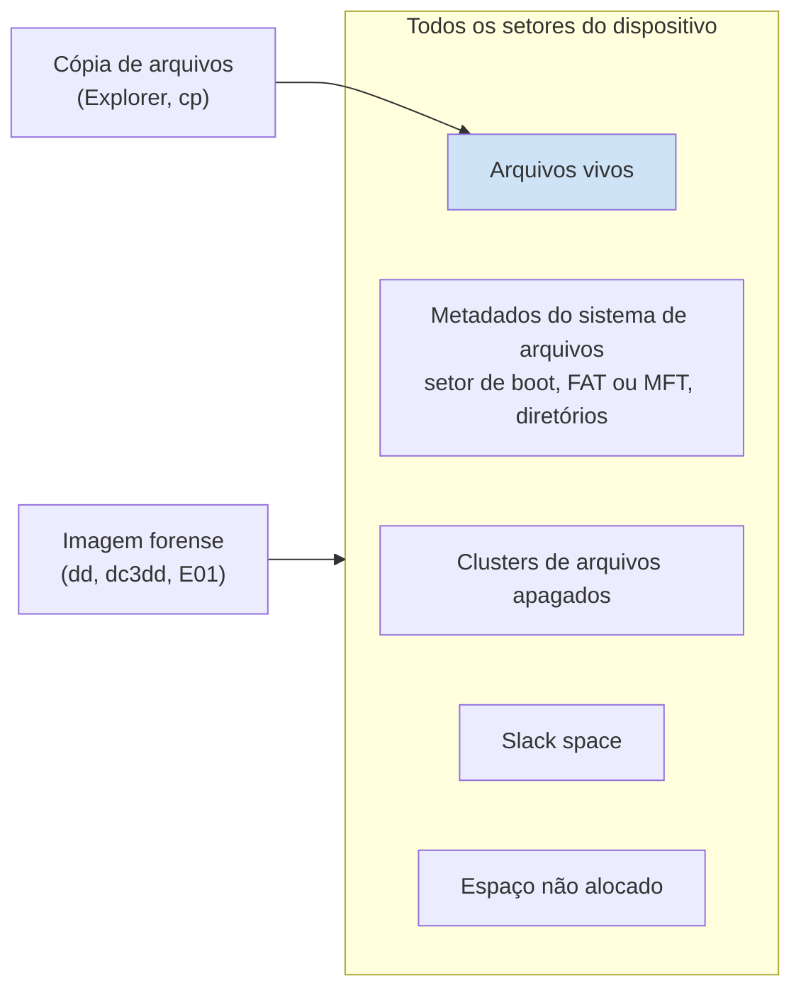
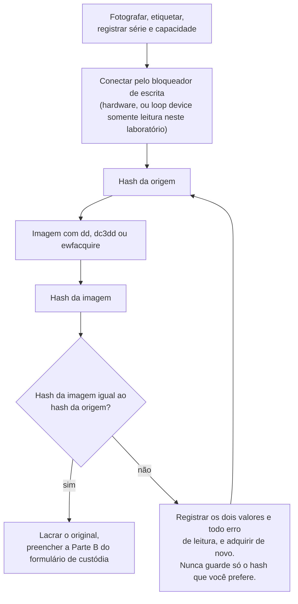
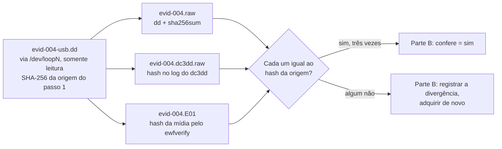

# Dia 50: Imagem de disco bit a bit

> 🇺🇸 Original: [*Day 50: Bit-for-bit disk imaging*](https://github.com/thiefdroppers/cyber-investigator-skills/blob/main/curriculum/phase-4-digital-forensics-incident-investigation/day-50.md) — © ThiefDroppers, licença MIT.
> Aqui: tradução fiel **+** camada brasileira. Nada do original foi removido; tudo o que é novo vem marcado com ➕.

**Fase 4. Forense digital e investigação de incidentes** · Meta da trilha: produzir uma imagem forense verificada de um dispositivo de armazenamento e um registro de aquisição que outro examinador conseguiria repetir.

Rank Jutsu: `B` · [](https://colab.research.google.com/github/Ridd1kulusC0d3r/investigador-cyber-90-dias/blob/main/curriculo/fase-4-forense-e-resposta/dia-50/dia-50.ipynb)

---

## 🎬 ➕ Abertura do caso — *Dois dispositivos na sacola*

Terça, 6 de outubro, 9h. Na sacola da TI da Serra Azul há o notebook `SA-CX-07`, desligado desde ontem às 14h45, e um pen drive azul com etiqueta "AG CENTRO" que estava espetado nele.

— Esse pen drive é da agência — explica o analista de TI por telefone. — Ela usa para levar a tabela de tarifas para o outro caixa.

Você já abriu o gerenciador de arquivos para "dar uma olhada" quando Rafa puxa o cabo.

— Se você espetar isso no seu Windows, ele escreve no pen drive. Aí a cópia que você vai jurar que é "do jeito que veio" já não é. Bloqueador de escrita, imagem, hash da origem, hash da imagem. E o notebook tem BitLocker: sem a chave de recuperação, a sua imagem é ruído criptografado.

Hoje você aprende a copiar um dispositivo inteiro, setor por setor, e a provar que a cópia é igual. *(Personagens e cenário: [Operação Isca](../../../caso-continuo/).)*

---

## 📖 Conceito

Uma imagem forense copia cada setor de um dispositivo, inclusive o espaço não alocado, o *slack space* e os metadados do próprio sistema de arquivos. Copiar arquivos pelo Explorer ou com `cp` pega só os arquivos vivos e altera os tempos de acesso na origem. Arquivos apagados, o conteúdo anterior de *clusters* reaproveitados e as estruturas que você vai interpretar amanhã ficam todos fora do que uma cópia de arquivos enxerga.

Três formatos de imagem cobrem quase todo o trabalho. Raw (também chamado dd, `.dd`, `.img`, `.001`) é uma cópia simples, byte a byte, sem metadados; toda ferramenta lê. O *EnCase Evidence File* (E01, "EWF") guarda os mesmos bytes comprimidos, em segmentos, com os dados do caso e um hash embutido; FTK Imager, `ewfacquire` e a maioria das suítes comerciais gravam nele. AFF4 é um formato aberto usado sobretudo para memória e aquisição em larga escala.

Antes que qualquer coisa leia a origem, um bloqueador de escrita fica entre ela e a sua estação. Bloqueadores de hardware (Tableau e similares) deixam passar comandos de leitura e descartam escritas. No Linux você pode marcar um dispositivo como somente leitura por software com `blockdev --setro /dev/sdX`, mas um bloqueio por software é evidência mais fraca que um de hardware, e suas notas precisam dizer qual você usou. Sistemas operacionais escrevem nos dispositivos que você conecta: o Windows pode criar `System Volume Information`, e um Linux de desktop pode montar automaticamente e atualizar o *journal*.

A aquisição só termina quando o hash da imagem bate com o hash da origem. Se um disco tem setores defeituosos, a ferramenta precisa registrar quais e o que gravou no lugar deles; uma divergência que você não consegue explicar é escrita, nunca ignorada.

Ordem das operações para um dispositivo desligado: fotografar e etiquetar, registrar número de série e capacidade, conectar pelo bloqueador de escrita, calcular o hash da origem, gerar a imagem, calcular o hash da imagem, comparar, lacrar o original e registrar cada passo com horário em UTC.

O que uma cópia de arquivos alcança, comparada com uma imagem:



A aquisição como um laço que só termina quando os hashes batem:



## 📚 Recursos

- [dc3dd](https://sourceforge.net/projects/dc3dd/) (o *fork* forense do dd feito pelo DoD Cyber Crime Center, com hash e log embutidos; empacotado no Debian/Ubuntu como `dc3dd`).
- [libewf / ewfacquire](https://github.com/libyal/libewf) (pacote `ewf-tools` no Debian/Ubuntu).
- [FTK Imager](https://www.exterro.com/digital-forensics-software/ftk-imager), gratuito, interface gráfica para Windows; o download exige cadastro.
- [Manual do GNU ddrescue](https://www.gnu.org/software/ddrescue/manual/ddrescue_manual.html), para mídia com falhas.
- Relatórios do NIST [*Computer Forensics Tool Testing* (CFTT)](https://www.nist.gov/itl/ssd/software-quality-group/computer-forensics-tool-testing-program-cftt) sobre ferramentas de imagem de disco.

### ➕ Recursos do contexto Brasil

- [Código de Processo Penal](https://www.planalto.gov.br/ccivil_03/decreto-lei/del3689compilado.htm), arts. 158-B (etapas "coleta" e "acondicionamento") e 159 (exame por perito oficial e assistente técnico).
- Microsoft, [*BitLocker recovery overview*](https://learn.microsoft.com/en-us/windows/security/operating-system-security/data-protection/bitlocker/recovery-overview): onde ficam as chaves de recuperação num ambiente corporativo (Active Directory, Entra ID). Notebooks corporativos no Brasil quase sempre vêm com BitLocker ligado.
- [Guymager](https://guymager.sourceforge.io/): ferramenta livre de aquisição com interface gráfica para Linux, que grava raw, E01 e AFF e calcula hashes durante a cópia; vem em distribuições forenses como a CAINE.

## 🛠️ Prática: dd, dc3dd e ewfacquire na evidência sintética EVID-004

Você precisa de uma máquina ou VM Linux (uma VM Debian ou Ubuntu serve). Instale as ferramentas:

```bash
sudo apt install dosfstools mtools dc3dd ewf-tools
```

**Seu checklist de hoje.** Faça na ordem e marque cada item ao terminar:

- [ ] Monte o "dispositivo" e registre o hash da origem.
- [ ] Conecte-o como somente leitura, por um bloqueador de escrita.
- [ ] Gere a imagem com `dd` e confira se o hash bate.
- [ ] Gere a imagem com `dc3dd` e confira o log dele.
- [ ] Gere a imagem E01 com `ewfacquire` e confira com `ewfverify`.
- [ ] Desconecte o *loop device*.
- [ ] Repita a aquisição no FTK Imager, se tiver Windows à mão.
- [ ] Escreva o parágrafo sobre divergência nas suas notas.
- [ ] ➕ Prática BR: plano de aquisição do notebook `SA-CX-07` (com BitLocker) e do pen drive "AG CENTRO".
- [ ] ➕ O notebook do dia: o `dd` em Python, setor defeituoso simulado e o registro de aquisição.

1. Monte o "dispositivo". [`resources/case-lab-p4/disk/make-evid-004.sh`](../../../upstream/curriculum/phase-4-digital-forensics-incident-investigation/resources/case-lab-p4/disk/make-evid-004.sh) cria `evid-004-usb.dd`, um volume FAT16 de 16 MiB com alguns arquivos financeiros inventados e um arquivo apagado. No trabalho real seria um pen drive físico; aqui o arquivo faz o papel dele.

   ```bash
   cd ~/lab-p4/evidence
   bash /path/to/repo/curriculum/phase-4-digital-forensics-incident-investigation/resources/case-lab-p4/disk/make-evid-004.sh
   chmod a-w evid-004-usb.dd
   ```

   O script imprime o SHA-256 do "dispositivo". Anote-o num formulário de custódia novo, do EVID-004, como hash da origem. O seu hash vai ser diferente do de outros alunos porque o FAT registra os horários de criação no momento da montagem. Tudo bem; o que importa é que os hashes da sua origem e da sua imagem batam entre si.

   > ➕ Neste repositório, o caminho é `upstream/curriculum/phase-4-digital-forensics-incident-investigation/resources/case-lab-p4/disk/make-evid-004.sh`.

2. Conecte-o como somente leitura, como você faria com um dispositivo real atrás de um bloqueador de escrita.

   ```bash
   sudo losetup --find --show --read-only evid-004-usb.dd     # imprime algo como /dev/loop3
   sudo blockdev --getro /dev/loop3                           # 1 significa somente leitura
   sudo blockdev --getsize64 /dev/loop3                       # 16777216
   ```

3. Gere a imagem com `dd` puro e confira.

   ```bash
   sudo dd if=/dev/loop3 of=~/lab-p4/work/evid-004.raw bs=64K conv=noerror,sync status=progress
   sudo sha256sum /dev/loop3 ~/lab-p4/work/evid-004.raw
   ```

   As duas linhas precisam mostrar o mesmo hash. Saiba o que as *flags* fazem: `conv=noerror` continua depois de um erro de leitura, e `sync` preenche o bloco que falhou com zeros para que os *offsets* seguintes continuem corretos. Com um `bs` grande, um único setor defeituoso zera o bloco inteiro; é por isso que discos falhando vão para o `ddrescue`, e por isso um tamanho de bloco pequeno é mais seguro com o `dd`.

4. Gere a imagem com o `dc3dd`, que calcula o hash e registra o log numa só passada.

   ```bash
   sudo dc3dd if=/dev/loop3 of=~/lab-p4/work/evid-004.dc3dd.raw hash=sha256 log=~/lab-p4/notes/evid-004.dc3dd.log
   cat ~/lab-p4/notes/evid-004.dc3dd.log
   ```

   O log lista o hash de entrada, o hash de saída e a contagem de setores. Confirme que o hash de entrada é igual ao do passo 1.

5. Gere a imagem E01 com o `ewfacquire` e verifique o contêiner.

   ```bash
   sudo ewfacquire -t ~/lab-p4/work/evid-004 -f encase6 -c deflate:best \
     -C LAB-P4 -D "EVID-004 synthetic USB image" -E EVID-004 -e "Your Name" \
     -N "Lab acquisition, loop device read-only" -d sha256 -u /dev/loop3
   ewfverify -d sha256 ~/lab-p4/work/evid-004.E01
   ewfinfo ~/lab-p4/work/evid-004.E01
   ```

   `-u` roda sem interação, com os valores informados; sem ele, o `ewfacquire` pergunta cada coisa. O `ewfverify` recalcula o hash da mídia armazenada e compara com o hash embutido na aquisição. O `ewfinfo` mostra os metadados do caso que você digitou.

6. Desconecte: `sudo losetup -d /dev/loop3`.

7. Se tiver Windows disponível, repita uma vez no FTK Imager: *File*, *Create Disk Image*, *Image File*, selecione `evid-004-usb.dd`, adicione um destino, escolha E01, preencha os campos do caso e marque *"Verify images after they are created"*. Guarde o log `.txt` que ele grava ao lado da imagem e compare a linha SHA-256 com a sua.

A aquisição terminada deve ter esta forma. Um hash de origem, três imagens, três comparações:



8. Nas suas notas, escreva um parágrafo sobre o que você escreveria no formulário se o hash da origem calculado depois da imagem não batesse com o calculado antes, e o que faria em seguida. (Dica: controladores de pen drive remapeiam blocos; diga o que observou, adquira de novo e não escolha discretamente o hash que você prefere.)

Artefato: um registro de aquisição do EVID-004 preenchido na Parte B do formulário de custódia, com três arquivos de imagem cujos hashes são todos iguais ao hash da origem, mais o log do dc3dd e a saída do `ewfinfo` salvos em `notes/`.

### ➕ Prática BR: plano de aquisição dos dois dispositivos da sacola

**Exercício 1: o notebook `SA-CX-07` (EVID-SA-002).** Escreva, antes de tocar em qualquer coisa, o plano de aquisição em até 10 linhas, respondendo:

1. O disco é um SSD NVMe com BitLocker. Você vai gerar a imagem do disco inteiro (cifrado) ou do volume aberto? Resposta que a Vigia adota: **as duas**, se possível. A imagem do disco cifrado é a cópia fiel do dispositivo; a do volume decifrado é a que permite análise. As duas têm hash próprio, e o formulário diz de onde veio a chave.
2. Quem fornece a chave de recuperação do BitLocker? (A TI da cooperativa, a partir do diretório corporativo. Registre quem entregou, quando e por qual canal. A chave é dado sensível: ela entra no formulário só como "fornecida por X às Y UTC", nunca escrita por extenso.)
3. Por que um SSD pode dar hashes diferentes em duas leituras da origem, mesmo sem ninguém escrever nele? (O controlador do SSD gerencia blocos por conta própria; setores marcados como livres pelo TRIM podem ser lidos como zeros. Regra do original vale igual: registre o que viu, adquira de novo, não escolha o hash.)
4. Bloqueador de escrita: hardware para NVMe, ou boot por um Linux forense com montagem desativada. Escreva qual e por quê.

**Exercício 2: o pen drive "AG CENTRO" (EVID-SA-004).** O notebook do dia monta um pen drive FAT16 sintético com o conteúdo da agência. Gere a imagem dele com o `dd` em Python, compare os hashes e preencha a Parte B do formulário (com a Parte E do Dia 49). No Linux real, os comandos seriam os mesmos dos passos 2 a 6, com o dispositivo físico no lugar do *loop device*.

### ➕ O notebook do dia

Abra o [notebook do Dia 50 no Colab](https://colab.research.google.com/github/Ridd1kulusC0d3r/investigador-cyber-90-dias/blob/main/curriculo/fase-4-forense-e-resposta/dia-50/dia-50.ipynb). Nele você:

1. monta, em Python puro, um volume FAT16 com os mesmos arquivos do `make-evid-004.sh` (e o arquivo apagado), já que o Colab não tem `mkfs.fat` nem `mtools` por padrão;
2. reimplementa o `dd if=... of=... bs=... conv=noerror,sync` com leitura em blocos e hash em paralelo, e compara origem e imagem;
3. simula **um setor defeituoso** e vê, com `bs=64K` e com `bs=512`, quantos bytes viram zero (a lição do `sync`);
4. compara uma "cópia de arquivos" com a imagem: quantos bytes do dispositivo a cópia de arquivos não alcança;
5. repete com o pen drive "AG CENTRO" da Serra Azul e gera a Parte B do formulário;
6. joga o **quiz da aquisição** (flags, formatos, o que fazer quando o hash não bate).

Há uma célula opcional com `!apt-get install sleuthkit dc3dd ewf-tools` para quem quiser rodar as ferramentas reais no Colab.

## ✅ Checkpoint

- Seu registro de aquisição lista o nome e a versão de cada ferramenta usada (`dc3dd --version`, `ewfacquire -V`).
- Seu registro de aquisição lista o comando exato de cada uma das três imagens.
- Seu registro de aquisição lista o hash da origem para cada uma das três imagens.
- Seu registro de aquisição lista o hash da imagem para cada uma das três imagens.
- Seu registro de aquisição tem uma entrada sim/não de "confere" para cada uma das três imagens.
- O `ewfverify` relata sucesso.
- Seu parágrafo do passo 8 diz para registrar a divergência como foi observada.
- Seu parágrafo do passo 8 diz para adquirir de novo.
- Seu parágrafo do passo 8 não escolhe nenhum dos dois hashes da origem como o correto.
- Sem consultar notas, você diz o que `conv=noerror` e `sync` fazem, cada um, num comando `dd`.

### ➕ Checkpoint BR

- Seu plano do `SA-CX-07` diz se a imagem é do disco cifrado, do volume decifrado ou das duas, e de onde veio a chave de recuperação, sem escrever a chave.
- Seu plano explica em uma frase por que um SSD pode dar dois hashes diferentes da origem.
- A Parte B do EVID-SA-004 tem hash da origem, hash da imagem e "confere = sim".
- No notebook, você explica por que `bs=64K` zerou 64 KiB e `bs=512` zerou só 512 bytes no setor defeituoso simulado.

## ⚖️ ➕ Camada jurídica BR

**Perito oficial e assistente técnico (CPP, art. 159).** O art. 159 diz que o exame de corpo de delito e as outras perícias são feitos por perito oficial, e o seu §3º faculta às partes formular quesitos e indicar assistente técnico. Na prática, uma imagem forense feita pela Vigia não substitui a perícia oficial se o caso for à Justiça; ela é o material do cliente, que pode ser entregue à autoridade e que um assistente técnico pode examinar. Por isso o registro de aquisição precisa ser **repetível**: o perito oficial vai querer refazer a conta e chegar ao mesmo hash.

**Etapas "coleta" e "acondicionamento" (CPP, art. 158-B, IV e V).** Gerar a imagem é coleta; guardar o original lacrado é acondicionamento. O registro de quem conectou o dispositivo, com qual bloqueador, e quando o lacre foi rompido e refeito, é o que mostra que a coleta não alterou o vestígio.

**LGPD.** O disco do `SA-CX-07` contém dados pessoais de cooperados (o sistema de caixa) e, possivelmente, dados pessoais da própria caixa. A imagem copia tudo, inclusive o que não interessa ao caso. A base legal do tratamento continua sendo a do Dia 1 (art. 7º, IX, legítimo interesse da cooperativa na prevenção à fraude, ou o exercício regular de direitos em processo, art. 7º, VI), e o princípio da necessidade (art. 6º, III) pede que a **análise** se limite ao que o caso exige, mesmo que a **imagem** seja completa. Escreva isso no plano.

> Material de estudo, não constitui orientação jurídica.

## 🧠 ➕ Camada 8 — a urgência que faz espetar o pen drive

A cena de abertura é real em quase todo time: o analista espeta o pen drive "só para ver". Daniel Kahneman descreveu dois modos de pensar: o **Sistema 1**, rápido, automático e guiado pelo hábito, e o **Sistema 2**, lento e deliberado. Espetar um pen drive é um gesto de Sistema 1, treinado milhares de vezes fora do trabalho forense. Sob pressão (três vítimas, a gerente ligando), o Sistema 1 ganha.

O antídoto não é "ter mais cuidado". É mudar o ambiente para que o gesto automático seja o certo: bloqueador de escrita já conectado na estação de análise, montagem automática desligada, um *checklist* físico colado no monitor ("série → bloqueador → hash origem → imagem → hash imagem"). O *checklist* de hoje do original é exatamente isso: Sistema 2 escrito com antecedência para o momento em que você só vai ter Sistema 1.

## 🤖 ➕ Skill do dia

O dia propõe acrescentar ao procedimento "Recebimento de evidência e cadeia de custódia" (Dia 49) três itens sobre aquisição: bloqueador de escrita, verificação do hash da imagem contra a origem e o que fazer quando não bate (inclusive SSD e BitLocker). Texto e caso de teste em [`_skill-delta.md`](_skill-delta.md).

## 💡 ➕ Inovação OSINT do dia — hash enquanto copia (o truque do `dc3dd`, em 10 linhas)

O `dc3dd` lê a origem uma vez só e calcula o hash enquanto grava a imagem. Em Python puro dá para fazer o mesmo com qualquer arquivo grande (uma imagem, um vídeo baixado de uma rede social para preservação, um dump de site):

```python
import hashlib

def copiar_com_hash(origem, destino, bs=1 << 20):
    h_in = hashlib.sha256()
    with open(origem, "rb") as src, open(destino, "wb") as dst:
        while bloco := src.read(bs):     # lê 1 MiB por vez
            h_in.update(bloco)           # hash do que ENTROU
            dst.write(bloco)
    with open(destino, "rb") as f:       # e confere o que SAIU, numa segunda leitura
        h_out = hashlib.file_digest(f, "sha256")
    return h_in.hexdigest(), h_out.hexdigest()
```

O hash "de entrada" prova o que você leu; o "de saída", lido de novo do disco, prova o que ficou gravado. Se os dois batem, a cópia é íntegra. Para preservação de conteúdo OSINT, é a diferença entre "eu baixei o vídeo" e "eu baixei o vídeo e provo que o arquivo de hoje é o mesmo que baixei".

## 📝 Diário de estudo

- Data:
- Tempo gasto:
- O que ficou claro:
- O que ainda está nebuloso:
- Artefato produzido: Parte B do EVID-004 com três imagens conferidas, `evid-004.dc3dd.log`, saída do `ewfinfo`, plano de aquisição do `SA-CX-07`, Parte B do EVID-SA-004

---
<sub>Baseado em [cyber-investigator-skills](https://github.com/thiefdroppers/cyber-investigator-skills) por ThiefDroppers (MIT). Tradução, camada BR, Camada 8, skill pt-BR e notebook por Deivison Lourenço (@Ridd1kulusC0d3r).</sub>
